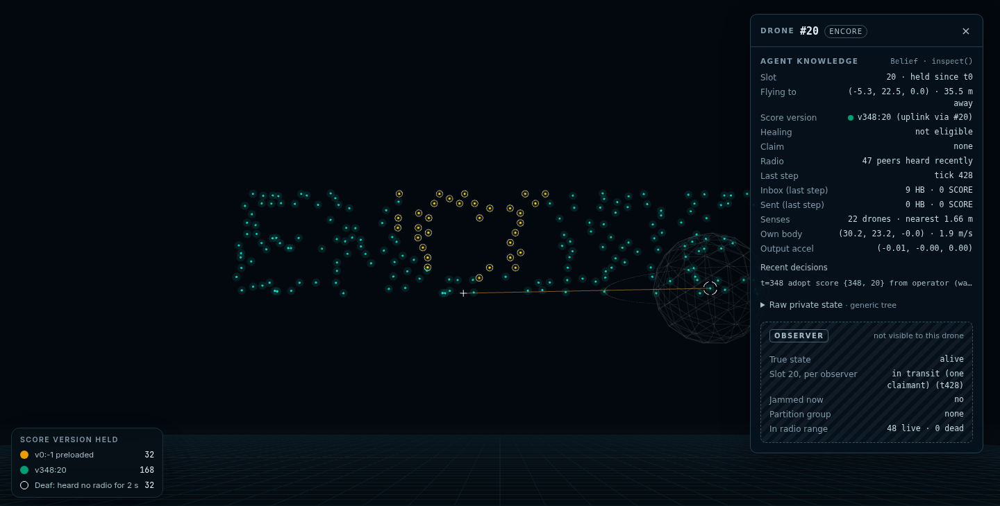
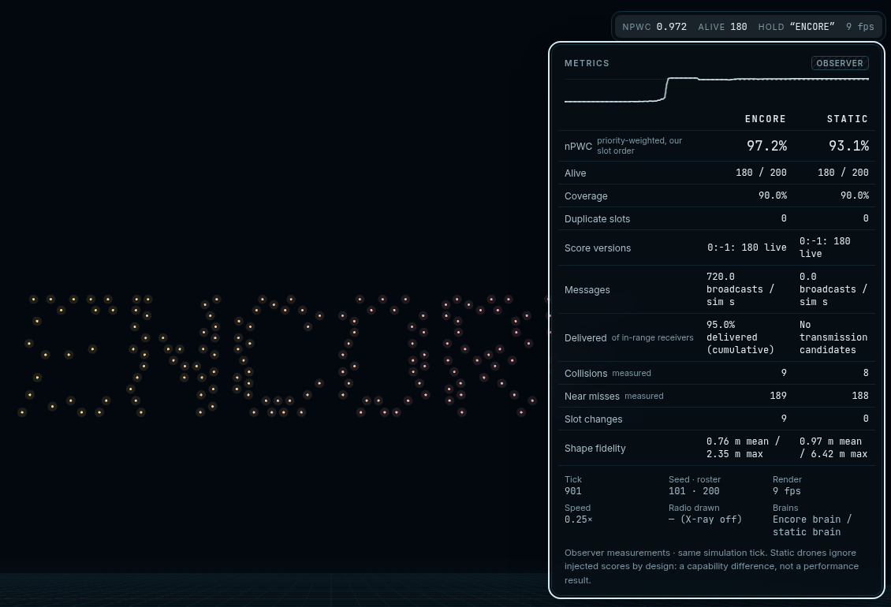
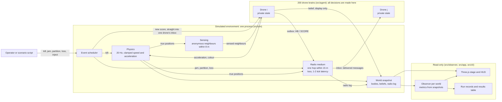
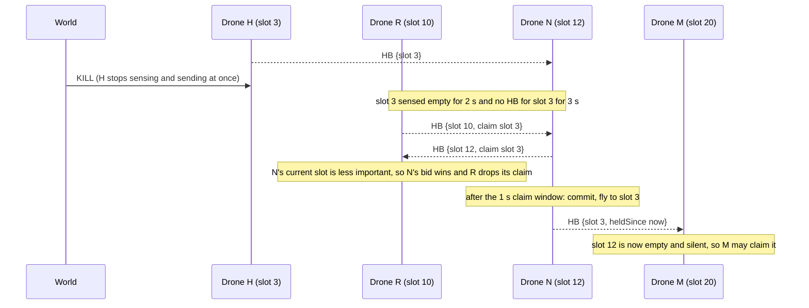
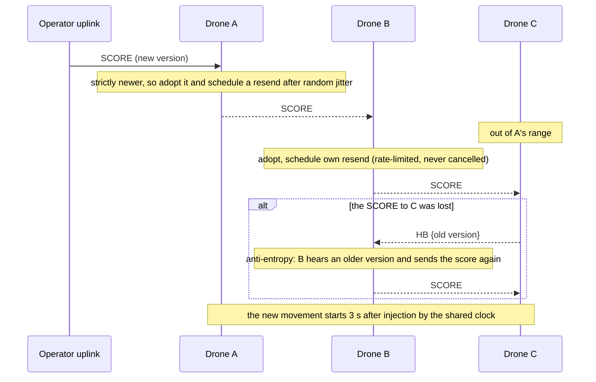

<p align="center">
  
</p>

# Encore

**A composition of independent minds.** Encore is a drone light show with no conductor during the performance. In a 3D browser simulation, each of 200 drones decides for itself, using only its own position, what it senses nearby and what it hears on short-range radio. When drones fail, nearby survivors move into the more important parts of the picture. When a new composition reaches one drone, it spreads drone to drone. A conventional pre-programmed show flies alongside from the same seed and gets the same failures.

**Result, 5 of 5 seeds:** after 20 neighbouring drones are killed, the largest gap in Encore's picture shrinks back to 2.4 m while the static show keeps a 7.0 m hole. It costs 4 radio messages per drone-second, and in one reconnection scenario many more collisions ([evidence](#evidence)).

Built at **DurHack 2026** (Durham, 14–15 November). Software only: no real drones or hardware, and no network access at run time. It runs offline in a browser on one laptop.

**[Run it](#run-it)** · **[90-second tour](#a-90-second-tour)** · [How it works](#how-encore-works) · [Evidence](#evidence) · [Tests](#tests-and-reproducibility) · [Docs](#documentation)

<p align="center">
  
</p>
<p align="center"><sub>Recorded from the app with <a href="docs/assets/readme/capture.mjs"><code>capture.mjs</code></a>: seed 101, the same 20 drones killed at 20 s in both worlds. Top: Encore. Bottom: the static show. Two runs of the same seed and kill, one per view; frames are cropped, labelled and stacked, not retouched. One frame every 0.6 s of simulated time.</sub></p>

---

## The question

A drone show is one picture made by hundreds of machines. Most shows are pre-programmed: each drone flies its own precomputed path from a show file ([Skybrush](https://docs.skybrush.io/public/faq/latest/overview.html) works this way), and a ground station handles setup and abort, not real-time control. If a drone drops out, its part of the picture is simply missing.

> *Can independent agents keep a coherent shared performance when their information and their communication are imperfect?*

Encore explores that question in simulation. Each drone gets the same preloaded score, roster size and algorithm, and reads a shared show clock. From then on it acts only on that, its own body, and what it can sense and hear. There is no central controller during the show. The environment can break things: kill drones, jam the radio, cut the swarm in two, drop packets. Every metric is measured against a pre-programmed baseline flying the same show, with the same seed and the same failures.

Encore invents no new algorithm. It combines known ideas (gossip, local failure suspicion, priority slot claims) into an inspectable drone-show simulation that you can break, and it compares measured recovery against a static pre-uploaded baseline.

## What you can see and do

<p></p>

**Stage.** Two worlds in lockstep from one seed: Encore above, the static show below (<kbd>B</kbd> cycles Encore, Split and Static). Both get every event. The readout at the top right compares them on the same tick.

<p></p>

**Inspect** (<kbd>C</kbd>, click a drone). Each drone is coloured by the score version it believes. Here a jam (<kbd>J</kbd>, 12 m around a drone in the middle of the word) has made 32 drones deaf; they are ringed and still believe the preloaded score. A new composition injected into drone 20 through the Composer has reached the other 168. The inspector shows what drone 20 itself knows, with the observer's ground truth kept in a separate box.

<p></p>

**Measure** (<kbd>M</kbd>). One read-only observer per world computes every number from the world's snapshots: coverage, shape and collisions from true positions, slot and version counts from what each drone reports it believes. Here Encore has refilled its important slots after a regional kill and the static show has not; plain coverage is 90.0% in both.

The dock at the bottom also opens the Composer (<kbd>F</kbd>), a command console (<kbd>/</kbd>), the show timeline (<kbd>T</kbd>) and ghost-slot rings (<kbd>G</kbd>). The full key map is in the [tour](#a-90-second-tour).

## What it does

**Simulation and 3D view**
- A deterministic 20 Hz world: 200 drones with clamped speed and acceleration, ideal short-range sensing and a radio with range, packet loss and latency ([`src/sim`](src/sim)).
- A preloaded show: the word ENCORE, then a sphere, then a double helix, with paced flight between formations.
- Three.js stage with orbit camera and three presets, a split view (<kbd>B</kbd> or `?split=1`), a drone inspector, a composer, a command console, a show timeline and a 90-second scripted demo (<kbd>D</kbd>).

**Decentralised behaviour** ([`src/agent/encoreBrain.ts`](src/agent/encoreBrain.ts))
- One brain per drone, with private state. It sees only its own body, its inbox and anonymous neighbours.
- **Local repair:** a drone that senses an important slot empty, and hears nobody holding it, claims it over the radio. The best bid wins, and the drone flies in. Low-priority detail around the hole is given up, so that part of the picture thins instead of keeping a hole.
- **Score dissemination:** a new composition reaches one drone and spreads by store-and-forward gossip, rate-limited, with anti-entropy for drones that missed it.
- **Silence is not death:** radio silence alone never makes a vacancy. A drone that has heard no other drone for 2 s counts as deaf: it drops its claim and starts none, though a claim that completes within those first 2 s can still commit.

**Disruption you can apply**
- Kill a region, a selected drone or a random 10%; jam the radio around a drone; partition the swarm along a plane; set packet loss from 0 to 100%; inject a new composition into one drone.
- Every disruption goes to both worlds as the same environment event. The interface can never set a drone's slot, target or belief.

**Measurement**
- A read-only observer per world: priority-weighted coverage (nPWC), plain coverage, shape error, duplicate slots, slot changes, messages and deliveries, collisions and near-misses, and score versions.
- A headless batch runner for scenarios S0–S5, which writes replayable JSON run records and a results table ([`src/cli`](src/cli)).

## How Encore works

Two parts of the program are easy to confuse. The **environment** is centralised: one process simulates physics, sensing, the radio and the faults, and the observers measure everything. The **decisions** are not: each drone runs its own instance of the brain, sees only its own input, and can affect other drones only by radio messages and by where it flies (one brain module runs every drone, each with its own private state). This split is enforced by tests, not by convention ([`tests/boundaries.test.ts`](tests/boundaries.test.ts), [`tests/isolation`](tests/isolation)).



### What each drone knows

| A drone gets | A drone never sees |
|---|---|
| The shared show clock and its own position and velocity | Other drones' ids, slots, state or beliefs, except what they broadcast |
| Messages delivered to it this tick | Who is alive: ground truth lives only in the world and the observer |
| Neighbours within 8 m, as relative position and velocity, with no id and no slot | Jam or partition geometry, lost packets and wall-clock time |
| At start: its id and launch slot, the roster size, the preloaded score, the parameters and a private random seed | Any other drone's output from the same tick |

Drones exchange only two kinds of message, both one-hop broadcasts within 15 m. A **heartbeat** (`HB`, 4 times a second) carries the sender's id and position, the slot it holds, when it took it, the score version it flies and, while it is claiming, the slot it wants with its current slot as the bid. A **`SCORE`** message carries a whole composition. The radio never relays. Spreading across the swarm is the drones' own doing.

### Repair: from a failure to a refilled slot

Slots are numbered by importance. The formation is ordered by farthest-point sampling, so any prefix of the slots is an evenly spread version of the shape. When a drone fails:

1. **Detect.** A neighbour within 6 m senses the slot empty for 2 s *and* has heard no heartbeat holding it for 3 s. Silence alone is not enough.
2. **Gate.** On its own heartbeat ticks, the neighbour may act only if it has been settled at its slot for 1 s, the formation has been in a hold for at least 2 s, its target has been stable for 6 s, every drone it heard in the last 2 s flies the same score version, and it has heard *someone* in the last 2 s.
3. **Claim.** It announces a claim in its heartbeats for 1 s. If two drones want the same slot, the one whose current slot is least important wins; on a tie, the lower id wins. Claims only ever move a drone to a more important slot.
4. **Commit and fly.** The winner takes the slot and flies there. Its old, less important slot may in turn be claimed by a nearby drone holding an even less important one, so the vacancy moves down the priority order, one short hop at a time, until it sits in a low-priority slot that nobody nearby wants.
5. **Recover from mistakes.** If two drones end up holding one slot, the earlier holder keeps it once they hear each other, and the other drone returns to its previous slot. A drone that sees its target already occupied gives way.

<details>
<summary><b>Sequence diagrams: repair and score dissemination</b></summary>

Repair, simplified: H holds an important slot and fails. N and R are neighbours; M is further out.



Score dissemination, as tested in T18: A and C are 20 m apart, out of radio range; B sits between them.



</details>

<details>
<summary><b>Parameters (contract defaults at 200 drones)</b></summary>

| Parameter | Value | Meaning |
|---|---|---|
| Tick | 50 ms (20 Hz) | Simulation step |
| `rSense` / `rRadio` / `rClaim` | 8 m / 15 m / 6 m | Sensing range / radio range / furthest slot a drone may claim |
| `hbPeriod` | 5 ticks (0.25 s) | Heartbeat period |
| `tVacant` / `tSuspect` | 2 s / 3 s | Slot must be sensed empty / unheard for this long |
| `claimWindow` | 1 s | Contention window before commit |
| `claimGap` | 6 slots | Claim only a slot at least 7 places more important |
| `tStable` / `tDeaf` | 6 s / 2 s | Target stability before repair / silence that makes a drone "deaf" |
| `scoreResendMin` / `scoreLead` | 2 s / 3 s | Minimum gap between a drone's SCORE sends / lead time of a new movement |
| `loss` / latency | 5% / 1–2 ticks | Default per-receiver packet loss / radio latency |
| `vMax` / `aMax` | 8 m/s / 8 m/s² | Speed and acceleration limits |

All values: [`src/contracts/params.ts`](src/contracts/params.ts), explained in [contracts and algorithms](docs/design/contracts-and-algorithms.md).

</details>

### The baseline, and why the comparison is fair

The **static baseline** models a pre-uploaded show. Each drone keeps its launch slot for the whole show, flies the preloaded score, never reads its inbox and sends nothing. Both brains use the same steering and paced-flight code. In both the app and the batch runner, the two worlds share the seed, parameters, preloaded score, scripted events, world code and observer code. **Only the brain differs.** In the app, a region kill is resolved once to drone ids from the Encore world's positions, and the same ids die in both worlds; after Encore has moved drones, a later region kill can remove drones from different places in the static world. The results table counts a seed as a fair pair only if commit, parameter hash and events all match.

The baseline is the floor for message cost (zero) and is immune to radio faults by construction. Encore pays for its adaptivity with messages, slot changes and some extra near-misses; [the evidence](#evidence) reports those costs beside the wins.

## Evidence

Fifty headless runs: five scenarios × seeds 1–5 × both brains, 200 drones, 90 s of simulated time each. Every run starts from commit `571c8e4` with a frozen parameter set (SHA-256 `6342c662…`). The full generated table, per-seed rows and hand-written notes are in [`results/RESULTS.md`](results/RESULTS.md).

**nPWC** (normalised priority-weighted coverage) is the share of the picture's importance covered by live drones, divided by the best the surviving drones could achieve. It uses our own priority order, so the table also gives plain coverage and the largest gap in metres, which use no labels. The win rule and pass lines were registered in the [evaluation plan](docs/validation/evaluation-and-tests.md#3-scenarios) before the run.

<p align="center">
  
</p>
<p align="center"><sub>The chart covers the ENCORE hold, 15–45 s, from the 10 S2 run records (<a href="docs/assets/readme/make-charts.mjs"><code>make-charts.mjs</code></a>). The table below measures nPWC later, at 85–90 s, in the next formation.</sub></p>

| Scenario (200 drones, seeds 1–5) | nPWC at 85–90 s, static → Encore (median) | Win / tie / loss | What else the records show |
|---|---|---|---|
| **S0** no failures | 1.000 → 1.000 | 0 / 5 / 0 | Encore makes 0 slot changes and sends 4.0 messages per drone-second; static sends none |
| **S1** 20 random drones killed at 20 s | 0.912 → 0.997 | **5 / 0 / 0** | Plain coverage ties at 0.900. Encore recovers in a median 5.25 s; static never reaches the recovery line on any seed |
| **S2** 20 neighbouring drones killed at 20 s | 0.909 → 0.997 | **5 / 0 / 0** | Largest gap in the picture 7.03 m → 2.39 m (median, 40–45 s). Encore recovers in a median 9.25 s, flight included |
| **S3** partition for 30 s, then a 15 s jam, no failures | 1.000 → 1.000 | 0 / 5 / 0 | Encore makes 0 slot changes; 27% of its per-receiver deliveries fail (blocked or lost), against 5% with no radio faults |
| **S5** partition, new score injected on one side, reconnect | no verdict | — | All 200 Encore drones adopt the new score; static cannot (a capability difference, not a win). All live Encore drones agree on one score 0.30–0.45 s after reconnection. **Cost: 103 collisions against 14**, though the two worlds fly different formation changes here ([#123](https://github.com/durhacko/Pihh/issues/123)) |

<details>
<summary><b>How these numbers are defined and computed</b></summary>

- **nPWC** (normalised priority-weighted coverage): the share of slot importance that is physically occupied by a live drone, divided by the best that the surviving drones could achieve. A slot counts as occupied if any live drone's true position is within 0.6 m of it. It uses our own priority order, so read it beside **plain coverage** (occupied slots / 200) and **sfMax**, the largest distance from any point of the target shape to the nearest live drone, which uses no labels at all.
- **nPWC at 85–90 s** is the mean over ticks 1700–1799, in the hold of the show's second formation (a sphere), after a formation change. On the damaged ENCORE itself (40–45 s, as in the chart) the medians are S1 0.912 → 0.987 and S2 0.909 → 0.969. **Win** if Encore − static > +0.02 on that seed, **loss** if < −0.02, tie otherwise. Pairs are by seed.
- **Recovery time** (`tRec`): seconds from the kill to the start of the first 3 s stretch with nPWC ≥ 0.95, in a hold. A run that never gets there is *censored*: static in S1 and S2, all 5 seeds.
- **Collisions** are entry events below 0.4 m between live drones, sampled at 20 Hz, so they are lower bounds. They have no physical effect in the simulation.
- **Replay:** run records hold no wall-clock values. One Encore record per scenario was re-run from the same commit and gave an identical state hash, summary and series.
- **Scale and speed:** 5 seeds per cell, so no significance tests. The chart and the ranges quoted here are min–max across seeds; RESULTS.md reports medians with interquartile ranges. Ten 90-second runs of one scenario took 117–133 s headless, one process per scenario, on a shared 16-core laptop.
- **Not run yet:** S4 (partition plus kill), seeds 6–20 and the 100-drone repeat.

</details>

**Where Encore ties or costs more.** It ties when nothing fails (S0) and when only the radio fails (S3). It always sends more: 4 messages per drone-second against none. Repairs cost a median of 25 (S1) and 33 (S2) slot changes per run, at most 2 per drone. It has slightly more collisions after a kill (17 and 16 against 14). In S5 it has many more (103 against 14, with the two worlds flying different formation changes), because the half of the swarm that adopts the new score after reconnection joins a formation change already in progress at close to full speed ([#123](https://github.com/durhacko/Pihh/issues/123)). nPWC wins rest on our own slot order; plain coverage ties by physics, because both worlds lose the same drones.

**Gate tests.** The pre-registered healing tests (G1) and dissemination tests (G4) run in CI on the real world, the real radio and the real Encore brain. Details are in the [test section](#tests-and-reproducibility).

## Run it

You need **Node.js 22.12 or later** and a browser with WebGL. No drones, accounts, keys or network access are needed after install.

```bash
git clone https://github.com/durhacko/Pihh.git encore
cd encore
npm ci            # once; the only step that needs the internet
npm run build
npm run preview
```

Open **http://127.0.0.1:4173/?seed=101&split=1**, or the address Vite prints if port 4173 is taken. On Windows PowerShell, use `npm.cmd` if the execution policy blocks `npm`. On WSL, run npm from a Linux path (`cd ~/...`), not from a `\\wsl.localhost\...` path in Windows. `npm ci` may print deprecation and `npm audit` warnings about development tools; they don't affect the build (`npm audit --omit=dev` reports none).

For development with hot reload: `npm run dev`, then open the printed address (Vite's default is port 5173).

| URL option | Effect |
|---|---|
| `?seed=N` | Reproducible seed (default 1) |
| `?split=1` | Encore on top, static below, one camera |
| `?arm=static` | Single view of the static world |
| `?q=low` | Lower pixel ratio for slow machines |
| `?n0=100`, `150` or `200` | Roster size (default 200; other values are ignored) |

## A 90-second tour

1. **Open** `/?seed=101&split=1`. Encore is on top and the static show is below; both launch into the word ENCORE.
2. **Press <kbd>D</kbd>** to run the scripted demo. It drives the same controls you have, on fixed ticks from seed 101:

   | Time | What happens |
   |---|---|
   | 0 s | Launch into ENCORE |
   | 12 s | X-ray on: a sample of real radio deliveries is drawn |
   | 20 s | 20 drones in the first E are killed in both worlds. In the top world, neighbours claim the vacated important slots |
   | 48 s | The swarm starts re-forming as the preloaded sphere |
   | 61 s | A jam over the sphere's cap; belief colours on |
   | 64 s | A new composition (a helix) is injected into one drone. Playback slows to 0.5× for 3 s. It spreads by radio and reaches drones inside the jam only when the jam lifts at 73 s. The static world can't adopt it |
   | 90 s | End. Press <kbd>D</kbd> to run it again |

3. **Break it yourself.** Click a drone in the Encore view to select it (the inspector opens), then:

   | Key | Action |
   |---|---|
   | <kbd>K</kbd> | Kill every drone within 8 m of the selected one. With nothing selected, click where the centre should be |
   | <kbd>J</kbd> | Jam the radio within 12 m of it, or click a centre if nothing is selected. Press <kbd>J</kbd> again to lift the jam |
   | <kbd>P</kbd> | Partition the swarm along the plane x = 0 (press again to reconnect) |
   | <kbd>I</kbd> or <kbd>F</kbd> | Open the Composer: choose text, sphere or double helix, pick the target drone, then press **Inject**. Nothing is sent until then |
   | <kbd>X</kbd> / <kbd>C</kbd> | Radio X-ray: a sample of the radio messages actually sent (3 receivers of every 4th heartbeat), plus each drone's line to its flight target (the Tethers lens, which you can turn off under Lenses) / colour drones by the score version they believe |
   | <kbd>Space</kbd> / <kbd>R</kbd> | Play or pause / reset to the seed |
   | <kbd>[</kbd> <kbd>]</kbd> | Slower or faster (0.25× to 4×) |
   | <kbd>1</kbd> <kbd>2</kbd> <kbd>3</kbd> | Camera: front, ¾, top |
   | <kbd>.</kbd> | Step one tick |
   | <kbd>B</kbd> | Cycle Encore → Split → Static |
   | <kbd>M</kbd> | Metrics: both worlds compared, including which brain each world flies |
   | <kbd>G</kbd> / <kbd>T</kbd> | Ghost slots (observer view) / show timeline |
   | <kbd>/</kbd> or <kbd>`</kbd> | Command console (for example `inspect 20`) |
   | <kbd>D</kbd> / <kbd>?</kbd> | Scripted demo / help |
   | <kbd>H</kbd> | Hide or show all controls (performance view); <kbd>Esc</kbd> brings them back |

   The **Disrupt** popover in the dock has *Destroy a region*, *Kill selected drone*, *Kill 10% at random*, jam, partition, the region and jam radii, and packet loss as a slider (0–100% in steps of 5).
4. **Read the numbers.** The readout at the top right shows nPWC (Encore / static in split view), alive drones, the hold or transition phase and fps. Click it or press <kbd>M</kbd> for **Metrics**: alive, coverage, duplicate slots, score versions, messages, deliveries, collisions, near misses, slot changes, shape fidelity, and the brain each world flies.

Try killing a region, then compare the two worlds' nPWC 15 seconds later. Then jam a region and inject a composition just outside it, with belief colours on (<kbd>C</kbd>). A jam holds the new score back only from drones that stay inside it: a drone that flies out of the jam can adopt it, and the rest catch up when the jam lifts.

## Tests and reproducibility

```bash
npm ci
bash scripts/check.sh     # typecheck, lint, all tests, production build, docs link check
npm test                  # tests only
```

CI runs `scripts/check.sh` on every pull request and on pushes to `main` (Node 24.11.0). On Windows, run `check.sh` from Git Bash, or run `npm run check` and then `python scripts/check_links.py`.

| What is tested | Where |
|---|---|
| **Isolation.** `src/agent` imports only contracts and score; the core imports no `three` and no DOM; brains use no clock and no `Math.random` | [`tests/boundaries.test.ts`](tests/boundaries.test.ts) (T01) |
| **Locality (T02), order independence (T03) and replay (T04)** on the real world for every brain, including the real Encore brain. **T05:** a full-show jam leaves the static baseline unchanged | [`tests/isolation`](tests/isolation) (T02–T05) |
| **Healing gate G1.** 40 drones on a text formation, real world, real radio at 20% packet loss, real Encore brain, contract parameters for 40 drones with no overrides, seeds 1–5 and 101–105. Null run: no slot changes. Clumped kill of 5: final nPWC above static, no duplicate lasting over 3 s, at most 3 commits per kill, every commit to a more important slot, no commits in the last 10 s. 35 s full jam: no slot changes | [`tests/g1`](tests/g1) (T08–T10) |
| **Dissemination gate G4.** Two-hop relay; all 200 drones adopt at 20% loss; nothing crosses a jam or partition until it lifts; after a partition the later version wins everywhere | [`tests/g4`](tests/g4) (T16, T18) |
| **The brains in detail.** Every repair gate, claim contention, duplicate resolution, physical yield, gossip rules | [`tests/agent`](tests/agent) |
| **World, radio and faults.** Loss statistics, latency, jam, partition, injection, collision accounting | [`tests/sim`](tests/sim) |
| **Observer, scenarios and runner.** Metric definitions, read-only observer, replayable run records, fair-pair rule | [`tests/observer`](tests/observer), [`tests/cli`](tests/cli) |
| **App.** Controls, readout and Metrics, X-ray, belief colours, inspector, composer, console, timeline and scripted demo, against a fake DOM in Node | [`tests/app`](tests/app) |

To re-run the evidence, check out the evidence commit and write to a new directory (about 10 minutes for all five scenarios in one process):

```bash
git checkout 571c8e4 && npm ci
npm run eval -- --scenario min --seeds 1-5 --arms static,encore --n0 200 --out rerun/
npm run eval -- --report rerun/    # compare with the generated part of results/RESULTS.md
```

Don't write into `results/`: it holds the committed records and hand-written notes, and the runner refuses to overwrite a record from a different commit or parameter set. From the same commit, a re-run gives an identical state hash. In the browser, `window.encore.stateHashes()` returns each world's state hash, so two loads with the same seed and the same actions can be compared.

**Not covered:** there are no browser, GPU or end-to-end tests. The isolation mutation check ([`tests/isolation/check-mutations.mjs`](tests/isolation/check-mutations.mjs)) runs by hand, not in CI. Repair is gated at 40 drones; at 200 drones it is measured by the evidence run but not asserted in a test. Across all 40 kill centres of seed 1, 2 still finish their last repair just after the 20 s quiet limit (20.2 s).

## Neptune North challenge and sponsor tools

Encore was built for the **Neptune North** challenge at DurHack 2026, with the event theme **Composition**: drones compose an image, and a timed score composes images into a show. Neither the challenge brief nor the theme wording was published online. We address both as they were reported to the team, and we don't claim to meet a brief we could not read ([event notes](docs/competition/BRIEF.md)).

The engineering claim it supports is narrow and checkable. Independent actors, each with local sensing, one-hop radio, a shared clock and a preloaded score, keep a recognisable shared picture through the failures and radio faults we tested. Low-priority detail is given up, so the picture thins rather than keeping a hole. Each drone reports its last 20 decisions, which the inspector shows beside the observer's ground truth.

**Sponsor APIs: none are used.** Encore makes no network calls at run time, by requirement ([NFR-04](docs/specification/requirements.md)). There is no Gemini, MongoDB or TigerData integration. A design for Gemini-generated formations has been proposed ([#117](https://github.com/durhacko/Pihh/issues/117)) and is not implemented.

## Built with

| | Exact version ([`package.json`](package.json)) | Used for |
|---|---|---|
| [TypeScript](https://www.typescriptlang.org/) (strict) | 5.9.3 | All code; its parser powers the import-boundary test |
| [Three.js](https://threejs.org/) | 0.181.1 | 3D rendering (WebGL) and orbit controls |
| [Vite](https://vite.dev/) | 7.2.2 | Dev server, build and preview |
| [Vitest](https://vitest.dev/) | 4.0.9 | Tests |
| [ESLint](https://eslint.org/) and [typescript-eslint](https://typescript-eslint.io/) | 9.39.1 / 8.46.4 | Lint; bans DOM, network, clock and `Math.random` in the simulation core |
| [tsx](https://tsx.is/) | 4.23.15 | Runs the headless batch runner |
| `@fontsource-variable/inter`, `@fontsource-variable/jetbrains-mono` | 5.2.8 | Offline UI fonts (Inter, JetBrains Mono) |

Also: `@types/node` 24.10.1 and `@types/three` 0.181.0. Python 3 (standard library only) runs the docs link checker. GitHub Actions runs CI. The simulation core (`src/contracts`, `src/score`, `src/agent`, `src/sim`, `src/observer`) has no runtime dependencies.

```text
src/contracts/   shared types and parameters (the boundary between drone and world)
src/score/       compositions -> priority-ordered formation slots
src/agent/       drone brains: Encore, the static baseline, shared steering
src/sim/         the world: physics, sensing, radio, environment events
src/observer/    read-only metrics
src/app/         Three.js app: stage, dock, readout and Metrics, X-ray, inspector, composer, console, timeline, scripted demo
src/cli/         headless scenarios, batch runner, results table
```

## Documentation

| | |
|---|---|
| [System architecture](docs/design/system-architecture.md) | Components, the information rules, the tick, the two-world comparison |
| [Contracts and algorithms](docs/design/contracts-and-algorithms.md) | Types, parameters, messages, composition format, the repair algorithm, motion, baseline |
| [Evaluation and tests](docs/validation/evaluation-and-tests.md) | Metrics, scenarios S0–S5, fairness rules, pre-registered pass lines, test list |
| [Results](results/RESULTS.md) | The generated results table, provenance and hand-written notes |
| [Experience and demo](docs/design/experience-and-demo.md) | Views, layers, controls and the scripted demo |
| [Requirements](docs/specification/requirements.md) | Requirements with acceptance checks, including the claims we must not make |
| [Decisions and risks](docs/planning/decisions-and-risks.md) | Architecture decision records and the risk register |
| [Evidence and assumptions](docs/context/evidence-and-assumptions.md) | Prior art and every simplifying assumption |
| [Docs index](docs/INDEX.md) | Everything else, including the team workflow |

## Limitations

- **A simulation, not flight software.** The drones are logically separate agents in one process, with isolation enforced by tests. Sensing is ideal, the radio is a range-limited sphere with random loss and latency, the clock is shared, and there is no wind, drag or physical collision response. Nothing here has flown.
- **Repair is local and greedy.** A hole is noticed only by drones within 6 m that can sense it. A wiped-out region heals inward from its rim, and an island that no survivor can sense is never detected. Low-priority detail is given up, so the image thins instead of staying whole.
- **Repair is deliberately slow and sometimes paused.** It takes about 3 s to detect a vacancy and 1 s to contend, plus flight. Repair waits during formation changes, inside a jam, and for 6 s after any new score.
- **Partitions can keep two scores alive** until the halves reconnect, and a partition during a formation change looks like mass failure to the half left behind.
- **Collisions are counted, not prevented,** and the counts are lower bounds.
- **Drones are assumed honest.** Any drone can inject a score, and messages are not authenticated. Drones that fail vanish; a drone that fails but stays in place is not modelled.
- **The evidence is small.** Five seeds per scenario at one swarm size and one parameter set.

**Next steps.** Fix the reconnection collisions ([#123](https://github.com/durhacko/Pihh/issues/123)). Run the full matrix: S4, seeds 6–20 and 100 drones. Add a central-controller baseline beside the static one.

## Team and credits

Built at DurHack 2026 by **Arnav Chitriv** ([@reverez](https://github.com/reverez)), **William Pimentel** ([@wpimento](https://github.com/wpimento)) and **Haris** ([@sirahmo](https://github.com/sirahmo)). Who did what is recorded in the [issues](https://github.com/durhacko/Pihh/issues?q=is%3Aissue) and [pull requests](https://github.com/durhacko/Pihh/pulls?q=is%3Apr).

**AI use** (credited as required by the event rules, [BRIEF R4](docs/competition/BRIEF.md#4-submission-and-rules)). Most of the code and documentation in this repository was written by AI coding agents, directed by the team. The team chose the idea, made the design decisions, split the work into GitHub issues and decided what to merge.
- **Claude Code** (Anthropic; Claude Opus 5.5 and Claude Fable 5.2 models) ran in Arnav's sessions, including an orchestrator session that handed issues to parallel worker sessions. It did the contracts, score, steering and baseline, the Encore brain and its G1 tests, score gossip, the app integration, the scripted demo, the interface modules, the evaluation runner and the evidence run, and most of the documentation. Commits carry a `Co-Authored-By: Claude …` trailer.
- **OpenAI Codex** ran in William's and Haris's sessions, as reported by the team. It did the scaffold and CI, the world and radio faults, the renderer and X-ray layers, the controls, the observer, the isolation tests and the comparison HUD. Codex adds no commit trailer.
- **GitHub Copilot** is credited as co-author on the initial scaffold commit.

Prior art that shaped the design is listed in [evidence and assumptions](docs/context/evidence-and-assumptions.md). The 5×7 dot font, all images and the diagrams in this README were made for this project. The banner is drawn with the app's own formation font by [`make-hero.mjs`](docs/assets/readme/make-hero.mjs), and the chart is drawn from the run records by [`make-charts.mjs`](docs/assets/readme/make-charts.mjs).

## License

[Apache License 2.0](LICENSE).
