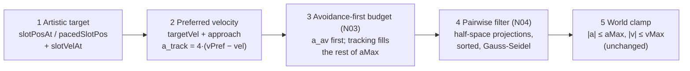

# Adaptive recovery and safety RFC

> **STATUS: PROPOSED — NOT IMPLEMENTED.** Nothing in this RFC is built, approved or scheduled. Every contract change below needs Arnav's approval (decision D2) and declares a new evidence revision (decision D5). It is all Track P work: none of it may land in the hackathon window unless Arnav pulls it forward (decision D4, recommended: no; decisions in the [roadmap](../planning/PHASE2_ROADMAP.md#decisions-for-arnav)).

Purpose: how Encore could keep healing while formations move, how steering could give avoidance real authority, and how the swarm behaves under degradation, concurrent scores and connectivity loss. Status: proposed RFC for issue #110, Track P (capabilities C8 and C9). Owner: Arnav (Phase 2 architecture, issue #110). Audit base: `origin/main` 26b438a (first audited at 7a50a69); re-checked at `origin/main` c697f6c (02:58 GMT, 15 Nov 2026).

This file is canonical for **E02** healing while formations move (with **N01** co-moving-frame vacancy sensing), **E03** local predictive collision avoidance (with **N03** avoidance-first budget and **N04** pairwise safety filter), the design arguments for **E04**, **E08** and **E09**, and the full text of **P2-CC-03**, **P2-CC-04**, **P2-CC-05** (a, b) and **P2-CC-08** (deferred). Everything else is linked:

| Topic | Canonical place |
|---|---|
| Candidate scoring and verdicts (E01–E10, N01–N21) | [PHASE2_CANDIDATES](../ideation/PHASE2_CANDIDATES.md) |
| Capabilities C1–C9, pipeline, P2-ADRs, P2-FR/NFR, contract-change register, evidence-fragility rule | [PHASE2_ARCHITECTURE](PHASE2_ARCHITECTURE.md) |
| Motion primitives, `slotPosAt` / `slotVelAt` (P2-CC-01, P2-CC-02), observer under motion (P2-CC-06), score linter L1–L6 | [ANIMATED_CHOREOGRAPHY_RFC](ANIMATED_CHOREOGRAPHY_RFC.md) |
| Tests P2-T…, invariants INV-…, scenarios M0–M6, sweeps X…, fuzz campaigns FZ…, thresholds | [PHASE2_EVALUATION](../validation/PHASE2_EVALUATION.md) |
| Gates P2-G0–P2-G6, decisions D1–D7, risks P2-R… | [PHASE2_ROADMAP](../planning/PHASE2_ROADMAP.md) |
| Work packages P2-WP-… | [PHASE2_WORK_PACKAGES](../development/PHASE2_WORK_PACKAGES.md) |
| Base healing, known limits 1–9, dissemination and motion (incl. "Paced targets") | [contract §8](contracts-and-algorithms.md#8-healing-local-claims-adr-007), [§8.5](contracts-and-algorithms.md#85-known-limits-state-these-dont-hide-them), [§9](contracts-and-algorithms.md#9-score-dissemination-and-partitions-adr-005-adr-008), [§10](contracts-and-algorithms.md#10-motion) |
| Wording we may and may not use | [requirements §5](../specification/requirements.md#5-claims-we-must-not-make) |

Status labels: **(a)** implemented and tested on main · **(b)** implemented, not integrated · **(c)** open PR or active work · **(d)** documented only · **(e)** not present. Statuses and file:line cites are at `origin/main` 26b438a; what changed since the first audit is listed once in [PHASE2_ARCHITECTURE §1](PHASE2_ARCHITECTURE.md#1-scope-sources-and-status-labels). Numbers marked *estimate* are arithmetic, not runs; measured numbers are cited to a PR or test.

**Re-checked at c697f6c.** Merged since 26b438a and relevant here: #115 (Encore step cost, edits `encoreBrain.ts` and `world.ts`), #82 (sensing order, edits `world.ts` and adds `src/sim/sensing.ts`) and #137 (freeze run, `scripts/eval/`). Line cites into `encoreBrain.ts` and `world.ts` are at 26b438a and may have moved; the function names are the stable reference. The waits on #115 and #82 below are satisfied by those merges. The CURRENT_STATE lock table at c697f6c still lists #82 (`src/sim/world.ts`, `src/sim/sensing.ts`, `tests/sim/**`) and #137 (`results/**`; timeouts in `tests/agent`, `tests/g1`, `tests/g4`), and `src/agent/**` stays orchestrator-only. Under the [roadmap's lock rule](../planning/PHASE2_ROADMAP.md#base-state-this-roadmap-depends-on) a merged PR's lock binds until the orchestrator lifts it. Nothing here is Track H work, and every change waits for P2-G0 (P).

---

## 1. E02: healing while formations move

### 1.1 The moving-slot problem

Today every hold is static: a slot's position is `expandRecipe(...).slots[v].pos` for the whole movement (a). An animated hold (C7, defined in [ANIMATED_CHOREOGRAPHY_RFC](ANIMATED_CHOREOGRAPHY_RFC.md)) replaces that with `slotPosAt(score, tick, v, n0, params)` and its derivative `slotVelAt`. The healing code assumes a static target in five places (`src/agent/encoreBrain.ts`):

| # | Place | Today | What motion breaks |
|---|---|---|---|
| 1 | Settle test, `:313-315` | `off < rOcc` and `\|vel\| < 0.5` (absolute speed) | A drone on a slot faster than 0.5 m/s keeps `settledSince` null, so `canHeal` condition 3 fails for it. Drones on slow slots still settle: slots within `0.5/ω` of a spin axis (2.5 m at ω = 0.2, the poles of `EVAL-M`), every slot of a slow enough spin, and the zero-velocity phases of sway, pulse and waves. So the settle test does **not** switch healing off by itself, and those drones would judge vacancies in the wrong frame (row 2) |
| 2 | Vacancy scan, `:237-243` | Sensed positions against the static `slots[v].pos`, tolerance `rOcc` | Holders that lag more than `rOcc` behind a moving slot look absent: false vacancies |
| 3 | Physical yield, `:319-323` | `occupied(target, …)` against the static target | Yield judged against the wrong point |
| 4 | `canHeal` condition 2, `:188` | `lastTargetChange` moves only in `targetChanged` (`:67-72`): a slot change, a movement change or an adoption | Safe only if motion inside a movement is **not** treated as a target change |
| 5 | Steering, `:351-359` | Aims at `pacedSlotPos` (#96, `steer.ts:114`); no target-velocity feed-forward (`steer.ts:33-80`) | A drone trails a moving target by about `u²/aMax` (*estimate*: 0.44 m at 1.87 m/s), which feeds row 2 |

Contract §8.5 limit 4 ("no healing during transitions") states the consequence. Healing while slots move is (e).

**Interim motion gate.** Because of row 1, the build between P2-CC-02/03 and P2-CC-04 needs an explicit gate. [P2-WP-21](../development/PHASE2_WORK_PACKAGES.md#p2-wp-21--contract-feed-forward-steering-brains-aim-at-the-moving-slot) step 5 makes `evaluateCanHeal` return `false` whenever `currentMovement(s.score, now).movement.motion` is present, and states it in contract §8.2 and §8.5 limit 4. It adds no `Params` or `EncoreState` field and never fires with motion absent. So the interim build has no healing in motion by that gate, not by the settle test. P2-WP-25 removes the gate and replaces it with this RFC's rule (P2-CC-04). The gate is also the fallback if C8 slips.

### 1.2 Why "the previous position is empty" is the wrong test

Remembering where a neighbour or slot was and treating "nobody is there now" as failure evidence fails twice under motion. **False vacancies:** on `EVAL-M`'s sphere (rim radius 9.37 m, [choreography RFC §4](ANIMATED_CHOREOGRAPHY_RFC.md#4-feasibility-bounds)) at ω = 0.2 rad/s a rim slot moves 1.87 m/s, 0.47 m between two scans of one drone and 3.7 m over `tVacant` (2 s), more than twice `slotSpacingMin`; the live holder has moved on with its slot, so the remembered point is empty. **Masked vacancies:** other drones rotate through the remembered point, so a dead holder's old position is often occupied. Sensing must ask whether the slot's **current** position is empty, at the same tick as the sensed snapshot; `emptySince` stays keyed by slot index, so it follows the slot, not a point in space.

### 1.3 Co-moving-frame vacancy sensing (N01)

**Rule.** On a scan tick, every slot position used by the vacancy scan, the yield check and the settle test is evaluated at `input.tick`: `p_v = slotPosAt(score, input.tick, v, n0, params)`. `input.sensed` is built from body positions at the start of that same tick (`src/sim/world.ts`, step 3), so both sides of every comparison refer to one instant.

**Why "co-moving frame".** For a rigid motion `p_v(t) = c(t) + R(t)·s_v`, apply `R(t)⁻¹(· − c(t))` to both a sensed absolute position and `p_v(t)`. Distances are preserved, so "a sensed drone within r of `p_v(t)`" is the same test in the formation's body frame. In that frame slots are fixed, the neighbourhood of a drone is fixed, and healing reduces to the static case except for tracking lag. This is the virtual-structure view of formation control [15], applied to failure sensing. Non-rigid motion, such as transverse waves, keeps the same rule but loses the invariance; the claim feasibility guard (§1.7) covers that.

Unchanged: `emptySince` keyed by slot index, the `rClaim` reach test (now against `p_v`) with the #76 rule that clears the timer of an out-of-reach slot, and bids, `claimWindow`, commit and history. Rejected: *pausing the motion to heal*, which needs swarm-wide agreement; and *reading `HB.pos` to tell "lagging" from "gone"*, which changes the detector's semantics and is missing exactly when it matters, because a jammed holder's heartbeat does not arrive. Information used: the score, the clock, own `pos` and anonymous `sensed` (legal under I1, I4, I5).

### 1.4 The effective occupancy radius `rOccEff`

A live holder that tracks its moving slot imperfectly must still count as occupying it. Only the **vacancy** test widens its tolerance. The "am I at my slot" tests keep `rOcc`.

```text
rOccEff(score, tick, v) =
    rOcc                                   if the current movement has no motion   (bit-identical to today)
    rOcc + lagBound(v)                     if that is < rOccCap(movement)
    NONE  (slot not watched this scan)     otherwise

lagBound(v) = ffResidual(v)  +  LAG_MARGIN               # holder-to-slot error in the brain's frame (below)
  uMax(v)        = max |slotVelAt(score, t, v)| over the current movement's hold   (closed form, from the score)
  ffResidual(v)  = (aRefMax(v) / TRACK_GAIN)² / aMax    with feed-forward (P2-CC-03)
                 = uMax(v)² / aMax                       without feed-forward
  aRefMax(v)     = max |slotAccAt| over the hold         (centripetal ω²r for a spin)
  LAG_MARGIN     = a code constant, fixed from M0 (see below) before any M1–M6 run
rOccCap(mv) = min( minSpacing(mv) / 2,  minSpacing(mv) − rOcc − lagMax(mv) )
  minSpacing(mv) = 1.5015 m (slotSpacingMin·1.001) for rigid motion, outward pulses, and planar formations
                   waving along their normal; 1.5015·√(1 − A·k) for any other transverse wave (choreography RFC §5.2)
  lagMax(mv)     = max over slots of lagBound(v) in this movement
```

**Which frame the lag is measured in.** The vacancy test compares `input.sensed` (bodies at the start of tick t) with `slotPosAt(t)`. A holder with feed-forward aims at `slotPosAt(t)` with velocity `slotVelAt(t)` from the start of tick t, so in this frame it does not trail by a tick of slot travel; its steady error is the residual below (about 0.001 m at the `EVAL-M` rim, own simulation, *estimate*). The `|ṗ|·DT` offset (0.094 m there) exists only between a snapshot and the same tick's slot, because the world snapshots after integrating ([choreography RFC §7.3](ANIMATED_CHOREOGRAPHY_RFC.md#73-the-one-tick-offset-lag-aware-note)). It is the observer's offset, not the brain's, so `lagBound` leaves it out.

**Feed-forward residual** (*estimate*, own derivation). With feed-forward, `steer` asks for `a = TRACK_GAIN·(targetVel + approach − vel)`. Steady circular tracking needs the reference acceleration `aRef`, hence a velocity error `aRef / TRACK_GAIN`, which the approach term `sqrt(aMax·e)` must supply: `e = (aRef / TRACK_GAIN)² / aMax`. Without feed-forward the approach term carries the whole slot speed, `e ≈ u² / aMax`; the residual error without reference feed-forward is a known effect [16].

**Why the cap.** This is an argument about targets plus bounded lag, not a guarantee. Slots of one movement are at least `minSpacing(mv)` apart at every tick (rigid motion and pulses keep the expanded 1.5015 m; non-planar waves shrink it, choreography RFC §5.2). A tracking holder of slot `w` is within `rOcc + lagBound(w) ≤ rOcc + lagMax` of `p_w`, so it is at least `minSpacing − rOcc − lagMax` from any other slot `p_v`: below that radius it cannot mask `v`. The half-spacing term keeps the tolerance disks of different slots disjoint, so one drone counts as occupying at most one slot. With default `Params`, `minSpacing/2` = 0.75 m binds while `lagMax` < 0.15 m. Even then the margin is small, and a drone that is not tracking (in flight, swerving) can still mask a slot it is passing; `tVacant` absorbs the transient case. When the lag bound does not fit, the slot is **not watched**: its timer is cleared and nothing is claimed. A missed heal costs coverage, while a false vacancy costs churn and duplicates, so the rule chooses the missed heal. If `rOccEff` errs, it errs towards a missed heal.

**Worked numbers** (*estimates*, `EVAL-M` spin ω = 0.2 rad/s, sphere rim radius 9.37 m, `rOccCap` = 0.75 m):

| Term | With feed-forward | Without feed-forward |
|---|---|---|
| `uMax` | 1.87 m/s | 1.87 m/s |
| `ffResidual` (`aRef` = ω²R = 0.375 m/s²) | 0.001 m | 0.44 m |
| `rOccEff` = 0.6 + residual + `LAG_MARGIN` | 0.601 m + margin: watched while the margin is ≤ 0.10 m | 1.04 m + margin > 0.75: **not watched** |

So **healing in motion depends on feed-forward** (P2-CC-03 lands before P2-CC-04): without it the lag pushes `rOccEff` past the cap. With feed-forward at the L6 working limit `|ṗ| ≤ 0.5·vMax` = 4 m/s on the same rim (ω ≈ 0.43 rad/s, `aRef` ≈ 1.7 m/s²), `ffResidual` ≈ 0.023 m, so rim slots stay watched while `LAG_MARGIN` < 0.12 m ([choreography RFC §4](ANIMATED_CHOREOGRAPHY_RFC.md#4-feasibility-bounds)). The cap therefore depends on `LAG_MARGIN`, not on L6. If the `|ṗ|·DT` term were kept as a conservative allowance, the admissible rim speed would fall to about `(0.15 − LAG_MARGIN)/DT` ≈ 2 m/s at a 0.05 m margin, which only just admits `EVAL-M`. **Non-planar waves** shrink the cap. At `A·k` = 0.13, `minSpacing` = 1.40 m and the cap is 0.70 m. For `A` = 2 m and ω = 1.4 rad/s, `ffResidual` = (Aω²/4)²/8 ≈ 0.12 m, so `rOccEff` ≥ 0.72 m and **no slot is watched**: that wave cannot heal at all. Waves heal only at smaller `Aω²`, for example A = 1 m and ω = 1 rad/s gives `rOccEff` ≈ 0.61 m plus margin.

**Calibrating `LAG_MARGIN`.** On M0 dev seeds, before any M1–M6 run, measure in the **brain's frame**: the distance between each holder's position in snapshot t−1 (what `input.sensed` holds at tick t) and `slotPosAt(t)`. Take its p99 over the hold, subtract `ffResidual`, round up to 0.05 m and freeze the result as a code constant. Measured from snapshot t against `slotPosAt(t)` instead, the result would include the 0.094 m observer offset and overstate the margin by `uMax·DT`. P2-T24 reports the lag. It is not a `Params` field, so `paramsHash` is unchanged, but a new revision is still declared.

### 1.5 Relative settle and `canHeal`

Contract §8.2 condition 3 becomes **relative**: settled ⇔ `|pos − slotPosAt(slot, now)| < rOcc` and `|vel − slotVelAt(slot, now)| < 0.5` for `tSettle`. With motion absent, `slotVelAt = 0`, so `|vel − 0| = |vel|` and the test is bit-identical to today's.

Motion inside a movement **is not a target change**. `targetChanged()` still fires only on a slot change, a movement-index change or a score adoption, so condition 2 (`tStable`) keeps its meaning. The other conditions are unchanged: hold + `holdGrace` (the hold keeps today's definition, and motion neither ends nor extends it), versions, deafness. A late adopter is placed straight onto the moving target by the closed-form `slotPosAt`. It judges no vacancy until it has settled relative to the motion.

### 1.6 The two-signal vacancy detector under motion

`vacant(v)` stays an AND of two independent signals (a, `encoreBrain.ts:199-202`):

- **S (sensing):** no sensed drone within `rOccEff` of `p_v(now)` for `tVacant`.
- **H (heartbeat):** no heartbeat holding `v` heard for `tSuspect`.

Motion affects **S only**, through lag; H is keyed by slot index and contains no position. Range cannot weaken H for a claimable slot: it is within `rClaim` (6 m), so a live tracking holder is within about `rClaim + lagBound`, far inside `rRadio` (15 m), even under waves (pairwise distances change by at most twice the amplitude). Its silence comes from loss, jam, partition or death, never distance.

Under clean radio, H blocks a false S: a lagging but transmitting holder keeps refreshing `slotHeard`. That silence alone is never death is standard failure-detector practice [21][22]; the physical second signal is a combination, not an invention. The risk lies where H is lost for a reason other than death (§1.11, §1.12): there S alone decides, and its robustness to lag is the whole defence.

### 1.7 Claim feasibility guard

A claim makes sense only if the claimant can reach the slot and stay on it. Before claiming `v`, a drone checks this pure function of the score:

```text
claimFeasible(score, now, v, mine):
  if the current movement has no motion: return true                       # bit-identical to today
  H = claimWindow + ceil(rClaim / (0.5·vMax) / DT)                         # 20 + 30 = 50 ticks with defaults
  if now + H >= start of the next movement: return false                  # never claim across a movement change
  for t = now, now + hbPeriod, …, now + H:                                 # sampled, deterministic
    if |slotPosAt(v, t) − slotPosAt(mine, t)| > rClaim + rOcc: return false  # slot-to-slot; a settled claimant is within rOcc of mine
    if |slotVelAt(v, t) − slotVelAt(mine, t)| > ALPHA·vMax: return false   # ALPHA = 0.5, code constant
  return true
```

The scan's reach test (`|p_v − in.pos| ≤ rClaim`, kept from today) is drone-to-slot. The guard is slot-to-slot, with tolerance `rClaim + rOcc` because `canHeal` requires the claimant to be settled within `rOcc` of its own slot. So at `t = now` the guard never rejects a slot that the reach test admits, and it changes reach by at most `rOcc` at later samples.

- **Rigid motion:** slot distances are invariant, so the distance check always passes. The relative slot speed is `|ω × Δ| ≤ ω·|Δ|`, so the speed check binds only for pairs more than `4/ω` m apart. It never binds when ω ≤ 4/(rClaim + rOcc) ≈ 0.61 rad/s, which covers every EVAL formation at its recommended ω ([choreography RFC §4.1](ANIMATED_CHOREOGRAPHY_RFC.md#41-rotation-spin-also-orbit-with-ρ--path-radius)). Small shapes spun faster (ρ = 5 m, up to 0.75 rad/s recommended) defer claims between slots more than about 5.3 m apart.
- **Non-planar transverse waves within L6** (`A·k ≤ 0.13`, choreography RFC §4.2): from §5.2 there, `|Δ̇| ≤ min(2Aω, A·k·ω·|c|)` with `|c| ≤ rClaim + rOcc`, so `|Δ̇| ≤ 0.86·ω·(A·k / 0.13)` m/s. With `ω ≤ 2/√A` this is at most about 2.6 m/s for any `A`, below `ALPHA·vMax` = 4 m/s, so **the speed check never defers a claim**. Only the distance check can bind, for pairs near the reach edge, because waves change slot distances by up to `A·k·|c|` ≈ 0.86 m.
- **Planar formations waving along their normal** (text at n0 = 200) have no spacing limit on `A·k`, and the relative slot speed reaches `2Aω` within half a wavelength. With λ ≈ 12 m, A = 2 m and ω = 1.4 rad/s (`Aω²` ≈ 3.9 ≤ 4), pairs 6 m apart reach 5.6 m/s > 4 m/s and are deferred. This is the only L6-admissible case known here in which the speed check binds (scenario choice: AR-Q4).

Deferral is the safe fallback: the hole waits until the motion passes the guard or until the next static hold.

The guard is a check at samples, not a continuous certificate.

### 1.8 Contention and ownership disagreement

The ownership rules do not read positions: duplicates go to the earlier `(heldSince, id)`, bids compare `(rank, −id)`, and `slotHeard` is keyed by index. These rules are independent of both version and time: `heldSince` is the tick of a commit, which motion never rewrites, and ids are unique. So the §8.4 settling argument carries over unchanged: commits strictly lower the committer's index by more than `claimGap`; a pop returns the drone with its original `heldSince`, so it outranks every later taker; and `history[0]` is never discarded, so every live drone keeps a home. Motion changes **when** vacancy evidence appears, not how disagreement is resolved: two claimants on a moving slot resolve through bids if they hear each other, otherwise by duplicate or yield. As in §8.4, this is an argument, not a proof, and it assumes failures eventually stop.

### 1.9 Oscillation prevention: what motion adds

The base protocol already uses the three standard anti-chattering devices: a hysteresis margin (`claimGap`), dwell times (`tVacant`, `tSuspect`, `claimWindow`, `tStable`, `tSettle`) and a monotone potential (claims only go down; only the bounded history pop goes up). Motion adds three sources of churn:

| Source | Mechanism | Mitigation |
|---|---|---|
| False vacancy from lag | Holder outside `rOccEff` while silent | Feed-forward; `rOccEff`; continuous emptiness for `tVacant`; §1.11 |
| Watched-set churn (non-rigid motion) | A slot enters and leaves `rClaim` | The #76 rule clears the timer of any slot that leaves reach, so a slot must stay in reach for a whole `tVacant` |
| Claim chasing | A claimant cannot keep up with its target | Feasibility guard; yield and duplicate rules still apply |

Every commit-and-pop pair that motion adds is still bounded by the history argument. What can grow is the **number** of such pairs per episode. That is counted (`slotChanges`, duplicate-slot seconds) and bounded by measurement in P2-T29.

### 1.10 Packet loss

At 5% independent loss, a live holder goes silent for `tSuspect` (12 heartbeat periods) with probability 0.05¹² ≈ 2.4·10⁻¹⁶ per receiver. At 20% (scenario M3) the figure is 0.2¹² ≈ 4·10⁻⁹. Both are arithmetic, not measurements. Loss does not interact with motion: rigid motion leaves the radio graph unchanged. Its effect on recovery is the base one. Lost bids lead to duplicates (§8.5 limit 5), which clear on contact or by physical yield. M3 measures this under spin.

### 1.11 Jams: the jam-plus-lag false vacancy (the main new risk)

**Fact checked in the repo:** jams cut radio only. `world.ts` drops a delivery when the sender or receiver is inside a jam sphere (step 5). Sensing is built from all live bodies within `rSense`, with no jam check (step 3). A jammed holder therefore stays visible.

**Static case (today).** A jammed holder is silent (H holds) but sensed on its slot (S fails), so it is never vacant; drones inside the jam go deaf after `tDeaf` and stop claiming. G1 test 3 passes on these grounds.

**Under motion.** A jammed holder that also trails its slot by more than `rOccEff` makes **both** signals true, and a neighbour outside the jam claims a live drone's slot: §8.5 limit 6, made more likely. The radio duplicate rule cannot fire while the holder is jammed, and the settled claimant does not run the yield check (`off < rOcc`). Two outcomes follow from today's yield rule (`encoreBrain.ts:319-323`). A holder with an empty history (its launch slot) never yields, so the duplicate lasts until the jam ends, the earlier `heldSince` wins and the claimant pops. A holder with a non-empty history is itself more than `rOcc` off its slot and sees the claimant on it, so after `yieldTicks` **it** pops, and the wrong drone keeps the slot. Either way each false vacancy costs a bounded number of moves (a commit, a pop, and a cascade into the vacated slot), which is what P2-T29 counts.

**A second motion effect.** The jam sphere is fixed in the world, but `isJammed` is recomputed every tick from current positions, so spinning drones keep entering it (deaf after `tDeaf`) and leaving it (timers cleared, `tVacant` again). The base S3 jam (radius 12, centred on the formation) covers the whole `EVAL-M` sphere, so every drone is deaf and the test passes trivially; the probe therefore uses a **partial** jam (probe `J`, [PHASE2_EVALUATION §5](../validation/PHASE2_EVALUATION.md#5-animated-scenarios-m0m6-track-p)).

**Mitigation, strongest first:** (1) feed-forward (P2-CC-03) keeps steady-state lag far below `rOccEff − rOcc` (§1.4 table); (2) `rOccEff` absorbs the predicted lag and the cap unwatches slots whose lag bound is too large; (3) emptiness must last `tVacant` (2 s, 8 scans), so a transient avoidance swerve resets the timer; (4) the feasibility guard removes the fast relative motions in which lag grows. See also AR-Q1.

**Measurement:** P2-T28 ("silence is not death" under motion, probe `J`, no kills) and P2-T29 (the same probe with a test-only wrapper, counted against the pre-registered churn bound). For a drone inside the jam, the wrapper drops feed-forward **and** steers at a point 1.0 m behind its slot along `−slotVelAt`, in both arms. Removing feed-forward alone is not adversarial: at ω = 0.2 the rim lag without it is about 0.47 m in the brain's frame (*estimate*), inside `rOccEff` ≈ 0.6 m + `LAG_MARGIN`, so signal S never fires. 1.0 m is above the 0.75 m cap. A pre-registered sanity check requires at least one jammed holder to be farther than its `rOccEff` from its slot, in the brain's frame, on `tVacant` consecutive ticks; otherwise P2-T29 is reported **void**, not passed. Both are defined in [PHASE2_EVALUATION §5](../validation/PHASE2_EVALUATION.md#5-animated-scenarios-m0m6-track-p). The claim is "bounded, measured churn", not "no churn".

### 1.12 Partitions and reconciliation

Partition groups are **fixed at `PARTITION_ON`** from positions at that tick (`world.ts`, step 1), and they cut radio, not sensing. Under rigid motion the groups travel with their drones. In the co-moving frame the partition is therefore a fixed cut through the formation, which rotates in the world frame.

Across the cut, drones are sensed but silent, as with a jammed neighbour, so the jam-plus-lag risk applies at the cut only. Claimants on opposite sides cannot hear each other's bids, so §8.5 limit 5 duplicates can arise until physical yield (no radio needed) or reconnection. **Reconciliation at `PARTITION_OFF`** uses the base rules unchanged, none of which reads position: heartbeats resume, duplicates resolve by `(heldSince, id)` and the later taker pops, and anti-entropy spreads the newest version (§9). Scenario M4 is M2 with partition `P` across the kill.

### 1.13 An updated score arriving during recovery

Adoption calls `targetChanged()` (a, `encoreBrain.ts:129-143`; §8.5 limit 8). That clears every `emptySince`, `settledSince` and `yieldSince`, and sets `lastTargetChange = now`. `canHeal` condition 2 then fails for `tStable`, so any open claim is dropped at the next scan. A commit that has already happened is kept: a slot index means the same place across versions (§8.4). Recovery restarts after about `tStable + tSettle + tVacant` (6 s + 1 s + 2 s) plus contention and flight.

**Motion-specific requirement.** `composeNext` copies the current movement into the new score (§9, limit 9). If the copy lost the motion, every adopter's target would jump back to the static base position. Today's `copyMovement` drops unknown fields, so P2-CC-01 changes it to carry `motion` ([choreography RFC §10.1](ANIMATED_CHOREOGRAPHY_RFC.md#101-p2-cc-01-movementmotion-and-movementcolourmotion), which owns that change). With the phase anchored to the movement's own `holdStart` ([§3.3 there](ANIMATED_CHOREOGRAPHY_RFC.md#33-phase-anchoring-and-timing-semantics)), the closed-form target is continuous across adoption.

P2-T30 (scenario M5) checks this.

### 1.14 Failure suspicion under motion

Suspicion is per slot (`slotHeard`) and per peer (`peers[id].heard`), both counted in ticks (a). Motion changes neither. For claimable slots, range loss cannot cause it either (§1.6).

The remaining blind spot is unchanged from §12: a drone that is dark but still hovering is sensed and never vacant. P2-CC-08 (deferred) is the only proposal that would model it.

### 1.15 Per-tick pseudo-code diff against contract §8.3

The diff is against §8.3 at 26b438a. Lines starting `+` are new, `-` are removed, and unmarked lines are unchanged context. Step 1 (inbox) and step 5 (send) do not change.

```diff
 step(s, in):
   now = in.tick
   # 1. Inbox — unchanged
 
   # 2. Target
   mv = currentMovement(s.score, now)
   if mv.index != s.mvIndex: s.mvIndex = mv.index; targetChanged()
-  target = expandRecipe(mv.movement.recipe, n0, params).slots[s.slot].pos
-  update s.settledSince from |in.pos - target| < rOcc and |in.vel| < 0.5
+  target    = slotPosAt(s.score, now, s.slot, n0, params)      # P2-CC-02; the static slot when motion is absent
+  targetVel = slotVelAt(s.score, now, s.slot, n0, params)      # [0,0,0] when motion is absent
+  update s.settledSince from |in.pos - target| < rOcc and |in.vel - targetVel| < 0.5   # relative settle
+  # motion inside a movement is NOT a target change: lastTargetChange is untouched
 
   # 3. Physical yield (works without radio). Only in hold
   if mv.inHold and s.history is not empty and |in.pos - target| > rOcc:
-    seen = any sensed drone within rOcc of target
+    seen = any sensed drone within rOcc of target              # target = slotPosAt(now): same tick as in.sensed
     s.yieldSince = seen ? (s.yieldSince ?? now) : null
     if s.yieldSince != null and now - s.yieldSince >= yieldTicks: popHistory("slot already occupied")
 
   # 4. Scan and claim, on my heartbeat ticks only
   if scan tick:
     if not canHeal(): s.emptySince = all null; s.claim = null  # canHeal uses the relative settle above
     else:
+      F = slot positions of mv at now, evaluated once into a scan-local array (hoisted form, below)
+      lag = lagBound(v) for every slot, lagMax and rOccCap(mv), once per scan from closed-form maxima
       for v != s.slot:
-        if |slotPos(v) - in.pos| > rClaim: s.emptySince[v] = null; continue
-        empty = no sensed drone within rOcc of slotPos(v)
+        pv = F[v]                                              # co-moving frame: same tick as in.sensed
+        if |pv - in.pos| > rClaim: s.emptySince[v] = null; continue
+        r = rOccEff(v) from lag                                # = rOcc when motion is absent
+        if r is NONE: s.emptySince[v] = null; continue         # lag bound too large: not watched
+        empty = no sensed drone within r of pv
         s.emptySince[v] = empty ? (s.emptySince[v] ?? now) : null
       vacant(v) := unchanged (tVacant AND tSuspect)
       if s.claim: unchanged (drop if not vacant; commit after claimWindow)
       if not s.claim and I did not commit this tick:
         V = { v : vacant(v) and v + claimGap < s.slot
-                  and no peer heard within claimWindow is claiming v with a better bid }
+                  and no peer heard within claimWindow is claiming v with a better bid
+                  and claimFeasible(s.score, now, v, s.slot) }  # true when motion is absent
         if V not empty: s.claim = { slot: min(V), start: now }
 
   # 5. Send — unchanged
-  # 6. Move and light: section 10
+  # 6. Move and light: section 10; aim = pacedSlotPos (in src/score after P2-CC-02), targetVel = pacedSlotVel (P2-CC-03)
```

**Bit-identity.** With motion absent, every `+` line reduces to its `-` line: `slotPosAt` and `F` return the static slots, `targetVel` is zero, `rOccEff = rOcc` and `claimFeasible = true`. The new constants are code constants: no `Params` field and no `EncoreState` change, so with motion absent `paramsHash` and the S0–S5 and G1 `stateHash` should be identical. A new evidence revision is still declared (D5), and P2-T31 runs them anyway.

**Hoisted form.** The scan must not call `slotPosAt(score, now, v, …)` once per slot. Each such call repeats `currentMovement`, builds the `expandRecipe` memo key with `JSON.stringify(recipe)` (`src/score/expand.ts:125`), recomputes the same rotation or phase and allocates a `Vec3`. At 40 scans per tick × 200 slots that is about 8 000 stringify-and-lookup calls per tick per world. Instead, a scan computes `currentMovement`, `expandRecipe` and every quantity that depends only on `(movement, tick)` once, then applies the closed-form motion per slot into an array local to that call. A local array is not module-level state, so it is legal in a brain. `src/score` must export this per-slot primitive (or a slots-only bulk form beside `transformFormationAt`, whose `dense` output the brain does not need), and `slotPosAt` must delegate to the same arithmetic so that the scan, the drone's own target and the observer agree bit for bit. The choreography RFC owns that export (§3.1 there). For rigid motion, transforming `in.pos` and the k sensed vectors into the body frame and testing against the static slots needs O(k) transforms instead of O(n0). It is an allowed optimisation if measured. `uMax` and `aRefMax` are closed-form per slot (spin: ω·ρ_v and ω²·ρ_v, with ρ_v the distance from the axis; wave: A·ω and A·ω²; pulse: §4.3 there), so the lag table is O(n0) arithmetic per scan. `claimFeasible` samples about 11 ticks × 2 slots, only for vacant candidates.

**Cost** (*estimate*, not measured). With the hoisted form a scan costs one setup plus up to n0 per-slot applications (rigid: about 15 flops; wave: one `sin`), so 40 scans/tick × 200 slots = 8 000 applications per tick at n0 = 200. The budget is the repo's: both worlds ≤ 3 ms per frame (SHOULD, [experience §10](experience-and-demo.md#10-performance)), and each per-tick Phase 2 addition ≤ 0.5 ms/tick/world, measured opt-in (`P2_PERF=1`, [PHASE2_EVALUATION §12](../validation/PHASE2_EVALUATION.md#12-performance-criteria)) with the existing #118 harness (`scripts/perf/`). P2-T18 times P2-WP-25's scan at n0 = 200, opt-in ([PHASE2_EVALUATION §7](../validation/PHASE2_EVALUATION.md#7-tests-p2-t01p2-t36)).

### 1.16 Extended known limits (proposed additions to contract §8.5)

Limit 4 is rewritten. It replaces P2-WP-21's interim wording ("no healing while the current movement has motion", §1.1). The new limits 10–15 follow the merged limits 1–9.

- **4 (rewritten).** No healing during transitions, inside a jam, or while score versions disagree nearby. In an animated hold, a slot is judged only when its lag bound fits under `rOccEff`'s cap, and claimed only when its motion passes the feasibility guard; otherwise the hole waits for a slower phase or the next static hold.
- **10. Jam or partition plus lag can fake a vacancy.** A silent holder trailing its slot by more than `rOccEff` looks dead; its slot can be claimed and the duplicate lasts until radio returns. Counted (P2-T29).
- **11. Healing in motion is only as good as tracking.** Without feed-forward, or near the speed and acceleration limits, slots are not watched: safe, but no repair.
- **12. Fast relative slot motion defers repair** for pairs whose relative slot speed exceeds `ALPHA·vMax`. Within L6 that happens only for planar formations waving along their normal at short wavelength, and for small shapes spun above about 0.61 rad/s (§1.7). Fast waves are not watched at all (§1.4).
- **13. A world-fixed jam crosses a moving formation.** Drones keep entering it (deaf) and leaving it (`tVacant` again), so repair near a jam is slower than in a static hold.
- **14. The guard and the lag bound are sampled estimates** (every `hbPeriod` ticks; `LAG_MARGIN` from M0 dev seeds), not proofs.
- **15. Limit 1 is unchanged by motion:** an island with no survivor within reach is never detected.

---

## 2. E03: local predictive collision avoidance

### 2.1 What `steer` does today, and why avoidance lacks authority

`steer` (a, `src/agent/steer.ts:33-80`; both brains pass it the paced point, #96) returns the **unclamped** sum of three terms:
- a tracking term `4·(vDes − vel)`, with `|vDes| ≤ vMax`;
- linear separation below `dAvoid` = 1.4 m, at most `aMax` = 8 m/s²;
- a mirrored sidestep of `0.3·aMax` = 2.4 m/s² when closing.

The world then scales the **whole vector** to `aMax` (`world.ts:173`). Analytically (not measured), tracking can request up to `4·16 = 64` m/s², so far from its desired velocity a drone keeps only a `|a_av|/|a_sum|` share of 8 m/s² for avoidance: with a 3 m/s velocity error and a neighbour at 0.9 m, 12 m/s² of tracking plus 2.9 m/s² of separation clamps to about 1.7 m/s² of avoidance. The trigger is distance-only (no time-to-collision term), which handles head-on closing up to about 3 m/s (*estimate*). **Physics floor** (*estimate*): a head-on pair closing at `2·vMax` = 16 m/s needs 8 m of braking at full `aMax` each, which equals `rSense`; choreography (pacing, assignment, lanes) has to avoid such pairs.

### 2.2 Evidence so far

- **#80** (issue and PR #96 notes): S0, static arm, n0 = 200: 60 collisions and 310 near-misses per run, all in transitions (49 at launch, 11 text→sphere, 0 in holds); a swept audit found real crossings at 2–8+ m/s, and end-of-tick sampling missed 2 of 62 (counts are lower bounds, contract §10).
- **Paced targets (#96, merged, (a)):** S0 collisions **60 → 14** at n0 = 200 (near-misses 310 → 250, PR notes). Static S0 is seed-independent, so this is one measurement, not a distribution; also 27 → 7 at n0 = 100 and 92 → 30 at n0 = 300 (contract §10). `tests/cli/s0Collisions.test.ts` asserts ≤ 15, and ≥ 95% on slot at both hold starts (unchanged at c697f6c). The 14 predates #82, which re-orders `sensed`, so it is not a pass line: P2-T32 compares with R0's S0 counts instead ([PHASE2_EVALUATION §7](../validation/PHASE2_EVALUATION.md#7-tests-p2-t01p2-t36)).
- **The spike's negative results** (branch `spike/80-transition-collisions`, not on main):

  | Variant | Collisions | Note |
  |---|---|---|
  | `transitLanes` | 62 | No help |
  | `transitionTicks` × 1.5 | 60 | No change |
  | TTC sidestep | 52 unpaced | With pacing, **11 → 19–20**: it made paced flight worse |

  This is a direct warning against untested predictive add-ons.

### 2.3 Method comparison for Encore's anonymous sensing

Encore's sensing (`Sensed = { rel, vel }`, no id) is enough for every method below. None needs identities. Reciprocity comes from a shared rule.

| Method | Control variable | Ideal-case result | What breaks it in Encore | Deadlock | Verdict |
|---|---|---|---|---|---|
| VO [1] | velocity | No collision within τ if the other keeps its velocity | Mutual avoidance oscillates | possible | Superseded |
| RVO [2] | velocity | Removes VO's oscillation | Velocity is not Encore's input (`Δv ≤ aMax·DT` = 0.4 m/s per tick) | possible | Superseded |
| ORCA [3] | velocity (half-spaces + LP) | No collisions within τ if every LP is feasible and all agents reciprocate | Single integrator assumed; the world clamps acceleration and speed; dense LPs go infeasible | known (symmetric swaps) | Adaptable; fallback option |
| AVO [4] | acceleration-velocity | ORCA with bounded acceleration | Still velocity-space; heavier | possible | Not worth it here |
| CBF filter [5][6] | **acceleration** (native) | Barrier stays non-negative if every QP is feasible and all agents run it | DT = 0.05; `\|vel\| ≤ vMax` clamp outside the model; infeasible with many neighbours | known; broken by a consistent perturbation | **Chosen (N04)** |
| Boids / potential fields [7][8] | acceleration | None | Local minima, oscillation, gains tuned for one density [9] | possible | Today's `steer`; keep as nominal layer |
| Improved separation (budget, TTC gain) | acceleration | None | TTC already failed in the spike | possible | Budget only (N03); no TTC |

Prior art for the whole pipeline (artistic target, then assignment, then preferred velocity, then a reciprocal filter) is the display-swarm work of Alonso-Mora et al. [10]. Encore's version is an adaptation of it, not an invention.

### 2.4 The staged motion pipeline



Stage 1 is P2-CC-01/02 (choreography RFC), stage 2 is P2-CC-03, stage 3 is P2-CC-05a and stage 4 is P2-CC-05b, all Track P. Stage 5 is unchanged: the world gains no enforcement (ADR-009, ADR-010). Stages 2–4 live in `steer`, which both arms call.

### 2.5 N03: avoidance-first acceleration budget (exact algorithm)

```text
steerBudget(pos, vel, target, sensed, params, targetVel):
  a_track = TRACK_GAIN · (targetVel + approach(target − pos) − vel)        # stage 2
  N = sensed entries with 0 < |rel| < dAvoid, sorted by key(n)              # key below; sum in this order
  if N is empty: return a_track                                             # exactly stage 2: the world clamps as today
  a_av = Σ_{n∈N} [ separation(n) + (closing(n) ? sidestep(n) : 0) ]        # today's terms, unchanged
  if |a_av| ≥ aMax: return a_av · (aMax / |a_av|)                          # avoidance takes all authority
  # largest λ in [0,1] with |a_av + λ·a_track| ≤ aMax
  A = |a_track|²; B = a_av·a_track; C = |a_av|² − aMax²                     # C < 0
  λ = (A == 0) ? 1 : min(1, (−B + sqrt(B² − A·C)) / A)
  return a_av + λ·a_track
key(n) = (|n.rel|², n.rel[0], n.rel[1], n.rel[2], n.vel[0], n.vel[1], n.vel[2])  # total order, lexicographic
```

Avoidance keeps its full authority and tracking gets what is left. With no neighbour inside `dAvoid` the output is exactly stage 2, so holds with settled drones (spacing 1.5 m > `dAvoid`) are unaffected. The sum is taken in sorted order, so the output is bit-independent of `sensed` order. **Decision: keep this defensive sort.** #82 (a draft at the audit base, merged since; re-checked at c697f6c) makes the world deliver `sensed` already sorted by the same key (`src/sim/sensing.ts`), but that order is not contract text, and the agent must not rely on an order the contract does not promise. On presorted input, a run-detecting sort such as V8's needs about k − 1 comparisons, so the cost is O(k), not O(k log k) (*estimate*). P2-T18 should time it for P2-WP-27/28. Promoting the order to `AgentInput.sensed` contract text instead would be a separate D2 change. N03 is accepted post-hackathon as the first step of C9. Hypothesis to test: under pacing, tracking errors are small and the gain may be negligible, so N03 is **measured before** N04 is built (P2-T32).

### 2.6 N04: pairwise safety filter (exact algorithm)

This follows Wang, Ames and Egerstedt's barrier for double integrators [5], with the decentralised half split from Borrmann et al. [6]. From drone i's view of a sensed neighbour j:

```text
d = |rel|,  r̂ = rel / d                      # rel = p_j − p_i ; relVel = v_j − v_i (Sensed)
s = −(rel · relVel) / d                      # closing speed: s > 0 when closing
A = 2·β·aMax                                 # braking authority of the pair; β = 0.5 leaves room for tracking
Ds = dCollide + 0.2 = 0.6 m                  # safety distance (code constant)
if d > Ds:
  h  = sqrt(2·A·(d − Ds)) − s                # pairwise barrier: ≥ 0 means "can still brake in time"
  b  = κ·h − A·s / sqrt(2·A·(d − Ds)) + (|relVel|² − s²) / d       # from ḣ ≥ −κ·h; κ = 2 s⁻¹ (code constant)
  c  = max(b / 2, −aMax)                      # my half; clamp keeps the request finite near d = Ds
  cFull = max(b, −aMax)                       # full responsibility, used only on cap overflow (below)
else:                                         # already inside Ds
  c = cFull = (s > 0) ? −aMax : −aMax / 2     # full push away while closing, half while separating
constraint:  r̂ · u ≤ c                        # "my acceleration towards j is at most c"
```

Inside `Ds`, `c` stays at `−aMax` while closing, which is the value it reaches just outside `Ds` (b → −∞ as d ↓ Ds with s > 0). So `c` does not weaken as d decreases.

**Derivation.** With `Δp = p_i − p_j = −rel`, `n = Δp/d`, `Δv = −relVel`: `n·Δv = −s` and `ḣ = A(n·Δv)/sqrt(2A(d−Ds)) + (|Δv|² − (n·Δv)²)/d + n·(u_i − u_j)`. Requiring `ḣ ≥ −κh` gives `(r̂·u_i) − (r̂·u_j) ≤ b`, linear in the two accelerations. `b` is symmetric in i and j, because `d`, `s` and `|relVel|` are the same from both sides. The class-K choice (`κh` here, `γh³` in [5]) is free. The constants are starting points, tuned on dev seeds and frozen before evaluation.

**Reciprocity needs a symmetric neighbour set.** The halves add up to the pairwise constraint only if **both** drones include the pair. A cap on the k nearest does not do that: nearest-neighbour sets are not symmetric, and on the 1.5 m launch grid many neighbours sit at exactly equal distances, with ties broken on signed `rel`, which flips between i and j. The filter therefore selects candidates by `c`, which is symmetric: `C = {n : c_n < aMax}`, the constraints that can bind for some `|u| ≤ aMax`. Sensing is symmetric (both drones are within `rSense` of each other), so `j ∈ C_i` exactly when `i ∈ C_j`. A count cap is kept for cost. When it binds, the drone keeps the most critical entries (smallest `c`) and takes full responsibility (`cFull`) for each one it keeps. A pair that one side drops at overflow gets only the other side's share, which is half if that side did not overflow. The brain does not report this, so P2-T33 counts how often the cap binds. At rest on the launch grid, `c_n < aMax` means d < 4.6 m: 28 candidates against a cap of 32 (*estimate*), so the cap should not bind there.

**Projection with Gauss-Seidel sweeps and a constraint-preserving ball step:**

```text
filter(u_nom, a_track, sensed):                          # sensed iterated in key(n) order (defensive sort, §2.5)
  C = { n : c_n < aMax }                                 # symmetric selection
  if |C| ≤ MAX_ACTIVE (= 32): M = C, each with c_n       # both sides hold the pair: the halves add up
  else: M = the MAX_ACTIVE entries of C with smallest (c_n, key(n)), each with cFull_n   # overflow
  if M is empty: return u_nom                            # exactly stage 3
  u = u_nom; fired = false
  repeat SWEEPS = 3 times:
    if this is the last sweep and |u| < 0.1·aMax:        # deadlock tie-breaker, before the last sweep
      T = { n ∈ M : d_n < dAvoid and r̂_n · a_track > 0 }  # tracking (stage 2) wants to go through n
      if T is not empty: u = u + sidestep(first of T in key order); fired = true   # today's cross(rel, up) rule
    last = none
    for n in M in key order:
      if r̂_n · u > c_n: u = u − (r̂_n · u − c_n) · r̂_n; last = n; fired = true   # half-space projection
    if fired and |u| > aMax:                             # ball step: keep the last enforced constraint tight
      q = (last == none) ? undefined : r̂_last · u
      if last == none or |q| ≥ aMax: u = u · aMax / |u|
      else: w = u − q·r̂_last;  u = q·r̂_last + w · sqrt(aMax² − q²) / |w|   # shrink only the part ⟂ r̂_last
  return fired ? u : u_nom
```

Each projection removes only the component along `r̂`. The stage-3 sidestep is along `cross(rel, up)`, perpendicular to `r̂`, so it survives its own neighbour's projection. This is the "consistent perturbation" Wang et al. use against symmetric deadlock [5], and Encore's mirrored sidestep already is one, because the other drone sees `−rel`. The tie-breaker fires on a stalled command whose tracking term points into a close neighbour, not on closing. In a true symmetric deadlock both drones have stopped (`relVel` ≈ 0), so a closing test, like today's `steer.ts:65`, would never fire. It tests `a_track` rather than `u_nom`, because at a stall separation cancels tracking and the sign of `r̂·u_nom` is noise. It runs before the last sweep, so the sidestep is projected too.

**Why the ball step is not a uniform rescale.** Scaling the whole vector after projecting undoes the projection when `c < 0` and `u` has a large tangential part. Worked case (*estimate*): d = 1.0 m, head-on closing at s = 3 m/s, A = 8, κ = 2, Ds = 0.6 gives h = −0.47, b = −10.4 and c = −5.2. The projection gives u = (−5.2 along r̂, 7.7 tangential), |u| = 9.3. A uniform rescale would give r̂·u = −4.47 > c. The ball step instead gives (−5.2, 6.08), with |u| = 8 and the constraint tight. With one active constraint this is the exact projection onto the intersection of the half-space and the ball. With several, the sweeps alternate projections, which is an approximation of the QP and not a solution of it. The ball step is the last operation of the last sweep, so `|u| ≤ aMax` and the world clamp leaves the output unchanged. A single constraint is always feasible within the ball (`c ≥ −aMax`), but several active constraints can be jointly infeasible, for example a drone boxed in on several sides. Constraints still violated after three sweeps are a best effort: P2-T33 reports the residual `max(0, r̂·u − c)` and the swept counts measure the outcome. When no projection or tie-breaker fires, the output is `u_nom`, which is exactly stage 3.

### 2.7 Deadlocks, determinism and fairness

**Deadlocks** are known for ORCA and CBF alike in symmetric settings (head-on pairs, antipodal swaps). Mitigations: the mirrored sidestep (stage 3 and the post-filter tie-breaker) and pacing, which makes crossing traffic meet at transit speed. A deadlock shows up as drones off their slot at `holdStart`; `tests/cli/s0Collisions.test.ts` asserts ≥ 95% on slot at both hold starts, and that check is the regression check for N03 and N04. Deadlock is made unlikely, not excluded.

**Determinism.** Every loop runs over the total order `key(n)`, never `sensed` order. All constants are code constants, and there is no randomness. P2-T33 permutes `sensed` and requires bit-identical output. It should also cover four cases:
- **Launch-grid reciprocity:** for every pair on the 1.5 m grid, `j ∈ M_i ⇔ i ∈ M_j` when neither side overflows. The test counts overflows.
- **`c` around `Ds`:** cases at `d = Ds ± 1e-9`, closing and separating, check that `c` is non-increasing as `d` falls.
- **The ball-step case of §2.6:** `|u| ≤ aMax`, and `r̂·u ≤ c` within 1e-9.
- **A stalled symmetric pair:** `relVel = 0` at `d < dAvoid`, with each drone tracking towards the other, makes the tie-breaker fire, with the two drones sidestepping in opposite directions.

**Fairness.** Both brains call the same `steer`, so upgrading it upgrades the baseline too and Encore's advantage stays attributable to coordination. A filter for Encore alone would confound the A/B comparison, and judges could rightly call that out.

### 2.8 What cannot be promised

Adapted from the Phase 2 motion research, with the jam item checked against the repo:

1. **No hard result in discrete time with clamps.** Nothing here holds under DT = 0.05, the world's `vMax` clamp, or QP/LP infeasibility in dense clusters.
2. **Protection holds only among drones running the same filter.** In the simulator every live drone runs it, and killed drones leave the airspace (AS-05, [evidence and assumptions](../context/evidence-and-assumptions.md)). Jams do **not** affect it: jams cut radio only, and the filter uses sensing only (`world.ts`, checked).
3. **The filter's envelope is a closing speed at first sensing of at most `sqrt(2·A·(rSense − Ds)) = sqrt(4β·aMax·(rSense − Ds))` ≈ 10.9 m/s at β = 0.5.** The pair's braking authority is A = 8 m/s², not 2·aMax. Above that speed the barrier is already negative when the neighbour is first sensed. This is far below the full-speed head-on 16 m/s of §2.1, which no rule can brake within `rSense` = 8 m. For context (*estimates*): paced transitions stay at or below 4 m/s per drone (L5, with 4.61 m/s on 9 EVAL slots), so head-on pairs close at up to about 9.2 m/s, inside the envelope. Slot speeds under L6 are also at most 4 m/s. A healing flight reaches up to `sqrt(aMax·rClaim)` ≈ 6.9 m/s, which is inside the envelope against a hovering drone, borderline (10.9 m/s) against a drone moving at the L6 limit, and outside it for two healers head-on (13.9 m/s). Choreography must keep closing speeds inside the envelope.
4. **Deadlock is not excluded.**
5. **Fidelity and safety trade off.** While the filter acts, drones leave their slots, so `sfMean` and `sfMax` get worse. In a hold this can also push a holder outside `rOccEff`, which ties back to §1.11.

The wording stays "checked properties on these runs, not proofs" and "measured, not guaranteed" ([requirements §5](../specification/requirements.md#5-claims-we-must-not-make)).

### 2.9 Measurement

Each stage is measured against R0, the base's final evidence (the freeze-run records, #137, archived at P2-G0 (P); [PHASE2_EVALUATION §10](../validation/PHASE2_EVALUATION.md#10-provenance-and-reproducibility)), on S0, both arms, n0 ∈ {100, 200, 300}: end-of-tick `collisions` and `nearMisses` plus **swept closest-approach counts** (N10, observer-side, P2-WP-08 / P2-T12), so an improvement cannot be a sampling artefact; the fidelity cost (`sfMean` over transitions); and the on-slot percentage at each `holdStart`.

Thresholds and the P2-G2(b) pass line are canonical in [PHASE2_EVALUATION §7](../validation/PHASE2_EVALUATION.md#7-tests-p2-t01p2-t36) and [PHASE2_ROADMAP](../planning/PHASE2_ROADMAP.md#gates). P2-G2(b) blocks any animated formation in a judged demo; P2-G2(a) (feed-forward, P2-T23/T24) is what blocks P2-G3.

---

## 3. E04: graceful degradation

**What exists (a):** farthest-point priority order, so any prefix is an evenly spread thinner image (a 2-approximation of the k-centre radius over the candidate cloud [11]); local healing that pushes holes towards high indices; the observer's `npwc`. FR-10's 90%/70% screenshots are **base** work, not Phase 2.

**Local recovery versus recomposition.** Today's recovery is **local and priority-ordered**: each commit moves a hole to a less important index. This approximates "fly the first k slots" without anyone knowing k. Full **recomposition** would rescale the shape for the M survivors, which needs every drone to agree on M.

| Estimator | How | Fit for Encore |
|---|---|---|
| Push-sum [12] | Halve and send (s, w) to a random peer; s/w converges | **Rejected.** Mass conservation breaks under 5% loss and under the very deaths being counted; it needs unicast, while Encore is broadcast-only |
| Extrema propagation [13] | Flood elementwise minima of K Exp(1) samples; estimate (K−1)/Σmin | Technically workable. Idempotent, loss-robust, converges in hop-diameter rounds, error about 1/sqrt(K−2) (about 18% at K = 32). Needs `Heartbeat` to carry K minima (a contract change) and epoch restarts, because a minimum never forgets the dead |
| Epoch bitmap (200 bits, OR-merge) | Exact G-Set per epoch | Same contract change and epoch problem; exact only at small n0 |

**Rejected for now (N11).** Any estimate agrees only within a connected component and only after convergence; two groups on different k fly two layouts whose slots can collide. Making it safe needs a quantised k with hysteresis and an epoch switch on the global tick, and it still disagrees across partitions: an agreement problem the show does not need, since local prefix healing already approximates prefix-k.

**The legal path is operator-triggered.** An operator who wants a smaller image injects a new score through `INJECT_SCORE` (I7). It spreads by the existing LWW gossip and needs no new agreement protocol. It would need a recipe size or scale field. That is not proposed here and stays deferred ([PHASE2_CANDIDATES](../ideation/PHASE2_CANDIDATES.md), E04).

**Agents never know the global survivor count.** `Belief.peersKnown` counts only one-hop peers heard within `tSuspect`. The alive count exists only in the world and the observer (I6). A Phase 2 view may show it as observer truth, but no brain may read it.

---

## 4. E08: concurrent score conflicts

**What exists.** (a) LWW adoption on `(issuedTick, origin)` (`encoreBrain.ts:129-143`), a never-cancelled rate-limited `SCORE` send (`scheduleScoreSend`, `:118-122`) and anti-entropy from the version in every heartbeat (§9); FR-22 (the later `issuedTick` wins after reconnection) tested by base T16 (`tests/g4/dissemination.test.ts`); §8.5 limits 7–9.

**The register is a physical-clock LWW, not a Lamport clock.** `newerVersion` (`src/score/timing.ts:28-30`) compares `issuedTick`, the shared show clock (AS-01), then `origin`. The pair looks like a Lamport timestamp `(counter, pid)` [14], but ordering comes from synchronised physical time, not causality. With clock skew, which is not modelled, a causally later injection could lose; a hybrid logical clock [23] would fix that. A register merged by max under a total order is a state-based CRDT [24]. Its merge is commutative, associative and idempotent. None of this is new to Encore.

**Convergence argument.** (1) Each drone's version only increases: adoption requires strictly newer. (2) Within a connected component a stale drone adopts with probability 1 under independent loss < 1, relayed hop by hop (§9 "cannot stall", checked by base T18, `tests/g4/relay.test.ts`). (3) The merge is max, so **delayed or reordered** `SCORE`s are harmless (a late older version is ignored) and **duplicates** are harmless by idempotence. (4) **Repeated reconnections** cannot undo progress, because versions are monotone; after the last reconnection the connected swarm reaches the maximum version once a connected period outlasts the dissemination time, which is bounded below by the hop diameter, not log n.

**Where convergence is not assured:** a permanent partition or jam (FR-21: two versions fly); reconnection windows shorter than the dissemination time (flapping: progress is monotone but completion is unbounded); a group with no surviving link; clock skew (not modelled); malformed or malicious senders (§12); and **two different scores with equal versions**. Neither is newer, so each drone keeps whichever it saw first, permanently. The app controller refuses a second injection on the same tick and `origin` is the receiving drone, but scenario generators and the fuzzer must also never emit two different scores with the same version. Incoming scores are checked only for finite version fields and non-empty `movements`, so a malformed recipe is not rejected at the brain boundary.

**What the loser experiences.** The losing injection is discarded, not merged (a blended choreography is one nobody authored). On reconnection the losing group switches movement mid-flight, possibly first flying the copied base movement for up to `scoreLead` (limit 9). Slot ownership ignores versions (§8.4), so cross-side duplicates resolve by `(heldSince, id)`.

PR #105's notes report a partition run with 40 slot changes and 386 duplicate-slot ticks, clearing about 14 ticks after `PARTITION_OFF`: measured once and **not asserted**. Turning this into a documented bound is C6 (P2-WP-10, P2-T14, sweep X3; Track H, no brain change). Deferred adoption at movement boundaries (N21) waits until that discontinuity has been measured.

**Why no consensus protocol.** Latest-wins is the intended semantics; staying available in a minority partition is a requirement (the show goes on); and a fleet-wide quorum is not reachable with one-hop broadcast and no relaying of heartbeats. Paxos and Raft [17][18] would buy agreement at the cost of availability, a leader and at least two message delays per decision. Consensus would be justified only for an irreversible group action ("land now") or a global k (§3), and even then a neighbourhood quorum would be the realistic tool. Both are out of scope.

---

## 5. E09: connectivity-aware motion

**Three different kinds of radio loss.** Motion helps with only some of them:

| Cause | Model (repo) | Can motion change it? |
|---|---|---|
| Geometric range | Delivery only within `rRadio` = 15 m, recomputed every tick | Yes: a formation that brings drones within range reconnects them |
| Jam | Sphere fixed in the world; `isJammed` recomputed every tick from current position | Yes: drones moving out of the sphere regain radio (§1.11) |
| Imposed partition | Two groups **fixed at `PARTITION_ON`** by position at that tick | **No.** Membership is frozen, so no motion overcomes a `PARTITION` |

**Authoring-time check only.** Formations are authored, so connectivity is checked where it can be fixed, by the score linter: L2 (radio components and hop diameter of the slot graph with edges ≤ `rRadio`), L3 (unhealable islands) and L6 (motion bounds), all canonical in [ANIMATED_CHOREOGRAPHY_RFC](ANIMATED_CHOREOGRAPHY_RFC.md). Rigid motion preserves the slot graph; waves change edge lengths by at most twice the amplitude, so L2 is evaluated at sampled ticks. The hop diameter also explains slow adoption.

**Runtime connectivity control is rejected** (algebraic-connectivity λ₂ maintenance [19] and its local k-hop variants): it fights the shape, since farthest-point formations may need gaps larger than `rRadio`; it needs multi-hop estimates and new messages; and it cannot overcome an imposed partition anyway.

---

## 6. Contract change proposals

Every proposal in this section is labelled **PROPOSED CONTRACT CHANGE — REQUIRES ARNAV APPROVAL** (decision D2). The register of all P2-CCs is in [PHASE2_ARCHITECTURE §12.1](PHASE2_ARCHITECTURE.md#121-register). Track H needs none of them.

### P2-CC-03: target-velocity feed-forward in `steer`

**PROPOSED CONTRACT CHANGE — REQUIRES ARNAV APPROVAL**

| Field | Content |
|---|---|
| Current interface | `steer(pos, vel, target, sensed, params): Vec3` (`src/agent/steer.ts:33`); contract §10 `vDes = normalise(d)·min(vMax, sqrt(aMax·dist))`; both brains pass `pacedSlotPos` (`steer.ts:114`) as `target`. (a) |
| Problem it cannot solve | A moving target leaves a trailing error of about `u²/aMax` (*estimate*: 0.44 m at 1.9 m/s): a spin is sheared (lag grows with radius) and shrunk (chord-cutting), and vacancy sensing breaks (§1.4) |
| Proposed extension | `steer(..., targetVel: Vec3 = ZERO)` with `vDes = targetVel + normalise(d)·min(vMax, sqrt(aMax·dist))`; a component is added only when non-zero (`x + 0` can turn `−0` into `+0`). Call sites pass `pacedSlotVel(...)`, the **motion part only** of the target velocity, which P2-CC-02 adds to `src/score` beside `pacedSlotPos` (moved there byte-for-byte; `steer.ts` re-exports it; [choreography RFC §3.5](ANIMATED_CHOREOGRAPHY_RFC.md#35-composition-with-paced-targets-96)): `ZERO` for static scores and during transitions, `slotVelAt` in an animated hold. Both arms |
| Justification | Standard remedy for tracking a moving reference [15][16]; precondition for C7 fidelity and C8 (§1.4); about 1–2 h (*estimate*) |
| Backwards compatibility | Bit-identical by construction for `ZERO`; P2-T23 proves it (S0–S5, seed 1, both arms, equal `stateHash`). Static scores never pass non-zero, so base evidence stays reproducible |
| Migration steps | (1) Parameter + §10 text. (2) P2-T23, P2-T24. (3) Pass `pacedSlotVel` once P2-CC-02 lands. (4) Optional, separately measured: feed forward the paced-lerp derivative (changes S0; new revision; AR-Q2) |
| Affected modules | `src/agent/steer.ts`; call sites in `encoreBrain.ts`, `staticBrain.ts`; contract §10 |
| Affected tests | `tests/agent/steer.test.ts`, new P2-T23/T24; `tests/cli/s0Collisions.test.ts`, `tests/g1/*`, `tests/agent/pacedSlotPos.test.ts`, `tests/isolation/*` unchanged and green |
| Conflicts with active work | `encoreBrain.ts` was contended by #115 (perf), open at 26b438a and merged since, so its line cites may have moved; #82 (draft at the audit base, merged since) sorts `sensed`, and N03/N04 keep their own sort (§2.5). `src/agent/**` is orchestrator-only, and #137 still locks timeouts in `tests/agent` and `tests/g1` (re-checked at c697f6c). Track P only, after P2-G0 (P) (archived evidence matrix) |

### P2-CC-04: healing in motion

**PROPOSED CONTRACT CHANGE — REQUIRES ARNAV APPROVAL**

| Field | Content |
|---|---|
| Current interface | Contract §8.2 condition 3 (absolute speed), §8.3 steps 2–4 (static slot positions, `rOcc`), §8.5 limit 4; `src/agent/encoreBrain.ts:185-202, 214-243, 307-323`. (a) |
| Problem it cannot solve | No healing while slots move: the absolute settle test blocks fast slots but not slow ones, so the interim build turns healing off with P2-WP-21's explicit motion gate (§1.1); naive relaxation gives false vacancies from lag and claims the claimant cannot follow |
| Proposed extension | Exactly the §1.15 diff: relative settle; slot positions at `input.tick` (N01); vacancy-only `rOccEff` with the `rOccCap(mv)` cap (about 0.75 m with defaults, §1.4) and "not watched" above it; the scan in the hoisted form (§1.15); `claimFeasible`; motion is not a target change; §8.5 limit 4 rewritten and limits 10–15 added (§1.16). `LAG_MARGIN` and `ALPHA` are code constants, **no `Params` field**; `EncoreState` unchanged |
| Justification | Flagship post-hackathon capability (C8); answers contract §12's stated difficulty with a frame-invariant detector while keeping the two-signal AND |
| Backwards compatibility | With motion absent every line reduces to today's (§1.15), so `paramsHash` and the S0–S5 and G1 `stateHash` should be identical; a new evidence revision is still declared (D5) and the re-run confirms identity |
| Migration steps | (1) Needs P2-CC-01/02 (with `copyMovement` keeping `motion`, §1.13) and P2-CC-03 (without feed-forward, lag pushes `rOccEff` past the cap, about 0.75 m, §1.4). (2) Pure helpers `rOccEff`, `claimFeasible` in a new `src/agent/motionHeal.ts`, which imports only `../contracts` and `../score`. (3) Remove P2-WP-21's interim motion gate and edit steps 2–4. (4) Freeze `LAG_MARGIN` from M0 dev seeds. (5) Contract §8.2/§8.3/§8.5 text. (6) P2-T26–T31 |
| Affected modules | `src/agent/encoreBrain.ts`, new `src/agent/motionHeal.ts`; contract §8; `src/score` as consumer only |
| Affected tests | `tests/agent/encoreBrain.test.ts`: only the import-set line (`:308`, which gains `'./motionHeal'`) plus a new purity check that `motionHeal.ts` imports only `'../contracts'` and `'../score'` and passes the same no-clock, no-mutable-module-state checks. New `tests/agent/encoreMotion.test.ts`. P2-WP-21's `tests/agent/motionGate.test.ts` asserts the gate, so it must be retired or inverted when the gate goes; P2-WP-25's allowed files do not list it yet. Unchanged and green: `tests/g1/g1.test.ts`, `tests/g1/g1.beyond.test.ts` (P2-T31), `tests/g4/*`, `tests/isolation/encore.test.ts`. New P2-T26–T30 (P2-WP-26) |
| Conflicts with active work | The most validated file. #115 (perf) was open at 26b438a and has merged since (re-checked at c697f6c); `src/agent/**` is orchestrator-only, and #137 still locks timeouts in `tests/agent`, `tests/g1` and `tests/g4`. Track P after P2-G0 (P); must pass P2-G3, which needs P2-G2(a) |

### P2-CC-05a: avoidance-first acceleration budget

**PROPOSED CONTRACT CHANGE — REQUIRES ARNAV APPROVAL**

| Field | Content |
|---|---|
| Current interface | `steer` returns the unclamped sum; the world clamps it (contract §10, ADR-009, `world.ts:173`). (a) |
| Problem it cannot solve | Tracking swamps avoidance after the clamp (§2.1), exactly in the transitions where all #80 collisions occur |
| Proposed extension | `steerBudget` (§2.5): avoidance first, in sorted order; tracking scaled by the largest λ ∈ [0, 1] within `aMax`; stage 2 unchanged when no neighbour is inside `dAvoid`. Both arms |
| Justification | About 20 lines; a cheap, testable hypothesis before N04; may be negligible under pacing, hence measured first |
| Backwards compatibility | Not bit-identical wherever a neighbour is inside `dAvoid` (every transition): new revision, S0–S5 re-run (D5). Settled holds unaffected |
| Migration steps | (1) Swept accounting (P2-WP-08) first. (2) Implement in shared `steer`. (3) P2-T32 at n0 ∈ {100, 200, 300}, both arms, with fidelity cost. (4) §10 text and P2-ADR-06, which revisits ADR-009 ([PHASE2_ARCHITECTURE §11](PHASE2_ARCHITECTURE.md#11-proposed-adrs)) |
| Affected modules | `src/agent/steer.ts`; contract §10 |
| Affected tests | `tests/agent/steer.test.ts`, `tests/cli/s0Collisions.test.ts` (re-baselined only by explicit decision), `tests/g1/*`, new P2-T32 |
| Conflicts with active work | Contended `steer.ts`; #82's order no longer matters once sums are sorted. Track P only |

### P2-CC-05b: pairwise safety filter

**PROPOSED CONTRACT CHANGE — REQUIRES ARNAV APPROVAL**

| Field | Content |
|---|---|
| Current interface | As P2-CC-05a, after it lands |
| Problem it cannot solve | The budget restores authority but stays speed-blind (distance-only trigger at 1.4 m; about 3 m/s head-on, *estimate*), with no braking-distance or reciprocity rule |
| Proposed extension | The §2.6 filter: barrier `h`, half split from the shared rule over the symmetric set `{c < aMax}`, `MAX_ACTIVE = 32` with full responsibility on overflow, order `key(n)` = `(\|rel\|², rel, vel)`, 3 Gauss-Seidel sweeps with a constraint-preserving ball step, and a stall tie-breaker. `Ds`, `β`, `κ` are code constants. Both arms |
| Justification | Native acceleration input, so a better fit than velocity-space ORCA (§2.3); established prior art [5][6]; at most O(32 × 3) projections per drone per tick (*estimate*) |
| Backwards compatibility | Equals P2-CC-05a when no constraint is active; otherwise a new revision |
| Migration steps | (1) Only after P2-CC-05a is measured. (2) Pure function in `src/agent`. (3) P2-T33 plus S0/S2 with swept counts. (4) §10 text; P2-ADR-06 |
| Affected modules | `src/agent/steer.ts` and new `src/agent/safetyFilter.ts` (P2-WP-28). `steer.ts` then imports `./safetyFilter`. The `staticBrain`/`encoreBrain` import-set tests are unaffected, because neither brain's own imports change: both still reach the filter only through `./steer`. Contract §10 |
| Affected tests | `tests/agent/steer.test.ts`, new `tests/agent/safetyFilter.test.ts` (P2-T33), `tests/cli/s0Collisions.test.ts`, `tests/g1/*`, isolation tests |
| Conflicts with active work | As P2-CC-05a. Never move enforcement into `world.ts` (a central controller) |

### P2-CC-08 (deferred): dark-but-hovering failures

**PROPOSED CONTRACT CHANGE — REQUIRES ARNAV APPROVAL.** Listed for completeness; **not recommended**.

| Field | Content |
|---|---|
| Current interface | `{ type: 'KILL'; tick; ids }` (`src/contracts/world.ts:8`); a killed body stops being sensed, stepped and heard (AS-05). (a) |
| Problem it cannot solve | No alive-but-not-functioning failure [20]: a sensed, silent, dark drone is never vacant (already a §12 omission) |
| Proposed extension | `KILL.mode?: 'fall' \| 'dark'`; `'dark'`: no longer stepped, brakes to a hover, stays sensed, silent, unlit |
| Justification | Honest-limits demonstration (N12) of the detector's designed blind spot |
| Backwards compatibility | Absent = today. Observer needs a rule: dead for coverage, present as an obstacle |
| Migration steps | Contract §5/§12 text; world event handling; observer `alive` and metrics; console command; a scenario |
| Affected modules | `src/contracts/world.ts`, `src/sim/world.ts`, `src/observer/*`, app console |
| Affected tests | `tests/sim/faults.test.ts`, `tests/sim/world.test.ts`, `tests/observer/*`, isolation tests |
| Conflicts with active work | `world.ts` was contended by #115 and #82, both open at 26b438a and merged since; the CURRENT_STATE lock table at c697f6c still lists #82's `src/sim/world.ts` and `tests/sim/**` lock until the orchestrator lifts it. Better stated in the pitch than built |

---

## 7. Validation mapping

Test and scenario definitions, pass conditions and invariant definitions are canonical in [PHASE2_EVALUATION](../validation/PHASE2_EVALUATION.md#7-tests-p2-t01p2-t36). Gates are canonical in [PHASE2_ROADMAP](../planning/PHASE2_ROADMAP.md#gates). This table only maps them to the claims of this RFC.

| Test | Claim of this RFC it checks | CC / WP | Gate |
|---|---|---|---|
| P2-T23 | Feed-forward with `targetVel = 0` is bit-identical (§6, P2-CC-03) | CC-03 / WP-21 | P2-G2(a) |
| P2-T24 | Tracking lag with and without feed-forward; source for `LAG_MARGIN` (§1.4) | CC-03 / WP-21 | P2-G2(a) |
| P2-T25 | Observer occupancy at `slotPosAt(tick)` (dependency, owned by the choreography RFC) | CC-06 / WP-22 | P2-G3 |
| P2-T26 | M0: no false vacancy in a null spin (§1.3–§1.5) | CC-04 / WP-26 | P2-G3 |
| P2-T27 | M1, M2: repair during rigid motion (§1.3–§1.8) | CC-04 / WP-26 | P2-G3 |
| P2-T28 | Probe `J`, partial jam: silence is not death under motion (§1.11) | CC-04 / WP-26 | P2-G3 |
| P2-T29 | Probe `J` + wrapper: jam-plus-lag churn is bounded (§1.11, limit 10) | CC-04 / WP-26 | P2-G3 |
| P2-T30 | M5: score update during recovery (§1.13) | CC-04 / WP-26 | P2-G3 |
| P2-T31 | No G1 regression; bit-identity with motion absent (§1.15) | CC-04 / WP-25 | P2-G3 |
| P2-T32 | Avoidance-first budget against R0's S0 counts, swept; fidelity cost (§2.5, §2.9) | CC-05a / WP-27 | P2-G2(b) |
| P2-T33 | Filter determinism and order independence (§2.6, §2.7) | CC-05b / WP-28 | P2-G2(b) |
| P2-T14 | Dual injection X3: later `issuedTick` wins; churn within the bound (§4) | none / WP-10 (Track H) | H-merge; P2-G4 |
| P2-T12 | Oracle upper bound (instant global knowledge) ≤ observed time to first `npwc ≥ 0.95`, and ≤ `tRec` when defined; swept ≥ end-of-tick counts (§2.9) | none / WP-08 (Track H) | H-merge; P2-G2(b), P2-G4 |

The other scenarios probe **M3** contention under 20% loss (§1.10), **M4** a partition cut rotating with the formation (§1.12) and **M6** watched-set churn under non-rigid motion (§1.7, §1.9). On the sphere (non-planar, within L6), M6 cannot exercise speed deferrals, and at A = 2 m, ω = 1.4 rad/s it watches no slot at all (§1.4, §1.7). AR-Q4 asks which wave M6 should fly.

P2-T26 and P2-T28 can run before P2-WP-25. Then they test P2-WP-21's interim motion gate (§1.1), not healing in motion, and both are re-run after P2-WP-25.

The checked properties `INV-*` ([PHASE2_EVALUATION §4](../validation/PHASE2_EVALUATION.md#4-checked-properties)) run over every M-run history and are reported as "checked properties on these runs, not proofs". A comparison is fair only if both arms fly the same animated score with the same `steer`, seeds and events, and differ only in healing and dissemination.

---

## 8. Open questions for review

- **AR-Q1. Yield under jam plus lag.** P2-CC-04 as registered keeps yield at `rOcc`, and under jam plus lag today's yield rule can make the live holder pop and leave the wrong drone on the slot (§1.11). Using `rOccEff` for yield's "seen" test would make an in-flight claimant back off from a lagging live holder before it arrives, the safe direction against limit 10 (the cap keeps tracking holders of other slots outside it, §1.4). Evaluate both on P2-T29 before freezing.
- **AR-Q2. Transition feed-forward** of the paced-lerp derivative may cut transition collisions further but breaks S0 bit-identity: its own measured revision if wanted.
- **AR-Q3. `β` and `κ`** trade safety against fidelity; tune on dev seeds and freeze before P2-T32/T33. `β` also sets the closing-speed envelope (§2.8 item 3: about 10.9 m/s at β = 0.5), which two healers flying head-on exceed.
- **AR-Q4. Which wave M6 flies.** A non-planar wave within L6 never triggers the guard's speed check, and at `Aω²` near the L6 limit it is not watched at all (§1.4, §1.7). So either M6 moves to a planar text wave along the normal with a short wavelength (for example λ ≈ 12 m, A = 1–2 m, `Aω²` ≤ 4) to exercise deferrals, or it stays on the sphere at a milder `W1` (for example A = 1 m, ω = 1 rad/s) and its stated purpose and expectation become "watched-set churn and distance deferrals only". This needs a decision when `W1` is fixed at P2-G1. The same question is [EV-Q2](../validation/PHASE2_EVALUATION.md#open-questions) in the evaluation, which owns the scenario.
- **AR-Q5. `MAX_ACTIVE` overflow.** At overflow, a pair dropped on one side gets only the other side's share (§2.6). Whether 32 is enough during dense transitions (not only at rest on the grid) is unmeasured. If P2-T33 shows the cap binding on S0, the options are a larger cap or no cap, which costs O(|C|·sweeps).

---

## References

From the Phase 2 research notes; † = not re-verified online in this session.

1. Fiorini & Shiller, IJRR 1998 (velocity obstacles).
2. van den Berg, Lin & Manocha, ICRA 2008 (RVO).
3. van den Berg, Guy, Lin & Manocha, ISRR 2009 / STAR 2011 (ORCA).
4. van den Berg, Snape, Guy & Manocha, ICRA 2011 (AVO).
5. Wang, Ames & Egerstedt, IEEE T-RO 2017 (safety barrier certificates).
6. Borrmann, Wang, Ames & Egerstedt, IFAC ADHS 2015 (control barrier certificates for swarms).
7. Reynolds, SIGGRAPH 1987 (boids). †
8. Khatib, IJRR 1986 (potential fields). †
9. Koren & Borenstein, ICRA 1991 (limits of potential fields). †
10. Alonso-Mora et al., IJRR 2012 (image and animation display with multiple robots).
11. Gonzalez, TCS 1985 (k-centre, farthest-point). †
12. Kempe, Dobra & Gehrke, FOCS 2003 (push-sum). †
13. Baquero, Almeida, Menezes & Jesus, IEEE TPDS 2012 (extrema propagation).
14. Lamport, CACM 1978 (logical clocks). †
15. Lewis & Tan, Autonomous Robots 1997 (virtual structures). †
16. Ren, Systems & Control Letters 2007 (consensus with a time-varying reference). †
17. Lamport, Paxos made simple, 2001. †
18. Ongaro & Ousterhout, USENIX ATC 2014 (Raft). †
19. Zavlanos & Pappas, IEEE T-RO 2007; Zavlanos, Egerstedt & Pappas, Proc. IEEE 2011 (connectivity control). †
20. Winfield & Nembrini, IJMIC 2006 (fault tolerance in robot swarms). †
21. Chandra & Toueg, JACM 1996 (unreliable failure detectors). †
22. Das, Gupta & Motivala, DSN 2002 (SWIM). †
23. Kulkarni et al., OPODIS 2014 (hybrid logical clocks). †
24. Shapiro, Preguiça, Baquero & Zawirski, SSS 2011 (CRDTs). †
