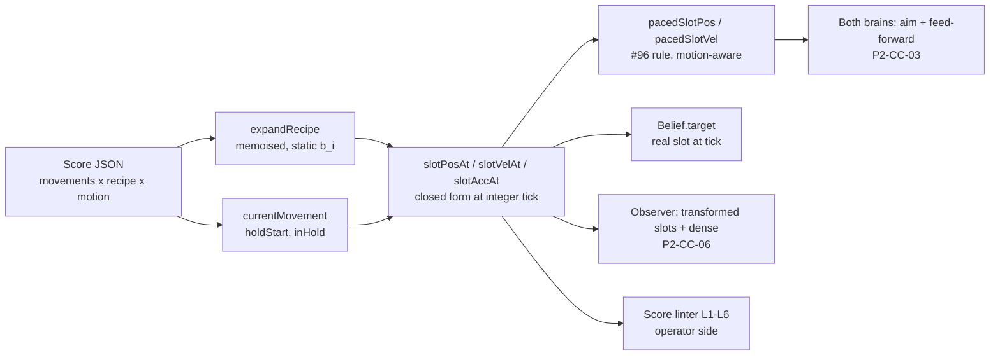

# Animated choreography RFC

> **STATUS: PROPOSED — NOT IMPLEMENTED.** Nothing in this document exists in the code. The motion model is Track P (after submission, or earlier only with Arnav's explicit approval, decision D4). Only linter checks L1–L5 are Track H, and they need no contract change. This document does not change the contract, the evidence plan or the demo. Contract changes here are labelled **PROPOSED CONTRACT CHANGE — REQUIRES ARNAV APPROVAL**.

Purpose: specify how a hold can move (spin, orbit, sway, travelling wave, outward pulse) while every drone still computes its target alone, from the score and the shared clock; how the observer measures a moving formation; and how an operator authors and checks a moving show (score linter L1–L6). Status: proposed, Track P (capability C7), linter L1–L5 Track H (capability C3). Owner: Arnav (Phase 2 architecture, issue #110). Audit base: `origin/main` 26b438a (first audited at 7a50a69); re-checked at `origin/main` c697f6c (02:58 GMT, 15 Nov 2026).

## 0. Scope, canonical content and status of existing pieces

**This document is canonical for:**
- the animated choreography model (candidate E01, and the target side of N02): the virtual-structure approach, `MotionSpec` and its v1 primitives (§2);
- the closed-form target functions `slotPosAt`, `slotVelAt` and `slotAccAt`, phase anchoring, and how they compose with paced targets (§3);
- feasibility bounds (§4) and separation arguments (§5);
- the resolved motion semantics (§6) and observer semantics under motion (§7);
- the authoring evaluation for E10 (§8) and the score linter, checks L1–L6 (§9);
- the full text of P2-CC-01, P2-CC-02 and P2-CC-06 (§10).

**It links to, and does not restate:**

| Topic | Canonical place |
|---|---|
| Candidates E01–E10 and N01–N21, their scores and verdicts | [`../ideation/PHASE2_CANDIDATES.md`](../ideation/PHASE2_CANDIDATES.md) |
| Capabilities C1–C9, pipeline, P2-FR/P2-NFR, P2-ADR, contract change register | [`PHASE2_ARCHITECTURE.md`](PHASE2_ARCHITECTURE.md) |
| Feed-forward in `steer` (P2-CC-03), healing in motion (P2-CC-04), motion safety (P2-CC-05) | [`ADAPTIVE_RECOVERY_AND_SAFETY_RFC.md`](ADAPTIVE_RECOVERY_AND_SAFETY_RFC.md) |
| Tests P2-T*, scenarios M0–M6, invariants, summary keys | [`../validation/PHASE2_EVALUATION.md`](../validation/PHASE2_EVALUATION.md) |
| Gates P2-G0–P2-G6, decisions D1–D7, risks P2-R* | [`../planning/PHASE2_ROADMAP.md`](../planning/PHASE2_ROADMAP.md) |
| Work packages P2-WP-* and file placement | [`../development/PHASE2_WORK_PACKAGES.md`](../development/PHASE2_WORK_PACKAGES.md) |
| Composition input X-IN, and its D3-gated live variant X-RUN/live | [`OPTIONAL_INTEGRATION_BOUNDARIES.md`](OPTIONAL_INTEGRATION_BOUNDARIES.md) (X-RUN/live: [§6.1](OPTIONAL_INTEGRATION_BOUNDARIES.md#61-x-runlive-provisional-d3-gated)) |
| Demo beats | [`../demo/PHASE2_JUDGING_STORYBOARD.md`](../demo/PHASE2_JUDGING_STORYBOARD.md) |
| Base types, healing, dissemination, motion | [`contracts-and-algorithms.md`](contracts-and-algorithms.md) |

Status key: **(a)** implemented and tested on main · **(b)** implemented, not integrated · **(c)** open PR or active work · **(d)** documented only · **(e)** not present. Statuses and file:line cites are at `origin/main` 26b438a; what changed since the first audit is listed once in [PHASE2_ARCHITECTURE §1](PHASE2_ARCHITECTURE.md#1-scope-sources-and-status-labels). Re-checked at c697f6c: #113, #115, #121, #82 and #126 have merged since 26b438a, so every wait on them below is satisfied by the merge. #115 (06af4b2) moved some `encoreBrain.ts` lines by a few (the `transitLanes` call is at `:359-361` at c697f6c). The CURRENT_STATE lock table at c697f6c still lists #113's `src/app/main.ts` and `src/app/ui/**` lock and #126's `src/app/render/**` lock; under the [roadmap's lock rule](../planning/PHASE2_ROADMAP.md#base-state-this-roadmap-depends-on) they bind until the orchestrator lifts them. Open #127 (Readout transition) edits `main.ts` and `worlds.ts`. **None of the base work below is Phase 2 work.**

| Existing piece | Status | Where | Relevance here |
|---|---|---|---|
| Static formations: `Slot.pos` is a pure function of `(recipe, n0, slotSpacingMin)`. No size, centre, orientation or motion field | (a) | `src/contracts/score.ts`, `src/score/expand.ts` | The base that motion transforms |
| `expandRecipe` memo keyed on `JSON.stringify(recipe)`, `n0`, `slotSpacingMin`. Deep-frozen, FIFO cache of 64 | (a) | `src/score/expand.ts` | Motion must stay outside `Recipe` so the key never needs a tick |
| `currentMovement`, `holdStart = startTick + transitionTicks`, `inHold` | (a) | `src/score/timing.ts` | Phase anchor |
| `composeNext` carries the current movement unchanged. `copyMovement` copies only `startTick`, `transitionTicks` and `recipe`, so unknown fields are dropped | (a) | `src/score/compose.ts` | P2-CC-01 changes it to carry `motion` (§10.1); this RFC owns that change |
| Paced targets: `pacedSlotPos` and the module constant `PACE_SETTLE_TICKS = 60` (not a `Params` field), steering only, both brains (#96) | (a) | `src/agent/steer.ts:114` | First time-dependent aim point; composition rule in §3.5 |
| Score adoption and gossip (#105). Incoming scores are checked only for version fields and non-empty `movements`; unknown recipe kinds are not rejected | (a) | `src/agent/encoreBrain.ts:129-143` | `validateMotion` joins this check |
| Composer `validateDraft`, preview layer (#112); timeline cues, no seek (#109) | (b) at 26b438a: merged, not mounted by `main.ts`. #113 has since merged and `main.ts` calls `connectComposer` and `connectTimeline` (re-checked at c697f6c) | `src/app/ui/Composer.ts`, `src/app/ui/Timeline.ts` | Authoring hook and cue label (§8.2) |
| Ghost slots from `Observer.slotStatus`; inspector truth box | (b) at 26b438a: no `createSlotStatusFeed` or `connectInspector` caller. Since #113 merged, `main.ts` calls both (re-checked at c697f6c) | `GhostSlotLayer.ts`, `inspectorTruth.ts` | Follow CC-06 |
| "Rotating or animated holds" listed as STRETCH; FR-38 says "after G5, via a `[contract]` PR" | (d) | [contract §12](contracts-and-algorithms.md#12-deliberately-not-in-the-mvp), [`requirements.md`](../specification/requirements.md) | This RFC is that proposal |
| Target velocity, moving formations, motion validation, score linter | (e) | — | Proposed here |

## 1. Model: a virtual structure evaluated by every drone

A moving hold is a **virtual structure** (Lewis and Tan, 1997). The formation is a rigid or structured body with a pose that is a closed-form function of time. Each drone tracks its own slot on that body:

`p_i(t) = M(t; b_i)`

Here `b_i` is slot `i`'s static position from `expandRecipe`, and `M` is the motion map of the current movement. Every drone can evaluate `M` for any slot at any tick from the score (invariants I4 and I5) and the synced show clock (assumption AS-01). So a moving formation needs **no new messages, no new state and no agreement**: it is the same shared vocabulary as today (contract §6, "Shared vocabulary vs live knowledge"), with one more argument, the tick.

**Prior art, not novelty.** This is the virtual-structure method (Lewis and Tan 1997), a position-based formation control in the survey of Oh, Park and Ahn (2015), which needs a shared frame and clock. Feeding forward the reference velocity is standard tracking practice (without it a moving reference leaves a steady-state error; Ren 2007). Offline speed, acceleration and distance checks are drone-show industry practice (Intel Shooting Star, Skybrush Studio) and reappear here as the score linter. Alonso-Mora et al. (2012) is the closest whole-pipeline precedent. Encore applies these methods under its information boundary and adds nothing new to them.

**What motion is not.** It is not a new recipe, not a morph between recipes, and not a per-drone trajectory. Slot index `i` stays slot `i`, with the same priority and the same colour gradient position, for the whole movement (§3.7).



## 2. `MotionSpec` and the v1 primitives (P2-CC-01)

### 2.1 Type sketch

```ts
// src/contracts/score.ts — PROPOSED CONTRACT CHANGE — REQUIRES ARNAV APPROVAL (P2-CC-01)
export type MotionSpec =
  | { kind: 'spin';  axis: Vec3; pivot: Vec3; omega: number; rampTicks: number }                  // rigid rotation
  | { kind: 'orbit'; normal: Vec3; outward: Vec3; radius: number; omega: number; rampTicks: number } // rigid translation on a circle
  | { kind: 'sway';  amplitude: Vec3; omega: number; rampTicks: number }                          // rigid translation on a line
  | { kind: 'wave';  origin: Vec3; travel: Vec3; displace: Vec3;                                    // transverse travelling wave
                     amplitude: number; wavelength: number; omega: number; rampTicks: number }
  | { kind: 'pulse'; pivot: Vec3; beta: number; omega: number; rampTicks: number };               // outward-only scaling

export type ColourMotion =                                                                         // brightness only, hue kept
  | { kind: 'breathe'; depth: number; omega: number; rampTicks: number }
  | { kind: 'chase';   depth: number; omega: number; rampTicks: number; origin: Vec3; travel: Vec3; wavelength: number };

export interface Movement {
  startTick: number;
  transitionTicks: number;
  recipe: Recipe;
  motion?: MotionSpec;            // absent => today's static hold, bit-identically
  colourMotion?: ColourMotion;    // absent => Slot.colour, bit-identically
}
```

**Design choices:**
- **One primitive per movement in v1.** Stacking is deferred: still closed-form, but the bounds do not compose simply (§8.1).
- **Motion lives on `Movement`, not on `Recipe`.** The `expandRecipe` memo key stays tick-free, and the same recipe can hold still in one movement and spin in the next.
- **Every geometric field is explicit**, with no defaults hidden in code, so the score JSON is the whole definition. The composer pre-fills `pivot = [0, 30, 0]` (`CENTRE`, `expand.ts`).
- **Size:** under 200 bytes of JSON per `MotionSpec`, so the score stays small (contract §3).

### 2.2 Structural validation: `validateMotion` (pure, in `src/score`)

`validateMotion(m: MotionSpec): string | null` returns the first problem, or `null` if there is none. The same function is used in four places:
- Encore's adoption check (`encoreBrain.ts:129-143`), which then ignores the score so it is not adopted. A brain that throws aborts the whole world step, so an invalid motion must be caught here;
- the composer, as an error;
- X-IN compositions (see [`OPTIONAL_INTEGRATION_BOUNDARIES.md`](OPTIONAL_INTEGRATION_BOUNDARIES.md)), once a v2 composition format accepts `motion` (v1 rejects the key, [boundaries §3.2](OPTIONAL_INTEGRATION_BOUNDARIES.md#32-file-format-sketch-encorecomposition-v1)). A composition from the optional gateway (`integrations/gateway/`) under X-RUN/live ([boundaries §6.1](OPTIONAL_INTEGRATION_BOUNDARIES.md#61-x-runlive-provisional-d3-gated)) takes the same path. X-RUN/live needs D3, is off by default, and the default build makes zero external requests. Its only inbound payload is a candidate composition, which must pass every X-IN step before an operator `INJECT_SCORE`. It is never called from ticks, brains, the world or the observer;
- the linter, which reports it as an info line and skips L6.

Rules:

| Rule | Why |
|---|---|
| All numbers finite. Vectors have three finite components | Closed-form evaluation must never produce `NaN` (the world throws on a non-finite accel) |
| `axis`, `normal`, `outward`, `travel` and `displace` have length ≥ 1e-6. They are normalised at evaluation with `Math.sqrt` | A zero axis has no rotation. `Math.sqrt` is correctly rounded (IEEE 754) and `Math.hypot` is not required to be, so `Math.sqrt` keeps the result identical across engines |
| `rampTicks` is an integer ≥ 1 | Continuity of position (§3.3) |
| `wave`: `|t̂·ê| ≤ 1e-6` | **Longitudinal (compression) waves are forbidden** (§2.4) |
| `wave`: `amplitude ≥ 0`, `wavelength > 0`, `omega ≥ 0` | Direction of travel is `+t̂` |
| `pulse`: `beta ≥ 0`, `omega > 0` | **Inward scaling is forbidden** (§2.4) |
| `orbit`: `|ô·n̂| ≤ 1e-6`, `radius ≥ 0` | `outward` must lie in the orbit plane |
| `colourMotion.depth ∈ [0, 1]` | Brightness factor stays in `[0, 1]` |

Feasibility (speed, acceleration, altitude, spacing) is **never** a validation error. It is a linter warning (§9), so an operator can deliberately fly near the limits on a test run.

### 2.3 The v1 primitives

Notation: `s = (tick − holdStart)·DT` is seconds since the hold began. `Tr = rampTicks·DT`. `u = clamp((tick − holdStart)/rampTicks, 0, 1)` is computed from integers, then divided once. Hats are normalised vectors.

The ramp uses smoothstep for amplitude, `r(u) = 3u² − 2u³`, and its integral for phase, `R(u) = u³ − u⁴/2`. The phase is:

`φ(s) = 0` for `s ≤ 0`; `φ(s) = ω·Tr·R(u)` for `0 < s < Tr`; `φ(s) = ω·(s − Tr/2)` for `s ≥ Tr`.

So `φ' = ω·r(u)` and `φ'' = 6ω·u(1 − u)/Tr`. Angular rate rises smoothly from 0 to ω, and both position and velocity are continuous at `holdStart` and at `holdStart + rampTicks`.

| Kind | `M(t; b)` (position of the slot whose static position is `b`) | Rigid? |
|---|---|---|
| `spin` | `o + Rot(â, φ(s))·(b − o)` with `o = pivot`. Rodrigues: `Rot(â,θ)q = q·cosθ + (â×q)·sinθ + â(â·q)(1 − cosθ)` | yes (rotation) |
| `orbit` | `b + ρ[(cos φ(s) − 1)·ô + sin φ(s)·(n̂ × ô)]`, `ρ = radius` | yes (translation; the formation keeps facing the audience) |
| `sway` | `b + a·sin φ(s)` with `a = amplitude` | yes (translation) |
| `wave` | `b + A·r(u)·sin(k·ξ − ω·s)·ê`, with `ξ = t̂·(b − origin)`, `k = 2π/wavelength`, `A = amplitude`, `ê = displace`, `t̂ = travel` | no (bounded, §5.2) |
| `pulse` | `o + σ(s)·(b − o)`, `σ(s) = 1 + β·r(u)·(1 − cos ωs)/2 ≥ 1` | no (similarity, spacing grows) |

For `s ≤ 0` every map is the identity. During the transition, the target is the static slot exactly as today. Motion starts at `holdStart` and ends when the next movement starts (`currentMovement` switches).

### 2.4 Why compression waves and inward scaling are forbidden

The numbers use `slotSpacingMin = 1.5` (expanded closest pair `1.5·1.001 = 1.5015` m), `dAvoid = 1.4`, `dNear = 0.8` and `dCollide = 0.4`.

- **Longitudinal waves.** Displacement along the travel direction compresses neighbour spacing to about `1.5015·(1 − A·k)`. Staying above `dAvoid` needs `A·k ≤ 0.067`. Staying above `dNear` needs `A·k ≤ 0.47`.

  Below `dAvoid` the separation term in `steer` fires on drones that are exactly on their slots. That is visible jitter and a fight between tracking and avoidance. A limit of `A·k ≤ 0.067` leaves almost no visible wave (1 m amplitude needs a wavelength of at least 94 m), so the primitive is useless. It is forbidden structurally.
- **Inward scaling ("breathing in").** Scaling by `σ < 1` shrinks every distance by `σ`. The closest pair reaches `dAvoid` at `σ = 1.4/1.5015 ≈ 0.93`, which is only a 7% squeeze. Outward pulses (`σ ≥ 1`) only increase spacing (§5.1). A "breathing" look comes from pulsing outward from the base size.

Both rules are structural (`validateMotion`), not linter warnings. Each guards a property that the steering layer, not the operator, would pay for.

### 2.5 Colour and brightness envelopes: decision

**Decision: colour over time belongs to the drone's light output.** It is not a rendering effect.

Proposed `slotColourAt(score, tick, slot, n0, params): RGB` returns `Slot.colour × g(tick)`, where `g ∈ [1 − depth, 1]`:
- `breathe`: `g = 1 − depth·r(u)·(1 − cos ωs)/2`;
- `chase`: `g = 1 − depth·r(u)·(1 − cos(k·ξ − ωs))/2`.

Both brains output it as `AgentOutput.colour`. With `colourMotion` absent, the result is `Slot.colour`, bit-identically.

Reasons:
1. The world already records `body.colour` from the brain, and the renderer draws snapshots (ADR-010). A renderer-only envelope would make the app invent show state that no drone produced.
2. A brightness-only factor keeps hue. A palette that avoids the reserved white and vermilion (composer warnings, #112) can never be turned into a diagnostic colour.
3. `stateHash` covers `colour`, so colour animation stays inside replay checks.

**Metrics must not depend on colour, and they do not.** `measureFormation` reads only `alive`, `pos`, `belief.slot` and `belief.version` (checked in `src/observer/measure.ts`). This RFC adds no colour-based metric.

## 3. Closed-form target functions (P2-CC-02)

### 3.1 Signatures

```ts
// src/score — PROPOSED CONTRACT CHANGE — REQUIRES ARNAV APPROVAL (P2-CC-02). Pure; same rules as expandRecipe.
slotPosAt(score: Score, tick: number, slot: number, n0: number, params: Params): Vec3   // real slot at tick (motion applied, not paced)
slotVelAt(score: Score, tick: number, slot: number, n0: number, params: Params): Vec3   // d/dt slotPosAt, m/s
slotAccAt(score: Score, tick: number, slot: number, n0: number, params: Params): Vec3   // optional: linter L6, later acceleration feed-forward
pacedSlotPos(score, tick, slot, n0, params): Vec3       // moved from src/agent/steer.ts, motion-aware (§3.5)
pacedSlotVel(score, tick, slot, n0, params): Vec3       // motion part of the aim velocity (§3.5)
slotColourAt(score, tick, slot, n0, params): RGB        // §2.5
validateMotion(m: MotionSpec): string | null            // §2.2
transformFormationAt(f: Formation, mv: Movement, holdStart: number, tick: number,
                     out?: { slots: Vec3[]; dense: Vec3[] }): Formation   // observer bulk path (§7)
slotPositionsAt(score, tick, n0, params, out?: Vec3[]): Vec3[]   // slots-only bulk form: every slot at tick, no dense (brain scan)
PACE_SETTLE_TICKS                                       // moved with pacedSlotPos; steer.ts re-exports both
```

**One per-slot primitive.** `slotPosAt`, `slotPositionsAt` and the slots of `transformFormationAt` share one internal step in `src/score/motion.ts`. A setup runs once per `(movement, tick)`: the normalised vectors, `φ`, and the rotation or the ramp factor. Then a closed-form step maps one static `b` to its position at that tick. `slotPosAt` and `slotPositionsAt` first call `currentMovement` and take the `expandRecipe` hit; `transformFormationAt` is given the movement and base formation. `slotPosAt` is the setup plus one step. The other two run the setup once and the step per slot, in the same arithmetic order, so all three agree bit for bit. `slotPositionsAt` exists for CC-04's vacancy scan, which needs every slot each scan tick but not the 2000 dense points ([recovery RFC §1.15, hoisted form](ADAPTIVE_RECOVERY_AND_SAFETY_RFC.md#115-per-tick-pseudo-code-diff-against-contract-83)). In a brain, `out` is an array local to the call, never module state.

**Why the pacing rule moves.** On main, `pacedSlotPos` lives in `src/agent/steer.ts:114` (a). The boundary test allows `score` to import only `score` and `contracts`, and `observer` to import only `observer`, `contracts` and `score`. So a `src/score` function cannot "compose with" a function in `src/agent`, and the observer cannot reach it either. P2-CC-02 therefore moves `pacedSlotPos` and `PACE_SETTLE_TICKS` into `src/score` byte for byte, adds `pacedSlotVel`, and `steer.ts` re-exports both. `src/cli/scenarios.ts` imports `PACE_SETTLE_TICKS` from `../agent/steer` and keeps working.

### 3.2 Exact definitions

Let `cm = currentMovement(score, tick)` and `b = expandRecipe(cm.movement.recipe, n0, params).slots[slot].pos`. A missing slot throws `RangeError`, as `pacedSlotPos` does today. Let `s`, `u`, `φ`, `φ'` and `φ''` be as in §2.3, with `holdStart = cm.holdStart`.

- `slotPosAt = M(b)` from the §2.3 table, or a copy of `b` when `motion` is absent.
- `slotVelAt`, analytic:
  - spin: `φ'·(â × (p − o))`, where `p = slotPosAt`;
  - orbit: `ρφ'·(−sin φ·ô + cos φ·(n̂×ô))`;
  - sway: `a·φ'·cos φ`;
  - wave: `A·[r'(u)·sin ψ − r(u)·ω·cos ψ]·ê`, with `ψ = kξ − ωs` and `r' = 6u(1−u)/Tr`;
  - pulse: `σ'·(b − o)`, with `σ' = β[r'·(1 − cos ωs)/2 + r·ω·sin(ωs)/2]`;
  - `[0, 0, 0]` when motion is absent, or for `s ≤ 0`.
- `slotAccAt`:
  - spin: `φ''·(â × q) + φ'²·(â × (â × q))` with `q = p − o`;
  - orbit and sway: the second derivatives of their closed forms;
  - wave: `A·[r''·sin ψ − 2r'ω·cos ψ − r·ω²·sin ψ]·ê`, with `r'' = (6 − 12u)/Tr²`;
  - pulse: `σ''·(b − o)`.

  It is zero where `slotVelAt` is zero.
- Ramp derivatives (`r'`, `r''`, `φ''`) are taken as 0 outside `0 < s < Tr`. Velocity is continuous everywhere. Acceleration is bounded and may step at the ramp ends.

### 3.3 Phase anchoring and timing semantics

**Decision: phase is anchored to the movement's own `holdStart = startTick + transitionTicks`, and motion is the identity for `tick ≤ holdStart`.** No v1 motion spans a transition.

Justification:
1. **Paced transitions are untouched.** During a transition the "to" point is the static slot, so the #96 rule and its measured effect (S0 static collisions 60 → 14 at n0 = 200, [contract §10](contracts-and-algorithms.md#10-motion)) carry over unchanged.
2. **Injection is seamless.** The anchor travels with the movement. `composeNext` copies the current movement's `startTick` and `transitionTicks` unchanged (`compose.ts`). So for every `tick` before the new movement starts, `slotPosAt` is identical in the old and the new score: adopting the injected score causes no target jump. [Contract §8.5](contracts-and-algorithms.md#85-known-limits-state-these-dont-hide-them) limits 8 (an injection pauses healing for `tStable`) and 9 (a score from a different base can send a drone back for up to `scoreLead`) are unchanged.
3. **Settling comes first.** The paced point arrives `PACE_SETTLE_TICKS = 60` ticks before `holdStart`, so drones have about 3 s to settle on static slots before the ramp begins. A ramp of `rampTicks ≥ 40` also roughly matches `holdGrace = 40`.

Timing rules:
- `inHold` and `holdStart` keep today's definitions (§6). Motion neither ends nor extends a hold.
- Motion ends at the next movement's `startTick`. From that tick, `currentMovement` returns the next movement, whose transition paces from the previous slot **evaluated at the transition's begin tick** (§3.5).
- **Authoring formula.** `transitionTicksBetween(from, to)` must measure `from` as the previous movement's positions at the next movement's `startTick`, not its static slots. For a spun sphere followed by text, the rotated "from" set changes the maximum displacement. `makeScore` and `composeNext` both know the next `startTick` before computing `transitionTicks`, so this stays closed-form (migration step, §10.1).

### 3.4 Determinism and reproducible replay

- **Evaluate, never integrate.** No angle, phase or offset is accumulated tick by tick, and none is stored in brain state. Every call recomputes from the integer `tick`. Accumulation would drift, and it would make a late adopter's target differ from an early adopter's (it would break P2-T21). Any field in `EncoreState` would also change `stateHash` for every record.
- **Fixed operation order.** `tick − holdStart` is an exact integer subtraction. `u` is an integer ratio. `s` is that integer times `DT`. One shared implementation is called by brains, observer, linter and app, so nobody re-derives the formula, and identical inputs give bit-identical outputs in one engine.
- **Engine caveat.** `Math.sin` and `Math.cos` are implementation-approximated in ECMAScript. One run uses one engine, so it is deterministic. Node and Chrome share V8's math library, so app-to-headless replay (T13) is expected to hold, though the language does not promise it. Another engine may differ in the last bits; ADR-002 already does not promise identical floats on another host (`tests/g1/g1.beyond.test.ts:85`). Per-tick snapping to 1e-9 (as `shapes.ts` does for static shapes) is **not** recommended, because snapping can itself flip at a rounding boundary.
- **Replay.** A run stays a pure function of (scenario, seed, arm, n0, params, git), because the motion is inside the score the scenario builder produces. T04 and T13 apply unchanged. Fractional-tick evaluation is allowed **only** in the app for display interpolation, never in core.

### 3.5 Composition with paced targets (#96)

**The current rule** (a) is canonical in [contract §10](contracts-and-algorithms.md#10-motion), "Paced targets" (`steer.ts:114`). In this RFC's notation: `begin = max(startTick, 0)`, `span = holdStart − PACE_SETTLE_TICKS − begin`, `f = max(0, (tick − begin)/span)` until `begin + span`, and `aim = from + (to − from)·f`. `from` is `launchPos(slot, n0)` for movement 0 (paced only when `startTick ≤ 0`; a carried movement 0 is unpaced) and the same slot of the previous movement otherwise. Only steering aims at the paced point. `Belief.target`, the at-slot and settled checks, and vacancy sensing use the real slot.

**The proposed motion-aware rule** (P2-CC-02) makes two substitutions:
- `to(tick) = slotPosAt(score, tick, slot, …)`, the real moving slot of `cm`;
- `from = cm.index == 0 ? launchPos(slot, n0) : M_prev(b_prev; begin)`, the previous movement's slot **evaluated at the begin tick** with that movement's own `holdStart`. It is frozen for the rest of the transition.

The aim point is `aim(t) = from + (to(t) − from)·f(t)`. Its exact derivative is:

`aim'(t) = f(t)·slotVelAt(t) + (to(t) − from)·f'(t)`, with `f' = 1/(span·DT)` for `begin ≤ t < begin + span`, and 0 otherwise.

`pacedSlotVel` returns **only the motion part, `f(t)·slotVelAt(t)`**:
- In v1 it is zero during every transition, because `to` is static there.
- It equals `slotVelAt` in holds.
- It is zero for every static score.

So when P2-CC-03 feeds `pacedSlotVel` forward as `targetVel`, static scores stay bit-identical (P2-T23). Feeding the lerp term `(to − from)·f'` forward as well would change every static transition. That is a separate, measured option ([safety RFC, AR-Q2](ADAPTIVE_RECOVERY_AND_SAFETY_RFC.md#8-open-questions-for-review)); it is not part of CC-02.

Edge cases:
- If the previous movement had not reached its hold at `begin` (an injection during a transition), its motion is the identity there, so `from` is its static slot. That is today's rule.
- Movement 0 with `startTick > 0` stays unpaced. Its `to(t)` is the moving slot.
- A slot change by healing paces against the new index, which in a hold is the slot itself (contract §10).
- At `begin`, the drone may be moving at up to `|slotVelAt(prev)|` while the aim velocity becomes `(to − from)/(span·DT)`. That velocity step is bounded and reported by L6 (§9.6). v1 adds no ramp-out, because a ramp-out would make a carried movement's motion depend on the next `startTick`, which an injection can change.

### 3.6 Late score adoption

A drone that adopts a score at tick `t` evaluates `slotPosAt(newScore, t, slot, …)` and flies to the moving slot at once. There is no catch-up state and no history: a late adopter computes exactly the target an early adopter computes at the same tick (P2-T21). With CC-04, `canHeal` keeps it from judging vacancies until it has settled relative to the motion. Before CC-04, the interim motion gate keeps every drone from healing during motion (§6; healing details are in the [safety RFC](ADAPTIVE_RECOVERY_AND_SAFETY_RFC.md)).

### 3.7 Slot identity preservation

- Motion never permutes indices. Slot `i` of a moving formation is the image of slot `i` of the static formation, with the same priority and the same base colour.
- Slot persistence across formations (contract §6) and every index-based rule (claims `v + claimGap < slot`, duplicates, history) keep their meaning.
- Spin, orbit, sway and pulse are similarity transforms. They preserve the farthest-point prefix property: the covering radius of any prefix scales by `σ` and is otherwise unchanged (Gonzalez 1985; Eldar et al. 1997).
- A wave displaces slots and dense points by the same field, so any prefix's covering radius changes by at most `2A`.

### 3.8 Backwards compatibility and complexity

- **Motion absent.**
  - `slotPosAt` returns a copy of `expandRecipe(...).slots[slot].pos`, and `slotVelAt` and `slotAccAt` return zero.
  - `pacedSlotPos` performs the #96 arithmetic in the same order, and `slotColourAt` returns `Slot.colour`.
  - `Belief.target` equals today's static slot whenever `s.mvIndex` is the current movement. It already does at every step after `targetChanged`.
  - Score JSON is unchanged, because an absent key is not serialised. So `stateHash` and `paramsHash` are unchanged for every static scenario (P2-T20).
  - The evidence-revision rule still applies to any code change in `src/agent` after #26 (decision D5, [roadmap](../planning/PHASE2_ROADMAP.md#decisions-for-arnav)).
- **Cost per drone per tick:** O(movements) for `currentMovement`, one memoised `expandRecipe` hit (a `JSON.stringify(recipe)`, as today; two in transitions), then O(1) motion arithmetic: a few trigonometric calls and about 40 flops. Estimate, not measured: well under 0.1 ms per tick for 200 drones. CC-04's scan needs every slot, not only the k within `rClaim`, because the reach test itself uses each slot's moving position. It calls `slotPositionsAt` once per scan (§3.1): one setup, then up to n0 per-slot steps, about 8 000 per tick per world at n0 = 200 (estimate, [recovery RFC §1.15](ADAPTIVE_RECOVERY_AND_SAFETY_RFC.md#115-per-tick-pseudo-code-diff-against-contract-83)). Its time is to be measured under P2-T18. The binding rule is ≤ 0.5 ms/tick/world per Phase 2 addition, measured opt-in (`P2_PERF=1`, P2-T18, [PHASE2_EVALUATION §12](../validation/PHASE2_EVALUATION.md#12-performance-criteria)) with the existing #118 perf harness (`scripts/perf/`), under the frame budget of [experience-and-demo §10](experience-and-demo.md#10-performance).
- **Allocation.** Brains allocate one `Vec3` per call, as `pacedSlotPos` already does. The scan's `slotPositionsAt` call writes into an array local to that call. The observer's bulk path (`transformFormationAt`) writes into caller-owned buffers. No module-level mutable state is added: `expandRecipe`'s cache stays the only one, so trigonometric results are not memoised globally.

## 4. Feasibility bounds

**Working limits:** the slot reference stays within 50% of the world limits, `|ṗ| ≤ 0.5·vMax = 4 m/s` and `|p̈| ≤ 0.5·aMax = 4 m/s²`. The other half is headroom for correction and avoidance. Linter L6 enforces these limits as warnings.

**Radii.** The radii below come from running `expandRecipe` at n0 = 200 on main in a scratch script (not a repo test):
- **Sphere:** maximum distance from the centre `(0, 30, 0)` is 9.37 m; minimum y is 20.64 m.
- **Helix:** 15.63 m from the vertical axis, 24.98 m from the centre; minimum y is 10.48 m.
- **Text "ENCORE":** 39.04 m from the vertical axis, planar (zero depth span); minimum y is 22.40 m.

### 4.1 Rotation (spin; also orbit with ρ = path radius)

For rim radius `ρ`:
- rim speed is `ρω`;
- steady centripetal acceleration is `ρω²`;
- the binding limit is `ω_max = min(4/ρ, √(4/ρ))`.

For `ρ ≥ 4 m`, **speed binds first**.

| Formation / axis | ρ (m) | ω_max (speed) | ω limit (accel) | Recommended ω |
|---|---|---|---|---|
| Small shape | 5 | 0.80 rad/s | 0.89 | ≤ 0.75 |
| Sphere, any axis through the centre | 9.37 | 0.427 | 0.65 | **≤ 0.4** (EVAL-M uses 0.2) |
| Helix, vertical axis | 15.63 | 0.256 | 0.51 | ≤ 0.25 |
| Helix, horizontal axis through the centre | 24.98 | 0.160 | 0.40 | ≤ 0.15 |
| Text "ENCORE", vertical axis | 39.04 | 0.102 | 0.32 | ≤ 0.1 |

| ω (rad/s) | Period | Sphere rim v / a | Helix (vertical axis) v / a | Text v | Lag without feed-forward, sphere rim (`v²/aMax`) |
|---|---|---|---|---|---|
| 0.10 | 62.8 s | 0.94 m/s / 0.09 m/s² | 1.56 / 0.16 | 3.9 | 0.11 m |
| 0.20 | 31.4 s | 1.87 / 0.37 | 3.13 / 0.63 | 7.8 ✗ | 0.44 m |
| 0.30 | 20.9 s | 2.81 / 0.84 | 4.69 ✗ | ✗ | 0.99 m |
| 0.40 | 15.7 s | 3.75 / 1.50 | ✗ | ✗ | 1.76 m |

✗ marks a rim speed above 4 m/s.

The lag column is the analytic steady-state trailing distance of today's `steer` with no feed-forward, `d = v²/aMax`. It grows with radius, so a rigid spin is sheared without feed-forward. It is not measured; P2-T24 measures it.

**Ramp.** Tangential acceleration peaks at `1.5·ρω/Tr` (at `u = ½`). Choose `rampTicks ≥ ⌈8·ρ·|ω|⌉`, which gives `Tr ≥ 0.4·ρω` s: tangential acceleration is then ≤ 3.75 m/s², and with the centripetal term the total stays ≤ 4 m/s² while `ρω ≤ 4`. **Recommended default: `rampTicks = 40`.**

### 4.2 Transverse wave

In steady state, peak speed is `Aω` and peak acceleration is `Aω²`. So `ω_max = min(4/A, 2/√A)`. For `A < 4 m`, acceleration binds.

During the ramp, acceleration is bounded by `A·(ω² + 3ω/Tr + 6/Tr²)`. This loose bound is used to size `Tr` at 80% of `ω_max`. L6 samples the real `slotAccAt` and may accept shorter ramps.

| A (m) | ω_max (steady) | Period at ω_max | Ticks per period | ω at 80% | Ramp needed (loose bound) |
|---|---|---|---|---|---|
| 0.5 | 2.83 rad/s | 2.2 s | 44 | 2.26 | ≥ 3.2 s (64 ticks) |
| 1 | 2.00 | 3.1 s | 63 | 1.60 | ≥ 4.5 s (90) |
| 2 | 1.41 | 4.4 s | 89 | 1.13 | ≥ 6.2 s (124) |
| 4 | 1.00 (both bind) | 6.3 s | 126 | 0.80 | ≥ 9 s (180) |

Sampling is adequate: every row has at least 44 ticks per period.

**Spacing condition for waves** (from §5.2):
- On a planar formation with `ê` normal to its plane, there is no extra limit.
- Otherwise `A·k ≤ 0.13` keeps every pair above `dAvoid`, so `wavelength ≥ 48·A` m: at least 48 m for 1 m amplitude, and 24 m for 0.5 m.

### 4.3 Pulse

For a slot at distance `ρ` from the pivot, steady speed is `ρβω/2` and steady acceleration is `ρβω²/2`.

- **Sphere** (ρ = 9.37): with β = 0.1, ω ≤ 2.9 rad/s (acceleration binds); with β = 0.3, ω ≤ 1.7.
- **Ground clearance:** the lowest sphere slot drops by `β·(30 − 20.64)`, which is 2.8 m at β = 0.3 (L4).
- **Radio and claims:** pulses also lengthen radio and claim distances. L2 and L3 evaluate at `σ_max = 1 + β`.

## 5. Separation: what is preserved, and what is only bounded

These are arguments about **targets** (slot positions). They are not claims about drones: drones deviate under tracking error and avoidance. The binding wording applies ([claims table](../specification/requirements.md#5-claims-we-must-not-make)): these are checked properties of the targets, not collision guarantees.

### 5.1 Rigid motion and outward pulse

- **Rigid motion.** For spin, orbit and sway, `p_i − p_j = Q(t)(b_i − b_j)` with `Q ∈ SO(3)` (the identity for orbit and sway). So `|p_i − p_j| = |b_i − b_j| ≥ 1.5015` m at every tick, exactly in real arithmetic.
  - In floating point, Rodrigues with a normalised axis keeps `Q` orthogonal to within a few ulps, so distances move by about 1e-13 m.
  - The expansion margin (`×1.001`, 1.5 mm) absorbs this many orders of magnitude over.
- **Pulse.** `|p_i − p_j| = σ|b_i − b_j| ≥ |b_i − b_j|` because `σ ≥ 1`.

P2-T22 checks `≥ slotSpacingMin` at every tick.

### 5.2 Transverse wave

Take a pair with base offset `δ = b_j − b_i`, let `a = δ·ê` and `c = δ·t̂`. Because `ê ⟂ t̂`, `a² + c² ≤ |δ|²`. The relative displacement is `Δ = A·r·(sin ψ_j − sin ψ_i)`, and `|Δ| ≤ min(2A, A·k·|c|)` because `|sin x − sin y| ≤ |x − y|`. Then:

`|δ'|² = |δ|² + 2aΔ + Δ² ≥ |δ|² − 2|a|·A·k·|c| ≥ |δ|² − A·k·(a² + c²) ≥ |δ|²·(1 − A·k)`.

The documented bounds, which P2-T22 checks, are:
- **Planar formation, `ê` normal to the plane** (`a = 0` for every pair): `|δ'| ≥ |δ|`. Spacing never decreases. This is the "transverse waves only increase spacing" case. It covers text at n0 = 200, which is planar.
- **Otherwise:** `|δ'| ≥ 1.5015·√(1 − A·k)` for `A·k ≤ 1`. Staying above `dAvoid` needs `A·k ≤ 1 − (1.4/1.5015)² ≈ 0.13`, and staying above `dNear` needs `A·k ≤ 0.72`.
- **Text with depth layers** (when `n0 > 8·litCells`) is not planar. Pairs stacked exactly along `ê` have `c = 0` and do not move relative to each other; diagonal pairs between layers are bounded as above.

## 6. Resolved semantics

| Question | Resolution (normative for P2-CC-01/02/06; healing items are detailed in the safety RFC) |
|---|---|
| **Animated hold** | `inHold = tick ≥ holdStart`, `holdStart = startTick + transitionTicks`, unchanged. Motion neither ends nor extends a hold, which lasts until the next `startTick` |
| **Transition completion** | Scheduled `holdStart`, unchanged and global. "Arrived" is per-drone relative settle (below); nothing waits for agreement |
| **Time-dependent slot occupancy** | For the observer, slot `v` is occupied at a snapshot if a live drone is within `rOcc` of `slotPosAt(ref, snapshot.tick, v)`. It is the same tick as the snapshot (§7). The brain's own sensed-occupancy test is CC-04's |
| **Recovery eligibility (`canHeal`)** | All existing conditions, with condition 3 made relative, plus a claim feasibility guard. See [P2-CC-04](ADAPTIVE_RECOVERY_AND_SAFETY_RFC.md#p2-cc-04-healing-in-motion), which depends on P2-CC-03. Until CC-04 lands, healing is **disabled by an explicit motion gate**: `evaluateCanHeal` returns `false` while the current movement has `motion` ([P2-WP-21 step 5](../development/PHASE2_WORK_PACKAGES.md#p2-wp-21--contract-feed-forward-steering-brains-aim-at-the-moving-slot)). The settle test alone would not stop it: absolute speed < 0.5 m/s still holds on slots within `0.5/ω` of a spin axis (the poles of `EVAL-M`) and in the zero-velocity phases of sway, pulse and waves, while the scan would still test static positions. CC-04 replaces the gate |
| **Target velocity** | `slotVelAt`, analytic, never a finite difference. Used for feed-forward (via `pacedSlotVel`, CC-03) and for the relative settle test (CC-04) |
| **Settle** | Relative speed and offset in the co-moving frame: `|pos − slotPosAt(now)| < rOcc` and `|vel − slotVelAt(now)| < 0.5` m/s for `tSettle` (CC-04). With motion absent this reduces exactly to today's test |
| **`Belief.target`** | `slotPosAt(score, s.now, s.slot, …)`: the real slot at the brain's current tick, not the paced point, which keeps the #96 rule. The inspector's truth check compares it with the observer's reference slot at the same tick (`inspectorTruth.ts`), so the two stay consistent |
| **Observer occupancy and reference geometry** | P2-CC-06 (§7) |
| **Visual fidelity** | `sfMean` and `sfMax` against `dense` transformed to the snapshot tick by the same map (rigid: same transform; wave: same displacement field at each dense point's own `ξ`; pulse: same scale). A lag-aware note is recommended (§7.3) |
| **Late adoption** | Closed-form `slotPosAt` puts a late adopter straight onto the moving target (§3.6). `canHeal` keeps it from judging vacancies until it is settled relative to the motion |
| **Baseline fairness** | Both arms fly the same animated score, with the same `slotPosAt`, the same `steer` (with feed-forward and safety), the same seeds and the same events. The static arm is never stripped of animation. Canonical wording: [`../validation/PHASE2_EVALUATION.md`](../validation/PHASE2_EVALUATION.md) |

## 7. Observer semantics under motion (P2-CC-06)

### 7.1 Rule

`geometry(snapshot)` in `src/observer/index.ts` builds the reference formation from `currentMovement(ref, snapshot.tick)` and a static `expandRecipe`. CC-06 changes it to:

```text
mv = currentMovement(ref, snapshot.tick)
base = expandRecipe(mv.movement.recipe, n0, params)                        # memoised, frozen
formation = transformFormationAt(base, mv.movement, mv.holdStart, snapshot.tick, buffers)
            # motion absent or tick <= holdStart: returns `base` itself (same object, no copy)
            # otherwise: slots[i].pos = slotPosAt(...) (same function as the brains), dense mapped by the same M,
            #            bounds recomputed, index and colour unchanged
measured = measureFormation(snapshot, formation, params)                   # unchanged code
inHold = mv.inHold                                                         # unchanged definition
```

- `Observer.slotStatus` already promises "the reference formation **at this tick**" (contract §5). CC-06 makes that literal under motion, with no type change. The static arm is measured against its own preloaded score, motion included, as the reference rule already requires.
- Brains and observer share the same `M`, so occupancy, ghost slots and the inspector truth box cannot disagree with what drones aim at. `GhostSlotLayer`, `inspectorTruth` and the timeline phase follow automatically.
- Direct `expandRecipe` callers must switch to `slotPosAt`: `onSlotFraction` in `src/cli/run.ts`, and `tests/g1/helpers.ts` (`formationAt`, `coverageOf`, `shapeFidelityOf`).

### 7.2 Metric definitions

- **Unchanged in name and formula**, with "slot position" read as "slot position at the sample tick": `coverage`, `pwc`, `npwc`, `sfMean`, `sfMax` and `dupSlots`.
- **New summary keys** live only in [`../validation/PHASE2_EVALUATION.md`](../validation/PHASE2_EVALUATION.md), never in contract types. Candidates include a tracking-lag mean and a swept count.
- **Pre-registration.** The evaluation doc needs a one-line note that, under motion, "occupied" is measured against the moving slot.

### 7.3 The one-tick offset (lag-aware note)

The world advances `tick`, builds inputs from start-of-tick bodies, steps the brains, integrates, and only then snapshots (`src/sim/world.ts`). A drone that tracks its moving slot perfectly is therefore at about `slotPosAt(t + 1)` in snapshot `t`. Its systematic offset from `slotPosAt(t)` is about `|ṗ|·DT`:
- 0.094 m at the M-scenario sphere rim (1.87 m/s);
- at most 0.2 m at the 4 m/s working limit.

That is up to a third of `rOcc`. The resolved semantics (§6) fix "same tick as the snapshot", so this RFC keeps it. The evaluation doc should state the offset next to occupancy and `sf*` results under motion. Changing to `snapshot.tick + 1` would be a separate decision (D2).

### 7.4 Cost

The cost is one trigonometric evaluation per sample plus about 2200 point transforms every 5 ticks. That is small next to the existing fidelity cost of O(2000 × M) per sample (an estimate, not measured). It is measured under P2-T18 (§3.8 budget rule).

## 8. Authoring and composition (E10 evaluation)

### 8.1 Decision: a compact grammar, movements × recipe × motion

A show is a list of movements. Each movement is a **recipe** (what shape), an optional **motion** (how the hold moves) and an optional **colour motion**. The authoring formula (§3.3) derives the timing.

The grammar is deliberately small, for four reasons:
- every drone must evaluate it in closed form at any tick;
- the linter must be able to bound it;
- the healing rules need a co-moving frame, which exists only for rigid or structured motion;
- the score must stay small enough to gossip (contract §3).

| Alternative | Verdict | Reason |
|---|---|---|
| **Movements × recipe × one `MotionSpec`** | **Accept (v1)** | Closed form, bounded, small JSON, one validator |
| Motion stacks (`motion: MotionSpec[]`, body-frame wave then rigid) | Defer (v2) | Still closed-form, but bounds add and spacing proofs weaken. Needs L6 composition rules |
| Pose keyframes with splines per movement | Defer | Closed-form if piecewise polynomial, but needs spline bounds and an authoring UI |
| Per-drone trajectories (Skybrush / Intel-style show files) | **Reject** | Breaks "score is small", replaces slot persistence with per-drone paths, and makes healing meaningless: a vacancy has no recipe-level meaning |
| Expression or script language in the score | **Reject** | Determinism, validation and safety: arbitrary code cannot be bounded or replayed safely |
| Continuous morph between recipes, or non-rigid deformation | **Reject (v1)** | Compresses spacing, and has no co-moving frame for healing |
| New recipe kinds (`cloud`, `ring`, `grid`), multi-cue editing | Defer ([candidates §7.2](../ideation/PHASE2_CANDIDATES.md#72-deferred-in-order)) | Orthogonal to motion. A `Recipe` union change is its own contract change |

### 8.2 Integration points (Track P, P2-WP-23)

Composer, preview and timeline were (b) at 26b438a. #113 has since merged and mounts them (re-checked at c697f6c); P2-T16 covers these views. WP-23 edits no path that the CURRENT_STATE lock table lists. At c697f6c that table still lists #113's `src/app/ui/**` and #126's `src/app/render/**` (which holds `GhostSlotLayer.ts`), until the orchestrator lifts them. WP-23 also edits `worlds.ts`, which open #127 edits.
- **Composer (#112).** `Draft` gains `motion: MotionSpec | null` and `colourMotion: ColourMotion | null`, offered as presets ("slow spin", "gentle wave", "pulse") with the pivot pre-filled as `[0, 30, 0]`. `validateDraft` adds `validateMotion` errors and linter warnings, which never block injection (P2-T09). The inject path calls `composeNext(..., motion?, colourMotion?)`; the trailing parameters are optional, so existing callers are unchanged.
- **Preview layer (#112).** It may animate the draft with `slotPosAt` on a local preview clock. The label stays "local only, nothing is sent".
- **Timeline (#109).** An animated cue labels its hold band with the primitive and rate (for example `spin 0.2 rad/s`). The phase still comes from `inHold`, and there is still no seek.
- **Console.** `cue add` and `cue move` stay `'later'`. A `form sphere --spin ω` option is proposed for WP-23 (P2-T16); its syntax belongs to the command registry.
- **Ghost slots and inspector:** no change beyond CC-06. **X-IN compositions:** validated by the same `validateMotion` and linter, from a v2 format on ([`OPTIONAL_INTEGRATION_BOUNDARIES.md`](OPTIONAL_INTEGRATION_BOUNDARIES.md)). That includes an X-RUN/live candidate from `integrations/gateway/` (D3-gated, off by default, §2.2); it reaches a drone only through an operator `INJECT_SCORE`.

## 9. Score linter: checks L1–L6

### 9.1 Contract of the linter

- **What it is.** Operator-side, pure and deterministic. It imports only `src/contracts` and `src/score`. It runs on the authoring path (composer, CLI report) and never in a brain, the world or the observer.
- **Warnings only.** Its output **never blocks** injection (P2-T09). Structural invalidity is the validator's job, not the linter's.
- **Wording.** "Predicted under ideal paced flight"; "checks on targets, not proofs".

**Interface.** Entry points (`lintFormation`, `lintTransition`) and the finding shape are fixed in [P2-WP-04](../development/PHASE2_WORK_PACKAGES.md#p2-wp-04--score-linter-library-and-cli-lint-report). Composer drafts are linted on the score that `composeNext` would produce at the current tick. Every finding names its check (`L1`–`L6`), movement, severity (`info` or `warn`), value against threshold, and the worst slots or pairs.

**Placement:**
- **Track H** (L1–L5, P2-WP-04 and P2-WP-05): `src/cli/lint.ts`, **not** `src/score`. It is pure: it imports only `src/contracts` and `src/score`, and its own test asserts that. The app composer imports it (the boundary test restricts only core folders, so app → cli is allowed). It may not import `src/agent`, so it restates the #96 pacing formula; a parity test pins it to `PACE_SETTLE_TICKS` and compares it with `pacedSlotPos` at sampled ticks of the EVAL score (tests may import anything).
- **Track P:** after P2-CC-02 moves pacing into `src/score`, the linter imports it and the restatement is deleted. L6 (P2-WP-24, P2-T17) needs CC-01/02.

**Motion-aware geometry.** "Slot positions of movement k" means the base positions for rigid motion, where every check is invariant. For pulse it means the positions at `σ_max`. For waves it means positions sampled over one period.

### 9.2 L1: predicted conflicts under ideal paced flight (no avoidance)

For every paced movement `k`, the linter takes "from" and "to" positions:
- `a_i`, the "from" point of §3.5: `launchPos(i)` for movement 0, otherwise the previous slot evaluated at `begin`;
- `b_i`, the static slot of movement `k` (in v1, "to" is static during a transition).

Every drone uses the same fraction `f ∈ [0, 1]`, so each pair's relative path is linear in `f`. For each pair `i < j`:

```text
r0 = a_j − a_i;   D = (b_j − b_i) − r0
f* = (D·D > 0) ? clamp(−(r0·D)/(D·D), 0, 1) : 0
dmin = |r0 + f*·D|;   tick* = begin + f*·span
```

**Output:**
- counts of pairs with `dmin < dCollide` and `dmin < dNear`;
- the ten worst pairs as `(i, j, dmin)` with `tick*`.

**Skips and cost:**
- A movement 0 with `startTick > 0` is unpaced by the #96 rule. L1 reports `info: not paced, not evaluated`.
- The check covers n0(n0−1)/2 pairs, which is 19,900 at n0 = 200, per transition.

**What it means.** L1 reports "predicted conflicts under ideal paced flight (no avoidance) — not a collision forecast". One scratch computation on the EVAL score at n0 = 200 (not a repo test) found 183 pairs below `dCollide` at launch and 25 in A → B, against 14 collisions measured per S0 run after #96. The reactive layer resolves most conflicts at paced speeds, so L1 shows where that layer works, not what will hit. P2-T08 is a calibration report, never a forecast claim and not a pass line. P2-T07 checks the closed form against brute-force sampling.

### 9.3 L2: radio graph

- **Graph.** Nodes are the slots of movement `k`. There is an edge where `|p_i − p_j| ≤ rRadio` (15 m). For waves the edge must hold at every sampled tick; for pulse it is taken at `σ_max`.
- **Output:**
  - the number of components and their sizes (`warn` if more than 1);
  - the hop diameter: the maximum, over components, of BFS eccentricity (`info`).
- **Cost.** O(n0²) to build the graph plus n0 BFS runs, about 4·10⁶ steps at n0 = 200.
- **Meaning.** With more than one component, a score injected into one component cannot reach another while the formation holds (contract §9, "directly or through a chain of drones"). The hop diameter is a lower bound on dissemination hops. Slots stand in for drones, which sit within about `rOcc` of them. This is E09's authoring check; runtime connectivity control stays rejected.

### 9.4 L3: unhealable islands

- **Definition.** Slot `v` is an island if no other slot `u` has `|p_u − p_v| ≤ rClaim` (6 m). A drone on `v` that dies can never be replaced, because a claimant must be within `rClaim` (contract §8.5, limit 1).
- **Output:** the island slot list (`warn` if non-empty).
- **Detail line (`info`).** The linter also lists the slots that no lower-priority neighbour can ever claim: there is no `u > v + claimGap` within `rClaim`.
- **EVAL result.** The scratch run found no L3 islands in either EVAL formation at n0 = 200.

### 9.5 L4: altitude

- **Static hold:** the minimum over slots and `dense` of `y` must be at least 2 m (contract §6, `bounds.min.y ≥ 2`).
- **Animated hold:** the swept minimum, in closed form:
  - **spin:** for each slot, `(o + â(â·q))_y − |q − â(â·q)|·√(1 − â_y²)`, with `q = b − o`;
  - **orbit:** `b_y + min over φ` of the path's `y`;
  - **sway:** `b_y − |a_y|`;
  - **wave:** `b_y − A·|ê_y|`;
  - **pulse:** `o_y + (1 + β)(b_y − o_y)` for slots below the pivot.
- Paced transitions are straight lines between endpoints at `y ≥ 0` and `y ≥ 2`, so they need no extra check.
- **Output:** the minimum `y` and the offending slots (`warn`).

### 9.6 L5 and L6: speeds and accelerations

**L5, paced speed.** For each paced movement, `v_i = |b_i − a_i| / (span·DT)`. It warns if `max v_i > 0.5·vMax`, and reports the count of slots over the limit.
- By construction the authoring formula keeps this at or below 4 m/s when `begin = startTick`.
- It can exceed 4 m/s when `begin` is clipped to 0. In a scratch computation, EVAL movement A at n0 = 200 (start −40, so the pacing span is 263 ticks, not 303) gave a maximum paced speed of **4.61 m/s on 9 slots**, and movement B gave 3.99 m/s.
- That is within #96's own feasibility guard (up to `vMax`), so the expected outcome on EVAL is a warning that is reported, not a defect.

**L6, motion bounds** (Track P, P2-WP-24). For each movement with `motion`:
- **Sampling.** Every tick from `holdStart` to `holdStart + rampTicks + ⌈P/DT⌉`, where `P = 2π/|ω|`. If ω is 0, the ramp alone is sampled. If `P/DT < 40`, it adds `info: fewer than 40 samples per period`.
- **Checks.** For every slot it evaluates the shipped `slotVelAt` and `slotAccAt`, and warns if `|ṗ| > 0.5·vMax` or `|p̈| > 0.5·aMax`. It reports the worst slot and tick.
- **Sub-lines** (`info` unless stated):
  - **L6-sep:** for waves only, the minimum sampled pair distance among pairs with base distance ≤ `dAvoid + 2A`, compared with `dAvoid` (`warn`), together with the analytic bound of §5.2.
  - **L6-exit:** at the next movement's `begin`, the velocity step `|aim'(begin) − slotVelAt(prev, begin − 1)|`, reported against `0.5·vMax`.

L6 uses the same functions the drones use, so the check cannot drift from the motion it checks. Closed-form maxima (§4) are for authoring guidance; the samples decide.

**Cost** (estimates): about 200 slots × 700 samples = 1.4·10⁵ evaluations. L6-sep adds the near pairs × samples.

## 10. Contract change proposals (full text)

### 10.1 P2-CC-01: `Movement.motion` and `Movement.colourMotion`

**PROPOSED CONTRACT CHANGE — REQUIRES ARNAV APPROVAL**

| Field | Content |
|---|---|
| Current interface | `Movement { startTick; transitionTicks; recipe }`, and `Recipe` has three kinds with an optional palette (`src/contracts/score.ts`, [contract §2](contracts-and-algorithms.md#2-score-and-formation-types)). Light colour is the slot's colour ([contract §10](contracts-and-algorithms.md#10-motion)). "Rotating or animated holds" is STRETCH ([contract §12](contracts-and-algorithms.md#12-deliberately-not-in-the-mvp)) |
| Problem it cannot solve | A hold cannot move: every target is static for the whole movement, so the show cannot spin, sway or ripple. A renderer-side animation would be invented state (ADR-010) |
| Proposed extension | Optional `motion?: MotionSpec` (spin, orbit, sway, transverse wave, outward pulse; §2.1, §2.3) and `colourMotion?: ColourMotion` (breathe, chase; §2.5). Phase is anchored to the movement's `holdStart`, with the identity until then (§3.3). Pure `validateMotion` in `src/score`, wired into Encore's adoption check (§2.2). Contract §10 text changes to "light colour is `slotColourAt`" |
| Justification | Standard virtual structure, no communication (§1); exact late adoption and replay (§3.4, §3.6); spacing preserved or bounded (§5); compression and inward scaling excluded (§2.4) |
| Backwards compatibility | Fields are optional. Absent means no JSON key, so `stateHash`, `paramsHash`, `RunRecord` and every static behaviour are bit-identical (§3.8, P2-T20). `expandRecipe` and its memo key are untouched. No `Params` field is added, so `paramsHash` is unchanged |
| Migration steps | 1. Add the types and `validateMotion`. 2. `copyMovement` in `compose.ts`, which today drops every field but `startTick`, `transitionTicks` and `recipe`, copies `motion` and `colourMotion` (deep copy). 3. `composeNext(..., motion?, colourMotion?)` takes optional trailing parameters. 4. `makeScore` and `composeNext` measure `transitionTicks` from the previous movement's positions at the new `startTick` (§3.3). 5. Encore's adoption check (`encoreBrain.ts:129-143`) calls `validateMotion`. 6. Contract §2, §6 and §10, and the FR-38 row of [`requirements.md`](../specification/requirements.md), are updated in the same `[contract]` PR (P2-WP-20's allowed files list that row). 7. Declare a new evidence revision (D5) |
| Affected modules | `src/contracts/score.ts`; `src/score/{compose,timing,index}.ts` and new `src/score/motion.ts`; `src/agent/encoreBrain.ts` (validation, colour); `src/agent/staticBrain.ts` (colour); the app composer and timeline (WP-23) |
| Affected tests | New `tests/score/motion.test.ts` (validation, closed forms, P2-T20–T22). `tests/score/compose.test.ts`: the carried movement keeps `motion`, and the transition is measured from moved positions. `tests/agent/encoreBrain.test.ts`: the import-set regex is unchanged, because the imports still come from `../score`, and a malformed motion is not adopted. `tests/contracts/*` type fixtures. G1 and S0–S5 hashes are unchanged with motion absent |
| Conflicts with active work | #105, #112 and #109 are merged, so the conflict is sequencing, not rebasing. Open at 26b438a: #113 (mounts composer and timeline; edits `main.ts`, `worlds.ts`, `actions.ts`, `commands.ts`), #121 (follow-ups to #112/#109), #115 (`encoreBrain.ts`). All three have merged since (re-checked at c697f6c), so those waits are satisfied. Still open at c697f6c: #127 (`main.ts`, `worlds.ts`); the lock table still lists #113's `src/app/ui/**` lock, and `src/agent/**` is frozen except through the orchestrator. #26 evidence: any merge after the run starts is a new revision ([evidence-fragility rule](PHASE2_ARCHITECTURE.md#1-scope-sources-and-status-labels)). Track P only, so not before P2-G0 (P) and P2-G1 |

### 10.2 P2-CC-02: `slotPosAt`, `slotVelAt`, `slotAccAt` and motion-aware pacing

**PROPOSED CONTRACT CHANGE — REQUIRES ARNAV APPROVAL**

| Field | Content |
|---|---|
| Current interface | Brains compute `expandRecipe(currentMovement(score, now).movement.recipe).slots[slot].pos` (static). `Belief.target` is the static slot of `s.mvIndex`. `pacedSlotPos(score, tick, slot, n0, params)` and `PACE_SETTLE_TICKS` live in `src/agent/steer.ts` ((a), #96; `pacedSlotPos` at l.114). The static brain's `slotAt(s, tick)` is static per movement |
| Problem it cannot solve | Nothing can evaluate a moving slot or its velocity. The observer, CLI and app cannot reach the pacing rule, because they may not import `src/agent`. Without `slotVelAt`, steering cannot feed forward and trails a moving slot by `v²/aMax` (§4.1), which shears rigid motion |
| Proposed extension | New pure exports in `src/score` (§3.1): `slotPosAt`, `slotVelAt`, optional `slotAccAt`, `pacedSlotPos` (moved, motion-aware), `pacedSlotVel` (motion part only), `slotColourAt`, `transformFormationAt` and the slots-only bulk form `slotPositionsAt`. The three position functions share one per-slot primitive (§3.1). `Belief.target = slotPosAt(score, s.now, s.slot, …)`. Both brains aim at `pacedSlotPos` and pass `pacedSlotVel` to `steer` once P2-CC-03 lands |
| Justification | One shared implementation removes re-derivation drift between brain, observer, app and linter; closed form gives late-adopter equality and replay (§3.4); feeding forward only the motion part keeps static scores bit-identical (§3.5) |
| Backwards compatibility | With motion absent, every function returns today's values with today's arithmetic order (§3.8). `steer.ts` re-exports `pacedSlotPos` and `PACE_SETTLE_TICKS`, so `scenarios.ts` and `tests/agent/pacedSlotPos.test.ts` compile unchanged. Shown by P2-T20 and by S0–S5 seed 1 `stateHash` equal to the parent ([standard regression set](../development/PHASE2_WORK_PACKAGES.md#23-standard-regression-set)) |
| Migration steps | 1. Move `pacedSlotPos` and `PACE_SETTLE_TICKS` to `src/score` byte for byte, then re-export them from `steer.ts`, as their own commit. 2. Add the motion functions (§3.1), including `slotPositionsAt` on the shared per-slot primitive. In a separate commit, apply the §3.5 substitutions to `pacedSlotPos` and add `pacedSlotVel`; without them `pacedSlotPos` returns the static slot once the transition ends, and brains aiming at it hold still. 3. Encore: the target and settle inputs use `slotPosAt(now)`, and `belief()` uses `s.now`. The `transitLanes` call site (`encoreBrain.ts:355-357` at 26b438a) passes `slotPosAt(now)` to `steerTarget` and subtracts it, in place of the static `mine.pos`; otherwise a drone tracking its moving slot is soon more than 3 m (`LANE_RELEASE_DIST`) from the static position and keeps its ±2 m depth offset for the whole hold. In the same step, healing is **disabled by an explicit motion gate**: `evaluateCanHeal` returns `false` while `currentMovement(s.score, now).movement.motion` is present ([P2-WP-21 step 5](../development/PHASE2_WORK_PACKAGES.md#p2-wp-21--contract-feed-forward-steering-brains-aim-at-the-moving-slot)). The gate adds no `Params` or `EncoreState` field and never fires with motion absent. P2-CC-04 replaces it. 4. Static brain: `slotAt` uses `slotPosAt`; its lane call already takes that `target`, so it needs no separate change. 5. Colour from `slotColourAt` in both arms. 6. Update contract §6 (function list) and §10 (paced targets, `Belief.target`). The PR that adds the gate also states it in contract §8.2 (condition 3) and §8.5 limit 4 |
| Affected modules | `src/score/*` (new `motion.ts`, `pacing.ts`); `src/agent/steer.ts` (re-export); `src/agent/encoreBrain.ts`; `src/agent/staticBrain.ts`; consumers in `src/cli/run.ts`, `src/app/ui/Composer.ts` and the linter |
| Affected tests | `tests/agent/pacedSlotPos.test.ts` (unchanged, through the re-export), plus a twin in `tests/score`. `tests/boundaries.test.ts` stays green (score imports score and contracts only). `tests/cli/s0Collisions.test.ts` (≤ 15) must give the identical count. G1 suite and base T16/T18 unchanged. New P2-T20 and P2-T21. A brain test with `transitLanes = true` during a spin: within 3 m of `slotPosAt(now)` the aim carries no depth offset (both brains). A score test that `slotPosAt(…, v, …)`, `slotPositionsAt(…)[v]` and `transformFormationAt(…).slots[v].pos` are bit-identical at sampled ticks of `EVAL-M`. The motion-gate test `tests/agent/motionGate.test.ts` (P2-WP-21): `canHeal` stays false and Encore makes 0 slot changes during an animated hold, pole slots included |
| Conflicts with active work | `encoreBrain.ts` and `steer.ts` are contended ([files Track H must not edit](../development/PHASE2_WORK_PACKAGES.md#62-files-track-h-must-not-edit)). #115 was open at 26b438a and edited `encoreBrain.ts`; it has merged since (re-checked at c697f6c), and `src/agent/**` stays frozen except through the orchestrator. Edits only in Track P, after P2-G0 (P). CC-03's parameter may land first: `targetVel`, defaulting to zero, is P2-WP-21 steps 1–2, which merge before P2-WP-20 ([WP §6.3](../development/PHASE2_WORK_PACKAGES.md#63-track-p-shared-files-merge-order-is-mandatory)). Its non-zero use (passing `pacedSlotVel`) needs CC-02. CC-04 builds on CC-02 and CC-03 and lands after both ([safety RFC](ADAPTIVE_RECOVERY_AND_SAFETY_RFC.md)). Any lint or app code written in Track H that duplicates the pacing rule is replaced (§9.1) |

### 10.3 P2-CC-06: observer semantics under motion

**PROPOSED CONTRACT CHANGE — REQUIRES ARNAV APPROVAL**

| Field | Content |
|---|---|
| Current interface | `Observer.slotStatus(snapshot)` returns `{ formation; inHold; status }`, "the reference formation at this tick" ([contract §5](contracts-and-algorithms.md#5-world-events-snapshot-metrics)). The implementation uses static `expandRecipe` (`src/observer/index.ts`). Occupancy is `≤ rOcc` against `slot.pos`, and `sf*` is measured against static `dense` (`measure.ts`) |
| Problem it cannot solve | Under motion, a drone exactly on its moving slot looks vacant within a second: at ω = 0.2 the sphere rim moves 1.87 m/s, more than `rOcc` (0.6 m) in under 0.4 s. Coverage, npwc and `sf*` would collapse into artefacts, and the ghost slots and inspector would contradict the drones |
| Proposed extension | The reference formation becomes `transformFormationAt(expandRecipe(...), movement, holdStart, snapshot.tick)`: slots at `slotPosAt(snapshot.tick)`, `dense` mapped by the same `M` (rigid: same transform; wave: same field; pulse: same scale), bounds recomputed, index and colour unchanged. `inHold` is unchanged. Occupancy is within `rOcc` of the slot at the snapshot tick. New summary keys appear only in PHASE2_EVALUATION. No contract type changes; the contract text clarifies "at this tick" (§7) |
| Justification | One shared map, so the observer cannot disagree with what drones aim at; the type already promises tick-specific geometry; static geometry would make moving-show evidence misleading |
| Backwards compatibility | Motion absent, or `tick ≤ holdStart`: `transformFormationAt` returns the same frozen `base` object. Every metric and summary key is bit-identical. `structuredClone` in `slotStatus` is unchanged |
| Migration steps | 1. Add `transformFormationAt` (CC-02). 2. Call it in `geometry()`. 3. Switch `onSlotFraction` (`src/cli/run.ts`) and `tests/g1/helpers.ts` to `slotPosAt`. 4. Add the evaluation-doc note on time-dependent occupancy and the one-tick offset (§7.3). 5. Build the M-scenarios (P2-WP-22, P2-T19; scenarios in [PHASE2_EVALUATION §5](../validation/PHASE2_EVALUATION.md#5-animated-scenarios-m0m6-track-p)) |
| Affected modules | `src/observer/index.ts`; `src/cli/run.ts`. Code that changes behaviour without a code change: `GhostSlotLayer`, `inspectorTruth` and the timeline phase |
| Affected tests | `tests/observer/*` unchanged (static). New P2-T25 (a drone stationary in the co-moving frame counts as occupied during spin), P2-T18 (per-tick cost of the time-dependent geometry). `tests/observer/read-only.test.ts` stays green. App ghost and X-ray tests unchanged. P2-T26 for M0 |
| Conflicts with active work | The summary windows are hard-coded to the EVAL timeline (see PHASE2_EVALUATION). At 26b438a, open #113 (app shell, issue #92) wired ghost slots and the inspector, and open #115 edited `src/observer/measure.ts`. Both have merged since (re-checked at c697f6c), so those waits are satisfied; CC-06 needs no app edit either way. The #26 evidence revision rule applies (D5) |

## 11. Tests, gates and risks (pointers)

- **Tests** (all defined in [PHASE2_EVALUATION §7](../validation/PHASE2_EVALUATION.md#7-tests-p2-t01p2-t36)):
  - P2-T07, P2-T08 and P2-T09 (linter, Track H); P2-T17 (L6);
  - P2-T20 to P2-T22 (this RFC's functions);
  - P2-T25, P2-T26, P2-T18 (per-tick cost) and P2-T19 (M builder) (observer);
  - P2-T16 (animated app views);
  - P2-T23 and P2-T24 (feed-forward, safety RFC).

  The scenarios are M0–M6 with `EVAL-M`: the EVAL score with sphere movement B given `spin ω = 0.2 rad/s` about the vertical axis through `(0, 30, 0)`. That is inside the recommended bound of §4.1, with 1.87 m/s rim speed and 0.37 m/s² acceleration.
- **Gate P2-G1** (choreography approved) needs P2-CC-01, -02 and -06 approved, determinism tests specified, and the L6 bounds fixed. This RFC proposes these bounds:
  - `|ṗ| ≤ 4 m/s` and `|p̈| ≤ 4 m/s²`;
  - `rampTicks ≥ 40` recommended;
  - non-planar waves `A·k ≤ 0.13`.

  The wave preset `W1` for M6's `EVAL-W` is fixed at the same gate, within these bounds and with `rOccEff` below its cap on B's slots ([recovery RFC §1.4](ADAPTIVE_RECOVERY_AND_SAFETY_RFC.md#14-the-effective-occupancy-radius-rocceff)). Whether M6 stays on the sphere or moves to a planar text wave is AR-Q4 ([recovery RFC §8](ADAPTIVE_RECOVERY_AND_SAFETY_RFC.md#8-open-questions-for-review)) and EV-Q2 ([PHASE2_EVALUATION](../validation/PHASE2_EVALUATION.md#open-questions)).
- **Gate P2-G2** ([roadmap](../planning/PHASE2_ROADMAP.md#gates)): part (a), feed-forward bit-identity and tracking (P2-T23, P2-T24), blocks P2-G3; part (b), avoidance (P2-T32, P2-T33), blocks any animated formation in a judged demo. Gates are checkpoints, not a strict sequence; the post-hackathon order is C7 → C8 → C9.
- **Risks** (register in [roadmap](../planning/PHASE2_ROADMAP.md#risks)): without CC-03, motion shears rigid shapes and lag can exceed `rOcc` (§4.1); without CC-04 (which itself depends on CC-03), healing is disabled during motion by an explicit motion gate (P2-WP-21 step 5), so a kill during motion is not healed during that animated hold; a camera orbit already looks like motion for free (contract §12), so E01's value is mainly as the enabler for C8. On D4 (pull Track P into the hackathon) the recommendation is **no**, with high confidence.

## References

1. M. A. Lewis, K.-H. Tan. High precision formation control of mobile robots using virtual structures. *Autonomous Robots* 4:387–403, 1997.
2. K.-K. Oh, M.-C. Park, H.-S. Ahn. A survey of multi-agent formation control. *Automatica* 53:424–440, 2015.
3. W. Ren. Multi-vehicle consensus with a time-varying reference state. *Systems & Control Letters* 56, 2007.
4. J. Alonso-Mora, A. Breitenmoser, M. Rufli, R. Siegwart, P. Beardsley. Image and animation display with multiple mobile robots. *IJRR*, 2012.
5. Skybrush Studio documentation: safety checks and transitions (docs.skybrush.io). Intel Shooting Star press coverage (TechCrunch, 2016).
6. T. F. Gonzalez. Clustering to minimize the maximum intercluster distance. *Theoretical Computer Science* 38, 1985. Y. Eldar, M. Lindenbaum, M. Porat, Y. Y. Zeevi. The farthest point strategy for progressive image sampling. *IEEE TIP* 6(9), 1997.
7. M. Turpin, N. Michael, V. Kumar. CAPT: concurrent assignment and planning of trajectories for multiple robots. *IJRR* 33(1), 2014. Background for synchronised straight-line transitions.
