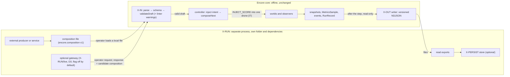

# Optional integration boundaries

> **STATUS: PROPOSED — NOT IMPLEMENTED.** Nothing in this file exists in code. Encore today makes no network call and has no import or export path beyond the CLI's `RunRecord` files and reports. Every boundary below is optional, provider-neutral and Track P. `X-IN` and `X-OUT` stay offline; `X-RUN`, its live variant `X-RUN/live` (§6.1) and `X-PERSIST` also need decision `D3` ([roadmap](../planning/PHASE2_ROADMAP.md#decisions-for-arnav)), and `integrations/` (proposed `P2-WP-30b`, §9) merges only after gate `P2-G6` ([roadmap gate rule](../planning/PHASE2_ROADMAP.md#gates)). This file names no sponsor and designs no provider integration.

Purpose: define how optional external integrations may touch Encore without changing the offline core. Status: proposal for Phase 2 (Track P, after submission). Owner: Arnav (Phase 2 architecture, issue #110). Audit base: `origin/main` 26b438a (first audited at 7a50a69). Re-checked at `origin/main` c697f6c (02:58 GMT, 15 Nov 2026).

## 1. Scope

This file is canonical for:
- the four boundaries `X-IN` (composition input), `X-OUT` (telemetry export), `X-PERSIST` (optional persistence) and `X-RUN` (external integration runner), including `X-RUN/live` (§6.1), the boundary the stacked integration specs #117 and #130 (and #142) depend on;
- the composition file kinds: `encore.composition` v1 and the proposed v2 (§3.2, §3.3);
- the shared gateway skeleton, guard, dependency policy, `requestId` rule, app-side folder and pure validator path (§6.2), which #117, #130 and #142 cite;
- the failure-handling rules and security basics for those boundaries;
- the contract-impact statement for integrations (none, §10);
- the intake template (§11) for William (`wpimento`; "Williams" in [`TEAM_ROLES.md`](../development/TEAM_ROLES.md)).

It links to, and does not restate:

| Topic | Canonical location |
|---|---|
| Phase 2 pipeline, capabilities `C1`–`C9`, `P2-CC-*` register | [`PHASE2_ARCHITECTURE.md`](PHASE2_ARCHITECTURE.md) |
| Score linter checks `L1`–`L6` | [`ANIMATED_CHOREOGRAPHY_RFC.md`](ANIMATED_CHOREOGRAPHY_RFC.md#9-score-linter-checks-l1l6) |
| Gate `P2-G6`, decision `D3`, risk `P2-R14` | [`PHASE2_ROADMAP.md`](../planning/PHASE2_ROADMAP.md) |
| Work package `P2-WP-30` (proposed split into `30a` and `30b`, §9; also `P2-WP-02` fuzz repros, `P2-WP-05` linter hook) | [`PHASE2_WORK_PACKAGES.md`](../development/PHASE2_WORK_PACKAGES.md) |
| Tests `P2-T09`, `P2-T35`; repro format `p2-repro/1`; timing method | [`PHASE2_EVALUATION.md`](../validation/PHASE2_EVALUATION.md) |
| Whether anything reaches the judged demo | [`PHASE2_JUDGING_STORYBOARD.md`](../demo/PHASE2_JUDGING_STORYBOARD.md) (decision `D7`) |
| Candidate list | [`PHASE2_CANDIDATES.md`](../ideation/PHASE2_CANDIDATES.md) |
| Sponsor facts | [`BRIEF.md`](../competition/BRIEF.md#5-prize-tracks) (every sponsor brief is ❌ at 26b438a; `BRIEF.md` unchanged at c697f6c) |

Sponsor-specific investigation, requirements and architecture belong to William. See §12.

### 1.1 What exists today

Status codes: (a) implemented and tested on main · (b) implemented, not integrated · (c) open PR or active · (d) documented only · (e) not present. Status is at 26b438a. Every row was re-checked at c697f6c; a row says so where the status changed. What moved since the first audit is listed once in [`PHASE2_ARCHITECTURE.md`](PHASE2_ARCHITECTURE.md#changes-since-first-audit).

| Piece the boundaries reuse | Status |
|---|---|
| Inject path: `dispatchInject` → `runControlPlan` (`src/app/ui/Composer.ts`) → `controller.handle({type:'inject', recipe, at?})` (`src/app/actions.ts`) → `composeNext` → one `INJECT_SCORE` into the selected drone, in both worlds, registered with both observers | (a) |
| `validateDraft(draft, params)` in `src/app/ui/Composer.ts` (#112) | (b) at 26b438a: `main.ts` called neither `connectComposer` nor `connectInspector`. Re-checked at c697f6c: (a). #113 has merged and `main.ts` mounts both. `validateDraft` is still in `Composer.ts` and still has no palette range check (§3.1). The CURRENT_STATE lock table still lists #113's `src/app/main.ts` and `src/app/ui/**` locks; they bind until the orchestrator lifts them |
| Incoming `SCORE` checks in the brain (`handleScoreMessage` in `encoreBrain.ts`, #105): finite version fields and non-empty `movements` only; an unknown recipe kind is not rejected | (a) |
| `show save` / `show load` console commands | (d): status `'later'` in `commands.ts` |
| `RunRecord` JSON per run, written by `npm run eval` (`src/cli/main.ts`), both arms registered (`src/cli/brains.ts`, #116) | (a) |
| `canonicalJson` and `paramsHash` (`src/cli/run.ts`) | (a) |
| Perf and screenshot harness `scripts/perf/` (#118) | (a) |
| Export from the app (any file, download or storage) | (e) |
| Score linter `L1`–`L6` | (e): proposed `C3`, `P2-WP-04`/`05` |
| Fuzz repro files | (e): proposed `P2-WP-02` |
| Any network call under `src/` | (e): none, also at c697f6c (grep for `fetch(`, `XMLHttpRequest`, `WebSocket`, `EventSource`, `sendBeacon`). `scripts/perf/cdp.mjs` talks to local headless Chrome over WebSocket, so the `P2-T35` scan covers `src/` only |
| `X-IN`, `X-OUT`, `X-PERSIST`, `X-RUN`, `X-RUN/live`, `integrations/gateway/`, `src/app/live/`, `src/app/compose/validate.ts` | (e), also at c697f6c |

## 2. Overview



These rules hold for every boundary:
1. **The core stays offline and unchanged.** `src/`, `tests/`, the CLI, the default build and the judged demo make no network call, with or without integrations ([NFR-04](../specification/requirements.md#3-non-functional-requirements)). The one exception is `X-RUN/live` (§6.1): only after `D3`, only in one confined app folder, only in a non-default build. It never applies to the core folders (`src/contracts`, `src/score`, `src/agent`, `src/sim`, `src/observer`), `src/cli`, `tests/`, `check.sh` or the judged demo.
2. **Files by default.** Data crosses as local files that an operator chooses. The core never opens a socket, never polls a folder and never runs a server. The only other channel is the operator-initiated `X-RUN/live` request (§6.1), whose response enters exactly where a file would (`X-IN` step 2).
3. **One validator.** External compositions pass through the same validation and the same controller as a judge-typed word. There is no second path into the swarm.
4. **Exports are read-only.** They are pure functions of data the simulation already produced. They never change trajectories, `stateHash` or records.
5. **Optional.** Removing every integration leaves Encore fully usable and `bash scripts/check.sh` green (`P2-T35`).

This is the ports-and-adapters pattern (Cockburn, "Hexagonal architecture", 2005) with file-based ports. Nothing in it is new.

## 3. X-IN: composition input

### 3.1 Path from file to swarm

| Step | What happens | Reuses |
|---|---|---|
| 1. Acquire | The operator picks a local file (file picker or drag-and-drop; later `show load`). No URL, no fetch, no folder watch. Under `X-RUN/live` (§6.1) the body of a gateway response takes the file's place; steps 2–8 are unchanged | — |
| 2. Size gate | Reject before parsing if the file is over 64 KiB or not UTF-8 | — |
| 3. Parse | `JSON.parse`, then copy into fresh plain objects. Reject the keys `__proto__`, `constructor` and `prototype` at any depth | — |
| 4. Schema | Strict `encore.composition` v1 (§3.2). Unknown `schema`, unknown `v` or any unknown key rejects the **whole file** | — |
| 5. Composer validation | Each cue becomes a draft via `draftFromRecipe(name, recipe)` and goes through `validateDraft(draft, params)`. That checks the name, `validateText` (font, `TEXT_MAX` = 20), the palette warnings and `expandRecipe`. Errors block that cue; warnings are shown | `validateDraft` (§1.1) |
| 6. Resource and motion constraints | The score linter (pure `src/cli/lint.ts`, which the composer imports) runs **inside** `validateDraft` once `P2-WP-05` lands: `L1`–`L5` now, `L6` once motion exists. Its findings are warnings that never block (`P2-T09`). `X-IN` adds no second linter | [`L1`–`L6`](ANIMATED_CHOREOGRAPHY_RFC.md#9-score-linter-checks-l1l6) |
| 7. Convert | Valid cues become composer drafts. `X-IN` never builds a `Score`. At injection the controller builds it with `composeNext(authoredScore, tick, recipe, droneId, n0, params)`, which assigns `version`, `startTick` and `transitionTicks` | `composeNext` (a) |
| 8. Inject | The operator selects one drone and injects through the inject path (§1.1). The controller's own checks still apply: one `INJECT_SCORE` per tick, and text matching `/^[A-Z0-9 ]{1,20}$/i`. Since 26b438a (re-checked at c697f6c) it also refuses a drone selected in the static pane. The result is one `INJECT_SCORE` into one drone's inbox, scheduled into both worlds and recorded in the event log | I7, [FR-19](../specification/requirements.md#composition-and-score) |

`X-IN` never sets a drone's slot, target or belief, or calls `world.schedule` directly (AGENTS Encore rule 2); never injects into more than one drone; never bypasses the controller's event log, so headless replay of the log (T13) still reproduces `stateHash`; and never schedules injections by itself. Every cue is an operator action, so an external producer never controls the show clock.

Two gaps must be closed first. They are part of `P2-WP-30` (the offline half, proposed `P2-WP-30a`, §9); see [work packages](../development/PHASE2_WORK_PACKAGES.md).
- **Palette range.** `validateDraft` does not check that palette components are finite and in [0, 1]. A non-finite value would also make `canonicalJson` throw. Add the check **to `validateDraft`**, so the composer and `X-IN` share it.
- **Headless use.** `Composer.ts` imports `PreviewLayer` (three.js) and DOM helpers. To validate headless, move `validateDraft` into a pure module (`src/app/compose/validate.ts`, §6.2) with no behaviour change, and keep re-exporting it from `Composer.ts` so the #112 tests stay unchanged. A `--validate-composition <file>` CLI flag can then write a validation report (§4, kind `validation`); it changes `src/cli/main.ts`, which stays untouched for the whole of Track H because the freeze run uses it ([roadmap base state](../planning/PHASE2_ROADMAP.md#base-state-this-roadmap-depends-on)), so it lands only in Track P, after the `P2-G0` (P) archive. `X-RUN` can pre-check its output with it as a subprocess.

### 3.2 File format sketch (`encore.composition`, v1)

This is a versioned data format. It is not a contract type and lives outside `src/contracts`.

```ts
interface CompositionFileV1 {
  schema: 'encore.composition';
  v: 1;
  name: string;                    // 1–24 printable characters (NAME_MAX)
  cues: { name: string; recipe: Recipe }[];   // 1–16 cues; Recipe is exactly the contract union (text | sphere | helix, optional palette)
  provenance?: { producer: string; note?: string };   // each ≤ 200 characters; shown as plain text, never interpreted
}
```

```json
{ "schema": "encore.composition", "v": 1, "name": "Evening set",
  "cues": [ { "name": "Hello", "recipe": { "kind": "text", "text": "HELLO", "palette": [[1, 0.6, 0.1], [0.2, 0.5, 1]] } },
            { "name": "Orb", "recipe": { "kind": "sphere" } } ],
  "provenance": { "producer": "example adapter" } }
```

These fields are rejected because they are unknown keys: `version`, `origin`, `movements`, `startTick`, `transitionTicks`, `droneId`, `tick`, `slots`, any position, target or belief, `motion`, and anything URL-like or code-like.
- **Animated movements.** `motion` stays rejected until `P2-CC-01` is approved. Accepting it then needs a new format version (v2), not a silent extension. Today `copyMovement` (`compose.ts`) would also drop it; that change belongs to [P2-CC-01](ANIMATED_CHOREOGRAPHY_RFC.md#101-p2-cc-01-movementmotion-and-movementcolourmotion).
- **New recipe kinds.** Kinds such as `cloud` and `svg` are `E10` full. They are a contract change to the `Recipe` union ([contract §2](contracts-and-algorithms.md#2-score-and-formation-types)), not an `X-IN` feature. Because gossip does not reject unknown kinds (§1.1), `X-IN`'s strict schema is the guard that keeps one out of the swarm.

### 3.3 Proposed v2 (holds and generated recipes)

**Proposed, needs Arnav.** Until v2 is approved, step 4 accepts v1 only, and a v1 file that carries any v2 field is rejected as an unknown key. v1 stays exactly as §3.2. `encore.composition` v1 and v2 are the only composition formats; there is no `CompositionFile` or `encore.show` kind.

v2 adds two things to v1:
- **`holdTicks`**: an optional per-cue hold, as a tick count. Its bounds are set when v2 is approved. A saved show with holds exports only as v2 (MongoDB MCR-20, #130).
- **Generated recipes**: only after `GF-CC-01` (#117) is approved. They use unit-space geometry, and their shape is defined there, not here. Each generated cue is capped at 16 KB. The per-file rule for v2 (beside the 64 KiB gate of §3.1 step 2) is open: `GQ-3` in #117.

v2 changes nothing else. A v2 file still passes steps 2–8 of §3.1. `motion` stays rejected until `P2-CC-01` (§3.2).

**Loading a library.** The MVP path is "Load as drafts" (§3.1 step 7): each cue becomes a composer draft, and the operator injects it. `holdTicks` is carried as data and does not act. `X-IN` never schedules injections by itself (§3.1), so a timed cue runner that plays holds is a separate, opt-in follow-up (MongoDB MDB-D6 and MCR-21, #130). It is not part of `X-IN`.

## 4. X-OUT: telemetry export

### 4.1 Contents

The export is bounded, versioned and read-only. It is one NDJSON file per run (JSON Lines, jsonlines.org): one envelope per line.

| `kind` | `payload` | Source | Source status |
|---|---|---|---|
| `header` | producer (`cli` or `app`), sampling settings, limits | writer | (e) |
| `scenario` | scenario description `{id, seed, score, events, ticks}` plus the full `Params` | `buildScenario`, `resolveParams`; app world config | data (a), not exported |
| `event` | one `EnvEvent` | `RunRecord.events`; `controller.getEventLog()` | (a) |
| `snapshot` | one sampled `WorldSnapshot`, in a lite or full projection (§4.3) | the value `world.step()` returns | data (a); no serialiser (e) |
| `metrics` | one `MetricsSample` | `observer.sample` | (a) |
| `summary` | the summary keys ([evaluation §2](../validation/evaluation-and-tests.md#2-metrics)) | `observer.summary()` | (a) |
| `run-record` | an unchanged `RunRecord` (`v: 1`) | `runOne` | (a) |
| `repro` | a fuzz counterexample, unchanged `p2-repro/1` ([evaluation §6.2](../validation/PHASE2_EVALUATION.md#62-fuzz-campaign-fz1-track-h)) | fuzzer (`P2-WP-02`) | (e) |
| `validation` | an `X-IN` validation report: per cue, errors, warnings and linter findings | §3 | (e) |
| `footer` | line count, dropped count per kind, `truncated` | writer | (e) |

`RunRecord` has no score and no full `Params` ([contract §5](contracts-and-algorithms.md#5-world-events-snapshot-metrics)). The `scenario` line carries them **beside** the record, so `RunRecord` does not change.

### 4.2 Envelope

```ts
interface ExportLineV1 {
  schema: 'encore.export'; v: 1;
  git: string;          // same meaning as RunRecord.git
  paramsHash: string;   // same function as src/cli/run.ts
  runId: string;        // deterministic, see below
  kind: string;         // §4.1
  seq: number;          // 0-based line number, so a reader can detect gaps
  tick: number | null;
  payload: unknown;
}
```

- `runId` is a deterministic function of (scenario id or `app`, `n0`, arm, seed, `git`, `paramsHash`, hash of the canonical event list).
  - For the CLI this extends the existing file name `${scenario}_n${n0}_${arm}_s${seed}`.
  - It is never a wall-clock value, a random UUID or host information.
- The app has no `node:crypto`. It computes `paramsHash` with Web Crypto SHA-256 at export time, outside the tick. Web Crypto is offline and asynchronous.

### 4.3 Size bounds and sampling (proposed; the sizes are estimates, not measured)

| Item | Default | Hard cap | On cap |
|---|---|---|---|
| Line | — | 1 MiB | drop the line and count it |
| File | — | 64 MiB | stop writing, set `footer.truncated = true` |
| `snapshot` (lite) | every 20 ticks (1 s); drops `belief.log` and replaces `radio[].delivered` with its length | 120 per file | drop and count |
| `snapshot` (full) | only with an explicit flag | 20 per file | drop and count |
| `metrics`, `event`, `summary`, `run-record` | all | `event` ≤ 10 000 | drop and count |

- Estimate: a lite snapshot at `n0` = 200 is tens of kilobytes, so an 1800-tick run is a few megabytes. Measure when `P2-WP-30` (proposed `30a`) is built.
- The `header` names the lite projection, and numbers are written exactly, so a consumer can recompute metrics.

### 4.4 Determinism and read-only rules

1. **Never inside a decision.** The writer runs on the observer and CLI side, after `step()` returns. In the CLI, lines are written after `runOne` completes. During the run, only a bounded snapshot sampler buffers copies.
2. **Same inputs, same bytes.** Lines are serialised with `canonicalJson`. Equal inputs give byte-identical files. Nothing wall-clock (`Date`, `performance`), random or host-specific enters any line. This keeps the property `run.ts` states for records: "No wall-clock value enters the record".
3. **Read-only.** The writer never mutates a snapshot or record and never calls a world or brain method. With export on and off, `stateHash`, `RunRecord` and the summary are equal (`P2-T35`).
4. **Budget.** The sampler is the only per-tick cost. It stays ≤ 0.5 ms/tick/world, measured opt-in (`P2_PERF=1`, [evaluation §12](../validation/PHASE2_EVALUATION.md#12-performance-criteria)), inside the base frame budget "both worlds ≤ 3 ms" (SHOULD, [experience §10](experience-and-demo.md#10-performance)). Frame numbers reuse the #118 harness (`scripts/perf/`). Measure it; do not assume it.
5. **App export is on demand**, from data the app already keeps (`worlds.series()`, `getEventLog()`) plus an optional bounded snapshot ring. It is (e) today, also at c697f6c. Wiring it touches `src/app/main.ts`. #113 has merged, but the CURRENT_STATE lock table at c697f6c still lists `main.ts` under #113, and that lock binds until the orchestrator lifts it.

## 5. X-PERSIST: optional persistence

`X-PERSIST` is anything that keeps data beyond a local file: a database, an object store or a remote dashboard. It covers two things only: saved compositions (a show library) and experiment evidence (validated `X-OUT` run records). It never covers live control. It runs **only inside `X-RUN`** (an `integrations/` process or the gateway of §6.1). Inside the core, the only persistence is the local files of the `X-OUT` writer and the existing `RunRecord` files.

It must **not**:
- control the clock (no pacing and no "wait for acknowledgement");
- enter agent decisions. Nothing flows back except a candidate composition that passes `X-IN`, from a file or through `X-RUN/live`, and that an operator then injects;
- block the tick loop;
- be mandatory;
- change deterministic results.

It **must**:
- read only closed files (a `footer` is present), or tail by `seq` and treat a missing footer as truncated;
- be asynchronous, with a bounded queue whose capacity is fixed in its own configuration. On backpressure it drops and counts, and reports the counts;
- write idempotently on (`runId`, `kind`, `seq`), so re-ingesting a file changes nothing;
- retry a bounded number of times with backoff, and log failures in `X-RUN` only.

The in-core `X-OUT` writer bounds its own buffer the same way and records drops in `footer.dropped`.

## 6. X-RUN: external integration runner

| Rule | Detail |
|---|---|
| Location | Proposed: `integrations/<name>/` at the repo root, never under `src/` or `tests/`. A networked service is the one shared optional gateway `integrations/gateway/`, with one independently optional module per approved integration (#117, #130, #142). Each module is enabled only by its own server-side configuration, and losing one disables nothing else. It merges only after `P2-G6` (proposed `P2-WP-30b`, §9) |
| Dependencies | Each integration (the gateway counts as one) has its own `package.json` and lockfile. It is not an npm workspace, so the root `npm ci` installs none of it |
| Excluded from core checks | Already excluded: root `tsconfig.json` includes only `src`, `tests` and `vite.config.ts`; vitest includes only `tests/**`; Vite bundles only what `index.html` reaches. **Not yet excluded:** `eslint .` lints from the root (only `dist`, `node_modules` and `research` are ignored), so `P2-WP-30` (proposed `30b`) adds `integrations/**` to the ignores in `eslint.config.js` (a build-config change, skimmed by its owner per [WORKFLOW](../development/WORKFLOW.md)) |
| Coupling | It talks to Encore through `X-IN` files it writes into its own `out/` folder, `X-OUT` files it reads from a folder the operator gives it, and, for the gateway only, `X-RUN/live` (§6.1). It may run the core's headless validator as a subprocess (§3.1). It may import, by relative path, only pure, dependency-free modules: `src/contracts/**`, `src/score/**`, the pure composition validator (`src/app/compose/validate.ts`, §6.2) and `src/telemetry/**` (proposed, #142). It never imports `src/app` UI code, `src/agent`, `src/sim`, `src/observer` or `src/cli`. Nothing under `src/` imports from `integrations/` |
| Writes | Atomic: write a temporary file, then rename it, so a half-written composition never exists |
| Network | Allowed only in `X-RUN`, and only after `D3` is approved for that integration. Credentials come from that process's environment. The app side of `X-RUN/live` is the one exception under `src/` (§6.1) |
| Demo | The judged demo path never depends on `X-RUN`, and its build has `X-RUN/live` off |
| Removal | Deleting `integrations/` leaves `bash scripts/check.sh` green, offline (`P2-T35`, `P2-G6`) |

### 6.1 X-RUN/live (provisional, D3-gated)

`X-RUN/live` is an HTTP request/response channel between the app and the optional gateway (§6). It exists because the stacked integration specs #117 and #130 ask the app to fetch candidate compositions and saved shows while the simulation runs. Until `D3` is approved it stays documentation, and #117 and #130 cite it as "X-RUN/live (provisional, #110)". Without it, the same work uses file-based `X-IN` (OFFLINE-AUTHORING).

| Rule | Detail |
|---|---|
| Gate | `D3` approved for that integration (§9), and `P2-G6` |
| Mode | Non-default only. A non-secret build flag enables it, and its default value is off. The default build, the judged demo and `bash scripts/check.sh` run with it off and make zero external requests. NFR-04's acceptance check is unchanged |
| Where the app code lives | One confined folder (proposed `src/app/live/`). It is the only place under `src/` that may use a network API. It is reached only from behind the flag, through a compile-time constant, so the default bundle does not contain it. Its tests use an injected fake transport, and no test opens a socket |
| Inbound to Encore | Exactly one kind: a candidate composition. Its body enters `X-IN` at step 2 (§3.1) and must pass every step before an operator injects it (I7). Read-only library and analytics data may also come back, for display only; it never reaches the controller |
| Outbound from the app | Only operator-initiated requests, such as asking for a candidate or saving a composition that already passed `validateDraft`. No world state per tick (streaming telemetry is a separate, unaccepted proposal: OIB-Q5, §13), no credentials and no secrets |
| When | On an operator action, possibly while the simulation runs. Never inside the tick loop, a brain, the world, the observer or any decision path. Nothing returned reaches a drone except through an operator `INJECT_SCORE` |
| Reaching the gateway | A local origin from configuration. A Vite dev proxy for `/api` would change `vite.config.ts`, which is a build-config change that needs its owner's sign-off. It is not decided here (OIB-Q2, §13). Until it is decided for CORS, the gateway sends no CORS headers (§6.2) |
| Failure | The app checks whether the gateway is there (for example `/api/health`). If the gateway is absent or unreachable, the live panel says so and the rest of Encore is unchanged (§7) |
| Scan | `P2-T35` ([evaluation](../validation/PHASE2_EVALUATION.md)) must be extended before any `X-RUN/live` code merges. It must allow network APIs under `src/` only in the confined folder, and check that the default build makes zero external requests |

The gateway skeleton, its guard, the `requestId` rule and the app-side folder are defined once, in §6.2.

### 6.2 Shared gateway skeleton and guard

Stated once here, for every gateway module (#117, #130, #142). Module specs cite this section and never redefine any of it. The rulings are the orchestrator's cross-integration rulings XI-11 to XI-14. Everything here is proposed and `D3`-gated, like §6.1.

**Skeleton (XI-12).** `integrations/gateway/` has one server, one `guard.ts`, one `errors.ts`, one `config.ts` and one `GET /api/health`. Whichever module work package is approved first builds it. Every other module depends on it.
- `errors.ts` holds the one error envelope, `sanitise` and `redact`. Every route fails with `{ "error": { "code", "message", "details"?: [{ "path", "reason" }], "requestId"? } }`. `code` is SCREAMING_SNAKE from one shared list (`VALIDATION_FAILED`, `NOT_FOUND`, `PAYLOAD_TOO_LARGE`, `UNSUPPORTED_MEDIA_TYPE`, `RATE_LIMITED`, `UNAUTHORIZED`, `FORBIDDEN`, `CONFLICT`, `SCHEMA_VERSION_UNSUPPORTED`, `DATABASE_UNAVAILABLE`, `PROVIDER_UNAVAILABLE`, `PROVIDER_ERROR`, `TIMEOUT`, `INTERNAL`). Module-specific reasons go in `details[].reason`. A success body has no `success` flag; the HTTP status carries it.
- Each module is enabled only by its own server-side configuration. One module failing or absent disables nothing else (§6).

**Guard (XI-12).** One guard for every module:

| Rule | Detail |
|---|---|
| Bind | `127.0.0.1` only. The gateway refuses to start on any other address unless a server-side authorisation is configured and enabled. A flag alone is never enough |
| Peer | A non-loopback peer is refused |
| Host | Allow-list: `127.0.0.1:<port>` and `localhost:<port>`, plus the dev proxy if one is used (OIB-Q2) |
| Origin | Exact match on every non-GET request. A missing or `null` Origin gets 403 `FORBIDDEN` |
| Content-Type | A non-JSON body gets 415 `UNSUPPORTED_MEDIA_TYPE` |
| Token | An optional per-launch token |
| CORS | No CORS headers unless OIB-Q2 is decided for CORS |

**Dependency policy (XI-12).** Exact version pins. Install with `npm ci --ignore-scripts`. A 14-day minimum release age for every dependency. Run `npm audit signatures`. Use `node:http`; no web framework unless approved. Each module reads only its own secrets.

**`requestId` (XI-11).** Optional and client-generated, matching `^[A-Za-z0-9._:-]{1,64}$`. The gateway treats it as opaque and echoes it in the error envelope. A value that does not match is dropped, not echoed, and the request still proceeds. The gateway logs its own server id. The Gemini client fills it from one monotonic client counter and matches responses by that counter.

**App-side network code (XI-14).** All of it lives in `src/app/live/`: the gateway clients for `gemini`, `shows` and `tiger` reads. Each module has its own build-time, non-secret boolean flag (for example `VITE_SHOW_LIBRARY`). The flags are constant-folded, so the default build contains and renders no network path and makes zero external requests. Who owns the folder skeleton is open (OIB-Q3).

**Pure validator (XI-13).** `src/app/compose/validate.ts`. Whichever of `P2-WP-30a` and MDB-WP-02 lands first creates it; the other extends it.
- It holds the DOM-free body of `validateDraft` and the palette finiteness and range checks (§3.1).
- It also holds `validateText` and `TEXT_MAX`, **moved** (not copied) from `src/app/ui/commands.ts`, because `commands.ts` imports `actions.ts`, which imports `src/sim`. One re-export line stays in `commands.ts`; that needs its owner's sign-off.
- It imports only `src/contracts`, `src/score` and `src/score/font`. The gateway may import it (§6, Coupling).

## 7. Failure handling

In every row Encore remains fully usable. The **offline fallback** is a library of saved, validated composition files (proposed `assets/compositions/*.json`). They are committed with the repo and re-validated by a test (proposed `tests/cli/compositions.test.ts`) on every check, so they cannot silently rot. Both are owned by `P2-WP-30a` (the offline half of `P2-WP-30`): its allowed files list them and its step 3 commits and re-validates them ([work packages](../development/PHASE2_WORK_PACKAGES.md#p2-wp-30--integration-boundaries-in-code-offline); OIB-Q4, resolved).

| Failure | Detected in | Encore core | Operator sees | Fallback |
|---|---|---|---|---|
| External service unavailable | `X-RUN` | Unaffected; it was never contacted | No new composition file; `X-RUN` writes a status line in its own log | Saved compositions |
| Authentication failure | `X-RUN` | Unaffected | `X-RUN` fails fast with no retry storm. The secret never appears in logs or output files | Saved compositions |
| Timeout | `X-RUN`, with a bounded deadline | Unaffected | No partial file, because writes are atomic | Saved compositions |
| Gateway absent, unreachable or erroring (`X-RUN/live`) | App health check or request | Unaffected; no tick waits on it | The live panel shows "unavailable" or the error; nothing else changes | Saved compositions |
| Malformed data (not JSON, over the size gate, wrong `schema` or `v`, unknown key), from a file or a gateway response | `X-IN` steps 2–4 | Nothing loaded, nothing injected | The whole file is rejected with a list of reasons | Saved compositions |
| Data violating score constraints (unsupported glyph, more than 20 characters, `expandRecipe` throws, palette out of range, or the controller refuses) | `X-IN` step 5, or the controller | The invalid cue never dispatches, as in the composer today | The cue is shown with its errors; valid cues stay usable | Fix the file or use a saved composition |
| Linter findings (`L1`–`L6`) | `X-IN` step 6 | No block (`P2-T09`) | Warnings, as in the composer | Operator's choice |
| Export consumer slow, or disk full | `X-OUT` writer or `X-PERSIST` | The run and its `RunRecord` complete as today. The export fails or truncates, and the run does not | `footer.truncated` and dropped counts, or a writer error | Re-export from the records |
| Integration disabled or removed | — | Identical to today | Nothing | Not needed |

## 8. Security basics

These rules are input hygiene. They are not a security claim: the claims table keeps "Drones are assumed honest; any drone can inject a score" ([requirements §5](../specification/requirements.md#5-claims-we-must-not-make)).

- **No secrets in the repo or the browser bundle.**
  - Vite inlines `VITE_*` variables into the built files, so no credential ever goes into a `VITE_*` variable.
  - Credentials live only in the `X-RUN` process environment (the gateway's, for `X-RUN/live`). The app never holds one. The root `.gitignore` already ignores `.env*`, `*.pem` and `*.key`.
- **External data is untrusted.** A gateway response counts as external data, exactly like a file. Validate strictly with size limits before anything else. Reject prototype keys. Build fresh objects. This is the OWASP Input Validation guidance, nothing new.
- **No code execution from external content.**
  - No `eval`, no `Function` and no dynamic `import`.
  - No expression language in compositions, and no URL is fetched because a file names one.
  - Text such as names and `provenance` is rendered with `textContent`, never `innerHTML`.
- **Paths.** The `X-OUT` writer writes only into the directory the operator gives it. Its file names come from sanitised deterministic parts, so nothing taken from a file can traverse paths.
- **Exports hold simulation data only.** No host names, user names or absolute paths.
- **Localhost gateway requests and dependencies.** The request rules for every gateway module (127.0.0.1 bind, Host allow-list, exact Origin match, 415 for non-JSON bodies, optional per-launch token) and the dependency policy (exact pins, `npm ci --ignore-scripts`, 14-day minimum release age, `npm audit signatures`) are stated once, in §6.2. Module specs cite them there.

## 9. The no-network rule and decision D3

Three rules forbid network services today:
- **NFR-04** ([requirements §3](../specification/requirements.md#3-non-functional-requirements)), the offline rule: "Offline, one laptop: no internet and no external services, at run time and in the demo. […] Internet is needed only for the one-off `npm ci`".
- The [`AGENTS.md`](../../AGENTS.md#0-ground-rules) ground rule: "**Software only.** No hardware, no network calls and no external services, in code, tests or the demo".
- The last row of [contract §12](contracts-and-algorithms.md#12-deliberately-not-in-the-mvp): "any network or external service" is out of scope, revisit "Never".

**A citation error, stated once here.** Four places attribute the network ban to NFR-10 (checked at c697f6c):
- `AGENTS.md:15`;
- the scope line of [`CURRENT_STATE.md`](../CURRENT_STATE.md), which cites NFR-10 for "no internet, no external services";
- [`docs/project-manifest.yaml`](../project-manifest.yaml) line 14: "no external services; the whole application runs on one laptop (NFR-10)";
- the contract §12 row.

NFR-10 is the software-only, no-hardware rule; the network and external-service ban is **NFR-04**. Phase 2 docs cite NFR-04.

**`D3`** is a team decision, listed in the [roadmap](../planning/PHASE2_ROADMAP.md#decisions-for-arnav); Arnav consults William and Haris, agents do not. It amends four things together: NFR-04, the AGENTS ground rule, the contract §12 "Never" row and the [decision log](../planning/decisions-and-risks.md#decision-log-newest-first). The amendment must keep all of these:
1. The core folders, `src/cli`, `tests/`, the CLI, the default build and the judged demo stay offline. NFR-04's acceptance check is unchanged.
2. Network access is allowed only inside `X-RUN` (`integrations/`, including the gateway), per approved integration (intake §11). The single exception under `src/` is the confined `X-RUN/live` folder in a non-default build (§6.1).
3. The core passes `bash scripts/check.sh` offline with `integrations/` removed and `X-RUN/live` off (`P2-T35`).

**Only `X-RUN` and `X-RUN/live` need `D3`** (and `X-PERSIST`, which runs inside `X-RUN`). `X-IN` and `X-OUT` are offline files and need no amendment. `D3` is one decision, shared with the integration specs' own network gates (#117, #130, #142). Approving it for one integration does not approve it for another.

**Which package merges when.** The gate rule is canonical in the [roadmap gates](../planning/PHASE2_ROADMAP.md#gates); this file does not set it. [`PHASE2_ARCHITECTURE.md` §4.11](PHASE2_ARCHITECTURE.md#411-stage-11-optional-export) proposes splitting `P2-WP-30` in two:
- **`P2-WP-30a`**: `X-IN` and `X-OUT` in `src/cli`, the pure validator module and its palette checks, and `--validate-composition`. It is offline, needs no `D3`, and is gated by `P2-G0` (P) only.
- **`P2-WP-30b`**: `integrations/` (including the gateway), the `eslint.config.js` ignore and `X-RUN`. It is gated by `P2-G6` and `D3`.

Until the roadmap adopts the split (the work packages already have), the roadmap gates both halves at `P2-G6`; `30a` also merges after `P2-WP-23` (`Composer.ts`). Either way, `integrations/` merges only after `P2-G6`.

**Recommendation.** No amendment during the hackathon window (high confidence). Nothing on the judged path needs it, and there is no time to validate it. After submission it is the team's call.

## 10. Contract impact: none

| Boundary | What it touches | Why it is not a contract change |
|---|---|---|
| `X-IN` | `Recipe` (read), the `inject` intent, `composeNext`, `INJECT_SCORE` | All of these exist unchanged. `ControlIntent` is app-internal (`actions.ts`), not a contract file. The composition format is new data outside `src/contracts` |
| `X-OUT` | `WorldSnapshot`, `MetricsSample`, `EnvEvent`, `RunRecord`, summary keys | They are serialised unchanged inside a new envelope. `RunRecord` stays `v: 1`; score and params travel in a separate `scenario` line |
| `X-PERSIST`, `X-RUN` | Files only | They are outside the process and outside `src/` |
| `X-RUN/live` | An app-side client folder and a candidate composition | The candidate is an `encore.composition` body that goes through `X-IN`. The gateway reads contract types and changes none |
| Shared behaviour | `validateDraft` palette check, pure-module move | App code from #112, not contract (§3.1) |

Things that **would** be contract changes, none of which is proposed here:
- adding score or params to `RunRecord`;
- new recipe kinds;
- `motion` in a movement (`P2-CC-01`, owned by [`ANIMATED_CHOREOGRAPHY_RFC.md`](ANIMATED_CHOREOGRAPHY_RFC.md));
- any new `EnvEvent` for integrations.

Once code exists, the format types live in their modules and this file stays the source of truth for behaviour, mirroring the contract rule.

## 11. William's intake template

Copy one per sponsor or provider. Fill only what is verified. Mark the rest ❓ or ❌ as in [`BRIEF.md`](../competition/BRIEF.md).

```markdown
# Integration intake: <sponsor> / <challenge>

> **STATUS: DRAFT | SUBMITTED | APPROVED | REJECTED.** Not implemented.

| Field | Value |
|---|---|
| Author | William (`wpimento`) |
| Date (GMT) | 2026-11-.. ..:.. |
| Linked issue | #.. |
| Reviewer | Arnav (contract and integration owner) |
| Depends on | D3 (no-network amendment): pending / approved |
| Review outcome | pending / approved / changes requested, with date |

## 1. Sponsor and challenge
Name, track ID from BRIEF (P1–P11), challenge title.

## 2. Verified sponsor requirements
| ID | Requirement (verbatim) | Source (URL, or "booth, <name>, <time>") | Status (✅ / 🕘 / ❓ / ❌) | Checked by, when |
|---|---|---|---|---|

## 3. Proposed use case
One paragraph. What happens, and who does it.

## 4. User-visible benefit
What a judge or operator sees that they could not see before.

## 5. Relevant Encore extension interface
X-IN / X-OUT / X-PERSIST / X-RUN / X-RUN/live (tick all that apply), and why each one is needed.

## 6. Data inputs and outputs
| Direction | Format (encore.composition v1 / encore.export v1 kinds) | Size and rate | Example file |
|---|---|---|---|

## 7. External dependencies
Packages (exact versions), services, accounts. All of them live in integrations/<name>/ only.

## 8. Security and credential requirements
Which secrets, where they are stored (X-RUN environment only), rotation, what is logged.

## 9. Offline fallback
Which saved, validated compositions are used when the service is unavailable.

## 10. Acceptance criteria
Observable checks, including: the core passes bash scripts/check.sh offline with integrations/ removed and X-RUN/live off (P2-T35).

## 11. Demonstration plan
Where it is shown (never on the judged path without D7), its length, and what happens if the service is down.

## 12. Required contract changes
None expected. Otherwise, one block per change, labelled
**PROPOSED CONTRACT CHANGE — REQUIRES ARNAV APPROVAL**, with: current interface, problem it cannot solve,
proposed extension, justification, backwards compatibility, migration steps, affected modules, affected tests,
conflicts with active work.

## 13. Test evidence
Commands run and their results, honestly (the AGENTS handoff format). "Not run" is an allowed answer.
```

## 12. Intentionally left to William

This file decides none of the following. Each belongs in William's intake documents, which are reviewed by Arnav before `P2-G6`:
- which sponsors or providers to pursue, and whether any is worth integrating at all;
- verifying sponsor requirements (`BRIEF.md` is the place for event facts; #1 tracks capture);
- provider SDKs, API workflows, request and response shapes, rate limits, quotas and cost;
- authentication and credential flows;
- schemas or data models in any external store used by `X-PERSIST`;
- any model, prompt or content-generation design inside `X-RUN`;
- the integration's own tests and demonstration plan, within §6 and `D7`.

## 13. Open questions

| ID | Question | Owner | Blocks |
|---|---|---|---|
| OIB-Q1 | **Resolved (XI-14).** The `X-RUN/live` flags act at build time: one non-secret boolean flag per module, constant-folded, so the default `dist/` contains no client and makes zero external requests (§6.2) | Arnav | Nothing |
| OIB-Q2 | How does the app reach the gateway: a Vite dev proxy for `/api` (a `vite.config.ts` change, owner sign-off) or a local origin with CORS on the gateway? Until it is decided for CORS, the gateway sends no CORS headers (XI-12, §6.2) | Arnav, with the build-config owner | `X-RUN/live` wiring in #117, #130 and #142 |
| OIB-Q3 | Which work package owns the app-side `X-RUN/live` client folder (`src/app/live/`, §6.2) and the `P2-T35` extension? Neither half of `P2-WP-30` does: the proposed `30a` is offline, and the proposed `30b` covers `integrations/`, not app code under `src/` (§9) | Arnav | `X-RUN/live` code |
| OIB-Q4 | **Resolved.** `P2-WP-30a` now lists the saved-composition library (`assets/compositions/*.json`) and its re-validation test (`tests/cli/compositions.test.ts`) in its allowed files, and its step 3 commits and re-validates them ([work packages](../development/PHASE2_WORK_PACKAGES.md#p2-wp-30--integration-boundaries-in-code-offline)). The §7 fallback is owned | Arnav | Nothing |
| OIB-Q5 | `X-OUT/live` (proposed by #142, TIG-11): a `D3`-named amendment for streaming per-frame telemetry samples from `src/app/live/telemetry/` to a separate, write-only gateway process. Neither `X-OUT` (offline files) nor `X-RUN/live` (operator-initiated requests only, no world state per tick, §6.1) covers it. **Not accepted; Arnav decides** | Arnav | Any streaming telemetry code in #142 |
