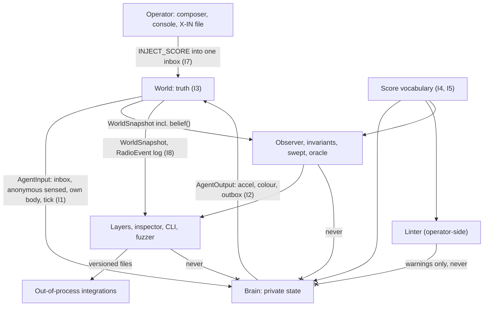

# Phase 2 architecture

> **STATUS: PROPOSED — NOT IMPLEMENTED.** Nothing in this file exists in code. It is a design for work that starts only after the base gates, and every contract change in it needs Arnav's approval first.

Audit base: `origin/main` 26b438a (first audited at 7a50a69).

Purpose: the cross-system Phase 2 pipeline, with the responsibility, dependencies, contracts, ownership, determinism, cost, error handling and tests of each stage. It also holds the module map, the information-rule mapping, capabilities C1–C9, the proposed requirements (`P2-FR`, `P2-NFR`) and ADRs (`P2-ADR`), the contract-change register (`P2-CC`) with the full text of P2-CC-07, the traceability table, the one "Changes since first audit" note that the other Phase 2 docs link to, and the adversarial review record with its unresolved questions (AQ-*). Status: proposed, awaiting decisions D1–D7 in the [roadmap](../planning/PHASE2_ROADMAP.md#decisions-for-arnav). Owner: Arnav (Phase 2 architecture, issue #110).

## 1. Scope, sources and status labels

**What it links to and does not restate:**

| Topic | Canonical file |
|---|---|
| Scoring of E01–E10 and N01–N21, verdicts, rejects | [`PHASE2_CANDIDATES.md`](../ideation/PHASE2_CANDIDATES.md) |
| Gates P2-G0–P2-G6, decisions D1–D7, risks P2-R*, cut order | [`PHASE2_ROADMAP.md`](../planning/PHASE2_ROADMAP.md) |
| P2-CC-01, -02, -06, motion primitives, linter checks L1–L6 | [`ANIMATED_CHOREOGRAPHY_RFC.md`](ANIMATED_CHOREOGRAPHY_RFC.md) |
| P2-CC-03, -04, -05, -08, healing in motion, steering safety | [`ADAPTIVE_RECOVERY_AND_SAFETY_RFC.md`](ADAPTIVE_RECOVERY_AND_SAFETY_RFC.md) |
| X-IN, X-OUT, X-PERSIST, X-RUN, the no-network rule | [`OPTIONAL_INTEGRATION_BOUNDARIES.md`](OPTIONAL_INTEGRATION_BOUNDARIES.md) |
| Tests P2-T*, invariants INV-*, repro format `p2-repro/1`, scenarios M0–M6, X1–X3, FZ1, timing method | [`PHASE2_EVALUATION.md`](../validation/PHASE2_EVALUATION.md) |
| Work packages P2-WP-*, allowed files, lanes | [`PHASE2_WORK_PACKAGES.md`](../development/PHASE2_WORK_PACKAGES.md) |
| Demo beats P2-B* | [`PHASE2_JUDGING_STORYBOARD.md`](../demo/PHASE2_JUDGING_STORYBOARD.md) |
| Base types, algorithms, limits | [contracts](contracts-and-algorithms.md) |
| Base components and rules I1–I8 | [system architecture](system-architecture.md#3-information-rules) |
| Base FR/NFR and claims we must not make | [requirements](../specification/requirements.md#5-claims-we-must-not-make) |

**Status labels** for existing things, all **at 26b438a**: **(a)** implemented and tested on main · **(b)** implemented, not integrated · **(c)** open PR or active · **(d)** documented only · **(e)** not present. Everything they label is base work, never Phase 2 work.

### Changes since first audit

Between 7a50a69 and 26b438a these merged, and are now (a) unless noted:
- **#111** `[contract]` text: contract §8.5 has 9 limits (limit 3: about 20 s for a chain with a two-hop drone; limit 8: an injection pauses healing for `tStable`; limit 9: a score from another base can send a drone back for up to `scoreLead`). §9 jitter is a fresh `nextRandom() % scoreJitter`; the stall bound is `max(1 + scoreJitter, scoreResendMin)`.
- **#96** `[contract]` paced targets: `pacedSlotPos(score, tick, slot, n0, params)` (`src/agent/steer.ts:114`) with the module constant `PACE_SETTLE_TICKS = 60`, not a `Params` field. Every movement after the first is paced in a straight line from the same slot of the previous movement, reaching the slot at `holdStart − 60`; movement 0 is paced from `launchPos` only when `startTick ≤ 0`. Both brains use it for steering only. EVAL movement A now starts at `min(-40, 380 − holdGrace − tA)`.
- **#105** score gossip: adoption `encoreBrain.ts:129-143`, `scheduleScoreSend` `:118-122`; T16 `tests/g4/dissemination.test.ts`, T18 `tests/g4/relay.test.ts`. Incoming scores are checked only for a finite version and non-empty `movements`; unknown recipe kinds are not rejected.
- **#107** Encore brain in the app; **#116** CLI Encore arm (`src/cli/brains.ts` `ARMS = ['static', 'encore']`); **#118** perf and screenshot harness (`scripts/perf/*`, [`QA.md`](../demo/QA.md)); **#68** Encore isolation and replay tests; **#104** scripted demo; **#108** inspector follow-ups; **#119**, **#120** demo constants and tests.
- **#112** composer and console, and **#109** timeline (no seek): merged but **not mounted** (`main.ts` calls neither `connectComposer` nor `connectInspector`), so (b).

Still open at 26b438a, and the source of Track H's **contended files**: #113 app shell (mounts composer, inspector, ghost slots and HUD `inHold`; edits `main.ts`, `worlds.ts`, `actions.ts`, `commands.ts`, `Hud.ts`), #115 Encore step performance (`encoreBrain.ts`, `world.ts`, `grid.ts`, `observer/measure.ts`), #121 follow-ups to #112/#109, #122 evidence minimum matrix (G5; `src/cli/**`, `results/`), #124 CURRENT_STATE, #125 submission text, #82 draft sensing order (`world.ts`). Inspector, ghost-slot and composer visibility depends on #113.

**Active work at review time (Sun 15 Nov, 02:25 GMT, `origin/main` ac8d1af).** The statuses above stay as at 26b438a. This note only updates what Track H avoids and waits for:
- Merged since 26b438a: #124 (00:24), #122 (00:33), #115 and #121 (00:36), #82 (01:40, adds `src/sim/sensing.ts`), #125 (01:50) and #113 (01:56, which mounts the composer, inspector and ghost slots).
- Open and contending:
  - **#126** quality ladder. It edits the layer seam Track H uses: `src/app/render/Layer.ts` gains an optional `setQuality?(level: number)`. It also edits `WorldView.ts`, `quality.ts`, `layers/{Radio,Belief,Drone}Layer.ts`, `colourModes/{radioTrace,belief}.ts`, `main.ts`, `worlds.ts` and `ui/Readout.ts`. `RadioLayer.ts` and `radioTrace.ts` are the pattern P2-WP-03 copies.
  - **#127** readout phase: `main.ts`, `worlds.ts`, `ui/Readout.ts` and `ui/DemoScript.ts`.
  - **#137** freeze run: `results/README.md` and `scripts/eval/*`.
- Locks: the [CURRENT_STATE](../CURRENT_STATE.md) lock table also locks `src/app/render/**` (#126) and `results/**` (#137). It still lists #113 on `src/app/main.ts` and `src/app/ui/**`, and it keeps `src/agent/**` orchestrator-only.
- Consequences:
  - P2-WP-03 and P2-WP-06 start only after #126 lands. They then implement the optional `setQuality`, shedding arrows and the legend at high levels.
  - The waits on #115, #121 and #113 are now satisfied.
  - `world.ts` is cited below by function name, because #115 and #82 moved its lines.

**Constraints this design obeys** (stated in the [roadmap](../planning/PHASE2_ROADMAP.md), not repeated in full):
- Evidence is fragile. Once the evidence matrix (#122) runs with frozen params, any change to `src/agent/**` behaviour, `steer`, `Params` or `EncoreState` creates a new evidence revision: `paramsHash` hashes the whole `Params` object, and `stateHash` hashes brain state.
- Two tracks. **Track H** (hackathon, from P2-G0 (H)) is new files only, makes zero `[contract]` PRs and is off by default. **Track P** (post-submission) holds every contract change.
- Contended files (above) stay untouched in Track H. A new `src/app/render/layers/*Layer.ts` self-registers through `import.meta.glob` (`layers/index.ts`) and gets every tick through `Layer.ingest`.
- Binding wording: "checked properties on these runs, not proofs", "predicted conflicts under ideal paced flight (no avoidance) — not a collision forecast", "measured, not guaranteed", "oracle upper bound". Never "collision-free", "novel algorithm", "guaranteed" or "detects dead drones".
- No network calls in code, tests or demo (NFR-04). Only X-RUN needs D3 ([no-network rule](OPTIONAL_INTEGRATION_BOUNDARIES.md#9-the-no-network-rule-and-decision-d3)).

## 2. Capabilities C1–C9

A capability is an accepted bundle of candidates. Scores, confidence and rejected alternatives are in [`PHASE2_CANDIDATES.md`](../ideation/PHASE2_CANDIDATES.md). Post-hackathon order: C7 → C8 → C9.

| Cap | Name | From | Track | Set | Pipeline stages | Requirements |
|---|---|---|---|---|---|---|
| C1 core | Checked properties and counterexample search (P2-WP-01, -02) | N05 + N06 (E06 core) | H | Minimal | 9, 10 | P2-FR-01, -02 |
| C1 readout | Live invariant readout (P2-WP-06) | N05 (readout) | H | Recommended | 10 | P2-FR-06 |
| C2 | Repair cascade trail | N07 (+ E05 framing) | H | Minimal | 10 | P2-FR-03 |
| C3 | Score linter L1–L5 (L6 later) | N08 + E09 min + E10 min | H | Recommended | 2 | P2-FR-04, -05 |
| C4 | Resilience curves, oracle bound, swept collisions | E07 + N09 + N10 | H | Stretch | 9, 10 | P2-FR-07, -08 |
| C5 | Knowledge-vs-truth inspector | E05 min, then full | H stretch (needs a D1 exception) / P | Stretch | 6 (P), 10 | P2-FR-09, -17 |
| C6 | Concurrent score conflict evidence | E08 min | H | Stretch | 3, 4, 10 | P2-FR-10 |
| C7 | Animated choreography | E01 + N02 | P | Post-hackathon core | 1, 2, 5, 7, 9, 10 | P2-FR-11, -12, -13, -19 |
| C8 | Healing in motion | E02 + N01 | P | Post-hackathon flagship | 6, 9 | P2-FR-14 |
| C9 | Avoidance with authority | E03: N03 (accepted, first step) then N04, with N10 | P | Post-hackathon | 7, 9 | P2-FR-15, -16 |
| — | Integration boundaries | Phase 2 brief, integrations | P (P2-WP-30a after P2-G0 (P); P2-WP-30b, X-RUN, after P2-G6 and D3; §4.11) | Optional | 1, 11 | P2-FR-18 |

## 3. Pipeline overview

Today's pipeline plus operator-side checks before injection and read-only analyses after observation; Track P makes stages 5–7 time-dependent. Stages 1–3 run on the operator side, 4–7 in each drone on its own data, 8 in the environment, and 9–11 read only.

```mermaid
flowchart LR
  subgraph OP["Operator side: app and CLI"]
    S1["1 Composition authoring<br/>Composer, console, X-IN file"]
    S2["2 Validation and linter<br/>validateDraft, L1-L6"]
    S3["3 Injection<br/>INJECT_SCORE into one drone"]
  end
  subgraph DR["Each drone: src/agent, imports contracts and score only"]
    S4["4 Dissemination<br/>LWW on issuedTick, origin"]
    S5["5 Local targets<br/>slotPosAt, slotVelAt"]
    S6["6 Local coordination<br/>claims, heal, co-moving frame"]
    S7["7 Safety-aware steering<br/>feed-forward, budget, filter"]
  end
  S8["8 Physics<br/>src/sim world, unchanged role"]
  subgraph RO["Read-only consumers (I6)"]
    S9["9 Observation<br/>metrics, invariants, swept, oracle"]
    S10["10 Visualisation and evaluation<br/>layers, inspector, CLI, fuzzer"]
    S11["11 Optional export X-OUT<br/>versioned files"]
  end
  S1 --> S2 --> S3 --> S4 --> S5 --> S6 --> S7 --> S8
  S8 -- "AgentInput only (I1)" --> S4
  S8 -- "WorldSnapshot" --> S9 --> S10 --> S11
```



## 4. Stage contracts

Costs are per tick at `n0` = 200 unless stated. Every Phase 2 figure is an **estimate**; measured baselines are in §9. Rows a stage does not change are omitted.

### 4.1 Stage 1: composition authoring

| Aspect | Specification |
|---|---|
| Responsibility | The operator builds a recipe draft and previews it locally. Nothing reaches a world until stage 3 |
| Existing | (a) `ControlPanel` inject path into `actions.ts`. (b) the console grammar `ui/commands.ts`, and `Composer.ts`, `Console.ts`, `PreviewLayer.ts` (#112; mounted by #113). (e) file import |
| Phase 2 | Track H: none. Track P: animated drafts through `Movement.motion` (P2-CC-01, P2-WP-23). P2-WP-30a: an X-IN composition file read out of process and checked by the same validator ([integration boundaries](OPTIONAL_INTEGRATION_BOUNDARIES.md)) |
| Allowed dependencies | `src/app/ui` may import `src/contracts`, `src/score` (preview expansion) and `src/cli/lint.ts`. It never imports `src/agent` or brain state types |
| Input → output | Typed text, commands or an X-IN file → contract `Recipe` (Track P: `Movement` with optional `motion`) |
| Ownership, determinism | The Composer owns its drafts and no simulation state. Off the tick path; a preview is a pure function of the draft |
| Cost, errors | A cold `expandRecipe` takes a few ms at `n0` 200 (audit measurement, not asserted), then is memoised. An invalid draft is never dispatched (`dispatchInject`, #112) |
| Tests | `tests/app/composer/*`; P2-T09 |

### 4.2 Stage 2: score validation and linting

| Aspect | Specification |
|---|---|
| Responsibility | Reject malformed drafts (errors). Warn about predicted consequences (L1–L5, later L6), operator-side only. Checks, output and placement are canonical in the [choreography RFC §9](ANIMATED_CHOREOGRAPHY_RFC.md#9-score-linter-checks-l1l6) |
| Existing | (b) `validateDraft(draft, params)` in `Composer.ts`: name, font, palette and `expandRecipe` errors and warnings (merged, not mounted) |
| Phase 2 | Track H: pure library `src/cli/lint.ts` (P2-WP-04) plus a CLI lint report for the EVAL transitions; one hook in `validateDraft` (P2-WP-05). Track P: L6 (P2-WP-24) |
| Placement decision | `src/cli/lint.ts`, **not** `src/score` (a `src/score` change ripples into both brains and the evidence). It imports only `src/contracts` and `src/score`, which its own test asserts, and restates the #96 pacing formula with a parity test pinned to `PACE_SETTLE_TICKS`. The composer imports it: `tests/boundaries.test.ts` restricts only core folders, and the app may import everything ([architecture §2](system-architecture.md#2-components)). After P2-CC-02 it imports pacing from `src/score` and the copy goes |
| Ownership, determinism | Stateless; a pure function of its inputs (P2-T07) |
| Cost | Off the tick path, run on draft change. L1: 19 900 pairs, closed form. L2: O(n0²) graph build plus BFS. L3: O(n0²). Estimated at low milliseconds; not measured |
| Errors | It never returns an error. If it throws, the composer shows "lint unavailable" and injection proceeds. Warnings never block (P2-T09) |
| Tests | P2-T07 (L1 closed form against brute-force sampling), P2-T08 (calibration report, not a pass line), P2-T09, P2-T17 (L6) |

L1 is exact only because #96 gives every slot of a movement the same `begin` and `span`. It reports **predicted conflicts under ideal paced flight (no avoidance) — not a collision forecast**: one scratch computation (not a repo test) found 183 pairs below `dCollide` at launch and 25 in A → B, against 14 measured collisions per S0 run, so P2-T08 is a calibration report, never a forecast claim.

### 4.3 Stage 3: injection

| Aspect | Specification |
|---|---|
| Responsibility | Deliver one new score to **one** drone (I7) in both worlds, and register it with both observers |
| Existing | (a) `composeNext` and `actions.ts` `schedule()`. The world puts one `OPERATOR` `ScoreMsg` into one inbox |
| Phase 2 | Track H: no change; X3 (P2-WP-10) uses existing `EnvEvent`s. Track P: a score may carry `motion` (P2-CC-01). `copyMovement` in `src/score/compose.ts` drops unknown fields today, so P2-CC-01 changes it ([RFC §10.1](ANIMATED_CHOREOGRAPHY_RFC.md#101-p2-cc-01-movementmotion-and-movementcolourmotion)) |
| Input → output | `Recipe` → `EnvEvent { type: 'INJECT_SCORE' }`, with explicit tick and drone id |
| Tests | T13, FR-19; P2-T14 |

### 4.4 Stage 4: dissemination

| Aspect | Specification |
|---|---|
| Responsibility | Spread the newest score by delivered radio only |
| Existing | (a) #105: last-writer-wins on `(issuedTick, origin)`, anti-entropy from the heartbeat version, rate-limited `SCORE` sends that are never cancelled ([contract §9](contracts-and-algorithms.md#9-score-dissemination-and-partitions-adr-005-adr-008); §8.5 limits 7–9) |
| Phase 2 | **No semantic change** in either track. Merging concurrent scores and deferred adoption (N21) are rejected or deferred ([candidates](../ideation/PHASE2_CANDIDATES.md)). C6 measures the churn bound only. Track P: the `SCORE` payload grows by one motion spec per movement. No new message type |
| Input → output | Inbox `SCORE` → adopted `Score` in the drone's own `EncoreState`, recomputed `mvIndex` |
| Determinism, cost | Jitter is a fresh draw from the per-drone seeded stream. At most one `copyJson` send per `scoreResendMin` per drone |
| Errors | Only a missing or non-finite version and empty `movements` are ignored (`encoreBrain.ts:129-143`); an unknown recipe kind is not rejected and would fail inside `expandRecipe`. Track P: an invalid `motion` must be rejected at adoption (`validateMotion`), because a brain that throws aborts the whole world step (`step()` in `src/sim/world.ts`) |
| Rule for generators | Scenario generators and the fuzzer never emit two different scores with the same version: equal versions with different content never converge |
| Tests | T16, T18, `tests/g4/*`; P2-T14 |

Prior art: gossip and anti-entropy (Demers et al. 1987; Scuttlebutt) and LWW registers (Shapiro et al. 2011). Nothing here is new.

### 4.5 Stage 5: local time-dependent target computation

| Aspect | Specification |
|---|---|
| Responsibility | Give each drone where its slot is **now** and how fast it moves, from the score and the synced clock only |
| Existing | (a) `expandRecipe(...).slots[slot].pos`, static per movement. (a) `pacedSlotPos` (#96, `steer.ts:114`), the aim point during transitions only; `Belief.target`, the settled checks and sensing use the real slot |
| Phase 2 | Track P (P2-CC-02, P2-WP-20): pure `slotPosAt` and `slotVelAt` in `src/score`, closed form, with motion anchored to the movement's own `holdStart`. `pacedSlotPos` and `PACE_SETTLE_TICKS` move into `src/score` byte for byte, `pacedSlotVel` is added, and `steer.ts` re-exports both ([RFC §3.5](ANIMATED_CHOREOGRAPHY_RFC.md#35-composition-with-paced-targets-96)). `Belief.target` = `slotPosAt(now)` |
| Allowed dependencies | `src/score` → `src/contracts` only. Callers: both brains, the observer, app ghost and preview layers, the linter |
| Input → output | `(Score, tick, slot, n0, Params)` → `Vec3` (position) or `Vec3` (velocity) |
| Ownership | Stateless. The `expandRecipe` memo key must never include the tick |
| Determinism | Closed form in the tick, with no integrated state, so a late adopter computes the same target as an early one (P2-T21). Trigonometry is engine-dependent: replay holds within one host (ADR-002) |
| Cost | Own target: O(1) per drone per tick. The vacancy scan evaluates up to `n0` slots per scan tick (1 in 5): about 8 000 slot transforms per tick swarm-wide. A per-tick transform cache would be module-level mutable state, forbidden in brains |
| Errors | `RangeError` for a missing slot (existing). Non-finite motion parameters are rejected at validation (stage 2) and at adoption (stage 4) |
| Tests | P2-T20 (motion absent ⇒ equal to `expandRecipe` exactly), P2-T21, P2-T22 |

### 4.6 Stage 6: local coordination

| Aspect | Specification |
|---|---|
| Responsibility | Decide, on the drone's own data, whether to heal, claim, commit, pop or yield ([contract §8](contracts-and-algorithms.md#8-healing-local-claims-adr-007)) |
| Existing | (a) the Encore brain: `canHeal` (5 conditions), the two-signal vacancy, one-hop claims, history pops, physical yield. Static: none |
| Phase 2 | Track H: **no change** (`encoreBrain.ts` fixes the evidence, and `src/agent/**` is orchestrator-only). Track P: the co-moving frame (P2-CC-04): vacancy, yield and settle at `input.tick` against `slotPosAt`, relative settle, `rOccEff` for the vacancy test only, and a claim feasibility guard, all with code constants. It **depends on P2-CC-03**: without feed-forward, lag pushes `rOccEff` past the `slotSpacingMin − rOcc` = 0.9 m cap ([safety RFC §1.4](ADAPTIVE_RECOVERY_AND_SAFETY_RFC.md#14-the-effective-occupancy-radius-rocceff)). Yield under jam plus lag is open question AR-Q1 ([§8](ADAPTIVE_RECOVERY_AND_SAFETY_RFC.md#8-open-questions-for-review)). Brain-produced reasons `Belief.why` (P2-CC-07, §12.2) |
| Allowed dependencies | `src/agent` → `src/contracts`, `src/score`. No `Math.random`, `Date`, `performance` or module-level mutable state; index-order iteration; seeded stream in state |
| Input → output | `AgentInput` + `EncoreState` → slot decisions in state; claims in `HB.claim`; `Belief` |
| Ownership | `EncoreState` is private. Others see it only through `belief()` and `World.inspect().state` |
| Cost | Today O(n0) per drone per scan tick, so swarm-wide O(n0²)/5. Track P keeps that order (§9) |
| Errors | A brain must never throw on valid input |
| Tests | G1 suite (T08–T10), 40-centre sweep (183/200 baseline), T19; P2-T26–T31, P2-T34 |

### 4.7 Stage 7: safety-aware steering

| Aspect | Specification |
|---|---|
| Responsibility | Turn the target into a desired acceleration that tracks well and avoids neighbours. Both arms share it (FR-17) |
| Existing | (a) `steer`: arrive tracking (`TRACK_GAIN` 4), linear separation below `dAvoid`, a mirrored sidestep, aiming at `pacedSlotPos` (#96). After the world's `aMax` clamp, tracking can swamp avoidance (analytic, not measured) |
| Phase 2 | Track P only, in this order (detail in the [safety RFC](ADAPTIVE_RECOVERY_AND_SAFETY_RFC.md)): (1) velocity feed-forward `targetVel`, default zero (P2-CC-03); (2) avoidance-first acceleration budget (P2-CC-05a); (3) a CBF-style pairwise filter with Gauss-Seidel sweeps and the sidestep kept as tie-breaker (P2-CC-05b); (4) the world clamp, unchanged. (2) is measured before (3) is written |
| Feed-forward | `targetVel = pacedSlotVel`, the **motion part only**: zero for static scores, so P2-T23 bit-identity holds. Feeding forward the paced-lerp term is a separate measured option (AR-Q2) |
| Information | Own `pos` and `vel`, anonymous `sensed[].rel` and `.vel`, `target` and `targetVel` from the score, `Params`. No radio, no ids |
| Determinism | The neighbour order comes from values, key `(|rel|², rel, vel)`, never from `sensed` order (#82). With `targetVel` = 0 the output must be bit-identical to today's (P2-T23) |
| Cost | Today O(k) per drone. With the filter: O(k log k + sweeps·k). Worst case at launch: k ≈ 89 neighbours within `rSense` 8 m on the 1.5 m grid (geometry estimate) |
| Errors | Guard `r = 0` and degenerate geometry. A non-finite acceleration throws in the world ("Brain returned invalid acceleration", `step()` in `world.ts`) |
| Tests | `tests/agent/steer.test.ts`, `tests/agent/pacedSlotPos.test.ts`, `tests/cli/s0Collisions.test.ts` (`MAX_COLLISIONS = 15`); P2-T23, -T24, -T32, -T33 |

Prior art: virtual-structure feed-forward (Lewis and Tan 1997); velocity obstacles and ORCA (van den Berg et al. 2008, 2011); safety barrier certificates (Wang, Ames and Egerstedt 2017; Borrmann et al. 2015). Wording: "measured, not guaranteed".

### 4.8 Stage 8: physics

| Aspect | Specification |
|---|---|
| Responsibility | The environment: clamp, integrate, sense, radio, events, collision accounting (contract §5) |
| Phase 2 | **No change** in either track (`world.ts` fixes the evidence). World-side collision enforcement is rejected as a central controller (ADR-009, ADR-010) |
| Determinism | `stateHash` covers `{seed, tick, bodies: {id, alive, diedTick, pos, vel, colour, state}}` (`World.stateHash()` in `world.ts`): brain `state`, not `belief`. It does not cover in-flight messages, the world's radio and loss RNG stream, jams, partitions or loss. Each brain's seeded stream (`EncoreState.rng`, which drives score-send jitter) is inside `state`, so it is hashed |
| Tests | T02–T07, T12; `tests/isolation/*` (#68) |

### 4.9 Stage 9: read-only observation

| Aspect | Specification |
|---|---|
| Responsibility | Ground-truth metrics and checked properties from snapshots. It decides nothing (I6) |
| Existing | (a) `src/observer`: `TickEvidence`, the reference rule, `measureFormation`, summaries, `slotStatus` |
| Phase 2 (Track H) | `src/observer/invariants.ts` (P2-WP-01): incremental checkers for the six INV-* properties, whose definitions (truth contact, observed history stack, quiet anchor, thresholds) are canonical in [PHASE2_EVALUATION §4](../validation/PHASE2_EVALUATION.md#4-checked-properties); the API is in P2-WP-01. `src/observer/swept.ts` (P2-WP-08): swept closest-approach counts |
| Phase 2 (Track P) | Time-dependent reference geometry and occupancy at `slotPosAt(tick)` (P2-CC-06) |
| Allowed dependencies | `src/observer` → `src/observer`, `src/contracts`, `src/score` (T01) |
| Output | Phase 2 result files only, never `MetricsSample` or `RunRecord.summary`, so no contract change |
| Ownership | Each checker instance owns its incremental state. Reset means a new instance, as the observer does today |
| Determinism | A pure function of the snapshot stream and recorded events. It must leave `stateHash` unchanged (T14 pattern, P2-T10) |
| Cost | ≤ 0.5 ms/tick/world, measured opt-in (`P2_PERF=1`, P2-T18). Worst cases in §9 |
| Errors | A tick gap throws, mirroring `TickEvidence`. A violation is data, never an exception |
| Tests | P2-T01, P2-T02, P2-T12, P2-T15, P2-T18, P2-T25 |

Checkers encode contract §8.5 limits exactly, so a documented limit is never reported as a bug. Prior art: Jepsen-style history checkers (Kingsbury).

### 4.10 Stage 10: visualisation and evaluation

| Aspect | Specification |
|---|---|
| Responsibility | Show and measure what happened, from snapshots, the observer and the medium's log only |
| Existing | (a) layers, HUD, CLI with both arms (#116), report, scripted demo (#104), perf harness (#118). (b) inspector, ghost slots, timeline (#109): mounted by #113 |
| Phase 2 visualisation (Track H) | `CascadeLayer.ts` (P2-WP-03): arrows only for observed `belief.slot` changes. `InvariantsLayer.ts` (P2-WP-06): an X-ray readout reading "checked properties on this run, not proofs". Both are **off by default** and X-ray only. X-ray alone is not an off switch, though: the scripted demo turns X-ray on at 12 s (`DemoScript.ts`), so each layer needs its own opt-in (AQ-1). Once #126 lands, both implement the optional `Layer.setQuality` and shed arrows and the legend at high levels. The inspector peer diff (P2-WP-09) is a pure helper plus two hooks (`Inspector.ts`, `inspectorTruth.ts`). It is therefore Track H only with a D1 exception, otherwise Track P. It was blocked on #113 mounting the inspector, which merged after the audit base |
| Phase 2 evaluation (Track H) | Standalone CLI files run with `npx tsx src/cli/<x>.ts`. P2-WP-01 owns `src/cli/harness.ts` (`runCustom`); the fuzzer (P2-WP-02, FZ1, ddmin), sweeps (P2-WP-07, X1, X2), oracle bound and swept counts (P2-WP-08) and X3 (P2-WP-10) depend on it. `src/cli/main.ts`, `brains.ts` and `package.json` stay untouched until #122's records are archived |
| Allowed dependencies | New layers: `three`, `src/contracts`, `src/observer`; never `src/agent`. CLI entries: `src/sim`, `src/agent`, `src/observer`, `src/score`, `src/contracts` |
| Outputs | Repro files in the `p2-repro/1` format ([PHASE2_EVALUATION §6.2](../validation/PHASE2_EVALUATION.md#62-fuzz-campaign-fz1-track-h)) and exploratory reports under `results/phase2/`, never mixed with the pre-registered matrix in `results/` |
| Determinism | The fuzzer derives every schedule from the campaign seed with the world's seeded generator (`createRandom`), from score geometry (the slot positions of the preloaded or scheduled score, [PHASE2_EVALUATION §6.2](../validation/PHASE2_EVALUATION.md#62-fuzz-campaign-fz1-track-h)), never from live or brain state. Same seed ⇒ byte-identical repro files (P2-T03) |
| Cost | Layers use persistent buffers and cap the arrow count. Fuzzing is offline at `n0` 40, within the estimated budget in PHASE2_EVALUATION (≤ 400 runs). ddmin re-runs at most O(u²) schedules for u atomic units (Zeller and Hildebrandt 2002) |
| Errors | A layer must never throw out of `ingest`. A fuzz run that throws is recorded as a failing property `CRASH` with its schedule, and shrunk like any other |
| Tests | P2-T03–T06 (re-confirm the P2-T05 target, the G1 late-commit `it.fails` in `tests/g1/g1.beyond.test.ts`, on current main first), P2-T10, P2-T11, P2-T13, P2-T14, P2-T18; Track P P2-T16 (animated app views), P2-T19 (M builder) |

### 4.11 Stage 11: optional export

| Aspect | Specification |
|---|---|
| Responsibility | Hand records and snapshots to out-of-process consumers as versioned files (X-OUT). Persistence and external adapters (X-PERSIST, X-RUN) are defined in [integration boundaries](OPTIONAL_INTEGRATION_BOUNDARIES.md) |
| Gate | Track P. The gate rule is canonical in the [roadmap gates](../planning/PHASE2_ROADMAP.md#gates); this file proposes splitting P2-WP-30 there and in the work packages. **P2-WP-30a**: X-IN and X-OUT in `src/cli`. It is offline, needs no D3, and is gated by P2-G0 (P) only. **P2-WP-30b**: `integrations/` and X-RUN, gated by P2-G6 and D3 (amend NFR-04, the AGENTS ground rule, the contract §12 "Never" row and the decisions log). Until then: (e) and not built |
| Rule | Integrations live outside `src/` core, in `integrations/` and a separate process. They talk to Encore only through files. Exporters (P2-WP-30a) are pure functions of records or snapshots; X-IN uses a pure `validateDraft` module re-exported by `Composer.ts`. The core passes `check.sh` offline with `integrations/` deleted |
| Contract | None in `src/contracts`: export formats are versioned data formats |
| Tests | P2-T35 |

## 5. Module map

### 5.1 Existing modules extended

| Module | Status | Extension | Track, package |
|---|---|---|---|
| `src/app/ui/Composer.ts` `validateDraft` | (b) #112 | Calls `src/cli/lint.ts`; one validation path, not a parallel one | H, P2-WP-05 |
| `src/contracts/score.ts`, `src/score/compose.ts` | (a) | `Movement.motion?`; `copyMovement` keeps it | P, P2-CC-01 |
| `src/score/*` | (a) | `slotPosAt`, `slotVelAt`, pacing moved here, `pacedSlotVel` | P, P2-CC-02 |
| `src/agent/steer.ts` | (a) | Feed-forward, budget, filter; shared by both arms | P, P2-CC-03, -05 |
| `src/agent/encoreBrain.ts` | (a); contended by #115 | Co-moving frame, `Belief.why` | P, P2-CC-04, -07 |
| `src/agent/staticBrain.ts` | (a) | `slotAt` uses `slotPosAt` and passes `targetVel` (§8) | P |
| `src/contracts/agent.ts` `Belief` | (a) | `why?` | P, P2-CC-07 |
| `src/observer/index.ts`, `measure.ts` | (a); `measure.ts` contended by #115 | Geometry at `slotPosAt(tick)` | P, P2-CC-06 |
| `GhostSlotLayer.ts`, `inspectorTruth.ts`, `Timeline.ts` | (b) | Time-dependent slots, animated cues | P, P2-WP-23 |
| `Inspector.ts`, `inspectorTruth.ts` | (b) | Peer-diff hooks | H with D1 exception, else P; P2-WP-09 |

### 5.2 New modules

| Module | Track, package | Imports | Justification |
|---|---|---|---|
| `src/observer/invariants.ts` | H, P2-WP-01 | observer, contracts, score | Shared by CLI, fuzzer and readout; observer rule by T01 |
| `src/cli/harness.ts` (`runCustom`) | H, P2-WP-01 | as CLI | One runner for every Track H CLI file; `brains.ts` untouched |
| `src/observer/swept.ts` | H, P2-WP-08 | contracts | The contract §10 SHOULD with no world change |
| `src/cli/lint.ts` | H, P2-WP-04 | contracts, score | See §4.2 placement |
| Fuzzer, sweep, oracle bound, X3 builder (`src/cli/*.ts`) | H, P2-WP-02, -07, -08, -10 | as CLI | Headless, offline, environment-side (I3); exploratory, labelled, outside the pre-registered matrix |
| `src/app/render/layers/CascadeLayer.ts` | H, P2-WP-03 | three, contracts | Glob self-registration: no `main.ts` edit |
| `src/app/render/layers/InvariantsLayer.ts` | H, P2-WP-06 | three, contracts, observer | Same seam, with a DOM legend like `BeliefLayer` |
| Peer-diff helper in `src/app/ui` | P2-WP-09 | contracts | A pure, guarded reader of `inspect().state`; it does not import `src/agent` |
| X-OUT exporters, X-IN reader (`src/cli`) | P, P2-WP-30a | as CLI | Offline versioned files; no D3 |
| `integrations/` (outside `src/`) | P, P2-WP-30b | files only | Keeps the offline core unchanged |

Paths are proposals. The exact files of each package are fixed in [`PHASE2_WORK_PACKAGES.md`](../development/PHASE2_WORK_PACKAGES.md).

### 5.3 Rejected abstractions

| Rejected | Why |
|---|---|
| A `src/phase2/` tree or "feature manager" | It cuts across the boundary rules and needs a T01 allow-list edit. Each part belongs to an existing package |
| A `src/safety/` or `src/lint/` top-level package, or an app-local linter copy | A new core folder needs a boundary-test edit, `steer` already holds safety for both arms, and a second linter would drift |
| A plugin registry or event bus for checkers | Six checkers are a fixed list. Indirection would hide which properties are checked |
| A scenario DSL or shared preset module now | `scenarios.ts` imports `src/sim`, and the app does not use EVAL. The fuzzer emits plain `EnvEvent[]` |
| World checkpointing for a scrubber (N14) | `stateHash` does not cover in-flight messages, the world's radio and loss RNG stream (brain streams are inside `state` and are hashed), jams or partitions. Deferred |
| A Web Worker for observers | It changes the app loop (`main.ts`, contended). Measure first (§9) |
| App-side re-derivation of `canHeal` reasons | It drifts silently from the brain. Replaced by P2-CC-07 |
| An oracle arm (`AgentBrain.kind` widened) | It is a central harness; only the "oracle upper bound" number is accepted |
| A new timing framework | The #118 harness and the opt-in `P2_PERF=1` tests already cover it (§9) |

## 6. Information flow and rules I1–I8



| New component | Binding rules | How it complies | Guard |
|---|---|---|---|
| Invariant checkers | I6 | They read snapshots, events and params; nothing flows back | T14 pattern, P2-T10 |
| Fuzzer | I3, I6 | Environment-side: emits only `EnvEvent`s from score geometry ([PHASE2_EVALUATION §6.2](../validation/PHASE2_EVALUATION.md#62-fuzz-campaign-fz1-track-h)), never from live or brain state; never two scores with one version | P2-T03 |
| Cascade layer | I6, I8 | It draws only observed `belief.slot` changes; captions cite real `RadioEvent`s only | P2-T06 |
| Invariants readout | I6 | Display only; X-ray only | P2-T10 |
| Linter and `validateDraft` hook | I4, I5, I7 | It uses the score vocabulary only, before injection; it never blocks | P2-T09 |
| Sweep, oracle bound, swept counts | I6 | CLI or observer only; the oracle is labelled "oracle upper bound" (instant global knowledge) and never enters a brain | P2-T11, P2-T12 |
| Inspector peer diff | I1, I6 | The agent column reads `inspect().state` generically; the truth column stays in the hatched observer box | P2-T13; `tests/app/stage/isolation.test.ts` |
| X3 dual injection | I7 | Two `INJECT_SCORE` events into one drone each; adoption only by delivered `SCORE` | P2-T14 |
| `slotPosAt`, `slotVelAt` | I4, I5 | Functions of the preloaded or delivered score and the synced clock (AS-01) | P2-T20, P2-T21 |
| Feed-forward, budget, filter | I1, I2 | Own body, anonymous `sensed`, score-derived target; no ids, no radio | P2-T23, P2-T33; T01 |
| Healing in motion | I1, I5 | Sensed positions against score positions at `input.tick`; `HB.pos` is not used | P2-T26–P2-T29; T02 |
| Observer motion geometry | I6 | The reference is computed from registered scores, not beliefs | P2-T25 |
| `Belief.why` | I1, I6 | Derived inside `belief(state)` from private state; only observer, renderer and inspector read it | P2-T34 |
| Exporters, X-IN reader | I6, I7 | Exports read records; an imported composition enters only through stage 3 | P2-T35 |

## 7. Moving-formation semantics (summary)

Specified exactly in the [choreography RFC](ANIMATED_CHOREOGRAPHY_RFC.md) and the [safety RFC](ADAPTIVE_RECOVERY_AND_SAFETY_RFC.md):

| Question | Resolution |
|---|---|
| Animated hold | `inHold` and `holdStart` keep today's definition; motion neither ends nor extends a hold |
| Transition completion | The scheduled `holdStart` is unchanged; "arrived" is a per-drone relative settle |
| Slot occupancy (observer) | Occupied ⇔ a live drone within `rOcc` of `slotPosAt(slot, tick)` at the snapshot's tick |
| `canHeal` | Relative settle plus all existing conditions; claims only for slots that pass the feasibility guard |
| Target velocity | `slotVelAt`, analytic; used for feed-forward (through `pacedSlotVel`) and for the relative settle |
| Settle | Relative speed and offset in the co-moving frame |
| Visual fidelity | `sfMean` and `sfMax` against `dense` transformed to the tick, with a lag-aware note |
| Late score adoption | Closed-form `slotPosAt` puts a late adopter straight onto the moving target; `canHeal` stops it judging vacancies until settled |

## 8. Baseline fairness

Both arms run the same preloaded animated score, the same `steer` (with feed-forward and safety), the same seeds and the same events. Only healing and dissemination differ. `staticBrain` flies `slotPosAt` with `targetVel`, so the lag and collision cost of motion falls on both arms, and an avoidance gain is never credited to coordination. Base rules: [evaluation §4](../validation/evaluation-and-tests.md#4-baseline-fairness). Phase 2 scenarios and comparisons: [PHASE2_EVALUATION](../validation/PHASE2_EVALUATION.md). The oracle bound is never a competitor arm.

## 9. Performance analysis

**Measured baselines.** None of these is a benchmark.

| Item | Value at `n0` 200 | Source |
|---|---|---|
| App `stepBoth` (both worlds and observers, no rendering) | 7.7 ms/tick mean with the Encore brain in the Encore arm; 4.4 ms/tick with the static brain in both | `assets/qa/perf.md` from the #118 harness (`scripts/perf/simBench.ts`): one run, one machine, app revision 21747c5 |
| Encore world alone, hold / launch | ~11.6 / ~20.4 ms/tick | **One unrepeated measurement** (audit scratch run, not in the repo) |
| `slotStatus` off a sample tick | ~1.6 ms/call | PR #108 notes |
| Design budget | "both worlds ≤ 3 ms" per frame (SHOULD) | [experience §10](experience-and-demo.md#10-performance) |

The app is already over its SHOULD budget (#115, open at the audit base, has since merged, and the #126 quality ladder is open), so every per-tick Phase 2 addition is either headless or X-ray-only and capped. Frame-level checks reuse the #118 harness rather than a new timing framework.

**Phase 2 costs, worst case.** All are estimates; none has been measured.

| Addition | Swarm per tick, worst case | Mitigation |
|---|---|---|
| INV-DUP, -MONO, -SILENCE, -STATIC | O(n0) diff; contact checks only for duplicate pairs | Incremental state |
| INV-CONVERGE | Radio components by truth: 19 900 pair checks naive, O(n0·k) with a grid | Sample ticks only |
| Swept collisions | Pairs within `dNear + 2·vMax·DT` = 1.6 m; a dense cluster gives ≤ 19 900 segment tests | Grid-bounded; headless or CLI |
| Cascade layer | O(n0) slot diff; arrows capped | Persistent buffers, X-ray only |
| Linter, fuzzer, sweeps | Off the tick path | Debounced; fuzzing at `n0` 40 |
| Oracle time bound | Per kill event: `τ(s)` for each of U unoccupied slots over every live drone, then a sort ([PHASE2_EVALUATION §3.2](../validation/PHASE2_EVALUATION.md#32-recovery)): O(U·n0·u) reach tests for u searched ticks. No assignment is solved | CLI only, never per tick |
| `slotPosAt` in brains (P) | O(1) own target per drone; ~8 000 transforms on scan ticks (rigid ~15 flops; wave + one `sin`) | Measured in P2-WP-20 |
| Observer motion geometry (P) | + 2 000 `dense` transforms per sample; the memo no longer covers geometry | Fidelity stays O(2 000·M) |
| Safety filter (P), both arms | O(k log k + 3k) per drone; k ≈ 89 at launch ⇒ ~1.7·10⁵ ops | Measured in P2-WP-28 |
| `Belief.why` (P), every body | + O(n0) per drone, merged into the `peersKnown` loop: ~4·10⁴ simple ops, 200 small objects | §12.2 |

Rule: each per-tick Phase 2 addition costs ≤ 0.5 ms/tick/world at `n0` 200, measured opt-in (`P2_PERF=1`) by the method in [PHASE2_EVALUATION §12](../validation/PHASE2_EVALUATION.md#12-performance-criteria), and the scripted demo `stateHash` is unchanged (P2-G5). No other budget number is claimed before a measurement exists.

## 10. Proposed requirements

They become FR-39+ and NFR-11+ only when Arnav accepts them (D6). Base IDs are never renumbered. **[H]** = Track H, **[P]** = Track P.

| ID | Level | Requirement | Acceptance | Area |
|---|---|---|---|---|
| P2-FR-01 | SHOULD | [H] Pure incremental invariant checkers over the snapshot stream; each encodes contract §8.5 limits exactly | P2-T01, P2-T02, P2-T15 | observer |
| P2-FR-02 | SHOULD | [H] Seeded fault-schedule fuzzer (Encore arm) with ddmin shrinking and self-contained `p2-repro/1` files | P2-T03, P2-T04, P2-T05 | observer |
| P2-FR-03 | SHOULD | [H] Cascade trail: one arrow per observed `belief.slot` change; X-ray only; off by default | P2-T06 | app-render |
| P2-FR-04 | SHOULD | [H] Score linter L1–L5, pure; L1 labelled "predicted conflicts under ideal paced flight (no avoidance) — not a collision forecast" | P2-T07, P2-T08 | observer |
| P2-FR-05 | SHOULD | [H] Linter warnings in `validateDraft`; never block injection | P2-T09 | app-ui |
| P2-FR-06 | SHOULD | [H] (recommended set, C1 readout) Live invariant readout in X-ray: "checked properties on this run, not proofs" | P2-T10 | app-render |
| P2-FR-07 | STRETCH | [H] Exploratory sweeps X1, X2 with params overrides recorded in `paramsHash`, labelled exploratory | P2-T11 | observer |
| P2-FR-08 | STRETCH | [H] Oracle time bound (time to first `npwc` ≥ 0.95 under instant global knowledge), labelled "oracle upper bound": ≤ the observed time to first `npwc` ≥ 0.95, and ≤ `tRec` whenever `tRec` is defined; swept collision counts as supplementary numbers | P2-T12 | observer |
| P2-FR-09 | STRETCH | [H with D1 exception, else P] Inspector peer diff: known and alive, suspected but alive, believed alive but dead | P2-T13 | app-ui |
| P2-FR-10 | STRETCH | [H] Dual-injection scenario X3 with a documented churn bound | P2-T14 | observer |
| P2-FR-11 | SHOULD | [P] Animated movements (rigid motion, transverse waves, outward pulse) with closed-form `slotPosAt`/`slotVelAt` | P2-T20, P2-T21, P2-T22 | score |
| P2-FR-12 | SHOULD | [P] Velocity feed-forward in `steer`, both arms; bit-identical when target velocity is zero | P2-T23, P2-T24 | core-agent |
| P2-FR-13 | SHOULD | [P] Observer geometry and occupancy at `slotPosAt(tick)`; animated app views | P2-T25, P2-T16 | observer |
| P2-FR-14 | SHOULD | [P] Healing in motion in the co-moving frame, with a claim feasibility guard | P2-T26–P2-T31 | core-agent |
| P2-FR-15 | STRETCH | [P] Avoidance-first acceleration budget, both arms | P2-T32 | core-agent |
| P2-FR-16 | STRETCH | [P] Pairwise safety filter with neighbour order `(|rel|², rel, vel)`, both arms | P2-T33 | core-agent |
| P2-FR-17 | STRETCH | [P] `Belief.why`: brain-produced heal-gate and vacancy reasons shown in the inspector | P2-T34 | core-agent |
| P2-FR-18 | STRETCH | [P] X-OUT exports and X-IN composition import, out of process, offline | P2-T35 | ops |
| P2-FR-19 | SHOULD | [P] Linter L6 motion bounds for animated movements | P2-T17 | observer |
| P2-FR-20 | MUST | [P] A new evidence revision after any Track P contract change | P2-T36 | observer |
| P2-NFR-01 | MUST | [H] No Track H change touches brains, `steer`, `Params`, the world or `EncoreState` | S0–S5 records and the scripted demo `stateHash` unchanged after every Phase 2 merge | core-sim |
| P2-NFR-02 | MUST | Per-tick additions ≤ 0.5 ms/tick/world at `n0` 200 | P2-T10, P2-T18 (opt-in `P2_PERF=1`) | app-render |
| P2-NFR-03 | MUST | Module rules of §5 hold: brains import contracts and score only; new app code never imports `src/agent`; `lint.ts` and invariants are pure | T01 plus the import test in P2-WP-04 | core-agent |
| P2-NFR-04 | MUST | Fuzzer, linter, sweeps and exports are deterministic functions of their inputs and seeds | P2-T03, P2-T07, P2-T35 | observer |
| P2-NFR-05 | MUST | Phase 2 wording follows the claims table and §1's binding phrases | Spot check of UI strings, README and pitch | ops |
| P2-NFR-06 | MUST | Phase 2 visuals are off by default; the FR-35 script is unchanged | Three scripted runs give the same `stateHash` | app-ui |
| P2-NFR-07 | MUST | No network access in Phase 2 code or tests (NFR-04); integrations are removable | P2-T35 | ops |
| P2-NFR-08 | MUST | Every Phase 2 number traces to a `RunRecord`, repro file or report file with its `git` and `paramsHash` (extends NFR-09) | Spot check | ops |

## 11. Proposed ADRs

Status of each: **proposed**. They become ADR-011+ on acceptance (D6).

| ADR | Decision | Alternatives rejected, and why | Consequence |
|---|---|---|---|
| **P2-ADR-01 Two tracks** | Track H: additive new files, no `[contract]` PR, off by default, merges close Sun 07:30. Track P: every contract change, each a declared evidence revision. | *Pull motion or healing into the hackathon:* it changes brains, `steer` and `Params` after the matrix starts and forces a full re-run in the last hours. *One mixed track:* contract churn at night and contended files. | Phase 2 can be cut at any rung without touching the base demo. The flagship (C8) is post-submission. |
| **P2-ADR-02 Checked properties over histories** | Correctness evidence comes from observer-side checkers on real snapshot histories plus seeded counterexample search with ddmin, in the style of Jepsen, QuickCheck and FoundationDB simulation testing. | *Formal model checking (e.g. TLA+):* the model is not the code, and it would not fit in the time. *End-state asserts only:* they miss transient duplicates and late commits. *Assertions inside the brain:* they change `src/agent`. | Wording: "checked properties on these runs, not proofs". Known limits are encoded, not flagged. |
| **P2-ADR-03 Authoring-time feasibility** | Consequences of a composition are predicted at authoring time (linter L1–L6) as warnings that never block. | *Runtime connectivity control (λ₂, Zavlanos and Pappas):* it fights the shape and needs multi-hop estimates. *Blocking validation:* it can stall the live demo. *World-side enforcement:* a central controller. | Composition gets visible consequences. L1 reports predicted conflicts under ideal paced flight (no avoidance), never a collision forecast, with a calibration report against measured S0 collisions. |
| **P2-ADR-04 Closed-form moving targets** | Slot motion is a pure closed-form function of `(score, tick)` in `src/score` (a virtual structure, Lewis and Tan 1997), with an analytic velocity. | *Per-tick trajectories in the score:* large messages. *Followers using `HB.pos`:* stale and lossy. *Integrated per-drone motion state:* late adopters diverge. | Late adoption is exact. Both brains, the observer and the app share one function. Pacing moves to `src/score` so the observer can import it (P2-CC-02). |
| **P2-ADR-05 Healing in the co-moving frame** | Vacancy, yield and settle are judged at the snapshot tick against moving slot positions, with a relative settle and a feasibility guard, after feed-forward lands. | *Pause the motion to heal:* it needs agreement. *Keep healing off during motion (today):* a kill during a spin is never repaired. *Use the holder's `HB.pos`:* it changes detector semantics. | It answers contract §12's stated obstacle. Jam plus lag false vacancies are measured (P2-T29), not assumed away. |
| **P2-ADR-06 Safety stays in `steer`** | Feed-forward, then an avoidance-first budget, then a CBF-style pairwise filter, all in `steer` and shared by both arms; the world only clamps. Revisits ADR-009. | *ORCA-lite:* velocity-space, so it loses its property after conversion to acceleration. *Time-to-contact sidestep:* measured worse with pacing in #80. *World-side enforcement:* a central controller. | Collision changes are measured with swept counts and are never claimed as safety. |
| **P2-ADR-07 The brain explains itself** | Reasons shown in the inspector come from `Belief.why`, produced by the brain from its own state. | *Re-derive `canHeal` in the app:* silent drift, and the app would depend on brain internals. *Parse log strings:* brittle. | A contract field (P2-CC-07). `stateHash` is unchanged (§12.2). |
| **P2-ADR-08 Integrations out of process** | Optional integrations run in a separate process and exchange only versioned files (X-IN, X-OUT). | *An in-app SDK or network client:* breaks NFR-04. *A provider-specific design:* premature. | The core stays offline and passes its checks with integrations removed. Only X-RUN needs D3. |
| **P2-ADR-09 UI additions as self-registered layers** | Phase 2 visuals are new `*Layer.ts` files fed by `ingest`, X-ray only, off by default. | *Edits to `main.ts` or new panels:* contended by #113. *Always-on overlays:* clutter the 90 s script. | No contended-file edit, and the demo path is unchanged. |

## 12. Contract change proposals

### 12.1 Register

Every row is a **PROPOSED CONTRACT CHANGE — REQUIRES ARNAV APPROVAL** (D2). Track H needs none of them. Integration boundaries need none, because export and composition files are versioned data formats outside `src/contracts`.

| ID | Title | Owning doc | Affected modules | Track | Status |
|---|---|---|---|---|---|
| P2-CC-01 | `Movement.motion?: MotionSpec` | [Choreography RFC](ANIMATED_CHOREOGRAPHY_RFC.md) | `src/contracts/score.ts`, `compose.ts` (`copyMovement`), score validation, composer, timeline, linter L6 | P | Proposed |
| P2-CC-02 | `slotPosAt` and `slotVelAt` in `src/score`; `pacedSlotPos` moved byte for byte plus `pacedSlotVel`, re-exported by `steer.ts`; `Belief.target` at the current tick | [Choreography RFC](ANIMATED_CHOREOGRAPHY_RFC.md) | `src/score`, `steer.ts`, both brains, observer, ghost and preview layers, `inspectorTruth.ts`, `src/cli/lint.ts`, `tests/g1/helpers.ts` | P | Proposed |
| P2-CC-03 | `steer(..., targetVel = ZERO)` feed-forward of `pacedSlotVel` (motion part only) | [Safety RFC](ADAPTIVE_RECOVERY_AND_SAFETY_RFC.md) | `steer.ts`, both brains | P | Proposed |
| P2-CC-04 | Healing in motion (relative settle, co-moving frame, `rOccEff`, feasibility guard, limit 4 rewritten). Code constants only: no `Params` field and no `EncoreState` change, so `paramsHash` and `stateHash` are identical when nothing moves, yet it still declares a new evidence revision. Depends on P2-CC-03 | [Safety RFC](ADAPTIVE_RECOVERY_AND_SAFETY_RFC.md) | `encoreBrain.ts`, contract §8.2–§8.5 | P | Proposed |
| P2-CC-05 | Avoidance-first budget (a), then pairwise filter (b) with neighbour order `(|rel|², rel, vel)` | [Safety RFC](ADAPTIVE_RECOVERY_AND_SAFETY_RFC.md) | `steer.ts`, both brains, contract §10, ADR-009 | P | Proposed |
| P2-CC-06 | Observer semantics under motion | [Choreography RFC](ANIMATED_CHOREOGRAPHY_RFC.md) | `src/observer/index.ts`, `measure.ts`, evaluation doc, ghost layer | P | Proposed |
| P2-CC-07 | `Belief.why` | This file, §12.2 | `src/contracts/agent.ts`, `encoreBrain.ts`, `Inspector.ts` | P | Proposed |
| P2-CC-08 | `KILL.mode?: 'fall' \| 'dark'` | [Safety RFC](ADAPTIVE_RECOVERY_AND_SAFETY_RFC.md) | `src/contracts/world.ts`, `world.ts`, observer | — | Deferred, not recommended |

### 12.2 P2-CC-07: `Belief.why`

**PROPOSED CONTRACT CHANGE — REQUIRES ARNAV APPROVAL.** Track P (P2-WP-29), after P2-G0 for Track P and D2.

**Current interface** (`src/contracts/agent.ts` at 26b438a):

```ts
export interface Belief {
  slot: number; heldSince: number; target: Vec3; version: ScoreVersion;
  deaf: boolean; canHeal: boolean; claiming: number | null; peersKnown: number; log: string[];
}
```

`encoreBrain.belief(s)` fills these from `EncoreState`. `canHeal` is the boolean that `evaluateCanHeal` stored on the last **scan tick** (`now % hbPeriod === id % hbPeriod`). The world calls `brain.belief(body.state)` for **every** body, dead ones too, on every tick, and copies the result into `DroneSnap.belief` (the snapshot built at the end of `step()` in `world.ts`, after every brain has stepped).

**Problem it cannot solve.** The inspector can show *that* a drone may not heal or is not claiming, but not *why*. Contract §8.2 has five conditions and §8.1 has a two-signal vacancy test. The demo beat "knowledge versus truth, with reasons" (P2-B6) needs the brain's reason. The only alternatives are re-implementing `canHeal` in the app, which is forbidden because it drifts silently (P2-ADR-07), or parsing `log` lines, which are written only on decisions, not on a gate's state.

**Proposed extension:**

```ts
// src/contracts/agent.ts (proposed)
export type HealBlock = 'grace' | 'unstable' | 'unsettled' | 'mixedVersion' | 'deaf';   // contract §8.2 conditions 1-5, in order
export interface Belief {
  /* existing fields unchanged */
  why?: {
    canHeal: HealBlock[];   // conditions failing at the brain's last step (s.now), in §8.2 order; [] = all hold
    vacancy?: { slot: number; emptyFor: number; silentFor: number };   // ticks; absent when no slot is watched
  };
}
```

- `HealBlock[]` is a literal union, so no reason text is allocated per tick.
- `vacancy` names the slot this drone is claiming, if any. Otherwise it is the watched slot `v ≠ slot` with the oldest non-null `emptySince[v]` (ties: lowest index). Then `emptyFor = now − emptySince[v]` and `silentFor = now − slotHeard[v]`. The inspector shows them against `tVacant` and `tSuspect`.
- `staticBrain` leaves `why` absent. The inspector then says "this brain gives no reasons".

**Is `Belief` part of `stateHash`? No.** `stateHash()` hashes `{seed, tick, bodies: [{id, alive, diedTick, pos, vel, colour, state}]}` (`World.stateHash()` in `src/sim/world.ts`, checked at 26b438a): brain state, not `belief`. So `why` changes `stateHash` **only if** it is stored in `EncoreState`. The proposal therefore **derives `why` inside `belief(state)` from existing state fields**. Condition 1 uses `s.score.movements[s.mvIndex]` and `s.now`. Condition 2 uses `lastTargetChange`. Condition 3 uses `settledSince`. Condition 4 is the existing peer loop, merged with the `peersKnown` loop. Condition 5 uses `lastRx`. No state field is added, and neither `Params` nor `paramsHash` changes.

**Known skew.** `Belief.canHeal` stays the verdict of the last scan tick. `why.canHeal` evaluates the same predicates at `s.now`, so the two can disagree for up to `hbPeriod` = 5 ticks (0.25 s). That window includes the scan tick itself. On a scan tick that commits, `evaluateCanHeal` stores `true`, and then `commit()` calls `targetChanged`. `belief()` runs after the step, so on that same tick `why.canHeal` already reports `'unstable'`. The inspector shows both values. The exact alternative stores a reason bitmask at scan time in `EncoreState`. It was rejected for this change because it alters every `stateHash`.

**Justification.** The brain stays the single source of its own reasons (I6). The two-signal detector and "silence is not death" become visible with the drone's own numbers, and the inspector stays free of `src/agent` imports (contract §5).

**Backwards compatibility:**
- The field is optional. Existing consumers (observer, layers, HUD, timeline) ignore it.
- `RunRecord` contains no beliefs. `stateHash` and `paramsHash` are unchanged by construction.
- Snapshots grow by one small object per Encore drone per tick.
- Tests that `toEqual` a whole `Belief` must be updated.
- Per the governing rule, a change in `src/agent/**` is still declared a new revision (D5). The re-run is expected to reproduce every record's `stateHash` and `summary` exactly, and that equality is the acceptance check.

**Migration steps:**
1. D2 approval.
2. `[contract]` PR: the type in `src/contracts/agent.ts`, plus contract §4 text (with a pointer from §8.2).
3. In `encoreBrain.ts`, implement the five predicates once (`healBlocks`). `evaluateCanHeal` returns `healBlocks(...).length === 0`, so decisions are identical. `belief()` fills `why`.
4. `Inspector.ts` renders the reasons in the **agent** section with `tVacant`, `tSuspect` and `tDeaf` context, and hides the section when `why` is absent.
5. Run S0–S5, seeds 1–5, both arms. `stateHash` and `summary` must equal the archived revision. The G1 suite and the 40-centre sweep must stay green.
6. Record the revision.

**Affected modules:** `src/contracts/agent.ts`; `docs/design/contracts-and-algorithms.md` §4; `src/agent/encoreBrain.ts`; `src/app/ui/Inspector.ts`. Unchanged: `src/agent/staticBrain.ts`, `src/sim`, `src/observer`, `src/cli`.

**Affected tests:**
- To update: `tests/agent/encoreBrain.test.ts` (belief tests; the source-scan test is unaffected) and `tests/app/stage/inspector.test.ts`.
- Must stay green: `tests/app/stage/isolation.test.ts` (the inspector still never imports `src/agent`), `tests/observer/read-only.test.ts` (T14), `tests/isolation/*` (T02–T05, including #68's Encore tests) and `tests/g1/*`.
- New: P2-T34. It checks that `why` is derived only from brain state. It also checks that `healBlocks(s, now, holdStart).length === 0` ⇔ `evaluateCanHeal(s, now, holdStart)` at the `evaluateCanHeal` call on every scan tick of a G1 run. That check is made inside the scan, never by comparing `belief().why` with `belief().canHeal`: the two legitimately disagree on a commit tick (Known skew above).
- Fixtures that build `Belief` literals still compile, because the field is optional.

**Conflicts with active work:**
- `encoreBrain.ts`: #115 (performance; open at 26b438a, merged since), and any later brain PR.
- `Inspector.ts`: mounted by #113 (`connectInspector`; open at 26b438a, merged since). P2-WP-09's hooks touch it too.
- Evidence: this must not land before #122's matrix is archived (P2-G0 for Track P).

## 13. Traceability

Beat IDs are canonical in the [storyboard](../demo/PHASE2_JUDGING_STORYBOARD.md). Tests are canonical in [PHASE2_EVALUATION](../validation/PHASE2_EVALUATION.md#7-tests-p2-t01p2-t36). Packages are canonical in [PHASE2_WORK_PACKAGES](../development/PHASE2_WORK_PACKAGES.md).

| Feature | Cap | P2-FR | P2-ADR | P2-CC | P2-WP | P2-T | Beat |
|---|---|---|---|---|---|---|---|
| N05 invariant checkers | C1 | 01 | 02 | — | 01 | T01, T02, T15, T18 | P2-B2 |
| N06 fuzzer and ddmin | C1 | 02 | 02 | — | 02 | T03, T04, T05 | P2-B2 |
| N05 live readout | C1 readout | 06 | 02, 09 | — | 06 | T10 | P2-B2 |
| N07 cascade trail (+ E05 framing) | C2 | 03 | 09 | — | 03 | T06, T18 | P2-B1 |
| N08 linter (+ E09, E10 min) | C3 | 04, 05 | 03 | — | 04, 05 | T07, T08, T09 | P2-B3 |
| E07 sweeps, N09 oracle, N10 swept | C4 | 07, 08 | 02 | — | 07, 08 | T11, T12, T18 | none (README numbers) |
| E05 min peer diff | C5 | 09 | 07 | — | 09 | T13 | P2-B6 (peer diff only) |
| E08 min dual injection | C6 | 10 | — | — | 10 | T14 | P2-B4 |
| E01 + N02 animated choreography | C7 | 11, 12, 13, 19 | 04, 06 | 01, 02, 03, 06 | 20, 21, 22, 23, 24 | T16, T17, T18, T19, T20–T25 | P2-B5 (precondition) |
| E02 + N01 healing in motion | C8 | 14 | 05 | 04 (needs 01, 02, 03, 06) | 25, 26 | T26–T31 | P2-B5 |
| E03 (N03 then N04) + N10 | C9 | 15, 16 | 06 | 05 | 27, 28 | T32, T33 | none |
| E05 full `Belief.why` | C5 | 17 | 07 | 07 | 29 | T34 | P2-B6 |
| Integration boundaries | — | 18 | 08 | — | 30a, 30b | T35 | none |
| New evidence revision | — | 20 | 01 | all Track P | 31 | T36 | none |

Unmapped by design: E04 prefix preview (base FR-10 evidence, not Phase 2); the deferred and rejected items in [`PHASE2_CANDIDATES.md`](../ideation/PHASE2_CANDIDATES.md). P2-NFR-01 to P2-NFR-08 apply to every row.

## Open questions

The design questions still open after the adversarial review are AQ-1 to AQ-10 in the [unresolved questions](#unresolved-questions) table below. Questions owned by other files keep their own IDs there, for example AR-Q1 and AR-Q2 in the [safety RFC](ADAPTIVE_RECOVERY_AND_SAFETY_RFC.md#8-open-questions-for-review) and OIB-Q* in the [integration boundaries](OPTIONAL_INTEGRATION_BOUNDARIES.md).

## Adversarial review record

Six reviewers checked all nine Phase 2 docs against the source at 26b438a and against `origin/main` at review time. This section records what each one challenged, what changed in this file, and which questions stay open. Changes that belong to other files are made there, not here.

**Distributed.** The reviewer confirmed that the following hold: the partition and jam models, the truth-contact model, LWW on `(issuedTick, origin)`, INV-MONO and the commit/pop classification, the CBF derivation, and the absence of any truth or observer data flowing into a brain. They challenged four things. Interim healing is not actually off during slow motion. The checkers flag documented limits (INV-QUIET on limit 3, the INV-SILENCE excuse, INV-DUP under loss). The 16-neighbour cap breaks reciprocity. M6 cannot trigger the feasibility guard. Two fixes landed here. The `Belief.why` skew is now up to `hbPeriod` ticks, including the commit tick, and P2-T34's equivalence is defined inside `evaluateCanHeal` (§12.2). The `stateHash` wording now separates the world's RNG stream, which is unhashed, from the brains' streams, which are hashed (§4.8, §5.3). The rest is AQ-2, AQ-4, AQ-5 and AQ-6.

**Motion.** The reviewer re-derived the spin, wave and pulse bounds, the spacing and compression limits, the lag and feed-forward residuals, the CBF half split, the λ budget and the head-on limit, and they held. The reviewer then challenged how those results are applied. Near-axis slots still settle and heal between P2-WP-21 and P2-WP-25. The 0.9 m `rOccEff` cap ignores the neighbour's lag, and the P2-T29 probe cannot fail at ω = 0.2. The filter's own `aMax` rescale and its post-clamp sidestep undo its constraints. P2-G2(b) gates animated demos only on static S0 collisions. No text changed here. These are AQ-2, AQ-3, AQ-5 and AQ-6, and the RFC owners carry them.

**Architecture.** The reviewer confirmed that the module rules hold and that the cited interfaces exist. They challenged five things: a stale map of active work, line citations that #115 and #82 had shifted, a mislabelled performance number, unbuildable allowed-file lists (WP-25's import-set test, and WP-29's tests and the `evaluateCanHeal` edit), and the hot-path cost of `slotPosAt` in the scan. Three fixes landed here. §1 has a dated "Active work at review time" note, which includes #126 contending the `Layer.ts` seam. `world.ts` is cited by function name. The §9 `stepBoth` row is reworded. The work-package changes are reported to PHASE2_WORK_PACKAGES. Two stale baselines are reported for re-measurement: 183/200 predates #96, and ≤ 14 collisions predates #82. The cost question is AQ-8, and Euler validity of the oracle bound is AQ-7.

**Judge.** The reviewer confirmed that the status labels, prior-art credit, claim wording and ECC arithmetic hold. They challenged what a judge would see. Track H layers gated only on X-ray reach the scripted demo. C2 overlaps the existing `TetherLayer`. The B1 cascade picture is predicted, not measured. B2 is a deliberate rediscovery. The L1 usefulness claim is uncalibrated. P2-G0 (H) does not protect rehearsal. Here, §4.10 now states that X-ray alone is not an off switch. The rest is AQ-1, AQ-9 and AQ-10, plus storyboard and roadmap edits reported to their owners.

**Scope.** The reviewer confirmed that no Track H package hides a contract change. They challenged whether the hackathon plan can be carried out. The demo path turns X-ray on. The merges at 00:33–00:36 and 01:40–01:56 and the new lock table move every Track H app and results package onto locked paths. The timeline exceeds its own hour estimates. Cut triggers are ambiguous. The live readout's set differed between docs. Here, C1 is split into C1 core (minimal) and C1 readout (recommended, P2-FR-06 SHOULD), and the dated active-work note was added. Timeline feasibility is AQ-9.

**Consistency.** The reviewer confirmed the links and anchors, the banners, the NFR-04 citations, the neighbour order, the test IDs, the traceability table and the score recomputation. They challenged the following: three oracle algorithms, whether P2-G6 gates X-IN and X-OUT, "launch geometry" versus score geometry, the merge order of `Composer.ts`, and stray text in another file. Here, the §9 oracle cost row now follows the canonical PHASE2_EVALUATION §3.2 definition. §4.11 proposes splitting P2-WP-30 into 30a (X-IN, X-OUT; P2-G0 (P)) and 30b (X-RUN; P2-G6 and D3), with the gate rule left canonical in the roadmap. The fuzzer works from score geometry (§4.10, §6).

### Unresolved questions

| ID | Question | Why unresolved | Who decides | Roadmap decision |
|---|---|---|---|---|
| AQ-1 | How do P2-WP-03 and P2-WP-06 get their own off-by-default switch, given that the scripted demo turns X-ray on (P2-ADR-09, P2-NFR-06)? | A switch needs a UI hook in a locked file (`main.ts`, `src/app/ui/**` or `src/app/render/**`), or the layers stay unmerged until D7 | Arnav | [D7](../planning/PHASE2_ROADMAP.md#decisions-for-arnav), D1 |
| AQ-2 | Between P2-WP-21 and P2-WP-25, near-axis slots (< 0.5 m/s), spins with ω ≤ 0.05 rad/s and ramps still pass the absolute settle test, so drones scan against static slot positions. Should P2-WP-21 turn healing off whenever motion is present, or should WP-21 and WP-25 land together? | Both options change brain behaviour and the C7 → C8 order | Arnav | [D2](../planning/PHASE2_ROADMAP.md#decisions-for-arnav) |
| AQ-3 | Which `rOccEff` cap is right? The 0.9 m cap ignores the neighbour's own lag (masking-safe is about 0.75 m), and P2-T29 cannot fail at ω = 0.2 (lag 0.47 m < about 0.70 m) | The cap needs re-deriving, and the probe must be able to fail | Arnav (safety RFC) | D2 |
| AQ-4 | Should the checkers flag documented limits? INV-QUIET fires on limit 3. INV-SILENCE judges every tick against truth and the reference score, which is stricter than the brain's sampled evidence. INV-DUP depends on loss, and the readout cannot see `SET_LOSS` | The checkers would need either the brain's evidence, which the observer does not have, or a separate "expected limit" class | Arnav (PHASE2_EVALUATION §4) | D7 |
| AQ-5 | How should the pairwise filter be redesigned? The 16-nearest cap breaks pair reciprocity (signed tie-breaks) and hides fast closers. The `aMax` rescale and the post-clamp sidestep undo its constraints. Its head-on envelope is about 10.9 m/s at first sensing, not 16 | It needs a design and a measurement in P2-WP-28 | Arnav (safety RFC) | D2 |
| AQ-6 | M6 cannot trigger the claim feasibility guard within L6's spacing bound: relative slot speeds within `rClaim` are about 1 m/s against a 4 m/s threshold. Which scenario or threshold should replace it? | It depends on AQ-3 | Arnav (PHASE2_EVALUATION §5) | D2 |
| AQ-7 | Is `tOracle` still a lower bound when `reach_d` assumes continuous-time motion and the world integrates with semi-implicit Euler? | It needs a discrete-time derivation or a stated margin | Arnav (PHASE2_EVALUATION §3.2) | — |
| AQ-8 | Does `slotPosAt` in the scan (about 8 000 calls per tick) fit the 0.5 ms/tick/world rule? §4.5 rejects a cache, but a cache local to one `step` call is not module-level state | It is unmeasured until P2-WP-20 | Arnav | D2 |
| AQ-9 | Can Track H still run as planned? The hour estimates exceed the timeline. Orchestrator review and merge time is not counted. `src/app/render/**` and `results/**` are locked. No package owns the headless demo-script run with the checkers | It depends on when #126 and #137 land and when P2-G0 (H) is declared | Arnav | [D1](../planning/PHASE2_ROADMAP.md#decisions-for-arnav), D7 |
| AQ-10 | Is C2 distinct enough from the existing `TetherLayer`, which already draws each drone's line to its new target in X-ray, to build and pitch? The B1 "chain from the rim" is predicted, not measured | It needs a side-by-side check on a real run | Arnav | D7 |
