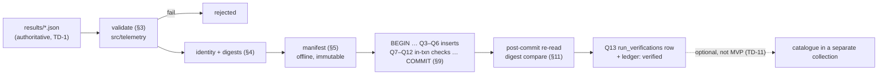
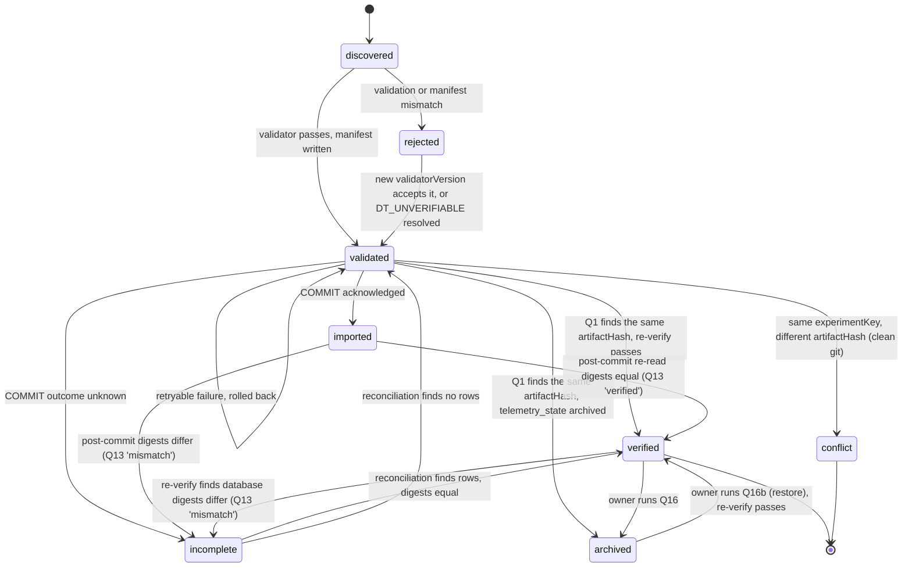

# Tiger Data telemetry and ingestion RFC

> **STATUS: PROPOSED — NOT IMPLEMENTED.** None of this exists in code. There is no `src/telemetry/`, no `integrations/gateway/`, no database client, no migration and no Tiger Data service on `main` at 23d6748. Every SQL block below is labelled **PROPOSED — NOT A MIGRATION** and nothing has been run against a database. Nothing here changes a contract.

**Purpose:** the exact, implementation-ready design for moving a committed `RunRecord` into Tiger Data and proving that the stored copy is faithful. It covers artifact validation, canonical identity, the import manifest and ledger, the schema, migrations, the import transaction, idempotency, verification and failure handling. **Status:** proposed; depends on the network decision TIG-D1 (= D3, approved per integration; = GF-D1 = MDB-D1, XI-9, XI-21). That is one decision (XI-9); approving it for another integration does not approve it here. **Owner:** source design by William Pimentel (`wpimento`), [Encore × Tiger Data technical plan](../handoffs/Encore_Tiger_Data_Technical_Plan.md) (cited below as "William §n"). Integrated by Arnav. Issue #142, audit base `main` 23d6748, facts checked 2026-11-15.

## 0. Scope, sources and what this RFC does not repeat

| Topic | Where it lives |
|---|---|
| Why Tiger Data, requirements `TIG-FR`/`TIG-NFR`, decisions `TIG-D`, risks `TIG-R`, conflict records `TCR`, contract change `TIG-CC-01` | [Tiger Data analytics (canonical overview)](../integrations/tiger-data-analytics.md) |
| Analytics queries, API routes, provenance block, report reconstruction, dashboard | [Analytics and dashboard RFC](TIGER_ANALYTICS_AND_DASHBOARD_RFC.md) |
| Work packages `TIG-01…TIG-11` | [Work packages](../planning/tiger-data-integration-work-packages.md) |
| Tests `TIG-T01…TIG-T44` and the acceptance run | [Evaluation](../validation/tiger-data-evaluation.md) |
| **This RFC** | validation, identity, manifest and ledger, DDL, migrations, time axis, import transaction, import states, verification, reconciliation, retries, connections and roles, ingestion performance, deferred position telemetry, `inHold` export options, the live-telemetry constraints (§15.3) |

**Query numbering.** This RFC defines queries **Q1–Q16** (identity, import, verification, reconciliation, archival). Analytics queries live in the analytics RFC, which numbers them from Q17.

**Boundaries used.** The importer is an X-RUN process and its database is X-PERSIST "experiment evidence (validated run records)" (provisional, #110). See [optional integration boundaries §5–§6](OPTIONAL_INTEGRATION_BOUNDARIES.md#5-x-persist-optional-persistence). The analytics reads reach the app over X-RUN/live (provisional, #110), never from the tick loop or a decision path. Live telemetry (TIG-11) is covered by neither and needs the proposed X-OUT/live amendment (§15.3). Network use needs TIG-D1. See [§9 of that doc](OPTIONAL_INTEGRATION_BOUNDARIES.md#9-the-no-network-rule-and-decision-d3) and [NFR-04](../specification/requirements.md). The core and the default build stay offline, and NFR-04's acceptance test is unchanged.

**Evidence boundary.** Two kinds of statement appear below:

- **Audit facts.** These were measured read-only from the 50 committed records in [`results/`](../../results/README.md) at 23d6748, using a standalone re-implementation of `canonicalJson` and sha256. They describe the fixtures. They are not Tiger results and say nothing about Encore's performance. The authoritative local report is [`results/RESULTS.md`](../../results/RESULTS.md).
- **Planned checks.** None of these has been executed (§16).

Provider facts carry VERIFIED, PARTLY or UNVERIFIED with their check date (§17).

**Deviations from William's plan.** Each one cites its conflict record in the overview. TCR-01…TCR-09 follow the order of the overview's decision sheet; TCR-10 onwards are numbered in [overview §18](../integrations/tiger-data-analytics.md#18-conflict-records). The overview is authoritative if the two differ.

| Deviation | Section | Conflict record |
|---|---|---|
| `src/server/` and `sql/` move to the shared gateway and to documentation | §1 | TCR-01 (placement) |
| `experiment_key` unique for clean-git runs, through a partial index | §6.1 | TCR-03 (experiment_key not unique), TCR-14 |
| MongoDB upsert removed from the critical import path | §11.3 | TCR-04 (per-run Mongo upsert) |
| No HTTP upload: a CLI importer with a write role | §9 | TCR-08 (HTTP upload vs CLI importer) |
| Sample schedule starts at tick 5 | §3.4 | TCR-11 |
| Range tolerance for `pwc`; no range CHECK on `npwc` or the summary | §3.4, §6.2 | TCR-12 |
| `artifactHash` and `fileSha256` always differ | §4 | TCR-13 |
| Dirty or unknown git does not identify an experiment | §4.3 | TCR-14 |
| DT taken from `git`, not `paramsHash` | §8 | TCR-15 |
| Canonical-JSON helper placement | §4.1 | TCR-16 |
| Ledger and manifests kept outside `results/` | §5 | TCR-22 |
| CHECK written with immutable functions | §6.2 | TCR-23 |
| Primary key `(run_id, sample_time)`; `seed` as `BIGINT` | §6.1, §6.2 | TCR-24 |
| `t_rec_applicable` keeps absent apart from null | §6.4 | TCR-25 |
| `import_conflicts` kept in Tiger | §6.5 | TCR-29 |
| `run_verifications`, the sixth table, defines `verified` | §6.5, §11.1 | TCR-36 |
| `archived` import state; owner-only restore (Q16b) and delete (Q16c) | §6.2, §10, §13 | TCR-37 |
| Manifest identity fields split from first-observation fields | §5 | TCR-38 |
| One `hashVersion` per database; a bump is a rebuild | §4.5 | TCR-39 |
| Minimum PostgreSQL 16 and TimescaleDB 2.20; no run-time DDL variants | §6.2, §7 | TCR-40 |

## 1. Placement and pipeline

Placement follows TD-2 and XI-1/XI-2 (TCR-01). William's `src/server/` and top-level `sql/` are not used.

| William §8 file | Proposed home | Network | Notes |
|---|---|---|---|
| `src/telemetry/schema.ts`, `validate.ts` | `src/telemetry/validate.ts` | none | pure; §3 |
| `src/telemetry/identity.ts` | `src/telemetry/identity.ts` | none | pure; §4. The hash function is injected (`sha256(text) → hex`), so the module does not import `node:crypto` and can run in Node or the browser |
| `src/telemetry/serialize.ts` | `src/telemetry/normalise.ts` | none | `RunRecord` to rows and back (§6.5) |
| `src/telemetry/verify.ts` | split: digests in `src/telemetry/digest.ts`; database re-read in the gateway | — | §11 |
| `src/telemetry/importer.ts`, `scripts/import-results.ts` | `integrations/gateway/src/tiger/importer.ts`, plus a CLI entry in the gateway `package.json` | Tiger only | write role; §9 |
| `src/server/db/tiger.ts` | `integrations/gateway/src/tiger/db.ts` | Tiger only | §13 |
| `sql/001…004` | this RFC (§6, §7), later `integrations/gateway/src/tiger/migrations/` | — | not created now |
| `tests/telemetry/*.test.ts` | `tests/telemetry/` (pure parts); `integrations/gateway/test/tiger/` (gateway parts) | none / Tiger only | the pure parts run in `npm run check` |

**Repository seam.** The gateway reaches the database only through a `TigerRepository` interface:

- `findIdentity` (Q1);
- `importRun(rows)`, one transaction covering Q2–Q12;
- `readBack(runId)` (Q10–Q12, Q14);
- `recordVerification` (Q13);
- `recordConflict` (Q15).

Unit tests use an in-memory fake that enforces the same unique keys and all-or-nothing transactions (see the evaluation's fixtures).

**Shared gateway (XI-1, XI-12).** `tiger` is one module of the single gateway `integrations/gateway/`. It uses the shared skeleton defined in [boundaries §6.2](OPTIONAL_INTEGRATION_BOUNDARIES.md#62-shared-gateway-skeleton-and-guard) (provisional, #110): one server, `guard.ts`, `errors.ts` (the XI-3 envelope, `sanitise`, `redact`), `config.ts` and `GET /api/health`. It never redefines them. The importer and the owner tools (§13) are CLIs with no HTTP surface, so the guard and the `requestId` rule (XI-11) apply only to the read routes (analytics RFC). The layout is XI-20: the skeleton in `integrations/gateway/src/`, this module in `integrations/gateway/src/tiger/`, its tests in `integrations/gateway/test/tiger/`, and one `package.json` and lockfile for the whole gateway.

**Purity is enforced only by convention today.** `tests/boundaries.test.ts` ignores folders outside the five core folders. The `fetch`/`Date` lint bans cover only the core (TCR-27). TIG work must therefore add a `telemetry` entry to the boundaries map and an ESLint block that bans `fetch`, `WebSocket` and `XMLHttpRequest` in `src/telemetry`. Both are shared-file edits.



## 2. The input: `RunRecord` v1 as it exists

The contract is [`src/contracts/metrics.ts:16-23`](../../src/contracts/metrics.ts) ([contract §5](contracts-and-algorithms.md#5-world-events-snapshot-metrics)). Its events are the `EnvEvent` union in [`src/contracts/world.ts:7-14`](../../src/contracts/world.ts). William §2 matches main exactly (TCR-05, facts checked against `Pihh.zip`).

Audit facts about the committed fixtures (read-only, 23d6748):

- **Count and cohort.** There are 50 files: S0, S1, S2, S3 and S5 × seeds 1–5 × {static, encore}, all at n0 = 200. Every record has `v` = 1, `git` = `571c8e44…` (not current main) and one `paramsHash`, `6342c662…91f2`.
- **Writer form.** Each file is `JSON.stringify(record)` plus LF, with keys in insertion order (`src/cli/main.ts:155`). It is not `canonicalJson`. Sizes range from 104,196 to 113,222 bytes.
- **Series.** Every record has 360 samples. The first tick is 5 and the last is 1800, strictly every 5 ticks; there is no tick-0 sample. Counters never decrease. That makes 18,000 sample rows in total.
  - `pwc`/`npwc` equal 1.0000000000000004 in 7,943 samples.
  - No sample has a null `npwc`, `sfMean` or `sfMax`. The minimum `alive` is 180.
  - The largest counter is `delivered` = 6,677,243. Static-arm message counters are all 0.
  - Only two version keys occur: `0:-1` and `400:1`.
- **Events.** There are 80 events in total, 0–4 per record. S3 has `PARTITION_ON/OFF` and `JAM_ON/OFF`. The S1 and S2 `KILL` events have 20 ids each. S5 has an `INJECT_SCORE` whose canonical JSON is 271 bytes, and whose first movement has `startTick` −40.
- **Kill sets.** All 20 S1/S2 `KILL` events are at tick 400. S1 has 5 distinct kill sets over its 5 seeds. **S2 has only 4: seeds 1 and 3 kill the same ids.** The two static S2 records for seeds 1 and 3 have equal series and equal summaries (all 24 keys); the two Encore records differ in 5 summary keys. So S2 has 5 seeds but 4 distinct kill sets (overview TIG-R08). No committed record has `tRec` = 0.
- **Summary.** 30 records have the 23 base keys and 20 (S1, S2) also have `tRec`. `tRec` is null in the 10 static S1/S2 records and `deliveryRatio` is null in every static record. Float rounding puts some values just outside their natural range: `npwcEnd` = 1.0000000000000002, `coordLoss` = −4.44e-16, `npwcDeficitSec` ≈ −2.6e-14.

## 3. Artifact validation (William §8 checklist, made exact)

The validator is one pure function: `validateRunRecord(bytes, context) → { ok: true, record, warnings } | { ok: false, errors }`. It is versioned (`validatorVersion`, a semver string stored with every import). It validates **while parsing**: the parsed value is checked field by field and never cast into a `RunRecord` until every rule passes. `context` = `{ sourceKind, expectedTicks }`. For `cli-scenario`, `expectedTicks` = `SCENARIO_TICKS` = 1800 (`src/cli/scenarios.ts:16`), which is the same for every scenario. Any failure produces `rejected` (§10) with every error listed, not just the first.

### 3.1 Bytes and parse

1. Size is checked **before** parsing: the file must be ≤ 1 MiB. That is about 9× the largest committed record (113,222 bytes, §2), so it is the per-record cap that XI-8 asks for, derived from the measured `results/` sizes with headroom.
2. The bytes must be strict UTF-8 (`TextDecoder('utf-8', { fatal: true })`). `JSON.parse` must succeed, and the top level must be a plain object. Byte-level UTF-8 does not catch the JSON escapes `\u0000` and unpaired surrogates (`\ud800`), so after parsing, **every string reachable from the record** (keys included, and the `INJECT_SCORE` glyph text) must contain no U+0000 and no unpaired surrogate. PostgreSQL `jsonb` refuses both (22P05), and `TextEncoder` would silently turn a lone surrogate into U+FFFD before hashing.
3. **Non-finite numbers.** JSON cannot carry `NaN` or `Infinity`. `JSON.stringify` writes them as `null`, and `JSON.parse` turns an out-of-range literal such as `1e400` into `Infinity`. So:
   - (a) every number must satisfy `Number.isFinite` after parse;
   - (b) a `null` is accepted only where the contract allows it **and** the consistency rules below hold. A `null` npwc with `alive > 0` is the visible trace of a NaN written as null, and it is rejected.
   - A NaN-turned-null in a field that is legitimately nullable, such as most summary keys, **cannot be detected after the fact**. The only real defence is producer-side: `canonicalJson` throws on non-finite values (`src/cli/run.ts:29`). Applying the same check before `writeFileSync` would be a `src/cli` change, so it needs its owner. This is recorded as a limitation, not solved here.
4. **Writer-form check.** If the raw bytes equal `JSON.stringify(parsed) + '\n'`, the manifest records `fileForm: 'cli-writer'`; otherwise `'other'`. A mismatch is a **warning**, not a rejection. Pretty-printed copies have the same `artifactHash`, but duplicate JSON keys, which `JSON.parse` resolves last-wins, also show up as `'other'`.

### 3.2 Top level

5. The key set is exactly `v, git, paramsHash, scenario, arm, seed, n0, events, series, summary, stateHash`. Unknown keys, including `__proto__`, are rejected. A future field means a new `v`.
6. `v === 1` (William's first item). Any other value gives `SCHEMA_VERSION_UNSUPPORTED`.
7. `scenario` must be in `SCENARIO_IDS` (`S0…S5`, `src/cli/scenarios.ts:13`). `arm` must be `'encore'` or `'static'`.
8. `seed` must be an integer in [0, 2³²−1], the same bound as `buildScenario` (`scenarios.ts:160`). This exceeds PostgreSQL `INTEGER`, hence `BIGINT` in §6.1.
9. `n0` must be an integer in [1, 10 000]. The upper end is only a sanity cap: the simulator uses 200.
10. `git` must match `^[0-9a-f]{40}(-dirty)?$` or be `'unknown'`. `paramsHash` must match `^[0-9a-f]{64}$`. `stateHash` must match `^[0-9a-f]{16}$`: it is the world's 16-hex `hashText`, not sha256 (`src/sim/world.ts:236-238`).

### 3.3 Events (per `EnvEvent`)

11. `events` is an array of at most 1,000 entries. X-OUT caps events at 10,000 per file, and the fixtures have at most 4. Ticks must be non-decreasing in array order (`buildScenario` sorts them, `scenarios.ts:156`). Order is preserved and never re-sorted, because `fairPair` compares events in array order.
12. Every event has exactly the keys of its variant. `tick` is an integer in [0, `expectedTicks`].
    - `KILL`: `ids` is a non-empty array of distinct integers in [0, n0).
    - Every `JAM_*` and `PARTITION_*` `id` matches `^[A-Za-z0-9_.:-]{1,64}$` (the fixtures use `J` and `P`).
    - `JAM_ON`: an `id`, `centre` is three finite numbers and `radius` is finite and > 0.
    - `JAM_OFF` and `PARTITION_OFF`: an `id`.
    - `PARTITION_ON`: an `id`, a finite `point`, and a finite, non-zero `normal`.
    - `SET_LOSS`: `loss` is finite and in [0, 1].
    - `INJECT_SCORE`: `droneId` is an integer in [0, n0). `score.version` has integer `issuedTick` and `origin` ≥ −1 (`OPERATOR` = −1). `score.movements` is non-empty and sorted by `startTick`. `startTick` is an integer and **may be negative** (the S5 fixture has −40). `transitionTicks` is an integer ≥ 0. The recipe is checked by the shared pure composition validator, `src/app/compose/validate.ts` (XI-13; created by P2-WP-30a or MDB-WP-02, whichever lands first; provisional, #110). Until that exists, a structural check applies: kind ∈ {text, sphere, helix}, text glyphs from the 5×7 font set, and palette values finite in [0, 1].
    - Every event's canonical JSON must be ≤ 64 KiB, the same budget as MongoDB saved shows (XI-8).
13. An unmatched `*_OFF`, or an `*_ON` that never closes, is a **warning**. The simulator tolerates both.

### 3.4 Series

14. `series` length = `expectedTicks / 5` (360), and `series[i].tick === 5 × (i + 1)`. So the first tick is 5, the last tick is `expectedTicks`, and there are no gaps or duplicates (TCR-11). William's "strictly increasing, five-tick schedule" becomes this exact equation. `5` is the contract's "one per 5 ticks" (`metrics.ts:6`, `src/observer/index.ts:52`).
15. Each sample has exactly the 13 contract keys, and `msgs` has exactly `hb, score, delivered, lost, blocked`.
16. The following must be safe integers ≥ 0: `alive`, `dupSlots`, every `msgs` counter, `collisions`, `nearMisses`, `slotChanges` and every `versions` value.
17. `alive ≤ n0`, and `alive` is non-increasing, because no `EnvEvent` revives a drone. `dupSlots ≤ alive`.
18. `coverage` is in [0, 1] exactly: it is occupied slots / n0 and a formation has exactly n0 slots (`score.ts:22`). `pwc` is in [0, 1 + 1e-9]. The tolerance is needed because the overshoot to 1.0000000000000004 is present in every fixture (TCR-12). Values are stored unclamped and never rounded.
19. **Nullability.** `npwc` is null **iff** `alive === 0`, and is otherwise finite and ≥ 0, with no upper bound because it is normalised by survivor capacity. `sfMean` and `sfMax` are null when `alive === 0`, and otherwise finite and ≥ 0. They may be null with `alive > 0` only for a formation with no dense points, and that raises a warning.
20. `versions` is an object with at most 64 keys. Each key matches `^-?\d+:-?\d+$` (`issuedTick:origin`). The values sum to exactly `alive`, because every live drone believes exactly one version (`src/observer/measure.ts:110-114`).
21. **Cumulative counters** (`msgs.*`, `collisions`, `nearMisses`, `slotChanges`) must never decrease from one sample to the next (TD-9). A decrease is a rejection (William §15 "counter decreases").

### 3.5 Summary

22. The keys must be exactly the 23 base keys emitted by `calculateSummary` (`src/observer/summary.ts:111-133`), plus `tRec` **iff** `events` contains a `KILL` (`summary.ts:134-135`). See the metric definitions in [evaluation §2](../validation/evaluation-and-tests.md#2-metrics); they are not repeated here. An absent `tRec` means not applicable and a null `tRec` means censored (TD-7), so the importer must preserve that distinction (§6.4).
23. Every value is a finite number or `null`. The code always sets these as numbers, so they must be non-null: `slotChanges`, `slotChangesMaxDrone`, `lateSlotChanges`, `dupSlotSec`, `collisions`, `nearMisses`. These must be integers: `slotChanges`, `slotChangesMaxDrone`, `lateSlotChanges`, `collisions`, `nearMisses`, `dupSlotsEnd`, `unadopted`. A non-null `tRec` must be ≥ 0. **No other range checks** apply, because the fixtures contain −4.4e-16 and 1+2.2e-16 (TCR-12).
24. **Exact integer consistency with the series** (when the last sample tick equals `expectedTicks`): `collisions`, `nearMisses` and `slotChanges` equal the last sample's counters, and `dupSlotsEnd` equals the last sample's `dupSlots`. Float-valued keys are **not** re-derived. The summary is authoritative (TD-7), and most keys need `inHold` or per-tick data that the record does not hold (§15.2).

### 3.6 Caps summary

The caps are: file 1 MiB; samples `expectedTicks / 5`; events 1,000; event 64 KiB; `versions` 64 keys; `git` 46 characters; `n0` 10,000. A cap change is a `validatorVersion` bump. The analytics and API side applies its own limits (see the analytics RFC).

## 4. Canonical identity (TD-4), `hashVersion` 1

### 4.1 Canonical JSON

The only canonical form is the repository's `canonicalJson` (`src/cli/run.ts:27-36`):

- keys are sorted by default `sort()` (UTF-16 code units) at every level, and keys whose value is `undefined` are dropped;
- arrays keep their order;
- primitives go through `JSON.stringify`, so `-0` becomes `0`;
- there is no whitespace;
- a non-finite number throws.

The same definition serves MongoDB `contentHash` ([show library §7.3](../integrations/mongodb-atlas-show-library.md#73-contenthash), provisional: depends on #130) and Gemini `sceneHash` ([Gemini §6.7](../integrations/gemini-generated-formations.md#67-canonicalisation-and-scenehash-gd-4), provisional: depends on #117), per XI-7. Gemini additionally quantises scene numbers, but never record numbers.

**Dependency (TCR-16).** Importing `canonicalJson` from `src/cli/run.ts` loads `node:crypto`, `createWorld`, both brains and the scenarios. XI-2 also forbids the gateway from importing `src/cli`, except a pure canonical-JSON helper once extracted. So the gateway importer **requires** the one shared extraction (XI-7): the pure module `src/score/canonical.ts` (XI-19, TIG-D7; proposed, owner Arnav). `run.ts` imports it instead of defining its own and re-exports it, so callers such as `report.ts` are unchanged. The gateway and `src/telemetry` import it under XI-2. It is a `src/cli` edit, so the `src/cli` owner is a dependency. There is no second copy: MongoDB `contentHash` and Gemini `sceneHash` use the same module. The move is byte for byte, and the vectors in §4.4 are its byte-identity test (existing artifact hashes unchanged). Until the move, only `tests/telemetry/` may import from `run.ts`.

### 4.2 Definitions

All hashes are sha256 over the UTF-8 canonical JSON, as 64 lower-case hex characters.

| Name | Input | Purpose |
|---|---|---|
| `fileSha256` | raw file bytes | detects re-serialisation and file tampering. It **always differs** from `artifactHash` for CLI-written files (TCR-13) |
| `artifactHash` | `canonicalJson(record)` | measurement identity: one artifact, one hash |
| `seriesDigest` | `canonicalJson(record.series)` | row verification (§11) |
| `eventsDigest` | `canonicalJson(record.events)` | row verification |
| `summaryDigest` | `canonicalJson(record.summary)` | row verification |
| `experimentKey` | `canonicalJson({ hashVersion, scenario, seed, arm, n0, git, paramsHash, events, compositionId })` | inputs identity: the same inputs must give the same record (William invariant 2) |
| `pairKey` | the same object **without `arm`** | two runs are a fair pair iff their `pairKey`s are equal and their arms differ |
| `run_id` | UUIDv5(`ENCORE_TIGER_NS_V1`, `artifactHash`) | the database key (§6.1) |

**`pairKey` vs `fairPair`.** `fairPair` compares only `git`, `paramsHash` and canonical events. Scenario and n0 come from grouping and seed from the map key (`src/cli/report.ts:114,134-136`). For every CLI record `compositionId` = `scenario:<id>` is a function of the scenario, so there `pairKey` is **equivalent** to `fairPair` plus `report.ts`'s grouping by (scenario, n0, seed), plus `hashVersion`. It is stronger only for `sceneHash` and `contentHash` compositions (TCR-19). The importer stores `pair_key`. The two analytics routes use it differently ([overview §6.6](../integrations/tiger-data-analytics.md#66-pairing-and-statistics); analytics RFC §4.1, §6.2):

- **Pair route.** It requires equal, non-null `pair_key`s **and** `fairPair`, so the two semantics can never silently diverge. Its deltas also need both runs clean, `telemetry_state = 'present'`, `verified` and not contested.
- **Multi-seed route.** It does **not** filter by `pair_key`. It classifies the candidates (analytics RFC §6.2) and excludes only runs with a listed reason (for example `DEV_SEED`, `CONTESTED`, `UNVERIFIED`, `HASH_VERSION`, `HORIZON`, `COMPOSITION`). `MISMATCH` and `UNPAIRED` seeds, and archived runs, go to `buildReport`, so per-arm statistics equal the CLI's.

`telemetry_state` therefore gates pair deltas, not report inclusion.

**`compositionId` rules.**

- **CLI scenarios** get `"scenario:<id>"`. The preloaded score is `buildEvalScore(params)` (`scenarios.ts:164`), so it is fully determined by `git` and `params`. Injected scores travel in full inside `INJECT_SCORE` events, so they are already part of `events`. `scenario:<id>` is meaningful only together with `git` (TCR-20).
- **App exports, and preloaded shows from Gemini or MongoDB,** get `"sceneHash:<hex>"` or `"contentHash:<hex>"`. App export is deferred (TCR-26).
- **A run with no composition identity** has `compositionId` = `null`. It is **storable but not pairable**: `pair_key` is `NULL`.

**`run_id` choice (TIG-D4, run_id scheme).** Recommended: **deterministic UUIDv5 from `artifactHash`**, rather than a random UUID.

- A retry after an unknown commit outcome uses the same `run_id`, so reconciliation is a primary-key lookup (§11).
- Test and production databases assign the same id to the same fixture.
- The offline manifest can name the id before any connection is made.

UUIDv5 uses SHA-1 only as a name-to-id mapping; integrity rests on `artifactHash`. `ENCORE_TIGER_NS_V1` is a fixed namespace UUID chosen once at implementation and frozen in `hashVersion` 1. Note the difference from X-OUT's `runId` (provisional, #110), which identifies the *experiment inputs* ([boundaries §4.2](OPTIONAL_INTEGRATION_BOUNDARIES.md#4-x-out-telemetry-export)). Tiger's `run_id` identifies the *artifact*.

### 4.3 Git cleanliness (TCR-14)

`gitClean` = `git` matches `^[0-9a-f]{40}$`. A `-dirty` suffix or `unknown` makes it `false`. The `-dirty` suffix carries no digest of the diff, and it only covers `src/`, `package.json` and `package-lock.json` (`src/cli/main.ts:74-82`). Two different dirty trees on the same HEAD therefore share an `experimentKey`. Raising a conflict between them would be a false alarm, and the CLI overwrite guard may already have replaced one file with the other. So the rule is:

- A dirty record is **importable** and flagged "weaker reproducibility evidence" (TD-4).
- It is **conflict-exempt**: the uniqueness of `experiment_key` is a partial index over clean runs only (§6.1).
- It keeps its `pair_key`, so that a warned override view is possible, but default comparisons filter on `git_clean`.

A later diff digest in `gitDescribe` would be a `src/cli` change and is out of scope.

### 4.4 Test vectors (audit facts, `hashVersion` 1 as defined here)

| Value | `S2_n200_encore_s1.json` | `S2_n200_static_s1.json` |
|---|---|---|
| file bytes | 110,281 | 104,324 |
| `fileSha256` | `8539d03d89ac66d1…4c9b` | — |
| `artifactHash` | `0b35b281cdb361bd…0e76` | `35ac712886627df5…eeb7` |
| `seriesDigest` | `6e5858d7f060bbfb…b9a9` | `245d6bdc816011fe…cfc9` |
| `eventsDigest` | `a4704e45ffe925fd…a7fe` | same |
| `experimentKey` | `8a55cda8450d8104…1409` | `3a078cb7d94f3ef6…e079` |
| `pairKey` | `f660290359fee12f…d376` | **same**, so a fair pair |

The full hex strings belong in the test fixture file, not in this document. These values pin the definitions; they are not an import result.

### 4.5 Versioning

`hashVersion` fixes four things: the canonical-JSON rules, the input object shapes above, the hash algorithm and the UUID namespace. Any change means `hashVersion` 2. `hash_version` is stored per row, but `artifact_hash` and `run_id` are **globally** unique, so one database holds one `hashVersion`. A bump is a **full rebuild**: drop the schema, re-run the migrations and re-import every artifact from its local file (§7 Rollback; TD-1). Rows are never transformed in place, and v1 and v2 rows never coexist.

## 5. Import manifest and local ledger (TD-3)

**Location (TIG-D5, ledger location; TCR-22).** The location is outside `results/`. `runReport` parses every top-level `*.json` in that folder (`src/cli/main.ts:100-101`), #137 rewrites and moves files there, and a committed ledger would mutate a contended folder.

- Recommended default: `integrations/gateway/src/tiger/state/`, ignored by a `.gitignore` inside the gateway package (no root change). It can be overridden with `ENCORE_TIGER_STATE_DIR`.
- Paths: manifests in `state/manifests/<artifactHash>.manifest.json`, the ledger in `state/imports.ndjson`.

**Manifest** (`manifestVersion` 1). It is written once per artifact, **before** any connection, atomically (temporary file, then rename, as in the X-RUN write rule). It is never rewritten, and it never modifies the artifact.

```json
{
  "manifestVersion": 1, "hashVersion": 1, "validatorVersion": "1.0.0",
  "artifactPath": "results/S2_n200_encore_s1.json",
  "fileSha256": "…", "fileBytes": 110281, "fileForm": "cli-writer",
  "artifactHash": "…", "experimentKey": "…", "pairKey": "…",
  "runId": "<uuidv5>", "gitClean": true,
  "compositionId": "scenario:S2", "sourceKind": "cli-scenario",
  "dtSeconds": 0.05, "expectedSamples": 360, "eventCount": 1,
  "seriesDigest": "…", "eventsDigest": "…", "summaryDigest": "…",
  "createdAt": "2026-11-15T03:00:00.000Z"
}
```

- TD-3's fields are kept exactly. The additions (`validatorVersion`, `fileBytes`, `fileForm`, `runId`, `dtSeconds` (TCR-15), counts and digests) are all derived from the artifact.
- **Two kinds of field.** The manifest is keyed by `artifactHash`, so it describes the *record*, not a file.
  - **Identity fields** are functions of the parsed record: `hashVersion`, `artifactHash`, `experimentKey`, `pairKey`, `runId`, `gitClean`, `compositionId`, `sourceKind`, `dtSeconds`, the counts and the three digests.
  - **First-observation fields** describe the file the manifest was first written from: `artifactPath`, `fileSha256`, `fileBytes`, `fileForm` and `createdAt`. They are recorded once and **never compared**. Each later attempt records the file it actually read (`artifactPath`, `fileSha256`, `fileBytes`, `fileForm`) on its `discovered` ledger line instead.
- `artifactPath` is a **POSIX, repo-relative** path. The importer normalises separators to `/` and then requires `^[A-Za-z0-9._-]+(/[A-Za-z0-9._-]+)*$` with no `..` segment. Absolute, `~/`, UNC (`\\host\share`) and drive-letter paths are refused, so no user name or home directory leaks into Tiger. The same rule is a CHECK in §6.1 and §6.5. It is a **label**: no component ever opens a file through a path read from the database (§11.2).
- `createdAt` is wall-clock time. That is allowed in a manifest, and it can never appear in a `RunRecord`.
- **Immutability.** If a manifest exists for an `artifactHash`, the importer recomputes the **identity fields** and compares them. Equal means the manifest is reused, whatever the file's bytes, form or location: a re-serialised copy (`FX-RESER`), a pretty-printed copy, or a copy that #137 moved to `superseded-*` or a scratch `--out` is the same record. Different means a `rejected` attempt with the code `MANIFEST_MISMATCH`, and the old manifest is never overwritten. A `validatorVersion` change is the one exception: it may add a new manifest beside the old one under `<artifactHash>.v<validatorVersion>.manifest.json`.

**Ledger.** This is append-only NDJSON with one line per state transition (§10). A single writer appends with `O_APPEND` and `fsync`, guarded by a lock file:

```json
{"ledgerVersion":1,"at":"…","attemptId":"<uuid v4>","artifactHash":"…","experimentKey":"…","runId":"…","from":"validated","to":"imported","code":null,"detail":null}
```

A record's current state is the last line for its `artifactHash`. The ledger is a **journal, not an authority**:

- Tiger is the authority on whether a run is present (`experiment_runs`) and verified (`run_verifications`, §11.1).
- The local artifact is the authority on content.
- A lost or deleted ledger is rebuilt by reconciliation (§11). A corrupt line, such as a torn final write, is skipped with a warning.

## 6. Schema (TD-5)

Everything lives in a dedicated schema, `encore`. The four tables are William's (§6.1–§6.4), and their columns and CHECKs are preserved unless a deviation is cited.

**Schema names.** The DDL listings below use **unqualified** names, exactly as the migration files will. The schema is resolved through `search_path`, which the runner and the importer set with `set_config('search_path', $1, true)` (§7, §9): `encore` in production, `tig_test_<12 hex>` in tests. Prose and the query listings (Q1–Q16) write `encore.<name>` for readability only; the code sends them unqualified under the same `search_path`.

### 6.1 `experiment_runs`

```sql
-- PROPOSED — NOT A MIGRATION (would be migration 001; the schema itself is created before 000, §7)
CREATE TABLE experiment_runs (
    run_id            UUID PRIMARY KEY,                       -- UUIDv5(artifact_hash), §4.2
    experiment_key    TEXT NOT NULL CHECK (experiment_key ~ '^[0-9a-f]{64}$'),
    pair_key          TEXT          CHECK (pair_key       ~ '^[0-9a-f]{64}$'),
    artifact_hash     TEXT NOT NULL UNIQUE CHECK (artifact_hash ~ '^[0-9a-f]{64}$'),
    file_sha256       TEXT NOT NULL CHECK (file_sha256    ~ '^[0-9a-f]{64}$'),   -- as first imported (§5)
    hash_version      SMALLINT NOT NULL CHECK (hash_version >= 1),
    manifest_version  SMALLINT NOT NULL CHECK (manifest_version >= 1),
    validator_version TEXT NOT NULL,
    importer_version  TEXT NOT NULL,                          -- gateway package version + its git
    source_kind       TEXT NOT NULL CHECK (source_kind IN ('cli-scenario', 'app-export')),
    artifact_path     TEXT NOT NULL                           -- label, as first imported; never opened (§5, §11.2)
                      CHECK (artifact_path ~ '^[A-Za-z0-9._-]+(/[A-Za-z0-9._-]+)*$'
                             AND artifact_path !~ '(^|/)\.\.(/|$)'),
    file_bytes        INTEGER NOT NULL CHECK (file_bytes > 0),                   -- as first imported
    scenario          TEXT NOT NULL,
    arm               TEXT NOT NULL CHECK (arm IN ('encore', 'static')),
    seed              BIGINT NOT NULL CHECK (seed BETWEEN 0 AND 4294967295),     -- uint32, §3.2
    n0                INTEGER NOT NULL CHECK (n0 > 0),
    git_revision      TEXT NOT NULL,
    git_clean         BOOLEAN NOT NULL,
    params_hash       TEXT NOT NULL CHECK (params_hash ~ '^[0-9a-f]{64}$'),
    state_hash        TEXT NOT NULL,
    dt_seconds        DOUBLE PRECISION NOT NULL CHECK (dt_seconds = 0.05),   -- asserted DT at the record's git, §8
    composition_id    TEXT,
    record_version    INTEGER NOT NULL CHECK (record_version = 1),
    expected_samples  INTEGER NOT NULL CHECK (expected_samples >= 0),
    event_count       INTEGER NOT NULL CHECK (event_count >= 0),
    series_digest     TEXT NOT NULL,
    events_digest     TEXT NOT NULL,
    summary_digest    TEXT NOT NULL,
    telemetry_state   TEXT NOT NULL DEFAULT 'present' CHECK (telemetry_state IN ('present', 'archived')),
    imported_at       TIMESTAMPTZ NOT NULL DEFAULT now(),     -- real ingestion time (TD-6)
    CHECK (git_clean = (git_revision ~ '^[0-9a-f]{40}$')),
    CHECK ((composition_id IS NULL) = (pair_key IS NULL))     -- no composition identity ⇒ not pairable
);

-- TD-5 / TCR-03: one artifact per experiment identity, for clean-git runs (dirty runs: §4.3, TCR-14)
CREATE UNIQUE INDEX experiment_runs_experiment_key_clean_uq
    ON experiment_runs (experiment_key) WHERE git_clean;

-- William §6.1, preserved
CREATE INDEX experiment_runs_pair_idx
    ON experiment_runs (scenario, seed, n0, arm, git_revision, params_hash);

CREATE INDEX experiment_runs_pair_key_idx ON experiment_runs (pair_key, arm);
```

**Why `experiment_key` is unique (TCR-03, experiment_key not unique).**

- William left it non-unique, but his own conflict rule (§5) says the same identity with a different artifact is "a reproducibility/identity conflict, not a harmless duplicate".
- A non-unique column would let two contradictory artifacts sit side by side, and analytics would then have to choose between them.
- With the index, the database enforces the rule even if two importers race. The conflicting artifact stays local and is recorded in `import_conflicts` (§6.5).

**Other differences from William's table.**

- `seed` is `BIGINT`, because seeds are uint32.
- The identity, digest and provenance columns are additions. `state_hash` and `record_version` are kept from William.
- `expected_samples` (William) is now set exactly to `expectedTicks / 5`.

### 6.2 `simulation_metrics` (hypertable)

```sql
-- PROPOSED — NOT A MIGRATION (would be migration 002). Requires PostgreSQL ≥ 16, TimescaleDB ≥ 2.20 (§7).
-- The one definition of tick → synthetic time, used by the CHECK below, by Q4 and by Q16b.
CREATE FUNCTION synthetic_time(tick integer) RETURNS timestamptz
    LANGUAGE sql IMMUTABLE PARALLEL SAFE
    AS $$ SELECT date_add(timestamptz '2020-01-01 00:00:00+00', tick * interval '50 milliseconds', 'UTC') $$;

CREATE TABLE simulation_metrics (
    sample_time        TIMESTAMPTZ NOT NULL,                  -- SYNTHETIC, not wall clock (§8)
    run_id             UUID NOT NULL REFERENCES experiment_runs (run_id),
    tick               INTEGER NOT NULL,
    alive              INTEGER NOT NULL,
    coverage           DOUBLE PRECISION NOT NULL,
    pwc                DOUBLE PRECISION NOT NULL,
    npwc               DOUBLE PRECISION,
    sf_mean            DOUBLE PRECISION,
    sf_max             DOUBLE PRECISION,
    dup_slots          INTEGER NOT NULL,
    versions           JSONB NOT NULL,
    hb_total           BIGINT NOT NULL,
    score_total        BIGINT NOT NULL,
    delivered_total    BIGINT NOT NULL,
    lost_total         BIGINT NOT NULL,
    blocked_total      BIGINT NOT NULL,
    collisions_total   BIGINT NOT NULL,
    near_misses_total  BIGINT NOT NULL,
    slot_changes_total BIGINT NOT NULL,
    PRIMARY KEY (run_id, sample_time),
    -- William §6.2, preserved
    CHECK (tick >= 0),
    CHECK (alive >= 0),
    CHECK (coverage BETWEEN 0 AND 1),
    CHECK (dup_slots >= 0),
    -- William had pwc BETWEEN 0 AND 1: rejects every committed artifact (TCR-12)
    CHECK (pwc >= 0 AND pwc <= 1 + 1e-9),
    -- additions
    CHECK (tick % 5 = 0),
    CHECK ((alive = 0) = (npwc IS NULL)),
    CHECK (npwc IS NULL OR npwc >= 0),
    CHECK (alive > 0 OR (sf_mean IS NULL AND sf_max IS NULL)),
    CHECK ((sf_mean IS NULL OR sf_mean >= 0) AND (sf_max IS NULL OR sf_max >= 0)),
    CHECK (jsonb_typeof(versions) = 'object'),
    CHECK (LEAST(hb_total, score_total, delivered_total, lost_total, blocked_total,
                 collisions_total, near_misses_total, slot_changes_total) >= 0),
    -- tick → synthetic time, immutable form, §8 and TCR-23
    CHECK (sample_time = synthetic_time(tick))
) WITH (
    tsdb.hypertable,
    tsdb.partition_column = 'sample_time',
    tsdb.chunk_interval   = '7 days',
    tsdb.columnstore      = false,
    tsdb.create_default_indexes = false
);

CREATE INDEX metrics_run_tick_idx ON simulation_metrics (run_id, tick);   -- William, preserved

COMMENT ON COLUMN simulation_metrics.sample_time IS
    'SYNTHETIC: 2020-01-01Z + tick × 50 ms; not wall clock. Same range for every run.';

-- Console-facing view: every judge-facing console query is written against it, never the raw table.
CREATE VIEW metrics_v AS
SELECT m.run_id, m.tick, m.tick * r.dt_seconds AS sim_seconds, m.sample_time AS synthetic_time,
       m.alive, m.coverage, m.pwc, m.npwc, m.sf_mean, m.sf_max, m.dup_slots, m.versions,
       m.hb_total, m.score_total, m.delivered_total, m.lost_total, m.blocked_total,
       m.collisions_total, m.near_misses_total, m.slot_changes_total
FROM simulation_metrics m JOIN experiment_runs r USING (run_id);
```

**One variant only.** Earlier drafts let the runner pick the legacy `create_hypertable(…, by_range(…))` call or a pre-16 CHECK at run time. That made a migration file's checksum depend on the environment, so it is dropped: the runner refuses PostgreSQL < 16 or TimescaleDB < 2.20 (§7). Tiger Cloud defaults to PostgreSQL 18 and TimescaleDB 2.31 (§17). William's `create_hypertable('simulation_metrics', 'sample_time', if_not_exists => TRUE)` is the pre-2.13 signature, deprecated since 2.13.0, and is not used.

**Primary key.** William's key was `(sample_time, run_id, tick)`. This RFC uses `(run_id, sample_time)` (TCR-24), for three reasons:

- A hypertable unique index must contain the partition column (VERIFIED, §17).
- The CHECK makes `sample_time` a bijective function of `tick`, so `(run_id, sample_time)` is unique **exactly** when `(run_id, tick)` is. The database now enforces what William left to the importer ("prevent duplicate logical ticks").
- Every run shares the same synthetic time range, so leading the key with `run_id` matches every access path (TD-6: every query filters by `run_id`). `tick` is dropped from the key because it is redundant.

**The tick → time CHECK and immutability (TCR-23).**

- `timestamptz + interval` is STABLE, not IMMUTABLE (VERIFIED from the `pg_proc` catalogue). PostgreSQL accepts it in a CHECK but "assumes" the expression is immutable.
- The three-argument `date_add(timestamptz, interval, text)` (PG16+) is immutable, so `encore.synthetic_time` can honestly be declared IMMUTABLE. It is exact microsecond arithmetic, because `interval * integer` never cascades into days or months.
- `sample_time` **cannot** be a generated column: partition columns may not be generated, and the `+` form is not immutable anyway (VERIFIED).
- The importer never sends `sample_time`. Q4 computes it with the same function, so the CHECK holds by construction.

**Chunking, honestly.** One run spans 1,800 ticks × 50 ms = 90 s of synthetic time, and every run starts at the same epoch. With a 7-day interval, **every row of every run sits in one chunk**, whatever the run count. A smaller interval does not help: chunks split the shared 90 s, not the runs. So the hypertable is justified only as the time-series feature William §6.2 names (`time_bucket` and other TimescaleDB functions over aligned synthetic time), not by volume.

**Per-run time offsets (evaluated and rejected).** Offsetting each run, for example by a day, would spread runs over chunks. But it would break three things:

- the plain tick → time CHECK, which would then need an offset column;
- cross-run alignment of `time_bucket` over the timestamp;
- William's "the fixed epoch can repeat across runs" design.

**Two alternatives that keep the CHECK (evaluated, not adopted for the MVP).**

- **A hash space dimension on `run_id`** (`by_hash('run_id', N)`, or `tsdb.segmentby` once columnstore is on). It is allowed, because the primary key already contains `run_id`, and it does spread runs over chunks. At 18,000 rows it buys nothing measurable.
- **Integer partitioning on `tick`**, with `time_bucket(20, tick)` (integer `time_bucket` variants exist, so a timestamp is not needed for bucketing). Any retention or columnstore policy would then need an `integer_now_func`, which also blocks an accidental time-based policy. It would drop William's `sample_time` column, though.

The synthetic timestamp is kept because TD-5 preserves William's columns and because the console and `time_bucket` over `timestamptz` read naturally. For the 17,280,000-row position table (§15.1), a space dimension or measured chunk sizing is required before any DDL is proposed.

**Columnstore.** This is disabled explicitly. The default (`tsdb.columnstore=true`) adds a policy that compresses chunks older than a threshold relative to `now()`. A 2020 synthetic epoch would make the only chunk eligible at once, so writes would land in compressed chunks. Columnstore can be revisited, with `segmentby run_id` and `orderby tick`, only after measuring; William §17 excludes it until basic queries work.

**NULL handling.** NULLs stay NULL. `npwc` is NULL exactly when `alive` = 0 (contract). It is never converted to 0.

**`versions` JSONB.** It holds the sample's `issuedTick:origin → count` object verbatim. There is no index in the MVP: the fixtures have at most two keys per sample, and App. A notes that indexing at scale needs expressions or normalised rows. That would be a later `sample_versions (run_id, sample_time, version_key, drones)` table, added only if a query needs it.

**Foreign key.** A foreign key from a hypertable to an ordinary table is supported (VERIFIED, §17).

**Retention and archival.** There is **no** time-based retention on `sample_time` (App. A). `add_retention_policy` drops whole chunks by partition time, so it would delete every run at once. Archival is per run instead (Q16). The owner role deletes the run's metric rows in one transaction and sets `telemetry_state = 'archived'`, keeping `experiment_runs`, `simulation_events` and `run_summaries`. The API then reports "archived", which is distinct from a run with zero measurements (William §14). Restoring is **not** a re-import: the importer sees the existing `artifact_hash`, has no UPDATE right, and reports `ARCHIVED` (§10 case 2(a′)). The owner runs `tiger restore <runId>` (Q16b, §13), which re-inserts the rows from the local artifact and sets the state back to `'present'`.

### 6.3 `simulation_events`

```sql
-- PROPOSED — NOT A MIGRATION (would be migration 003)
CREATE TABLE simulation_events (
    run_id      UUID NOT NULL REFERENCES experiment_runs (run_id),
    event_index INTEGER NOT NULL CHECK (event_index >= 0),   -- position in RunRecord.events
    tick        INTEGER NOT NULL CHECK (tick >= 0),
    event_type  TEXT NOT NULL CHECK (event_type IN ('KILL', 'JAM_ON', 'JAM_OFF', 'PARTITION_ON',
                                                    'PARTITION_OFF', 'INJECT_SCORE', 'SET_LOSS')),
    details     JSONB NOT NULL,                              -- the complete EnvEvent, verbatim
    PRIMARY KEY (run_id, event_index),
    -- immutable forms: ->> and int4out are IMMUTABLE, to_jsonb() is only STABLE (TCR-23)
    CHECK (details ->> 'type' = event_type),
    CHECK (jsonb_typeof(details -> 'tick') = 'number' AND details ->> 'tick' = tick::text)
);
CREATE INDEX simulation_events_type_idx ON simulation_events (event_type, tick);
```

- `details` holds the **whole** event, including `type` and `tick`. Reconstruction is therefore `details` in `event_index` order, with nothing reassembled. The CHECKs keep the convenience columns equal to it.
- Several events on one tick keep their array order (William §6.3).
- `INJECT_SCORE` keeps its full score in `details` for now. The largest fixture event is 271 bytes, and the per-event cap is 64 KiB.

These are scheduled **environment** events, not a log of drone decisions.

### 6.4 `run_summaries`

```sql
-- PROPOSED — NOT A MIGRATION (would be migration 004)
CREATE TABLE run_summaries (
    run_id       UUID PRIMARY KEY REFERENCES experiment_runs (run_id),
    summary_json JSONB NOT NULL CHECK (jsonb_typeof(summary_json) = 'object'),   -- every key, nulls kept
    -- William's typed columns, derived from summary_json so they cannot disagree with it
    npwc_end              DOUBLE PRECISION GENERATED ALWAYS AS ((summary_json ->> 'npwcEnd')::double precision) STORED,
    npwc_end_a            DOUBLE PRECISION GENERATED ALWAYS AS ((summary_json ->> 'npwcEndA')::double precision) STORED,
    coverage_end          DOUBLE PRECISION GENERATED ALWAYS AS ((summary_json ->> 'coverageEnd')::double precision) STORED,
    sf_mean_end           DOUBLE PRECISION GENERATED ALWAYS AS ((summary_json ->> 'sfMeanEnd')::double precision) STORED,
    sf_max_end            DOUBLE PRECISION GENERATED ALWAYS AS ((summary_json ->> 'sfMaxEnd')::double precision) STORED,
    t_rec_applicable      BOOLEAN          GENERATED ALWAYS AS (summary_json ? 'tRec') STORED,
    t_rec_seconds         DOUBLE PRECISION GENERATED ALWAYS AS ((summary_json ->> 'tRec')::double precision) STORED,
    npwc_deficit_seconds  DOUBLE PRECISION GENERATED ALWAYS AS ((summary_json ->> 'npwcDeficitSec')::double precision) STORED,
    collisions            BIGINT           GENERATED ALWAYS AS ((summary_json ->> 'collisions')::bigint) STORED,
    near_misses           BIGINT           GENERATED ALWAYS AS ((summary_json ->> 'nearMisses')::bigint) STORED,
    msgs_per_drone_second DOUBLE PRECISION GENERATED ALWAYS AS ((summary_json ->> 'msgsPerDroneSec')::double precision) STORED,
    delivery_ratio        DOUBLE PRECISION GENERATED ALWAYS AS ((summary_json ->> 'deliveryRatio')::double precision) STORED
);
```

- **Populated only from `RunRecord.summary`** (William §6.4, TD-7). `summary_json` keeps every key, including those with null values. A JSON `null` gives SQL `NULL` through `->>`.
- **The absent-versus-null problem.** William's plain `t_rec_seconds` column cannot tell "not applicable" (no `KILL`, key absent) from "censored" (`KILL` present, value null). `t_rec_applicable` records the difference, giving the three TD-7 states:
  - `applicable ∧ NOT NULL` = recovered;
  - `applicable ∧ NULL` = censored;
  - `NOT applicable` = not applicable.
  This is a deviation (TCR-25).
- **Why generated columns.** `run_summaries` is an ordinary table, and `->>`, `?` and the text-to-float8/int8 casts are immutable. Generated columns keep one fact in one place within the database. The alternative is plain columns written by the importer plus `CHECK (npwc_end IS NOT DISTINCT FROM (summary_json->>'npwcEnd')::float8)`. It is equivalent but more code. The immutability of these casts in this context has not been tested on the service (UNVERIFIED), and the plain-column form is the fallback.
- The typed columns exist for filtering and display. Any statistic still goes through `report.ts` (TD-8; analytics RFC).

### 6.5 `import_conflicts` and `run_verifications`

```sql
-- PROPOSED — NOT A MIGRATION (would be migration 005)
CREATE TABLE import_conflicts (
    conflict_id            BIGINT GENERATED ALWAYS AS IDENTITY PRIMARY KEY,
    hash_version           SMALLINT NOT NULL,
    experiment_key         TEXT NOT NULL,
    existing_run_id        UUID NOT NULL REFERENCES experiment_runs (run_id),
    existing_artifact_hash TEXT NOT NULL,
    incoming_artifact_hash TEXT NOT NULL,
    incoming_file_sha256   TEXT NOT NULL,
    incoming_artifact_path TEXT NOT NULL                       -- label only, same rule as artifact_path
                           CHECK (incoming_artifact_path ~ '^[A-Za-z0-9._-]+(/[A-Za-z0-9._-]+)*$'
                                  AND incoming_artifact_path !~ '(^|/)\.\.(/|$)'),
    detected_at            TIMESTAMPTZ NOT NULL DEFAULT now(),
    UNIQUE (hash_version, experiment_key, incoming_artifact_hash),
    CHECK (existing_artifact_hash <> incoming_artifact_hash)
);

-- Post-commit verification outcomes (§11.1). Append-only: the importer may INSERT, never UPDATE.
CREATE TABLE run_verifications (
    verification_id  BIGINT GENERATED ALWAYS AS IDENTITY PRIMARY KEY,   -- orders the rows of one run
    run_id           UUID NOT NULL REFERENCES experiment_runs (run_id),
    verified_at      TIMESTAMPTZ NOT NULL DEFAULT now(),               -- wall clock
    verifier_version TEXT NOT NULL,
    series_digest    TEXT NOT NULL CHECK (series_digest  ~ '^[0-9a-f]{64}$'),   -- recomputed from rows
    events_digest    TEXT NOT NULL CHECK (events_digest  ~ '^[0-9a-f]{64}$'),
    summary_digest   TEXT NOT NULL CHECK (summary_digest ~ '^[0-9a-f]{64}$'),
    outcome          TEXT NOT NULL CHECK (outcome IN ('verified', 'mismatch'))
);
CREATE INDEX run_verifications_run_idx ON run_verifications (run_id, verification_id DESC);
```

**Decision: keep `import_conflicts`** rather than recording conflicts in the ledger only. The read-only API must be able to mark an experiment as contested in its provenance, and it cannot see a local ledger. The conflicting artifact's rows are never stored.

**Decision: add `run_verifications`** (a deviation from TD-5's table list, TCR-36). Without it, the post-commit re-read lives only in the local ledger, and a reader cannot tell a committed-but-unverified run (case G) or a mismatched one (case H) from a verified one. Its definition of `verified` is in §11.1.

### 6.6 Normalisation (`src/telemetry/normalise.ts`)

William's `serializeSample` mapping is kept field for field, with two changes:

- `sampleTime` becomes the integer `syntheticSampleTimeMs(tick)` (§8). The fake repository uses it as given. Q4 recomputes it in SQL instead of trusting it, and the CHECK makes the two equal.
- Integers stay JavaScript numbers.

It never recalculates a metric and never mutates the record. The inverse, `rowsToRecord`, is what verification (§11) and the analytics side's report reconstruction use. It has two hazards:

- **`BIGINT` arrives as a string** in node-postgres by default. The gateway registers an `int8` parser that throws unless `Number.isSafeInteger`. Counters peak at about 6.7 × 10⁶, far below 2⁵³.
- **`DOUBLE PRECISION` text is exact only if `extra_float_digits ≥ 1`.** This is the default, and it gives "shortest-precise … preserving the original binary float value exactly" (VERIFIED, PostgreSQL docs). The importer and API set `extra_float_digits = 1` on connect, so that a role or database setting cannot silently round values.

JSONB numbers keep their decimal value exactly, and `JSON.parse` returns the same double. Key order in JSONB is irrelevant, because digests use `canonicalJson`. `-0` comes back as `0` from JSONB and as `-0` from float8, and both canonicalise to `0`.

## 7. Migrations (documentation only)

| File (later, `integrations/gateway/src/tiger/migrations/`) | Content | William |
|---|---|---|
| (runner, before 000) | `CREATE SCHEMA IF NOT EXISTS <schema>`, then `set_config('search_path', $1, true)` at the start of each file's transaction. `<schema>` is `encore`, or `tig_test_<12 hex>` in tests. One helper checks the name against `^(encore\|tig_test_[0-9a-f]{12})$` and quotes it with `%I`; it is the only place a schema name enters SQL | new |
| `000_migrations_table.sql` | `schema_migrations (version INT PK, name TEXT, sha256 TEXT, applied_at TIMESTAMPTZ)` | new |
| `001_runs.sql` | §6.1 | `sql/001_runs.sql` |
| `002_metrics.sql` | §6.2: `synthetic_time`, hypertable, comment, `metrics_v` | `sql/002_metrics.sql` |
| `003_events.sql` | §6.3 | `sql/003_events.sql` |
| `004_summaries.sql` | §6.4 | `sql/004_summaries.sql` |
| `005_conflicts_verifications.sql` | §6.5 | new |
| `006_roles.sql` | grants only (§13). Table grants use unqualified names; the three schema-level statements name the schema, so the runner issues them through the same helper. Roles are cluster-global and survive `DROP SCHEMA`, so creating them is **not** a migration: the owner's run-once script creates them, guarded by `IF NOT EXISTS (SELECT 1 FROM pg_roles …)` | new |

**Rules.**

- Migrations run as the schema owner (`tsdbadmin`, or an `encore_owner` role), using `TIGER_ADMIN_DATABASE_URL` (§13). They never run as `encore_importer`, which has no CREATE on the schema.
- Each file runs in its own transaction and is recorded with its sha256.
- File text uses **unqualified** names, so the same bytes (and checksum) serve `encore` and every test schema with no text substitution. Pasting files into the Tiger console by hand (the work packages' smallest slice) needs the runner's two statements first: `CREATE SCHEMA IF NOT EXISTS encore;` and `SET search_path = encore;`.
- An applied file is never edited: a changed checksum stops the runner.
- Migrations are forward-only in shared environments.
- A `down` script exists for local development only: revoke 006's grants, then drop in reverse order, 005 → 000.
- Before running, the runner reads `server_version_num` and `SELECT extversion FROM pg_extension WHERE extname = 'timescaledb'`. It **refuses** below PostgreSQL 16 or TimescaleDB 2.20. There is one DDL variant per file, never one chosen at run time.

**Compatibility.**

- The importer declares the migration range it understands and reads `schema_migrations` (it holds SELECT on it, §13). It refuses to write if the database is older than the minimum, or newer than it knows, because a newer schema may add NOT NULL columns. Readers tolerate additive changes.
- `record_version`, `hash_version`, `manifest_version` and `validatorVersion` change independently.
- A `RunRecord` v2 (for example TIG-CC-01, §15.2) means: a new validator branch, a migration that adds nullable columns and widens `CHECK (record_version …)`, and v1 rows left untouched.

**Rollback.** Before data exists, use `down` scripts. After data exists, use forward fixes. The ultimate rollback is always available because Tiger is never the only copy (TD-1): drop schema `encore`, re-run the migrations (the roles survive, and 006 only re-grants) and re-import every artifact. Import is idempotent and deterministic (`run_id` from `artifactHash`), so the rebuilt database has the same ids. The rebuild loses `imported_at` and the `run_verifications` history (the re-import writes fresh rows); this is recorded as a known consequence. The same procedure is the `hashVersion` upgrade path (§4.5).

## 8. Time semantics (TD-6)

- **The authoritative axis is `tick`.** Simulated seconds = `tick × dt_seconds`, read from `experiment_runs`. The value is never written as a literal in analytics SQL (William §9.1: "should ultimately be read from versioned simulation parameters").
- **DT is not a `Params` field** (`src/contracts/params.ts:3`), so `paramsHash` cannot vouch for it. Only `git` does (TCR-15). `dt_seconds` is **asserted, not measured**: it is the DT at the **record's** `git`. The importer establishes it by reading `src/contracts/params.ts` at that commit (for a `-dirty` record, at its 40-hex prefix) and parsing `export const DT = …`.
  - **How it reads that file is open (pending a ruling).** Earlier drafts ran `git show <git>:src/contracts/params.ts`. That spawns a child process, and no gateway process spawns children (TR-2, XI-23; the importer is a CLI of the gateway package). The options are that the operator passes the file, or a pure reader of the local git objects ([work packages §13](../planning/tiger-data-integration-work-packages.md#13-open-questions) item 5). The overview's TIG-D14 (open) decides; until then `git show` is not part of the design.
  - If that commit is not available locally, a clean-git attempt is `rejected` with `DT_UNVERIFIABLE`; after fetching the commit, a later attempt starts again at step 1 of §10. An `unknown`-git record takes the importer revision's DT with a `DT_ASSUMED` ledger warning; it is already excluded from default comparisons (§4.3).
  - The committed fixtures' revision `571c8e44` is present locally and has `DT = 0.05` (audit fact).
  - The 50 ms in `encore.synthetic_time` and the `dt_seconds = 0.05` CHECK are deliberate, guarded duplicates of that constant. A DT contract change needs a new migration and a rebuild.
  - **The DT check adds no protection beyond `git` against this database.** The CHECK pins every row to 0.05, so a same-DT predicate is always true there. It matters only against the in-memory fake, and as a guard if the CHECK is ever widened. Runs are comparable only if `git` matches.
- **`sample_time` is synthetic:** `2020-01-01T00:00:00Z + tick × 50 ms`. The column comment (§6.2), the `metrics_v.synthetic_time` column name, every API field and every chart label say "synthetic time (not wall clock)", so a console viewer is not left to guess why every run starts in 2020. The pure helper `syntheticSampleTimeMs(tick) = 1577836800000 + tick × 50` exists for tests. Unlike William's sketch it does not need `Date.parse`.
- **`imported_at` is real wall-clock ingestion time.** It is never used as a measurement.
- **Every metrics query filters by `run_id`** or aggregates across runs explicitly (App. A). A time-only predicate spans every run.

## 9. The import transaction (TD-10)

The importer is a CLI in the gateway package, using the write role (TCR-08, HTTP upload vs CLI importer). It has no HTTP upload endpoint, so William's write-authentication requirement applies only to the optional live ingestion (TIG-11, §15.3; its write authentication is decision TIG-D13). Imports are batched per run and never sent per tick.

One run is one transaction. Insert order follows foreign-key order: run, then samples, then events, then summary. Every value is parameterised (`$n`); identifiers are fixed in code.

```sql
-- PROPOSED — NOT A MIGRATION. Q1: identity pre-check (outside or at the start of the transaction)
SELECT run_id, artifact_hash, experiment_key, git_clean, telemetry_state
FROM encore.experiment_runs
WHERE artifact_hash = $1 OR (experiment_key = $2 AND git_clean);

-- Q2: serialise concurrent importers of one experiment. $1 = experimentKey (64 hex). The first 16 hex
-- digits are reinterpreted as a two's-complement int8, so keys starting 8–f do not overflow (22003).
-- Client equivalent: BigInt.asIntN(64, BigInt('0x' + key.slice(0, 16))).
-- Test vector (§4.4): '8a55cda8450d8104' → -8478644600858377980; '3a078cb7d94f3ef6' → 4181465500289548022.
SELECT pg_advisory_xact_lock(('x' || substr($1::text, 1, 16))::bit(64)::bigint);

-- Q3
INSERT INTO encore.experiment_runs (run_id, experiment_key, pair_key, artifact_hash, file_sha256,
  hash_version, manifest_version, validator_version, importer_version, source_kind, artifact_path,
  file_bytes, scenario, arm, seed, n0, git_revision, git_clean, params_hash, state_hash, dt_seconds,
  composition_id, record_version, expected_samples, event_count, series_digest, events_digest, summary_digest)
VALUES ($1, $2, …, $28);

-- Q4: all samples in one statement ($1 run_id + 17 column arrays), sample_time computed in SQL
INSERT INTO encore.simulation_metrics (sample_time, run_id, tick, alive, coverage, pwc, npwc, sf_mean,
  sf_max, dup_slots, versions, hb_total, score_total, delivered_total, lost_total, blocked_total,
  collisions_total, near_misses_total, slot_changes_total)
SELECT encore.synthetic_time(t.tick), $1, t.*
FROM unnest($2::int[], $3::int[], $4::float8[], $5::float8[], $6::float8[], $7::float8[], $8::float8[],
            $9::int[], $10::jsonb[], $11::int8[], $12::int8[], $13::int8[], $14::int8[], $15::int8[],
            $16::int8[], $17::int8[], $18::int8[])
     AS t(tick, alive, coverage, pwc, npwc, sf_mean, sf_max, dup_slots, versions, hb_total, score_total,
          delivered_total, lost_total, blocked_total, collisions_total, near_misses_total, slot_changes_total);

-- Q5
INSERT INTO encore.simulation_events (run_id, event_index, tick, event_type, details)
SELECT $1, e.ord - 1, e.tick, e.event_type, e.details
FROM unnest($2::int[], $3::text[], $4::jsonb[]) WITH ORDINALITY AS e(tick, event_type, details, ord);

-- Q6
INSERT INTO encore.run_summaries (run_id, summary_json) VALUES ($1, $2::jsonb);
```

**Statement choice.**

- `unnest` keeps a 360-row insert to a single statement with 18 parameters. A multi-row `VALUES` list would need 6,840 parameters, still under PostgreSQL's 65,535 limit.
- `COPY` (via `pg-copy-streams`, on a checked-out client and never `pool.query`) is reserved for workloads above about 10,000 rows per run, which today means only the deferred position telemetry (§15.1). So `pg-copy-streams` is **not a dependency** until COPY is needed. Neither the Tiger docs nor `pg-copy-streams` cover COPY through the transaction-mode pooler (UNVERIFIED), so COPY and named statements use the direct connection only.

**Session settings, per transaction.**

```sql
SELECT set_config('search_path', $1, true);   -- $1 = 'encore' or the checked test schema (§6, §7)
SET LOCAL statement_timeout = '30s';
SET LOCAL lock_timeout = '5s';
SET LOCAL idle_in_transaction_session_timeout = '60s';
```

`lock_timeout` also bounds the Q2 wait. An importer queued behind a slow one, or behind a backend whose COMMIT outcome is still pending (case E), fails with `55P03`. That is not a fault: the holder may just have committed the same artifact, so §12 re-runs the decision procedure.

The isolation level is the default READ COMMITTED. The unique constraints and the advisory lock, not the isolation level, guarantee correctness.

**In-transaction verification (before COMMIT).** Each query below must return its expected value, or the importer issues ROLLBACK.

```sql
-- Q7 (William §8, preserved): expect (expected_samples, 5, expectedTicks)
SELECT COUNT(*) AS sample_count, MIN(tick) AS first_tick, MAX(tick) AS last_tick
FROM encore.simulation_metrics WHERE run_id = $1;

-- Q8: tick sequence — expect 0 rows (every row is tick = 5 × position)
SELECT tick FROM (
  SELECT tick, ROW_NUMBER() OVER (ORDER BY tick) AS n FROM encore.simulation_metrics WHERE run_id = $1
) s WHERE tick <> 5 * n;

-- Q9: cumulative counters never decrease in the stored rows — expect 0
SELECT COUNT(*) FROM (
  SELECT hb_total - LAG(hb_total) OVER w AS d1, score_total - LAG(score_total) OVER w AS d2,
         delivered_total - LAG(delivered_total) OVER w AS d3, lost_total - LAG(lost_total) OVER w AS d4,
         blocked_total - LAG(blocked_total) OVER w AS d5, collisions_total - LAG(collisions_total) OVER w AS d6,
         near_misses_total - LAG(near_misses_total) OVER w AS d7, slot_changes_total - LAG(slot_changes_total) OVER w AS d8
  FROM encore.simulation_metrics WHERE run_id = $1 WINDOW w AS (ORDER BY tick)
) d WHERE LEAST(d1, d2, d3, d4, d5, d6, d7, d8) < 0;

-- Q10: series re-read for the digest (also used post-commit)
SELECT tick, alive, coverage, pwc, npwc, sf_mean, sf_max, dup_slots, versions, hb_total, score_total,
       delivered_total, lost_total, blocked_total, collisions_total, near_misses_total, slot_changes_total
FROM encore.simulation_metrics WHERE run_id = $1 ORDER BY tick;

-- Q11: events re-read — expect event_count rows
SELECT details FROM encore.simulation_events WHERE run_id = $1 ORDER BY event_index;

-- Q12: summary re-read
SELECT summary_json FROM encore.run_summaries WHERE run_id = $1;
```

Q9 repeats validation rule 21 against the **stored** rows, which proves the insert path did not reorder or alter them. Q10–Q12 feed the digest comparison in §11.1. COMMIT follows only if all of these pass.

## 10. Import states, idempotency and conflicts



| State | Meaning | Where it is known |
|---|---|---|
| `discovered` | a file found by the importer's directory scan (top-level `*.json` with `v` present) | ledger |
| `validated` | passes §3; manifest exists and matches | ledger + manifest |
| `imported` | COMMIT acknowledged by the server | Tiger (`experiment_runs` row) + ledger |
| `verified` | post-commit re-read over a fresh connection equals the artifact (§11) | Tiger (`run_verifications`, §11.1) + ledger |
| `rejected` | validation failed, or `MANIFEST_MISMATCH`, `DT_UNVERIFIABLE` or `DEV_SEED`; nothing sent | ledger only, so readers cannot tell "rejected" from "never imported" (open question, §17) |
| `conflict` | clean-git `experimentKey` already holds a different `artifactHash` | ledger + `import_conflicts` |
| `incomplete` | the outcome is unknown, or stored rows differ from the artifact | ledger; a mismatch also in `run_verifications` |
| `archived` | the run row, events and summary are kept; its samples were removed by the owner (Q16) | Tiger (`telemetry_state`) + ledger |

`archived` extends the decision sheet's state list. It mirrors a Tiger-side state that already existed, `telemetry_state` (TCR-37).

**Codes.** The ledger codes (`MANIFEST_MISMATCH`, `DT_UNVERIFIABLE`, `DT_ASSUMED`, `DEV_SEED`, `ARCHIVED`, `IDENTITY_MISMATCH`, `VERIFY_MISMATCH`, `COMMIT_UNKNOWN`, `VALIDATOR_DB_DISAGREE`) are importer-local. The importer has no HTTP surface, so they never form an error body. Where an analytics route reports one of these facts, it is a `details[].reason` (or an `excluded[].reason`) under an XI-3 shared code, never a new top-level code. The validator's `SCHEMA_VERSION_UNSUPPORTED` is already a shared XI-3 code.

**The decision procedure** runs on every attempt, and repeating it is always safe:

1. Validate the artifact and derive its identity (§3, §4). On failure the state is `rejected`.
   - **Development seeds.** In schema `encore`, the importer refuses seeds 101–105 (`rejected`, `DEV_SEED`). They are tuning seeds that never appear in reported results ([evaluation and tests §5](../validation/evaluation-and-tests.md#5-procedure)). Test schemas (`tig_test_*`) accept them, so the `FX-DEV` fixture can be imported. This is an importer policy, not a validator rule, because it depends on the target schema. The analytics side still excludes `DEV_SEED` on its own (analytics RFC).
2. Run Q1.
   - (a) The `artifact_hash` row already exists with `telemetry_state = 'present'`: **this is the identical artifact**, whatever its file bytes or path (§5). Skip the inserts, run post-commit verification (§11), and on success the state is `verified`, with zero new data rows (one new Q13 row). This is the idempotent no-op that TD-4 asks for.
   - (a′) The `artifact_hash` row exists with `telemetry_state = 'archived'`. The importer **does not** restore it (it has no UPDATE right) and does not verify it. It appends `archived` with the code `ARCHIVED`, never `VERIFY_MISMATCH`. Restoring is the owner's Q16b.
   - (b) A clean `experiment_key` row exists with a different hash: **conflict**. Insert into `import_conflicts`, append to the ledger, and never overwrite.
   - (c) An `artifact_hash` match whose `experiment_key` differs means the same record arrived with different identity inputs outside the record, in practice a different `compositionId` (for example an app export once tagged `sceneHash:` and once `contentHash:`). It stops the attempt with `IDENTITY_MISMATCH`. It cannot arise across `hashVersion`s, because one database holds one `hashVersion` (§4.5).
   - (d) Otherwise, continue to step 3.
3. BEGIN, then Q2, then **repeat Q1 under the lock**, then Q3–Q6, Q7–Q12 and COMMIT.
4. If an insert fails with `unique_violation` (SQLSTATE 23505), for example because of a racing importer without the lock, roll back and return to step 2. The unique constraint makes the database the final arbiter.

**`ON CONFLICT DO NOTHING` is never the correctness policy** (William §8). It would turn the conflict in case 2(b) into silent success. The single exception is the conflict-log insert:

```sql
-- Q15: record a conflict (idempotent because the row is a deterministic function of its unique key;
-- the correctness decision was already made by Q1)
INSERT INTO encore.import_conflicts (hash_version, experiment_key, existing_run_id, existing_artifact_hash,
  incoming_artifact_hash, incoming_file_sha256, incoming_artifact_path)
VALUES ($1, $2, $3, $4, $5, $6, $7)
ON CONFLICT (hash_version, experiment_key, incoming_artifact_hash) DO NOTHING;
```

**Resolving a conflict** is a human decision (Arnav). It cannot be resolved automatically, because it means the determinism invariant failed or the identity inputs are incomplete. The real causes are a nondeterminism bug, an identity input missing from `experimentKey` (for example a composition that was not captured), or a hand-edited artifact. #137 rewrites of `git` create **new experiments**, not conflicts, because `git` is an `experimentKey` input (TCR-22). The run stays out of comparisons until resolved.

## 11. Row verification and partial failures

### 11.1 What "verified" means

Verification runs after COMMIT, on a **new connection to the primary** (the writer host, the importer credential, inside `BEGIN READ ONLY`). It never uses `TIGER_READ_DATABASE_URL`, because that URL may one day point at a read replica, and replication lag would produce false mismatches. It re-runs Q7, Q8 and Q10–Q12. Then:

- `sha256(canonicalJson(rowsToSeries(Q10)))` must equal `seriesDigest`. Q10's `ORDER BY tick` defines the order.
- `sha256(canonicalJson(Q11 details[]))` must equal `eventsDigest`.
- `canonicalJson(Q12.summary_json)` must equal `canonicalJson(record.summary)`, which is the same as comparing `summaryDigest`.
- `experiment_runs` **identity columns** must equal the manifest's identity fields (§5). The first-observation columns (`file_sha256`, `artifact_path`, `file_bytes`) are never compared, so a moved or re-serialised copy verifies.
- Optionally, the whole record is reconstructed: `sha256(canonicalJson(rowsToRecord(…)))` must equal `artifactHash`. This is the strongest check, and it is what the analytics side's report reconstruction relies on.

A run row that is not yet visible on that connection means "retry verification" (case G), never `VERIFY_MISMATCH`.

Counts alone do not prove integrity (William §8). The digests prove that every stored number round-trips to the same double and every event and summary key survives. They rely on the parser rules of §6.6.

**Recording the outcome in Tiger.** The verifier then inserts one `run_verifications` row with the three digests it recomputed from the rows and `outcome` = `'verified'` if every check passed, otherwise `'mismatch'`:

```sql
-- Q13: record a post-commit verification outcome (importer role; append-only)
INSERT INTO encore.run_verifications (run_id, verifier_version, series_digest, events_digest,
                                      summary_digest, outcome)
VALUES ($1, $2, $3, $4, $5, $6);
```

**What the API reports.** `verified` uses **both** mechanisms: this writer-side table and the analytics side's per-read digest recomputation (analytics RFC §2.1). The **table condition** is the same two-part check as analytics RFC §2.1 (TR-1):

1. the **latest** `run_verifications` row for the `run_id` (highest `verification_id`) has `outcome = 'verified'`;
2. its three digests equal the `experiment_runs` digest columns.

`telemetry_state` is checked separately. The provenance field `verification` then takes one of five values:

| `verification` | Condition | `verified` |
|---|---|---|
| `verified` | the table condition holds, `telemetry_state = 'present'`, **and**, on routes that return series or events (metrics, pairs, multi-seed), the per-read recomputation matches | `true` |
| `verified-at-import` | the run list (Q17), which returns no series and does not recompute: the table condition holds and `telemetry_state = 'present'`. Shown as "verified at import" | `true` (list route only) |
| `verified-without-series` | an archived run (`telemetry_state = 'archived'`): the table condition holds and, on routes that return events, the events and summary digests match on read; samples absent | `false` |
| `mismatch` | any digest disagreement: a latest Q13 row of `'mismatch'` (case H), table digests unequal to the run row, or a failed recomputation | `false` |
| `not-checked` | no `run_verifications` row yet (case G) | `false` |

The API needs no ledger. A `mismatch` run is never paired or counted, and is excluded with the reason `UNVERIFIED`; for pairs, the deltas are null. The column list, the predicates and the per-route rules belong to the analytics RFC (§2.1). A reader recomputes on every read and caches nothing, but it cannot write a Q13 row. What row digests cannot prove (a holder of the writer credential can rewrite rows and digests together) is stated once, in the [overview](../integrations/tiger-data-analytics.md) (TCR-30).

### 11.2 Failure cases

| Case | What happened | Tiger state | Ledger action | Recovery |
|---|---|---|---|---|
| A | invalid artifact | untouched | `rejected` | fix the producer; nothing to undo |
| B | cannot connect, or TLS failure | untouched | stays `validated`, attempt logged | retry (§12) |
| C | error mid-transaction (timeout, 40001, 40P01) | rolled back | stays `validated` | retry |
| C′ | CHECK violation (23514) or data exception (22xxx) | rolled back | `rejected`, `VALIDATOR_DB_DISAGREE` | **bug**: the validator accepted what the schema refuses; fix and bump `validatorVersion` |
| D | importer crashes, or the connection drops before COMMIT is sent | the server aborts the transaction | stays `validated` | retry |
| E | connection lost **during** COMMIT (acknowledgement lost) | unknown | `incomplete`, `COMMIT_UNKNOWN` | reconcile: Q14 by `run_id` |
| F | COMMIT succeeds but the ledger append fails (crash, disk full) | committed | missing or stale | next run: Q1 case (a), then verify, then `verified` |
| G | post-commit verification cannot connect, or the row is not yet visible | committed, no Q13 row | `imported` | retry verification only; the API reports `not-checked` (`verified: false`) meanwhile |
| H | post-commit digests differ | committed but wrong; Q13 `'mismatch'` | `incomplete`, `VERIFY_MISMATCH` | **stop**. The run is `mismatch` and excluded (`verified: false`). A human uses the owner role to delete it (Q16c) and re-import |

```sql
-- Q14: reconciliation probe
SELECT r.run_id, r.artifact_hash, r.expected_samples, r.event_count, r.telemetry_state,
       (SELECT COUNT(*) FROM encore.simulation_metrics m WHERE m.run_id = r.run_id) AS samples,
       (SELECT COUNT(*) FROM encore.simulation_events  e WHERE e.run_id = r.run_id) AS events,
       EXISTS (SELECT 1 FROM encore.run_summaries s WHERE s.run_id = r.run_id) AS has_summary
FROM encore.experiment_runs r WHERE r.run_id = $1;
```

A per-run transaction cannot leave a run half-written. If Q14 finds a row with `telemetry_state = 'present'`, every child row exists too: expect `samples = expected_samples`. For an `'archived'` row expect `samples = 0` and report `ARCHIVED`, never a mismatch. Q14 still checks counts, so that a future multi-transaction COPY path cannot violate this unnoticed.

**Reconciliation** (`tiger reconcile`) does two passes:

- It walks every ledger entry not in a terminal state and every manifest, runs Q14 and the verification for each, and appends the resulting state (Q13 included).
- It also walks `experiment_runs` for runs with no ledger entry. This is routine, not rare: each checkout has its own gitignored state directory (TIG-D5), so a run imported from another worktree or machine has no local entry. Local evidence is found **by content, never by path**:
  - It scans the import directory, or an operator-given `--evidence-root`, and hashes every candidate file. The file whose `artifactHash` equals the stored one is the evidence. `artifact_path` is only a hint for which file to hash first, and it is never opened as given (§13 path rule).
  - A file at that path whose hash differs is reported as "file at path superseded" (informational; #137 rewrites files in place). It is **never** `VERIFY_MISMATCH`.
  - No matching file anywhere is reported as "stored copy without local evidence". It is never deleted automatically.
  - Only a **database-side** mismatch demotes a run (`verified → incomplete`): the digests recomputed from the rows differ from the `experiment_runs` digest columns. That check needs no local file, so a run verified elsewhere keeps its Q13 row.

TD-1's "a local original exists" is an operational obligation met by the committed `results/` (and by #137's `superseded-*` copies); `verified` in Tiger records that the rows matched the artifact when they were checked.

### 11.3 Optional MongoDB catalogue step (TD-11; TCR-02, TCR-04)

William §4.1 and §8 place a MongoDB catalogue upsert inside the import sequence, before "mark import complete". In the MVP **there is no MongoDB step**: import state lives in the ledger and in Tiger. MongoDB holds no telemetry and no experiment evidence, and `saved_shows` holds no experiment catalogue (XI-6). Tiger holds experiment evidence only; the link to a composition is `compositionId` in the manifest (§4.2).

If a catalogue is approved later, it is a separate collection (`encore.experiment_catalog`), never `saved_shows` ([show library §16](../integrations/mongodb-atlas-show-library.md), provisional: #130). It follows four rules:

- It is written only **after** `verified`.
- It is keyed by `experimentKey` and upserted idempotently with an equality check.
- It is tracked as its own ledger sub-state (`catalog: pending | done | failed`).
- Its failure **never** changes the Tiger state or blocks analytics.

William's `import_incomplete` for "MongoDB succeeded but Tiger failed, or vice versa" then maps to `verified` with `catalog: pending`. The reverse order cannot occur, because MongoDB is written only after Tiger is verified. William's ownership table is preserved as his proposal in the overview (TIG-D2, catalogue option).

## 12. Retries and backoff

| Class | SQLSTATE / error | Action |
|---|---|---|
| Transient | `08xxx` connection, `57P01` admin shutdown, `53300` too many connections, `40001`, `40P01`, `57014` statement timeout, `25P03` before COMMIT, socket and TLS-handshake timeouts | retry |
| Transient, at COMMIT | `25P03` idle-in-transaction timeout, or any transient error while COMMIT is in flight | apply case E (`COMMIT_UNKNOWN`, reconcile), never a blind retry |
| Identity | `23505` unique violation; `55P03` lock not available (usually the Q2 wait) | re-run the decision procedure (§10), not a blind retry: the other holder may have committed the same artifact |
| Validator disagreement | `23514`, `23502`, `22xxx` raised by Q3–Q6 | `rejected`; never retried. A `22xxx` from any other statement (Q2 cannot raise one with a validated key) is an importer bug: stop the batch |
| Configuration | `28xxx` authentication, `42501` insufficient privilege, `3D000` no database, `42P01` missing table (migration not applied) | stop the whole batch; report a safe message with no connection string |

**Backoff** is exponential with full jitter. Delay = `random(0, min(30 s, 0.5 s × 2^attempt))`, with at most 6 attempts per artifact per invocation and then the artifact stays `validated` for the next invocation. The jitter uses `Math.random`, which is allowed in the gateway and never in the core.

**Circuit breaker.** After 3 consecutive artifacts fail with transient errors, the importer stops the batch rather than burning attempts on every artifact.

A retry is always safe, because §10 is idempotent and `run_id` is deterministic.

## 13. Connections, TLS, roles and concurrency

**Configuration.**

- **Three credentials, one per process** (work packages TIG-03):
  - **reader:** `TIGER_READ_DATABASE_URL`, read only by the API process (`loadTigerReaderConfig`);
  - **importer:** `TIGER_DATABASE_URL`, read by the importer CLI from `integrations/gateway/src/tiger/.env.importer` (`loadTigerImporterConfig`);
  - **admin:** `TIGER_ADMIN_DATABASE_URL` (`tsdbadmin` or `encore_owner`), read only by `tiger:migrate`, the live-test harness and the owner tools `tiger archive | restore | delete` (Q16–Q16c below; `loadTigerAdminConfig`).
- Each process **refuses to start** if a credential it must not hold is set: the API process if the importer or admin URL is present, the importer CLI if the admin URL is present. The live write route (§15.3) has its own credential and process.
- All are held server-side only. They are never `VITE_*`, never logged, and never in error bodies (William §13). An HTTP route fails with the XI-3 envelope, for example 503 `DATABASE_UNAVAILABLE`.
- The host and port come from the Tiger Console or CLI. The port is per service, not 5432.

**TLS.**

- **The URL never sets TLS.** In node-postgres, parameters parsed from the connection string override fields of the config object (UNVERIFIED here; check in TIG-03), so an explicit `ssl` object is silently defeated by `?sslmode=no-verify` in the environment variable. The gateway therefore parses each URL with `new URL()` and **refuses** any `sslmode`, `sslrootcert`, `sslcert`, `sslkey` or `ssl` query parameter. Tiger's console strings carry `?sslmode=require`, so the operator strips it. The `ssl` option is built only from `TigerConfig.sslMode`:
  - `'verify-full'` (default; paid services) → `{ rejectUnauthorized: true, servername: host }`. Node's bundled roots cover Google Trust Services and ZeroSSL. A new service starts with a self-signed certificate for about 30 minutes, so verification failing then is expected; the fix is to wait, never to weaken the mode.
  - `'require'` → `{ rejectUnauthorized: false }`, allowed **only** when `TIGER_TLS_UNVERIFIED=1` is also set. **Free services supply no SSL certificate**, so this is the only mode that works there: encrypted but not server-authenticated. **What it risks is the credentials, not only the data.** The importer, reader and admin passwords all cross that channel. An active man-in-the-middle, for example on venue Wi-Fi, can relay the SCRAM exchange and gain write access, or keep it for an offline dictionary attack. It could then answer the post-commit re-read too. So `'require'` is allowed only with all of these (overview §10, TIG-D8, TIG-R41):
    1. SCRAM channel binding (SCRAM-SHA-256-PLUS; node-postgres `enableChannelBinding: true`), failing if the server does not offer it. Driver support, and whether it can be made mandatory, are UNVERIFIED; TIG-03 checks;
    2. long random passwords for all three roles;
    3. migrations and imports only from a trusted network, never venue Wi-Fi;
    4. rotation of all three passwords after the event;
    5. if channel binding is unavailable, any import or migration outside a trusted network needs a paid or trial service with `'verify-full'`.
  - `sslmode=disable` and every other mode are refused. At start-up the gateway logs one line stating the effective mode, with a warning that names the weaker mode when it is `'require'`.
- **Pin the exact `pg` version.** In pg 8.x (pg-connection-string 2.x), URL `sslmode=require` is reportedly an alias for verify-full with a deprecation warning, and libpq semantics arrive in pg 9 (UNVERIFIED). Refusing URL TLS parameters makes the behaviour independent of that, but TIG-03 records which semantics the pinned version has.

**Roles** (adapted from Tiger's documented read-only recipe, VERIFIED; the additions are standard PostgreSQL):

```sql
-- PROPOSED — NOT A MIGRATION. Owner's run-once script (tsdbadmin; roles are cluster-global, so this is
-- not in 006, and it is guarded so a re-run after DROP SCHEMA does not fail with 42710)
DO $$ BEGIN
  IF NOT EXISTS (SELECT 1 FROM pg_roles WHERE rolname = 'encore_importer') THEN CREATE ROLE encore_importer NOLOGIN; END IF;
  IF NOT EXISTS (SELECT 1 FROM pg_roles WHERE rolname = 'encore_reader')   THEN CREATE ROLE encore_reader   NOLOGIN; END IF;
END $$;
-- CREATE USER encore_import_app WITH PASSWORD '…' IN ROLE encore_importer;   -- passwords out of band
-- CREATE USER encore_api_app    WITH PASSWORD '…' IN ROLE encore_reader;
-- ALTER ROLE encore_import_app CONNECTION LIMIT 2;
-- ALTER ROLE encore_import_app SET statement_timeout = '30s';
-- ALTER ROLE encore_api_app CONNECTION LIMIT 3;
-- ALTER ROLE encore_api_app SET statement_timeout = '5s';
-- ALTER ROLE encore_api_app SET idle_in_transaction_session_timeout = '30s';
-- ALTER ROLE encore_api_app SET default_transaction_read_only = on;   -- second layer only
-- REVOKE TEMPORARY ON DATABASE tsdb FROM PUBLIC;   -- only if tsdbadmin may (UNVERIFIED)

-- PROPOSED — NOT A MIGRATION (006_roles.sql: grants only)
GRANT SELECT, INSERT ON experiment_runs, simulation_metrics, simulation_events,
                        run_summaries, import_conflicts, run_verifications
                     TO encore_importer;
GRANT SELECT ON schema_migrations TO encore_importer;   -- the §7 compatibility check
-- These three name the schema, so the runner issues them through the checked %I helper (§7):
--   GRANT USAGE ON SCHEMA <schema> TO encore_importer, encore_reader;
--   GRANT SELECT ON ALL TABLES IN SCHEMA <schema> TO encore_reader;   -- includes the metrics_v view
--   ALTER DEFAULT PRIVILEGES IN SCHEMA <schema> GRANT SELECT ON TABLES TO encore_reader;
```

- **`search_path` cannot be hijacked by the importer or reader.** Neither has CREATE on the schema (T32 asserts that the importer's `current_user` is not the owner), so neither can plant a same-named object that `search_path` would resolve first.

- **Grants enforce read-only; `default_transaction_read_only` does not.** It is only a session default, and a client can run `SET default_transaction_read_only = off` or `BEGIN READ WRITE`. It stays as a second layer. The role-level `statement_timeout` and `CONNECTION LIMIT` matter because a leaked reader credential otherwise has unlimited query time, and with `max_connections` = 25 and a `tsdbadmin` that is not a superuser, a runaway client could lock the owner out.
- The importer has **no UPDATE, DELETE or TRUNCATE**. Archival (Q16), restore (Q16b) and deletion (Q16c) run under the owner role, by hand, through `tiger archive | restore | delete <runId>` with the admin credential `TIGER_ADMIN_DATABASE_URL`. It is supplied only for that command and never stored in the API's or the importer's environment.
- Tiger notes that a read-only role "does not provide resource isolation". A read replica is a Scale and Enterprise feature and is out of MVP. If one is added, it serves the API only; verification always reads the primary (§11.1).
- **Path rule.** No component opens a file through a path read from the database. Import and reconciliation open only files found by scanning `--dir` or `--evidence-root`: each is resolved with `path.resolve(root, p)` and must stay inside `root`, `lstat` refuses symlinks, and UNC (`\\…`) and drive-letter paths are refused before any open (on Windows an opened UNC path makes an outbound SMB connection).

```sql
-- Q16: archive one run's samples (owner role, manual)
BEGIN;
SELECT pg_advisory_xact_lock(('x' || substr($2::text, 1, 16))::bit(64)::bigint);   -- $2 = experiment_key (Q2)
DELETE FROM encore.simulation_metrics WHERE run_id = $1;
UPDATE encore.experiment_runs SET telemetry_state = 'archived' WHERE run_id = $1;
COMMIT;

-- Q16b: restore an archived run (owner role, manual: tiger restore <runId>). The tool first validates
-- the local artifact (§3), found by content (§11.2), and requires its artifactHash = artifact_hash.
BEGIN;
SELECT pg_advisory_xact_lock(('x' || substr($2::text, 1, 16))::bit(64)::bigint);
SELECT telemetry_state, series_digest FROM encore.experiment_runs WHERE run_id = $1 FOR UPDATE;
--   expect 'archived', and series_digest = the artifact's seriesDigest; otherwise ROLLBACK
--   Q4 for $1, then Q7–Q10 as in §9 (expect expected_samples rows, digest equal)
UPDATE encore.experiment_runs SET telemetry_state = 'present' WHERE run_id = $1;
COMMIT;
--   then post-commit verification and Q13 (§11.1); run_id, events, summary and conflicts are untouched

-- Q16c: delete a wrong run entirely (owner role, manual; case H only)
BEGIN;
SELECT pg_advisory_xact_lock(('x' || substr($2::text, 1, 16))::bit(64)::bigint);
--   refuse (ROLLBACK) if import_conflicts has a row with existing_run_id = $1: that evidence is
--   resolved by a human first, never erased by a delete (the FK would raise 23503 anyway)
DELETE FROM encore.run_verifications  WHERE run_id = $1;
DELETE FROM encore.simulation_metrics WHERE run_id = $1;
DELETE FROM encore.simulation_events  WHERE run_id = $1;
DELETE FROM encore.run_summaries      WHERE run_id = $1;
DELETE FROM encore.experiment_runs    WHERE run_id = $1;
COMMIT;
```

Restore (Q16b) is preferred to delete and re-import whenever the stored run row is right, because it keeps `run_id`, `imported_at` and the conflict rows.

**Pooling and concurrency.**

- Shared-compute services have `max_connections` = 25 and **no pooler** on free services (VERIFIED). The budget is therefore: importer ≤ 2 direct connections (an import connection plus a verification connection), API pool `max: 3`, and the rest left to administration.
- Import concurrency defaults to 1 run at a time, with at most 2. One run is one transaction on one checked-out client.
- The ledger has a single appender in the importer process.
- Two importer processes in one checkout are prevented by the state-directory lock file. Two in different checkouts or on different machines are made safe by Q2 and the unique constraints.

## 14. Volume and performance

| Workload | Runs | `simulation_metrics` rows | event rows | summaries |
|---|---:|---:|---:|---:|
| One run | 1 | 360 | 0–4 | 1 |
| Committed minimum matrix (audit fact) | 50 | 18,000 | 80 | 50 |
| Full matrix (William §8: + S4, 20 seeds; not run) | 240 | 86,400 | not known | 240 |

These are small PostgreSQL workloads (William §11: "Do not claim ordinary PostgreSQL cannot handle them").

The following are **estimates, not measured**:

- About 150–300 bytes per metrics row, with the `versions` JSONB and two indexes, gives a few MiB for 18,000 rows. That is far inside the free tier's 750 MiB.
- Each run needs about 12 round trips (Q1, Q2, Q3–Q6, Q7–Q12, COMMIT, then verification). Free services are hosted only in us-east-1, so from the UK, at an assumed 80–100 ms round trip, a run takes roughly 1–3 s and the 50-run matrix roughly 1–3 minutes sequentially.

Measure these as part of the live tests before quoting any of them.

**Batch size.** Use one statement per table per run (Q4, Q5). Do not split 360 rows into smaller batches. Use `COPY` only above about 10,000 rows per run.

## 15. Deferred telemetry

### 15.1 Individual drone positions (William §11, out of scope)

The full matrix would produce 240 runs × 200 drones × 360 samples = **17,280,000** rows. Positions are not in `MetricsSample`. Extracting them needs a `WorldSnapshot` export (X-OUT `snapshot` lines (provisional, #110), whose lite projection is capped at 120 per file), and they largely duplicate what deterministic replay already gives: seed, params, git and events reproduce every position, and `stateHash` checks the result.

They are added only with a named analytics requirement and a **measured** storage budget. If added, the shape would be: a separate hypertable `drone_positions (sample_time, run_id, tick, drone_id, x, y, z, alive)` with PRIMARY KEY `(run_id, sample_time, drone_id)` and the same tick → time CHECK, loaded with `COPY`. Because every run shares one 90 s synthetic range, all 17 M rows would land in one chunk, so a space dimension on `run_id` or measured chunk sizing (§6.2) is a precondition for proposing that DDL. Columnstore would be worth evaluating there (`segmentby run_id`, `orderby tick, drone_id`), with the policy caveat of §6.2. No DDL is proposed now.

### 15.2 `inHold` export: TIG-CC-01 and the no-contract alternative

`inHold` is internal to the observer. It is pushed into the summary samples (`src/observer/index.ts:62`) but is not part of `MetricsSample`. So SQL cannot reproduce `tRec`, the hold-window means (`npwcEnd`: ticks 1700–1799, which excludes the tick-1800 sample; `npwcEndA`: ticks 800–899), `npwcDeficitSec` or `dupSlotSec` (`src/observer/summary.ts:56-78,99-124`). Even with `inHold`, `capacityLoss`, `coordLoss`, `msgsPerDroneSec`, `splitSec`, `tVersion` and the adoption keys stay underivable, because they need per-tick or per-drone data. **The MVP needs no contract change:** every summary value comes from `RunRecord.summary` (TD-7). There are two ways to get `inHold` if it is later wanted.

1. **TIG-CC-01: PROPOSED CONTRACT CHANGE — REQUIRES ARNAV APPROVAL.** Add `inHold: boolean` per sample, in a `RunRecord` v2 or a versioned `MetricsSample`. It is deferred, and it is defined in the overview. Its ingestion impact would be migration 00x adding `in_hold BOOLEAN NULL` (NULL for v1 rows), plus a validator v2 branch.
2. **Offline derivation (TCR-28), with no contract change, for CLI records only.**
   - `inHold` = `currentMovement(believedScore, tick).inHold` (`src/observer/index.ts:24-26`, `src/score/timing.ts:23-24`).
   - The believed score is the newest version with a count above 0 in `sample.versions`. It resolves to `buildEvalScore(params)` for `0:-1`, or to the score of the matching `INJECT_SCORE` event.
   - This is Node-side work that imports `src/score` and the scenario builder, so it cannot run in the gateway under XI-2 without extracting the score builder.

**Equivalence-test requirement**, for either route, before any SQL-derived recovery figure is shown. Both are planned, not executed:

- (a) For all 50 fixtures, recompute `tRec`, `npwcEnd`, `npwcEndA`, `coverageEnd`, `sfMeanEnd`, `sfMaxEnd`, `sfMaxEndA`, `npwcDeficitSec` and `dupSlotSec` from the series plus `inHold`, using the same order of floating-point operations as `summary.ts`. Each result must **equal exactly** the stored summary value: equal doubles, null for null, absent for absent.
- (b) Synthetic edge cases, each mirroring a branch of `recovery()`:
  - no post-kill hold sample gives null;
  - every hold sample ≥ 0.95 gives 0;
  - a streak broken by a non-hold sample;
  - a streak restarted by a tick gap ≠ 5;
  - a null or non-finite `npwc`;
  - post-kill counted inclusively (`tick >= killTick`);
  - an absent `KILL` gives an absent key.

Until both pass, the dashboard's first-qualifying-12-sample-streak band (`tRec > 0` only) stays derived only from the authoritative `tRec` (TD-7; [overview §6.5](../integrations/tiger-data-analytics.md#65-recovery-and-censoring), TCR-10; analytics RFC).

### 15.3 Live telemetry (TIG-11, stretch)

Live telemetry is not part of this RFC's import path, and no DDL for it is proposed. The constraints below are fixed in [work package TIG-11](../planning/tiger-data-integration-work-packages.md#tig-11-optional-live-ingestion-stretch) and the overview; they are repeated only so this RFC does not contradict them.

- **Boundary.** It is covered by neither X-OUT (offline files) nor X-RUN/live (operator-initiated requests only). It needs a proposed **X-OUT/live** amendment to the #110 boundaries doc, named by D3. That doc records it as an open question (OIB-Q5, proposed by #142), not as an accepted boundary (provisional, #110).
- **Sender.** `src/app/live/telemetry/`, behind its own build flag (XI-14). `offer()` runs once per rendered frame, after all `stepBoth()` calls, never in the tick loop.
- **Write route.** A separate entry point of the same gateway package, `integrations/gateway/src/tiger-live/server.ts`, built on the shared skeleton (guard, errors, config) and allowed only if OIB-Q5 is accepted (XI-20). It has its own credential `TIGER_LIVE_WRITE_URL` and an INSERT-only role on a staging table. The read API process refuses to start if that variable is set.
- **Idempotency.** The staging key is (`streamId`, `arm`, `seq`). Live rows stay provisional and are never claimed complete. Evidence still enters only through §10 as the final `RunRecord`, imported and verified (TD-14).
- **Write authentication** is decision TIG-D13 (overview).

## 16. Planned checks (none executed)

There is **no executed evidence** for any of this RFC. Nothing has been imported, no DDL has been run, and no Tiger service has been used. The audit facts in §2 and §4.4 come from read-only scans of committed files. Each planned check belongs to a range defined in the [evaluation](../validation/tiger-data-evaluation.md), which is canonical for every test ID's meaning:

| Area | RFC sections | Evaluation range |
|---|---|---|
| Validation rules, nullability, counters, caps, the NaN→null caveat, writer form | §3 | TIG-T01–T12 (import correctness) |
| `DEV_SEED`: seeds 101–105 refused by the importer in `encore`, accepted in a test schema | §10 | no test ID yet: the evaluation is to add this importer case to TIG-T01–T12 (T18 and T22 cover only the analytics exclusion) |
| Hash vectors and dirty-git handling | §4 | TIG-T01–T12 |
| Idempotent re-import (including re-serialised and moved copies), conflicts, the state machine (including `archived` and restore), crash cases A–H, `run_verifications` and the `verified` rule, ledger loss and rebuild, two worktrees with two ledgers, the optional catalogue order | §5, §10–§11, §13 | TIG-T13–T16 (cross-database and ledger) |
| `inHold` equivalence (if pursued) | §15.2 | no test ID until TIG-CC-01 or TCR-28 is pursued (a new ID then) |
| Roles: importer cannot UPDATE or DELETE; reader cannot write even after `BEGIN READ WRITE`; connection limits; URL TLS parameters refused; database-supplied paths never opened; each process refuses a credential it must not hold; migrations never run as the importer. No secrets in logs or errors | §7, §13 | TIG-T31–T36 (security) |
| Advisory-lock key for a key starting `8`–`f` (the §4.4 `8a55…` vector) | §9 | TIG-T01–T12, TIG-T41–T42 |
| Live service: hypertable creation form, immutable CHECK accepted, generated columns, FK, round-trip digests on Tiger, timings in §14 | §6, §9, §14 | TIG-T41–T44 (live integration and acceptance) |

Fixtures are the 50 committed records, read in place. **The Tiger workflow never writes to `results/`** (TCR-21; TCR-06, minimum matrix).

## 17. Provider facts used (checked 2026-11-15) and open questions

| Fact | Status |
|---|---|
| Timescale became Tiger Data on 17 June 2025; the managed product is Tiger Cloud; the extension is still TimescaleDB | VERIFIED |
| `CREATE TABLE … WITH (tsdb.hypertable, tsdb.partition_column, tsdb.chunk_interval, tsdb.columnstore, tsdb.create_default_indexes)` is the recommended form since 2.20. The default chunk interval is 7 days, columnstore is on by default, and the partition column should always be set explicitly | VERIFIED |
| `create_hypertable(t, by_range(col))` is legacy but supported; the old `create_hypertable(t, 'col', …)` is deprecated since 2.13.0 | VERIFIED |
| A unique index or primary key must include the partition column | VERIFIED |
| Partition columns cannot be generated columns; generation expressions must be immutable | VERIFIED |
| `timestamptz + interval` is STABLE; `date_add(timestamptz, interval, text)` (PG16+), `timestamp + interval` and `timezone(text, timestamp)` are immutable; `interval * n` never cascades into days or months | VERIFIED (PostgreSQL source) |
| A CHECK with a non-immutable expression is accepted by PostgreSQL | PARTLY (docs; not tested) |
| Foreign keys from a hypertable to an ordinary table are supported; hypertable to hypertable is not (tigerdata.com docs, *about constraints*) | VERIFIED |
| `add_retention_policy` drops whole chunks by partition time | VERIFIED |
| Tiger Cloud runs TimescaleDB 2.31 (changelog, 26 Oct 2026); the GitHub release is 2.32.0; new services default to PostgreSQL 18 | VERIFIED; the service's actual version is UNVERIFIED (check `extversion`) |
| Free services: 750 MiB, us-east-1 only, no pooler, no SSL certificate | VERIFIED |
| `max_connections` is 25 on shared compute; the pooler is PgBouncer, a paid add-on | VERIFIED |
| `extra_float_digits` defaults to 1, which gives shortest-precise, exactly round-tripping float output (postgresql.org) | VERIFIED |
| New services start with a self-signed certificate; a Google or ZeroSSL certificate usually arrives within about 30 minutes | VERIFIED (provider docs) |
| `to_jsonb()` is STABLE; `->>` and `int4out` are IMMUTABLE | PARTLY (PostgreSQL catalogue as documented; re-check `pg_proc.provolatile` on the service) |
| COPY or named statements through the transaction-mode pooler; node-postgres URL parameters overriding the config object, and pg 8.x treating `sslmode=require` as verify-full; columnstore and continuous aggregates on free services; immutability of the §6.4 casts on the service; whether `tsdbadmin` may `REVOKE TEMPORARY … FROM PUBLIC`; node-postgres SCRAM channel binding (`enableChannelBinding`) against a Tiger service, whether it can be made mandatory, and what certificate a free service presents | UNVERIFIED |

**Open questions** (not decided here):

- Should restore (Q16b) and delete (Q16c) run as the owner by hand, as proposed, or through a `SECURITY DEFINER` function such as `encore.restore_run(…)` with EXECUTE granted to a dedicated role? The owner route keeps the importer INSERT-only; the function route avoids handing out the owner URL. Decision for Arnav.
- Is a separate `artifact_copies` table worth having, so the read API can show every file a record has been seen as? The MVP keeps those observations in the local ledger only.
- Must a run verified on another machine be re-verified locally before a demo, or is its latest Q13 row enough? This RFC treats the Q13 row as enough (§11.2).
- Should rejections be visible to readers? Today a `rejected` attempt lives only in the local ledger, so the analytics side can report a missing seed only as `absent`. An append-only `import_attempts` table (hashes, reason code, no payload; importer INSERT-only) would let readers tell "never imported" from "rejected". It would be a seventh table. The overview counts six: William's four, `import_conflicts` and `run_verifications` (overview §6.3, TCR-36). Not proposed for the MVP; decision for Arnav.
- How does the importer read `src/contracts/params.ts` at a record's `git` (§8) without a child process? No gateway process spawns children (TR-2, XI-23), so `git show` is out. The options are that the operator passes the file, or a pure reader of the local git objects (work packages §13 item 5). This is TIG-D14 (open) in the overview. Decision for Arnav.
