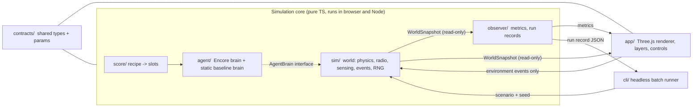

# System architecture

Purpose: which components exist, what each is responsible for, and which information may flow where. Exact types, messages and algorithms are in [`contracts-and-algorithms.md`](contracts-and-algorithms.md). Decisions and their reasons are in [`../planning/decisions-and-risks.md`](../planning/decisions-and-risks.md). Status: **approved for implementation** (ADR-001…010).

## 1. Shape of the system

One TypeScript codebase. A deterministic simulation core with no DOM dependency runs in two hosts: the browser app (live 3D show) and Node (tests and batch experiments). There is no server and no network: the built app is static files and works offline.

## 2. Components

| Directory | Responsibility | May import | Must not |
|---|---|---|---|
| `src/contracts/` | Shared types, message schemas, parameters, event and run-record types. **CONTRACT.** No logic beyond constants and tiny pure helpers | nothing | contain behaviour |
| `src/score/` | Deterministic expansion of a recipe into N0 priority-ordered slots (text, parametric shapes), and score timing helpers. Pure functions | `contracts` | use randomness that isn't seeded from the recipe; touch DOM |
| `src/agent/` | The Encore drone brain (peer table, vacancy detection, claims, score gossip), the shared steering function, and the static baseline brain (`staticBrain.ts`: flies slot *i* of the preloaded score, ignores radio) | `contracts`, `score` | import `sim`, `observer`, `app`; read anything but its `AgentInput` |
| `src/sim/` | The environment: drone bodies, physics limits, sensing, radio medium (range, latency, loss, jams, partitions), failures, event schedule, seeded RNG, the tick loop, scenario runner | `contracts`, and brains only through the `AgentBrain` interface | make any decision for a drone; touch DOM |
| `src/observer/` | Reads snapshots; computes metrics; writes run records; compares runs | `contracts`, `score` (for target shapes) | write to the world or to agent state |
| `src/app/` | Vite app: `main.ts` (loop, action dispatch), `render/` (Three.js scene and one file per view layer), `ui/` (DOM panels, HUD, inspector, scripted demo). Runs the Encore world and the baseline world side by side | everything, read-only | change the simulation except by scheduling environment events |
| `src/cli/` | Node entry: run scenario × seeds headless, write run records | `sim`, `observer`, `agent`, `score`, `contracts` | — |

Ownership (provisional until skills are confirmed) is in [`../planning/development-plan.md`](../planning/development-plan.md).

## 3. Information rules

These are the rules that make "decentralised" true. Each has a test in [`../validation/evaluation-and-tests.md`](../validation/evaluation-and-tests.md).

| # | Rule |
|---|---|
| I1 | A brain's `step` receives only its own state and its `AgentInput`: delivered radio messages, anonymous sensed neighbours within sensing range, its own position and velocity, the tick and show clock. |
| I2 | A brain returns an `AgentOutput` (desired acceleration, light colour, outgoing messages). It never mutates the world. |
| I3 | The world may know everything, because it emulates physics. It hands each drone only what I1 allows. |
| I4 | **Preloaded data is allowed and is not live state:** the launch roster size N0, the drone's own id and initial slot, the initial score, and the parameters. Every drone could carry these before take-off. |
| I5 | Knowing the score (the target vocabulary) is allowed. Knowing where other drones currently are, or which are alive, is allowed only through I1. |
| I6 | The observer and renderer read everything and decide nothing. The app changes the simulation only through environment events. |
| I7 | A new score enters through **one** drone's inbox as an operator uplink. Every other drone gets it only by radio messages that the medium actually delivers. |
| I8 | Radio rendering uses the medium's real event log. Sampling for drawing is allowed; inventing is not. |

What we do **not** claim: that drones are separate processes or machines. They are logically distributed actors in one process, with the isolation above enforced by an import-boundary check and a differential locality test.

## 4. The tick

Fixed timestep `dt = 0.05 s` (20 Hz). Rendering runs at display rate and interpolates between the last two snapshots. One tick, in order:

1. **Events.** Apply environment events scheduled for this tick: kill, jam on/off, partition on/off, score injection, packet-loss change.
2. **Deliver.** Move radio messages due this tick into each live drone's inbox, sorted by (sent tick, sender id, sender sequence).
3. **Sense.** For each live drone, list drones within sensing range as anonymous relative position and velocity.
4. **Decide.** Call every live drone's brain, in ascending id, on the state from the end of the previous tick. No drone sees another's output from the same tick.
5. **Transmit.** For each outgoing message and each live drone within radio range of the sender: check jams and partitions, draw packet loss, schedule delivery after the latency. Log a radio event either way.
6. **Move.** Clamp each requested acceleration, integrate velocity and position, clamp speed.
7. **Account.** Record collisions and near-misses from true positions.
8. **Observe.** Publish the read-only snapshot. The observer updates metrics.

Determinism: one seed per run. The world and radio draw from one seeded stream in the fixed order above. Each brain gets its own stream derived from the seed and its id, kept in its private state. Nothing reads wall-clock time or `Math.random`. Same seed, parameters and event script give the same run on the same JavaScript engine. We do not claim bit-identical results across engines (trigonometric functions may differ), so replay tests compare runs within one host.

## 5. Two worlds, one script

The comparison runs **two independent worlds** from the same seed, roster, score and event script: one with Encore brains, one with static baseline brains. A judge action (kill, jam, inject) is scheduled into both. The observer computes the same metrics for both. Inherent differences (the baseline has no radio protocol, so an injected score cannot spread) are stated in the evaluation doc, not hidden.

## 6. Scale and performance budget

- Target: 200 drones (`n0`) at 20 Hz simulation and 60 fps rendering on a team laptop, for both worlds together. Floor: 100 drones at 30 fps. Measured on team hardware at gate G2; numbers recorded in `CURRENT_STATE.md`.
- Simulation cost per tick is O(N·k) for sensing and radio with a uniform spatial grid (k = neighbours in range), and O(N) per brain worst case for its peer table.
- Rendering uses instanced meshes: one draw call for drones, one for ghost slots, one line buffer for radio sparks.
- Quality fallback, in order: fewer drawn radio sparks → no glow post-processing → lower drone count preset.

## 7. Failure of our own app

The app must survive its own demo: a `Reset` control rebuilds both worlds from the seed, and the scripted demo is just an event script, so it can be restarted at any beat. A recorded video is the last fallback ([`../demo/DEMO_PLAN.md`](../demo/DEMO_PLAN.md)).
