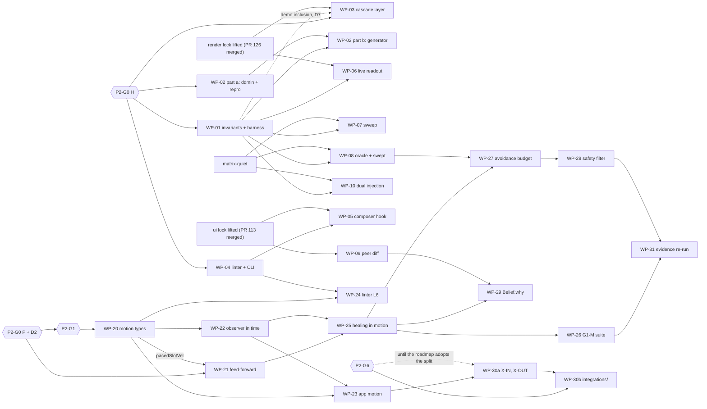

# Phase 2 work packages

> **STATUS: PROPOSED — NOT IMPLEMENTED.** Nothing in this file has been built, and no issue described here exists on GitHub. Each package becomes an issue only after its gate has passed and Arnav says go (see [§7](#7-issue-body-template)).

Purpose: the issue-ready work packages for Phase 2, `P2-WP-01`…`P2-WP-10` (Track H, inside the hackathon window) and `P2-WP-20`…`P2-WP-31` (Track P, after submission or with explicit approval). Status: proposal for review, no code written. Owner: Arnav (Phase 2 architecture, issue #110). Audit base: `origin/main` 26b438a (first audited at 7a50a69); re-checked at `origin/main` c697f6c (02:58 GMT, 15 Nov 2026).

## 1. Scope of this file

This file is canonical for **the work packages only**: what each one builds, in which files, against which existing interfaces, with which tests, and which packages can run at the same time. Everything else is linked, not restated:

| Topic | Canonical location |
|---|---|
| Candidate features `E01`–`E10`, `N01`–`N21` | [`../ideation/PHASE2_CANDIDATES.md`](../ideation/PHASE2_CANDIDATES.md) |
| Capabilities `C1`–`C9`, `P2-FR`/`P2-NFR`, `P2-ADR`, the `P2-CC` register and the full text of `P2-CC-07`, module rules, pipeline, changes since the first audit | [`../design/PHASE2_ARCHITECTURE.md`](../design/PHASE2_ARCHITECTURE.md) |
| Gates `P2-G0`–`P2-G6`, decisions `D1`–`D7`, risks `P2-R*`, the emergency cut order | [`../planning/PHASE2_ROADMAP.md`](../planning/PHASE2_ROADMAP.md) |
| Full text of `P2-CC-01`, `-02`, `-06`, linter checks `L1`–`L6` | [`../design/ANIMATED_CHOREOGRAPHY_RFC.md`](../design/ANIMATED_CHOREOGRAPHY_RFC.md) |
| Full text of `P2-CC-03`, `-04`, `-05a`, `-05b`, `-08` | [`../design/ADAPTIVE_RECOVERY_AND_SAFETY_RFC.md`](../design/ADAPTIVE_RECOVERY_AND_SAFETY_RFC.md) |
| `X-IN`, `X-OUT`, `X-PERSIST`, `X-RUN`, `X-RUN/live` | [`../design/OPTIONAL_INTEGRATION_BOUNDARIES.md`](../design/OPTIONAL_INTEGRATION_BOUNDARIES.md) |
| Tests `P2-T01`…`P2-T36`, invariants `INV-*`, the truth model, scenarios `M0`–`M6`, `X1`–`X3`, `FZ1`, the `p2-repro/1` format, every threshold and budget | [`../validation/PHASE2_EVALUATION.md`](../validation/PHASE2_EVALUATION.md) |
| Demo beats `P2-B*` | [`../demo/PHASE2_JUDGING_STORYBOARD.md`](../demo/PHASE2_JUDGING_STORYBOARD.md) |
| Base process: lanes, claims, branches, merge rules | [`../planning/development-plan.md`](../planning/development-plan.md), [`WORKFLOW.md`](WORKFLOW.md), [`../../AGENTS.md`](../../AGENTS.md) |

Status labels for existing code, all **at 26b438a**: **(a)** implemented and tested on main · **(b)** implemented, not integrated · **(c)** open PR or active branch · **(d)** documented only · **(e)** not present. What merged between 7a50a69 and 26b438a, and which open PRs make files contended, is listed once in [PHASE2_ARCHITECTURE, "Changes since first audit"](../design/PHASE2_ARCHITECTURE.md#changes-since-first-audit). None of it is Phase 2 work. File:line cites are also at 26b438a; #115 and #82 have since moved some `encoreBrain.ts` and `world.ts` lines, so `world.ts` is cited by function name.

**Re-checked at c697f6c** (02:58 GMT, 15 Nov 2026). Merged since 26b438a: #124, #122, #115, #121, #82 (adds `src/sim/sensing.ts`), #125, #113 (app shell; Composer and Inspector mounted), #137 (freeze-run script, `scripts/eval/`), #157, #161, #163, #164, #165, #154, #131/#148 (backup video recorder), #126 (quality ladder: optional `Layer.setQuality?(level)`, edits `src/app/render/**`) and #167. Every wait below on #113, #115, #121, #122 or #126 is satisfied by its merge. Still open: #127 (Readout transition: `main.ts`, `worlds.ts`, `ui/Readout.ts`, `ui/DemoScript.ts`), #166 (shell red-team: tethers, Space, radius, repair beat, labels; it may touch `TetherLayer.ts`), #160 (Devpost gallery) and #147 (pitch). The CURRENT_STATE lock table at c697f6c still lists #113 (`src/app/main.ts`, `src/app/ui/**`) and #126 (`src/app/render/**`) although both have merged. Under the [roadmap's lock rule](../planning/PHASE2_ROADMAP.md#base-state-this-roadmap-depends-on) they bind until the orchestrator lifts them (§2.1). Every package re-checks its dependencies and the lock table when its issue is created.

## 2. Rules every package follows

### 2.1 Track H (hackathon window)

- Starts only after **P2-G0 (H)** holds (time `T0`, no fixed start; [roadmap gates](../planning/PHASE2_ROADMAP.md#gates), where the list is canonical): #110 merged (the Track H thresholds of evaluation §4 and §6 pre-registered); G4 passed (met); Encore in the app (met, #107); the evidence matrix run with frozen params (met, #122); a `demo-good-<n>` tag exists; the FR-10 90% / 70% screenshots committed, or owned on an issue with a time (#141); an owner and slot named for the first presenter rehearsal of the 90 s script and for the backup video (#131); the CURRENT_STATE lock table re-read. Visual packages (P2-WP-03, -05, -06, -09) also need one presenter rehearsal recorded in DEMO_PLAN before they merge (roadmap rung 0b). Merges close **07:30 Sun**. The global cut trigger and cut order are in the [roadmap](../planning/PHASE2_ROADMAP.md#emergency-cut-order); nothing here overrides them.
- **Lock rule (binding).** The lock table in CURRENT_STATE ("Who is doing what") binds when P2-G0 (H) is checked, when a package is claimed and when it merges. No Track H PR edits a locked path, and that includes new files under a locked folder. A lock whose PR has merged stays binding until the orchestrator lifts it ([roadmap lock rule](../planning/PHASE2_ROADMAP.md#base-state-this-roadmap-depends-on)). The lists in §6.2 are illustrative only.
- **New files only**, plus at most one hook per package in a file whose owning PR has merged and that no lock covers. **Zero `[contract]` PRs.** No edit to `src/agent/**`, `src/contracts/**`, `src/score/**`, `src/sim/**`, `Params` or `EncoreState` (evidence fragility, [architecture](../design/PHASE2_ARCHITECTURE.md#1-scope-sources-and-status-labels)).
- CLI work is standalone files run with `npx tsx src/cli/<x>.ts`. `src/cli/main.ts`, `src/cli/brains.ts` and `package.json` stay untouched for the whole of Track H, because the freeze run (#137) uses them. P2-WP-01 owns `src/cli/harness.ts` (`runCustom`), so P2-WP-02 (part b), -07, -08 and -10 depend on it.
- **matrix-quiet** (the roadmap's term, used instead of "#122's records archived"): #122 merged on main (met, 84d2e2d) **and** no matrix run active on the laptop (#133 dry run, the #137 freeze run at 08:30, or any S0–S5 re-run). It is checked live. Fuzz campaigns, sweeps, bounds runs and X3 run only while matrix-quiet. The P2-G0 (P) archive is a separate post-G6 event.
- **No Track H PR commits under `results/**` while it is locked** (#137). Tools write to an explicit `--out` outside the repo. The `results/phase2/` folders named in the packages below apply only once that lock is lifted or the #137 owner agrees on #137 ([roadmap open question 3](../planning/PHASE2_ROADMAP.md#open-questions)).
- Off by default on the demo path. X-ray alone is **not** off: the scripted 90 s demo turns X-ray on from 12 s to 82 s (`src/app/ui/DemoScript.ts`, beats `xray` and `final-view`), and layers self-register. So every Phase 2 visual draws only when **its own opt-in URL flag is set and X-ray is on**. The flag is read once by the layer itself in `init`, from `?p2=<name>[,<name>…]`, guarded by `typeof location !== 'undefined'`, and it defaults to off. Everything else is headless.
- Tag `demo-good-<n>` before every Phase 2 merge.
- Wording follows [requirements §5](../specification/requirements.md#5-claims-we-must-not-make): "checked properties on these runs, not proofs", "predicted conflicts under ideal paced flight (no avoidance) — not a collision forecast", "measured, not guaranteed", "oracle upper bound".
- No network, no external service, in code, tests or demo (NFR-04, [requirements §3](../specification/requirements.md#3-non-functional-requirements)).
- Generators never emit two different scores with the same version: equal versions with different content never converge.

### 2.2 Track P (post-submission)

- Starts only after **P2-G0 (P)** (G6 submitted; the base evidence archived with records and git SHA: `R0`, the freeze-run records of #137) **and** the package's own gate and decision (D2 for each `P2-CC`, D3 for `X-RUN` and `X-RUN/live`, D5 for a new evidence revision).
- `[contract]` packages follow [`AGENTS.md` "Shared contracts"](../../AGENTS.md#shared-contracts): the PR updates types and the contracts doc together, Arnav approves and merges, and the owner comments on dependent issues. Each one declares a new evidence revision and is re-measured by P2-WP-31.
- Contract PRs are merged one at a time (they share `docs/design/contracts-and-algorithms.md`).
- Gates are checkpoints, not a strict sequence. P2-G2 (a) (feed-forward bit-identity and tracking, P2-T23/T24) blocks P2-G3; P2-G2 (b) (avoidance, P2-T32/T33) blocks any animated formation in a judged demo. The capability order C7 → C8 → C9 stands.

### 2.3 Standard regression set

Every package runs these unless it says otherwise:

1. `npm ci` once per worktree, then `bash scripts/check.sh` (typecheck, lint, all tests, build, docs links).
2. Import boundaries T01 (`tests/boundaries.test.ts`) and isolation T02–T05 (`tests/isolation/**`, including the Encore isolation and replay tests from #68) green.
3. G1 suite (`tests/g1/**`) green and unchanged. One exception: P2-WP-22 may edit `tests/g1/helpers.ts`, only to read slot positions through `slotPosAt`. Its PR must show identical G1 output before and after, with motion absent (the beyond-gate table and every verdict).
4. Track H only: `git diff --stat origin/main... -- src/agent src/contracts src/score src/sim` is empty.
5. App packages: the scripted-demo determinism test (`tests/app/demo.test.ts`, #104) still gives identical `stateHash` across runs.
6. Wherever a package claims "no effect on the simulation": equal `stateHash` with the addition on and off (S0–S5, seed 1, n0 40 by default; n0 200 under `P2_WIDE=1`). Track H's check before merge: S0–S5 seed 1 `stateHash` (and base summary) on the PR head equals the merge parent's. The reference is the merge parent, never #122's records, because later merges changed the brain and `src/sim` ([PHASE2_EVALUATION §10](../validation/PHASE2_EVALUATION.md#10-provenance-and-reproducibility)).
7. **Default-suite time (Track H).** `check.sh` and the freeze run (#137) execute the default `vitest run`, and tests near their timeouts already fail under load (CURRENT_STATE "Known risks" on main after 26b438a). All Track H packages together add **at most 15 s** to the default suite (proposed cap; Arnav may change it). Each PR measures and quotes its own addition. The default suite keeps one short run per package (about 300 ticks at n0 40). Anything heavier is opt-in behind `P2_WIDE=1`, which then runs the default-size case before the wide one. That includes the S0–S5 on/off matrix of item 6, the scripted-demo check, campaigns, sweeps and bounds integrations. Opt-in results go into the PR.

### 2.4 Performance rule

The repo's frame budget is [experience §10](../design/experience-and-demo.md#10-performance): "both worlds ≤ 3 ms, render ≤ 6 ms" per frame (SHOULD). The app is render-bound: about 7 fps in X-ray on the committed software-rendered run ([`assets/qa/perf.md`](../../assets/qa/perf.md); one run, not a benchmark). So every Phase 2 **layer** also attaches a #118 harness run (`node scripts/perf/run.mjs`) with the layer on and off, in single and split X-ray, to its PR. Pass: no fps drop beyond run-to-run noise. Each Phase 2 per-tick addition costs **≤ 0.5 ms/tick/world at n0 = 200**, measured by an opt-in timing test (`P2_PERF=1`, printed, never in the default suite) by the method of [PHASE2_EVALUATION §12](../validation/PHASE2_EVALUATION.md#12-performance-criteria) (P2-T10, P2-T18). Whole-app checks reuse the #118 harness (`scripts/perf/simBench.ts`, `scripts/perf/run.mjs`; [QA](../demo/QA.md)); no package invents its own timing framework. Anything over budget stays headless. The render quality ladder of #126 has merged (`src/app/render/quality.ts`; re-checked at c697f6c). Every Phase 2 layer implements the optional `Layer.setQuality?(level)` and hides itself at every quality level above 0. Phase 2 layers are then the first thing the ladder drops, before plain heartbeat lines. Making that an explicit rung of experience §10's degrade order is [open question 9](#8-open-questions).

## 3. Track H packages

### P2-WP-01 · Invariant checker library and run harness

| Field | Value |
|---|---|
| Features | C1 · N05 (the history-checking half of E06) |
| Lane · priority | B (world and evidence) · **P0** (minimal set) |
| Depends on | P2-G0 (H). INV-CONVERGE uses #105's gossip ((a)) |
| Allowed files | `src/observer/invariants.ts`, `src/cli/harness.ts`, `tests/observer/invariants.test.ts`, `tests/observer/invariantRuns.test.ts`, `tests/observer/demoScriptInvariants.test.ts`, `tests/cli/harness.test.ts` (all new) |
| Proposed contract changes | none |
| Falsification tests | P2-T01, P2-T02, P2-T15; cost P2-T18 |

**Purpose.** Pure, incremental checkers for `INV-DUP`, `INV-MONO`, `INV-SILENCE`, `INV-QUIET`, `INV-CONVERGE` and `INV-STATIC` over a real snapshot stream, plus one headless harness that runs any (score, events) pair. The CLI (P2-WP-02, -07, -08, -10) and the app readout (P2-WP-06) share them. The technique is history checking in the Jepsen style. Definitions and thresholds are in [PHASE2_EVALUATION §4](../validation/PHASE2_EVALUATION.md#4-checked-properties). The safety-like checkers (`INV-DUP`, `INV-MONO`, `INV-SILENCE`, `INV-STATIC`) encode the contract §8.4 argument or a [§8.5](../design/contracts-and-algorithms.md#85-known-limits-state-these-dont-hide-them) limit on the brain's delivered or sensed evidence, so a documented limit is never reported as a safety violation. `INV-QUIET` and `INV-CONVERGE` are pre-registered liveness targets, not encodings of limits: documented behaviour can exceed them. Every violation carries a `knownLimit` tag when its shape matches a documented limit. Reports list tagged and untagged violations separately, and only untagged ones are called counterexamples.

**Existing interfaces reused** (all (a)):

| Interface | File |
|---|---|
| `WorldSnapshot`, `DroneSnap`, `EnvEvent`, `RadioEvent` | `src/contracts/world.ts` |
| `Score`, `Params`, `makeParams`, `DT` | `src/contracts/score.ts`, `params.ts` |
| `currentMovement`, `expandRecipe`, `newerVersion` | `src/score/index.ts` |
| `versionKey`; `TickEvidence` | `src/observer/measure.ts`; `src/observer/evidence.ts` |
| `createObserver`; `createWorld` | `src/observer/index.ts`; `src/sim/index.ts` |
| `buildScenario`, `Scenario`, `SCENARIO_IDS` (EVAL timing as #96 set it) | `src/cli/scenarios.ts` |
| `paramsHash`, `canonicalJson`, `runOne` | `src/cli/run.ts` |
| `brainFor`, `BRAINS` (both arms registered by #116; imported read-only) | `src/cli/brains.ts` |
| `makeFakeSnapshot` | `tests/fixtures/fakeSnapshot.ts` |

**Implementation steps.**

1. In `invariants.ts`, export `type InvariantId`, `interface Violation { inv; tick; ids: number[]; slot?: number; knownLimit: string | null; detail: string }` (tags as PHASE2_EVALUATION §4 defines them, for example `'§8.5 limit 3'` or `'flapping'`) and `interface InvariantReport { checked; unavailable: { inv; why }[]; holding; violations: Violation[]; counts: Record<InvariantId, number> }`. Import only `../contracts`, `../score` and `./measure` (T01 enforces the observer rule).
2. Export `INVARIANT_DEFAULTS`, the thresholds pre-registered in PHASE2_EVALUATION §4, with a comment linking there. Code review never chooses a threshold.
3. Export `createInvariantChecker(options: { params: Params; arm: 'encore' | 'static' | 'unknown'; checks?: InvariantId[]; thresholds?: Partial<…> })`. It returns `{ registerScore(score), recordEvent(event), ingest(snapshot): Violation[], report(), reset() }`, mirroring `Observer` so the harness feeds both the same way. `ingest` follows `TickEvidence`'s tick rules: a repeated tick is a no-op; a gap or a backwards tick throws.
4. Implement each `INV-*` exactly as PHASE2_EVALUATION §4 defines it, over the truth model of [§2](../validation/PHASE2_EVALUATION.md#2-notation-and-the-truth-model) (contact from snapshot `t − 1` positions, partition groups rebuilt from recorded events, the observed history stack for `INV-MONO`, the `INV-QUIET` anchor that includes the current hold start). Implementation notes only:
   - state is allocated once (typed arrays of length `n0`), O(n0 + |radio|) per tick;
   - checks that need registered scores or recorded events report `unavailable` with the reason when they lack them; an `INV-QUIET` anchor derived from snapshot changes is marked `derived`;
   - without recorded events, a pair is treated as not in contact while more than one partition is active (only the oldest is visible in `partitionSide`), which can only suppress a report;
   - `INV-STATIC` runs only when `arm === 'static'`.
5. In `src/cli/harness.ts`, export `runCustom(run: { label; seed; params; score; events; ticks; arm }, hooks?: { onSnapshot?(s: WorldSnapshot): void })`, returning `{ record, report }`. It picks the brain with `brainFor` and registers every score and records every event **before** the first step, exactly as `runOne` does. `record` has the `RunRecord` fields plus `label` and `kind: 'p2-exploratory'` (the `p2-result/1` shape of [PHASE2_EVALUATION §10](../validation/PHASE2_EVALUATION.md#10-provenance-and-reproducibility)), so `buildReport` can read it; it is never written as an evaluation record.
6. Never mutate a snapshot. The tests deep-freeze snapshots, as T14 does.
7. `tests/observer/demoScriptInvariants.test.ts` is the headless demo-script check that roadmap D7 and P2-G5 require ([storyboard §4](../demo/PHASE2_JUDGING_STORYBOARD.md#4-beats)). It drives `createWorlds` with the `DemoScript` intents, as `tests/app/demo.test.ts` does, feeds both worlds' snapshots to `createInvariantChecker` and prints the violations with their `knownLimit` tags. It also prints the storyboard's P2-B1 measured row (slot changes, commits and pops, chain depth, first and last commit tick, and first and last arrow tick). The arrow ticks use P2-WP-03's arrival rule: the drone is within `rOcc` of its new target, on snapshot positions.

**Acceptance criteria.**
- P2-T01, P2-T02 and P2-T15 as PHASE2_EVALUATION §7 states them. Any `INV-QUIET`/`INV-CONVERGE` violation in P2-T02 is listed with its `knownLimit` tag and triaged against contract §8.5. It is either fixed in the checker (with a justification line) or reported as a finding before merge. Silently loosening a threshold is not allowed.
- `runCustom(buildScenario(id, seed, params))` gives the same `stateHash` and `summary` as `runOne` for S0, S2 and S5 at n0 40.
- `stateHash` is equal with and without the checker attached.

**Tests.** Unit: `invariants.test.ts` (P2-T01, tick rules, `unavailable` and `derived` modes, multi-partition suppression). Integration: `invariantRuns.test.ts` (P2-T02, P2-T15, the read-only check), `harness.test.ts` (harness ≡ `runOne`), `demoScriptInvariants.test.ts` (the canonical demo script run headless with the checkers, both arms, violations printed for the storyboard; this is the check D7 and P2-G5 require). Default suite (§2.3 item 7): one short S2 run per test file. Under `P2_WIDE=1`: the S0–S5 matrix of P2-T02 with the checker on and off, harness ≡ `runOne` on S0, S2 and S5, and the demo-script run. Falsification: P2-T01 is the anti-vacuity test; P2-T02 the false-alarm test.

**Performance.** `ingest` within the §2.4 rule (P2-T18, `P2_PERF=1`). Not measured yet.

**Regression checks.** Standard set; T01 with the new observer file; T14 still green.

**Rollback.** Revert the squash commit. Until P2-WP-02 and P2-WP-06 merge, nothing imports these files.

**Demonstration evidence.** The test prints a table (INV · checked · holding · first violation · known-limit instances) for S0–S5, quoted only as "checked properties on these runs, not proofs".

### P2-WP-02 · Fault-schedule fuzzer, ddmin shrinking, repro files

| Field | Value |
|---|---|
| Features | C1 · N06 (E06 core) |
| Lane · priority | B · **P0** (minimal set; cut last) |
| Depends on | P2-G0 (H). Two PRs, same ID and allowed files ([roadmap timeline](../planning/PHASE2_ROADMAP.md#track-h-timeline-sun-15-nov-gmt)). **Part a** (`ddmin.ts`, `repro.ts` and their unit tests) starts at `T0` beside P2-WP-01 and needs no checker: `repro.ts` is written against the `p2-repro/1` spec. **Part b** (the generator in `fuzz.ts`, P2-T03, P2-T05) works against WP-01's branch pinned at a named commit, pins the threshold type, and merges only after P2-WP-01 and part a |
| Allowed files | `src/cli/fuzz.ts`, `src/cli/ddmin.ts`, `src/cli/repro.ts`, `tests/cli/fuzz.test.ts`, `tests/cli/ddmin.test.ts` (all new); new folder `results/phase2/fuzz/` (minimal repro JSON only, once the `results/**` lock lifts; §2.1) |
| Proposed contract changes | none: the repro is its own versioned file format, not a `RunRecord` |
| Falsification tests | P2-T03, P2-T04, P2-T05 |

**Purpose.** Search seeded fault schedules for runs that break an `INV-*`, shrink each failure to a 1-minimal schedule, and write a self-contained JSON repro that replays. This is established practice: deterministic simulation testing (FoundationDB), swarm testing (Groce et al., 2012) and delta debugging (Zeller and Hildebrandt, 2002). It is not new work.

**Existing interfaces reused** (all (a)): `runCustom`, `createInvariantChecker` (P2-WP-01); `randomIds`, `agentSeed` (`src/sim/index.ts`); `createRandom` (`src/sim/random.ts`; the CLI is outside the core import rules); `nearestSlotIds`, `PLANE_P` (`src/cli/scenarios.ts`); `makeScore`, `expandRecipe`, `composeNext`, `currentMovement` (`src/score`); `makeParams`; `canonicalJson`, `paramsHash` (`src/cli/run.ts`). `killSetUp` and `healReadyTick` are test helpers in `tests/g1/helpers.ts`, so `fuzz.ts` restates them (`src/` never imports `tests/`) and a test pins the restatement to them.

**Implementation steps.**

1. Entry `npx tsx src/cli/fuzz.ts --campaign FZ1 --seed <u32> --runs <N> --out <dir> [--n0 40] [--ticks 1200] [--compare]`, and `--replay <file>`. There is no default `--out`; nothing is written outside it.
2. Implement FZ1 exactly as [PHASE2_EVALUATION §6.2](../validation/PHASE2_EVALUATION.md#62-fuzz-campaign-fz1-track-h) defines it: configuration, the swarm-testing generator, event resolution from score geometry only, ddmin atomic units and the 300-run shrink budget, the `p2-repro/1` fields (including `thresholds` and `stateHash`) and the calibration budget (≤ 400 runs, an estimate). This package fixes only the code layout: the generator in `fuzz.ts`; a generic, deterministic `ddmin<T>(units, test, budget)` in `ddmin.ts`; the writer and reader in `repro.ts`, serialised with `canonicalJson` plus a newline.
3. Every injection the generator composes carries a version no other score in the schedule has, and every jam and partition pair has its own id (`fz-j<k>`, `fz-p<k>`); a generator test asserts both (P2-T03).
4. `git` comes from a local copy of `src/cli/main.ts`'s private `gitDescribe` (`main.ts` is not edited).
5. `--replay` re-runs the file and prints whether the same INV fires at the same first tick.
6. `--compare` runs the comparative check of §6.2 (exploratory, not an INV). Fuzz runs are 1200 ticks, so `npwcEnd` (window 1700–1799) is null; the check uses §6.2's mean npwc over the last 100 ticks of hold samples.

**Acceptance criteria.** P2-T03, P2-T04, P2-T05; `--replay` reproduces every committed repro.

**Tests.**
- Unit: `ddmin.test.ts` (known minimal sets, 1-minimality, budget flag) and the repro round trip (part a); generator determinism, unique versions and ids (part b).
- Integration: a 3-run smoke campaign in the default suite, shortened if needed to stay inside the §2.3 item 7 cap. P2-T05 is opt-in (`P2_FUZZ=1`); its result (pass or fail, runs until discovery) goes into the PR.
- Falsification: P2-T05, with its own fixed calibration profile ([PHASE2_EVALUATION §6.2](../validation/PHASE2_EVALUATION.md#62-fuzz-campaign-fz1-track-h)): one clumped kill of size 5 at G1's kill tick and no other events. (a) A positive control: the known late G1 pairs fire `INV-QUIET` tagged limit 3. (b) An unaided find within the calibration budget.
- Re-confirmation first: re-run the G1 late-commit miss (`it.fails` in `tests/g1/g1.beyond.test.ts`) on current main and record the late (seed, centre) pairs; the calibration budget is re-derived from that run. Post-pacing, 2 of 40 seed-1 centres are late (about 5% per calibration run, an estimate); 17 of 200 is pre-pacing. If the `it.fails` has turned red, PHASE2_EVALUATION re-chooses the target first.
- If calibration fails, no "0 violations found" statement may be published from this fuzzer. What is shown instead is "FZ1 did not rediscover the known miss in N runs" and, in any demo, a hand-built repro of a known G1 pair, labelled as such.

**Performance.** Offline only, never in the app. The first run prints its wall time; the campaign size follows PHASE2_EVALUATION §6.2. Campaigns run only while matrix-quiet (§2.1).

**Regression checks.** Standard set; `git diff` shows no change under `src/observer`.

**Rollback.** Revert part b, then part a. Repro files are data and can stay or go.

**Demonstration evidence.** "N schedules, k violated INV-X; here is the minimal m-event repro" plus the `--replay` output. This package does not edit the README.

### P2-WP-03 · Repair cascade trail layer

| Field | Value |
|---|---|
| Features | C2 · N07 (E05 framing) |
| Lane · priority | C (experience) · **P0** (minimal set) |
| Depends on | P2-G0 (H) (Encore in the app, #107 (a)); the `src/app/render/**` lock lifted (#126 merged 02:56, so the merge wait is satisfied; re-checked at c697f6c); no file shared with open #166, which may touch `TetherLayer.ts`. Independent of P2-WP-01 for the merge. Inclusion in the judged demo (D7) also needs WP-01's headless demo-script check and the storyboard's P2-B1 measured row |
| Allowed files | `src/app/render/layers/CascadeLayer.ts`, `src/app/render/colourModes/cascadeTrail.ts`, `tests/app/xray/cascadeTrail.test.ts`, `tests/app/xray/cascadeLayer.test.ts` (all new) |
| Proposed contract changes | none |
| Falsification tests | P2-T06; cost P2-T18 |

**Purpose.** Draw an arrow from a drone's old target to its new one for every **observed** `belief.slot` change, once the drone has reached its new target, so that the repair chain of [contract §8](../design/contracts-and-algorithms.md#8-healing-local-claims-adr-007) is visible during the regional-kill beat ([P2-B1](../demo/PHASE2_JUDGING_STORYBOARD.md#p2-b1-repair-cascade-trail)). It draws only when opted in and in X-ray (§2.1), and it invents nothing (`AGENTS.md` Encore rule 3).

**Existing interfaces reused** (all (a)):
- `Layer`, `LayerFactory`, `LayerFrame`, and the optional `ingest(snapshot)` and `reset()` (`src/app/render/Layer.ts`). The optional `setQuality?(level)` was added by #126 after 26b438a (§2.4).
- Self-registration through `import.meta.glob('./*Layer.ts')` (`src/app/render/layers/index.ts`). **No `main.ts` edit.**
- `readViewMode` (`src/app/render/colourModes/viewMode.ts`); `RadioEvent.claimSlot`.
- The pattern of `colourModes/radioTrace.ts` and `RadioLayer`'s `group.userData.radio`.
- `TetherLayer` (`src/app/render/layers/TetherLayer.ts`, read only): in X-ray it already draws an amber line from every live drone farther than `rOcc` from its own `belief.target`, so a claimant's flight to its new slot is visible today. The trail adds what tethers do not show: persistence after arrival, commit and pop colours, and a count equal to the HUD's "Slot changes". Step 1 reuses the tether's `rOcc` rule so the two never overlap.
- `makeFakeSnapshot`; `createWorlds` (`src/app/worlds.ts`) and `createObserver` for the integration test.

**Implementation steps.**

1. `cascadeTrail.ts` (pure, no `three`): `class CascadeTrail(n0, capacity = 256)`.
   - `ingest(snapshot)` follows `TickEvidence`'s tick rules. A backwards tick resets.
   - Baseline: `prevSlot[i] = i` (`Int32Array`) and `prevTarget` (`Float32Array(3·n0)`) from the first snapshot.
   - For each **live** drone whose `belief.slot` differs, push `{ tick, id, from: prevTarget, to: belief.target, kind: newSlot < oldSlot ? 'commit' : 'pop', shownAt: null }` into a ring buffer and count it in `changes`. Dead drones are skipped, as `evidence.ts` skips them, so the counts match the observer's.
   - **Onset after arrival.** An entry becomes drawable on the first ingested tick on which its drone is within `rOcc` of the entry's `to` (the `TetherLayer` rule, on snapshot positions); `shownAt` is set then, and its fade starts there. While a drone is farther than `rOcc` from its current `belief.target`, so that its tether is drawn, none of that drone's entries is drawn. An entry whose drone dies or changes slot again before arriving is counted but never drawn. The alternative, drawing at commit with a hop index along the chain, is [open question 11](#8-open-questions).
   - Then, on **every** ingested tick and for **every** live drone, overwrite `prevSlot[i]` and `prevTarget[i]` with this tick's values. `from` is therefore always the previous tick's `belief.target`. `target` also moves at every movement change (it is the slot of the drone's current movement), so updating only on a slot change would start the next arrow in the previous formation.
2. Citation (optional, cheap): keep only the claim heartbeats (`type === 'HB' && claimSlot !== null`) of the last `claimWindow` ticks. For a commit, report how many distinct `delivered` receivers heard that drone's claims for the new slot.
3. `CascadeLayer.ts`: a default-export factory. One `LineSegments` for shafts and one for two-stroke arrowheads, with preallocated `Float32Array` positions and colours, `DynamicDrawUsage` and an updated `drawRange`. No per-frame allocation.
   - Commits and pops get two colours that reuse no existing X-ray meaning: not cyan (claim heartbeats), amber (in transit), magenta (`SCORE`, contested), vermilion (vacancy) or white (selection, deaf) ([experience §3](../design/experience-and-demo.md#3-view-layers)). The PR names the two colours.
   - Brightness fades linearly over 120 ticks (6 s) from `shownAt`, through vertex colours.
4. Visible if and only if `readViewMode().xray && optIn`. `optIn` is read once in `init` from the `p2` URL flag (§2.1): `?p2=cascade`. It defaults to off, so the scripted demo's X-ray beats draw nothing unless the presenter opted in. It keeps ingesting while hidden, so switching it on shows the true last 6 s. `setQuality(level)` hides the layer at every level above 0 (§2.4).
5. Expose `group.userData.cascade = { drawn, changes, commits, pops, pending }` for tests. `reset()` clears; `dispose()` removes from the scene.
6. No DOM legend in this package (a caption is a later option, using the `BeliefLayer` legend pattern).

**Acceptance criteria.** P2-T06 (recorded `changes` equal the observer's `slotChanges` delta; drawn arrows ≤ `changes`, each only after its drone arrived; no arrow without a belief change; the static view draws none). No trail segment is drawn for a drone while that drone's tether is drawn: a test applies `TetherLayer`'s rule to the same frames. Hidden outside X-ray and at quality levels above 0. With X-ray on and no `p2` flag, `group.visible === false` at every `DEMO_BEATS` tick. No file outside the allowed list.

**Tests.** Unit: change detection, kinds, ring wrap, repeated-tick no-op, reset, onset after arrival (including an entry superseded before arrival, counted and never drawn), no draw while the tether rule holds, and `from` equal to the previous tick's target across a movement change with no slot change. Integration: real `createWorlds` with the Encore brain at n0 40 and a regional kill, counted against a parallel `createObserver` (P2-T06); the static world shows `changes === 0`. Visibility: the scripted demo's view beats with and without the flag (hidden, but still ingesting, without it). A test asserts the position attribute is the same object across updates.

**Performance.** `ingest` is O(n0) on typed arrays, within the §2.4 rule (P2-T18). The #118 render check of §2.4 is attached to the PR.

**Regression checks.** Standard set; `tests/app/xray/**` green; the demo determinism test unchanged (render-only).

**Rollback.** Delete the layer file (self-registration makes deletion complete), or revert.

**Demonstration evidence.** In the regional-kill beat, commit arrows appear as claimants reach their new slots and fade about 6 s later. How many, and whether any of them chain, is not yet measured: the wording comes from the storyboard's [P2-B1](../demo/PHASE2_JUDGING_STORYBOARD.md#p2-b1-repair-cascade-trail) measured row, filled from WP-01's headless demo-script check (pending: not yet run). Inclusion in the judged demo is D7 (Haris owns the demo).

### P2-WP-04 · Score linter library and CLI lint report

| Field | Value |
|---|---|
| Features | C3 · N08 (+ E09 minimal, E10 minimal) |
| Lane · priority | B (library and CLI; consumed by lane C in P2-WP-05) · **P1** (recommended) |
| Depends on | P2-G0 (H). Models #96's pacing rule ((a)) |
| Allowed files | `src/cli/lint.ts` (pure library), `src/cli/lintReport.ts` (CLI entry), `tests/cli/lint.test.ts`, `tests/cli/lintReport.test.ts` (all new), new folder `results/phase2/lint/` (once the `results/**` lock lifts; §2.1) |
| Proposed contract changes | none |
| Falsification tests | P2-T07, P2-T08 |

**Placement.** The library is `src/cli/lint.ts`, not `src/score`: a `src/score` change reaches the brains and the evidence. It is pure: it imports only `src/contracts` and `src/score` and no Node built-ins, so it bundles into the browser, and its own test asserts that. The app composer imports it (P2-WP-05); the boundary test restricts only core folders, so app → cli is allowed. File output lives in `lintReport.ts`, never in `lint.ts`. After P2-CC-02 moves pacing into `src/score`, P2-WP-24 deletes the restatement below ([choreography RFC §9](../design/ANIMATED_CHOREOGRAPHY_RFC.md#9-score-linter-checks-l1l6)).

**Existing interfaces reused** (all (a)):
- `expandRecipe`, `currentMovement`, `launchPos`, `transitionTicksBetween`, `composeNext` (`src/score`); `Formation`, `Slot`, `Recipe`, `Score`, `Params`.
- `buildEvalScore`, `buildScenario` (`src/cli/scenarios.ts`); `runOne`, `resolveParams` (`src/cli/run.ts`).
- `pacedSlotPos`, `PACE_SETTLE_TICKS` (`src/agent/steer.ts:99`, `:114`): **restated, not imported**. `lint.ts` restates the paced-target rule of [contract §10](../design/contracts-and-algorithms.md#10-motion); a parity test (tests may import anything) pins it to `PACE_SETTLE_TICKS` and compares it with `pacedSlotPos` at sampled ticks of the EVAL score.

**Implementation steps.**

1. `lintFormation(formation, params)` returns findings for L2, L3 and L4; `lintTransition(from: Vec3[], to: Vec3[], spanTicks, params)` returns findings for L1 and L5. Findings: `{ check: 'L1'…'L5'; severity: 'info' | 'warn'; count; detail; pairs? | slots? }`.
2. Implement L1–L5 exactly as [choreography RFC §9](../design/ANIMATED_CHOREOGRAPHY_RFC.md#9-score-linter-checks-l1l6) defines them, including L1's closed form and its skip of an unpaced movement 0. L1's label is "predicted conflicts under ideal paced flight (no avoidance) — not a collision forecast".
3. `scoreTransitions(score, n0, params)` lists every paced transition of a score by the #96 rule (movement 0 paced from `launchPos` only if `startTick ≤ 0`; every later movement from the previous movement's same slot).
4. `lintReport.ts`: `npx tsx src/cli/lintReport.ts --n0 200 [--calibrate] [--out <file.md>]` lints EVAL's launch → A and A → B transitions. `--calibrate` runs S0 static once with `runOne` and takes measured collisions per transition window from the cumulative `series[].collisions`. It prints predicted against measured (P2-T08) as a calibration report, never a pass line and never a forecast claim.

**Acceptance criteria.** P2-T07; the P2-T08 report produced and committed to `results/phase2/lint/` (while `results/**` is locked, attached to the PR instead and committed once the lock lifts); the purity and parity tests pass.

**Tests.** Unit: `lint.test.ts` (checks, purity, parity). Integration: `lintReport.test.ts` (EVAL at n0 40, deterministic output; the `--calibrate` S0 run only under `P2_WIDE=1`, §2.3 item 7). Falsification: P2-T07 (closed form against brute force) and P2-T08 (published whatever it says).

**Performance.** Authoring time only, never per tick. L2's BFS time is printed under `P2_PERF=1`.

**Regression checks.** Standard set.

**Rollback.** Revert; no consumer until P2-WP-05.

**Demonstration evidence.** A README line from the committed report: "k predicted conflicts for A → B under ideal paced flight (no avoidance), not a collision forecast; S0 measured m".

### P2-WP-05 · Linter warnings in the composer

| Field | Value |
|---|---|
| Features | C3 · N08, E10 minimal |
| Lane · priority | C · **P1** |
| Depends on | P2-WP-04 merged; the `src/app/ui/**` lock lifted (§2.1). #112, #121 and #113 have merged (re-checked at c697f6c): `main.ts` mounts the composer, so those waits are satisfied. No file shared with open #127 or #166 |
| Allowed files | `src/app/ui/Composer.ts` (**one hook**), `src/app/ui/draftLint.ts` (new; no `createPanel` export, so the panel loader skips it), `tests/app/composer/lintWarnings.test.ts` (new) |
| Proposed contract changes | none |
| Falsification tests | P2-T09 |

**Purpose.** Show linter findings as composer warnings before injection ("3 predicted conflicts under ideal paced flight, 1 radio island"). Warnings never block.

**Existing interfaces reused.**
- `validateDraft(draft, params): Validation` and `Validation { ok; errors; warnings; recipe }` (`src/app/ui/Composer.ts:83` at 26b438a, `:85` at c697f6c; (b) at 26b438a, mounted since #113); `ComposeContext` (same file).
- `composeNext(score, tick, recipe, origin, n0, params)` (`src/score/compose.ts`, (a)): the score the controller would inject (`actions.ts:160` calls it through `composeScore`).
- `lintFormation`, `lintTransition`, `scoreTransitions` (`src/cli/lint.ts`, P2-WP-04).

**Implementation steps.**

1. `draftLint.ts`: `lintWarnings(recipe, params, ctx?: { score: Score; tick: number })`.
   - Formation checks (`lintFormation`) always.
   - Transition checks only when `ctx` is given: build `composeNext(ctx.score, ctx.tick, recipe, 0, params.n0, params)` and lint the transitions that `scoreTransitions` (P2-WP-04) lists for its new movement, with `lintTransition`. This is the score [choreography RFC §9.1](../design/ANIMATED_CHOREOGRAPHY_RFC.md#91-contract-of-the-linter) lints: `from` is the copied current movement's slots, by the #96 rule, so the composer and the CLI report share one definition. `origin` does not affect geometry. No snapshot or belief is read.
   - Any exception is caught and returns `[]`.
2. The hook in `Composer.ts` (one file; these edits only, listed in the PR):
   - `ComposeContext` gains an optional `score?(): Score`, the authored score the controller composes from. Whoever mounts the composer supplies it; WP-05 does not edit that code (see [open question 8](#8-open-questions)).
   - `validateDraft` gains an optional third parameter `lint?: { score: Score; tick: number }`. After the existing `expandRecipe` check, and only if there are no errors, one line appends `lintWarnings(recipe, params, lint)` to `warnings`. `ok` is never changed by the lint.
   - The panel's two render call sites (`Composer.ts:360`, `:450` at 26b438a; `:363`, `:453` at c697f6c) pass `{ score: ctx.score(), tick: ctx.snapshots().encore.tick }` when `ctx.score` exists. Every other caller (`dispatchInject` at `:220`, `setPreview` at `:246`, and `Console.ts`) is unchanged and gets the formation-only warnings.
3. Results are cached per (recipe JSON, score version, current movement index). The composed transition depends on the tick only through which movement is current, and a unit test checks that.

**Acceptance criteria.** P2-T09 (a draft with findings, or a throwing linter, still validates `ok: true` and dispatches exactly one `INJECT_SCORE`); for the same score, tick and recipe, the composer's L1/L5 counts equal `lintReport`'s; the #112 composer tests unchanged and green.

**Tests.** Unit: transition linting against the CLI path, caching, exception path, the formation-only path when `score` is absent. Integration: the existing inject path with a real controller (pattern of `tests/app/composer/inject.test.ts`). Falsification: P2-T09.

**Performance.** Zero per tick; the uncached validation time at n0 200 is printed in the PR.

**Regression checks.** Standard set; `tests/app/composer/**` green.

**Rollback.** Revert the hook and the call sites; `draftLint.ts` becomes dead code.

**Demonstration evidence.** A composer screenshot with the warning for a typed word (beat P2-B3). Cut at rung 3 of the roadmap's cut order (keep the CLI report).

### P2-WP-06 · Live invariant readout in X-ray

| Field | Value |
|---|---|
| Features | C1 · N05 (live readout) |
| Lane · priority | C · **P1** |
| Depends on | P2-WP-01 merged **and** "P2-T02 clean" as [PHASE2_EVALUATION §7](../validation/PHASE2_EVALUATION.md#7-tests-p2-t01p2-t36) defines it (a false violation on stage is worse than none). Whether the wide run fits before rung 4's trigger is [open question 7](#8-open-questions). Also the `src/app/render/**` lock lifted (#126 merged 02:56, so the merge wait is satisfied; re-checked at c697f6c) |
| Allowed files | `src/app/render/layers/InvariantsLayer.ts`, `tests/app/xray/invariantsLayer.test.ts` (both new) |
| Proposed contract changes | none |
| Falsification tests | P2-T10 |

**Purpose.** A small X-ray legend: "Checked on this run, not proofs: INV-DUP ✓ · INV-MONO ✓ · INV-QUIET ✓ (derived) — 3 of 6 checkable live", with the first violation's tick and drone id.

**Existing interfaces reused.** `Layer.ingest` and `init(ctx).params` (`src/app/render/Layer.ts`, (a)); the `BeliefLayer` DOM-legend pattern (per-view index via a data attribute; `src/app/render/layers/BeliefLayer.ts`, (a)); `readViewMode` (a); `createInvariantChecker` (P2-WP-01).

**Implementation steps.**

1. The factory creates a checker with `arm: 'unknown'`. A layer sees only snapshots, so it cannot know its arm, the events or the scores. `INV-STATIC`, `INV-SILENCE` and `INV-CONVERGE` therefore show "not checkable live (see CLI)". `INV-DUP` is defined on delivered heartbeats, and `RadioEvent`s are in every snapshot, so it runs live. Only its `dupContactRuns` diagnostic, which needs the truth-contact model and so the recorded events (PHASE2_EVALUATION §2), is marked "unavailable live". Nothing is inferred.
2. `ingest` feeds the checker. The DOM legend is rebuilt **only when the report changes** (unlike `BeliefLayer`, which rebuilds every frame).
3. Visible if and only if `readViewMode().xray && optIn`, with `optIn` read once in `init` from `?p2=inv` (§2.1), default off. `ingest` keeps running while hidden, and no legend element exists while hidden. `setQuality(level)` hides it at every level above 0 (§2.4). No click-to-select: selection goes through the controller (`actions.ts`, a #113 file that Track H does not edit).

**Acceptance criteria.** P2-T10. The wording on screen matches §2.1. With X-ray on and no `p2` flag, `group.visible === false` and no legend is in the DOM at every `DEMO_BEATS` tick.

**Tests.** Unit: legend text for holding, violated and unavailable states; the flag-off visibility check. Integration: `createWorlds` at n0 40 with an S2-like kill; the report equals a CLI `runCustom` report on the same events for the snapshot-checkable subset (short run by default, §2.3 item 7). Falsification: P2-T10.

**Performance.** As P2-T10, plus the #118 render check of §2.4.

**Regression checks.** Standard set; demo determinism.

**Rollback.** Delete the layer file.

**Demonstration evidence.** Only if D7 approves it for the judged demo; otherwise a screenshot for the README. Cut at rung 4.

### P2-WP-07 · Exploratory parameter sweep (X1, X2)

| Field | Value |
|---|---|
| Features | C4 · E07 |
| Lane · priority | B · **P2** (stretch) |
| Depends on | P2-WP-01 (harness); matrix-quiet (§2.1: #122 merged, met, and no matrix run active). A sweep sits beside the base S2 records and must not compete with a matrix run for CPU |
| Allowed files | `src/cli/sweep.ts`, `tests/cli/sweep.test.ts` (both new), new folder `results/phase2/sweeps/` (once the `results/**` lock lifts; §2.1) |
| Proposed contract changes | none (`makeParams(n0, overrides)` already exists) |
| Falsification tests | P2-T11 |

**Purpose.** One breakdown curve per sweep, X1 (loss) and X2 (kill fraction) as [PHASE2_EVALUATION §6](../validation/PHASE2_EVALUATION.md#6-exploratory-sweeps-and-the-fuzz-campaign) defines them, labelled **exploratory, not pre-registered**.

**Existing interfaces reused** (all (a)): `makeParams(n0, overrides)`, `DEFAULT_PARAMS` (`src/contracts/params.ts`); `runOne({ params })`, `paramsHash` (`src/cli/run.ts`); `buildReport` (`src/cli/report.ts`, read-only use); `buildEvalScore`, `nearestSlotIds`, `killCount` (`src/cli/scenarios.ts`); `randomIds`, `agentSeed`; `runCustom` (P2-WP-01).

**Implementation steps.**

1. Entry `npx tsx src/cli/sweep.ts --sweep X1|X2 --seeds 1-5 --arms static,encore [--n0 200] [--set key=value …] --out <dir>`.
2. `--set` is parsed against the keys and types of `DEFAULT_PARAMS`. An unknown key or a wrong type is an error. Overrides go through `makeParams(n0, overrides)`, so `paramsHash` differs per point by construction (P2-T11).
3. X1 calls `runOne` per (loss, seed, arm). X2 needs a kill count other than `killCount(n0)`, so it builds S2-like events in `sweep.ts` with the centre rule of §6 and runs them with `runCustom`. A test asserts that X2 at 10% reproduces `buildScenario('S2', …)`'s events exactly.
4. Output: records per point under `--out/<sweep>/<point>/`, and one Markdown table per sweep built by calling `buildReport` **per point** (one params hash per call, so no mixed-hash warning). Every heading says "exploratory, not pre-registered; no parameter was chosen from these runs" ([evaluation §5](../validation/evaluation-and-tests.md#5-procedure)).

**Acceptance criteria.** P2-T11; the X2-at-10% equals S2 test; the table carries `paramsHash` per point.

**Tests.** Unit: `--set` parsing; the X2-at-10% event equality (events only, no run). Integration (`P2_WIDE=1`, §2.3 item 7): a 2-point, 1-seed sweep at n0 40. Falsification: P2-T11.

**Performance.** Offline. The first run prints its wall time; sweeps run only while matrix-quiet.

**Regression checks.** Standard set.

**Rollback.** Revert; delete the output folder.

**Demonstration evidence.** One curve (`npwcEnd` and `tRec` against loss), labelled. README text only if computed before the freeze; cut first (rung 1).

### P2-WP-08 · Oracle time bound and swept collision accounting

| Field | Value |
|---|---|
| Features | C4 · N09, N10 |
| Lane · priority | B · **P2** (stretch) |
| Depends on | P2-WP-01 (harness `onSnapshot`); matrix-quiet (§2.1) |
| Allowed files | `src/observer/swept.ts`, `src/cli/oracle.ts`, `src/cli/bounds.ts`, `tests/observer/swept.test.ts`, `tests/cli/oracle.test.ts`, `tests/cli/bounds.test.ts` (all new), new folder `results/phase2/bounds/` (once the `results/**` lock lifts; §2.1). **Not** `src/observer/measure.ts` or any other existing observer file |
| Proposed contract changes | none: new keys are reported in Phase 2 tables, not in `RunRecord.summary` |
| Falsification tests | P2-T12; cost P2-T18 |

**Purpose.**
- `collisionsSwept` and `nearMissesSwept`: contract §10's closest-approach SHOULD, done observer-side, with no world change.
- `tOracle`: a labelled **oracle upper bound** (instant global knowledge, no detection delay) on recovery performance, which is a lower bound on recovery time. Defined only on runs with exactly one `KILL`. Never shown as a competitor arm.

**Existing interfaces reused** (all (a)): `WorldSnapshot.drones[].pos`; the world's on-entry counting rule (the collision and near-miss pass in `step()`, `src/sim/world.ts`, read only); the world's semi-implicit Euler step (velocity first, clamped to `vMax`, then position), which the discrete reach of §3.2 follows; `Params.dCollide`, `dNear`, `vMax`, `aMax`, `rOcc`; `expandRecipe`, `currentMovement`; `buildScenario`; `runCustom` (P2-WP-01).

**Implementation steps.**

1. `swept.ts`: `createSweptCounter(params)` with `ingest(snapshot)`, implementing `collisionsSwept` and `nearMissesSwept` exactly as [PHASE2_EVALUATION §3.3](../validation/PHASE2_EVALUATION.md#33-safety-swept-collisions) defines them (candidates, per-pair closest approach, entry rule). Nothing is restated here.
2. `oracle.ts`: `oracleRecoveryBound(snapshotAtKill, score, params)`, implementing `tOracle` exactly as [PHASE2_EVALUATION §3.2](../validation/PHASE2_EVALUATION.md#32-recovery) defines it: whole-tick `τ(s)` against the slot position at `k + u` (so it holds under motion too), the discrete reach `reach_d(u)` of the world's step rather than the continuous formula, and `null` on any run without exactly one `KILL`. Nothing else is restated here.
3. `bounds.ts`: `npx tsx src/cli/bounds.ts --scenario S1,S2,S4 --seeds 1-5 --arms static,encore --out <dir>`. S1, S2 and S4 each have one `KILL`. It uses `runCustom` with a swept counter in `onSnapshot` and the oracle at the `KILL` tick of single-kill runs; other runs report `tOracle` as `null`. Output table: `tFirst95` (observed time to first npwc ≥ 0.95), `tRec`, `tOracle`, `collisions`, `collisionsSwept`, `nearMisses`, `nearMissesSwept`.

**Acceptance criteria.** P2-T12: `tOracle ≤ tFirst95` on every single-kill run, and `≤ tRec` whenever `tRec` is defined; swept counts ≥ end-of-tick counts on every run.

**Tests.**
- Unit: two drones passing through each other between tick ends (swept 1, end-of-tick 0); the T12 head-on case of [evaluation §6](../validation/evaluation-and-tests.md#6-automated-tests) (both 1); the oracle on hand-built snapshots against brute force at n0 6; `reach_d(u)` against one drone driven from rest at full `aMax` through `createWorld` (within 1e-9 m, `u` ≤ 200) and as a bound from a moving start; `null` on a two-kill run.
- Integration: `bounds.test.ts` at n0 40, S2 (`P2_WIDE=1`, §2.3 item 7).
- Falsification: P2-T12 (if `tOracle` ever exceeds the observed time, the bound or the metric is wrong and the package does not merge).

**Performance.** Swept counting runs only in the CLI, within the §2.4 rule (P2-T18). The oracle runs once per kill.

**Regression checks.** Standard set; no edit to existing observer files.

**Rollback.** Revert.

**Demonstration evidence.** README lines in this form: "k collisions counted at tick ends; N by swept closest approach (measured, these runs)", and "Encore tRec X s; oracle upper bound (instant global knowledge) Y s".

### P2-WP-09 · Inspector peer diff: what it knows against what is true

| Field | Value |
|---|---|
| Features | C5 (minimal) · E05 |
| Lane · priority | C · **P2** (stretch) |
| Depends on | #113 merged and mounting the inspector (no caller at 26b438a: (b); met at c697f6c, where `main.ts` calls `connectInspector`); the `src/app/ui/**` lock lifted (§2.1). **Two hooks**: Track H only with an explicit D1 exception from Arnav ([roadmap D1](../planning/PHASE2_ROADMAP.md#decisions-for-arnav)), otherwise Track P beside P2-WP-29 |
| Allowed files | `src/app/ui/peerDiff.ts` (new; no `createPanel` export), `src/app/ui/Inspector.ts` (hook), `src/app/ui/inspectorTruth.ts` (hook), `tests/app/stage/peerDiff.test.ts` (new) |
| Proposed contract changes | none |
| Falsification tests | P2-T13 |

**Purpose.** For the selected drone, raw peer data from the drone's own state set against observer truth, with **no classification derived from brain rules**. Each row is one peer: "last heard t s ago" (or "never"), **from drone state**, beside the truth, which stays in the hatched "Observer · not visible to this drone" box: alive and in radio range, alive and out of range, or dead. The section header shows the drone's `tSuspect` as a reference value. The app never decides "believed alive" or "suspected": that is the brain's `peersKnown` rule, and restating it in the app is the re-derivation [P2-ADR-07](../design/PHASE2_ARCHITECTURE.md#11-proposed-adrs) rejects. A dead peer's row shows its heartbeat going stale (age growing past `tSuspect`) while truth says dead. A jammed live peer's row shows the same staleness while truth says alive. Brain-produced peer groups belong to the full form ([open question 10](#8-open-questions)).

**Existing interfaces reused.** `AgentView.inspect.state: unknown`, `ObserverTruth`, `InspectorSource`, `connectInspector`, `truthRows` (`src/app/ui/Inspector.ts`, (b)); `observerTruth(snapshot, slots, params, id)` (`src/app/ui/inspectorTruth.ts`, (b)); the isolation guard `tests/app/stage/isolation.test.ts` (#108, (a)).

**Implementation steps.**

1. `peerDiff.ts` (pure; must not mention `WorldSnapshot` or import `src/agent`, `src/sim` or `src/observer`): `peerDiff(state: unknown, truth: { liveInRange: number[]; liveOutOfRange: number[]; dead: number[] }, now)`. It reads `state.peers` **generically and guarded**: an array whose entries are `null` or have a finite `heard`. Otherwise it returns `null` and the section is hidden (the static brain has no peers). It returns rows `{ id, heardAgo: number | null, truth }` sorted by id. It never compares `heardAgo` with any parameter.
2. Hook 1 (`inspectorTruth.ts`): `observerTruth` adds `peers: { liveInRange, liveOutOfRange, dead }` from the snapshot.
3. Hook 2 (`Inspector.ts`): an optional `peers?` field on `ObserverTruth`, and one render section that calls `peerDiff` with `view.inspect.state`. The age column is labelled "from drone state"; `tSuspect` appears only as the header's reference value.

Neither hook file is edited by an open PR at 26b438a, nor at c697f6c (#127 and #166 do not list them), but both are under the `src/app/ui/**` lock; re-check before claiming.

**Acceptance criteria.** P2-T13. The output contains only ids, ages and truth labels: a test asserts that no row carries a derived label ("believed alive", "suspected", "silent"). Tripwire, in the test only (tests may know brain internals): on a real Encore world, the number of rows with `heardAgo < tSuspect` equals `belief.peersKnown`. If the meaning of `heard` changes, the test fails rather than the label drifting.

**Tests.** Unit: guards (missing `peers`, malformed entries), no derived labels. Integration: a jam beat where a jammed live peer's age grows while truth says alive, and a kill where a dead peer's age grows while truth says dead. Falsification: P2-T13 and the tripwire.

**Performance.** Inspector refresh is 4 Hz with an O(n0) scan; not per tick.

**Regression checks.** Standard set; `tests/app/stage/**` green.

**Rollback.** Revert both hooks; `peerDiff.ts` becomes unused.

**Demonstration evidence.** The 3-minute knowledge-versus-truth beat (E05, P2-B6 minimal form): a heartbeat going stale (not heard for more than `tSuspect`) while truth says alive (jam) or dead (kill). Cut at rung 2.

### P2-WP-10 · Dual injection across a partition (X3) and churn bound

| Field | Value |
|---|---|
| Features | C6 · E08 (minimal) |
| Lane · priority | B · **P2** (stretch) |
| Depends on | #105 (a); P2-WP-01 (harness, `INV-CONVERGE`). X3 has no base-matrix column to sit beside, so it needs no base records; it runs only while matrix-quiet (§2.1) |
| Allowed files | `src/cli/dualInject.ts`, `tests/cli/dualInject.test.ts` (both new), new folder `results/phase2/x3/` (once the `results/**` lock lifts; §2.1) |
| Proposed contract changes | none: semantics stay those of [contract §9](../design/contracts-and-algorithms.md#9-score-dissemination-and-partitions-adr-005-adr-008); no edit to adoption |
| Falsification tests | P2-T14 |

**Purpose.** Evidence for FR-22 and contract limits 7 and 8: inject different scores on both sides of a partition, reconnect, and measure convergence and churn against a pre-registered bound. Both scores share a base, so limit 9 is not exercised. The technique is textbook last-writer-wins on `(issuedTick, origin)` (a physical-clock LWW, not a Lamport clock) and must not be pitched as new.

**Existing interfaces reused** (all (a)): `buildEvalScore`, `PLANE_P`, `PARTITION_ID` (`src/cli/scenarios.ts`); `composeNext`; summary keys `tVersion`, `slotChanges`, `dupSlotSec`, `dupSlotsEnd`, `splitSec` (`src/observer/summary.ts`); `runCustom`, `INV-CONVERGE` (P2-WP-01).

**Implementation steps.**

1. Build X3 exactly as [PHASE2_EVALUATION §6](../validation/PHASE2_EVALUATION.md#6-exploratory-sweeps-and-the-fuzz-campaign) defines it; the two injections carry different versions.
2. Run the Encore arm with `runCustom`; record per-drone switch ticks to the winning version from snapshots.
3. Fix the numeric churn bound from **dev seeds 101–105 only** and write it into PHASE2_EVALUATION through a docs PR **before** eval seeds 1–5 run. Then assert eval seeds against it.
4. Report the keys §6 lists. `dupSlots` ignores versions, so read it with care in split scenarios.

**Acceptance criteria.** P2-T14.

**Tests.** Unit: event builder (sides correct, ticks ordered, versions distinct). Integration (`P2_WIDE=1`, §2.3 item 7): n0 40, one seed. Falsification: P2-T14 with the bound fixed in advance.

**Performance.** Offline; only while matrix-quiet.

**Regression checks.** Standard set. T16 (`tests/g4/dissemination.test.ts`) and T18 (`tests/g4/relay.test.ts`) stay green and unedited.

**Rollback.** Revert.

**Demonstration evidence.** The "two colours become one" beat (P2-B4), if D7 adds it, and a churn line in the README.

## 4. Track P packages

Every Track P package is post-submission unless D4 pulls it forward (recommended: no). Each `[contract]` package carries the label **PROPOSED CONTRACT CHANGE — REQUIRES ARNAV APPROVAL**; its full change text lives in the owning RFC and only the work split is here. Each declares a new evidence revision (D5).

### P2-WP-20 · [contract] Motion primitives and `slotPosAt` / `slotVelAt`

| Field | Value |
|---|---|
| Features · lane · priority | C7 · E01 · lane A · P0 (post) |
| Depends on | P2-G0 (P); P2-G1 (D2 approves P2-CC-01, -02, -06; determinism tests specified; L6 bounds fixed) |
| Allowed files | `src/contracts/score.ts`, `src/score/motion.ts`, `src/score/pacing.ts` (new), `src/score/{compose,timing,index}.ts`, `src/agent/steer.ts` (re-export only), `docs/design/contracts-and-algorithms.md` (§2, §6, §10, and the observer text of §5 for P2-CC-06), `docs/specification/requirements.md` (the FR-38 row only; CC-01 migration step 6), `tests/score/motion.test.ts`, `tests/score/pacing.test.ts` (new), `tests/score/compose.test.ts` (additions only: the carried movement keeps `motion`; the transition is measured from moved positions), `tests/contracts/**` (only if a type fixture needs the new optional fields) |
| Contract changes | P2-CC-01, P2-CC-02 (and the doc text of P2-CC-06) |
| Tests | P2-T20, P2-T21, P2-T22 |

**Existing interfaces reused:** `Movement`, `Recipe`, `Score`; `expandRecipe` (memo key must not include tick), `currentMovement`, `composeNext`, `copyMovement` (`src/score/compose.ts`); `pacedSlotPos`, `PACE_SETTLE_TICKS` (`src/agent/steer.ts:114`). All (a).

**Steps** (exactly as [choreography RFC §10.1](../design/ANIMATED_CHOREOGRAPHY_RFC.md#101-p2-cc-01-movementmotion-and-movementcolourmotion) and [§10.2](../design/ANIMATED_CHOREOGRAPHY_RFC.md#102-p2-cc-02-slotposat-slotvelat-slotaccat-and-motion-aware-pacing) specify):
1. Add the optional `Movement.motion` and `colourMotion` and the pure `validateMotion`. When absent, behaviour is bit-identical.
2. `copyMovement` carries `motion` and `colourMotion` (today it drops unknown fields; the RFC owns this change).
3. Move `pacedSlotPos` and `PACE_SETTLE_TICKS` into `src/score/pacing.ts` **byte for byte** and re-export them from `steer.ts`, as its own commit. `tests/agent/pacedSlotPos.test.ts` passes unchanged through the re-export, and its twin in `tests/score/pacing.test.ts` checks parity at sampled ticks of the EVAL score.
4. Implement closed-form `slotPosAt`, `slotVelAt` (and optional `slotAccAt`), `slotColourAt`, `transformFormationAt` and the slots-only bulk form `slotPositionsAt` in `src/score/motion.ts`; export them from `src/score/index.ts`. Motion is anchored to the movement's own `holdStart`. All three position functions share one per-slot step after a setup run once per `(movement, tick)`, in the same arithmetic order, so they agree bit for bit ([choreography RFC §3.1](../design/ANIMATED_CHOREOGRAPHY_RFC.md#31-signatures)). `slotPositionsAt` is the hoisted scan's input in P2-WP-25.
5. In a separate commit, apply the motion-aware substitutions of [choreography RFC §3.5](../design/ANIMATED_CHOREOGRAPHY_RFC.md#35-composition-with-paced-targets-96) to `pacedSlotPos`: `to = slotPosAt(t)`, and `from` = the previous movement's slot evaluated at `begin` with that movement's own `holdStart`, frozen for the transition. Add `pacedSlotVel` (the motion part only, zero for static scores) and re-export it. Without this step, `pacedSlotPos` returns the static `to` once the transition ends, so brains aiming at it (P2-WP-21 step 3) would hold the static slot and the formation would not move. Checked by P2-T21 and by a test that in a spinning hold the paced aim equals `slotPosAt(t)`.
6. Brain wiring lands in P2-WP-21.

**Acceptance:** P2-T20–T22. `slotPositionsAt` and the slots of `transformFormationAt` equal `slotPosAt` exactly (`===`) for every slot at sampled ticks. P2-T20 also covers colour: `slotColourAt` equals `Slot.colour` exactly when `colourMotion` is absent. A unit test for each `colourMotion` kind (breathe, chase). With motion absent, step 5 returns step 3's values exactly. Existing `tests/score/**` and `tests/agent/pacedSlotPos.test.ts` (through the re-export) unchanged, except the additions to `compose.test.ts` listed above.

**Performance:** per-call cost measured opt-in (`P2_PERF=1`) and printed in the PR.

**Regression:** standard set except item 4; with no brain using motion yet, S0–S5 `stateHash` equals the parent commit's.

**Rollback:** Arnav reverts the `[contract]` PR.

**Demonstration evidence:** none on its own; P2-WP-23 shows it.

### P2-WP-21 · [contract] Feed-forward steering, brains aim at the moving slot

| Field | Value |
|---|---|
| Features · lane · priority | C7 · N02 · lane A · P0 (post) |
| Depends on | D2 approves P2-CC-03. Two PRs in a fixed order (§6.3): steps 1–2 land **first**, before P2-WP-20, as the roadmap's first Track P `[contract]` PR (`targetVel` defaults to zero); steps 3–5 need P2-WP-20 merged |
| Allowed files | `src/agent/steer.ts`, `src/agent/staticBrain.ts`, `src/agent/encoreBrain.ts` (target, steering and `transitLanes` call sites, `belief()`, colour, `validateMotion` in the adoption check, the motion gate in `evaluateCanHeal`), contract doc §10 (steps 1–2), §8.2 condition 3 and §8.5 limit 4 (step 5), `tests/agent/feedForward.test.ts`, `tests/agent/bitIdentity.test.ts`, `tests/agent/motionGate.test.ts`, `tests/agent/lanesUnderMotion.test.ts` (new) |
| Contract changes | P2-CC-03; the brain side of P2-CC-02 |
| Tests | P2-T23, P2-T24 |

**Existing interfaces reused:** `steer`, `steerTarget` (`src/agent/steer.ts`); `encoreBrain`, `staticBrain`; adoption check `encoreBrain.ts:129-143`. All (a).

**Steps** (exactly as [recovery RFC, P2-CC-03](../design/ADAPTIVE_RECOVERY_AND_SAFETY_RFC.md#p2-cc-03-target-velocity-feed-forward-in-steer)):
1. Add `targetVel: Vec3 = ZERO`, adding a component only when non-zero (signed-zero safety).
2. Record a golden `stateHash` table for S0–S5, seed 1, from the parent commit (n0 40 by default, n0 200 under `P2_WIDE`) in the test, with that SHA (P2-T23).
3. Both brains aim at `pacedSlotPos` (now in `src/score`) and pass `pacedSlotVel`, the **motion part only**: zero for static scores, so P2-T23 holds. Feeding the lerp term forward too is a separate measured option (AR-Q2), not part of this package. Encore's `transitLanes` call site (`encoreBrain.ts:355-357` at 26b438a, `:359-361` at c697f6c) passes `slotPosAt(now)` to `steerTarget` and subtracts it, in place of the static `mine.pos` ([choreography RFC §10.2](../design/ANIMATED_CHOREOGRAPHY_RFC.md#102-p2-cc-02-slotposat-slotvelat-slotaccat-and-motion-aware-pacing), step 3). Otherwise a drone tracking its moving slot is soon more than 3 m (`LANE_RELEASE_DIST`) from the static position and keeps its ±2 m depth offset for the whole hold.
4. `Belief.target` = `slotPosAt(now)`; Encore's adoption check calls `validateMotion`. The static brain's `slotAt` uses `slotPosAt`; its lane call already takes that target, so it needs no separate change.
5. **Interim motion gate.** `evaluateCanHeal` returns `false` whenever `currentMovement(s.score, now).movement.motion` is present (condition 1 already excludes ticks before `holdStart + holdGrace`). The settle test does **not** switch healing off by itself. After step 4 it compares with `slotPosAt(now)` but still uses absolute speed < 0.5 m/s, so drones on slow slots settle: slots within `0.5/ω` of a spin axis (2.5 m at ω = 0.2, the poles of `EVAL-M`), every slot of a slow enough spin, and the zero-velocity phases of sway, pulse and waves. The vacancy scan meanwhile still tests the static `expandRecipe` positions (`encoreBrain.ts:239`). Without the gate those drones would judge vacancies in the wrong frame, the false and masked vacancies of [recovery RFC §1.2](../design/ADAPTIVE_RECOVERY_AND_SAFETY_RFC.md#12-why-the-previous-position-is-empty-is-the-wrong-test), after a kill or whenever heartbeats also fail (jam, partition, loss). The gate adds no `Params` field and no `EncoreState` field, and it never fires with motion absent, so P2-T23 holds. The same PR states it in contract §8.2 (condition 3) and §8.5 limit 4. P2-WP-25 replaces it with the co-moving-frame rule. It is also the fallback if C8 slips ([roadmap P2-R12](../planning/PHASE2_ROADMAP.md#risks)).

**Acceptance:** P2-T23 (bit-identical with static scores), P2-T24 (lag reported with and without feed-forward). Motion gate (`motionGate.test.ts`): an Encore world on EVAL with the sphere given a spin (built in the test; `buildMScenario` arrives with P2-WP-22), with and without a regional kill and with `SET_LOSS 0.2`. `canHeal` stays false for every drone throughout the animated hold, including the pole slots, and Encore makes **0** slot changes during it. The default suite runs n0 40 with a short hold, and n0 200 runs under `P2_WIDE=1`. A yield pop counts as a failure ([open question 6](#8-open-questions)). Lanes (`lanesUnderMotion.test.ts`): with `transitLanes = true` during a spin, a drone within 3 m of `slotPosAt(now)` aims with no depth offset, in both brains.

**Performance:** no measurable change at rest; measured with `P2_PERF`.

**Regression:** G1 suite and the 40-centre sweep bit-identical to the parent.

**Rollback:** revert.

**Demonstration evidence:** a spin with and without feed-forward, A/B.

### P2-WP-22 · [contract] Observer geometry in time, and the M-scenario builder

| Field | Value |
|---|---|
| Features · lane · priority | C7 · E01 · lane B · P0 (post) |
| Depends on | P2-WP-20 merged; D2 approves P2-CC-06. (#115, which edited observer files, has merged: re-checked at c697f6c) |
| Allowed files | `src/observer/index.ts`, `src/cli/run.ts` (`onSlotFraction`), `tests/g1/helpers.ts` (slot positions via `slotPosAt` only; the §2.3 item 3 exception, with identical G1 output shown in the PR), `docs/validation/evaluation-and-tests.md` (§2 metric note), `src/cli/motionScenarios.ts` (new: `buildMScenario`, `EVAL-M`, M0–M6), `tests/observer/motionGeometry.test.ts`, `tests/cli/motionScenarios.test.ts` (new) |
| Contract changes | P2-CC-06 (doc text landed in P2-WP-20; this package is the code) |
| Tests | P2-T25, P2-T19; cost P2-T18 |

**Existing interfaces reused:** `createObserver`, `geometry`, `observedGeometry` (`src/observer/index.ts:18-36`); `Observer.slotStatus` return type unchanged (`src/contracts/metrics.ts`); `runCustom` (P2-WP-01).

**Steps** (exactly as [choreography RFC §10.3](../design/ANIMATED_CHOREOGRAPHY_RFC.md#103-p2-cc-06-observer-semantics-under-motion)):
1. `geometry()` uses `transformFormationAt`, so slots and `dense` are evaluated at the snapshot tick; `measure.ts` is not edited.
2. Cache per tick, because the per-tick formation loses `expandRecipe`'s memo.
3. Leave `inHold` unchanged; new summary keys exist only in PHASE2_EVALUATION.
4. Build M0–M6 exactly as [PHASE2_EVALUATION §5](../validation/PHASE2_EVALUATION.md#5-animated-scenarios-m0m6-track-p) defines them, including probe `J`'s partial jam; M5's injected score has a version the preloaded score does not.

**Acceptance:** P2-T25, P2-T19. With motion absent, every existing observer test is unchanged.

**Performance:** within the §2.4 rule (P2-T18).

**Regression:** standard set; `tests/observer/**`; T14.

**Rollback:** revert.

**Demonstration evidence:** an occupancy table for M0.

### P2-WP-23 · App: ghost slots, timeline and composer for animated movements

| Field | Value |
|---|---|
| Features · lane · priority | C7 · E01, E10 · lane C · P1 (post) |
| Depends on | P2-WP-20, P2-WP-22 merged; #113 merged (mounts ghost slots, timeline and composer; met at c697f6c) |
| Allowed files | `src/app/render/layers/GhostSlotLayer.ts`, `src/app/ui/Timeline.ts`, `src/app/ui/Composer.ts`, `src/app/ui/commands.ts`, `src/app/ui/inspectorTruth.ts`, `src/app/actions.ts` (the `inject` intent gains optional `motion` and `colourMotion`; the `composeScore` signature gains the same trailing optional parameters), `src/app/worlds.ts` (wiring them to `composeNext`), `tests/app/**` (new files). `actions.ts` and `worlds.ts` were edited by #113, which has merged (re-checked at c697f6c), so that wait is satisfied. Open #127 also edits `worlds.ts`; re-check before claiming |
| Contract changes | none (uses P2-CC-01) |
| Tests | P2-T16 |

**Existing interfaces reused:** `LayerFrame.slots` (`src/app/render/Layer.ts`); `createSlotStatusFeed` (`GhostSlotLayer.ts`, 4 Hz, (b)); `connectTimeline` (`Timeline.ts`, (b)); `validateDraft`, `Draft` (`Composer.ts`, (b)); the `form …` parser (`commands.ts`); `observerTruth.sameFormation`.

**Steps** (integration points of [choreography RFC §8.2](../design/ANIMATED_CHOREOGRAPHY_RFC.md#82-integration-points-track-p-p2-wp-23)):
1. The inject path carries motion: the composer's intent passes `motion`/`colourMotion` through `actions.ts` to `composeScore` (`composeNext(..., motion?, colourMotion?)`). Existing callers are unchanged because the parameters are optional.
2. Ghost positions are interpolated between the last two feed readings and labelled.
3. Timeline cues show a motion badge.
4. The composer gains motion presets (v1: spin ω).
5. `form sphere --spin ω` is added to the parser.
6. `sameFormation` compares at the reading's tick.

**Acceptance:** P2-T16; nothing is drawn that the observer did not compute.

**Performance:** within the §2.4 rule.

**Regression:** standard set; the #109 and #112 tests green.

**Rollback:** revert.

**Demonstration evidence:** the spinning sphere with ghost rings.

### P2-WP-24 · Linter L6: motion feasibility

| Field | Value |
|---|---|
| Features · lane · priority | C3/C7 · N08, E01 · lane B · P1 (post) |
| Depends on | P2-WP-04, P2-WP-20 merged; L6 bounds fixed at P2-G1 |
| Allowed files | `src/cli/lint.ts`, `tests/cli/lint.test.ts` |
| Contract changes | none |
| Tests | P2-T17 |

**Steps:**
1. Replace the restated pacing rule with the `src/score` import and delete the parity restatement.
2. Implement L6 exactly as [choreography RFC §9](../design/ANIMATED_CHOREOGRAPHY_RFC.md#9-score-linter-checks-l1l6) bounds it, using the shipped `slotVelAt` and `slotAccAt`. Warnings only.

**Acceptance:** P2-T17; L6 unit cases at, just below and just above each bound.

**Performance:** authoring time only.

**Regression:** P2-T07 still passes.

**Rollback:** revert.

**Demonstration evidence:** a composer warning on an over-fast spin.

### P2-WP-25 · [contract] Healing in motion

| Field | Value |
|---|---|
| Features · lane · priority | C8 · E02, N01 · lane A · P0 (post, flagship) |
| Depends on | P2-WP-21 (P2-CC-03: without feed-forward, lag pushes `rOccEff` past the `rOccCap(mv)` cap, about 0.75 m with default `Params`, [recovery RFC §1.4](../design/ADAPTIVE_RECOVERY_AND_SAFETY_RFC.md#14-the-effective-occupancy-radius-rocceff)) and P2-WP-22 merged (and so P2-WP-20, which exports `slotPositionsAt`); P2-G2 (a); D2 approves P2-CC-04 |
| Allowed files | `src/agent/encoreBrain.ts`, `src/agent/motionHeal.ts` (new; pure `rOccEff`, `claimFeasible`), contract doc §8.2, §8.3, §8.5, `tests/agent/encoreMotion.test.ts` (new), `tests/agent/encoreBrain.test.ts` (the import-set line only, `:308`, which gains `'./motionHeal'`, plus a matching purity assertion that `motionHeal.ts` imports only `'../contracts'` and `'../score'` and passes the same no-clock, no-mutable-module-state checks), `tests/agent/motionGate.test.ts` (P2-WP-21's; retire or invert only) |
| Contract changes | P2-CC-04 |
| Tests | P2-T31 (and P2-WP-26's suite) |

**Existing interfaces reused:** `evaluateCanHeal`, the vacancy scan, `vacant`, the physical yield (`encoreBrain.ts`); `slotPosAt`, `slotVelAt`.

**Steps:** exactly the [recovery RFC, P2-CC-04](../design/ADAPTIVE_RECOVERY_AND_SAFETY_RFC.md#p2-cc-04-healing-in-motion): remove P2-WP-21's interim motion gate; relative settle; vacancy and yield tests at `input.tick`; `rOccEff` for the vacancy test only, with the `rOccCap(mv)` cap and "not watched" above it; the claim feasibility guard; limit 4 rewritten. The scan uses the **hoisted form** of [recovery RFC §1.15](../design/ADAPTIVE_RECOVERY_AND_SAFETY_RFC.md#115-per-tick-pseudo-code-diff-against-contract-83): `currentMovement`, `expandRecipe` and every quantity that depends only on `(movement, tick)` are computed once per scan, slot positions come from one `slotPositionsAt` call into an array local to the call (never module state), and the lag table is closed-form per slot. It never calls `slotPosAt` once per slot. `LAG_MARGIN` and `ALPHA` are code constants: no `Params` field and no `EncoreState` change, so `paramsHash` and `stateHash` are identical when no motion is present, yet the package still declares a new evidence revision. The yield side effect under jam plus lag is open question [AR-Q1](../design/ADAPTIVE_RECOVERY_AND_SAFETY_RFC.md#8-open-questions-for-review), settled on P2-T29 before freezing. Removing the gate also retires or inverts P2-WP-21's `tests/agent/motionGate.test.ts`, which asserts that `canHeal` stays false and that there are 0 slot changes during an animated hold. Inverted, it asserts healing in motion under P2-CC-04's rules.

**Acceptance:** P2-T31 (G1 suite green; 40-centre sweep ≥ `N_R0`/200, where `N_R0` is that sweep re-measured at the R0 commit at P2-G0 (P) and recorded on #110). 183/200 is pre-pacing and is not the line.

**Performance:** within the §2.4 rule, added to the Encore step; timed opt-in at n0 = 200 (`P2_PERF=1`). Timed under P2-T18 (the timed unit is the brain's scan, adaptive RFC §1.15).

**Regression:** standard set; `tests/g4/**`.

**Rollback:** revert. The new revision is abandoned and `R0` stays canonical.

**Demonstration evidence:** a kill during a spin, refilled while spinning (M2, P2-B5).

### P2-WP-26 · Motion falsification suite (G1-M)

| Field | Value |
|---|---|
| Features · lane · priority | C8 · E02 · lane B · P0 (post) |
| Depends on | P2-WP-22 (builder); P2-WP-25 for P2-T27, P2-T29 and P2-T30. P2-T26 and P2-T28 can run before P2-WP-25, but then they test P2-WP-21's interim motion gate (no healing during motion), not healing in motion; both are re-run after P2-WP-25 |
| Allowed files | `tests/g1m/**` (new) |
| Contract changes | none |
| Tests | P2-T26, P2-T27, P2-T28, P2-T29, P2-T30 |

**Steps:**
1. Runners for M0–M6 and probe `J` on `runCustom`, n0 200, both arms, identical score and events. P2-T28 and P2-T29 use `J`'s **partial** jam (jams cut radio only, not sensing; S3's radius-12 jam covers the whole `EVAL-M` sphere).
2. Thresholds imported from the values pre-registered in PHASE2_EVALUATION.
3. P2-T29's test-only wrapper (both arms): for a drone inside the jam, it drops feed-forward and steers at a point 1.0 m behind its slot along `−slotVelAt`. Dropping feed-forward alone is not adversarial, because the lag stays inside `rOccEff`. 1.0 m is above the 0.75 m `rOccEff` cap. The pre-registered sanity check runs first: at least one holder inside the jam is farther than its `rOccEff` from its slot, in the brain's frame, on `tVacant` consecutive ticks. Otherwise P2-T29 is reported **void**, not passed ([PHASE2_EVALUATION §5](../validation/PHASE2_EVALUATION.md#5-animated-scenarios-m0m6-track-p), probe `J`).
4. Wide runs opt-in.

**Acceptance:** all five tests as specified; LOSS rows kept.

**Performance:** opt-in wide runs only.

**Regression:** standard set.

**Rollback:** delete the folder.

**Demonstration evidence:** the P2-G3 evidence table.

### P2-WP-27 · [contract] Avoidance-first acceleration budget

| Field | Value |
|---|---|
| Features · lane · priority | C9 · E03, N03 · lane A · P1 (post) |
| Depends on | P2-WP-21 merged (same file); P2-WP-08 (`swept.ts`); merged after P2-WP-25 (C7 → C8 → C9; the contract doc is shared) |
| Allowed files | `src/agent/steer.ts`, contract doc §10, `tests/agent/steerBudget.test.ts` (new) |
| Contract changes | P2-CC-05a |
| Tests | P2-T32 |

**Steps:** exactly the [recovery RFC, P2-CC-05a](../design/ADAPTIVE_RECOVERY_AND_SAFETY_RFC.md#p2-cc-05a-avoidance-first-acceleration-budget): avoidance first in sorted neighbour order, tracking scaled into the remaining `aMax`, both arms; no reliance on the order of `sensed` (#82).

**Acceptance:** P2-T32 (S0, n0 200, both arms: collisions ≤ R0's S0 count of the same arm and seed, and `collisionsSwept` ≤ R0's swept count, from R0's records replayed through the P2-WP-08 counter; fidelity cost reported). No literal baseline: trajectories changed after the first S0 measurements (#82).

**Performance:** O(|sensed|), unchanged.

**Regression:** G1 suite; `tests/cli/s0Collisions.test.ts`.

**Rollback:** revert.

**Demonstration evidence:** a README number, counted at tick ends and swept.

### P2-WP-28 · [contract] Pairwise safety filter

| Field | Value |
|---|---|
| Features · lane · priority | C9 · E03, N04, N10 · lane A · P2 (post) |
| Depends on | P2-WP-27 merged and measured |
| Allowed files | `src/agent/safetyFilter.ts` (new; the name the [recovery RFC](../design/ADAPTIVE_RECOVERY_AND_SAFETY_RFC.md#p2-cc-05b-pairwise-safety-filter) uses; `steer.ts` then imports `./safetyFilter`, and the brains still import only `./steer`, so their import-set tests are unaffected), `src/agent/steer.ts`, contract doc §10, `docs/planning/decisions-and-risks.md` (ADR-009 row), `tests/agent/safetyFilter.test.ts` (new) |
| Contract changes | P2-CC-05b |
| Tests | P2-T33 |

**Steps:** exactly the [recovery RFC, P2-CC-05b](../design/ADAPTIVE_RECOVERY_AND_SAFETY_RFC.md#p2-cc-05b-pairwise-safety-filter): a CBF-style half-space projection per neighbour (Ames et al.; the reciprocal split follows ORCA, van den Berg et al.). Neighbours come from the symmetric set `{n : c_n < aMax}`, so a pair is held by both sides. At most `MAX_ACTIVE` = 32 are kept, and on overflow the entries with the smallest `(c, key)` take full responsibility. The order key is `(|rel|², rel, vel)`. Three Gauss–Seidel sweeps end with a constraint-preserving ball step, and a stall tie-breaker (a mirrored sidestep) fires only for a stalled pair. `Ds`, `β` and `κ` are code constants.

**Acceptance:** P2-T33 (determinism and independence from a permuted `sensed`, with the four cases of [recovery RFC §2.7](../design/ADAPTIVE_RECOVERY_AND_SAFETY_RFC.md#27-deadlocks-determinism-and-fairness): launch-grid reciprocity with an overflow count, `c` at `Ds ± 1e-9`, the ball-step case of §2.6, and the stalled symmetric pair), plus P2-T32 re-run. Together with P2-WP-27 this is P2-G2 (b).

**Wording:** never "collision-free".

**Performance:** measured at n0 200. The sweeps run over the active set (`|M|` ≤ 32), not over every sensed neighbour.

**Regression:** standard set.

**Rollback:** revert.

**Demonstration evidence:** S0 and S2 collision tables for both arms.

### P2-WP-29 · [contract] `Belief.why` and inspector reasons

| Field | Value |
|---|---|
| Features · lane · priority | C5 (full) · E05, N20 · lane A + C · P2 (post) |
| Depends on | P2-WP-25 merged (same brain file); P2-WP-09 (inspector section; built here if it was not built in Track H); D2 approves P2-CC-07 |
| Allowed files | `src/contracts/agent.ts`, `src/agent/encoreBrain.ts` (`belief()`, and `evaluateCanHeal` refactored onto a shared `healBlocks`; CC-07 migration step 3), contract doc §4 (with a pointer from §8.2), `src/app/ui/Inspector.ts`, `tests/agent/encoreBrain.test.ts` (whole-`Belief` expectations gain `why`), `tests/app/stage/inspector.test.ts` (CC-07 "to update"), `tests/agent/beliefWhy.test.ts`, `tests/app/stage/inspectorWhy.test.ts` (new) |
| Contract changes | P2-CC-07 ([full text](../design/PHASE2_ARCHITECTURE.md#122-p2-cc-07-beliefwhy)) |
| Tests | P2-T34 |

**Steps:**
1. The brain fills `why` in `belief()` from its own state, with `HealBlock[]` as a literal union. `evaluateCanHeal` returns `healBlocks(...).length === 0`, so decisions are identical.
2. The inspector renders it verbatim and never re-derives `canHeal`. `Inspector.ts` types the field as `Belief['why']` and never imports `HealBlock`, so the contract-name allowlist in `tests/app/stage/isolation.test.ts` stays unchanged and that file is not edited.
3. `Belief` is not in `stateHash` (`World.stateHash()` in `src/sim/world.ts` hashes brain state), so no hash changes. `why.canHeal` may differ from `Belief.canHeal` by up to `hbPeriod` ticks, including the commit tick: on a scan tick that commits, `evaluateCanHeal` stores `true`, then `commit()` changes the target, so `why.canHeal` already reports `'unstable'` ([architecture §12.2](../design/PHASE2_ARCHITECTURE.md#122-p2-cc-07-beliefwhy)). The inspector shows both and the skew is documented. P2-T34's equivalence is checked inside the scan at the `evaluateCanHeal` call (`healBlocks(s, now, holdStart).length === 0` ⇔ `evaluateCanHeal(s, now, holdStart)`), never through `belief()`.

**Acceptance:** P2-T34.

**Performance:** `belief()` is already O(n0); no new loops.

**Regression:** standard set; isolation tests.

**Rollback:** revert.

**Demonstration evidence:** "cannot heal: target changed 3.1 s ago".

### P2-WP-30 · Integration boundaries in code (offline)

| Field | Value |
|---|---|
| Features · lane · priority | integration boundaries `X-OUT`, `X-IN`, `X-RUN` · lane B · P2 (optional) |
| Depends on | Two parts, as [architecture §4.11](../design/PHASE2_ARCHITECTURE.md#411-stage-11-optional-export) proposes. **P2-WP-30a** (`X-IN`, `X-OUT`) is offline and needs no D3; it merges after P2-WP-23, because both edit `Composer.ts` and `commands.ts` (§6.3). The architecture proposes gating it by P2-G0 (P) only, but the [roadmap's P2-G6 row](../planning/PHASE2_ROADMAP.md#gates) still gates the whole P2-WP-30 merge (conservative), and the roadmap wins until it adopts the split ([open question 12](#8-open-questions)). **P2-WP-30b** (`integrations/`) needs P2-G6 and P2-WP-30a. Any networked module in it, the gateway included, also needs D3 for that integration (amend NFR-04, the `AGENTS.md` ground rule, the contract §12 "Never" row and the decisions log; a team decision, agents do not consult teammates) and William's intake documents (William: `wpimento`; "Williams" in TEAM_ROLES) |
| Allowed files | **30a:** `src/cli/export.ts`, `src/cli/importComposition.ts` (new); `src/app/compose/validate.ts` (new, or extended if MongoDB MDB-WP-02 (#130) has created it first; the DOM-free body of `validateDraft`, palette finiteness and range checks, and `validateText` and `TEXT_MAX` moved from `commands.ts`); `src/app/ui/Composer.ts` (re-export only); `src/app/ui/commands.ts` (the move only, leaving one re-export line; owner sign-off); `src/cli/main.ts` (`--validate-composition` flag only; Track P, after P2-G0 (P), since Track H never edits `main.ts`); `assets/compositions/*.json` (new: the saved, validated offline-fallback library of [boundaries §7](../design/OPTIONAL_INTEGRATION_BOUNDARIES.md#7-failure-handling)); `tests/cli/export.test.ts`, `tests/cli/compositions.test.ts` (new). **30b:** `eslint.config.js` (ignore `integrations/**`); `integrations/**` (new top-level folder, outside `src/`), with a networked service only as the one shared gateway `integrations/gateway/` ([boundaries §6](../design/OPTIONAL_INTEGRATION_BOUNDARIES.md#6-x-run-external-integration-runner)). Neither part builds the app-side `X-RUN/live` folder (proposed `src/app/live/`) |
| Contract changes | none: exports and composition files are versioned data formats outside `src/contracts` ([boundaries doc §10](../design/OPTIONAL_INTEGRATION_BOUNDARIES.md#10-contract-impact-none)) |
| Tests | P2-T35 |

**Steps (30a):**
1. `X-OUT`: pure functions from `RunRecord`s and snapshots to the versioned envelope of [boundaries §4](../design/OPTIONAL_INTEGRATION_BOUNDARIES.md#4-x-out-telemetry-export).
2. `X-IN`: a composition file validated by the same pure function the composer uses ([boundaries §3](../design/OPTIONAL_INTEGRATION_BOUNDARIES.md#3-x-in-composition-input)); `--validate-composition` writes the validation report. That function lives in `src/app/compose/validate.ts`. Whichever of P2-WP-30a and MongoDB MDB-WP-02 (#130) lands first creates the file, and the other extends it. It holds the DOM-free body of `validateDraft`, the palette checks, and `validateText` and `TEXT_MAX`. These two are moved from `src/app/ui/commands.ts`, not copied, because `commands.ts` imports `actions.ts`, which imports `src/sim`. `commands.ts` keeps one re-export line (owner sign-off). `validate.ts` imports only `src/contracts`, `src/score` and `src/score/font`, so the gateway may import it.
3. Commit the saved compositions under `assets/compositions/`. `tests/cli/compositions.test.ts` re-validates each one on every check, so the offline fallback cannot silently rot.

**Steps (30b):**
4. Anything external runs as a separate process in `integrations/` and talks to Encore only through files, or, for the gateway after D3, through `X-RUN/live` (step 5). It may import, by relative path, only pure modules (`src/contracts/**`, `src/score/**`, the 30a validator and `src/telemetry/**` if #142 adds it). A networked service lives only in the one gateway `integrations/gateway/`, with one independently optional module per approved integration. The gateway has one shared skeleton: one server, one `guard.ts`, one `errors.ts` (the shared error envelope), one `config.ts` and `GET /api/health`. Its rules (guard, error envelope, dependency policy, `requestId`) are defined once in [boundaries §6.2](../design/OPTIONAL_INTEGRATION_BOUNDARIES.md#62-shared-gateway-skeleton-and-guard). Whichever module work package is approved first builds it once. Other modules depend on it and never redefine the guard or the errors.
5. No network code anywhere in `src/`, except the D3-gated `X-RUN/live` folder (proposed `src/app/live/`), which P2-WP-30 does not build ([boundaries §6.1](../design/OPTIONAL_INTEGRATION_BOUNDARIES.md#61-x-runlive-provisional-d3-gated)). `X-RUN/live` needs D3 and P2-G6, sits behind a non-secret build flag that is off by default, and the default build, the judged demo and `check.sh` make zero external requests. Its only inbound payload is a candidate composition, which must pass `X-IN` before an operator `INJECT_SCORE`. It is never called from ticks, brains, the world or the observer. Its owner and the P2-T35 extension it needs are open (OIB-Q3).

**Acceptance:** P2-T35 (30a: exporting leaves `stateHash` unchanged, and every saved composition re-validates; 30b: the core passes `check.sh` offline with `integrations/` deleted; no network API under `src/`, except the D3-gated `src/app/live/` of step 5, which P2-WP-30 does not build).

**Performance:** offline.

**Regression:** standard set; the #112 composer tests and `tests/app/ui/commands.test.ts` unchanged through the re-exports.

**Rollback:** 30b: delete `integrations/` and revert. 30a: revert; the saved compositions are data and can stay or go.

**Demonstration evidence:** none required.

### P2-WP-31 · New-revision evidence re-run and report

| Field | Value |
|---|---|
| Features · lane · priority | C7–C9 evidence · lane B · P0 (whenever any Track P change merges) |
| Depends on | each merged `[contract]` package; D5; the archived base evidence (`R0` = the freeze-run records of #137 on the freeze commit, archived at P2-G0 (P); [PHASE2_EVALUATION §10](../validation/PHASE2_EVALUATION.md#10-provenance-and-reproducibility)) |
| Allowed files | new folder `results/phase2/<revision>/` (`p2-result/1` files); README results section (the post-submission README is not contended) |
| Contract changes | none |
| Tests | P2-T36 |

**Steps:**
1. Freeze params; record `paramsHash`, the git SHA and the revision id (`R1`, `R2`, …) per [PHASE2_EVALUATION §10](../validation/PHASE2_EVALUATION.md#10-provenance-and-reproducibility).
2. Run S0–S5 and M0–M6 per [evaluation §5](../validation/evaluation-and-tests.md#5-procedure), both arms, eval seeds.
3. Build the report with `buildReport`.
4. Compare against `R0` and keep LOSS rows.

**Acceptance:** P2-T36 (reproducible from records). Output gate P2-G4.

**Rollback:** `R0` stays canonical.

**Demonstration evidence:** the new results table.

## 5. Parallelisation



| Wave | Run together | Must wait for | Why sequential where it is |
|---|---|---|---|
| H1 (after P2-G0 (H)) | P2-WP-01, P2-WP-02 part a, P2-WP-03 (once the render lock is lifted), P2-WP-04 | — (WP-03: the `src/app/render/**` lock) | Disjoint files (§6.1). Part a needs no checker. The roadmap runs three sessions, so WP-04 starts when WP-03 cannot ([roadmap parallelisation](../planning/PHASE2_ROADMAP.md#parallelisation)) |
| H2 | P2-WP-02 part b, P2-WP-05; P2-WP-09 if the `src/app/ui/**` lock is lifted and D1 grants the exception | WP-01's branch pinned (part b works against it and merges after WP-01 and part a); WP-04 and the `src/app/ui/**` lock (for 05) | Part b runs the checker and harness; 05 imports the linter. #121 and #113 have merged, so those waits are satisfied |
| H3 | P2-WP-06; P2-WP-10; P2-WP-07, P2-WP-08 | WP-01 merged, "P2-T02 clean" as PHASE2_EVALUATION §7 defines it and the render lock lifted (for 06); WP-01 (for 10); matrix-quiet (for 07, 08, 10) | A live readout before P2-T02 is clean risks a false violation on stage. Sweeps, bounds and X3 must not compete with a matrix run for CPU |
| P1 (post) | P2-WP-21 steps 1–2, **then** P2-WP-20 | P2-G0 (P), D2; P2-G1 for WP-20 | WP-20 alone edits `src/contracts/score.ts`. WP-21 steps 1–2 merge first (the roadmap's first Track P PR), then WP-20; both edit contract §10 and `steer.ts` (§6.3) |
| P2 | P2-WP-21 steps 3–5, P2-WP-22, P2-WP-24, P2-WP-23 (after 22) | WP-20 | Only WP-21 edits the contract doc in this wave; WP-22's text landed in WP-20. WP-23's wait on #113 (`actions.ts`, `worlds.ts`) is satisfied by its merge |
| P3 | P2-WP-25, then P2-WP-26 | WP-21, WP-22, P2-G2 (a) | 25 edits `encoreBrain.ts` and the contract doc |
| P4 | P2-WP-27 → P2-WP-28; P2-WP-29 (after 25); P2-WP-30a (after 23), then P2-WP-30b | WP-25; WP-23 for 30a (and P2-G6 until the roadmap adopts the split); 30a, P2-G6 and D3 for any networked module for 30b | 27 and 28 share `steer.ts`; 27, 28 and 29 all edit the contract doc, so they merge one at a time and are measured one at a time. 30a follows 23 on `Composer.ts` and `commands.ts` |
| P5 | P2-WP-31 | every merged CC | One re-run per revision |

Effort estimates (low confidence, not measured): WP-01 2–3 h, WP-02 2–3 h, WP-03 1.5–2 h, WP-04 2 h, WP-05 1 h, WP-06 1 h, WP-07 1–1.5 h, WP-08 2–3 h, WP-09 1.5 h, WP-10 1.5 h. The hackathon window is about 2–4 h after base gates, so in practice only wave H1 and part of H2 fit. The cut order is in the [roadmap](../planning/PHASE2_ROADMAP.md#emergency-cut-order).

## 6. File ownership

### 6.1 Track H matrix

Every path is new unless marked "hook". No path appears under two packages.

| Path | Package |
|---|---|
| `src/observer/invariants.ts`, `src/cli/harness.ts`, `tests/observer/invariants.test.ts`, `tests/observer/invariantRuns.test.ts`, `tests/observer/demoScriptInvariants.test.ts`, `tests/cli/harness.test.ts` | WP-01 |
| `src/cli/fuzz.ts`, `src/cli/ddmin.ts`, `src/cli/repro.ts`, `tests/cli/fuzz.test.ts`, `tests/cli/ddmin.test.ts`, `results/phase2/fuzz/**` | WP-02 (parts a and b) |
| `src/app/render/layers/CascadeLayer.ts`, `src/app/render/colourModes/cascadeTrail.ts`, `tests/app/xray/cascadeTrail.test.ts`, `tests/app/xray/cascadeLayer.test.ts` | WP-03 |
| `src/cli/lint.ts`, `src/cli/lintReport.ts`, `tests/cli/lint.test.ts`, `tests/cli/lintReport.test.ts`, `results/phase2/lint/**` | WP-04 |
| `src/app/ui/Composer.ts` (hook), `src/app/ui/draftLint.ts`, `tests/app/composer/lintWarnings.test.ts` | WP-05 |
| `src/app/render/layers/InvariantsLayer.ts`, `tests/app/xray/invariantsLayer.test.ts` | WP-06 |
| `src/cli/sweep.ts`, `tests/cli/sweep.test.ts`, `results/phase2/sweeps/**` | WP-07 |
| `src/observer/swept.ts`, `src/cli/oracle.ts`, `src/cli/bounds.ts`, `tests/observer/swept.test.ts`, `tests/cli/oracle.test.ts`, `tests/cli/bounds.test.ts`, `results/phase2/bounds/**` | WP-08 |
| `src/app/ui/peerDiff.ts`, `src/app/ui/Inspector.ts` (hook), `src/app/ui/inspectorTruth.ts` (hook), `tests/app/stage/peerDiff.test.ts` | WP-09 |
| `src/cli/dualInject.ts`, `tests/cli/dualInject.test.ts`, `results/phase2/x3/**` | WP-10 |

The three hook files belong to merged PRs (#112; #102/#108). At 26b438a, `Inspector.ts` and `inspectorTruth.ts` were edited by no open PR, and `Composer.ts` was edited by open #121. #121 and #113 have since merged (re-checked at c697f6c), and no open PR lists the three files, but all three sit under the `src/app/ui/**` lock that CURRENT_STATE still lists for #113. So WP-05 and WP-09 start only once the orchestrator lifts it. The `results/phase2/**` folders above are committed only once the `results/**` lock lifts (§2.1). Re-check the lock table, `gh pr list --state open` and each PR's file list before claiming any package.

### 6.2 Files Track H must not edit

Status at 26b438a, re-checked at c697f6c. **Illustrative only:** the CURRENT_STATE lock table binds wherever the two differ (lock rule, §2.1).

| Path | Contended by |
|---|---|
| `src/app/main.ts`, `src/app/worlds.ts`, `src/app/actions.ts`, `src/app/ui/**` (including `Composer.ts`, `Console.ts`, `Timeline.ts`, `Inspector.ts`, `inspectorTruth.ts`, `DemoScript.ts`, `Readout.ts` and the shell UI files), `src/app/ui/styles.css` | #113 (merged 01:56; the `src/app/main.ts` and `src/app/ui/**` lock is still listed). Open #127 (`main.ts`, `worlds.ts`, `ui/Readout.ts`, `ui/DemoScript.ts`) and open #166 (`main.ts`, `ui/{DemoScript,Legend,dom,keys,popovers,store,surfaces}.ts`, `ui/styles.css`). WP-05's and WP-09's hooks wait for the lock to lift |
| `src/app/render/**`, new files included (`Layer.ts`, `WorldView.ts`, `quality.ts`, `layers/*`, `colourModes/*`) | #126 (merged 02:56; the lock is still listed). WP-03 and WP-06 add their new files only after it lifts. `layers/TetherLayer.ts`: open #166 may also touch it |
| `src/agent/**` (`encoreBrain.ts`, `state.ts`, `steer.ts`, `staticBrain.ts`) | orchestrator only (CURRENT_STATE); evidence fragility. #115 has merged |
| `src/sim/world.ts`, `src/sim/grid.ts`, `src/sim/sensing.ts`, `tests/sim/**` | #82 (merged 01:40; its lock is still listed); evidence fragility. #115 and #163 have merged |
| `src/observer/measure.ts` (and other existing observer files) | evidence fragility (#115 has merged) |
| Existing `src/cli/**` files (`main.ts`, `brains.ts`, `report.ts`, `run.ts`, `scenarios.ts`), `results/**`, `scripts/eval/**` | #122 merged; #137 freeze run at 08:30 (`scripts/eval/**` and `results/**` locked). `main.ts`, `brains.ts` and `package.json` stay untouched for all of Track H |
| `scripts/demo/**` | #131/#148 backup video recorder (merged; its lock is still listed) |
| `src/contracts/**`, `docs/design/contracts-and-algorithms.md` | contract owner only; zero `[contract]` PRs in Track H |
| `package.json`, build config, CI | lane B shared files (dev-plan rule) |
| `docs/INDEX.md`, `docs/CURRENT_STATE.md` (#124), `README.md`, `docs/demo/{DEMO_PLAN,DEVPOST,SUBMISSION_CHECKLIST}.md` (#125, merged; still listed as locked) | orchestrator and submission sessions; beats reach DEMO_PLAN only through its lock owner |

### 6.3 Track P shared files (merge order is mandatory)

| Path | Packages, in merge order |
|---|---|
| `docs/design/contracts-and-algorithms.md` | WP-21 (steps 1–2) → WP-20 → WP-21 (steps 3–5) → WP-25 → WP-27 → WP-28 → WP-29 |
| `src/agent/steer.ts` | WP-21 (steps 1–2) → WP-20 (re-export) → WP-21 (steps 3–5) → WP-27 → WP-28 |
| `src/agent/encoreBrain.ts` | WP-21 → WP-25 → WP-29 |
| `tests/agent/encoreBrain.test.ts` | WP-25 → WP-29 |
| `src/app/actions.ts`, `src/app/worlds.ts` | #113 (merged) → WP-23 (re-check open #127, which edits `worlds.ts`) |
| `src/cli/lint.ts` | WP-04 (Track H) → WP-24 |
| `src/app/ui/Inspector.ts` | WP-09 → WP-29 |
| `src/app/ui/inspectorTruth.ts` | WP-09 → WP-23 |
| `src/app/ui/Composer.ts` | WP-05 (Track H) → WP-23 → WP-30a |
| `src/app/ui/commands.ts` | WP-23 → WP-30a (or MongoDB MDB-WP-02, #130, if it moves `validateText` first) |
| `src/app/compose/validate.ts` | WP-30a or MongoDB MDB-WP-02 (#130): the first to land creates it, the other extends it |
| `src/observer/index.ts` | WP-22 only (#115 has merged) |

## 7. Issue-body template

**Do not create any of these issues yet.**
- Track H issues are created only after **P2-G0 (H)** has passed **and** Arnav says go (D1).
- Track P issues are created only after the package's own gate (P2-G1 or later, per the [roadmap](../planning/PHASE2_ROADMAP.md#gates)), the matching D2, D3 or D5 decision, **and** Arnav's go-ahead.
- Until then this file is the only place they exist.
- Issues are assigned to Arnav. An orchestrator session claims each one in its own worktree ([`AGENTS.md` §5](../../AGENTS.md#5-several-agents-on-one-machine-worktrees)); both teammates stopped AI-assisted development at 21:45 Sat and the orchestrator owns open issues ([CURRENT_STATE](../CURRENT_STATE.md)).
- Reviews are agent reviews run by the orchestrator. Merge rules are those of [WORKFLOW](WORKFLOW.md#who-may-merge).

Conventions, matching the existing issues and `.github/ISSUE_TEMPLATE/task.yml`:
- Title: `P2-WP-NN: <title>`. Contract packages: `[contract] P2-WP-NN: <title>`.
- Labels: existing labels only (`type:feature`, one of `lane:A-brain` / `lane:B-world` / `lane:C-experience`, one of `P0` / `P1` / `P2`, plus `contract` for `[contract]` packages). Add `status:blocked` while a dependency is open. Do not create new labels without Arnav.
- Branch: `feat/<issue#>-p2-<slug>`, or `test/…` for P2-WP-26.
- One issue, one PR. The PR body says `Closes #<this issue>`. A package split across PRs uses `Refs #<issue>` on all but the last. A package PR never closes #110.

```markdown
**Phase 2 work package P2-WP-NN** · Lane <A|B|C> · Track <H|P> · Gate <P2-G…> · [spec](https://github.com/durhacko/Pihh/blob/main/docs/development/PHASE2_WORK_PACKAGES.md)

> STATUS: Phase 2. Created after <gate> passed and Arnav's go-ahead on <date/time>.

## Objective
<Purpose from the package, one or two sentences.>

## Features and IDs
<C*, E*/N*>; contract changes: <P2-CC-… or none>; tests: <P2-T…>.

## Allowed files
<exact list from the package; nothing else. Any other file becomes a comment or a new issue.>

## Existing interfaces reused
<names and paths; re-verified against main today>

## Depends on
<#issues / PRs / P2-WP-… / gates>. Fixture: <none or name>.

## Implementation steps
<numbered steps from the package>

## Acceptance criteria
- [ ] <criteria from the package>
- [ ] Falsification tests <P2-T…> pass (definitions: docs/validation/PHASE2_EVALUATION.md)
- [ ] Performance: <requirement>; measured with `P2_PERF=1` and quoted in the PR as a measurement, not a benchmark
- [ ] Standard regression set (§2.3) green; `bash scripts/check.sh` passes
- [ ] Wording checked against requirements §5 ("checked properties on these runs, not proofs")
- [ ] `demo-good-<n>` tag exists before merge (Track H)
- [ ] PR opened with `Closes #<this>` and the handoff block

## Rollback
<from the package>

## Demonstration evidence
<from the package>

## Rules
- Track H: new files plus the listed hook only; no edit to src/agent, src/contracts, src/score, src/sim, Params or EncoreState; standalone CLI files; off by default; merges close 07:30 Sun.
- Track P: [contract] PR, Arnav approves and merges; declares a new evidence revision (D5).
- No network, no external services (NFR-04). The only proposed exceptions are Track P: networked modules in integrations/gateway/ and the X-RUN/live folder, each after D3 and P2-G6, off by default (OPTIONAL_INTEGRATION_BOUNDARIES §6.1).
```

## 8. Open questions

These are recorded here so they are decided, not silently resolved:

1. **P2-WP-09 needs two hooks** (`Inspector.ts`, `inspectorTruth.ts`), more than Track H's one per package. It needs the D1 exception, or it moves to Track P. #113 has merged and mounts the inspector (re-checked at c697f6c), so it is now blocked only on the `src/app/ui/**` lock.
2. **P2-WP-05's waits on #121 and #113 are satisfied** by their merges (re-checked at c697f6c): `Composer.ts` is no longer edited by an open PR and the composer is mounted. It still waits for P2-WP-04 and for the `src/app/ui/**` lock to be lifted.
3. **P2-T05 calibration target.** P2-T05 uses its own calibration profile ([PHASE2_EVALUATION §6.2](../validation/PHASE2_EVALUATION.md#62-fuzz-campaign-fz1-track-h)). The known late G1 pairs come from P2-WP-02's re-confirmation run of the `it.fails` on current main. The latest one sits only 4 ticks past `Q`, so the positive control can flip on another host (EV-Q1).
4. **Oracle definition.** N09's first sketch (min-bottleneck assignment to the full prefix) bounds a different event and could exceed `tRec`. P2-WP-08 bounds the time to first reach npwc ≥ 0.95 instead (P2-T12).
5. **AR-Q1** (yield tolerance under jam plus lag) stays open until P2-T29 runs (P2-WP-25).
6. **Physical yield under P2-WP-21's interim gate.** The gate stops scans and claims, but not the physical yield. After WP-21 step 4 the yield tests `rOcc` around `slotPosAt(now)` in every hold, so a lagging drone whose moving slot holds a neighbour for `yieldTicks` would pop. The motion-gate test fails on any pop. If it fails, the options are to gate the yield during motion as well until P2-WP-25, or to land feed-forward first and re-measure. That choice changes contract §8.3 text, so it needs Arnav before the steps 3–5 PR.
7. **Time for the "P2-T02 clean" run.** PHASE2_EVALUATION §7 defines "P2-T02 clean". Its wide run cannot overlap a matrix run, so it may not fit before rung 4's 06:00 trigger (WP-06's latest start); then WP-06 is cut.
8. **Who supplies `ComposeContext.score`** for P2-WP-05's transition checks. The mounting code came with #113 and is in `main.ts` (`connectComposer`), which is locked and which Track H never edits. At c697f6c `ComposeContext` has no `score`. Until something supplies it, the composer shows formation checks only and says the transition was not linted.
9. **Phase 2 layers in the degrade order.** §2.4 has each layer hide itself above quality level 0 of #126's ladder (merged; `src/app/render/quality.ts`). Writing that as an explicit first rung of [experience §10](../design/experience-and-demo.md#10-performance)'s degrade order is a base-document change for the orchestrator.
10. **Brain-produced peer groups.** P2-WP-09's minimal form shows only raw heartbeat ages beside truth. The groups "known", "silent" and "no longer heard" need the brain's own classification, for example `Belief.why.peers?: { known: number[]; silent: number[] }` produced in `belief()`. That would extend P2-CC-07 ([architecture §12.2](../design/PHASE2_ARCHITECTURE.md#122-p2-cc-07-beliefwhy)) and be built in P2-WP-29. It is not in CC-07 today.
11. **P2-WP-03 trail onset.** This file chooses onset after arrival: an arrow appears once the claimant is within `rOcc` of its new target, so it never overlaps that drone's tether ([candidates](../ideation/PHASE2_CANDIDATES.md) N07). The cost is that arrows lag the commit by the flight time, so P2-B1's spoken line may come before they show. The alternative draws at commit and adds what tethers cannot show, the hop index along a chain. Neither is measured. P2-WP-03 owns the choice, informed by the storyboard's P2-B1 measured row, before D7.
12. **The P2-WP-30 split.** [Architecture §4.11](../design/PHASE2_ARCHITECTURE.md#411-stage-11-optional-export) proposes 30a (`X-IN`, `X-OUT`, gated by P2-G0 (P) only) and 30b (`integrations/`, P2-G6 and D3). This file adopts the split of files and steps. The [boundaries doc](../design/OPTIONAL_INTEGRATION_BOUNDARIES.md) carries the proposed split. Only the roadmap ([P2-G6 row](../planning/PHASE2_ROADMAP.md#gates)) still gates the whole of P2-WP-30 at P2-G6, so 30a keeps the P2-G6 gate until the roadmap changes. 30a also follows P2-WP-23 on `Composer.ts` in either case.
