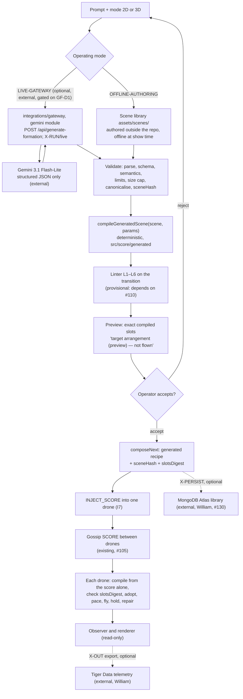

# Gemini-generated formations

> **STATUS: PROPOSED — NOT IMPLEMENTED.** Nothing in this document exists in the code. It is a specification for review, not a record of work done.
>
> Source design by **William Pimentel** (`wpimento`): [`../handoffs/Encore_Gemini_Flash_Lite_Architecture.md`](../handoffs/Encore_Gemini_Flash_Lite_Architecture.md). Integrated into the Encore repository by **Arnav** (contract owner), issue #117.

Purpose: the primary, implementation-facing specification for turning a natural-language prompt into a validated `Formation` that Encore's existing decentralised swarm disseminates and flies. Status: proposed; every contract change needs Arnav's approval and the network-facing path needs a team decision (GF-D1). Owner: Arnav (integration, contract), William (sponsor requirements, provider, gateway, persistence). Audit base: `main` at 4c41f75.

Companion documents, written in parallel and sharing the IDs used here:

- Work packages `GF-WP-01…15`: [`../planning/gemini-integration-work-packages.md`](../planning/gemini-integration-work-packages.md).
- Tests `GF-T01…GF-T40` and the complexity ladder `CL-1…CL-6`: [`../validation/gemini-formation-evaluation.md`](../validation/gemini-formation-evaluation.md).

This file is canonical for `GF-FR`, `GF-NFR`, `GF-CC`, `CR`, `GF-D` and `GF-R` IDs.

---

## 1. Purpose and scope

William's goal, in his words: "**Natural-language description → compact mathematical scene representation → physically constrained drone formation → decentralized execution.**" A user types "a side-view silhouette of an elephant" or "a 3D grey elephant with white tusks". Gemini 3.1 Flash-Lite returns structured JSON that describes the subject as mathematical parts. A deterministic compiler inside Encore turns that JSON into exactly `n0` target slots. The operator previews the result and injects it into one drone. The swarm then does what it already does: gossips the score, flies to its slots and repairs holes.

In scope:

- Two scene schemas, `SceneSpec2D` (Mode A, silhouettes) and `SceneSpec3D` (Mode B, coloured 3D), with validation, limits and canonical hashing (§6).
- The deterministic compiler `compileGeneratedScene` (§7).
- The integration with the score system, as proposed contract changes `GF-CC-01…06` (§8).
- The two operating modes, OFFLINE-AUTHORING and LIVE-GATEWAY (§4.3); the gateway interface (§10); the frontend flow (§11); persistence boundaries (§13).
- Risks, conflict records, proposed requirements, decisions, open questions, traceability and the review record (§15–§22).

Out of scope: provider selection beyond William's choice, gateway hosting, MongoDB and Tiger Data schemas beyond William's field lists (William owns these, §2), and any change to how drones coordinate.

### 1.1 What Gemini must not do

These hold in every mode. They restate William's "Strict separation of responsibilities" table against Encore's information rules ([I1–I8](../design/system-architecture.md#3-information-rules)).

| Gemini never… | Why | Enforced by |
|---|---|---|
| controls drones, outputs flight commands or computes trajectories | "We are **not** asking Gemini to fly the drones" (handoff §1). Brains steer locally ([contract §10](../design/contracts-and-algorithms.md#10-motion)) | Gemini's output is a `SceneSpec` only. No field in it names a drone, tick, velocity or slot |
| assigns slots or slot priority | Slot order comes from farthest-point sampling and carries meaning for repair (§7.5) | The compiler orders slots. Scene `priority`/`importance` only guides selection |
| reads agent state, beliefs, the radio or observer metrics | I1, I5, I6 | The gateway receives a prompt, a mode and a request id, nothing else (§10.1); its `gemini` module reads nothing from the other gateway modules or from X-OUT data, and prompts are never built from run data (§10.3) |
| overrides repair, or replaces the radio | Healing and gossip are the claim under test | Generated scores enter through `INJECT_SCORE` into one drone (I7) and gossip like any score |
| has its output executed | Untrusted text | JSON is parsed as data and validated. No `eval`, no code, no SVG or HTML rendering of model output (§10.3) |
| is needed during the show | NFR-04 offline rule; William's "Offline principle" | Once accepted, the score holds the whole scene. Replay needs no Gemini, MongoDB or network (§12) |

---

## 2. Status, ownership and source

| Item | Owner | Status here |
|---|---|---|
| Source design, model choice, schemas, algorithms, estimates, risks, priorities | William | Preserved. Changes forced by the repo are conflict records (§16) |
| Sponsor requirements (MLH "Best Use of Gemini API", MongoDB Atlas, Tiger Data) | William | Provisional. Names verified on the MLH prize page 2026-11-15; eligibility rules not published there (unverified) |
| Provider facts (model, SDK, pricing, limits) | William | Re-checked 2026-11-15 against official docs (§10.6); his values kept side by side |
| Gateway module `gemini` (`POST /api/generate-formation`) | William | Interface contract only (§10). Hosting, prompts and keys are his |
| MongoDB library, Tiger Data telemetry | William | MongoDB: his spec in #130. Tiger Data: reserved (§13). Attach through X-PERSIST / X-OUT |
| Contract changes `GF-CC-*` | Arnav | Proposed, not approved |
| Compiler, Composer integration, tests | Arnav's lanes, via `GF-WP-*` | Proposed |

Section references such as "handoff §4.5" point into the source handoff, preserved unmodified (banner).

---

## 3. Audit

Base: `main` at **4c41f75**; line citations are at 4c41f75. Status labels: **(a)** implemented and tested on main · **(b)** implemented, not integrated · **(c)** open PR or active branch · **(d)** documented only · **(e)** not present.

Changes since first audit (7a50a69 / 9f78902): #119/#120 made main green; #116 (CLI Encore arm), #68 (Encore isolation and replay tests), #118 (perf and screenshot harness), #115 (perf: `encoreBrain.ts`, `world.ts`), #122 (evidence matrix) and #121 (#112/#109 follow-ups) merged; `src/contracts` and `src/score` are unchanged.

### 3.1 Relevant merged work

| PR | What it gives this design |
|---|---|
| #105 score gossip | Adopts strictly newer scores; checks only the version and a non-empty `movements` (`encoreBrain.ts:129-143`). **No recipe validation** |
| #96 paced targets | `pacedSlotPos` paces from the **same slot index** of the previous movement (§8.10) |
| #111 contract text | §8.5 limits 8 (injection pauses healing) and 9 (fly-back for up to `scoreLead`) |
| #112 composer | `validateDraft` (trial `expandRecipe`), PreviewLayer, `dispatchInject` → `INJECT_SCORE`. **Not mounted** on main (b); #113 mounts it (c) |
| #107 Encore brain in app | Injected scores are adopted and gossiped in the app |

### 3.2 Active work that touches this design

| Item | Why it matters |
|---|---|
| #113 app shell (c) | Owns `main.ts`, `worlds.ts`, `actions.ts`, `commands.ts`, `Hud.ts`; mounts the Composer, Console, Preview and Inspector that GD-11 extends |
| #110 Phase 2 docs (c) | X-IN/X-OUT/X-PERSIST/X-RUN, linter L1–L6, decision D3. **Provisional** |
| #130 MongoDB docs (c) | William's show-library spec; shares the gateway (§10.4) and realises GF-WP-15's MongoDB half (§13) |
| Evidence (#122, merged) | Any later `src/agent/**`, `Params` or `EncoreState` change needs a new evidence revision (§8.2) |

### 3.3 What exists, (a)–(e)

| Capability | Status | Evidence |
|---|---|---|
| `Recipe` with kinds `text`, `sphere`, `helix` | (a) | `src/contracts/score.ts:7-10`; FR-09 |
| `expandRecipe`: about 4·n0 candidates, FPS order, uniform scale so the closest pair is `slotSpacingMin·1.001`, centred at (0, 30, 0), x-gradient colour, about 2000 dense points, frozen and memoised | (a) | `src/score/expand.ts:55-135`; T17 |
| Memo key `JSON.stringify(recipe)` + n0 + `slotSpacingMin`, built on every call, FIFO cache of 64 | (a) | `expand.ts:125-133` |
| `copyRecipe` deep-copies only `palette` | (a) | `src/score/compose.ts:29-34` |
| Transition time from the largest same-index displacement (formula in §8.10) | (a) | `src/score/timing.ts:36-49` |
| Composer preview of an exact `expandRecipe` result, local only | (b) | `src/app/render/layers/PreviewLayer.ts`; not mounted on main |
| Recipe validation in brains | (e) | Unknown kinds reach `expandRecipe` and would throw inside `world.step` |
| Any network code in `src/app` | (e) | No `fetch`, `XMLHttpRequest`, `WebSocket` (grep) |
| Web Worker | (e) | No `new Worker` in `src` |
| Scene schemas, compiler, hashing, gateway, scene library, persistence | (e) | — |
| Mentions of Gemini, MongoDB or Tiger Data in docs or code before #117 | (d) only | `docs/competition/BRIEF.md` P11 and H3 |
| Integration boundaries X-IN/X-OUT/X-PERSIST/X-RUN, linter L1–L6 | (d) | Phase 2 docs on the open #110 branch (provisional) |

---

## 4. User-facing functionality

### 4.1 Mode A: 2D silhouette

The user types "Generate a silhouette of an elephant". Gemini returns a `SceneSpec2D`: ellipses, polygons, closed Bézier paths and thick strokes, combined by union and subtract. Encore compiles `n0` slots on a flat vertical plane facing the audience (+z), filled and outlined, in one foreground colour. William's target: "A clear, recognizable, largely monochrome shape when viewed from the audience camera." It is labelled **audience-facing 2D artwork**: from the side it is a flat sheet of lights (handoff §4.7).

### 4.2 Mode B: coloured 3D

The user types "Generate a 3D elephant with grey skin, large ears and white tusks". Gemini returns a `SceneSpec3D`: ellipsoids, capsules, cylinders, cones and tapered tubes, each with a material colour and an importance. Encore samples the exposed surfaces and gives every slot a position and a colour. William's target: "A recognizable, stylized, coloured 3D object made from drone lights", favouring a reference view without abandoning the back (handoff §5.5).

**Neither mode generates an image.** Both are procedural, from structured text (handoff §1).

### 4.3 Operating modes (GD-1)

| | **Mode OFFLINE-AUTHORING** (recommended first) | **Mode LIVE-GATEWAY** (William's sponsor path) |
|---|---|---|
| Where Gemini runs | At authoring time, by a person or a tool **outside this repo** (for example Google AI Studio) | The `gemini` module of the optional gateway (`integrations/gateway/`, §10.4), called from the app at show time |
| What the app receives | Only validated scene JSON files, committed under a proposed `assets/scenes/` library (GF-WP-09), bundled at build time, or picked through X-IN | A scene in the gateway's response |
| Network at run time | None | App → local gateway → Google |
| Compliance today | Meets [NFR-04](../specification/requirements.md#3-non-functional-requirements) and the AGENTS.md ground rule **only if no network client is checked into the repo**. A checked-in authoring script that calls Gemini is LIVE-GATEWAY-class | **Forbidden** today by NFR-04, the AGENTS.md "Software only" ground rule and [contract §12](../design/contracts-and-algorithms.md#12-deliberately-not-in-the-mvp) "Never" |
| Gate | GF-CC-01 approved | GF-CC-01 plus **GF-D1**: Phase 2 decision D3 approved for this integration, amending NFR-04, the ground rule, contract §12 and the decisions log ([boundaries §9](../design/OPTIONAL_INTEGRATION_BOUNDARIES.md#9-the-no-network-rule-and-decision-d3), whose condition 2 admits the one confined X-RUN/live app folder); depends on X-RUN/live (provisional, #110) |
| Default | On (when built) | Off. Optional, with the offline library as fallback and a networking-off demo test |

The rest of the pipeline is identical in both modes: validate, compile, preview, accept, inject. Recommendation: build OFFLINE-AUTHORING first. It shows the whole "prompt → mathematical scene → decentralised execution" claim in the demo, with Gemini named honestly as the authoring tool, and it needs no rule change. LIVE-GATEWAY stays William's sponsor path, gated on GF-D1.

---

## 5. End-to-end architecture



Dashed arrows and nodes marked "external" are optional. Removing them leaves a working system.

The pipeline reuses existing stages: `validateDraft`, PreviewLayer, `dispatchInject`, the controller, `composeNext`, gossip, `pacedSlotPos`, healing and the observer. The new parts are the scene types, the validator, the compiler, hashing, the Composer's generated tab and, optionally, the gateway.

---

## 6. Scene descriptions

All types below are a **PROPOSED CONTRACT CHANGE — REQUIRES ARNAV APPROVAL**. They are part of GF-CC-01 (§8.1) and live in a proposed `src/contracts/generatedScene.ts`. Field names follow William's (handoff §4.2, §5.1). Additions are marked "added".

### 6.1 Coordinate conventions

- **Normalised space.**
  - Centres and curve points (Bézier control points included) are in [-1.5, 1.5]. A part's evaluated geometry may reach ±1.6; beyond that it is rejected. William asked for "approximately [-1, 1]" (handoff §4.2); the headroom (CR-30) is free because P1 rescales and the compiler normalises the scene before any threshold applies (§7.2).
  - Axes: x to the audience's right, **y up**, **z towards the audience**. Right-handed.
  - This matches the world: the audience camera is at (0, 6, 95), looking at (0, 30, 0) (`CameraRig.ts:6,13`).
- **Subject convention** (CR-31). The subject's front faces **+z** and its left/right symmetry plane is **x = 0**, so `mirror-x` makes left/right pairs (ears, tusks, legs). The model-facing prompt states this. `front`, `three-quarter` and `side` below name **camera presets**, not subject poses; under the convention the `front` camera sees the subject's front.
- **2D scenes** lie in the plane z = 0 and face +z.
- **Mapping to world** is uniform scale plus translation, with no rotation (P1, §7.6). World size is an output of spacing, not an input.
- **Angles** are in **degrees**. `rotationDeg: [rx, ry, rz]` means R = Rz · Ry · Rx about the part's `center`: X first, then Y, then Z, on fixed axes. Quaternions may be used internally. Trigonometric results are snapped (§7.12).
- **Reference views** are unit vectors from the formation centre towards the camera. They are copied from the `CameraRig.ts` presets at 4c41f75 as compiler constants:
  - `front`: (0, −24, 95), normalised;
  - `three-quarter`: (55, 15, 75), normalised;
  - `side`: (1, 0, 0).

### 6.2 `SceneSpec2D`

```ts
// src/contracts/generatedScene.ts (proposed; part of GF-CC-01)
export type Vec2 = [number, number];

/** sRGB-encoded colour: '#RRGGBB', or [r, g, b] with each in 0..1. Converted to Slot.colour by §7.7. */
export type ColourSpec = string | [number, number, number];   // the array form is added; William used a hex string

export interface SceneSpec2D {
  version: 1;
  mode: 'silhouette2d';
  title: string;                       // 1..60 printable characters; display only, never interpreted
  view: 'front' | 'side' | 'three-quarter';   // the subject's pose as drawn; the plane always faces +z
  foreground: ColourSpec;
  parts: Shape2D[];                    // 1..24, applied in array order (§7.2)
}

export interface Shape2D {
  id: string;                          // /^[a-z][a-z0-9_-]{0,31}$/, unique in the scene
  operation: 'union' | 'subtract';
  geometry: Geometry2D;
  priority: number;                    // integer 1..5; 5 = most important; >= 4 is "protected" (§7.2)
}

export type Geometry2D =
  | { type: 'ellipse'; center: Vec2; radii: Vec2; rotationDeg?: number }   // rotationDeg added (default 0)
  | { type: 'polygon'; points: Vec2[] }                // 3..64 vertices, simple, implicitly closed
  | { type: 'path'; points: Vec2[] }                   // closed cubic Bézier chain: 3k+1 points, k = 1..32 (§6.5)
  | { type: 'stroke'; points: Vec2[]; width: number }; // open cubic Bézier chain: 3k+1 points, k = 1..8; full width
```

Segments are William's cubic B(t) = (1−t)³P₀ + 3(1−t)²tP₁ + 3(1−t)t²P₂ + t³P₃. In a chain, points 3i … 3i+3 form segment i.
- A **stroke** is everything within `width/2` of its curve, so it has round caps.
- A **path** is closed. If it is not closed to within 1e-3, a straight segment is added and the warning `path-auto-closed` is given.

William's elephant excerpt (handoff §4.2) validates unchanged.

**Foreground.** `#RRGGBB` (case-insensitive) becomes `[RR/255, GG/255, BB/255]`. Both forms are sRGB-encoded and are linearised as in §7.7. Any other string is rejected (`bad-colour`).

### 6.3 `SceneSpec3D`

```ts
export interface SceneSpec3D {
  version: 1;
  mode: 'scene3d';
  title: string;
  referenceView: 'front' | 'side' | 'three-quarter';
  materials: Material3D[];             // 1..12
  parts: Part3D[];                     // 1..32 before mirroring; 1..48 after
}

export interface Material3D {
  id: string;                          // same id rule as parts
  rgb: [number, number, number];       // sRGB-encoded, 0..1 (William's field)
}

export interface Part3D {
  id: string;
  shape: Geometry3D;
  materialId: string;                  // must name a declared material
  importance: number;                  // integer 1..5; >= 4 is "protected"
  symmetry?: 'none' | 'mirror-x';      // mirror-x adds a copy reflected in the plane x = 0
}

export type Geometry3D =
  | { type: 'ellipsoid'; center: Vec3; radii: Vec3; rotationDeg?: Vec3 }        // radii along local x, y, z
  | { type: 'capsule'; center: Vec3; radius: number; length: number; rotationDeg?: Vec3 }
      // axis along local +y; `length` is the straight section between the hemisphere centres (added field)
  | { type: 'cylinder'; center: Vec3; radius: number; height: number; rotationDeg?: Vec3 }  // capped, axis local +y
  | { type: 'cone'; center: Vec3; baseRadius: number; topRadius: number; height: number; rotationDeg?: Vec3 }
      // capped frustum, axis local +y, base at -height/2; topRadius 0 = a pointed cone
      // (topRadius in [0, 1], exempt from the size floor; baseRadius >= 0.005 and >= topRadius; V5)
  | { type: 'taperedTube'; points: Vec3[]; startRadius: number; endRadius: number };
      // centreline: cubic Bézier chain, 3k+1 points, k = 1..5, in scene coordinates (no rotation);
      // radius linear in the curve parameter from startRadius to endRadius; open ends are capped by hemispheres
```

William's "explicit transform: centre, dimensions, orientation" becomes, per primitive, `center`, named dimensions and an optional `rotationDeg` (default zeros).
- Tubes need no rotation: their centreline is in scene coordinates.
- Tubes use a rotation-minimising frame (double reflection, Wang et al. 2008), so the cross-section does not twist.
- William's example (body, head, trunk) validates under the CR-30 ranges. Its trunk's control points reach x = 1.24 and the tube's surface about x = 1.33, which a ±1 / ±1.2 limit would reject. It faces +x, so the fixtures rotate it −90° about y (+x → +z) to meet the subject convention (CR-31); the original stays a fixture that validates, since the convention cannot be checked automatically.

**Mirror-x** reflects x (and every tube point) and negates `rotationDeg[1]` and `rotationDeg[2]`. The copy keeps the material and importance, and its id gets the suffix `~m`. A part whose box straddles x = 0 is not mirrored, and the warning `mirror-overlaps-self` is given.

### 6.4 Scene versions

`version: 1` is the only schema version. The compiler reads `version` and refuses any it does not implement (`unsupported-version`). `compilerVersion` (§7.1, an integer) is separate. It names the compiler that interprets the scene. A saved scene stores both, so a later compiler can tell when its output would differ (`slotsDigest`, §8.2). A schema change that alters meaning increments `version`. A compiler change that alters output for any valid scene increments `compilerVersion`. A recipe's `compilerVersion` must equal the running module's `COMPILER_VERSION`: operator-side validation rejects any other value (`unsupported-compiler`) and a brain refuses it (§8.2). Fleets with mixed compiler versions are out of scope for Option A and are the trigger for Option B (§8.5).

### 6.5 Validation rules

Validation is ordered: V1a, V2, V3, canonicalisation (§6.7), V1b, then V4–V12 **on the canonical scene only**, the exact object the compiler and `sceneHash` see. Quantisation can merge vertices or make a polygon self-touching, so a raw-scene verdict would not describe what is compiled. The first failing layer returns a typed rejection `{ ok: false; code; path; detail }` and nothing later runs. William's validation-layers table (handoff §8) maps onto these layers and onto the gateway layers in §10.2.

| # | Layer | Rule | On failure |
|---|---|---|---|
| V1 | Size | V1a: raw ≤ 64 KiB before parsing (the X-IN gate). V1b: canonical ≤ **16 KB** (§8.8), after canonicalisation | `too-large` |
| V2 | Parse | Fresh plain objects; reject `__proto__`, `constructor`, `prototype` keys | `parse` |
| V3 | Schema | Exact shape, enums, lengths, no extra keys, finite numbers, integer fields | `schema` |
| V4 | References | Unique part ids (after mirroring) and material ids; every `materialId` declared; ≥ 1 `union` (2D) | `reference` |
| V5 | Ranges | Centres and curve points in [-1.5, 1.5] (CR-30); sizes in [0.005, 1], except `cone.topRadius` in [0, 1]; colours in [0, 1]; priority 1..5; rotations within ±360; `compilerVersion` = `COMPILER_VERSION` (`unsupported-compiler`) | `range` |
| V6 | Geometry | Simple polygons; 3k+1 Bézier points; evaluated part boxes within ±1.6; tube radius below local curvature radius | `geometry` |
| V7 | Complexity | §6.6 limits | `complexity` |
| V8 | Connectivity 2D | Non-empty mask; specks < 0.5% dropped (warning), except a speck of a protected part, which is kept and warned with its part id; several components → `disconnected` (warning) | `empty-geometry` |
| V9 | Connectivity 3D | A part touching no other (box inflated by 0.02 of the normalised extent, §7.2) → `floating-part` | warning |
| V10 | Feature size | Below mask resolution (strokes < 0.02, radii < 0.01, as fractions of the normalised extent): thickened to that minimum (simplification 2, §7.11); warn below 2× | warning |
| V11 | Trial compile | `compileGeneratedScene` is `ok` for the current n0 and params. Operator side only: the compiled slots' graph with edges ≤ `rRadio` is connected (L2 self-partition, §8.11, CR-28) | compiler code (§7.11); `radio-partitioned` |
| V12 | Linter | L1–L6 (provisional: depends on #110). **Warnings only; they never block** | warnings |

V1–V10 are one pure implementation in a proposed `src/score/generated/validation.ts`, shared by the Composer, CLI, tests and (via subprocess) the gateway. App code does not validate with JSON Schema, because Gemini ignores several keywords (§6.8).

### 6.6 Complexity limits

These are proposed defaults, planning values to confirm with the ladder runs ([`../validation/gemini-formation-evaluation.md`](../validation/gemini-formation-evaluation.md)). They follow William's complexity targets: 6–20 parts for 2D, 12–30 for 3D, 500–1,200 and 1,000–2,500 output tokens.

| Limit | 2D | 3D | Why |
|---|---|---|---|
| Parts | ≤ 24 | ≤ 32 declared, ≤ 48 after mirroring | William's upper targets plus headroom |
| Materials | — | ≤ 12 | 200 lights cannot show more distinct colours usefully |
| Polygon vertices | ≤ 64 per polygon | — | Mask and simplicity check stay cheap |
| Bézier segments | path ≤ 32, stroke ≤ 8 | tube ≤ 5 | Organic outlines without unbounded detail |
| Total control points | ≤ 512 | ≤ 256 | Bounds compile time and JSON size |
| Canonical JSON | ≤ 16 KB | ≤ 16 KB | GD-3 cap (§8.8). About 2–4× William's token targets, estimated at roughly 4 bytes per token (planning estimate) |
| Subtract parts | ≤ 8 | — | "Excessive subtraction can disconnect the silhouette" (handoff §4.2) |

### 6.7 Canonicalisation and `sceneHash` (GD-4)

`sceneHash` identifies the compiler's input. Encore computes it; **it never trusts a hash from the model, the gateway or the recipe's own field** (§8.3). William's response envelope carries a `sceneHash`, but the app recomputes it and ignores the gateway's value except as a logged cross-check.

**Canonical form** (proposed `src/score/generated/hashing.ts`):

1. Start from the V3-valid scene.
2. Expand defaults: a missing `rotationDeg` becomes zeros and a missing `symmetry` becomes `'none'`. Hex foreground stays a string; there is no colour conversion at this stage.
3. Quantise every non-integer number to a grid of **1e-4**: `q = Math.round(v * 1e4) / 1e4`. Turn `-0` into `0`. Reject NaN and ±Infinity, which cannot reach this point after V3 but are checked again. Coordinates span [-1.5, 1.5], so the grid gives 30,001 steps per axis. At the largest plausible world extent (about 120 m, §7.6) a step is about 6 mm, far below `slotSpacingMin`.
4. Serialise with object keys sorted by UTF-16 code unit, arrays in order, no whitespace. Numbers use ECMAScript `Number.prototype.toString`, which the language specification defines exactly (shortest round-trip), so Node and browsers agree.
5. Encode as UTF-8 with a small hand-written encoder, so the score package needs no platform globals.

**The compiler compiles the canonical scene, not the raw one.** Two scenes that differ only below the quantisation grid therefore compile identically, and the hash honestly names what was compiled.

**Hash function: SHA-256 in pure TypeScript** (32-bit integer operations only, exact in every engine; checked against NIST test vectors). `node:crypto` is barred by the boundary rules and Web Crypto is asynchronous. A 64-bit FNV-1a would be enough for memo keys (accidental collision about k²/2⁶⁵, around 10⁻¹² for 10⁴ scenes), but it is not collision-resistant. Saved libraries and `slotsDigest` records (§8.2, §13) may cross a trust boundary later and benefit from a standard hash with published vectors. The hash runs once per recipe object (§8.3): at validation or composition, and once per drone per adoption, because each brain holds its own copy. Its cost (planning estimate: well under 1 ms for 16 KB) is therefore paid n0 times per world in the adoption window, never in steady state once the observer fix of §8.3 lands. One function serves every use. Under AS-06 there is no adversary today.

### 6.8 The JSON Schema subset Gemini supports

Facts verified 2026-11-15 from Google's structured-output documentation and the `@google/genai` 3.3.0 typings ([provider facts, §10.6](#106-provider-facts-verified-2026-11-15)).

- Supported for `responseJsonSchema`: `$id`, `$defs`, `$ref`, `$anchor`, `type`, `format`, `title`, `description`, `enum`, `items`, `prefixItems`, `minItems`, `maxItems`, `minimum`, `maximum`, `anyOf`, `oneOf` (treated as `anyOf`), `properties`, `additionalProperties`, `required`. VERIFIED.
- **Ignored, so they must be re-checked in app code:** `minLength`, `maxLength`, `minProperties`, `maxProperties`, `uniqueItems`, `contains`, `minContains`, `maxContains` (PARTLY VERIFIED: listed on the Interactions-variant page; the generateContent page states only "the model ignores unsupported properties"). `pattern` is not in the supported list either.
- Large or deeply nested schemas may be rejected with 400 INVALID_ARGUMENT. `anyOf` branches multiply the decoding paths. No numeric limits are published.

Consequences for the model-facing schemas (William's choice of "separate manageable schemas for 2D and 3D", kept):

| Constraint | In the model schema | Re-checked in app code (V-layer) |
|---|---|---|
| Geometry union | One `anyOf` per part on `type` (4 branches for 2D, 5 for 3D) | V3 |
| Array lengths (parts, points) | `minItems` / `maxItems` | V3, V7 |
| Numeric ranges | `minimum` / `maximum` | V5 |
| Unique ids | Not expressible (`uniqueItems` ignored) | V4 |
| Id and title format, hex colour | Not expressible (`pattern` unsupported, length ignored) | V3, V4 |
| 3k+1 Bézier points | Not expressible | V6 |
| Referential integrity (`materialId`) | Not expressible | V4 |
| Foreground | Ask for the array form only, which avoids an `anyOf`. Hex is accepted from hand-authored files | V3 |

---

## 7. Deterministic formation compiler

### 7.1 Interface

```ts
// src/score/generated/compile.ts (proposed; pure, no imports outside src/score and src/contracts)
export const COMPILER_VERSION = 1;   // integer (CR-22)

export function compileGeneratedScene(
  scene: SceneSpec2D | SceneSpec3D,  // V3-valid; canonicalised inside
  params: Params,                     // reads slotSpacingMin only (plus n0 when the argument is omitted)
  n0: number = params.n0,             // added: expandRecipe passes n0 explicitly (G1 tests use 40)
): CompileResult;

export type CompileResult =
  | { ok: true; formation: Formation; warnings: CompileWarning[]; sceneHash: string;
      compilerVersion: number; slotsDigest: string; stats: CompileStats }
  | { ok: false; code: RejectCode; detail: string; sceneHash: string | null;
      compilerVersion: number; warnings: CompileWarning[] };

export interface CompileWarning { code: string; partId?: string; detail: string }   // William used string[]
export interface CompileStats {
  candidates: { boundary: number; interior: number; feature: number; surface: number };
  perPart: Record<string, number>;     // selected slots per part id
  normalise: number;                   // uniform scale applied to the scene's union box before any threshold (§7.2)
  deltaFinal: number;                  // normalised spacing reached by selection (§7.4)
  scale: number;                       // metres per scene unit (§7.6)
  size: Vec3;                          // world extent of bounds
  closestPair: number;                 // metres; equals slotSpacingMin·1.001 up to rounding
  simplifications: string[];           // which permitted simplifications ran (§7.11)
  hiddenFraction?: Record<string, number>;  // 3D: share of each part's candidates removed as interior
}
```

`slotsDigest` is SHA-256 over the canonical slot list `[index, pos (1e-6 grid), colour (1e-6 grid)]` in index order, together with `n0` and `slotSpacingMin` (§8.2). The compiler's tunable constants (mask size, quotas, weights, retry counts) are **module constants versioned by `COMPILER_VERSION`, never `Params` fields**. Adding a `Params` field would change `paramsHash` and invalidate the evidence run ([Phase 2 roadmap, governing constraint](../planning/PHASE2_ROADMAP.md#the-two-tracks), provisional: depends on #110).

The stages follow William's table (handoff §6), with the repo's ordering and placement rules applied (GD-6, GD-7):

| Stage | 2D silhouette | 3D coloured |
|---|---|---|
| Input | Vector contours and regions | Parametric solids and tubes |
| Intermediate | 512² mask and vector boundaries | Area-weighted surface candidates with normals |
| Candidates (planning range) | about 800–2,000 | about 2,000–5,000 |
| Selection | Feature-aware, spacing-constrained | Feature-, visibility- and spacing-aware, Q(p) |
| Priority order | FPS over the selected set | Same |
| Local z | 0 | Variable |
| Colour | One foreground colour | Per material |
| Output | exactly n0 slots | exactly n0 slots |
| Dense reference | about 2,000 points of the filled silhouette | about 2,000 points of the exposed surface |

### 7.2 2D stages

1. **Geometry.** Each part gets an inside test:
   - ellipse: its implicit equation, after the inverse rotation;
   - polygon: even-odd crossing;
   - path: even-odd crossing against the cubic chain flattened at 16 samples per segment;
   - stroke: distance ≤ width/2 from the centreline flattened at 32 samples per segment.
2. **Normalise, then a 512² mask** over [-1.2, 1.2]² (cell ≈ 0.0047). P1 removes absolute scale, so internal thresholds must not depend on it: the scene's union bounding box is first scaled uniformly about its centre so its longer side spans [-1.1, 1.1] (`stats.normalise`; 3D does the same before §7.3). V9, V10 and ε (§7.3) are fractions of this normalised extent, so a scene and its half-size copy compile alike. Parts apply **in array order**: `union` sets cells and `subtract` clears them, so a later union can refill a cut-out. Bounding-box culling skips irrelevant parts. This is William's internal binary mask (handoff §4.3); it is never shown.
3. **Components.** 4-connected labelling; drop specks (V8).
4. **Boundary.** Marching squares gives closed contours (outer and holes), resampled at δ/4. Points within one cell of an original vector edge are snapped to it. William: "Original vector geometry can still be used to sample smooth boundaries."
5. **Candidates**, William's `FormationCandidate` (`pos`, `featureId`, `importance`, plus a class; colour comes later):
   - **boundary**: contour samples, tagged with the owning part;
   - **interior**: a hexagonal lattice of about 1,500 points over filled cells, with its offset drawn from the seeded PRNG;
   - **feature**: for protected parts (priority ≥ 4), samples along the stroke centreline or the part's medial line, so a trunk or tusk has candidates down its middle.
6. **Quotas (heuristic).** William: "around 30–40% of the final points to boundary and feature curves … This is a heuristic, not a general optimum." Boundary points and protected reservations therefore share **one budget of 35%·n0**, reservations first (§7.4), so the interior keeps at least 65% and the silhouette stays filled. The boundary share is further **capped by feasibility** at ⌊perimeter / δ⌋ (§7.10).

### 7.3 3D stages

1. **Meshes.** Each part, after mirroring, is tessellated at a fixed resolution (for example ellipsoids 32×16, tubes 24 around × 16 per segment). A triangle mesh is the intermediate William suggests (handoff §5.2).
2. **Area-weighted sampling.** Triangles are drawn by cumulative area (stratified and seeded), then a point is taken inside each by barycentric coordinates. This avoids the polar clustering of uniform-angle sampling. The total is about 4,000 candidates, clamped to 2,000–5,000. Each is William's `Candidate3D` (`position`, `normal`, `colour`, `featureId`, `importance`).
3. **Union-aware filtering.** Drop a candidate lying more than ε = 0.01 (of the normalised extent, §7.2) inside another part. The test is exact for ellipsoids, capsules, cylinders and cones; for a tube it is distance to the centreline below the local radius. Record each part's `hiddenFraction`. A protected part that loses more than 80% gets the warning `feature-mostly-hidden`, but its points are not reinstated ("do not preserve obviously nonsensical points inside solid objects").
4. **Visibility.** V(p) = max(0, n · v_ref), with analytic normals and the reference vector from §6.1. Compiler v1 does no ray-cast self-occlusion (a heuristic).
5. **Ranking.** William's Q(p) = αI + βV + γD, where I = importance/5 and D = distance to the selection divided by δ, capped at 2. The heuristic defaults α = 0.35, β = 0.35, γ = 0.30 are tuned by the ladder. A **rear-side floor** (heuristic: ≥ 15% of slots with V = 0) keeps real depth, "without entirely sacrificing rear-side geometry".

### 7.4 Shared selection

Inputs: the candidates (unit space), their class, featureId, importance, and V for 3D. Output: exactly n0 distinct candidates with closest pair ≥ δ, or a typed rejection.

1. **Initial spacing.** δ₀ = 0.9 · √(A / (n0 · 0.866)), where A is the filled area (2D) or exposed surface area (3D) in unit space. Hexagonal packing at spacing s needs about 0.866·s² per point. δ₀ is only the **upper bracket** of the search in step 5: farthest-point fill reaches about 78% of n0 at δ₀ (review re-run, planning estimate).
2. **Protected reservations.** `kMin = 3` (compiler constant). With share_f the part's share of the filled area (2D) or exposed area (3D), a protected part is reserved only if uniform fill would give it fewer than kMin slots (n0·share_f < kMin); large protected parts such as a body or head need none. It gets m_f = min(kMin, ⌊length_f / δ⌋ + 1) points along its feature candidates (length_f: its feature line) at mutual spacing ≥ δ. When the shared budget (§7.2 step 6) binds, parts are served in decreasing w_f = importance_f·share_f / Σ_all(importance·share), ties by part index. A protected part left with fewer than kMin slots at n0 = 200 gives `feature-starved` naming it. This is William's "Reserve feasible positions for critical features" and his response to "a narrow trunk receives almost none".
3. **Boundary (2D).** The boundary quota q = min(35%·n0 − reserved, ⌊perimeter / δ⌋) is split across contours (outer, holes, components) in proportion to length, by largest remainder with ties to the lower contour index. On contour c, candidate positions sit at arc-length steps L_c / q_c (≥ δ by the cap) from a fixed start (the point at the smallest angle from the centroid, lowest index on ties). A position is accepted only if it is ≥ δ from everything already selected; otherwise the next candidate in arc order is tried. The outline is covered evenly instead of from one end.
4. **Fill.** In 2D, run farthest-point selection over the remaining candidates, seeded with the points already chosen. In 3D, run greedy selection by Q(p) with the rear-side floor. Either way, only candidates at least δ from every selected point are eligible, and selection stops at n0.
5. **Spacing search (canonical; GF-WP-06 uses exactly this).** Deterministic bisection of δ over [0.35·δ₀, δ₀] for 10 steps, keeping the largest tested δ that reaches n0. Run it with full quotas; if no δ succeeds, again with reservations relaxed to one slot each; then with the boundary quota at zero; keep the first success. Shrinking δ grows the world (P1 scales the closest pair to 1.5 m), so heuristic quotas are relaxed only after the search fails, never traded for compactness. If no phase succeeds, return `infeasible-count`.

The same minimum spacing applies "across *all* protected and unprotected candidates" (handoff §4.5). Never duplicate a slot, drop below n0 or pad.

**Why spacing still matters under P1.** P1 scales the closest pair to `slotSpacingMin·1.001` (§7.6), so world spacing is always correct. What selection controls is **size**: the world extent is about `slotSpacingMin × extent / closestPair`, so one needlessly close pair inflates the whole formation. Max-min selection at δ keeps formations compact.

### 7.5 Priority order: FPS over the selected set (GD-6)

The existing `farthestPointOrder(selected, n0)` then orders the selection. Slot 0 is the point nearest the selection's centroid; each next slot is the farthest from those already ordered, with ties to the lowest index. Contract §6's prefix property ("any prefix `0…k-1` is an evenly spread k-drone version of the shape") therefore holds, which preserves:
- FR-10 and AS-09;
- the interleaved indices that healing needs, so every hole has a nearby, less important claimant;
- the observer's `pwc` weights.

This is William's "**recognizability at every prefix**". Feature awareness decides **which** points exist, and FPS decides their **order**, so "the first 40 slots exclusively along the trunk" cannot happen. An importance-weighted order is GF-CC-04, deferred (§8.4).

### 7.6 Placement P1 (GD-7)

P1 reuses `expand.ts` step 3 unchanged:
1. compile in unit space;
2. scale uniformly so the closest pair is `slotSpacingMin·1.001`;
3. centre the bounds of slots ∪ dense on (0, 30, 0).

FR-08, T17, the centring test and the implicit `rOcc < slotSpacingMin/2` invariant all hold. William's caps become **validation limits on the result**. They are never applied by clamping:

| Check | Limit | Result |
|---|---|---|
| Width (x extent) | > 40 m (William) | warning `wider-than-proposed-cap` |
| Height (y extent) | > 25 m (William) | warning `taller-than-proposed-cap` |
| Minimum altitude `bounds.min.y` | < 5 m (William) | warning |
| Minimum altitude `bounds.min.y` | < 2 m (contract §6 design rule) | **rejection** `below-floor` |
| Any extent | > 120 m (proposed hard limit, GF-D5) | **rejection** `too-large-world` |

Existing formations already exceed the width cap: ENCORE is 78.3 m and DURHACK 91.8 m wide at n0 = 200 (one local measurement). With the centre at y = 30, the 2 m floor allows heights up to 56 m. William's bounds-first alternative, **P2**, needs GF-CC-05 (§8.4).

**Tall 2D subjects (feasibility).** Under P1, H_world² = (H_unit² / A_unit) · A_world, and A_world grows with n0: about 700 m² at n0 = 200 in practice (the §7.10 minimum times about 1.8 from δ₀'s factor and the search). A 2D silhouette with H_unit² / A_unit above about 4.5 is therefore `below-floor` at n0 = 200, and larger rosters (`?n0=`, CR-27) make it worse, since height grows as √n0. A review re-derivation (planning estimate) put a plain rocket at H ≈ 64 m, `bounds.min.y` ≈ −1.9 m. Existing recipes avoid this by design: contract §6 asks for "a squat helix", and text gains z layers (`shapes.ts` `textLayers`). Generated 2D scenes get the same remedy as permitted simplification 5 (§7.11): **layering**, L ∈ {2, 3} copies of the silhouette at z offsets of δ, the smallest L that clears the floor. Each layer carries about n0/L slots, so height shrinks by about √L. This deviates from William's "Keep Z fixed" (handoff §4.6): CR-32.

### 7.7 Per-slot colours

- 2D: every slot takes the foreground colour.
- 3D: every slot takes its candidate's material colour. Material is constant per part, so mirroring keeps it.
- Contrast and reserved-colour checks reuse the Composer's existing palette warnings: near white is reserved for selection and deaf markers, near vermilion for vacant slots and jams, and pure blue reads dark. These run on the **sRGB-encoded** scene colour, the raw values the Composer compares (`Composer.ts:99-101`); on linear values they misfire (light periwinkle `[0.5, 0.55, 0.9]` linearises to about `[0.21, 0.26, 0.79]` and trips "pure blue"). The luminance check runs on the linear value: below 0.02 gives `dark-light-may-vanish`. William: "Dark colours may be difficult to see against the night sky."

**Colour-space rule (checked in `src/app` at 4c41f75).**

- **The 3D stage reads `Slot.colour` as linear.** It passes the colour to `THREE.Color.setRGB` (`DroneLayer.ts:41`, `PreviewLayer.ts:103`). In three 0.181.1, `setRGB` defaults to `ColorManagement.workingColorSpace`, which is linear sRGB. The renderer then outputs sRGB (`WorldView.ts:16`).
- **The Composer thumbnail reads it as sRGB-encoded.** It writes the same triple as CSS `rgb()` (`Composer.ts:271, 426`). The two views already disagree for existing recipes.
- **The contract** says only "0..1" (`params.ts:7`).

Proposed rule (GF-CC-06, contract text only): **`Slot.colour` is linear sRGB.** Model and hex colours are sRGB-encoded, so the compiler converts each channel:
- c ≤ 0.04045: c/12.92;
- otherwise: ((c + 0.055)/1.055)^2.4, snapped to 1e-9 (§7.12).

The thumbnail mismatch is CR-20.

**One rule for every hex input (CR-33).** The Composer and console store hex as raw `/255` with no linearisation (`store.ts:116-119`, `commands.ts:278-281`), and the stage reads that as linear. If only the compiler linearised, the same `#FFB000` would fly as one colour in a text palette and a darker one as a 2D foreground. So the conversion above lands **only together with** the same conversion in the Composer and console paths (option a, which visibly changes existing palettes and needs GF-D6 with before/after screenshots). Until GF-D6 approves that, generated colours pass through unconverted like palettes (option b), and existing palettes are unchanged.

Belief-colour and X-ray modes deliberately override artistic colours (`droneColour.ts:6-13`). That is diagnostic behaviour and stays.

### 7.8 Dense, bounds, warnings and result

- **Dense** has about 2,000 points (the test band is 1,500–2,500), drawn **from the intended geometry, never from the slots**:
  - 2D: a hexagonal lattice over the filled mask;
  - 3D: an area-weighted sample of the exposed surface.

  It gets the slots' transform. William: "Do not replace the dense reference with only the chosen 200 slots." The existing check that every slot lies within `slotSpacingMin` of dense applies (`expand.test.ts:57-58`).
- **Bounds** cover slots and dense, as in `expand.ts`.
- **Warnings** are typed and shown in the preview; they never block.
- **Freezing** is as today (`expand.ts:108-117`).

### 7.9 Correctness requirements vs heuristic quality improvements

**Correctness requirements** must hold, are tested, and block on failure:
- exactly n0 distinct slots;
- closest pair = `slotSpacingMin·1.001` (the T17 band);
- FPS order over the selected set;
- determinism across Node and browser;
- totality (§7.11);
- `bounds.min.y ≥ 2` and extent ≤ the hard limit;
- dense of 1,500–2,500 points from the intended geometry, with every slot within `slotSpacingMin` of it;
- colours in [0, 1], under the single hex rule (§7.7, CR-33);
- canonical SHA-256 (§6.7);
- removal of points more than ε inside another part.

**Heuristic quality improvements** are tuned, reported, and warn on failure:
- compactness through δ;
- William's 40 × 25 m and 5 m caps;
- feature reservations, the 30–40% boundary share and medial-line candidates;
- the Q(p) weights and rear-side floor, with no ray-cast occlusion;
- contrast and luminance warnings;
- `hiddenFraction` warnings;
- **recognisability**, which only human preview and the ladder can judge. It cannot be automated with text-only Flash-Lite (handoff §12).

### 7.10 Recognisability vs feasibility at about 200 lights

William's perimeter argument (handoff §4.7): if all 200 drones sat on one outline at ≥ 1.5 m spacing, the outline would need to be at least 200 × 1.5 = **300 m** long. That is why the silhouette is **filled**, with boundary points selected.

The same arithmetic bounds a filled shape. Hexagonal packing at spacing s needs about 0.866·s² per point, so n0 = 200 at 1.5 m needs **at least about 390 m²** of area: a lower bound only, since the compiled formation is larger (§7.6). The boundary share is scale-invariant and is best stated in δ units: boundary capacity ≈ P_unit / δ, so the achievable share ≈ (P / √A) · √0.866 / (0.9 · √n0). For a 26:15 ellipse (P/√A ≈ 3.75) that is about **27% at n0 = 200** and **61% at n0 = 40**. A 35% boundary quota is therefore usually infeasible at n0 = 200 for compact shapes and feasible at n0 = 40, which is why §7.2 step 6 caps it at ⌊perimeter / δ⌋. A review re-run (planning estimate) of a 26:15 ellipse at n0 = 200 gave 39.2 × 22.6 m with about 65 boundary points (33%). These are arithmetic bounds and estimates, not measurements.

Resolution limits that follow:
- **Narrow features.** A trunk 0.14 units wide in a formation about 30 m across is about 2 m wide: one or two lights across. Anything finer vanishes unless it is reserved.
- **Holes.** Cut-outs narrower than about 2·`slotSpacingMin` fill in.
- **3D surfaces.** In 3D the same 390 m² is spread over exposed surface, so small parts get only a few lights each.

William: "Highly detailed 3D objects cannot be faithfully represented by 200 isolated lights." The ladder (CL-1 … CL-6) records where recognisability fails. Beyond the budget the system simplifies or rejects.

### 7.11 Totality and fallbacks (GD-8)

- **The compiler is total for V3-valid input.** Every internal failure becomes `{ ok: false, code }`. Codes: `unsupported-version`, `reference`, `range`, `geometry`, `complexity`, `empty-geometry`, `too-few-candidates`, `infeasible-count`, `below-floor`, `too-large-world`, `internal` (a caught invariant breach, reported as a bug).
- **Warning codes** (typed, never blocking): `path-auto-closed`, `mirror-overlaps-self`, `disconnected`, `floating-part`, `feature-mostly-hidden`, `feature-starved` (§7.4 step 2), `gap-lost` (a subtracted gap whose narrowest width after placement is below 2·`slotSpacingMin`), `dark-light-may-vanish`, the size-cap warnings (§7.6), and one per simplification below.
- **Permitted simplifications**, in order, each recorded in `stats.simplifications` and in a warning:
  1. drop specks, never a protected part's (V8);
  2. thicken strokes and tubes below the minimum width to the minimum;
  3. relax protected reservations to one slot each;
  4. relax the boundary quota to zero;
  5. 2D only: layering, for a `below-floor` result (§7.6, CR-32).

  Steps 3 and 4 are the later phases of the single spacing search (§7.4 step 5); δ is never shrunk outside it.
- **Never permitted:** duplicate slots, spacing below `slotSpacingMin`, fewer than n0 slots, clamping the scale, dropping a protected part without a warning.
- **One rule in every doc: `expandRecipe` never throws for a generated recipe.** On a rejection it returns a deterministic fallback, the `sphere` formation for that `(n0, slotSpacingMin)`, held as its own frozen, memoised object. It must be total because preloaded scores (I4), the observer and `pacedSlotPos` call it without any adoption check, and `world.step` has no try/catch (`world.ts:156`): a throw would kill both worlds.
- **Strict path, operator side** (`composeNext`, `makeScore`, `validateDraft`, CLI): these call `compileGeneratedScene` (or a proposed `expandRecipeStrict`) and throw or refuse on rejection, so the operator never schedules a transition to the fallback. The controller already catches `composeNext` throws (`actions.ts:110, 160-164`).
- **Brain side:** in an honest flow, brains never see a rejected scene. Validation precedes injection, and GF-CC-02 refuses the scores listed in §8.2.
- **Detecting the fallback** without module-level mutable state, which contract §4 forbids beyond a pure memo: `isFallbackFormation(f)` compares `f` by identity with the frozen fallback, a pure and test-visible marker. Tests assert it never appears for the corpus, and that a preloaded score holding a rejected generated movement leaves `world.step` running (GF-T23/GF-T24 extension in the evaluation). This is a safety net, not a feature.

### 7.12 Determinism (GD-9)

Brains call `expandRecipe` (contract §4), so the compiler obeys the brain rules:
- no `Math.random`, `Date`, `performance`, `fetch` or DOM (core ESLint);
- no npm imports (`tests/boundaries.test.ts`);
- index-order iteration, with total comparators that break ties by index;
- a **seeded PRNG** (sfc32, integer-only) seeded from `sceneHash`;
- arithmetic and `Math.sqrt` are exact IEEE and used as they are; **every other `Math.*` result** (`sin`, `cos`, `pow`, `atan2`, `acos`, `exp`, `log`, `cbrt` …) is implementation-approximated in ECMAScript and is **snapped to 1e-9**, as `shapes.ts:17-20` does; `Math.hypot` is forbidden (use the square root of a sum of squares). An ESLint `no-restricted-properties` rule scoped to `src/score/generated` enforces this (a build-config change needing its owner's sign-off). Snapping does not remove a difference that straddles a grid boundary; the golden digests (GF-T19) are the backstop;
- outputs quantised before `slotsDigest`.

**Test.** Golden `slotsDigest` values for a scene corpus, compiled in Node and in a browser build (GF-T19, GF-T20). `compilerVersion` cannot differ within one run (CR-18). It is metadata, a cache-key part, and a guard for saved scenes (§8.2).

### 7.13 Performance budgets

- **Budget:** a cold compile at n0 = 200 in Node stays **≤ 200 ms**, the existing `expandRecipe` budget (`tests/score/perf.test.ts:2`), for CL-1–CL-4 scenes in both modes. If 3D CL-4+ scenes cannot meet it, the choice (raise the budget for generated recipes only, or precompile at authoring time and accept Option B, §8.5, for those scenes) is decision GF-D8, recorded and never silently assumed. Measured in GF-WP-13.
- **Planning estimates from operation counts, not measured:**
  - 2D: the mask (262k cells, culled per part) takes about 20–60 ms; selection (about 400k distance evaluations) and the O(n0²) closest pair take a few ms.
  - 3D: tessellation, 4,000 samples and about 200k inside tests take a few ms each.
- **Warm hits** under GF-CC-03 should match today's small-recipe hit (about 0.7 µs, one local measurement).
- **Where compiles run:** the worker compiles previews. The main thread compiles once, at `composeNext`, which warms the memo for brains and the observer (CR-09).

---

## 8. Score system integration

Each change below is a **PROPOSED CONTRACT CHANGE — REQUIRES ARNAV APPROVAL**.

### 8.1 GF-CC-01: generated recipe kind and scene types

**PROPOSED CONTRACT CHANGE — REQUIRES ARNAV APPROVAL.**

- **Current behaviour / interface.** `Recipe = text | sphere | helix` (`src/contracts/score.ts:7-10`), commented "All three recipe kinds are MUST". It is mirrored in contract §2, and FR-09 names exactly these three. The file header says: "Change only through a [contract] PR".
- **Problem it cannot solve.** A formation from arbitrary geometry cannot be expressed. The Composer itself lists "SVG outline", "Parametric" and "Point cloud" as greyed types that "need a new Recipe kind through a [contract] PR" (`Composer.ts:270, 385`).
- **Proposed interface.**

```ts
// src/contracts/score.ts
export type Recipe =
  | { kind: 'text'; text: string; palette?: [RGB, RGB] }
  | { kind: 'sphere'; palette?: [RGB, RGB] }
  | { kind: 'helix'; palette?: [RGB, RGB] }
  | GeneratedRecipe;                                   // optional kind (GF-FR-01); the three above stay MUST

export interface GeneratedRecipe {       // no `palette`: colours come from scene materials / foreground (§7.7)
  kind: 'generated';
  compilerVersion: number;     // integer; William wrote the literal 1
  sceneHash: string;           // 64 lowercase hex, canonical SHA-256 (§6.7); a checked label, never the memo key (§8.3)
  slotsDigest: SlotsDigest;    // GF-CC-02
  scene: SceneSpec2D | SceneSpec3D;   // canonical form (§6.7); types in src/contracts/generatedScene.ts
}
```

  `generatedScene.ts` holds §6.2–§6.3. Every exhaustive switch gains an assert-never `default`.
- **Rationale.** This is William's design (handoff §6.1). It keeps the "from the score alone" vocabulary (contract §6).
- **Compatibility.** Additive. Text, sphere and helix keep their code path, memo keys and results. Proof: `stateHash` is equal on S0–S5 seed 1 before and after.
- **Affected modules.**
  - Contracts: `score.ts`, `generatedScene.ts`, `index.ts`.
  - `shapes.ts`: `default` cases. New `src/score/generated/*`.
  - Every site that reads `recipe.palette` must narrow: `compose.ts:29-34` (`copyRecipe`, §8.7, plus a reject pre-check), `expand.ts:91` (plus an early branch), `Composer.ts` (`Draft.kind` at line 25, lines 79 and 96–98, `paletteOf` at 273) and `Timeline.ts:61, 74`.
  - Labels that would fall through to "Helix": `Timeline.ts:49` and `commands.ts:358`. Also `actions.ts:158-159` and `commands.ts:339`.
  - `expand.ts`: the total fallback and the strict entry point (§7.11).
  - Docs: contract §2; contract §6 step (2), which for kind `generated` reads "select n0 points (§7.4), then order the selection by farthest-point order, slot 0 the selected point nearest the selection's centroid; the prefix property holds over the selection"; an FR-09 note. The existing FPS re-derivation test (`expand.test.ts`, "slot 0 is the candidate nearest the centroid…") covers text, sphere and helix only; it must not be extended to generated recipes.
- **Regression risks.**
  - A missed switch mislabels silently.
  - Composer type changes collide with #113.
- **Required tests.** GF-T16–GF-T18 at n0 40 and 200; GF-T22 part 3 (`stateHash`); GF-T23 (assert-never); GF-T29 (preview equals compiled formation); the Timeline label.
- **Migration.** One `[contract]` PR, with the app follow-ups in the same PR so `check` stays green.
- **Conflicts.** #113 (Composer, `inject.test.ts`, `actions.ts`, `commands.ts`): merge after it. `src/contracts/**` is contended. P2-WP-20 / P2-CC-01 (provisional, #110) edit `src/contracts/score.ts` and `copyMovement` next to `copyRecipe` in `compose.ts`: merge one at a time.

### 8.2 GF-CC-02: `slotsDigest` and the adoption check

**PROPOSED CONTRACT CHANGE — REQUIRES ARNAV APPROVAL.**

- **Current behaviour.** `handleScoreMessage` adopts any strictly newer score with a finite version and non-empty movements (`encoreBrain.ts:129-143`). An invalid recipe is adopted anyway. `expandRecipe` then throws inside `step`, and `world.step` has no try/catch (`world.ts:156`). The contract assumes honest senders (AS-06).
- **Problem.** A generated recipe is the first kind whose expansion depends on the compiler version. Browser vs Node replay (base T13) and a saved scene vs today's compiler must agree. Silent disagreement would fly a different shape.
- **Proposed interface.**

```ts
export interface SlotsDigest { n0: number; slotSpacingMin: number; digest: string }   // SHA-256 of canonical slots
```

  - **Computing it.** `composeNext` and `makeScore` compute the digest from the same compile that sets `transitionTicks`.
  - **Checking it.** In `handleScoreMessage`, after the version checks and before adopting, a brain compiles **each `generated` movement** through `expandRecipe` (normally a memo hit).
  - **Refusal reasons** are only causes that every honest drone computes the same way from the score and its own constants: a rejected compile, a `sceneHash` label mismatch (§8.3), `compilerVersion ≠ COMPILER_VERSION` (§6.4), and a `slotsDigest` mismatch where the digest's `n0` and `slotSpacingMin` match its own. A parameter mismatch is out of scope: the roster itself disagrees, and the digest is not compared.
  - **On refusal** the brain does **not adopt**. It logs one note and remembers `(version, sceneHash)` in `refused?`, an **optional** `EncoreState` field that stays absent until the first refusal (so `JSON.stringify` omits it) and holds at most 8 entries, oldest evicted. Re-sends of a remembered pair are not rechecked.
- **Scope.** Inside one simulation process the shared memo makes `slotsDigest` a consistency assertion, not a drift detector. Its real purpose is saved scenes (library, MongoDB) and future multi-device use. The check also makes generated scores total at the brain boundary (CR-13). It is not a defence against malice (AS-06 stands).
- **Swarm-level consequences.** In one process every brain gets the same compile from the shared memo, so a refusal is **uniform**: all drones refuse or none does, and operator validation has already refused the same score. Refusal becomes **partial** only where compiles differ between drones (multi-device, mixed compiler versions), the very case the digest exists for, and then it splits the swarm until a score both sides accept arrives:
  1. a refuser keeps its old version, and every neighbour that hears it within `tDeaf` has `canHeal` false (condition 4, `encoreBrain.ts:191-195`);
  2. neighbours re-send to it on every heartbeat, limited by `scoreResendMin` (`encoreBrain.ts:161`);
  3. a refuser never relays (`scheduleScoreSend` runs only on adoption, `encoreBrain.ts:140`), so refusers at cut vertices block gossip;
  4. duplicate resolution compares slot indices with no version check (`encoreBrain.ts:164-165`), so drones on two scores pop each other;
  5. `composeNext` copies the current movement as movement 0 (`compose.ts`), so the next injection re-carries the refused movement and is refused too while that movement is current.

  The alternative, adopting on a digest mismatch with one log note and a counter (detection, not refusal) while drifted saved scenes are refused operator-side on library load and in `validateDraft`, avoids the split. It is open (GQ-1, §22) and decided under GF-D3. The evaluation needs a partial-refusal test (proposed GF-T24b: unadopted drones, `canHeal`-false drone-ticks, SCORE sends).
- **Compatibility.** Other kinds are not checked, so they behave bit-identically, and with `refused` absent until a refusal the S0–S5 `stateHash` is unchanged. The change still alters brain behaviour and the `EncoreState` type, so it is a new evidence revision regardless ([Phase 2 roadmap, governing constraint](../planning/PHASE2_ROADMAP.md#the-two-tracks), provisional: depends on #110).
- **Affected modules.**
  - `encoreBrain.ts`: `handleScoreMessage`, plus the optional, bounded `refused?` in `EncoreState`, which `stateHash` covers once present.
  - `expand.ts`: exposes `formationDigest`.
  - Contract §9 "Adopt" text.
  - The static brain never adopts injections (`staticBrain.ts:53`), so it needs no change.
- **Regression risks.**
  - Any `src/agent/**` behaviour change forces a new evidence revision.
  - The first compile moves from movement start to adoption, and each drone hashes its own copy then (§8.3).
- **Required tests.** GF-T24 (mismatch refused and logged once, the world does not throw, a match is adopted); GF-T22 part 3 (`stateHash` unchanged for other kinds, with `refused` absent); GF-T36 (replay of a generated injection); proposed GF-T24b (partial refusal, above).
- **Conflicts.** The brain-side "do not adopt on mismatch" check edits `src/agent/encoreBrain.ts` and `EncoreState`, so it is Track P only (Phase 2 D4), a new evidence revision, after #122 is archived and #115 has settled (both merged at 4c41f75; it rebases on #115's `encoreBrain.ts`). P2-WP-20 / P2-CC-01 (provisional, #110) add `validateMotion` to the same `handleScoreMessage` check: merge one at a time, and compose the check as `validateMotion`, then the generated-recipe check.

### 8.3 GF-CC-03: memo key for generated recipes

**PROPOSED CONTRACT CHANGE — REQUIRES ARNAV APPROVAL** (contract §6 text: "memoised on JSON(recipe)").

- **Current behaviour.** `key = JSON.stringify(recipe)|n0|slotSpacingMin` is built on **every** call, hits included (`expand.ts:125`). Encore calls `expandRecipe` 3–4 times per drone per tick: step, `pacedSlotPos` and `belief()`. That is 600–800 key builds per tick at n0 = 200. One local benchmark run (PARTLY VERIFIED) gives **about 45–165 ms per tick** at 10–30 KB. The real-time tick is 50 ms; #115 (merged) reported `stepBoth` at about 7–12 ms.
- **Problem.** With today's key, a generated scene breaks real time from its `startTick` onwards.
- **Proposed interface.** For `kind === 'generated'`, where `H(scene)` is the canonical SHA-256 **recomputed from the scene content** (§6.7):

```ts
key = `generated:${COMPILER_VERSION}:${H(scene)}:${n0}:${slotSpacingMin}`   // the module constant, never the recipe's field
```

- **Hash source (fixes cache poisoning).** `H(scene)` is computed once per recipe object and cached in a module-level `WeakMap<Recipe, string>` (no contract change). The recipe's own `sceneHash` and `compilerVersion` fields are never key parts; a `compilerVersion` other than `COMPILER_VERSION` is rejected (§6.4).
  - The `sceneHash` field is only a checked label. A mismatch makes the recipe invalid: operator-side validation rejects it (`hash-mismatch`), and a brain-side refusal is part of GF-CC-02.
  - `palette` is not in the key: generated recipes have none (§8.1).
  - **Brains.** Brain state keeps its adopted score by reference (the world passes `bodies[id].state` uncloned), but each brain adopts its own `copyJson` copy (`encoreBrain.ts:137`), so the WeakMap misses once per drone: **n0 hashes per world per adoption**, spread over the adoption window (planning estimate: a few ms per tick at peak gossip; measured in GF-WP-08). Steady state costs nothing. Letting brains keep the frozen received score instead of a copy would share one key, but that is a brain change (GF-CC-02 scope; GQ-7).
  - **Observer (a defect in the earlier draft's argument).** `ReferenceScores.reference()` returns a fresh `structuredClone` on every call (`observer/reference.ts:37`), `sample()` calls it every tick (`observer/index.ts:50`), and the geometry cache is keyed on snapshot identity (`observer/index.ts:31-34`), which is new every sample. As the code stands, every sample (every 5 ticks, per world) would canonicalise and hash the scene again. Fix, part of GF-CC-03 with no contract change: `ReferenceScores` keeps one deep-frozen copy per version and returns it by identity, or the observer memoises the `Formation` per `versionKey` and movement index. Both are safe because `register()` already rejects conflicting content for one version.
- **Rationale.** GD-5: the key no longer grows with scene size.
- **Compatibility.** Keys for text, sphere and helix are unchanged. The WeakMap is a "memo cache of pure results", which contract §4 allows.
- **Affected modules.** `src/score/expand.ts`; `src/observer/reference.ts` or `src/observer/index.ts`; contract §6 text.
- **Regression risks.** FIFO eviction over 64 entries is unchanged. An evicted scene costs one recompile.
- **Required tests.** GF-T22 (zero scene reads when warm; 30 KB timing; S0–S5 `stateHash`), extended to a whole world with the observer: after a generated injection, a test-only count of `H(scene)` calls is ≤ n0 + O(1) per adoption per world and 0 per steady-state tick in brains and the observer; a label mismatch is rejected (GF-T24); structurally equal recipes get equal keys.
- **Conflicts.** None: no open PR touches `expand.ts` or `src/observer`.

### 8.4 GF-CC-04 (deferred), GF-CC-05 (alternative), GF-CC-06 (colour space)

**GF-CC-04 (deferred): importance-weighted priority order.** **PROPOSED CONTRACT CHANGE — REQUIRES ARNAV APPROVAL.**
- Proposal: a weighted FPS that puts protected features into shorter prefixes.
- Risk: clustered low indices leave a feature's holes without a much-less-important claimant nearby (`claimGap` 6 at n0 = 200), which weakens healing. It also breaks the FR-10 and AS-09 assumptions.
- Prerequisites: G1 tests 1–3 on a generated shape, the 40-centre sweep with no regression (baseline 183/200), and FR-10 screenshots.
- Recommendation: **decline for now**. GD-6 already meets William's prefix goal.

**GF-CC-05 (alternative): bounds-first placement P2.** **PROPOSED CONTRACT CHANGE — REQUIRES ARNAV APPROVAL.**
- Proposal: contract §6 step 3 becomes "closest pair ≥ `slotSpacingMin`" for generated recipes. The compiler scales to a target box first, then uses Poisson-disk selection.
- Consequence: T17's upper bound (≤ 1.01·`slotSpacingMin`) splits by kind.
- Benefit: William's 40 × 25 m box holds by construction.
- Cost: many subjects are rejected rather than grown (about 390 m² minimum filled area, §7.10), and density varies by shape.
- Recommendation: **not now**.

**GF-CC-06: `Slot.colour` colour space (text only).** **PROPOSED CONTRACT CHANGE — REQUIRES ARNAV APPROVAL.** Contract §2 states that `Slot.colour` is linear sRGB in [0, 1], as the 3D renderer reads it. The compiler's linearisation lands only together with the same change to the Composer and console hex paths (CR-33, §7.7); until then generated colours pass through like palettes. The thumbnail fix is separate (CR-20).

### 8.5 Option A vs Option B: what travels (GD-3)

| | **Option A: scene in the score** (chosen; William's choice for the simulator) | **Option B: compiled slots as a `points` recipe** (hardware-oriented alternative) |
|---|---|---|
| Payload | Scene ≤ 16 KB | William's estimate: 200 × (6 + 3) = 1,800 bytes before framing |
| Contract | GF-CC-01/02/03 | A new `points` kind. Legal under §6 ("from the score alone") |
| Receiver work and drift | Memoised compile, free in simulated time (AS-12, §8.8); `slotsDigest` catches saved-scene and cross-device drift (§8.2) | Decoding only; no drift |
| `dense` for the observer | From the scene | Must travel too |
| Real radios | Needs fragmentation | Also "exceeds many realistic tiny radio payloads" (William) |
| Verdict | Build first | Revisit for multi-device or hardware work, or for 3D scenes over the compile budget (GF-D8) |

### 8.6 Cache keys

- **Main thread** (brains, observer, compose): the GF-CC-03 key, recomputed per recipe object through the WeakMap. The one compile at `composeNext` warms it.
- **Preview worker:** its own cache, which never warms the main thread (CR-09).
- **Saved library entries:** `(sceneHash, compilerVersion, n0, slotSpacingMin)` → `slotsDigest`. If a recompile on load differs, the warning says "this saved scene now compiles differently".
- **Gateway:** may key on `sceneHash`, as advice only (CR-26).

### 8.7 Deep copy and immutability (`copyRecipe`)

`copyRecipe` is shallow except for `palette` (`compose.ts:29-34`), so a nested `scene` would be shared by reference between the caller's draft and the composed score. Resolution (part of GF-CC-01): for `generated`, `copyRecipe` returns `{ kind, compilerVersion, sceneHash, slotsDigest: {...}, scene: deepFreeze(canonicalClone(scene)) }`. The compiler's canonical scene is a fresh, frozen object, so later mutation of the draft cannot reach a score. The controller (`actions.ts:93-98`), the world uplink and brains (`copyJson`) already copy. The remaining risk is a caller that keeps and mutates its recipe object, and freezing turns that into a TypeError instead of silent corruption, matching `expandRecipe`'s frozen `Formation` policy.

### 8.8 Radio message size

- The medium does not model payload size or bandwidth. Per receiver it applies only jam, partition, `loss` and uniform latency, and one frozen packet is shared by all receivers (`world.ts:161-193`).
- Contract §3 says "the whole score; it is small".
- A 16 KB `SCORE` therefore has exactly the delivery odds and latency of a heartbeat.

**Assumption disclosure** (proposed **AS-11** in [evidence-and-assumptions.md](../context/evidence-and-assumptions.md); AS-10 is taken; GF-D7): "Radio payload size is not modelled; generated scores up to 16 KB are delivered like any message. Real radios would fragment them." This is **not** a realism claim.

A second disclosure bears on the decentralisation claim, proposed **AS-12**: "Per-drone scene compilation is not modelled; a single-process memo makes it free in simulated time." Under Option A each real drone would compile at adoption (up to 200 ms cold, §7.13), which late adopters near `startTick` would need. Reports never say "each drone compiles in real time" (evaluation §11 wording).

**Cap:** the canonical scene is at most 16 KB (V1). That is about 2–4× William's output-token targets, enough for 30-part 3D scenes, and it bounds the copy costs that do exist:

- `copyJson` on every SCORE send: about 0.1–0.4 ms per copy at 10–30 KB (local, PARTLY VERIFIED);
- `structuredClone` in the observer's `reference()` each tick;
- `stateHash()` stringifying every brain's score copy.

At 16 KB these stay in the low milliseconds per tick at peak gossip (estimate, to be measured by the perf test).

### 8.9 Late adoption and lead time (GD-10)

- **Default.** `scoreLead` stays at **60 ticks (3 s)**.
- **Evidence.** PR #105 reported **100% adoption with the last drone at 15 ticks** in a connected swarm at n0 = 200 (multi-hop, loss 0.2), measured in that PR's tests and not re-run here.
- **Reporting.** William's "three simulated seconds are not a guaranteed whole-swarm adoption interval" still holds under jams and partitions. Late adoption is reported (`adoptP50`, `adoptMax`, `unadopted`; [evaluation §2](../validation/evaluation-and-tests.md#2-metrics)), never assumed away.
- **William's 8–15 s lead** is an **app-side per-injection override**, for presentation only. The app passes `{ ...params, scoreLead: X }` to `composeScore`. Only `composeNext` reads `scoreLead` (`compose.ts:50`), so no default or contract changes, and the memo key ignores it.
- **Cost of a longer lead.** It widens limit 9's fly-back window.
- **Late adopters** pace from the clock (§8.10) and join mid-transition correctly.

### 8.10 Transition timing and same-index correspondence

**Formula, verified** (`timing.ts:36-49`): `transitionTicks = ceil((max_i |to_i − from_i| / (0.5·vMax) + 3 s) / DT)`. With `vMax` = 8 that is d_max/4 + 3 s, rounded **up** to whole ticks. William's table (10 m → 5.5 s, 20 m → 8 s, 30 m → 10.5 s, 40 m → 13 s, 60 m → 18 s) is correct as **scheduled** durations. "These are scheduled durations, not guarantees that every drone has arrived."

**Pacing, verified in code** (`steer.ts:114-127`, #96).
- Every movement with index ≥ 1 is paced. Its steering point moves linearly from the **same slot index** of the previous movement, from `max(startTick, 0)` until 60 ticks (`PACE_SETTLE_TICKS`) before `holdStart`.
- Movement 0 is paced from `launchPos` **only** if `startTick ≤ 0`. In an injected score, movement 0 is the copied current movement, which is unpaced. The generated movement (index 1) is paced from it.
- `Belief.target`, the settled checks and sensing all use the real slot.

**Why slot persistence is kept** (CR-15). William calls same-index correspondence "a significant flaw". In Encore it is deliberate (FR-11; contract §6 "Slot persistence"):
- a formation change needs no messages;
- reassignment would need global knowledge, which I1 forbids, or consensus;
- reassignment would change what an index means mid-repair.

The cost is longer, crossing paths, and the max-displacement formula already allows for them. **Linter L1** (provisional: depends on #110) reports them in the preview as "predicted under ideal paced flight". Under pacing each pair's relative path is linear in the shared fraction f, so the closest approach has a closed form, f* = clamp(−a·b/|b|², 0, 1). L1 never blocks. Phase 2's N19 orientation idea (the rigid rotation or reflection that minimises same-index displacement) is **deferred**; it needs its own contract change.

### 8.11 Interaction with existing repair

- **Islands** (CR-14). Healing is local within `rClaim` = 6 m (contract §8.5 limit 1). FPS picks outliers early, so an isolated feature (an eye, a tail tip) gets **low indices**, which carry high `pwc` weight. If its drones die and no survivor is within `rClaim`, the hole is never repaired.
- **Confined repair (component form of L3).** Phase 2's L3 ([RFC §9.4](../design/ANIMATED_CHOREOGRAPHY_RFC.md#94-l3-unhealable-islands), provisional: depends on #110) flags single slots with no neighbour within `rClaim`. A detached feature of several slots (an eye, a tail) passes it, yet the same limit applies: a claimant must be within `rClaim` (`encoreBrain.ts:244`), so only that group's own drones can fill its holes, and holes never move out to the globally least important slots. For generated formations the check therefore runs on the **components of the slot graph with edges ≤ `rClaim`**. Every component other than the largest is reported, with its size and lowest index, as "repair confined: holes cannot leave this component". A component with fewer than `claimGap` + 2 slots, or with no index gap above `claimGap`, is also reported as "cannot heal internally", because a claim needs v + `claimGap` < own slot (`encoreBrain.ts:260`). Per-slot L3 is a strict subset of this check. V8/V9 point to the cause; the operator can connect the parts or accept the risk. The evaluation's `islandSlots` should become, or be joined by, a component-based `confinedSlots` (GF-T08, GF-T28).
- **L2 self-partition** (CR-28). Generated scenes are the first kind likely to have parts more than `rRadio` (15 m) apart: `disconnected` is only a warning and extents up to 120 m are allowed. While such a formation holds, the radio graph has several components ([RFC §9.3](../design/ANIMATED_CHOREOGRAPHY_RFC.md#93-l2-radio-graph)): a later injection reaches only the injected drone's component (`world.ts:184` delivers within `rRadio`), and the other components never leave unless the score already holds a later movement. Proposed rule: operator-side validation **rejects** a generated formation whose placed slots at `rRadio` form more than one component (`radio-partitioned`, V11). The weaker alternative, injection only behind an explicit operator acknowledgement, is open (GQ-2).
- **Unchanged.** `canHeal` is shape-independent. Limit 8 applies to generated injections like any other.

---

## 9. Information-flow boundaries (I1–I8)

Rules from [system-architecture §3](../design/system-architecture.md#3-information-rules).

| Rule | How generated formations comply | Base test ([evaluation §6](../validation/evaluation-and-tests.md#6-automated-tests)) |
|---|---|---|
| I1 | Brains receive generated recipes only inside a SCORE message or the preloaded score (I4). Compiling is a pure function of the score, total for any recipe (§7.11) | T01, T02 |
| I2 | Unchanged. The compiler returns frozen values | T14 analogue |
| I3 | Unchanged | T02 |
| I4 | A preloaded score may hold a generated movement compiled operator-side by `makeScore` | — |
| I5 | The scene is score vocabulary. Every drone computes every slot "from the score alone" (contract §6) | — |
| I6 | Preview, compiler warnings and linter output are read-only. Acceptance results in an `INJECT_SCORE` event | T13, T14 |
| I7 | Generated scores take the existing `dispatchInject` → controller → `INJECT_SCORE` path. No component writes to more than one drone | T13, T16, T18 |
| I8 | Unchanged. SCORE size is not drawn | — |

Gemini, the gateway, MongoDB and Tiger Data sit **outside** the simulation boundary. None of them can reach a brain except through an operator-accepted scene that becomes one `INJECT_SCORE`.

---

## 10. Backend gateway (GD-12)

**Gated on GF-D1.** The gateway is a network client checked into this repo (§10.4), so it is LIVE-GATEWAY-class even when used only for authoring. OFFLINE-AUTHORING uses a tool outside the repo instead (§4.3).

### 10.1 Endpoint contract (from William, with additions marked)

`POST /api/generate-formation`

Request:

```json
{ "prompt": "A 3D grey elephant with curved trunk and white tusks", "mode": "scene3d", "requestId": "r-000042" }
```

- `requestId` is added: an opaque client string ≤ 64 characters, echoed back (§11.2).
- `mode` is `"silhouette2d"` or `"scene3d"`.
- `prompt` is 1–500 characters, trimmed, printable (proposed default for William to confirm, GF-WP-12).
- No other field is accepted (`additionalProperties: false`): the request carries no run, telemetry, library or agent data (§10.3, "Module isolation").

Success response (William's envelope, plus `requestId`):

```json
{ "success": true, "requestId": "r-000042", "model": "gemini-3.1-flash-lite", "mode": "scene3d",
  "scene": { "version": 1, "mode": "scene3d", "title": "…", "referenceView": "three-quarter", "materials": [], "parts": [] },
  "sceneHash": "…", "modelLatencyMs": 0 }
```

As William notes, the empty arrays and zero latency are placeholders, not valid geometry or measured performance. The app treats `sceneHash` as advisory and recomputes it (§6.7).

Error response (added):

```json
{ "success": false, "requestId": "r-000042", "error": { "code": "provider-rate-limited", "message": "…", "retryable": true } }
```

Error codes:

- `bad-request`
- `prompt-too-long`
- `provider-rate-limited`
- `provider-unavailable`
- `provider-error`
- `timeout`
- `invalid-model-output`
- `scene-invalid`
- `response-too-large` (also a `MAX_TOKENS` finish)
- `provider-blocked` (added: `SAFETY` or `RECITATION` finish, or a `promptFeedback.blockReason`)
- `gateway-disabled`

### 10.2 Validation layers

William's table, mapped to where each layer runs.

| Layer (William) | Failure example | Gateway | App |
|---|---|---|---|
| Request validation | Empty or oversized prompt | Rejects (`bad-request`, `prompt-too-long`) | Same check before sending |
| JSON parsing | Incomplete response | Rejects (`invalid-model-output`); optionally one regeneration | V2 again |
| Schema validation | Missing radius, invalid material | JSON-Schema-level check | **Authoritative** V3–V5 |
| Geometry validation | Non-finite coordinate, disconnected curve | Optional, via the core's headless validator as a subprocess (CR-24) | **Authoritative** V6, V8–V10 |
| Complexity validation | Hundreds of components | Size and part-count limits | **Authoritative** V1, V7 |
| Feasibility validation | Cannot place n0 separated drones | — | Trial compile (V11) |
| Preview validation | Wrong animal | — | Human review in the Composer (§11) |

The app never relies on the gateway's checks. It treats every scene as untrusted, whether it came from the gateway or the library.

### 10.3 Security and operations

Rows marked † are **proposed defaults for William to confirm (GF-WP-12)**; he owns hosting, prompts and keys (§2). Binding for the app are only the envelope, error codes, `requestId` echo, response size cap, key placement and the localhost request rules.

| Concern | Rule |
|---|---|
| Key isolation | Only in the gateway's environment (`GEMINI_API_KEY`; the SDK prefers `GOOGLE_API_KEY` if both are set). **Never** in browser code, `VITE_*` or the repo. Google: "Do not hardcode API keys directly in web or mobile apps". Ephemeral tokens are Live-API-only and do not apply |
| Env config | Server-side: key, model, timeouts, limits, enable flag. The app holds only the gateway URL (localhost), off by default |
| Request validation | §10.1 limits. JSON only, no unknown fields, ≤ 8 KiB† |
| Localhost is not a boundary | Binding to `127.0.0.1` and restricting CORS do not stop a page in the operator's browser: a cross-origin "simple" POST (`text/plain`, no preflight) still runs the handler, spending quota and sending its prompt, and DNS rebinding lets that page read responses. So: (1) any request whose `Content-Type` is not exactly `application/json` gets 415 before any upstream call, which forces a preflight; (2) only `Host` values `127.0.0.1:PORT` and `localhost:PORT` are accepted (defeats rebinding); (3) every state-changing route requires an exact `Origin` match; (4) optionally a per-launch random token printed by the gateway and pasted into the app, never a `VITE_*` variable. The same rules apply to the `shows` module (`/api/shows*`, MongoDB writes, #130) |
| Module isolation | The `gemini` module imports and reads nothing from the other gateway modules (`shows`, telemetry) or from X-OUT data, whose snapshots carry beliefs. Prompts are never built automatically from run, telemetry or library metrics, so Gemini cannot become an outer-loop controller fed by swarm state |
| Dependencies | Exact versions (no `^` or `~`) and a committed lockfile; install with `npm ci --ignore-scripts`; a minimum release age (proposed ≥ 14 days: `@google/genai` 3.3.0 was published 2026-11-12, so start from the last 3.x release older than that, or wait); `npm audit signatures` in the gateway's own check; `node:http` rather than a web framework. Each module reads only its own environment variables, and a disabled module's secrets are never loaded. A compromised gateway exposes every secret it holds, Gemini and Atlas alike |
| Response size | `maxOutputTokens` 2,048 (2D) / 8,192 (3D)† (4,096 is about the 16 KB cap at 4 bytes per token, so a scene near the cap would be cut off). Whether thinking tokens count against `maxOutputTokens` on 3.1 Flash-Lite is UNVERIFIED. Raw text ≤ 64 KiB. Canonical scene ≤ 16 KB. Parse only when `candidates[0].finishReason === 'STOP'`; never parse a partial response (§10.1 codes) |
| Timeouts | 30 s per provider call; 45 s per request in total† |
| Rate limits | A configurable token bucket (default 1 in flight, 6 per minute)†. Free-tier RPM/RPD are UNVERIFIED, so none are hard-coded |
| Errors | 429 → `provider-rate-limited`, 503 → `provider-unavailable`, other errors → `provider-error`, deadline → `timeout` |
| Retries | **429 and 503 only**: exponential backoff with jitter, ≤ 2 retries within the deadline. Never 400/402/403. The SDK's default list also retries 408 and 5xx, so set `retryOptions.httpStatusCodes = [429, 503]` or disable SDK retries (default behaviour without `retryOptions` is UNVERIFIED) |
| Regeneration | William's "one optional retry" after a failed validation is operator-visible, never silent |
| Stale responses | Echo `requestId`; the app drops any response that is not the latest (§11.2) |
| Untrusted output | Data only. Reject; never repair silently. No `eval`, no code or tool execution, no HTML/SVG from model text (William: "never run AI-generated code or raw SVG markup"). `title` is rendered as text |
| Data use and region | On the **free tier, prompts and outputs are used to improve Google's products** and may be read by human reviewers (pricing page, VERIFIED; Additional Terms). The Gemini API Additional Terms also say API clients made available to users in the **UK, Switzerland and the EEA must use Paid Services only**, and that users must be **18 or older** (PARTLY VERIFIED: fetched 2026-11-15 through a summariser; re-read the wording). DurHack is in the UK, so LIVE-GATEWAY in the app likely needs a paid key (GQ-5). Never send private data. The prompt box says so |
| Logging | Request id, mode, latency, token counts (including `thoughtsTokenCount`), outcome. Never keys; prompts only on opt-in |

### 10.4 Location and packaging (CR-10, CR-21)

- There is no backend anywhere. The one optional service is a shared gateway at `integrations/gateway/` with its own `package.json` and lockfile and independently optional modules: `gemini` (this spec), `shows` (MongoDB, #130) and later William's telemetry. Routes: `/api/generate-formation`, `/api/shows*`, `/api/health`. William's `server/` folder becomes this package.
- The app reaches it only through X-RUN/live (provisional, #110; [OPTIONAL_INTEGRATION_BOUNDARIES §6.1](../design/OPTIONAL_INTEGRATION_BOUNDARIES.md#61-x-runlive-provisional-d3-gated)), from the one confined app folder that section proposes (`src/app/live/`), behind a default-off build flag. Its only payload into Encore is a candidate composition that must pass X-IN validation before any injection; carrying a generated cue needs `encore.composition` v2 (CR-29).
- It is not a workspace: the root `npm ci` installs none of it, the root tsconfig does not cover it, and `check.sh` stays offline-clean. The root `eslint.config.js` must ignore `integrations/**`: a build-config change needing its owner's sign-off.
- `@google/genai` 3.3.0 needs Node ≥ 22.0.0 (VERIFIED). The repo's Node 22.12+ is compatible.
- The root `package.json` is not touched. It is owned by William (`wpimento`; "Williams" in TEAM_ROLES) and paused.

### 10.5 Offline fallback

With the gateway down, disabled or rate-limited, the Composer's generated tab still offers the **scene library** (§12). Every library scene is compiled and previewed exactly like a gateway scene. The judged demo path never depends on the gateway (X-RUN rule; P2-T35-style removal test).

### 10.6 Provider facts, verified 2026-11-15

Status labels: VERIFIED = official source seen on 2026-11-15; PARTLY VERIFIED = an official source covers part of the claim; UNVERIFIED = not checked or not published. Sources: Google AI Studio model, changelog, deprecations, structured-output, thinking, pricing, rate-limits, API-errors and API-key pages; the npm registry; the `@google/genai@3.3.0` typings (all accessed 2026-11-15).

| Property | William's handoff value | Checked value (2026-11-15) | Status |
|---|---|---|---|
| Model id | `gemini-3.1-flash-lite` | Same. **Stable (GA 2026-05-07)**; shutdown scheduled **2027-05-07**; replacement `gemini-3.5-flash-lite` | VERIFIED |
| Preview id | "older `-preview` … discontinued" | `gemini-3.1-flash-lite-preview` shut down 2026-05-25 | VERIFIED |
| Newer models | — | `gemini-3.5-flash-lite` (Stable) exists; the models page recommends latest models for new projects. William's choice remains valid | VERIFIED |
| Similar id to avoid | — | `gemini-3.1-flash-lite-image` is a separate image model | VERIFIED |
| Input | Text, images, audio, video, PDFs | Same | VERIFIED |
| Output | Text only | Text | VERIFIED |
| Native image generation | No | Listed as unsupported | VERIFIED |
| Native 3D mesh | No dedicated mesh output | Output is text only; no mesh feature listed | PARTLY VERIFIED (inferred) |
| Structured JSON | Yes | Yes. JS: `config.responseMimeType: "application/json"` + `config.responseJsonSchema`. Do not combine with `responseSchema` (mutually exclusive). Subset in §6.8 | VERIFIED |
| Max input | 1,048,576 tokens | Same | VERIFIED |
| Max output | 65,536 tokens | Same | VERIFIED |
| Thinking levels | Minimal, low, medium, high | Same. Default minimal. Cannot be fully turned off. Field `config.thinkingConfig.thinkingLevel`. The SDK enum also has `XHIGH`, which this model does not support | VERIFIED |
| `thinkingBudget` | — | Whether accepted as a legacy option on 3.1 is not documented; do not rely on it | UNVERIFIED |
| SDK | `@google/genai` | 3.3.0 (published 2026-11-12), Node ≥ 22. Three days old at audit: the §10.3 minimum-release-age rule applies | VERIFIED |
| Thinking tokens vs `maxOutputTokens` | — | Whether thinking tokens count toward `maxOutputTokens` on 3.1 Flash-Lite is not documented | UNVERIFIED |
| Call shape | `ai.models.generateContent({ model, contents, config })` | Same; an Interactions API also exists; generateContent is not marked deprecated | VERIFIED / PARTLY VERIFIED (deprecation) |
| Free tier | Free within quota | Free tier exists | VERIFIED |
| Free-tier RPM / RPD | "Check actual account limits in Google AI Studio" | Not published; per project; RPD resets at midnight Pacific | UNVERIFIED (numbers) |
| Free-tier data use | "Provider data-use terms may apply" | "Used to improve our products": Yes on free tier, No on paid | VERIFIED (pricing page only) |
| Region and age | — | Additional Terms: only Paid Services for API clients offered to users in the UK, Switzerland and the EEA; users 18+ (§10.3) | PARTLY VERIFIED (summariser fetch of `aistudio.google.com/docs/terms`, 2026-11-15) |
| Paid input | $0.25 / 1M tokens | $0.25 text/image/video; $0.50 audio | VERIFIED |
| Paid output | $1.50 / 1M, including thinking | Same | VERIFIED |
| Temperature 0.2–0.5 | "Experiment around 0.2–0.5" | Not checked | UNVERIFIED: check Google's current Gemini 3 sampling guidance before benchmarking |
| 429 handling | "429 handling" | Retry with exponential backoff and jitter; 503 too; never 400/402/403 | VERIFIED |
| Key placement | Server-side, never `VITE_` | Same; ephemeral tokens are Live API only | VERIFIED |

William's recommended configuration (handoff §2: minimal thinking for 2D, low for 3D, temperature 0.3 in his sketch, one optional retry, 6–20 and 12–30 parts) is kept as **settings to benchmark**, exactly as he labelled them.

---

## 11. Frontend integration (GD-11)

### 11.1 Composer, not a parallel panel (CR-16)

William's `AIFormationPanel.ts` and `FormationPreview.ts` become a **"Generated" tab of the merged Composer** (#112). It reuses `validateDraft`, PreviewLayer, `dispatchInject`, the controller and the console's `inject --draft` path, so validation and injection exist once.

`Draft` gains a source, as a proposed app change after GF-CC-01:

```ts
type Draft =
  | { …existing fields…; source: 'builtin' }
  | { id; name; source: 'generated'; mode: 'silhouette2d' | 'scene3d'; prompt: string;
      scene: SceneSpec | null; status: 'idle' | 'requesting' | 'validating' | 'ready' | 'rejected';
      requestId: string | null; result: CompileResult | null; sent: string[] };
```

`validateDraft` gains a generated branch (V1–V11) whose `recipe` is the `GeneratedRecipe`. The tab replaces the greyed "Parametric" and "SVG outline" entries. The work starts after #113 mounts the Composer.

### 11.2 The user flow (10 steps)

| # | Step | Behaviour |
|---|---|---|
| 1 | Select mode | 2D or 3D; source is the library (OFFLINE-AUTHORING) or a prompt (LIVE-GATEWAY) |
| 2 | Enter prompt | 1–500 characters; free-tier data-use note in LIVE-GATEWAY |
| 3 | Generate | New `requestId` per click; status `requesting`; "Cancel" available |
| 4 | Validated result or clear error | Responses that are not the latest `requestId` are **dropped**. Errors name layer and path ("Part `trunk`: stroke needs 3k+1 points (got 5)") or the provider condition ("Gemini is rate-limited; try again or pick a saved scene") |
| 5 | Preview exact compiled formation | Worker compile; PreviewLayer draws the **exact** slots, labelled "**Target arrangement (preview) — not flown**" |
| 6 | Inspect warnings and feasibility | Compiler warnings, world size, islands (L3), predicted crossings (L1), paced speed (L5), `transitionTicks` (L-checks provisional: depends on #110) |
| 7 | Accept or reject | Reject returns to step 2; one operator-triggered regeneration |
| 8 | Inject | One live drone; one main-thread compile in `composeNext`; one `INJECT_SCORE` into both worlds and the log |
| 9 | Observe | Existing belief colours, radio layer, timeline, adoption readout. **Adoption is not occupancy** |
| 10 | Save / replay | With persistence, save scene and hashes through the gateway's `shows` module (X-PERSIST inside X-RUN/live, gated; William's MongoDB spec, #130); replay through X-IN with no Gemini call |

### 11.3 Preview vs live separation and wording

- The preview is computed locally from the compiler. It is never a world state and never drives a brain. PreviewLayer "has no route to a world".
- Live adoption, occupancy and fidelity come **only** from the simulation's observer.
- Wording rules: the preview says "target arrangement (preview) — not flown". The live view never says "formed" until observer occupancy says so. Linter numbers are "predicted under ideal paced flight". Generation latency is shown as measured wall-clock for that request, not as a benchmark.
- William: "Make preview and flight separate experiences."

### 11.4 Worker

`src/app/workers/formation.worker.ts` (proposed) runs the pure compiler from `src/score/generated` via `new Worker(new URL('./formation.worker.ts', import.meta.url), { type: 'module' })`, which Vite supports with no config. It posts back `{ requestId, result }` with a plain `Formation` (about 2,200 points). It has its own memo realm (CR-09), so the main thread compiles once at injection. The worker never touches a world.

---

## 12. Offline behaviour

- **The core and the demo run with networking off** (NFR-04): build, preview, library scenes, compile, inject, gossip, repair.
- **Library:** validated scene files under `assets/scenes/` with `sceneHash`, `compilerVersion` and `slotsDigest` per n0 (layout and loader in GF-WP-09). They are bundled at build time, not fetched: the built files request nothing outside `localhost`. Alternatively the operator loads them through X-IN (file picker; no URL, no fetch). Each loaded scene still passes V1–V11. A digest mismatch on load is a warning that the compiler has changed.
- **Saved compositions replay without Gemini.** The score holds the whole scene (William's "Offline principle"). Run provenance needs no contract change: `RunRecord.events` already holds each `INJECT_SCORE` with its full score.
- **LIVE-GATEWAY off or failing:** the Generated tab shows the library and a clear "Gateway unavailable" state. Nothing else changes.
- **Test:** GF-T35 (networking off; `check.sh` green with `integrations/` removed) and GF-T36 (replay).

---

## 13. Persistence boundaries (GD-13)

Both stores are **provisional and William-owned**. Neither is needed to run, and they attach only through Phase 2 boundaries (provisional: depends on #110): X-PERSIST runs only inside X-RUN; X-OUT is the read-only telemetry export. GF-WP-15's MongoDB half is realised by William's MongoDB spec, integrated in #130 (`docs/integrations/mongodb-atlas-show-library.md`, `docs/planning/mongodb-integration-work-packages.md`, MDB-WP-01…09); its Tiger Data half stays reserved for William. No schemas are defined here.

### 13.1 MongoDB Atlas: generated formation library

William's Gemini handoff lists `formationId`, `prompt`, `mode`, `modelId`, `sceneSpec` (canonical form, §6.7), `sceneHash`, `compilerVersion`, `droneCount` (n0), `placementParams`, `createdAt`, `generationMs` and `compileMs`. This spec adds `slotsDigest` (GD-13), so a later compiler's different output is detected (William: "Saving canonical compiled slots or a checksum also helps detect changes"). The schema itself belongs to the #130 spec.

The app never queries MongoDB at run time (CR-25). Library entries reach the app as exported scene files (X-IN) or by being checked into `assets/scenes/`. "Rate-limit resilience" (William) comes from the offline library, not from a live database read.

### 13.2 Tiger Data: run telemetry

William's metrics, read from X-OUT exports of real runs:

| Metric | Meaning (William) | Encore source |
|---|---|---|
| Formation generation | Gemini wall-clock latency | Gateway log (`generationMs`) |
| Compile time | Local geometry processing duration | App, wall-clock around the worker compile (outside the core, which has no clock) |
| Score adoption | Proportion that learned the new score | Observer `versions`, `adoptP50`, `adoptMax`, `unadopted` |
| Slot coverage | Occupied target slots | Observer `coverage`, `pwc`/`npwc` |
| Geometric fidelity | Match to dense intended geometry | Observer `sfMean`, `sfMax` |
| Collision count | Runtime safety/performance outcome | Observer `collisions`, `nearMisses` |
| Transition time | Scheduled vs observed arrival | `transitionTicks` vs first hold sample with high occupancy |
| Settling time | Position/velocity tolerance met | Observer samples |
| Linkage | "Attach the formation ID and run ID" (handoff §11) | `sceneHash` (and the library's `formationId`, #130) in the injected score, and the `RunRecord`'s run identity; no contract change (§12) |

**Adoption is not occupancy** (William): a drone can hold the newest score while still flying, and the hold tick does not prove settling. William's illustrative dashboard values (8.6 s generation, 94% adoption, 89% coverage, 2 collisions) are **not evidence** and must never appear as results.

---

## 14. Performance and timing

### 14.1 Two clocks

William: "**Wall-clock time:** Gemini request, validation, geometry compilation, preview. **Simulation time:** Score dissemination, transition, settling." The preview arrives before the drones finish. Generation never overlaps with dissemination, because a score cannot gossip before it is injected.

### 14.2 William's latency table: planning estimates, not benchmarks

| Stage | 2D elephant | 3D elephant |
|---|---:|---:|
| Network and model response | 3–12 s | 6–25 s |
| JSON validation | Usually under 0.1 s | Usually under 0.1 s |
| Geometry reconstruction | ~0.05–0.5 s | ~0.1–2 s |
| Candidate selection and checks | ~0.01–0.2 s | ~0.02–0.5 s |
| Preview update | ~0.05–0.3 s | ~0.05–0.5 s |
| **Preview planning range** | **~4–15 s** | **~7–30 s** |

These assume one successful request and no retry. The compile rows are bounded tighter by the 200 ms budget of §7.13 if it is met. In OFFLINE-AUTHORING the network row is zero at show time.

William's hypothetical 3D timeline (handoff §7.5): 15.0 s model + 0.7 s compile + 10.0 s lead + 13.0 s transition gives the preview at 15.7 s and the scheduled hold at 38.7 s. With GD-10's default lead of 3 s, the hold would be scheduled at about 31.7 s. Both are scheduled times at 1× speed with immediate acceptance, not arrival guarantees.

### 14.3 Bottlenecks, caching and budgets

- **Memo key** (§8.3), **scene copies** (§8.8), **cold compile** (§7.13), **candidate budgets** (§7.1, CR-06) and **response budgets** (§10.3) are bounded where they are defined.
- **Observer fidelity:** 2,000 dense points against 200 live drones per sample per world, the same as today; #115 (merged) replaced the full scan with a drone grid.
- **Gemini latency:** 3–25 s (planning). Mitigated by the preview UX and the library, and by one call per scene. William: "Optimize first-attempt success rate".
- **Playback speed:** the browser loop caps steps per frame, so achieved speed can lag the requested speed. Report simulated ticks and wall-clock separately.

### 14.4 Lead time and UI responsiveness

The lead-time trade-off is in §8.9. The default 3 s is already 4× the adoption time #105 measured in a connected swarm. William's 8–15 s buys narration time at the cost of a longer limit-9 window.

For responsiveness:
- previews compile only in the worker;
- nothing compiles on the render loop;
- injection does one bounded main-thread compile, shown with a brief "Composing…" state.

---

## 15. Risks

`GF-R01…GF-R15` follow the issue's risk list in order, with William's headings (handoff §4.7, §5.7, §10) mapped onto them; `GF-R16+` are extra. "Kind": **correctness** (must hold; tested; blocks) or **heuristic** (tuned; reported). Tests are `GF-T` IDs from the [evaluation](../validation/gemini-formation-evaluation.md).

| ID | Risk | William's headings mapped here | Kind | Mitigation | Validation | Fallback |
|---|---|---|---|---|---|---|
| GF-R01 | Valid JSON but incorrect geometry | "Model does not understand geometric feasibility" (critical); "Valid parts can be badly assembled"; "Incorrect anatomy"; "Ambiguous views or impossible detail" | Heuristic, with correctness gates | Compiler authoritative; V1–V11; connectivity warnings; few-shot examples; human preview | GF-T01–GF-T05; GF-T37, GF-T38 | Reject; one operator-visible regeneration; library |
| GF-R02 | 200 separated lights impose a severe visual-resolution limit | "200 drones impose a severe resolution limit" (critical); "200 points aren't enough" | Heuristic | Stylised geometry, complexity limits (§6.6), explicit simplify or reject (§7.10–§7.11) | GF-T37 (CL-5/CL-6 expected to simplify or reject) | Reject beyond budget |
| GF-R03 | Thin or important features can disappear during sampling | "Trunk or tail disappears"; "Thin details get no drones"; "Holes disappear" | Heuristic (warned) | Protected reservations, medial-line candidates, thickening (§7.2–§7.4) | GF-T09, GF-T10 | Warning naming the part; reject if the operator declines |
| GF-R04 | Fixed world bounds may make valid point allocation impossible | "Minimum spacing can conflict with world bounds" (critical); "Huge formation"; "Oversized or low-altitude object" | Correctness (spacing, floor) + heuristic (size) | P1: spacing by construction; caps as warnings; `below-floor`, `too-large-world` rejections (§7.6) | GF-T17, GF-T18 | Rejection; P2 = GF-CC-05 |
| GF-R05 | Generated slots can cause long, crossing trajectories | "Slot correspondence may produce inefficient transitions" (high); "Flight paths cross"; "Spaced targets don't guarantee safe paths" | Heuristic (no safety claim) | Keep FR-11; pacing (#96); L1 predicted crossings in the preview; N19 deferred (§8.10) | GF-T26, GF-T27 | Operator rejects or injects later; report counts (AS-04) |
| GF-R06 | Score dissemination might not complete before the scheduled movement | "Score propagation may miss the scheduled start" (high); "Generated scores may only partially propagate" | Correctness of **reporting** | Existing gossip; `adoptMax`, `unadopted`; versions and occupancy tracked separately; optional lead override (§8.9) | GF-T25, GF-T26 | Show late adoption honestly |
| GF-R07 | A generated score can be large relative to simulated radio assumptions | "Scene complexity increases message size" (high); "Large message has no realistic bit-rate cost" | Correctness of **disclosure** | 16 KB cap; AS-11 (proposed); Option B noted (§8.5, §8.8) | GF-T04, GF-T25 | Simplify the scene |
| GF-R08 | Different compiler versions can produce different slot arrangements | "Floating-point/transcendental differences"; "A new compiler may change old scenes"; "Nondeterministic geometry" | Correctness | §7.12 rules; `compilerVersion`; `slotsDigest` (§8.2 scope) | GF-T19, GF-T20, GF-T24 | Refuse adoption on mismatch (GF-CC-02); warn on library load |
| GF-R09 | Nested generated scenes increase cache and serialisation costs | "Large geometry/observer work can drop frames"; handoff §6.3 cache issue | Correctness of budget | GF-CC-03 key; deep copy and freeze (§8.7); 16 KB cap; worker | GF-T21, GF-T22; [evaluation §8](../validation/gemini-formation-evaluation.md#8-performance-criteria) | Smaller scenes |
| GF-R10 | Preview success does not imply flight completion | "Make preview and flight separate experiences"; "Adoption is not occupancy"; "Fidelity metric may disagree with slot coverage" | Correctness of wording | Preview label; live numbers only from the observer (§11.3); `dense` from the intended shape | GF-T29, GF-T30, GF-T26 | — |
| GF-R11 | API quotas and connectivity can disrupt live demonstrations | "Free-tier availability is not guaranteed" (high) | Operational | OFFLINE-AUTHORING default; library fallback; backoff on 429/503 only (§10.3) | GF-T33, GF-T35 | Library |
| GF-R12 | External services must not become simulation dependencies | William's "Offline principle"; "MongoDB caching" | Correctness | Scene travels in the score; no run-time DB or Gemini call (CR-25); gateway optional (§10.4) | GF-T35, GF-T36 | Remove `integrations/` |
| GF-R13 | New geometry must not destabilise existing evaluation metrics | "Interpret against `dense` and compare fair conditions" | Correctness | Additive kind; S0–S5 unchanged; derived GF-S scenarios; no new `RunRecord.summary` keys | GF-T22 part 3, GF-T27 | Feature off by default |
| GF-R14 | Generated colours require explicit colour-space handling | "Linear vs sRGB, glow and blending"; "Colours look wrong" | Correctness (rule) + heuristic (look) | GF-CC-06; luminance and reserved-colour warnings (§7.7) | GF-T17; visual check | Operator recolours |
| GF-R15 | Visual recognisability cannot be guaranteed solely by mathematical validation | "Valid JSON but poor object"; handoff §12 | Heuristic (human-judged) | Human preview; Class C protocol | [Evaluation §6](../validation/gemini-formation-evaluation.md#6-recognisability-protocol-class-c), GF-T37 | Do not demo unrecognised scenes |
| GF-R16 | Security and data handling | "Untrusted prompts and generated data"; "Provider data-use terms may apply" | Correctness | §10.3; no execution; key server-side; data-use notice | GF-T32, GF-T34 | Gateway disabled |
| GF-R17 | Stale responses | "Late response can overwrite newer prompt" | Correctness | `requestId`; stale drop (§11.2) | GF-T31 | — |
| GF-R18 | Unhealable islands and confined repair (repo: limit 1, L3) | — | Heuristic, with a reported metric | Component-form L3 report; V8/V9 (§8.11) | GF-T08, GF-T28 | Connect the parts |
| GF-R19 | Evidence fragility: GF-CC-02 changes `src/agent` behaviour and `EncoreState` | — | Process | Track P only, new evidence revision (§8.2) | GF-T22 part 3, GF-T24 | Defer GF-CC-02 |
| GF-R20 | Provider churn: model shutdown scheduled 2027-05-07 | — | Operational | Model id in gateway config; saved scenes are model-independent | GF-T40 (dated per model) | Successor model |
| GF-R21 | A generated formation cuts its own radio graph (L2) | — | Correctness | `radio-partitioned` rejection (V11, §8.11, CR-28) | Proposed eval test (two blobs > 15 m apart, injection during hold, report `unadopted`) | Connect or compact the scene |
| GF-R22 | Partial refusal of a generated score splits the swarm | — | Correctness (multi-device only) | Uniform refusal reasons only; detection alternative GQ-1 (§8.2) | Proposed GF-T24b | Recompile operator-side; inject a score all accept |
| GF-R23 | The local gateway is reachable from any page in the operator's browser | — | Correctness (security) | Content-Type, Host and Origin rules (§10.3) | GF-T33 extension | Gateway disabled |

---

## 16. Conflict records

Renumbered from the code-compatibility audit's C1–C18 (as CR-01…CR-18 in the same order), plus CR-19…CR-27 found while writing this spec and CR-28…CR-35 from the review (§22). "Approval" names who decides.

| ID | Source proposal (William) | Current behaviour (repo) | Incompatibility | Recommended resolution | Approval |
|---|---|---|---|---|---|
| CR-01 | Live prompt → Gemini via a Node API; MongoDB; Tiger Data | NFR-04; AGENTS.md ground rule; contract §12 "Never"; decisions log 19:25/19:50 | Contradicts MUST rules for the live path | Two modes (GD-1): OFFLINE-AUTHORING now, with no network client in the repo; LIVE-GATEWAY after GF-D1 | Team (GF-D1 = D3) |
| CR-02 | `Recipe` gains `generated` | Three-kind union; FR-09 | Contract change touching every switch | GF-CC-01; FR-09 unchanged + GF-FR-01 | Arnav |
| CR-03 | Scene recompiled via `expandRecipe` | `JSON.stringify` key per call, 600–800 calls/tick | 45–165 ms/tick at 10–30 KB (local bench) | GF-CC-03 + WeakMap | Arnav |
| CR-04 | 40 × 25 m and 5 m caps; bounds-first; spacing "≥ 1.5 m" | Scale to `slotSpacingMin·1.001`; size is an output; T17 ≤ 1.01 | Caps break FR-08/T17 if enforced by scaling | P1 + caps as validation; P2 = GF-CC-05 | Arnav (GF-D5) |
| CR-05 | Feature-aware selection **and** priority | FPS order; FR-10, AS-09, `pwc`, healing | Non-FPS order breaks prefixes and healing | Selection feature-aware, order FPS (GD-6); GF-CC-04 deferred | Arnav |
| CR-06 | 800–5,000 candidates; 512² mask | "about 4·n0"; ≤ 200 ms cold | Text deviation | §6 wording "at least 4·n0" for generated | Arnav |
| CR-07 | 8–15 s lead | 60 ticks; adoption in 15 ticks (#105) | Not needed; longer limit-9 window | Keep 60; app override | — |
| CR-08 | Nested `scene` | `copyRecipe` shallow | Aliasing | Deep copy + freeze (§8.7) | Arnav |
| CR-09 | Worker compile | One cache per realm | Worker does not warm main thread | Worker for preview only | Arnav |
| CR-10 | `@google/genai` and DB clients in `package.json`; `server/` | Root deps owned by William (paused); `server/` untypechecked | Ownership; offline install | Shared optional `integrations/gateway/` package (§10.4); root ESLint ignores `integrations/**` | William / Arnav, after GF-D1 |
| CR-11 | Compiler in `src/score/generated` | Core bans clock, random, fetch, npm imports | Libraries or random samplers fail CI | Self-contained TS, seeded PRNG, snapping | — |
| CR-12 | Scene in SCORE gossip | No size model; score "is small" | Overstates realism | Disclosure (AS-11, proposed) + 16 KB cap | Arnav (GF-D7) |
| CR-13 | Output → compile → inject | No recipe validation in brains; crash in `world.step` | Malformed scene crashes both worlds | V1–V11; total compiler; GF-CC-02 | Arnav |
| CR-14 | Feature islands | Local healing; limit 1 | Unrepairable high-priority holes | L3 warning; connectivity checks | Arnav |
| CR-15 | Same-index is "a significant flaw" | FR-11; #96 paces same index | Nothing to fix | No change; L1 reports; N19 deferred | — |
| CR-16 | `AIFormationPanel`, `FormationPreview` | Composer owns drafts, preview, inject | Duplication | Composer "Generated" tab | Arnav |
| CR-17 | Gemini call from the app | `VITE_*` is public | Key in bundle | Server-side key only | GF-D1 |
| CR-18 | `compilerVersion` as compatibility | One binary | No effect in a run | Metadata, cache key, saved-scene guard; `slotsDigest` scope in §8.2 | — |
| CR-19 | (observation) | The NFR-10 / NFR-04 citation error is recorded once, in [boundaries §9](../design/OPTIONAL_INTEGRATION_BOUNDARIES.md#9-the-no-network-rule-and-decision-d3) (provisional, #110) | Wrong requirement may be amended | Follow that record; this spec cites NFR-04 everywhere | Arnav (docs) |
| CR-20 | "Three.js colour-space conversion" caveat | Stage reads `Slot.colour` as linear; Composer thumbnail as sRGB; contract silent | Views disagree; no rule for generated colours | GF-CC-06; app issue for thumbnail | Arnav |
| CR-21 | App calls gateway over HTTP; `server/` | X-RUN (provisional): files, plus X-RUN/live from one confined, default-off app folder (`src/app/live/`) after D3 (boundaries §6.1) | Live HTTP exists only under that amendment | GF-D1; depends on X-RUN/live (provisional, #110); the app client lives in the confined folder | Team |
| CR-22 | `compilerVersion: 1` vs `string` in `CompileResult` | — | Internal mismatch | Integer everywhere | Arnav |
| CR-23 | `foreground: string` (hex) | `pattern` unsupported by Gemini | Hex cannot be constrained | `hex \| [r,g,b]`; model asks for the array | Arnav |
| CR-24 | Gateway runs `validateScene` | X-RUN may not import `src/` | Validator drift | Gateway checks size and schema, or runs the core validator as a subprocess; the app is authoritative | William + Arnav |
| CR-25 | MongoDB as live cache | App makes no network calls | Live DB read is network | Export to files (X-IN) or `assets/scenes/`; persistence per #130 | William |
| CR-26 | Gateway returns `sceneHash` | GD-4 | Trust boundary | App recomputes | — |
| CR-27 | "Exactly 200" | `n0` varies (40 in G1; `?n0=` in #113) | Breaks other rosters | `n0` everywhere; digests per n0 | — |
| CR-28 | (none: generated shapes are new) | Radio delivers within `rRadio` = 15 m (`world.ts:184`); L2 reports components (RFC §9.3) | A formation with parts > 15 m apart partitions the swarm for later injections | Reject `radio-partitioned` at validation (§8.11); acknowledgement alternative open (GQ-2) | Arnav |
| CR-29 | Scenes travel in compositions and the library | X-IN `encore.composition` v1: `Recipe` is exactly text \| sphere \| helix, positions rejected, new fields need v2, 64 KiB per file ([boundaries §3.2](../design/OPTIONAL_INTEGRATION_BOUNDARIES.md#32-file-format-sketch-encorecomposition-v1)) | v1 cannot carry a generated cue; 16 cues × 16 KB exceed the gate | `encore.composition` **v2** in #110's boundaries doc. Scene coordinates are unit-space geometry, never drone positions: they are compiled, FPS-ordered and rescaled by P1, so no field addresses a drone, slot index or tick. Per-cue cap 16 KB canonical, and an explicit per-file rule (GQ-3). Provisional: depends on #110 | Arnav (#110) |
| CR-30 | Coordinates "approximately in [-1, 1]" (handoff §4.2) | An earlier draft made it a hard [-1, 1] / ±1.2 limit, which William's own 3D example fails (trunk to x ≈ 1.33) | Silent tightening | Centres and curve points within ±1.5, evaluated geometry within ±1.6 (§6.1, V5, V6) | Arnav |
| CR-31 | 3D example faces +x (head at x = 0.72); `mirror-x` | `mirror-x` reflects in x = 0; camera presets name views | Mirroring duplicates the head instead of pairing ears and legs | Subject convention: front +z, symmetry plane x = 0 (§6.1); fixtures rotate the example −90° about y. A `mirror-z` value for profile poses is open (GQ-4) | Arnav + William |
| CR-32 | "Keep Z fixed" for 2D (handoff §4.6) | P1 scales height with √n0; floor at 2 m | Tall 2D subjects become `below-floor` | Layering as simplification 5 (§7.6, §7.11), the text-layers remedy; or GF-CC-05 for this case (GQ-6) | Arnav + William |
| CR-33 | Hex/sRGB colours, linearised for generated scenes (§7.7) | Composer and console store hex as raw `/255` (`store.ts:116-119`, `commands.ts:278-281`) | Same hex flies as two colours | One rule for every hex path: linearise all together (GF-D6, screenshots) or pass generated colours through | Arnav (GF-D6) |
| CR-34 | `GeneratedRecipe = { kind; compilerVersion: 1; sceneHash; scene }` (handoff §6.1) | — | `slotsDigest` added (GF-CC-02) | Keep the addition; it is the only cross-device drift check | Arnav |
| CR-35 | Priorities: 2D "Essential", 3D "High" (handoff §13, "Final priorities") | Base levels MUST/SHOULD/STRETCH; any `GF-CC` is Track P | The feature is optional and needs contract changes | 2D → SHOULD, 3D → STRETCH; "bounded compiler" and "preview before injection" → MUST (if GF-FR-01) (§18) | Arnav + William |

---

## 17. Phase 2 coexistence (GD-14)

**Provisional: depends on #110.** References: [PHASE2_ARCHITECTURE](../design/PHASE2_ARCHITECTURE.md), [ANIMATED_CHOREOGRAPHY_RFC](../design/ANIMATED_CHOREOGRAPHY_RFC.md), [OPTIONAL_INTEGRATION_BOUNDARIES](../design/OPTIONAL_INTEGRATION_BOUNDARIES.md), [PHASE2_EVALUATION](../validation/PHASE2_EVALUATION.md), [PHASE2_ROADMAP](../planning/PHASE2_ROADMAP.md), [PHASE2_WORK_PACKAGES](../development/PHASE2_WORK_PACKAGES.md).

- **Animation is orthogonal to recipe kind.** P2-CC-01's `Movement.motion` transforms a movement's slots over time, whatever recipe produced them, so generated formations animate unchanged. Rigid motion (spin, orbit, translate) preserves pairwise distances and therefore spacing. Outward-only pulses keep spacing ≥ the static value. A `silhouette2d` movement is flat artwork facing +z, though: a linter info line warns when a motion's rotation axis has |â_z| < cos 30°, or its swept yaw exceeds ±30° (the evaluation's alternate-view angle), because the audience then sees it edge-on.
- **Linter L1–L6** applies to generated movements unchanged. L2 and L3 matter most (§8.11: self-partition and confined repair), L4 checks the floor and L6 checks motion feasibility once motion exists.
- **Observer** (P2-CC-06): `dense` comes from the intended surface and receives the same motion transform, so `sfMean`/`sfMax` stay meaningful. Dense is never the 200 slots.
- **Gossip.** Generated scores propagate through the existing gossip with no special coordination. Dual injections follow T16 ordering (P2-T14 applies unchanged).
- **Repair.** L3 islands interact with limit 1. Healing in motion (P2-CC-04) is shape-independent.
- **Integration boundaries.** OFFLINE-AUTHORING scenes enter through X-IN as composition files whose cues may hold generated recipes. That needs `encore.composition` **v2**, not v1: v1's `Recipe` is exactly the three-kind union and rejects any position, and its 64 KiB gate cannot hold 16 cues of 16 KB (CR-29). Run telemetry leaves through X-OUT. MongoDB and Tiger Data sit behind X-PERSIST/X-RUN.
- **Tracks.** Every `GF-CC` is a contract change, so the generated-formation feature is **Track P** (post-submission, or earlier only with Arnav's explicit approval, Phase 2 D4/GF-D8). No Track H work package needs any part of it.

---

## 18. Proposed requirements

Columns as in [requirements.md](../specification/requirements.md). These are proposals. Base IDs are never renumbered. On acceptance they become FR-39+/NFR-11+ in the order Arnav chooses, coordinated with the Phase 2 `P2-FR` mapping.

| ID | Level | Requirement | Acceptance | Area |
|---|---|---|---|---|
| GF-FR-01 | SHOULD | Recipe kind `generated` (GF-CC-01) expands to exactly `n0` slots in FPS order over a feature-aware selection, closest pair `slotSpacingMin·1.001`, centred at (0, 30, 0), `bounds.min.y ≥ 2` | T17 analogue on the scene corpus at n0 40 and 200 | score |
| GF-FR-02 | SHOULD | Mode A: `SceneSpec2D` (ellipse, polygon, closed cubic Bézier path, thick stroke; union/subtract) compiles to a flat, single-colour silhouette facing +z | Corpus CL-1…CL-4 2D scenes compile; preview from the audience camera | score |
| GF-FR-03 | STRETCH | Mode B: `SceneSpec3D` (ellipsoid, capsule, cylinder, cone, tapered tube; mirror-x) compiles to a coloured 3D formation with per-material colours | Corpus CL-1…CL-4 3D scenes compile; materials preserved | score |
| GF-FR-04 | MUST (if GF-FR-01) | Validation V1–V11 runs before any generated recipe is injected; failure blocks with a typed, located error | Rejection corpus: every invalid case blocked with the right code | app-ui |
| GF-FR-05 | MUST (if GF-FR-01) | The compiler is total for schema-valid scenes, and a brain never throws on a generated recipe | Fuzz: no throw; GF-CC-02 refusal test; world never throws | score |
| GF-FR-06 | MUST (if GF-FR-01) | `sceneHash` is canonical SHA-256 computed by Encore; a claimed hash is only a checked label, never the memo key (§8.3) | Key-order, -0 and quantisation invariance; NIST vectors; mismatch rejected | score |
| GF-FR-07 | SHOULD | A brain refuses a generated movement only for the uniform reasons of §8.2, including a `slotsDigest` that does not match its own compile (GF-CC-02; refusal vs detection open, GQ-1) | Mismatch not adopted; logged once; `stateHash` unchanged while nothing is refused | core-agent |
| GF-FR-08 | MUST (if GF-FR-01) | The preview shows the exact compiled slots, warnings and linter findings, labelled "target arrangement (preview) — not flown" | Preview slots deep-equal the injected expansion | app-ui |
| GF-FR-09 | MUST (if GF-FR-01) | A generated score enters only as one `INJECT_SCORE` into one drone through the existing controller | Event log holds one event; T13 replay | app-ui |
| GF-FR-10 | SHOULD | Offline scene library (OFFLINE-AUTHORING, no network client in the repo) usable with networking off | NFR-04 test with library scenes | app-ui |
| GF-FR-11 | STRETCH | Optional LIVE-GATEWAY generation, off by default, gated on GF-D1 | Gateway contract tests; app works with it absent | ops |
| GF-FR-12 | SHOULD | Slot colours from foreground or materials, under one rule for every hex input path (GF-CC-06, CR-33) | Conversion unit tests; the same hex gives the same `Slot.colour` in a palette and a scene | score |
| GF-FR-13 | MUST (if GF-FR-01) | `dense` is about 2,000 points of the intended geometry, never the slots | 1,500–2,500 points; every slot within `slotSpacingMin` of dense | score |
| GF-FR-14 | SHOULD | Saved generated compositions replay with no Gemini or database call | Replay from file offline; digest check | app-ui |
| GF-FR-15 | MUST (if GF-FR-11) | Stale gateway responses are dropped by `requestId` | Out-of-order response test | app-ui |
| GF-NFR-01 | MUST (if GF-FR-01) | Deterministic across Node and browser | Golden digests equal in both | score |
| GF-NFR-02 | MUST (if GF-FR-01) | Cold compile ≤ 200 ms at n0 = 200 in Node for CL-1–CL-4 scenes; 3D CL-4+ per GF-D8 | Perf test | score |
| GF-NFR-03 | MUST (if GF-FR-01) | A generated movement adds ≤ 0.5 ms per tick per world at n0 = 200 in steady state; the adoption-window cost (n0 hashes per world, §8.3) is measured and reported | 30 KB-scene perf test on `stepBoth` with the observer, not on `expandRecipe` alone | score |
| GF-NFR-04 | MUST (if GF-FR-01) | Canonical scene ≤ 16 KB; payload-size abstraction disclosed | V1 test; assumption row present | score |
| GF-NFR-05 | MUST | Core and demo pass NFR-04 with any gateway removed | Networking-off run; `check.sh` green without `integrations/` | ops |
| GF-NFR-06 | MUST (if GF-FR-11) | API key server-side only; never `VITE_*`; model output never executed | Bundle grep for key patterns; code review | ops |
| GF-NFR-07 | SHOULD | Preview compile never blocks rendering; one bounded main-thread compile at injection | Worker in use; frame-time check in QA harness | app-ui |

---

## 19. Decisions needing approval

| ID | Decision | Recommendation | Confidence | Blocks |
|---|---|---|---|---|
| GF-D1 | Phase 2 **D3** approved **for this integration** ([roadmap](../planning/PHASE2_ROADMAP.md#decisions-for-arnav); conditions in [boundaries §9](../design/OPTIONAL_INTEGRATION_BOUNDARIES.md#9-the-no-network-rule-and-decision-d3), provisional: depends on #110): amend **NFR-04**, the AGENTS.md ground rule, contract §12 and the decisions log to allow an optional, off-by-default LIVE-GATEWAY. D3's condition 2 must keep its exception for the one confined X-RUN/live app folder (§6.1); the roadmap's D3 row names only X-RUN. Approving D3 for #130 does not approve it here (CR-21) | No change during the hackathon. Afterwards only with William and Haris consulted by Arnav | High | GF-FR-11, GF-WP-12 |
| GF-D2 | Approve GF-CC-01 (recipe kind and scene types) | Approve, post-submission (Track P) | Medium | Everything else |
| GF-D3 | Approve GF-CC-02 (brain adoption check), including refusal vs detection on a digest mismatch (GQ-1) | Track P only: a new evidence revision after #122 is archived and #115 has settled (§8.2) | Medium | GF-FR-07 |
| GF-D4 | Approve GF-CC-03 (memo key) | Approve with GF-CC-01; it is required for real time | High | GF-NFR-03 |
| GF-D5 | Placement P1 with caps as warnings; hard limits `below-floor` (< 2 m) and `too-large-world` (> 120 m) | Approve P1; decline GF-CC-05 for now | High | GF-WP-06 |
| GF-D6 | Approve GF-CC-06 (`Slot.colour` linear) together with linearising the Composer and console hex paths (CR-33), and the thumbnail fix as an app issue | Approve only with before/after screenshots of existing palettes; otherwise generated colours pass through | Medium | GF-FR-12 |
| GF-D7 | 16 KB scene cap and assumption AS-11 (proposed: "payload size not modelled") | Approve | High | GF-NFR-04 |
| GF-D8 | Timing (whole feature in Track P) and compile budget: if 3D CL-4+ misses 200 ms, raise the budget for generated recipes only, or precompile at authoring time and accept Option B for those scenes | Track P; keep 200 ms until measured (GF-WP-13) | High (timing) | Scheduling, GF-NFR-02 |
| GF-D9 | Library location `assets/scenes/` and whether model-authored scenes may be committed (free-tier data use, provenance metadata) | Allow, with prompt, model id and date stored | Medium | GF-WP-09 |
| GF-D10 | GF-CC-04 importance-weighted order | Decline for now | Medium | — |

---

## 20. Open questions

1. Do the MLH prize rules require a live API call at judging, or does OFFLINE-AUTHORING with Gemini-authored scenes qualify? Eligibility is not published on the prize page (UNVERIFIED). William owns this, via issue #1's in-person brief capture.
2. Which temperature guidance does Google give for Gemini 3 models? William's 0.2–0.5 is unchecked (§10.6).
3. Can 3D compile meet 200 ms at n0 = 200 with the proposed tessellation, or is GF-D8 needed? Measure in GF-WP-13.
4. Should the 2D foreground allow a second accent colour (for example eyes) without becoming 3D? Not in v1.
5. Should L3 islands become a rejection for generated scenes above some `pwc` weight? This needs a kill-on-island measurement.
6. Does the Phase 2 `encore.composition` v2 format (CR-29) need a field for scene provenance (prompt, model id), or is that persistence-only (William)?
7. Ray-cast self-occlusion for 3D visibility in compiler version 2: worth it at 200 lights?

Questions raised by the review are GQ-1…GQ-9 in [§22](#22-review-record).

---

## 21. Traceability

GF-WP numbers follow the [work packages](../planning/gemini-integration-work-packages.md). `GF-T` IDs and their meaning are defined only in the [evaluation](../validation/gemini-formation-evaluation.md); "eval §8" is its performance criteria.

| Requirement | Design section | Contract change | Work package | Tests |
|---|---|---|---|---|
| GF-FR-01 | §7, §8.1 | GF-CC-01, GF-CC-03 | GF-WP-06, GF-WP-07, GF-WP-08 | GF-T16–T18, GF-T22 |
| GF-FR-02 | §6.2, §7.2 | GF-CC-01 | GF-WP-01, GF-WP-03, GF-WP-04 | GF-T01–T05, GF-T06–T10, GF-T37 |
| GF-FR-03 | §6.3, §7.3 | GF-CC-01 | GF-WP-01, GF-WP-05 | GF-T01–T05, GF-T11–T15, GF-T37 |
| GF-FR-04 | §6.5, §10.2 | — | GF-WP-01, GF-WP-10 | GF-T01–T05 |
| GF-FR-05 | §7.11, §8.2 | GF-CC-02 | GF-WP-06, GF-WP-07 | GF-T23, GF-T24 |
| GF-FR-06 | §6.7, §8.3 | GF-CC-01, GF-CC-03 | GF-WP-02 | GF-T20, GF-T24 |
| GF-FR-07 | §8.2 | GF-CC-02 | GF-WP-07 | GF-T24, GF-T36 |
| GF-FR-08 | §11.2, §11.3 | — | GF-WP-10 | GF-T29, GF-T30 |
| GF-FR-09 | §9, §11.2 | — | GF-WP-11 | GF-T29, GF-T36 |
| GF-FR-10 | §12 | — | GF-WP-09 | GF-T35 |
| GF-FR-11 | §10 | — (GF-D1) | GF-WP-12 | GF-T32–T34 |
| GF-FR-12 | §7.7 | GF-CC-06 | GF-WP-06 | GF-T17 |
| GF-FR-13 | §7.8 | — | GF-WP-06 | GF-T18 |
| GF-FR-14 | §12, §13 | — | GF-WP-09, GF-WP-11, GF-WP-15 | GF-T35, GF-T36 |
| GF-FR-15 | §11.2 | — | GF-WP-10 | GF-T31 |
| GF-NFR-01 | §7.12 | — | GF-WP-02, GF-WP-13 | GF-T19, GF-T20 |
| GF-NFR-02 | §7.13 | — (GF-D8) | GF-WP-06, GF-WP-13 | eval §8 |
| GF-NFR-03 | §8.3 | GF-CC-03 | GF-WP-08 | GF-T22, eval §8 |
| GF-NFR-04 | §6.6, §8.8 | — | GF-WP-01 | GF-T04 |
| GF-NFR-05 | §12 | — | GF-WP-09, GF-WP-14 | GF-T35 |
| GF-NFR-06 | §10.3 | — | GF-WP-12 | GF-T32, GF-T34 |
| GF-NFR-07 | §11.4, §14.4 | — | GF-WP-10 | GF-T29, eval §8 |

---

## 22. Review record

Four review lenses read this spec, its companions and William's handoff against `main` at 4c41f75 (2026-11-15). Changes are folded into the sections named; companion-doc changes they imply are listed for the [work packages](../planning/gemini-integration-work-packages.md) and the [evaluation](../validation/gemini-formation-evaluation.md), which stay canonical for their own IDs.

**Distributed.** Challenged: what a brain-side refusal does to the swarm, whether `expandRecipe` throws or falls back, radio self-partition, multi-slot islands, the "`stateHash` unchanged" criterion, the observer's cost argument, `compilerVersion` semantics, gateway module isolation and per-drone compile cost. Changed: refusal reasons narrowed to uniform causes, with swarm-level consequences stated (§8.2); one totality rule with a strict operator path and a pure fallback marker (§7.11, I1 row); L2 self-partition as a `radio-partitioned` rejection (§8.11, CR-28); component-form island check (§8.11); `refused?` optional and bounded (§8.2); observer fix (§8.3); `compilerVersion` rules (§6.4, §8.3); module isolation (§10.3); AS-12 (§8.8).

**Geometry.** Challenged: tall 2D subjects under P1, William's 3D example against V5/V6, the subject's facing, the δ search, reservations, boundary walking, the perimeter argument, the boundary budget, absolute thresholds, pointed cones, validation on raw vs canonical scenes, colour-space of warnings, the contract §6 text for selection, transcendental snapping, and 2D under rotation. Changed: tall-subject feasibility and 2D layering (§7.6, CR-32); ranges ±1.5 / ±1.6 (CR-30); subject convention (§6.1, CR-31); one bisection search (§7.4 step 5; §7.11 duplicate removed); reservations only for small protected parts with `kMin = 3` and the `feature-starved` / `gap-lost` warnings (§7.4, §7.11); length-proportional boundary quota (§7.4 step 3); restated boundary bound (§7.10); one 35% budget (§7.2); normalisation before thresholds (§7.2); `topRadius` 0 allowed (V5); canonical-scene validation (§6.5); warning colour spaces (§7.7); contract §6 text (§8.1); `Math.*` rule (§7.12); edge-on warning (§17).

**Security.** Challenged: localhost as a boundary, hashing per recipe object, raw vs canonical validation, supply chain, incomplete or blocked responses, the memo key's trust in recipe fields and the refused-set size. One provider fact was added: the Additional Terms' UK/EEA paid-only and 18+ rules (§10.3, §10.6; PARTLY VERIFIED). Changed: Content-Type, Host and Origin rules for every gateway route (§10.3); per-adoption hash cost stated honestly (§6.7, §8.3); Dependencies row (§10.3); `finishReason` check, `provider-blocked` code, 8,192-token 3D budget (§10.1, §10.3); key built from `COMPILER_VERSION`, set bounded to 8 (§8.2, §8.3).

**Integration.** Challenged: "GF-D1 = D3", the X-IN format, colour consistency across hex paths, labelling William's gateway parameters, Phase 2 conflicts, missing CRs, CR-19, X-PERSIST, a non-existent "governing fact 1", test labels and the William/Williams naming. Changed: GF-D1 is D3 approved for this integration, keeping condition 2's X-RUN/live exception (§4.3, §19, CR-21); `encore.composition` v2 (CR-29, §17); CR-33 for hex paths; † proposed defaults (§10.3); P2-WP-20 / P2-CC-01 in the Conflicts rows (§8.1, §8.2); CR-34, CR-35 and the linkage row (§13.2); CR-19 points to #110's single record; roadmap governing-constraint link (§7.1, §8.2); GF-T29 label (§8.1); "William" throughout. Not changed: X-PERSIST already covers a show library and runs inside the gateway (boundaries §5); only the step-10 wording was sharpened (§11.2).

| ID | Question | Why open | Who decides | Decision |
|---|---|---|---|---|
| GQ-1 | On a `slotsDigest` mismatch, should a brain refuse (current text) or adopt and log (detection), leaving drift refusal to the operator side? | Refusal is binding text for GF-CC-02, but partial refusal splits the swarm (§8.2) | Arnav | GF-D3 |
| GQ-2 | Radio self-partition: reject `radio-partitioned`, or allow injection behind an explicit operator acknowledgement? | Rejection removes some legitimate multi-part scenes; no measurement yet | Arnav | GF-D5 |
| GQ-3 | `encore.composition` v2 per-file rule: raise the 64 KiB gate, or cap generated cues per file (for example ≤ 3)? | Belongs to #110's boundaries doc; trades X-IN's guard against show length | Arnav (#110) | GF-D7 |
| GQ-4 | Add `mirror-z` for profile poses facing ±x, or keep the front-+z convention only? | Profiles are the natural audience view for many animals; the enum is William's | Arnav + William | GF-D2 |
| GQ-5 | LIVE-GATEWAY at DurHack: is a paid key available, given the UK paid-only term (PARTLY VERIFIED)? | Terms wording to re-read; budget and sponsor rules are William's | William | GF-D1 |
| GQ-6 | Tall 2D subjects: layering (CR-32), outright rejection, or GF-CC-05 for this case only? | Layering departs from "Keep Z fixed" | Arnav + William | GF-D5 |
| GQ-7 | Accept n0 scene hashes per adoption per world, or let brains keep the frozen received score so one key is shared? | The second is a brain change; the first is unmeasured | Arnav | GF-D4 |
| GQ-8 | Hex colours: linearise every path together (option a) or pass generated colours through (option b)? | Option a changes existing palettes visibly | Arnav | GF-D6 |
| GQ-9 | Gateway SDK version: wait for the 14-day release age of 3.3.0, or pin the last older 3.x? | Depends on when GF-D1 is approved | William | GF-D1 |
