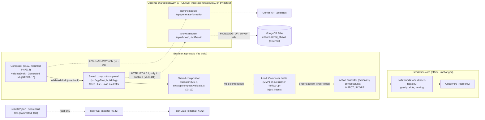

# MongoDB Atlas show library

> **STATUS: PROPOSED — NOT IMPLEMENTED.** Nothing in this document exists in the code. It is a specification for review, not a record of work done. No test listed here has been run.
>
> Source design by **William Pimentel** (`wpimento`): [`../handoffs/Encore_MongoDB_Atlas_Implementation_Spec.md`](../handoffs/Encore_MongoDB_Atlas_Implementation_Spec.md), preserved unmodified. Integrated by **Arnav** (contract and integration owner), issue #130.

Purpose: the canonical specification for saving validated Encore compositions to MongoDB Atlas, browsing them, and loading one back into the running simulation through the existing operator pathway. Status: proposed; any network use from the app needs team decision MDB-D1. MDB-D1 = D3, approved per integration (= GF-D1 = TIG-D1 for their modules; XI-9, XI-21). MDB-D1 opens only the `shows` module. Owner: Arnav (integration, contracts); William (source design, sponsor requirements). Audit base: `origin/main` 4c41f75.

Companion documents, sharing these IDs: work packages `MDB-WP-01…09` in [`../planning/mongodb-integration-work-packages.md`](../planning/mongodb-integration-work-packages.md) (canonical for titles and allowed files); tests `MDB-T01…T41` in [`../validation/mongodb-show-library-evaluation.md`](../validation/mongodb-show-library-evaluation.md). This file is canonical for `MDB-FR`, `MDB-NFR`, `MDB-CC`, `MCR`, `MDB-D` and `MDB-R`. Gemini (`GF-*`, `CR-*`), Phase 2 (`X-*`, `D1`–`D7`, `P2-*`), Tiger (`TD-*`, `TIG-*`) and cross-integration ruling (`XI-*`) IDs are cited, never redefined. Links into Gemini documents are *provisional: depends on #117*; links into Phase 2 documents are *provisional: depends on #110* (merge order #110 → #117 → #130).

---

## 1. Purpose and scope

William's goal is to let users "generate drone formations with Gemini, validate them against Encore's score contract, save them to MongoDB Atlas, browse previously saved shows, and load them into Encore without calling Gemini again". His success criterion, verbatim:

> **MVP success criterion:** Generate a show → save it to Atlas → refresh the browser → retrieve the saved show → load and execute it in Encore.

Until GF-CC-01 is approved (post-submission, Gemini [GF-D2](gemini-generated-formations.md#19-decisions-needing-approval)) there is no Generate step; shows are `source: 'manual'` (MDB-D7, MCR-22).

> **What can be demonstrated, and when** (2026-11-15; current recommendations)
> - **At submission:** nothing from this document. Every package is gated after the base submission ([work packages, Gating](../planning/mongodb-integration-work-packages.md#gating)), MDB-D1 is recommended "no change during the hackathon", and GF-D2 is post-submission. Do not claim the MLH Atlas track unless MDB-D8 says otherwise.
> - **After MDB-D1 (post-submission):** compose → save → refresh → list → retrieve → load, `source: 'manual'`, in a non-default build. The demo composition is `FX-SHOW` (HELLO → sphere → helix, [evaluation fixtures](../validation/mongodb-show-library-evaluation.md#2-fixtures-and-test-doubles)).
> - **After GF-CC-01 and GF-D1:** William's full criterion, with Generate.
>
> Saving only the current single draft adds nothing over the Composer, which already offers it with no database; the demo is worth showing only with a multi-movement composition.

His boundary, verbatim: "MongoDB must not become a dependency of the drone simulation. Its purpose is persistence and reuse of compositions, not telemetry, agent decisions, or replay infrastructure."

**In scope:** one collection, `encore.saved_shows` (§7); three routes and a health check in one optional, out-of-process service (§6, §10); a shared validator (§9); a **Save composition** action and a **Saved compositions** panel (§12; labels per MDB-D9); a load path using only the existing `inject` intent (§8, §13); offline, failure, security, determinism and isolation rules.

**Out of scope for the MVP.**
- William's list, kept: accounts, collaboration, full deterministic replays, MongoDB telemetry, vector embeddings, semantic search, advanced analytics, and a full experiment-management platform.
- Also out: editing and deleting shows ("not required for MVP"); public deployment (MDB-D3); any change to `src/contracts`, `src/score`, `src/agent`, `src/sim` or `src/observer`; offline export/import, recommended but optional (MDB-WP-09).

---

## 2. Status, ownership and source

| Item | Owner | Status |
|---|---|---|
| Source design (workflow, data model, API, UI states, risks, scenarios, tests) | William | Preserved. Changes forced by the repo are conflict records (§24) |
| Sponsor facts (MLH "Best Use of MongoDB Atlas") | William | Names only, from [`BRIEF.md`](../competition/BRIEF.md) P11/H3. Eligibility rules unpublished: UNVERIFIED |
| Network decision MDB-D1 | Team (Arnav consults William and Haris) | Pending; MDB-D1 = D3, approved per integration (= GF-D1 = TIG-D1 for their modules; XI-9, XI-21), not duplicated. It opens only the `shows` module |
| Implementation | TBD by Arnav (MDB-D5, XI-10); lanes suggested in the work packages | Not started |

William's §12 agent brief is source material for a future implementation, not permission to implement now.

---

## 3. Repository audit

Base `origin/main` **4c41f75**. The orchestrator scanned `main` and all 57 pushed branches (2026-11-15, about 01:10 GMT), and this writer re-checked the worktree.

| Component | State on `main` and every pushed branch | Evidence |
|---|---|---|
| Backend of any kind | **None.** No `server/` or `integrations/` | `ls`; orchestrator `git grep origin/*` |
| Gemini, TigerData, MongoDB code | **None.** No driver in [`package.json`](../../package.json) | grep of `src`, `tests`, `scripts`, `package.json`, `vite.config.ts` |
| Network code in the app | None. ESLint bans `fetch`, `Date` and similar in the core folders only ([`eslint.config.js:9-11`](../../eslint.config.js)) | grep |
| Environment | Only `VITE_SIM_MODE` ([`main.ts:16`](../../src/app/main.ts)); `.env*` ignored except `.env.example` ([`.gitignore:2-4`](../../.gitignore)); Vite dev and preview bound to `127.0.0.1` ([`package.json:8-13`](../../package.json)) | read |

William's statement that Gemini and TigerData "are reported as completed" is therefore **unverified** (possibly local, unpushed work). It is recorded as MCR-01, not as fact.

**Relevant active work:** **#112** Composer and console, merged but not mounted ([`Composer.ts:7-8`](../../src/app/ui/Composer.ts)); **#113** app shell (open), which mounts them and owns `main.ts`, `worlds.ts`, `actions.ts` and `commands.ts`; **#117** Gemini (GF-CC-01, GF-WP-10, -12, -15; OFFLINE-AUTHORING, LIVE-GATEWAY); **#110** Phase 2 (X-IN, X-OUT, X-PERSIST, X-RUN, D3, P2-WP-30, P2-T35); **#142** Tiger Data, stacked after this, not on this branch (`docs/integrations/tiger-data-analytics.md`).

**Stale since the audit base.** #113 has since merged (`6d5ea32`; re-checked on `main` `c697f6c`). There, `main.ts` mounts the Composer and Console explicitly (`connectComposer`, `main.ts:459`), the `Drafts` store is created in `main.ts` (`:457`), and nothing calls `createPanels`. The panel-loader claims below hold at 4c41f75 only; the mount path is MQ-1. The inject intent also refuses a drone selected in the static pane (`STATIC_SELECTION_REFUSAL`, `actions.ts:45, 106, 194` on `c697f6c`).

| Status | Items |
|---|---|
| **Verified implemented** | `Score`, `Movement`, `Recipe` (`text`, `sphere`, `helix`) ([`score.ts:5-18`](../../src/contracts/score.ts)); `composeNext`, `makeScore` ([`compose.ts:45-79`](../../src/score/compose.ts)); the `inject` intent and controller ([`actions.ts:9-14, 109-165`](../../src/app/actions.ts)); gossip and adoption ([`encoreBrain.ts:129-143`](../../src/agent/encoreBrain.ts)); self-registering panels ([`ui/index.ts:5-13`](../../src/app/ui/index.ts)) driven by DOM intents ([`DemoScript.ts:214-241`](../../src/app/ui/DemoScript.ts)), at 4c41f75 only: on `c697f6c` `createPanels` is defined but never called, and panels are mounted explicitly in `main.ts` |
| **Implemented, not integrated** | Composer `validateDraft`, preview and inject path (#112; mounting is #113) |
| **Active development** | #113, #117, #110, #142 |
| **Proposed** | Everything in §5–§29 |
| **Unverified** | Gemini and TigerData "completed"; MLH eligibility; MongoDB facts marked UNVERIFIED in §10.9 |

---

## 4. User stories

- **US-1 Save.** As an operator I compose (or, after GF-CC-01, generate) a formation, check it, and press **Save composition** with a title, so it outlives the session.
- **US-2 Browse after refresh.** I refresh, open **Saved compositions**, and see title, time and movement count, newest first.
- **US-3 Load.** I select a show; it is re-validated. I press **Load as drafts** (MVP, §8) and inject each movement as I would a typed word, or, after MDB-D6 and MCR-21, **Schedule composition…** with a live drone selected. Either way the swarm flies it through the same radio path, with no Gemini call.
- **US-4 Offline demo.** With no internet, Encore runs exactly as today, and the library says it is unavailable.
- **US-5 Retry.** After a save times out, **Retry** never creates a duplicate.
- **US-6 Trust.** A stored show that no longer validates is rejected on read and never reaches a drone.

---

## 5. Architecture



Dashed edges and everything in `GW` are optional and external. **The NFR-04 boundary is the edge of `APP` plus `CORE`.** With the gateway absent and the library flag off, the app makes no request, and [NFR-04](../specification/requirements.md#3-non-functional-requirements)'s acceptance check is unchanged. Nothing from MongoDB reaches a drone except as one controller-built `INJECT_SCORE`.

| Component | Does | Must not | Needed to run locally? |
|---|---|---|---|
| Encore core | Expands recipes, composes scores, simulates drones, radio and observers | Import a database driver; do I/O; read the library | **Yes** |
| Encore app | Validates, previews, injects; hosts the optional library client and panel | Hold credentials; inject anything not passed by the shared validator; block a frame on the network | **Yes** (the library client: no) |
| Gemini (gemini module, GF-WP-12) | Generates a scene from a prompt | Control drones, assign slots, write to MongoDB | No |
| MongoDB Atlas (shows module) | Stores, lists, returns compositions | Store telemetry, frames, replays, `RunRecord`s or `ScoreVersion`s; be read in a tick | No |
| TigerData (#142) | Stores and analyses experiment evidence imported from committed CLI `RunRecord` files by a CLI importer (X-OUT records later, after P2-WP-30a; XI-22) | Write to `saved_shows`; feed back into a run | No |
| Optional gateway (X-RUN/live) | Hosts independently optional modules; keeps secrets; validates again, completely (XI-2) | Import from `src/` beyond XI-2's pure modules; be needed by the demo; let one module's failure disable another | No |

---

## 6. Backend and database boundaries (MD-1)

**There is no backend to reuse** (MCR-02). William's instruction "Reuse the existing Gemini/TigerData backend if one exists" therefore becomes: build **one** optional service that both features share.

- **Location:** `integrations/gateway/` (XI-1, MDB-D4). No module creates its own server.
  - Own `package.json`, lockfile, `tsconfig.json`, `README.md` and `.env.example` (no secret).
  - Not an npm workspace, so the root `npm ci` installs none of it.
  - The root `package.json` ("Williams" in [`TEAM_ROLES.md`](../development/TEAM_ROLES.md), paused) is untouched; root `package.json`, CI and `eslint.config.js` (ignore `integrations/**`) changes need owner sign-off.
- **Modules:** `gemini` ([Gemini spec §10](gemini-generated-formations.md#10-backend-gateway-gd-12)), `shows` (this document) and `tiger` (#142). Each is enabled only by its own server-side configuration (`MONGODB_URI` for `shows`); absence or failure of one never disables another, the app, the simulator, the CLI or `report.ts`.
- **Folder name.** The Gemini spec now uses the same folder ([§10.4](gemini-generated-formations.md#104-location-and-packaging-cr-10-cr-21)); MCR-07 is closed by XI-1.
- **The shared gateway skeleton (XI-12).** One server, one `guard.ts`, one `errors.ts` (the XI-3 envelope, `sanitise`, `redact`), one `config.ts` and `GET /api/health`. Its rules live in the #110 boundaries doc ([§6.2](../design/OPTIONAL_INTEGRATION_BOUNDARIES.md#62-shared-gateway-skeleton-and-guard), provisional). Whichever module work package is approved first builds it, once. The `shows` module depends on it and never redefines the guard or the errors. This answers MQ-8.
- **What the `shows` module adds:** its routes (§10.2–§10.3), its reason codes (§10.1), its `modules.shows` health entry (§10.4), its repository and its own configuration (`MONGODB_URI`, `MONGODB_DB`).
- **Dependency policy (XI-12).** Exact pins; `npm ci --ignore-scripts`; a 14-day minimum release age; `npm audit signatures`; `node:http`, with no web framework unless approved (William: "Do not add Express or another framework before inspecting current infrastructure"). Each module reads only its own secrets: the `shows` module never loads the Gemini key or the admin URI (§21).

| Phase 2 boundary, as amended (XI-4; provisional, #110) | Mapping | Gap |
|---|---|---|
| [X-RUN](../design/OPTIONAL_INTEGRATION_BOUNDARIES.md#6-x-run-external-integration-runner), as [X-RUN/live](../design/OPTIONAL_INTEGRATION_BOUNDARIES.md#61-x-runlive-provisional-d3-gated) | **X-RUN/live**, the D3-gated HTTP channel: own folder and dependencies, only XI-2's pure imports, credentials in its environment, deletable with `check.sh` green. Inbound only a candidate composition, X-IN-validated before an operator injection; outbound read-only library data | None once D3 is approved (MCR-11) |
| [X-PERSIST](../design/OPTIONAL_INTEGRATION_BOUNDARIES.md#5-x-persist-optional-persistence) | The `shows` module is X-PERSIST of compositions; never live control | None (MCR-11) |
| [X-IN](../design/OPTIONAL_INTEGRATION_BOUNDARIES.md#3-x-in-composition-input) | A loaded show passes the X-IN validation steps, then the `inject` intent. **Load as drafts** (MVP, §8) conforms: every movement becomes a Composer draft the operator injects | Two conflicts. Format: `movements` with `holdTicks` vs X-IN v1 `cues: { name; recipe }[]`, which rejects the key `movements` (MCR-20). Self-scheduling: the cue runner schedules *k* injections after one confirmation, vs X-IN's "never schedules injections by itself. Every cue is an operator action" (MCR-21). MDB-WP-09 writes only `encore.composition` files, v1 or the proposed v2, and no other file kind (XI-15) |
| [D3](../planning/PHASE2_ROADMAP.md#decisions-for-arnav) | Needed for any library use from the app. MDB-D1 = D3, approved per integration (= GF-D1 = TIG-D1 for their modules; XI-9, XI-21). MDB-D1 opens only the `shows` module: approving D3 for one integration does not approve it for another ([boundaries §9](../design/OPTIONAL_INTEGRATION_BOUNDARIES.md#9-the-no-network-rule-and-decision-d3)) | None |

**Vite proxy.** Same-origin `/api` calls need a dev and preview `server.proxy` in `vite.config.ts`: a build-config change for its owner, listed, not decided ([OIB-Q2](../design/OPTIONAL_INTEGRATION_BOUNDARIES.md#13-open-questions)). The gateway sends no CORS headers unless OIB-Q2 is decided for CORS (XI-12); then it answers only the configured app origins. Either way the guard's `Host`, `Origin` and remote-address rules (§10.7) apply; a proxied request carries the app's `Host`.

---

## 7. Data model (MD-5)

Database `encore` (from `MONGODB_DB`), collection `saved_shows` (William §4).

### 7.1 Fields

| Field | BSON type | Req. | Rule | Set by |
|---|---|---|---|---|
| `_id` | ObjectId | yes | Identifier | MongoDB |
| `schemaVersion` | int | yes | `1` here (§7.4) | service |
| `title` | string | yes | Trimmed, 1–80 code points, no `\p{Cc}`/`\p{Cf}` (the rule [`commands.ts:355`](../../src/app/ui/commands.ts) applies to names), plain text | client, checked |
| `prompt` | string | no | ≤ 2000 code points; newline and tab only as control characters; stored only if "Store prompt" is ticked (MDB-D2) | client, checked |
| `composition` | object | yes | `{ v: 1, movements: [{ recipe, holdTicks }] }` (§8.1) | client, checked |
| `preview` | object | yes | `{ movementCount, kinds }`, derived for listing | service |
| `contentHash` | string | yes | 64 lower-case hex `sha256(canonicalJson(composition))` (§7.3) | service |
| `requestHash` | string | yes | 64 lower-case hex fingerprint of the whole normalised request, for idempotency (§7.3, §10.5) | service |
| `source` | string | yes | `gemini` or `manual` | client |
| `generator` | object | iff `gemini` | `{ model (1–100), integrationVersion (1–20), sceneHashes? (≤ 16 × 64 hex) }` | client, checked |
| `operationId` | string | yes | Lower-case UUID v4 (§10.5) | client |
| `createdAt`, `updatedAt` | date | yes | Server time; equal in the MVP | service |

The service builds each document **field by field** from the validated request. It never spreads the body into an insert. **Never stored:** a runtime `ScoreVersion`, absolute `startTick`, `transitionTicks`, drone ids, slots, positions, telemetry, frames, snapshots, `RunRecord`s, replays, large AI traces or wall-clock latencies.

### 7.2 Example document (corrected)

William's example is "schematic", in his own word. Its `score.version {issuedTick: 0, origin: 0}`, `startTick` 0/200/400 and hand-written `transitionTicks` are removed for the reasons in §8.4 (MCR-06).

```json
{
  "_id": { "$oid": "<24 hex, assigned by MongoDB>" },
  "schemaVersion": 1,
  "title": "HELLO to Helix",
  "composition": {
    "v": 1,
    "movements": [
      { "recipe": { "kind": "text", "text": "HELLO", "palette": [[1, 0.6, 0.1], [0.2, 0.5, 1]] }, "holdTicks": 600 },
      { "recipe": { "kind": "sphere" }, "holdTicks": 600 },
      { "recipe": { "kind": "helix" }, "holdTicks": 600 }
    ]
  },
  "preview": { "movementCount": 3, "kinds": ["text", "sphere", "helix"] },
  "contentHash": "<64 lower-case hex, computed by the service>",
  "requestHash": "<64 lower-case hex, computed by the service>",
  "source": "manual",
  "operationId": "3f1c9a2e-7b4d-4e8a-9c1f-2a6b8d0e4f71",
  "createdAt": { "$date": "<server time>" },
  "updatedAt": { "$date": "<server time>" }
}
```

- **`holdTicks` 600** (30 s at `DT` = 0.05) is `DEFAULT_HOLD_TICKS` ([`compose.ts:9`](../../src/score/compose.ts)).
- **Palette components** are in [0, 1] ([`params.ts:7`](../../src/contracts/params.ts)).
- **`source` is `manual`** because, until GF-CC-01, no Encore path produces a Gemini composition (MCR-13).
- **A Gemini document after GF-CC-01** is `schemaVersion: 2`, with `generated` recipes, `source: "gemini"` and `generator` (§15).

### 7.3 `contentHash`

Canonical JSON uses the rules of `canonicalJson` ([`src/cli/run.ts:27-36`](../../src/cli/run.ts)):
- keys sorted at every level;
- arrays kept in order;
- no whitespace;
- numbers via `JSON.stringify` (`-0` becomes `0`);
- non-finite numbers rejected.

`contentHash` = hex SHA-256 of UTF-8 `canonicalJson(composition)` (XI-7), the canonical JSON Tiger and Gemini also use. The gateway cannot import `src/cli` (XI-2), so it imports the one shared pure module `src/score/canonical.ts` (XI-19, proposed, owner Arnav) and uses `node:crypto`. `src/cli/run.ts` and `src/telemetry` import the same module. The move is byte-for-byte, so `stateHash` and existing artifact hashes do not change. The SHA-256 is never computed in `src/score`, so Gemini's pure-TypeScript SHA-256 ([§6.7](gemini-generated-formations.md#67-canonicalisation-and-scenehash-gd-4)) is not needed; the app's optional R15 uses Web Crypto. Text is stored upper-case (R12), so equal shows hash equally.

Uses of `contentHash` (composition identity only):
- integrity check on read (R15);
- the identity Tiger's import manifest may record as `compositionId = contentHash:<hex>` (TD-3, XI-6; provisional, #142). The Tiger draft uses that form for *preloaded* shows; a show loaded here is always injected, so its steps are already inside Tiger's `events` and the link is informational.

**`requestHash`** = hex SHA-256 of `canonicalJson({ schemaVersion, title, prompt?, composition, source, generator? })`, computed **after** validation and normalisation (title trimmed, text upper-cased, absent optional fields omitted). It is the idempotency fingerprint (§10.5): a retry that changes the title, ticks "Store prompt", or changes `source` or `generator` under the same key is a conflict, not a replay. `operationId` and timestamps are excluded.

Both hashes are computed by the service only; client-supplied values are ignored.

### 7.4 Schema versioning, compatibility, migration

| On read | Behaviour |
|---|---|
| Supported version, valid | Returned, loadable |
| Supported version, invalid or hash mismatch | The list marks `loadable: false, problem: 'invalid'` only when a projected summary field fails (§10.3); it cannot see `composition`. A hash mismatch or composition failure is detected by `GET /:id` → `500 INTERNAL` (`STORED_SHOW_INVALID`) and then shown as state 8. Never injected (William scenario B) |
| Newer than the reader supports | Listed `problem: 'unsupported-schema'`; `GET /:id` → `500 SCHEMA_VERSION_UNSUPPORTED`; **never reinterpreted** (scenario F) |
| Missing or below 1 | Invalid |

- **When to bump.** Bump `schemaVersion` whenever an old reader could misread a new document: a new recipe kind, a new required field or a changed meaning. Documents with a `generated` recipe are `schemaVersion: 2`, so a v1 reader says "unsupported" instead of "corrupt".
- **Old documents stay valid.** A reader supports every version up to its own.
- **Migration** is not in the MVP: an explicit gateway script backs up, validates with version-*n* rules, converts, validates with version-*n+1* rules, then writes or reports. Nothing is rewritten in place without the backup.
- **Collection validator first.** Before any v2 write is enabled, the admin setup script (§11) runs `collMod` to make the optional `$jsonSchema` (§9) accept both versions (with `validationLevel: 'moderate'` if old documents need it). Only then are v2 writes switched on; otherwise the first v2 save fails with 121 `DocumentValidationFailure`.

### 7.5 Recipe kinds and size

- **Supported kinds** are `text`, `sphere` and `helix` ([`score.ts:7-10`](../../src/contracts/score.ts), FR-09). `generated` is accepted only after GF-CC-01, and only in v2.
- **Unknown kinds are rejected** on write and on read. Brains check only the version and a non-empty `movements` ([`encoreBrain.ts:133-134`](../../src/agent/encoreBrain.ts)), and an unknown kind throws inside `expandRecipe` during `world.step`.
- **A rejected `generated` recipe does not throw** in the total `expandRecipe` once GF-CC-01 lands: it returns a fallback sphere (Gemini [§7.11](gemini-generated-formations.md#711-totality-and-fallbacks-gd-8), ruling G2-1). Library checks therefore use the strict path (R14), so a rejected scene fails validation instead of loading as a sphere.
- **Size.** MongoDB's document limit is 16 MiB (VERIFIED, §10.9). The request body cap is **64 KiB** for v1. A 16-movement composition with palettes and a 2000-character prompt is a few kilobytes (an estimate from field sizes, not a measurement).
- **v2 needs its own budget.** A generated scene may be 16 KB (GF-NFR-04), so 16 of them would exceed 64 KiB. The v2 cap is movements × the Gemini scene cap + overhead, set when GF-CC-01 is approved (XI-8, MCR-15).

---

## 8. Runtime version vs reusable composition (MD-2, MD-3)

### 8.1 What is stored

```ts
interface SavedShowComposition { v: 1; movements: { recipe: Recipe; holdTicks: number }[] }   // 1–16 movements
```

The stored body type is `SavedShowComposition`, never `CompositionV1`, so it cannot be confused with the X-IN file kind `encore.composition` v1 (`schema`, `name`, `cues`; XI-21). Its `movements` map to `encore.composition` `cues` at the export edge (§14, MCR-20).

William allows a "validated score **or canonical reusable composition**". This spec stores the composition and renames `score` to `composition` (MCR-04): a stored object called `score` that is not a `Score` invites blind injection.

A `Score`'s three timing and identity fields are runtime-only:
- `version` names the injection tick and receiving drone ([`score.ts:5`](../../src/contracts/score.ts));
- `startTick` is an absolute tick of one run;
- `transitionTicks` is computed from the previous formation at injection ([`compose.ts:50-53`](../../src/score/compose.ts)).

`holdTicks` is the author's intent, with `makeScore`'s meaning: "each later movement starts `holdTicks` after the previous movement's hold began" ([`compose.ts:60-63`](../../src/score/compose.ts)). The last movement's `holdTicks` is validated but unused.

### 8.2 The load algorithm

**MVP: Load as drafts** (MDB-D6). Each validated movement becomes one Composer draft (`draftFromRecipe`, [`Composer.ts:78`](../../src/app/ui/Composer.ts); the `Drafts` store, `:34`), named `<title> i/k`. The operator injects each one as today, so every injection is an operator action (X-IN, MCR-21) and nothing below is needed. `holdTicks` is shown as advice next to each draft. This is the cheapest honest path: the draft store and inject path already exist, and it needs only the mount line of MQ-1.

**Follow-up: the cue runner** (after MCR-21 is approved). It replays the composition as ordinary operator `inject` intents. The controller gives each one a **fresh** version through `composeNext`. Notation: `now` the current tick; `L` = `params.scoreLead`, 60 by default ([`params.ts:39`](../../src/contracts/params.ts)); `R` the runner's dispatch lead; `T_i` step *i*'s `transitionTicks`; `h_i` its `holdTicks`.

1. **Preconditions.** The controls report `available` and `composition` (`radioFaults && composeScore`, [`actions.ts:84`](../../src/app/actions.ts)); a live drone is selected; no other load is running; the scripted demo is not running (its inject beat, [`DemoScript.ts:64`](../../src/app/ui/DemoScript.ts), would collide with the one-injection-per-tick rule at `actions.ts:156` or override the load; message "Stop the scripted demo first."); the composition passes the shared validator, trial expansion at the app's `n0` included. Starting the demo stops an active runner, and the panel says "Stopped: the scripted demo started."
2. **First tick.** `t_1` is the operator's chosen tick `a > now` ([`actions.ts:133`](../../src/app/actions.ts)), or `now + 1` (sent without `at`).
3. **Dispatch.** Once `now ≥ t_i − R`, send `{ type: 'inject', recipe: r_i, at: t_i }` as an `encore:control` event. This is the scripted demo's pattern ([`DemoScript.ts:87-90, 222`](../../src/app/ui/DemoScript.ts)). **`R` = 60 ticks** = the demo's `LEAD_TICKS` ([`DemoScript.ts:41`](../../src/app/ui/DemoScript.ts)). The runner sees `encore:control-status` at most every 200 ms ([`main.ts:269`](../../src/app/main.ts) at 4c41f75; `main.ts:575` on `main` `c697f6c`), which at the maximum 4× speed is 16 ticks, plus up to 5 ticks per frame (`MAX_STEPS_PER_FRAME`, [`worlds.ts:208`](../../src/app/worlds.ts); `:236` on `c697f6c`): about 21 ticks between polls, leaving roughly 39 ticks for a frame hitch. 60 is also the safe maximum: `t_{i+1} − t_i ≥ 60` (step 6), so step *i+1* is never dispatched before `t_i`, and at most one future step is ever scheduled. The cost is a dead-drone window (step 7) of up to 60 ticks.
4. **Late.** If `now ≥ t_i` already, send without `at`, set `t_i = now + 1`, and mark the load off-schedule (the rule in [`DemoScript.ts:122-133`](../../src/app/ui/DemoScript.ts)).
5. **Check.** The status emitted right after the intent carries `result.event` ([`actions.ts:174`](../../src/app/actions.ts)). Require an `INJECT_SCORE` with `tick = t_i`, `version = { issuedTick: t_i, origin: droneId }`, two movements, `movements[1].startTick = t_i + L` and `movements[1].recipe` deep-equal to `r_i`; then read `T_i = movements[1].transitionTicks`.
6. **Next.** `t_{i+1} = t_i + max(L, T_i + h_i)`.
   - Movement *i* starts at `s_i = t_i + L` and holds from `s_i + T_i`. Movement *i+1* starts at `s_i + T_i + h_i`, so the hold lasts exactly `h_i`. This is `makeScore`'s timing shifted by `t_1 + L`, except that `T_1` is measured from the formation current at `t_1`, not from the launch grid.
   - The `max` never binds under default parameters: `transitionTicksBetween` ≥ `ceil(3 s / DT)` = 60 ([`timing.ts:48`](../../src/score/timing.ts)) = `L`. If it binds, the panel says so.
7. **Abort or pause.** The runner stops on a reset or seed change (the tick goes backwards, as [`DemoScript.ts:141`](../../src/app/ui/DemoScript.ts) detects), an `INJECT_SCORE` it did not send, or a failed intent.

   **The target drone.** The runner never sends `select`. It records the selected drone as `plan.droneId` at confirmation (state 9a). Before each dispatch it checks `status.selectedId === plan.droneId && status.selectedAlive` (`ControlStatus`, `actions.ts:51` on `c697f6c`). If that fails, it pauses with "Paused: drone <id> is no longer selected or alive." A `STATIC_SELECTION_REFUSAL` result (a drone selected in the static pane, §3) also pauses the runner; it does not count as a failed intent. **Resume** continues into the drone selected at that moment, and the panel names it.

   "Select a live drone first." ([`actions.ts:88`](../../src/app/actions.ts)) pauses the runner the same way until the operator selects a drone and presses **Resume**; later steps shift. An uplink into a drone that dies between dispatch and `t_i` is discarded ([`world.ts:130`](../../src/sim/world.ts); reported at [`Console.ts:117`](../../src/app/ui/Console.ts)). The runner flags that step as possibly undelivered.
8. **Stop.** Cancels every step not yet dispatched. The step already dispatched (at most one, scheduled up to `R` ticks ahead) cannot be un-scheduled and still flies; the panel says so (state 10).
9. **Done** after step *k*: "Scheduled *k* injections. Dissemination and flight are live simulation, not stored results."

### 8.3 The chaining question (answered from the code)

**Scheduling chains.** `schedule` sets `authoredScore` to each scheduled score immediately ([`actions.ts:96-98`](../../src/app/actions.ts)). The next intent's `composeNext(authoredScore, t_{i+1}, …)` (`:160`) therefore copies `currentMovement(authoredScore, t_{i+1})` ([`timing.ts:12-25`](../../src/score/timing.ts)) = movement *i*, because `s_i ≤ t_{i+1}`. So `S_{i+1} = [m_i, m_{i+1}]`. If `t_{i+1} < t_i + L`, movement *i* would vanish silently; hence the `max` in step 6.

Pre-scheduling all *k* steps would therefore also work, with no contract change. If a runner is built, the just-in-time one is preferred (MDB-D6):
- **No un-schedule:** a pre-scheduled show stops only on a reset. The just-in-time runner still cannot cancel the one step it has dispatched (§8.2 step 8).
- **Fixed drone:** `droneId` is fixed per intent, so one dead drone loses every remaining step.
- **Interleaving:** later steps, with higher `issuedTick`, override a manual injection in between. The just-in-time runner narrows this to the one dispatched step.

Both approaches log exact ticks, so both replay deterministically (§17).

### 8.4 Why a stored `ScoreVersion` is never reused (MCR-06)

Inject William's example `{ issuedTick: 0, origin: 0 }`, with movements at ticks 0/200/400, into a running show:
- **Wrong origin.** `origin` is "the drone that received the uplink". The preloaded score uses `OPERATOR` = −1 ([`score.ts:5`](../../src/contracts/score.ts), [`params.ts:4`](../../src/contracts/params.ts)). Origin 0 is drone 0.
- **Accidental ordering.** `newerVersion` is lexicographic on `(issuedTick, origin)` ([`timing.ts:28-30`](../../src/score/timing.ts)). `{0, 0}` beats the preloaded `{0, −1}` but loses to every later injection, so after any injection it is silently ignored. A stored version from a later tick of another run would beat every injection until this run's clock passed it. That breaks "the operator's most recent composition always wins" ([contract §6](../design/contracts-and-algorithms.md#6-composition-from-recipe-to-slots)).
- **Wrong clock.** Past `startTick`s make `currentMovement` jump to the last movement, so the show is skipped.
- **Wrong timing.** Hand-written `transitionTicks` need not match `transitionTicksBetween`, so the paced flight is wrong.
- **Key collisions.** Adoption read-outs are keyed by version (`versionKey`), so a replayed version collides with keys in this run.

**The persistence layer never invents a version** (William §4). It has no access to the simulation clock or the receiving drone, so anything it made would be a guess. Only the controller assigns versions, at scheduling time.

### 8.5 Late and missed adoption

Each step is a separate dissemination (contract §9).
- **Newest wins.** A drone adopts only a strictly newer version and "joins whatever movement is current" by the clock ([`encoreBrain.ts:125-143`](../../src/agent/encoreBrain.ts)).
- **A missed step recovers, but not for free.** A drone that misses `S_i` but hears `S_{i+1} = [m_i, m_{i+1}]` rejoins at step *i+1*. In `S_{i+1}` the copied `m_i` is current for at most `L` ticks after `t_{i+1}`, so that drone loses movement *i*'s hold, and its transition to `m_{i+1}` (timed from `m_i`'s formation) is mis-paced. A dead target loses the step entirely (§8.2 step 7).
- **Partitions are shown honestly.** A cut-off group keeps the older version, so two versions fly at once, and the belief view shows it. On reconnection, the newest wins ([contract §9](../design/contracts-and-algorithms.md#9-score-dissemination-and-partitions-adr-005-adr-008)).
- **Healing cost.** Each adoption pauses healing for `tStable` = 120 ticks ([contract §8.5](../design/contracts-and-algorithms.md#85-known-limits-state-these-dont-hide-them), limit 8). Every movement change blocks healing anyway (limit 4, `targetChanged` at [`encoreBrain.ts:314`](../../src/agent/encoreBrain.ts)), so the *marginal* cost of a step over a single multi-movement score is about the `L` ticks between adoption and the movement start: about *k* × `L` per load, not *k* × `tStable`. This is what MDB-CC-01 would save.
- **Limit 9 does not arise between the runner's own steps,** because each is composed from the previous one. If another injection intervenes, the runner stops, but a step it already dispatched still overrides that injection (higher `issuedTick`).
- **The static arm ignores uplinks** ([`Console.ts:46`](../../src/app/ui/Console.ts)), as for any injection.

---

## 9. Validation (MD-4)

**One pure validator, three runs:**
- (a) in the app before save;
- (b) in the service on write (never trust the client);
- (c) in the app before load, and in the service on read (never trust stored data).

It uses runtime checks, never casts, and has no DOM or three.js.

**`validateDraft` cannot serve directly** ([`Composer.ts:85-107`](../../src/app/ui/Composer.ts)). It takes the UI `Draft` type, sits in a module that imports `PreviewLayer`, and does not range-check palettes.

**The pure validator is `src/app/compose/validate.ts` (XI-13).**
- P2-WP-30a creates it, or MDB-WP-02 if 30a has not landed. Whichever lands first creates it; the other extends it.
- It holds the DOM-free body of `validateDraft`, the palette finiteness and range checks, and `validateText` with `TEXT_MAX`.
- `validateText` and `TEXT_MAX` are **moved**, not copied, from `src/app/ui/commands.ts`, which keeps one re-export line (owner sign-off). The reason: `commands.ts` imports `actions.ts`, which imports `src/sim`.
- It imports only `src/contracts`, `src/score` and `src/score/font`.
- The composition validator is recipe-level and shares that file's text rule, font table and trial expansion (MCR-19). This closes MQ-6.

**The service imports the same validator** (XI-2): the gateway may import, by relative path, `src/contracts/**`, `src/score/**` and `src/app/compose/validate.ts` (XI-13), so service-side validation is **complete**, R14 included (superseding Gemini CR-24). Not knowing the app's `n0`, it runs R14 at the app's smallest and largest `n0` (MDB-T08); the app repeats it at its own `n0`. Both suites run the same fixture corpus (MDB-T01–T10).

| # | Rule | Derived from | Save (app) | Write (svc) | Load (app) | Read (svc) |
|---|---|---|---|---|---|---|
| R1 | Body ≤ 64 KiB, `application/json`, UTF-8. Bytes are decoded with a strict `TextDecoder` (`fatal: true`); invalid UTF-8 → `INVALID_JSON` | MD-5; X-IN step 2 | ✓ | ✓ (413/415/400) | — | — |
| R2 | Depth scan before `JSON.parse` (limit 8); fresh plain objects; reject `__proto__`, `constructor`, `prototype`, keys starting `$` or containing `.`. Validation is shape-directed: it descends only into known fields, so anything outside the shape fails as `UNKNOWN_KEY`/`INVALID_FIELD` before `canonicalJson` runs | X-IN step 3 ([§3.1](../design/OPTIONAL_INTEGRATION_BOUNDARIES.md#31-path-from-file-to-swarm)); MD-10 | ✓ | ✓ | ✓ | ✓ |
| R3 | Supported `schemaVersion` | §7.4 | ✓ | ✓ | ✓ | ✓ |
| R4 | `title` rule (§7.1) | William §4; [`commands.ts:355`](../../src/app/ui/commands.ts) | ✓ | ✓ | ✓ | ✓ |
| R5 | `prompt` rule (§7.1) | William §4 | ✓ | ✓ | ✓ | ✓ |
| R6 | `source` enum; `generator` iff `gemini`, bounded | William §4 | ✓ | ✓ | ✓ | ✓ |
| R7 | `composition` keys exactly `v`, `movements`; `v` = 1 | §8.1 | ✓ | ✓ | ✓ | ✓ |
| R8 | 1–16 movements | MD-4; X-IN's 1–16 cues | ✓ | ✓ | ✓ | ✓ |
| R9 | Movement keys exactly `recipe`, `holdTicks`; `holdTicks` safe integer in [0, 6000] (5 min). So `version`, `startTick`, `transitionTicks`, `origin`, `droneId`, `slots` are rejected as unknown | [`score.ts:13-17`](../../src/contracts/score.ts) | ✓ | ✓ | ✓ | ✓ |
| R10 | `kind` ∈ {`text`, `sphere`, `helix`} (+ `generated` in v2) | [`score.ts:7-10`](../../src/contracts/score.ts); FR-09 | ✓ | ✓ | ✓ | ✓ |
| R11 | Recipe keys exactly `kind`, `text`, `palette?` / `kind`, `palette?` | [`score.ts:8-10`](../../src/contracts/score.ts) | ✓ | ✓ | ✓ | ✓ |
| R12 | `text`: not blank, ≤ 20 code points, every character in the font (A–Z, 0–9, space), stored upper-case | [`font.ts:10-48`](../../src/score/font.ts); `validateText` and `TEXT_MAX`, moved to `src/app/compose/validate.ts` (XI-13; today [`commands.ts:115, 288-296`](../../src/app/ui/commands.ts)); [`actions.ts:158-159`](../../src/app/actions.ts) | ✓ | ✓ | ✓ | ✓ |
| R13 | `palette` absent or two triples of finite numbers in [0, 1] | [`params.ts:7`](../../src/contracts/params.ts); `expandRecipe` clamps silently ([`expand.ts:53, 91-99`](../../src/score/expand.ts)) | ✓ | ✓ | ✓ | ✓ |
| R14 | Trial `expandRecipe` succeeds at the app's `n0`. For a `generated` recipe (v2) it is the strict path (`expandRecipeStrict` or `compileGeneratedScene`), which throws `GeneratedSceneRejected`; the total `expandRecipe` would return the fallback sphere (G2-1) | [`expand.ts:56-68`](../../src/score/expand.ts); [`Composer.ts:103-105`](../../src/app/ui/Composer.ts); Gemini [§7.11](gemini-generated-formations.md#711-totality-and-fallbacks-gd-8) | ✓ | ✓ | ✓ | ✓ |
| R15 | `contentHash` equals recomputed | §7.3 | — | computes | optional (Web Crypto) | ✓ |
| R16 | No extra top-level keys; all strings bounded | MD-5, MD-10 | ✓ | ✓ | ✓ | ✓ |

- **Why R12 matters.** The font alone does not reject anything: `litCells` renders an unknown character as a space ([`font.ts:55-56`](../../src/score/font.ts)).
- **Nesting bounds (R2).** A valid v1 composition nests at most 6 containers (composition, `movements`, movement, recipe, `palette`, triple), the request body 7. The linear depth scan runs before parsing with limit 8. Whether `JSON.parse` itself is safe on deeply nested input is UNVERIFIED. The v2 limit is set with GF-CC-01, because a generated scene nests deeper.
- **Warnings never block.** Reserved colours and thin long text ([`Composer.ts:95-102`](../../src/app/ui/Composer.ts)) are shown, not stored or enforced.
- **Optional MongoDB `$jsonSchema` collection validator.** It mirrors R3–R13 and R16 as defence in depth, and is applied by the admin setup script (§11), never by the runtime user. It cannot use the `integer` type or the `$ref`, `default`, `definitions` and `format` keywords (§10.9). These rules make it accept valid shows:
  - With `additionalProperties: false`, the top-level `properties` must include `_id: { bsonType: 'objectId' }`, or **every** document is rejected (§10.9).
  - `schemaVersion` and `holdTicks` use `bsonType: ['int', 'long']`.
  - Palette channels use `bsonType: 'number'` with `minimum: 0`, `maximum: 1`: the Node serialiser stores integer-valued numbers such as the `1` and `0` of §7.2's palette as int32 and `0.6` as double, so a `double`-only type would reject valid shows.
  - A rejection (121 `DocumentValidationFailure`) means the app and collection rules have drifted: `500 INTERNAL` with reason `VALIDATOR_DRIFT`, logged, never driver text.

---

## 10. API contracts (MD-7, MD-8)

William's four routes and status table are kept. Additions are marked **(added)**.

### 10.1 Types

```ts
type ShowSource = 'gemini' | 'manual';
interface Generator { model: string; integrationVersion: string; sceneHashes?: string[] }
interface ShowSummary {
  id: string; title: string; source: ShowSource; createdAt: string;   // ISO 8601
  movementCount: number; kinds: string[]; schemaVersion: number;
  loadable: boolean; problem?: 'invalid' | 'unsupported-schema';
}
interface SavedShow extends ShowSummary {
  prompt?: string; composition: SavedShowComposition; contentHash: string; generator?: Generator; updatedAt: string;
}
interface ErrorBody { error: { code: ErrorCode; message: string; details?: { path: string; reason: ReasonCode }[]; requestId?: string } }   // XI-3
type ReasonCode = 'UNSUPPORTED_RECIPE' | 'INVALID_TEXT' | 'INVALID_COLOUR' | 'INVALID_TIMING' | 'RUNTIME_FIELD'
  | 'UNKNOWN_KEY' | 'INVALID_FIELD' | 'TOO_MANY_MOVEMENTS' | 'EXPANSION_FAILED' | 'INVALID_JSON' | 'INVALID_IDEMPOTENCY_KEY'
  | 'INVALID_ID' | 'INVALID_QUERY' | 'INVALID_CURSOR' | 'IDEMPOTENCY_CONFLICT' | 'MODULE_DISABLED' | 'STORED_SHOW_INVALID'
  | 'VALIDATOR_DRIFT' | 'OUTCOME_UNKNOWN' | 'INDEX_MISSING';
// App-side only, for state 8: 'unsupported-schema' | 'invalid' | 'not-expandable-here' (R14 fails at this page's n0)
```

- **One envelope for every gateway module** (XI-3, MCR-16); no `success` flag on success bodies. It is built by the shared gateway skeleton's `errors.ts` (XI-12), with its `sanitise` and `redact`; this module supplies only its reason codes.
- **`requestId`** (XI-11): optional, client-generated, opaque to the gateway, pattern `^[A-Za-z0-9._:-]{1,64}$`. A value that does not match is dropped, not echoed, and the request proceeds; it is not an error. The gateway logs its own server id on every line. This blocks log forging and terminal escapes in the console the operator watches. The Gemini client's counter ids (for example `r-000042`) match the pattern. This closes MQ-12.
- **`ErrorCode`** is XI-3's shared list; this module uses all of it except `PROVIDER_UNAVAILABLE`, `PROVIDER_ERROR` and `TIMEOUT`. Module reasons go in `details[].reason`.
- **`details`**: JSON path (`""` for the request) and reason, never driver text; each rule reason maps to one of R1–R16. `RUNTIME_FIELD` marks a stored `version`, `startTick`, `transitionTicks`, `origin` or `droneId`.
- **Retry by status, never message text:** only network errors, timeouts, 503 and 429 are retried (§10.6).

### 10.2 `POST /api/shows`

```ts
// Headers: Content-Type: application/json; Idempotency-Key: <uuid v4>
interface SaveShowRequest {
  schemaVersion: 1; title: string; prompt?: string; composition: SavedShowComposition;
  source: ShowSource; generator?: Generator;
  operationId?: string;   // body fallback; if both are present they must be equal
}
interface SaveShowResponse { show: SavedShow; idempotentReplay: boolean }   // 201 + Location: /api/shows/<id>
```

| Status | When | Code |
|---|---|---|
| 201 | Inserted | — |
| 200 (added) | Same `operationId` and `requestHash` as an existing document; the original is returned with `idempotentReplay: true` | — |
| 400 | Not JSON; fails R2–R16; missing, malformed or mismatched key | `VALIDATION_FAILED` (`INVALID_JSON`, a rule reason, or `INVALID_IDEMPOTENCY_KEY`) |
| 401 / 403 | Missing per-launch token if enabled, or no authorisation when deployed (MDB-D3) / missing, `null` or foreign `Origin`, foreign `Host`, non-loopback peer (the shared guard, §10.7) | `UNAUTHORIZED`, `FORBIDDEN` |
| 409 (added) | Same `operationId`, different `requestHash` (title, prompt, source, generator or composition differ) | `CONFLICT` (`IDEMPOTENCY_CONFLICT`) |
| 413 (added) | Body over 64 KiB, counted while streaming, before parsing | `PAYLOAD_TOO_LARGE` |
| 415 (added) | Not `application/json` | `UNSUPPORTED_MEDIA_TYPE` |
| 429 (added) | Rate limit; `Retry-After` header | `RATE_LIMITED` |
| 503 | Atlas unreachable / module disabled / unique index not confirmed / handler deadline hit (outcome unknown: retry with the same key) | `DATABASE_UNAVAILABLE` (`MODULE_DISABLED`, `INDEX_MISSING`, `OUTCOME_UNKNOWN`) |
| 500 | Unexpected; collection-validator rejection | `INTERNAL` (`VALIDATOR_DRIFT` for 121) |

**400 rather than 422** for invalid input, as William specifies. Reasons already separate malformed JSON from rule failures, and one status keeps the client rule simple: no 4xx is retried except 429.

### 10.3 `GET /api/shows` and `GET /api/shows/:id`

**List.**
- Query: `limit` (1–50, default 20) and `cursor` (opaque base64url, ≤ 128 characters).
- `200 { items: ShowSummary[]; nextCursor: string | null }`.
- Errors: `400 VALIDATION_FAILED` (`INVALID_QUERY`/`INVALID_CURSOR`), `429`, `503`, `500`.
- It projects `preview`, never `composition` (William: "metadata only"), so it cannot check `contentHash` or R7–R14; those run on retrieval (§7.4).
- **Every projected field is validated per item:** `title` (R4), `source` (R6), `schemaVersion` an integer, `createdAt` a date, `preview.movementCount` an integer in 1–16, `preview.kinds` supported kinds with length equal to `movementCount`. An item that fails is returned as `loadable: false, problem: 'invalid'` with the fixed title "Invalid saved show" and no stored value (a document written through the Atlas console or another client is exactly scenario B). The app client repeats the same per-item check before rendering.

**Retrieve.**
- `:id` must match `^[0-9a-f]{24}$` before any query, or `400 VALIDATION_FAILED` (`INVALID_ID`).
- `200 { show: SavedShow }`; `404 NOT_FOUND`; `500 INTERNAL` (`STORED_SHOW_INVALID`); `500 SCHEMA_VERSION_UNSUPPORTED`; `503`; `500 INTERNAL`.
- Stored-data failures are 500s and never retried: the client cannot fix them. The UI shows them as "Invalid saved show".

### 10.4 `GET /api/health`

- The route belongs to the shared gateway skeleton (XI-12). This module contributes only `modules.shows`.
- This module defines only `modules.shows: { enabled: boolean; db: 'up' | 'down' | 'disabled'; writable: boolean }`.
- The envelope (`service`, `version`) is the skeleton's ([boundaries §6.2](../design/OPTIONAL_INTEGRATION_BOUNDARIES.md#62-shared-gateway-skeleton-and-guard), provisional). Every other `modules.*` entry is defined by its own module (for `tiger`, the Tiger analytics RFC §3.1, #142).
- `db` comes from a cached `ping`, refreshed at most every 10 s. A successful ping is a connection, so it also runs the lazy index confirmation (§11) if that has not resolved.
- `writable` is `true` only once the unique `operationId` index is confirmed (§11). Until then, or if `listIndexes` shows it missing, `db` stays `'up'` and `writable` is `false`: writes give `503 INDEX_MISSING` and reads proceed. The panel keeps the list and **Load as drafts**, and disables Save with a fixed reason (§12). `writable` is `false` whenever `db` is not `'up'`.
- It never contains a URI, host, user or error text.

### 10.5 Idempotency

- **Key.** The app makes `operationId = crypto.randomUUID()` (app code, outside the core) once per Save attempt. It keeps the key with the byte-identical body until a definitive answer: 2xx, 400, 409, 413 or 415. Any edit to the save form or its source drafts discards the pending request; the next Save makes a new key (§12). The server does not rely on this rule: it compares `requestHash`.
- **Transport.** An `Idempotency-Key` header, with the body field as a fallback. The header keeps the body equal to the content and follows the common HTTP convention (the IETF draft's standards status is UNVERIFIED). The fallback serves tools that cannot set headers.
- **Database constraint.** A unique index on `operationId`, confirmed before any write (§11), and a direct insert with no read first.
  - **Detection.** A duplicate key is `err instanceof MongoServerError && err.code === 11000` (VERIFIED, §10.9). When the error carries `keyPattern`/`keyValue`, it must name `operationId`; a collision on anything else is `500 INTERNAL`.
  - **Comparison.** The service then runs `findOne({ operationId })`. Equal `requestHash` (§7.3) → `200` with the original `id` and `idempotentReplay: true`. Different `requestHash` → `409 IDEMPOTENCY_CONFLICT`. `contentHash` is not the comparison: the same composition with a new title is a conflict.
  - **Read returns null** after an E11000 (a race with an operator deletion, or a read routed elsewhere) → `503 DATABASE_UNAVAILABLE` (`OUTCOME_UNKNOWN`), retryable with the same key; never 500.
- **Concurrency.** Two simultaneous requests with one key: the index admits exactly one insert, and both callers receive the same `id`.
- **Driver retries.** The driver's `retryWrites` defaults to `true` (§10.9); the unique index makes its retried inserts safe too.

### 10.6 Connection, timeouts, retries, availability

- **One `MongoClient` per process,** constructed lazily on the first library request and kept for the process lifetime ("most applications only require a single instance of a `MongoClient`, even across multiple requests", §10.9). `connect()` is not called eagerly: the driver connects on the first operation (§10.9), and while Atlas is down each operation's server selection fails with 503 and later ones recover by themselves. No new client is built after a failure. If a client must ever be replaced (a configuration change), `await old.close()` first.
- **`serverSelectionTimeoutMS`: 3000** (a planning value; the default of 30000 is too long for a panel). A server-selection timeout → `503 DATABASE_UNAVAILABLE`.
- **Server-side time limits.** `maxTimeMS: 2000` on reads and on `insertOne` (the insert command accepts `maxTimeMS`, VERIFIED, §10.9; the driver option name is checked in MDB-WP-03). Driver `timeoutMS` is optional and UNVERIFIED.
- **Handler deadline: 5 s** (planning value, below the 8 s client abort). Every repository call is wrapped in a timeout, because server selection and `maxTimeMS` do not bound a stalled socket (`socketTimeoutMS` defaults to no timeout). A deadline hit → `503 DATABASE_UNAVAILABLE`. For POST the reason is `OUTCOME_UNKNOWN`: the insert may or may not have landed, so the client retries with the same key and gets `201` or a `200` replay. The deadline is testable with a fake clock and a repository that never resolves.
- **Client timeout: 8 s** (`AbortController`). On a network error, timeout or 503, GET retries once after about 1 s with jitter; POST retries at most twice, **only with the same key and body** (also on 429, after `Retry-After`). Nothing else is retried; the **Retry** button reuses the key.
- **No `MONGODB_URI`** → the shows module is disabled: health reports `db: 'disabled'` and the routes return `503 DATABASE_UNAVAILABLE` (`MODULE_DISABLED`). The other modules are unaffected.

### 10.7 Authorisation, origin, rate limiting (MD-9)

**MVP: a local demo on the operator's laptop.** The guard is the shared gateway skeleton's `guard.ts` (XI-12), the same for every module (`gemini` and `tiger` included). The `shows` module never redefines it. Its rules, restated only for reference:
- **Binding** `127.0.0.1` only. The gateway refuses to start on any other address unless MDB-D3's server-side authorisation is configured and enabled; a flag alone is never enough, and the refusal message names no secret.
- **Non-loopback peer:** a request whose `req.socket.remoteAddress` is not loopback gets 403.
- **Host allow-list (DNS rebinding):** both `127.0.0.1:<port>` and `localhost:<port>`, plus the app's `host:port` when the Vite `/api` proxy is used (a proxied request carries the app's `Host`).
- **Origin:** an exact match on every non-GET. A missing `Origin` or `Origin: null` gets 403 `FORBIDDEN`. No wildcard and no "any localhost", which would admit every other local dev server.
- **Content type:** a non-JSON body gets 415 `UNSUPPORTED_MEDIA_TYPE`, which also forces a CORS preflight from other origins.
- **Optional per-launch token** (401 without it), printed by the gateway and pasted into the app, never a `VITE_*` variable. It adds to locality; it does not replace it.
- **No CORS headers** unless OIB-Q2 is decided for CORS.

**What this module needs from it:**
- **Allow-list values.** Exact app origins in both forms: `http://127.0.0.1:5173`, `http://localhost:5173`, and the same for preview `:4173`.
- **Fixed ports.** Dev and preview run with `server.strictPort` / `preview.strictPort: true`, so Vite fails instead of moving to `:5174` and breaking the allow-list. That is a `vite.config.ts` change for the build-config owner (sign-off), listed with the proxy.
- **No LAN exposure.** Running Vite (`--host` for a phone or projector) or the proxy on any interface other than `127.0.0.1` exposes the gateway, and `GET /:id` returns stored prompts, to the venue network. That is a deployment under MDB-D3 and is forbidden in the MVP.

Writes are protected by locality, **not** by a browser secret (William: "A shared secret in browser JS is not protection").

Any non-local deployment needs server-side authorisation (e.g. a server-held operator credential via a server-issued HttpOnly session, no account system), TLS and stricter limits; out of the MVP (MDB-D3).

**Rate limits for the `shows` routes** (a token bucket per process; planning values): writes 10 per minute with a burst of 3; reads 120 per minute; `429` with `Retry-After`.

### 10.8 Database availability

- **Lazy connect.** Atlas is contacted only on the first library request, never at gateway start and never by the app's build. Index confirmation (§11) also runs then, not at start.
- **Outage.** Requests return `503` within the server-selection timeout (and always within the handler deadline), and health reports `db: 'down'`.
- **Recovery** needs no restart: the same client's next operation succeeds once Atlas is back. The app re-probes only on a user action (§12).

### 10.9 MongoDB facts used (checked 2026-11-15)

| Fact | Status and source |
|---|---|
| Maximum BSON document size 16 MiB | VERIFIED, <https://www.mongodb.com/docs/manual/reference/limits/> |
| A single `MongoClient` reused across requests; the driver calls `connect()` automatically for CRUD operations (explicit `connect()` optional since v4.7) | VERIFIED, <https://www.mongodb.com/docs/drivers/node/current/connect/mongoclient/> |
| `serverSelectionTimeoutMS` default 30000; `maxPoolSize` 100; `retryWrites` true | VERIFIED, <https://www.mongodb.com/docs/drivers/node/current/connect/connection-options/> |
| `maxTimeMS`: server terminates the operation at its next interrupt point | VERIFIED, <https://www.mongodb.com/docs/manual/reference/method/cursor.maxTimeMS/> |
| `$jsonSchema` subset: no `integer`, `$ref`, `default`, `definitions`, `format` | VERIFIED, <https://www.mongodb.com/docs/manual/reference/operator/query/jsonSchema/> |
| Atlas accepts client connections only from IP access-list entries | VERIFIED, <https://www.mongodb.com/docs/atlas/security/ip-access-list/> |
| Error codes: 11000 `DuplicateKey`, 121 `DocumentValidationFailure`, 50 `MaxTimeMSExpired`, 85 `IndexOptionsConflict`, 86 `IndexKeySpecsConflict` | VERIFIED, <https://www.mongodb.com/docs/manual/reference/error-codes/> |
| The `insert` command accepts optional `maxTimeMS` (non-negative integer) | VERIFIED, <https://www.mongodb.com/docs/manual/reference/command/insert/> |
| With `additionalProperties: false`, `_id` must be in `properties` or all documents are rejected | VERIFIED, <https://www.mongodb.com/docs/manual/core/schema-validation/specify-json-schema/json-schema-tips/> |
| Built-in `readWrite` includes `createIndex`, `dropIndex`, `dropCollection`, `remove` and `update`, but not `collMod` | VERIFIED, <https://www.mongodb.com/docs/manual/reference/built-in-roles/> (its `rolesInfo` privilege list) |
| Collection-scoped custom Atlas role (`find`, `insert`, `listIndexes`); driver option names for `maxTimeMS`/`timeoutMS` on `insertOne` in the chosen version; free-tier quotas; Atlas Search limits on the free tier | UNVERIFIED |

---

## 11. Indexes and pagination (MD-6)

| Index | Purpose |
|---|---|
| `{ createdAt: -1, _id: -1 }` | Newest-first listing with a total order. Its prefix serves William's `{ createdAt: -1 }`, which is not created separately |
| `{ operationId: 1 }` unique | Idempotency (§10.5) |

Titles are not unique (William).

**Keyset pagination.**
- `cursor = base64url(JSON [createdAt, id])`.
- The next page is `{ $or: [{ createdAt: { $lt: c } }, { createdAt: c, _id: { $lt: id } }] }`, sorted `{ createdAt: -1, _id: -1 }`, with `limit + 1` rows; the extra row decides `nextCursor`.
- No `skip`, so cost stays flat at any page depth.
- **The cursor is client-controlled and re-typed before use.** Its decoded form is exactly a JSON array of length 2, `[ms, hex]`: `ms` a safe non-negative integer (epoch milliseconds) and `hex` matching `^[0-9a-f]{24}$`. The filter is built only from `new Date(ms)` and `new ObjectId(hex)`, never from decoded values. Anything else (over 128 characters, invalid base64url, invalid JSON, operator objects such as `{"$gt": ""}`, strings, floats, negatives, extra elements) → `400 VALIDATION_FAILED` (`INVALID_CURSOR`) before any query.

**Index setup and confirmation.**
- **Created by an admin script, not by the runtime user.** A gateway setup script (`integrations/gateway/`, run once by hand with a privileged Atlas user and recorded in its README) creates both indexes and the optional validator (§9, §7.4). The runtime user then needs no `createIndex` or `collMod` (§21).
- **Confirmed once, lazily.** On the first successful connection (not at process start, §10.8) the module runs `listIndexes` and confirms a **unique** index on `{ operationId: 1 }`. The result is memoised; a failed attempt is not cached, so the next request retries it. Until it has resolved, writes fail closed with `503 DATABASE_UNAVAILABLE` (`INDEX_MISSING`) and the insert is never called; reads may proceed. Health then reports `db: 'up'` with `writable: false` (§10.4), so browsing stays available.
- **If the runtime role is allowed to create indexes** (a fallback, not the recommendation), `createIndex` runs in the same memoised step. It is idempotent only for an identical specification: 85 `IndexOptionsConflict` and 86 `IndexKeySpecsConflict` are configuration errors, logged, and leave the module disabled. Creating the unique index also fails if duplicate `operationId`s already exist.
- Never per request.

---

## 12. UI workflow (MD-12)

**Build flag and placement** (X-RUN/live; [OIB-Q1](../design/OPTIONAL_INTEGRATION_BOUNDARIES.md#13-open-questions) assumes build time, and so does this spec).
- **Build time only.** `import.meta.env.VITE_SHOW_LIBRARY === '1'` is a constant-folded guard around the mount call, so the default bundle contains no client and no panel. No URL flag. MDB-T24 checks that the default `dist/` contains no `/api/shows` or `/api/health` string, and MDB-T35 that it makes no request.
- **Confined folder (XI-14).** All app network code for every module lives in one folder, `src/app/live/`, behind one build-time boolean flag per module. The shows client and its panel section are proposed as `src/app/live/shows.ts` and `src/app/live/SavedCompositions.ts`, not William's `src/app/services/savedShows.ts` or `src/app/ui/` (MCR-17; MDB-WP-05 uses the same paths). Who owns the folder skeleton is open (OIB-Q3).
- **Mount.** One flag-guarded mount line in `main.ts` passes the panel the `Drafts` store, `params` and the controller (MQ-1, shell owner's sign-off). It replaces the earlier "self-registering panel plus a `Composer.ts` hook" (MCR-14), which current `main` no longer supports (§3).
- **Default build: no library network path.** No cloud panel, no Dock entry, no Save button, no request. Encore is exactly today's app.
- **File-only mode (optional, MDB-WP-09).** Export, Import and Load as drafts with no `fetch` are offline X-IN code, not network code. The work-package file puts them in their own panel, `src/app/ui/CompositionFiles.ts`, which ignores the flag, so it is the one part a default build may show; it still makes no request. There are therefore two mount lines in `main.ts`: a flag-guarded one for the Saved compositions panel (MDB-WP-05) and an unguarded one for the file-only panel (MDB-WP-09). Both need the shell owner's sign-off (MQ-1).
- Like the scripted demo, the panel talks to the simulation only through `encore:control` and `encore:control-status` events (and, for Load as drafts, the `Drafts` store).

**Save composition** sits in the panel, sourced from the Composer's drafts; there is no parallel generation flow.
- **Enabled** only when every chosen draft passes `validateDraft` (or the Gemini tab's validator, GF-WP-10, after GF-CC-01). With the library unavailable it is shown disabled with the state 7 reason; with `writable: false` (§10.4), with the read-only reason.
- **The form:** a title, pre-filled from the first draft's name; an ordered list of movements (the current draft by default, optionally more validated drafts, each with `holdTicks`, default 600); "Store prompt", unticked by default (MDB-D2).
- **Labels** avoid the shell's "Show" (the Dock's scripted-demo button, the "Scripted show" caption, console `show save`/`show load`): MDB-D9.

**State model.** The panel's states come from four independent dimensions; each input has exactly one value per dimension.

| Dimension | Values → state |
|---|---|
| Availability | `off` (default build: nothing rendered); `probing` → 2; `disabled` (gateway reports the shows module off) → 1, "not configured" variant; `unavailable` (no gateway) or `down` (`db: 'down'`, 503) → 7; `up` → 3 or the list; `read-only` (`db: 'up'`, `writable: false`, §10.4) → 3 or the list, with Save disabled: "Saving is unavailable until the library's duplicate check is confirmed. Browsing still works." |
| Save | `idle`; `saving` → 4; `saved` → 5; `failed-retryable` → 6a; `failed-definitive` → 6b. Survives availability changes: a 503 on save shows 6a's text with a state 7 badge and keeps Retry |
| Selection | `none`; `selected` → 9; `confirming` → 9a; `invalid` → 8; `retrieve-failed`: 404 "This show no longer exists. Refresh the list."; 503 → state 7 text |
| Load | `idle`; `running` or `paused` → 10a; `done` → 10b; `stopped` → 10c |

Availability never disables the Composer, the controls, or the runner's Stop and Resume.

**Health probes.** One `/api/health` probe on mount (flag-on builds only), plus one per user action: opening the panel, **Check again**, Save, Retry. Probes are capped with backoff (planning values: at least 2 s apart, doubling to 30 s) and never run as a background loop. This one rule is the canonical one for the evaluation and work-package files (MDB-T25, MDB-WP-05).

| # | State | Behaviour | Message (text only) |
|---|---|---|---|
| 1 | Not configured (flag on, module disabled) | **Check again** | "Saved compositions are not configured on this gateway. Encore runs fully without them." |
| 2 | Fetching | Progress indicator; list marked busy for assistive technology | "Fetching saved compositions…" |
| 3 | Empty library | Friendly empty state | "No saved compositions yet. Compose a formation and press Save composition." |
| 4 | Saving | Save disabled; drafts untouched; key kept | "Saving “<title>”…" |
| 5 | Save success | Confirmation; list refreshes; key discarded | "Saved “<title>”." |
| 6a | Save failed, retryable (network, timeout, 503, 429 after `Retry-After`) | Request kept in memory; **Retry** with the same key and body; shows what Retry resends. Any edit to the form or its source drafts discards the request and re-enables Save with a new key | "Not saved: <reason>. Retry sends “<title>”, <n> movements." |
| 6b | Save failed, definitive | 400/413/415: `details[]` reasons beside the field; Save again only after an edit, with a new key. 409: **Save as new** with a new key. 401/403: no Retry | 400/413/415: "Not saved: <reason>." 409: "This save conflicts with an earlier attempt." 401/403: "Saving is not allowed from this page." |
| 7 | Atlas or service unavailable | Library actions disabled; **Check again**; Composer, controls and an active load unaffected | "Cloud library unavailable. Local simulation is unaffected." |
| 8 | Invalid saved show | Listed but not loadable; never injected. One fixed message per cause (§10.1) | Unsupported schema: "Saved by a newer Encore; update to load it." Invalid: "This saved show is damaged and cannot be loaded." Not expandable here: "This show cannot be flown with <n0> drones on this page." |
| 9 | Selected | Title, movement count, kinds, time, warnings. **Load as drafts** (MVP) once retrieval and validation pass. **Schedule composition…** (runner follow-up) also needs a live drone and the scripted demo stopped ("Stop the scripted demo first.") | "<title> · <n> movements" |
| 9a | Confirm schedule (runner only) | Explicit confirmation before any intent | "Schedule <k> injections into drone <id>? Keep this page open while it runs." |
| 10a | Running (runner only) | Per-step progress; Stop; Resume after a pause | "Step <i> of <k> scheduled for tick <t>. Later steps are scheduled as the show reaches them; keep this page open. Flight is live simulation." |
| 10b | Done (runner) / loaded as drafts | — | Runner: "Scheduled <k> injections. Dissemination and flight are live simulation, not stored results." Drafts: "Added <k> drafts to the Composer. Inject each one when you are ready." |
| 10c | Stopped (runner) | — | "Stopped. Steps not yet scheduled are cancelled; step <i> (tick <t>) was already scheduled and will still fly." |

**Refresh** reloads the app: the simulation restarts, and in-memory state (drafts, a pending or failed save, the runner) is cleared; the Atlas library is not (William §7). A draft whose save failed is lost on reload like any other draft. A save interrupted by a refresh either landed or did not, and the reloaded list shows which. A key is never reused after a reload.

**Rendering.** Messages are fixed strings chosen by code. Stored strings (titles, prompts, model ids) reach the DOM only as `h()` text children, `textContent`, or `setAttribute` on an attribute that is not a URL. These sinks are banned in the panel and the library client:
- an `innerHTML` or `outerHTML` assignment, with or without a template literal;
- an `html:` key passed to `h()`, which assigns `innerHTML` ([`dom.ts:18`](../../src/app/ui/dom.ts));
- `esc(`: escape-then-markup is not allowed here;
- `insertAdjacentHTML`, `document.write` and `srcdoc`.

MDB-T22 scans for them.

---

## 13. Operator injection: the exact path

1. The Composer's inject (Load as drafts) or the runner dispatches `CustomEvent('encore:control', { detail: { type: 'inject', recipe, at } })`, as [`DemoScript.ts:222`](../../src/app/ui/DemoScript.ts) does.
2. `bindControls` hands it to `controller.handle` ([`actions.ts:175, 109`](../../src/app/actions.ts)).
3. `handle` checks, in order: aligned world clocks (`:131`); `at` after `now` (`:132-134`); radio faults and `composeScore` connected (`:143, :155`); **one injection per tick** (`:156`); a selected live drone (`:157`, `:86-90`); the text regex `/^[A-Z0-9 ]{1,20}$/i` (`:158`). It then upper-cases the text (`:159`).
4. `composeScore(authoredScore, tick, recipe, id, n0, params)` (`:160`) is `composeNext` ([`compose.ts:45-57`](../../src/score/compose.ts)). It returns version `{ issuedTick: tick, origin: id }` and movements `[current, { startTick: tick + scoreLead, transitionTicks, recipe }]`.
5. `schedule` (`:91-102`) clones the event into both worlds, logs it, sets `authoredScore`, and registers the score with both observers.
6. The world checks the target (`world.ts:95`). At `tick` it delivers one `SCORE` uplink from `OPERATOR` to that drone (`:122-124`), or discards it if the drone is dead (`:130`).
7. The Encore brain adopts the score if newer and gossips it (`encoreBrain.ts:129-143`; FR-19, FR-20, I7).

The runner never calls `world.schedule`, never sets a slot, target or belief, and never injects into more than one drone (William: "Never assign individual drone targets from MongoDB").

---

## 14. Offline compatibility and failure handling (MD-11)

- **The core is untouched** and the library client is optional, off by default and feature-detected (§5), so the static build and the NFR-04 demo are unaffected.
- **A cloud-only show is not available offline** (William §7).
- **The offline path is an optional export/import** of the same composition as an X-IN `encore.composition` file (MDB-WP-09). Exported files that are committed go in `assets/compositions/`, the one committed composition library (XI-18, [boundaries §7](../design/OPTIONAL_INTEGRATION_BOUNDARIES.md#7-failure-handling)), and are re-validated by `tests/cli/compositions.test.ts`. It is outside William's MVP (MCR-09).
- **File kinds (XI-15).** Only `encore.composition` v1 (existing X-IN: text, sphere and helix cues, no holds) and the proposed v2 (optional per-cue `holdTicks` and, after GF-CC-01, generated recipes; [boundaries §3.3](../design/OPTIONAL_INTEGRATION_BOUNDARIES.md#33-proposed-v2-holds-and-generated-recipes), #110, needs Arnav). `saved_shows.composition` maps movements ↔ cues. Every saved movement carries `holdTicks`, so a faithful export needs v2 (MCR-20). R9 accepts `holdTicks` as a safe integer in [0, 6000], and §3.3 sets v2's bounds only when v2 is approved. Request to the #110 owner: v2's per-cue `holdTicks` must accept at least [0, 6000], or the export/import round trip loses holds (MCR-20, MDB-WP-09, MDB-T41). No other file kind name is used (`CompositionFile`, `encore.show`).

| Scenario | Trigger | Behaviour | Message | Keeps working |
|---|---|---|---|---|
| A. Atlas unavailable during save | 503 | Draft and request kept; retries with the same key; then Retry | State 6a, with a state 7 badge | Composer, inject, controls |
| B. Corrupt saved document | Read fails R2–R16 | `500 INTERNAL` (`STORED_SHOW_INVALID`); not loadable; nothing injected | State 8 | Other shows, simulation |
| C. Save times out | 8 s client abort | Retry with the same key → 201 or a 200 replay; never a duplicate | "Checking whether the save completed…" | Everything |
| D. Unauthorised write | Missing, `null` or foreign `Origin`; foreign `Host`; non-loopback peer; no session when deployed | 403/401 before any database call; no credential detail; no Retry | State 6b: "Saving is not allowed from this page." | Browsing, simulation |
| E. No internet at all | No route out | Gemini, the library and Tiger analytics reads fail fast | State 7 | Simulation, Composer, a scheduled show, exported files |
| F. Outdated or newer schema | Unsupported version | Reported, or migrated explicitly offline; never reinterpreted | State 8 | Supported shows |
| G1. Default build (added) | Flag off at build time | Nothing rendered; no request | None | Everything; NFR-04 demo |
| G2. Gateway absent or module disabled (added) | Health fails, or reports `shows.enabled: false` | State 7 (absent) or state 1 (disabled); no background polling; **Check again** re-probes; a gateway started later is picked up without a reload | State 7 / 1 | Everything |
| H. Refresh (added) | Reload | Simulation restarts; memory cleared; library persists | State 2 | Atlas data |
| I. Atlas lost after load (E2E step 10) | Outage mid-show | Drafts, or the runner, hold the composition in memory | None | The whole loaded show |

---

## 15. Relationship to Gemini

- **Where Save gets the composition.** Only from a validated source: the Composer draft after `validateDraft`, or the Gemini tab's validated generated draft (V1–V11, GF-WP-10). The library never calls Gemini and never accepts an unvalidated response. There is **no parallel Gemini flow** (Gemini CR-16).
- **"Generate a show" today.** The Gemini spec yields **one generated scene per request** and needs GF-CC-01. William's MongoDB workflow imagines Gemini producing a multi-movement `text`/`sphere`/`helix` composition, which no Encore document specifies (MCR-13). So:
  - **Before GF-CC-01,** shows are `source: 'manual'` (MDB-D7).
  - **After it,** a generated draft saves as a `generated` movement in a `schemaVersion: 2` document, and multi-movement shows are built from several validated drafts. Such a show is `source: 'gemini'` with a `generator`, whether the scene came from LIVE-GATEWAY or OFFLINE-AUTHORING; never `manual`. What `generator.integrationVersion` holds for an OFFLINE-AUTHORING scene, which has no gateway, is MQ-13.
- **Compatibility of generated recipes** depends on GF-CC-01 (the kind), GF-CC-02 (`slotsDigest`) and GF-CC-03 (the memo key). The recipe carries `compilerVersion`, `sceneHash` and `slotsDigest`.
  - **Hashes.** `sceneHash` names one generated recipe's canonical scene; `contentHash` names the whole saved composition (XI-6). The stored scene is already in Gemini's canonical, quantised form ([§6.7](gemini-generated-formations.md#67-canonicalisation-and-scenehash-gd-4)), and `contentHash` does not quantise again. `generator.sceneHashes` repeats the hashes for listing only. The app recomputes every `sceneHash` and never trusts a stored one.
  - **Strict load (G2-1).** On load the app recompiles through the strict path (R14). A rejected scene throws `GeneratedSceneRejected`, so the show is state 8 and nothing is injected. It never loads as the total path's fallback sphere.
  - **Digest.** The app compares `slotsDigest`; a mismatch (a changed compiler) is reported, never loaded silently.
- **Gemini's earlier field list** (William's Gemini handoff §11; Gemini §13.1) is superseded by this model (XI-6, MCR-12): `formationId` → `_id`, `modelId` → `generator.model`, scene fields → the recipe; `droneCount` and `placementParams` are not stored (recipes are `n0`-independent); `generationMs` (now Gemini's `modelLatencyMs`) and `compileMs` are wall-clock values. They are kept in the gateway log and GF-WP-13's dated results, are not stored in `saved_shows`, and are not Tiger evidence (XI-21, Tiger TCR-33).
- **Gemini CR-25** ("never at run time") is corrected by XI-5: after MDB-D1 the app may call the library while the simulation runs, never in the tick loop or a decision path; only an operator `INJECT_SCORE` reaches a drone (I7, MCR-10).
- **GF-WP-15.** Its MongoDB half is realised by MDB-WP-01…09, from William's own specification. Its Tiger Data half is realised by #142 (TIG-01…TIG-11). Nobody is assigned (XI-10, XI-24); William keeps sponsor-specific decisions (MCR-08).

---

## 16. TigerData separation (MD-13)

- **MongoDB stores compositions only.** There is no telemetry collection in MongoDB.
- **TigerData** (William's plan, #142, provisional) stores experiment evidence imported from committed CLI `RunRecord` files by a CLI importer (X-OUT records later, after P2-WP-30a; XI-22). It has no upload route.
- **References run one way.** A telemetry record may reference a show's `_id` or `contentHash`, never the reverse. Identity links (XI-6): `sceneHash` (Gemini recipe), `contentHash` (saved composition), `compositionId` (Tiger manifest).
- **No shared collection.** The Tiger plan's optional experiment catalogue, if built, is a separate collection, never `saved_shows` (Tiger decision TD-11). Nothing here changes for it.

---

## 17. Determinism and agent isolation (MD-14)

- **No I/O in the core:** none in ticks, brains, worlds or observers; library work is asynchronous app code outside the step loop. FR-01, FR-02 and T01 are unchanged; a grep for the driver package under `src/` is added.
- **One entry point.** Injection happens only through `INJECT_SCORE` into one drone (I7, FR-19).
- **Replay.** The event log holds every step's exact tick and full score, so a headless replay of the log reproduces `stateHash` (the T13 pattern). The same composition with the same seed, events and injection ticks gives the same `stateHash` (NFR-03, T04), testable without Atlas from a fixture (MDB-T32).
- **A saved composition is not a deterministic replay** (William §8.4). Seed, events, parameters, `n0` and git revision are not stored here. A reproducible run is a `RunRecord` plus its scenario (Tiger Data).

---

## 18. Performance

- **Off the tick.** All library work is asynchronous and outside ticks. Latency is wall-clock and never enters a `RunRecord`, export or metric.
- **Bounded list:** ≤ 50 metadata items per page, and keyset pages have flat cost.
- **Bounded load:** at most 16 intents. Each costs one `composeNext`: two memoised `expandRecipe` calls plus an O(n0) `transitionTicksBetween`, the same as one Composer inject.
- **No measurements yet** (§28); MDB-T measures with the existing perf harness if needed.

---

## 19. Known limitations (William §8.4, preserved)

- Cloud save/retrieve requires connectivity and can be slower than local JSON.
- Atlas quotas, costs, and performance depend on the actual plan and cluster configuration.
- Successful persistence does not prove the show executes correctly; validate and test through the operator pathway.
- Save may succeed while the client times out; retries must be idempotent.
- Schema evolution needs compatibility handling.
- Offline access to cloud-only shows requires separate caching/export functionality, not included in MVP.
- Saving a score is **not** saving a deterministic replay. Full replay needs configuration, seed, events, environment, and verification.
- A basic save/load integration is technically valid but may be less compelling to judges than deeper MongoDB use. Prize eligibility and outcome must be verified separately.
- If the existing Gemini integration has no trusted backend, introducing one may take materially longer than the 1–2 hour target.

Added from the repository:
- No backend exists, so the last bullet applies in full.
- Each scheduled load step adds about `L` ticks of healing pause (§8.5).
- Shows are `n0`-independent, so a text show may read thinly at `n0` = 40 (a warning only).

---

## 20. Hackathon value (MD-15)

**What is real.** A validated composition becomes a reusable asset that survives a refresh, and, when exported, an offline-safe demo input.

**What is honest.** This is a **shallow** database use (William §8.4). Taken together, the work-package gating (after the base submission), MDB-D1 ("no change during the hackathon") and Gemini GF-D2 (post-submission) mean **nothing here can be shown at DurHack under current recommendations, and the MLH Atlas track should not be claimed** unless MDB-D8 approves a timeboxed slice (§1 box). Phase 2 and NFR-04 keep the library out of the judged demo in any case. Prize eligibility is UNVERIFIED and owned by William.

**Deferred, not MVP** (one line each: what judges would see; dependency; owner):
- **Atlas Search over titles** (and prompts only where stored): search in the panel. Needs an Atlas Search index (free-tier limits UNVERIFIED); prompts are off by default (MDB-D2), so it mostly searches titles. Owner TBD by Arnav.
- **Show lineage (`derivedFrom`):** "derived from" links between compositions. A schema bump (§7.4). Owner TBD by Arnav.
- **Run-outcome summaries:** a **Tiger-side** view keyed by MongoDB `contentHash`, stored in Tiger, never in `saved_shows` (§16, XI-6). This is a future request to #142: no Tiger document defines such a view yet. Owner TBD by Arnav (XI-10).
- No vector search (William: out of scope).

---

## 21. Security (MD-10)

- **Secrets stay server-side.** `MONGODB_URI` and `MONGODB_DB` live only in the gateway environment, never in `VITE_*` (Vite inlines those into the bundle), bundles, committed `.env` files, logs, screenshots or error bodies. The built bundle is grepped for `mongodb+srv` and `MONGODB_` (MDB-T24).
- **Least privilege.** Two Atlas users:
  - **Runtime** (the gateway): a custom role on `encore.saved_shows` with `find`, `insert` and `listIndexes` only. Built-in `readWrite` would also allow `update`, `remove`, `dropCollection`, `dropIndex` and `createIndex` on an append-only collection (§10.9). No `collMod`. Collection scoping is UNVERIFIED; if it is unavailable, `readWrite` on `encore` is the fallback, recorded as a risk. MDB-T37 checks that the runtime user's `update`, `delete`, `drop`, `createIndex` and `collMod` on `saved_shows` fail, and so do its writes to other collections in the same database.
  - **Admin** (the setup script, §11): creates the indexes and the validator, run once by hand; its credentials are never in the gateway's `.env`. On the test database it also runs the per-run cleanup, because the runtime role cannot delete.
- **Atlas network access at a venue.** The operator's public address is a NAT shared with every attendee on the venue Wi-Fi, and it changes between networks. Never add `0.0.0.0/0`. Use a temporary access-list entry with an expiry for the venue address, and accept that it is shared. Use a dedicated demo user, separate from the test principals on `encore_test`, rotated or deleted after the event. Load the URI only from the gateway's own ignored `.env` (for example `node --env-file`), never from shell history or a command line (MDB-R32).
- **No client operators** (R2). Documents are built field by field. Queries take only a validated ObjectId or a validated, re-typed cursor (§11).
- **Bounded and sanitised.** Bodies, strings, pages and rate are bounded. Errors are fixed codes and messages: no stack traces, no driver text, no connection strings.
- **Text-only rendering** (§12).
- **Prompt privacy (MDB-D2).** The library is private to the local deployment; a prompt is stored only with an explicit tick. Free-tier Gemini prompts already help Google improve its products (Gemini §10.3, verified there; the prompt box says so), so storing one in Atlas is a second, separate disclosure.

---

## 22. Risks

Severity: Critical, High, Medium or Low. MDB-R01–R24 are William's (§8.1 with his severities; §8.2 "impact" kept as the consequence and rated here; §8.3 bullets). §8.4 is preserved in §19.

| ID | Risk | Sev. | Mitigation |
|---|---|---|---|
| MDB-R01 | Internet unavailable (§8.1) | High | Cloud features fail gracefully (§14) |
| MDB-R02 | Backend unavailable (§8.1) | High | Never block a score already in memory |
| MDB-R03 | Atlas credentials exposed (§8.1) | Critical | Server-only; bundle grep |
| MDB-R04 | Database I/O slows simulation (§8.1) | High | No DB calls in ticks or agents |
| MDB-R05 | Saved score bypasses radio (§8.1) | Critical | Operator pathway only (§13) |
| MDB-R06 | TigerData overlap (§8.1) | Medium | §16 |
| MDB-R07 | Backend breaks static deployment (§8.1) | High | Separate package; library off by default; NFR-04 test |
| MDB-R08 | New packages break CI (§8.1) | Medium | No root dependency; root ESLint ignores `integrations/**` (build-config change); removal test |
| MDB-R09 | Unsupported Gemini recipe → invalid execution (§8.2) | High | R10; versioned `generated` |
| MDB-R10 | Unsupported glyphs → incorrect formation | Medium | R12 |
| MDB-R11 | Overlapping/unsorted movements → bad scheduling | Medium | Unrepresentable: ordered composition, controller-set `startTick` |
| MDB-R12 | Negative/non-integer ticks | Medium | R9 |
| MDB-R13 | Invalid RGB | Medium | R13 |
| MDB-R14 | Oversized payload | Medium | R1, R8, R16 |
| MDB-R15 | Old schema retrieved | Medium | §7.4 |
| MDB-R16 | Duplicate retries | Low | §10.5 |
| MDB-R17 | Stale stored `ScoreVersion` | High | Never stored (§8.4) |
| MDB-R18 | Credential leakage (§8.3) | Critical | §21 |
| MDB-R19 | Unauthorised writes | High deployed / Low local | §10.7; MDB-D3 |
| MDB-R20 | Denial of service | Medium | Limits |
| MDB-R21 | Stored content injection | High | `textContent` only |
| MDB-R22 | Prompt privacy | Medium | MDB-D2 default off |
| MDB-R23 | Atlas network permissions | Medium | IP access list, least privilege |
| MDB-R24 | Error disclosure | Medium | Fixed codes |
| MDB-R25 | MDB-D1 not approved → no library in the app (new) | High | MDB-WP-09 export/import |
| MDB-R26 | GF-CC-01 not approved → no "generate" step (new) | High | Manual shows, stated honestly (MDB-D7) |
| MDB-R27 | Validator drift between app and service (new) | Medium | One validator, `src/app/compose/validate.ts`, imported by both (XI-2, XI-13); shared corpus; app re-checks on load |
| MDB-R28 | Load step lost: dead drone, reset, foreign injection (new) | Medium | Just-in-time runner, pause and resume |
| MDB-R29 | No approved mount line on current `main` (#113 merged; nothing calls the panel loader) → the panel never appears (new) | Medium | One flag-guarded mount line, shell owner's sign-off (MQ-1) |
| MDB-R30 | Local cross-origin writes or DNS rebinding (new) | Medium | `Host`/`Origin` checks, JSON only, no wildcard CORS |
| MDB-R31 | William's 1–2 h estimate assumed a reusable backend (new) | High | Timebox; Track P; no core refactor |
| MDB-R32 | Shared venue NAT on the Atlas access list; URI on a laptop at a public event (new) | Medium | Temporary entry with expiry, never `0.0.0.0/0`; dedicated demo user rotated after the event; URI only in the ignored `.env` (§21) |
| MDB-R33 | Unique index missing or not yet confirmed → duplicate saves on retry (new) | Medium | Writes fail closed until `listIndexes` confirms it (§11) |
| MDB-R34 | Vite or the proxy exposed on the LAN (`--host`) → gateway and stored prompts reachable (new) | High | Forbidden in the MVP; loopback-only peers; exact Origin and Host allow-lists (§10.7) |

---

## 23. Proposed requirements

Columns as in [`requirements.md`](../specification/requirements.md). These are proposals; base IDs are never renumbered. On acceptance, Arnav maps them to FR-39+/NFR-11+ together with the Gemini and Phase 2 IDs (D6).

| ID | Level | Requirement | Acceptance | Area |
|---|---|---|---|---|
| MDB-FR-01 | SHOULD | Save a validated 1–16-movement composition with a title via `POST /api/shows` | 201; read-after-write equal `contentHash` (separate test DB) | ops |
| MDB-FR-02 | SHOULD | List newest first, metadata only, keyset pagination | Order, size, cursor tests | ops |
| MDB-FR-03 | SHOULD | Retrieve by id; validated on read by service and app | Corrupt fixtures rejected on both sides | ops |
| MDB-FR-04 | MUST (if FR-01) | Load only through the `inject` intent, one step per movement, fresh controller versions: as Composer drafts (MVP) or, after MCR-21, the cue runner | Drafts: *k* drafts, zero intents until the operator injects. Runner: log holds *k* `INJECT_SCORE` with `{t_i, droneId}`; ticks as §8.2 | app-ui |
| MDB-FR-05 | MUST (if FR-01) | One rule set R1–R16, same verdict in app and service | Shared corpus in both suites | app-ui |
| MDB-FR-06 | MUST (if FR-01) | Idempotent create keyed by `operationId`, compared by `requestHash`; replay 200, conflict 409 | Retry and concurrency tests; same key and composition with a new title → 409 | ops |
| MDB-FR-07 | SHOULD | The UI states (§12: ten, with sub-states 6a/6b, 9a, 10a–c) from the four-dimension model | One test per state; one expected state per dimension per input | app-ui |
| MDB-FR-08 | MUST (if FR-01) | A failed save never discards the draft; Retry (retryable failures only) reuses the key; an edit or a definitive failure makes a new key | Failure injection, including 400, 409 and 403 | app-ui |
| MDB-FR-09 | MUST (if FR-01) | Unsupported or invalid stored schemas reported, never reinterpreted or injected | v2 and corrupt fixtures | app-ui |
| MDB-FR-10 | SHOULD | `/api/health` without secrets; library off by default at build time | Zero requests and no `/api/*` string in the default `dist/` | ops |
| MDB-FR-11 | SHOULD | Optional offline export/import (MDB-WP-09) | Networking-off round trip | app-ui |
| MDB-FR-12 | SHOULD (after GF-CC-01) | Gemini provenance stored; `slotsDigest` checked on load | Mismatch reported | app-ui |
| MDB-NFR-01 | MUST | NFR-04 acceptance passes with the gateway absent and the library off; `check.sh` green with `integrations/` removed | Networking-off run; removal test | ops |
| MDB-NFR-02 | MUST | No credential in browser, bundle, repo, logs or errors | Bundle grep | ops |
| MDB-NFR-03 | MUST | No database or network code in the core; no I/O in a tick | Import and grep checks | core-sim |
| MDB-NFR-04 | MUST | Loading a fixture composition is deterministic | Equal `stateHash` in two runs | app-ui |
| MDB-NFR-05 | MUST | Bounded inputs (64 KiB, ≤ 50 per page, rate limits) | 413, 429 tests | ops |
| MDB-NFR-06 | MUST | Sanitised errors from the fixed code list | Driver-failure test | ops |
| MDB-NFR-07 | MUST | Stored text rendered as text only | Script-in-title test | app-ui |
| MDB-NFR-08 | SHOULD | Library calls never block a frame; 8 s client timeout | Timeout test | app-ui |

---

## 24. Conflict records

| ID | William's proposal | Verified current behaviour | Conflict | Resolution | Approver |
|---|---|---|---|---|---|
| MCR-01 | Gemini and TigerData "completed" | No such code anywhere at 4c41f75 | Unverified premise | Treat as absent; re-inspect before coding | — |
| MCR-02 | Reuse the existing backend | None exists | Nothing to reuse | One shared optional gateway (MD-1) | Arnav (MDB-D4) |
| MCR-03 | "No internet" rule "updated or explicitly scoped" | NFR-04 MUST, AGENTS ground rule, contract §12 "Never"; AGENTS.md:15 miscites NFR-10 (Gemini CR-19) | Live library forbidden today | MDB-D1 = D3, approved per integration (= GF-D1 = TIG-D1 for their modules; XI-9, XI-21). MDB-D1 opens only the `shows` module. William's wording matches D3 | Team |
| MCR-04 | Stored field `score` | `Score` holds runtime fields | Invites blind injection | `composition` (MD-2) | Arnav |
| MCR-05 | Load a multi-movement score | `composeNext` takes one recipe | No multi-movement inject | Chained steps (MD-3); MDB-CC-01 deferred | Arnav |
| MCR-06 | Example `version {0,0}`, ticks 0/200/400, `transitionTicks` 60/80 | Origin is a drone id (preloaded: `OPERATOR` −1); ticks are runtime | Wrong ordering, skipped show, wrong pacing | Corrected example (§7.2, §8.4) | — |
| MCR-07 | `server/` | Gemini spec: `integrations/gemini-gateway/` | Two locations | `integrations/gateway/` (XI-1); the Gemini spec uses it | Arnav (MDB-D4) |
| MCR-08 | Persistence per William's spec | GF-WP-15 "reserved for William; interface only" | Ownership overlap | MDB-WP-* realise the MongoDB half (XI-6). Its Tiger Data half is realised by #142 (TIG-01…TIG-11). Nobody is assigned (XI-10, XI-24); William keeps sponsor-specific decisions | Arnav (MDB-D5) |
| MCR-09 | Offline cache "not included in MVP" | NFR-04 demo must run offline | Cloud-only shows not demoable offline | Optional MDB-WP-09; demo never depends on Atlas | Arnav |
| MCR-10 | Browse and retrieve in the app | Gemini CR-25: "app never queries MongoDB at run time" | Two integration docs disagree | XI-5: calls while running, never in ticks; gate on MDB-D1; #117 corrects CR-25 | Team |
| MCR-11 | App ↔ backend over HTTP | X-RUN files-only; X-PERSIST covers X-OUT data | Outside both boundaries | XI-4: X-RUN/live and X-PERSIST (provisional, #110), approved with D3 | Team |
| MCR-12 | (Gemini handoff) fields `formationId`, `sceneSpec`, `droneCount`, `generationMs`… | Two field lists, one collection | Drift | This model canonical; the earlier list is superseded (XI-6); mapping §15 | Arnav |
| MCR-13 | Gemini outputs a multi-movement built-in composition | Gemini spec outputs one generated scene (GF-CC-01) | "Generate a show" has no source yet | Manual shows first (MDB-D7); open question 1 | Arnav |
| MCR-14 | Save after Gemini generation; `ShowLibrary.ts` | At 4c41f75 the Composer has no `createPanel`; on current `main` (#113 merged) nothing calls `createPanels` and `Drafts` is created in `main.ts` | A self-registering panel never mounts; Save needs the drafts | One flag-guarded mount line in `main.ts` passing `Drafts`, `params` and the controller; no `Composer.ts` edit (§12, MQ-1) | Arnav / shell owner |
| MCR-15 | Payload limits | MD-5 64 KB; scenes ≤ 16 KB (GF-NFR-04) | 16 generated movements exceed it | 64 KiB for v1; v2 cap per XI-8 when GF-CC-01 is approved | Arnav |
| MCR-16 | `{"error":{"code":"DATABASE_UNAVAILABLE"…}}` | Gemini route uses `success` and kebab-case | Two styles in one gateway | One envelope and code list (XI-3, §10.1), built once in the shared skeleton's `errors.ts` (XI-12) | Arnav |
| MCR-17 | Browser `fetch('/api/shows')` from `src/app/services/savedShows.ts` | P2-T35 scans `src/` for network calls; X-RUN/live confines app network code to `src/app/live/` behind a compile-time flag (OIB-Q1) | One call site outside the confined folder; a URL flag would ship the client in the default bundle | Client in `src/app/live/` (XI-14); build-time `VITE_SHOW_LIBRARY` only; after D3, P2-T35 allow-lists that folder | Arnav |
| MCR-18 | "Loaded: existing operator controls can execute it" | Injection is execution | Ambiguous step | Load = schedule steps; state 10 | — |
| MCR-19 | "Existing score validation" | `validateDraft` is UI-typed, imports three.js, no palette range check | No headless validator | Recipe-level pure validator in `src/app/compose/validate.ts`, imported by the gateway too (XI-2, XI-13, §9) | Arnav |
| MCR-20 | Stored `movements` with `holdTicks` | X-IN v1 is `cues: { name; recipe }[]` and rejects the key `movements` ([X-IN §3.2](../design/OPTIONAL_INTEGRATION_BOUNDARIES.md#32-file-format-sketch-encorecomposition-v1)) | Two composition formats for one boundary | Recommended by XI-15: `encore.composition` v2 (#110, needs Arnav) adds optional per-cue `holdTicks`, and `saved_shows.composition` maps `movements` ↔ `cues` at the edge (`name` from `<title> i/k`); a show with holds exports only as v2 ([boundaries §3.3](../design/OPTIONAL_INTEGRATION_BOUNDARIES.md#33-proposed-v2-holds-and-generated-recipes)). v2's per-cue `holdTicks` must accept at least R9's [0, 6000] for a lossless round trip (a request to the #110 owner). Still undecided (MQ-2) | Arnav + #110 owner |
| MCR-21 | One Load schedules the whole show | X-IN "never schedules injections by itself. Every cue is an operator action" (§3) | The cue runner self-schedules *k* injections after one confirmation | MVP Load as drafts (conforms); the runner only if this boundary rule is amended (MDB-D6) | Arnav + #110 owner |
| MCR-22 | Criterion step 1 "Generate a show" | No Generate step until GF-CC-01 (post-submission, GF-D2) | The sponsor criterion cannot be met as written | MDB-D7 reads it as "compose or generate" until then, stated in panel and pitch | Arnav; William retains the sponsor call (XI-10) |

---

## 25. Contract changes

**The MVP needs none.** The `inject` intent, `composeNext`, `INJECT_SCORE` and `Recipe` exist unchanged. `ControlIntent` is app-internal ([`actions.ts:9-14`](../../src/app/actions.ts)), not a contract file. The composition format and the API types are data outside `src/contracts`, as in Phase 2's [contract-impact table](../design/OPTIONAL_INTEGRATION_BOUNDARIES.md#10-contract-impact-none). Accepting `generated` recipes is GF-CC-01's change, not this feature's.

### MDB-CC-01 `composeShow` (deferred)

**PROPOSED CONTRACT CHANGE — REQUIRES ARNAV APPROVAL.**

- **Current interface.** `composeNext(score, tick, recipe, origin, n0, params): Score` returns `[current, next]` ([`compose.ts:45-57`](../../src/score/compose.ts)). Contract §6 lists `src/score`'s public API.
- **Problem it cannot solve.** A *k*-movement show needs *k* disseminations: about *k* × `L` ticks of extra healing pause (limit 8 beyond limit 4's, §8.5), windows in which drones hold different steps, and a lost hold for any drone that misses a step.
- **Proposed interface.** `composeShow(score, tick, recipes: Recipe[], holdTicks: number[], origin, n0, params): Score`, with version `{ tick, origin }` and movements `[current, m_1 at tick + scoreLead, m_2 at m_1.startTick + T_1 + h_1, …]` (transitions as `makeScore` computes them). Plus an app intent `inject-show`.
- **Justification.** One version per show; late adopters receive the whole show; one healing pause.
- **Backwards compatibility.** Additive. `composeNext` is unchanged, and existing scenario `stateHash`es are unchanged.
- **Migration.** One `[contract]` PR: contract §6, `src/score/index.ts`, `compose.ts`, `actions.ts`, tests. The runner switches over when it lands.
- **Affected modules.** `src/score/compose.ts` and `index.ts`; `src/app/actions.ts`; the Timeline (plans with more than two movements); the console grammar.
- **Affected tests.** Equivalence with `makeScore`; T13 replay; T16 ordering.
- **Conflicts with active work.** #113 (`actions.ts`, `commands.ts`); P2-CC-01 (`Movement.motion`).
- **Why deferred.** MD-3 needs no contract change, and Phase 2 D4 keeps contract PRs out of the hackathon.

---

## 26. Decisions needing approval

| ID | Decision | Recommendation | Confidence | Blocks |
|---|---|---|---|---|
| MDB-D1 | = Phase 2 [D3](../planning/PHASE2_ROADMAP.md#decisions-for-arnav), approved per integration (= GF-D1 = TIG-D1 for their modules; XI-9, XI-21). MDB-D1 opens only the `shows` module. One amendment scoped to the gateway (X-RUN/live, X-PERSIST; provisional, #110); core and default build stay offline, NFR-04 test unchanged | No change during the hackathon; afterwards Arnav consults William and Haris | High | MDB-FR-01–03 in the app |
| MDB-D2 | Library visibility and prompt storage | Private to the local deployment; prompt stored only on an explicit tick | Medium | MDB-WP-04, -05 |
| MDB-D3 | Write protection if deployed beyond localhost | Server-held credential via HttpOnly session, TLS, stricter limits; out of MVP | Medium | Any deployment (MDB-WP-07) |
| MDB-D4 | Shared gateway at `integrations/gateway/` | Ruled by XI-1; one skeleton, guard and dependency policy, built once by the first approved module work package (XI-12); #117 aligned | High | MDB-WP-03 |
| MDB-D5 | Who implements | TBD by Arnav; never William or Haris; William keeps sponsor-specific decisions (XI-10) | — | All MDB-WP |
| MDB-D6 | Load strategy | MVP: **Load as drafts** (§8.2; X-IN conformant, already exists). Follow-up: the just-in-time cue runner (over pre-scheduling, §8.3), only after MCR-21 | High | MDB-WP-06 |
| MDB-D7 | Ship before GF-CC-01 with `source: manual`, reading the criterion's first step as "compose or generate" (MCR-22) | Yes, stated honestly in panel and pitch; William retains the sponsor call (XI-10) | Medium | MVP acceptance |
| MDB-D8 | MLH Atlas track: forgo it, or approve a timeboxed pre-submission slice | Forgo under current recommendations (§1, §20). The smallest slice, if approved: MDB-WP-02 minimal, WP-03/04 on `node:http`, a list-and-save panel, Load as drafts; cost: a non-default build beside the NFR-04 demo and an MDB-D1 exception | Medium | Any submission claim |
| MDB-D9 | UI labels and console names | "Saved compositions", "Save composition", "Load as drafts", "Schedule composition…"; console `show save`/`show load` stay the file-based X-IN path (MDB-WP-09), and the cloud library gets no console command in the MVP. Alternative: rename the Dock's demo button with the shell owner | Medium | MDB-WP-05 |

---

## 27. Open questions

1. Should Gemini get a "composition planner" mode returning a sequence of built-in recipes (William's "HELLO → sphere → helix")? It is not in the Gemini spec; it belongs to #117 or William.
2. Should a show record its authoring `n0`, for the thin-text warning? It would be advisory only.
3. Does MLH's Atlas track require a live database call at judging? UNVERIFIED; William owns this.
4. Is a collection-scoped Atlas user available on the free tier?
5. When the runner pauses for a dead drone, should it offer the nearest live drone? A question for the UI owner.

Questions raised by review are MQ-1… in the [review record](#review-record).

---

## 28. Planned checks vs executed evidence

**No check has been executed, and no evidence exists.** All tests are planned in [`../validation/mongodb-show-library-evaluation.md`](../validation/mongodb-show-library-evaluation.md). William's rule stands: "Do not claim live Atlas verification without an actual read-after-write test." The VERIFIED rows in §10.9 are documentation reads, not tests of this system.

---

## 29. Traceability

Work-package titles are canonical in the [work-packages file](../planning/mongodb-integration-work-packages.md); this table cites IDs only.

| Requirement | Design | Contract dependency | Work package | Tests |
|---|---|---|---|---|
| MDB-FR-01 | §7, §10.2 | None | MDB-WP-02, -03, -04, -05 | MDB-T11, T38 |
| MDB-FR-02 | §10.3, §11 | None | MDB-WP-03, -04 | MDB-T14 |
| MDB-FR-03 | §9, §10.3 | None | MDB-WP-02, -04 | MDB-T15–T16 |
| MDB-FR-04 | §8, §13 | None (MDB-CC-01 deferred) | MDB-WP-06 | MDB-T30–T31 |
| MDB-FR-05 | §9 | `Recipe` (read) | MDB-WP-02 | MDB-T01–T09 |
| MDB-FR-06 | §10.5 | None | MDB-WP-03, -04, -05 | MDB-T19, T39 |
| MDB-FR-07, -08 | §12, §14 | None | MDB-WP-05, -07 | MDB-T25–T29 |
| MDB-FR-09 | §7.4 | None | MDB-WP-02, -04 | MDB-T10, T16 |
| MDB-FR-10 | §10.4, §12 | None | MDB-WP-04, -05, -07 | MDB-T18, T24, T25, T35 |
| MDB-FR-11 | §14 | None | MDB-WP-09 | MDB-T41, T35 |
| MDB-FR-12 | §15 | GF-CC-01, GF-CC-02 | MDB-WP-02, -05 (after GF-WP-10) | MDB-T02 (rejected before GF-CC-01); new test on approval |
| MDB-NFR-01 | §5, §14 | None | MDB-WP-07, -08 | MDB-T34–T35 |
| MDB-NFR-02 | §21 | None | MDB-WP-07 | MDB-T24 |
| MDB-NFR-03 | §17 | None | MDB-WP-06 | MDB-T33 |
| MDB-NFR-04 | §17 | None | MDB-WP-06 | MDB-T32 |
| MDB-NFR-05 | §10.2, §10.7 | None | MDB-WP-04, -07 | MDB-T13, T21 |
| MDB-NFR-06 | §10.1 | None | MDB-WP-04, -07 | MDB-T23 |
| MDB-NFR-07 | §12, §21 | None | MDB-WP-05, -07 | MDB-T22 |
| MDB-NFR-08 | §10.6 | None | MDB-WP-05 | MDB-T28 |
| William's 10-step E2E | §1, §14 | GF-CC-01 for step 2 as written | MDB-WP-08 | MDB-T36–T40 |

---

## Review record

Adversarial review, 2026-11-15, six lenses, against William's source, MONGO_DECISIONS, the cross-integration rulings (XI-*), the Gemini, Phase 2 and Tiger drafts, the code at 4c41f75 and current `main` c697f6c, and MongoDB's official documentation. No database was contacted. Executed evidence is still none (§28).

**Distributed systems.** The safety invariants hold: no target assignment, one `INJECT_SCORE` into one drone per step, a fresh version per step, and the chaining in §8.3 is correct. Fixed here: "a missed step is harmless" (false: the hold is lost, §8.5); the healing cost (about *k* × `L`, not *k* × `tStable`); the limit 9 sentence; what Stop cannot cancel; the X-IN gap (MCR-20, MCR-21); the `contentHash` link to Tiger's `compositionId` (§7.3). Open: the determinism test for the late path and `t_1`; short holds (MQ-11). Since applied: the runner never sends `select` and checks the selected drone before each step (§8.2 step 7, proposed answer to MQ-10).

**Database.** Fixed: idempotency now compares a server-computed `requestHash` over the whole normalised request (§7.3, §10.5); the unique index is confirmed lazily, writes fail closed until it is, and 85/86 are configuration errors (§11); a 5 s handler deadline plus `maxTimeMS` on `insertOne` (§10.6); the `$jsonSchema` rules for `_id` and int32 palettes (§9); list-versus-retrieve detection (§7.4, §10.3); 11000 VERIFIED with its detection and null-read handling; `collMod` and the validator-first migration step; one long-lived `MongoClient`. Closed since: R12's `validateText` moves to `src/app/compose/validate.ts` (XI-13, MQ-6).

**Security.** Fixed: the locality model now requires an exact `Origin` on every non-GET (missing or `null` → 403), defines the Host allow-list behind the proxy, rejects non-loopback peers, fixes ports with `strictPort`, and forbids LAN exposure (§10.7, MDB-R34); the cursor is re-typed before any query (§11); list items are validated per field (§10.3); `requestId` is pattern-bound (§10.1); runtime and admin Atlas users are split, with venue-NAT and rotation rules (§21, MDB-R32); the `h()` `html` sink is named (§12). Since applied: deep-nesting and invalid UTF-8 limits (§9 R1, R2), the full banned-sink list (§12), the refuse-to-start bind rule (§10.7), and the shared guard and `requestId` pattern (XI-11, XI-12). The evaluation file now uses `MODULE_DISABLED`.

**Frontend.** Fixed: build-time flag only, client in `src/app/live/`, nothing rendered in the default build (§12, MCR-17); a four-dimension state model with a mapping table; state 6 split into retryable and definitive; **Check again** and one probe rule; state 10 split into running, done and stopped, with a confirmation 9a; edits discard a pending save; three state 8 messages; labels that do not collide with the shell's "Show" (MDB-D9); a scripted-demo precondition. Open: the mount path on current `main` (MQ-1).

**Hackathon.** Fixed: a dated "what can be demonstrated, and when" box (§1, §20): nothing at submission, so do not claim the Atlas track unless MDB-D8 approves a slice; Load as drafts as the MVP load (MDB-D6); R = 60 with the status-cadence reasoning (§8.2); honesty notes on the deferred uses; the Gemini caveat under the criterion and MCR-22 for MDB-D7. Open: MDB-D8 itself (MQ-4).

**Scope.** The core-isolation claims hold. Fixed: R (60, not 40: one constant shared with `LEAD_TICKS`, and the largest lead that keeps at most one future step scheduled). Open, because the fixes sit outside this file or need an owner: the mount line (MQ-1), whether `src/score/canonical.ts` is re-exported from `src/score/index.ts` (MQ-7; its location is fixed by XI-19), and the contract §12 "Never" row that D3 amends (MQ-9). Resolved since: the WP-04/WP-07 overlap (XI-12: the guard is the skeleton's, and WP-07 tests it) and WP-02's folder ordering (XI-13). Gateway-skeleton ownership (MQ-8) is answered by XI-12.

### Unresolved questions

| ID | Question | Why open | Who decides | Link |
|---|---|---|---|---|
| MQ-1 | May one flag-guarded line in `main.ts` mount the panel with `Drafts`, `params` and the controller? | Current `main` never calls `createPanels`; MDB-WP-05 forbids `main.ts` | Arnav with the shell owner | MDB-D5, MDB-D6 |
| MQ-2 | X-IN v2 with per-cue `holdTicks`, or a `movements` ↔ `cues` mapping at the edge? | MCR-20; two formats for one boundary. XI-15 recommends both: v2 with optional per-cue `holdTicks`, plus the mapping at the edge; still open until Arnav approves v2 ([boundaries §3.3](../design/OPTIONAL_INTEGRATION_BOUNDARIES.md#33-proposed-v2-holds-and-generated-recipes)). v2's per-cue `holdTicks` must accept at least R9's [0, 6000] for a lossless round trip (a request to the #110 owner) | Arnav + #110 owner | MDB-D6 |
| MQ-3 | May any runner self-schedule injections after one confirmation? | MCR-21 contradicts X-IN's "every cue is an operator action" | Arnav + #110 owner | MDB-D6 |
| MQ-4 | Forgo the MLH Atlas track, or approve the timeboxed slice? | Cost to the NFR-04 demo and an MDB-D1 exception | Arnav; William keeps the sponsor call (XI-10) | MDB-D8, MDB-D1 |
| MQ-5 | Vite `/api` proxy or CORS (OIB-Q2), and `strictPort: true`? | Both are `vite.config.ts` changes | Arnav with the build-config owner | MDB-D1, MDB-D3 |
| MQ-6 | Where does the text rule (R12) live so the gateway can import it? | **Closed by XI-13:** moved to `src/app/compose/validate.ts`, one re-export line left in `commands.ts` (§9). This also closes the work-package file's §6 item 3 | Arnav (with P2-WP-30) | MDB-D4 |
| MQ-7 | Where does `canonicalJson` move, and does it change `src/score`'s public API? | **Location closed by XI-19:** the pure module `src/score/canonical.ts` (proposed, owner Arnav), a byte-for-byte move that `src/cli/run.ts`, the gateway and `src/telemetry` import (§7.3). Still open: whether it is re-exported from `src/score/index.ts`, since `src/score` is a contract-listed API (XI-7) | Arnav | MDB-D4 |
| MQ-8 | Who builds the shared gateway skeleton (server, envelope, guards, health)? | **Answered by XI-12:** whichever module work package is approved first builds it once (MDB-WP-03 or GF-WP-12); the others depend on it (§6) | Arnav | MDB-D4, MDB-D5 |
| MQ-9 | Is D3's amendment of contract §12's "Never" row a contract change for this feature? | §25 says no contract change; the network decision edits a contract file | Arnav | MDB-D1 |
| MQ-10 | How does a runner choose and keep its target drone, given `select` accepts a dead drone and `main` refuses a selection made in the static pane? | Proposed answer in §8.2 step 7: never send `select`, check the selected drone before each step, pause otherwise, resume into the drone selected then. Needs the UI owner's agreement | Arnav with the UI owner | MDB-D6 |
| MQ-11 | Should R9 set a minimum `holdTicks` so repair can happen within a hold? | Holds under about 8 s leave no repair window; R9 accepts 0 | Arnav | MDB-D6 |
| MQ-12 | Should XI-3's `requestId` be narrowed for every gateway module? | **Closed by XI-11:** pattern `^[A-Za-z0-9._:-]{1,64}$` for every module; a non-matching value is dropped (§10.1) | Arnav (orchestrator ruling) | MDB-D4 |
| MQ-13 | What does `generator.integrationVersion` hold for an OFFLINE-AUTHORING scene, which has no gateway? | R6 requires a `generator` for `source: 'gemini'` (§15); raised by the evaluation file | Arnav with #117 | MDB-D7 |
