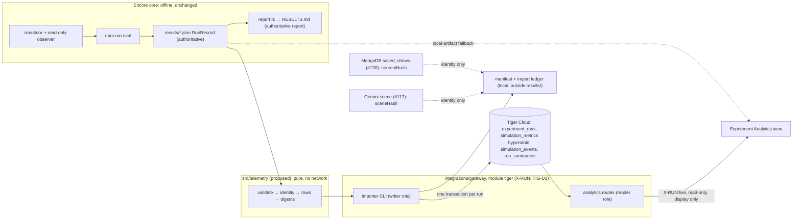

# Tiger Data experiment analytics

> **STATUS: PROPOSED — NOT IMPLEMENTED.** Nothing in this document exists in the code. It is a specification for review, not a record of work done. No Tiger Data test listed here or in the companion documents has been run.
>
> Source design by **William Pimentel** (`wpimento`): [`../handoffs/Encore_Tiger_Data_Technical_Plan.md`](../handoffs/Encore_Tiger_Data_Technical_Plan.md), preserved unmodified and cited below as "William §n". Integrated by **Arnav** (contract and integration owner), issue #142.

Purpose: the canonical overview of how Encore's experiment evidence becomes a verified, queryable time-series copy in Tiger Data, and how a dashboard reads it without ever touching the simulation. Status: proposed; every networked piece needs the team decision TIG-D1 (= Phase 2 D3 = Gemini GF-D1 = MongoDB MDB-D1). Owner: Arnav (integration, contracts); William (source design, sponsor requirements and sponsor-specific decisions). Audit base: `main` at 23d6748; provider facts checked 2026-11-15.

**Companion documents.** Each owns its detail; this file summarises and links.

| Topic | Canonical file |
|---|---|
| Validation, identity, manifest and ledger, DDL, import transaction, import states, verification, retries, roles (queries Q1–Q16) | [Telemetry and ingestion RFC](../design/TIGER_TELEMETRY_AND_INGESTION_RFC.md) |
| Analytics queries (Q17 onwards), API routes, provenance block, report reconstruction, dashboard | [Analytics and dashboard RFC](../design/TIGER_ANALYTICS_AND_DASHBOARD_RFC.md) |
| Work packages `TIG-01…TIG-11` (titles, allowed files, sequence) | [Work packages](../planning/tiger-data-integration-work-packages.md) |
| Tests `TIG-T01…TIG-T44`, report equality E1–E3, the 12-step acceptance | [Evaluation](../validation/tiger-data-evaluation.md) |
| **This file** | `TIG-FR`, `TIG-NFR`, `TIG-CC`, `TCR`, `TIG-D`, `TIG-R` |

Phase 2 (`X-*`, `D3`, `P2-*`), Gemini (`GF-*`, `CR-*`) and MongoDB (`MDB-*`, `MCR-*`, `MD-*`) IDs are cited, never redefined. Links into those documents are provisional: Phase 2 depends on #110, Gemini on #117, MongoDB on #130 (merge order #110 → #117 → #130 → #142).

---

## 1. Purpose and scope

William's objective: make Encore's simulated swarm resilience "measurable, reproducible, auditable, and comparable against a static baseline", with Tiger Data as the **telemetry and experiment analytics engine, not a central coordinator** (William §1). His own test of honesty is the one this design keeps: "actual persisted time-series queries, not just a JSON chart with a Tiger Data logo".

What that phrase means here, stated once: **Tiger stores and serves the evidence and runs per-run time-series queries (series, `LAG` deltas, gap-filled alignment); every reported statistic is computed by `report.ts`, and Tiger produces no new result.** In William's closing words, it is "evidence infrastructure, not a substitute".

The integration must let a reader answer eight questions, derived from William §1 ("What we want to demonstrate") and §3 ("Main dashboard questions"):

1. What was formation quality before, during and after failures: `alive`, `coverage`, `pwc`, `npwc`, `sfMean`, `sfMax`?
2. What was the authoritative `tRec` (start of the first qualifying 12-sample streak), or was it censored or not applicable, and where did the run end (`npwcEnd`)? `tRec` alone does not show whether recovery was sustained (§6.5).
3. What communication cost accompanied repair: heartbeats, score broadcasts, delivered, lost and blocked messages?
4. What instability accompanied it: slot changes, duplicate slots, collisions, near misses?
5. Was each Encore/static comparison a fair pair (same scenario, seed, `n0`, code, parameters, events and composition)?
6. How repeatable is the result across seeds, with failures, censored runs, the worst seed and the number of distinct event sets visible? Seeds are not always independent draws (§2, TIG-R08).
7. Is every number traceable to an artifact, a code revision and a verification state?
8. Did the number come from a server-side query over persisted rows, a local file, or an illustrative fixture?

**In scope:** batch ingestion of `RunRecord` artifacts, identity and pairing, the schema, read-only analytics routes, an Experiment Analytics view, offline behaviour, live telemetry as a stretch. **Out of scope** (William §17): any path from Tiger into the simulation, replacing the local report, drone positions, complex continuous aggregates before basic queries work, and needing internet for the demo.

William's critical caveat stands everywhere: "The analytics platform provides evidence about the simulation; it does not improve the underlying swarm algorithm or prove real-world drone safety."

## 2. Repository audit (main 23d6748)

William's "existing repository" facts were checked against an uploaded snapshot (`Pihh.zip`). They were re-checked against `main`; they hold, with four precisions (TCR-05, TCR-10).

| Status | Item | Evidence |
|---|---|---|
| **Implemented** | `MetricsSample` and `RunRecord` v1, exactly as William §2 quotes them | [`src/contracts/metrics.ts`](../../src/contracts/metrics.ts) |
| Implemented | Observer summary: 23 base keys, plus `tRec` only when a `KILL` exists | [`src/observer/summary.ts`](../../src/observer/summary.ts): `RECOVERY_SAMPLES = 12` (l.41); all-hold special case returns 0 (l.60); a qualifying sample is `inHold`, non-null, finite, ≥ 0.95 (l.65); returns `(start − killTick) × DT` (l.75); `tRec` set only with a `KILL` (l.135) |
| Implemented | `DT = 0.05` s per tick: a constant, not a `Params` field | [`src/contracts/params.ts:3`](../../src/contracts/params.ts) |
| Implemented | `canonicalJson` (sorted keys, throws on non-finite), `paramsHash` (sha256, `node:crypto`); `npm run eval` = `tsx src/cli/main.ts` | [`src/cli/run.ts`](../../src/cli/run.ts), [`src/cli/main.ts`](../../src/cli/main.ts) |
| Implemented | `WIN_MARGIN`, `verdict`, `quantile`, `median`, `stats(values, censoredHigh)`, `fairPair`, `pairStatus`, `npwcRows`, `buildReport` (Markdown only); S5 has no verdict | [`src/cli/report.ts`](../../src/cli/report.ts) |
| **Committed evidence** | **50 `RunRecord` files**: S0, S1, S2, S3, S5 × seeds 1–5 × both arms, `n0` = 200, git `571c8e4…` (not current `main`); `RESULTS.md`, `PARAMS.md`, `README.md` (#122) | [`results/`](../../results/README.md) |
| Implemented, not wired | Design tokens; not imported on `main` (open #113 wires them) | `src/app/ui/styles.css` |
| **Verified by this audit (read-only)** | `buildReport` over the 50 records equals `RESULTS.md` up to the `---` before `## Notes`, byte for byte, in any input order; 360 samples per record, ticks 5…1800 step 5; 18,000 sample and 80 event rows; counters never decrease; 7,943 samples have `pwc`/`npwc` = 1.0000000000000004; files are not canonical JSON | Workflow fact pack. These describe fixtures, not performance and not Tiger results |
| **Verified by this audit (read-only)** | **S2 seeds 1 and 3 share one KILL set** (the same 20 ids at tick 400). The two static records are equal in all 24 summary keys; the two Encore records differ in 5 (`sfMeanEnd`, `sfMaxEndA`, `npwcDeficitSec`, `collisions`, `deliveryRatio`), with `npwcEnd` 0.98888… and `tRec` 9.25 in both; `stateHash` differs. So S2 has **4 distinct kill sets among its 5 seeds**, and seeds 1 and 3 give near-duplicate paired deltas. S1 has 5; S0, S3 and S5 have one fixed event set by design. All 20 kills are at tick 400; no committed record has `tRec = 0` | `results/S2_n200_{static,encore}_s{1,3}.json`; kill centre drawn by `pickOne(rs, allIds(n0), …)` ([`scenarios.ts`](../../src/cli/scenarios.ts) l.178–179). `report.ts` and `RESULTS.md` are unchanged; the caveat is presented in the UI (TIG-R08) |
| **In progress** | #113 shell; #137 freeze (rewrites `git` of identical records); #153 seed bounds; #148, #127, #126; docs #110, #117, #130 | open PRs and issues |
| **Proposed** | Everything Tiger | this document set |
| **Verified (public page, fetched 2026-11-15)** | MLH prize "**Best Use of Tiger Data**" (prize: Stream Deck Mini). The listing gives a promotional description ("Building high-performance apps under hackathon deadlines shouldn't mean spending half your weekend configuring complex databases …") and no separate judging or eligibility criteria | [`BRIEF.md`](../competition/BRIEF.md) P11, https://mlh.io/events/durhack-2026/prizes |
| **Unverified** | "Completed" Gemini or Tiger work elsewhere (MongoDB MCR-01): no such code, backend or `integrations/` on any pushed branch (orchestrator scan; re-check in TIG-01). How MLH judges "best use" beyond the listing. The provisioned service's tier and version | open question 1 (§21) |

The authoritative local report is [`results/RESULTS.md`](../../results/RESULTS.md). This document set never restates its results as Tiger results.

## 3. The four invariants

William's invariants (§1), with how Encore enforces each:

| # | William's invariant | Enforcement in Encore |
|---|---|---|
| I-T1 | "Agent decisions use only local simulation state and permitted radio messages; no cloud telemetry may drive drones." | Nothing under `src/` imports `integrations/`; the analytics client imports no controller or `INJECT_SCORE` builder; a drone is reached only by an operator `INJECT_SCORE` (I7) |
| I-T2 | "The same inputs, events, seed, code and parameters must produce the same deterministic simulation record." | `experimentKey` names the inputs, `artifactHash` the record; a mismatch is a conflict, never an overwrite (§6.2) |
| I-T3 | "Simulation and local reporting work without Gemini, Tiger Data or MongoDB." | `report.ts` and `RESULTS.md` stay authoritative (TD-1); `check.sh` passes offline without `integrations/` (P2-T35, provisional #110) |
| I-T4 | "The UI distinguishes measured, missing, censored, provisional, and illustrative values." | Provenance on every response and chart; nulls stay null; censored ≠ not applicable (§6.5, §6.8) |

## 4. System boundaries and data ownership

There is no arrow from Tiger, the gateway or the dashboard back into the core. The importer is an X-RUN process and Tiger is X-PERSIST "experiment evidence (validated run records)"; the dashboard reads through X-RUN/live, whose returned analytics data is "for display only; it never reaches the controller" ([boundaries §5–§6.1](../design/OPTIONAL_INTEGRATION_BOUNDARIES.md#5-x-persist-optional-persistence), provisional: #110).

**Data ownership.** William's table (§5) is preserved in the first two columns. The third column is the reconciled MVP owner (TD-1, TD-11); differences cite their conflict record.

| Information | William's owner | Reconciled owner (MVP) | Record |
|---|---|---|---|
| Prompt, composition recipe, version, scenario configuration | MongoDB Atlas | Saved compositions and prompts: `saved_shows` (#130); generated scenes: Gemini (#117); CLI scenarios: code at `git` plus [`PARAMS.md`](../../results/PARAMS.md). Runtime score versions are never stored (MD-3) | TCR-02 |
| Scenario/seed/arm and code/config identity | Run artifact; indexed in both systems | Artifact; indexed in Tiger and the manifest, not MongoDB | TCR-02 |
| Time-series metrics | Tiger Data | **Artifact**; Tiger holds a verified copy | TCR-34 |
| Scheduled environment events | Original artifact; queryable copy in Tiger | Unchanged | — |
| Observer-produced summary values | Original artifact; queryable copy in Tiger | Unchanged; copied, never recomputed | — |
| Original deterministic `RunRecord` | Local immutable artifact storage | Unchanged; the 50 committed records are durable through git, a new laptop-only run is not | TIG-R19 |
| Import status and artifact checksum | Import manifest / MongoDB catalog | Manifest and ledger; Tiger rows and verification | TCR-02, TCR-04 |
| Composition identity (added) | "outside `RunRecord`" (§5) | Manifest `compositionId` | TCR-20 |
| Individual positions | Not in initial integration | Unchanged; deferred | — |

Nothing in Tiger is ever the only copy of evidence (TD-1).

## 5. Priorities

William's four phases (§16) become five priorities, so that the MongoDB catalogue, which TD-11 defers, does not gate the dashboard. His estimates (2–4 h, 2–4 h, 3–5 h for dashboard plus catalogue, 4–8+ h) stay rough, "excluding potentially significant service setup, deployment and debugging time".

| Priority | Content | Exit criterion (William's wording kept) | Work packages |
|---|---|---|---|
| 1. Reliable ingestion | Validator, identity, manifest, schema, one transactional import, verification, idempotent re-import | "one `RunRecord` survives upload and round-trip verification unchanged in meaning" | TIG-01–TIG-05 |
| 2. Paired analytics | Run and series routes, fair-pair validation, aligned trajectories, `report.ts` reuse | "Tiger-backed analytics match the authoritative local evaluation report" (made exact as E1–E3) | TIG-06, TIG-07 |
| 3. Dashboard | Run selector, recovery timeline, costs, summary, provenance, incomplete-import warnings | "users can select a real persisted experiment and inspect the evidence and its provenance" | TIG-08 |
| 4. Optional MongoDB catalogue | Only if TIG-D2 chooses it; never `saved_shows` | Catalogue reconciles idempotently after verified Tiger commits | TIG-09 |
| 5. Optional live telemetry (stretch) | Bounded export, authenticated ingestion, provisional display, reconciliation | "cloud disconnection does not alter simulation results or conceal telemetry loss" | TIG-11 |

TIG-10 (end-to-end validation) closes priorities 1–3. Only priority 1 is needed for any sponsor claim; priorities 2 and 3 are what make it worth a judge's time (§15).

## 6. Design summary

Each subsection states the decision and links the RFC that owns the detail.

### 6.1 Ingestion and import states

- **Source:** committed CLI `RunRecord` files, read in place; the Tiger workflow never writes to `results/` (TCR-06, TCR-21). App export is deferred (TCR-26); an X-OUT `run-record` line is a later, equivalent source (TCR-32).
- **Flow (TD-10):** validate → identity → manifest (offline) → BEGIN → run, samples, events, summary → in-transaction verification → COMMIT → post-commit digest re-read → ledger `verified`. One transaction per run.
- **States:** `discovered → validated → imported → verified`, plus `rejected`, `conflict`, `incomplete`. The ledger is a journal, not an authority; reconciliation rebuilds it from Tiger and the artifacts.
- **Validation** makes William's §8 checklist exact. Samples start at tick 5 (TCR-11); `pwc`/`npwc` exceed 1 by float error, so ranges carry a tolerance and values are stored unclamped (TCR-12). Files are ≤ 1 MiB, about 9× the largest committed record (113,222 bytes), checked before parsing.
- **No HTTP upload.** The importer is a gateway CLI with a writer role (TCR-08).

Detail: [ingestion RFC §3, §5, §9–§12](../design/TIGER_TELEMETRY_AND_INGESTION_RFC.md).

### 6.2 Identity

- `artifactHash = sha256(canonicalJson(record))`; `fileSha256` hashes raw bytes. For CLI-written files they **always** differ (insertion order, TCR-13).
- `experimentKey = sha256(canonicalJson({ hashVersion, scenario, seed, arm, n0, git, paramsHash, events, compositionId }))` names the inputs.
- `pairKey` = the same without `arm`: a fair pair iff `pairKey`s are equal and arms differ. It is stronger than `report.ts`'s `fairPair`, which still runs so the semantics cannot diverge (TCR-19).
- `compositionId`: `scenario:<id>` for CLI runs, meaningful only with `git` (TCR-20); `sceneHash:`/`contentHash:` for preloaded Gemini or MongoDB shows. None ⇒ storable, not pairable.
- `run_id` = UUIDv5 of `artifactHash` (TIG-D4): a retry after an unknown commit outcome is a key lookup.
- Same clean `experimentKey`, different `artifactHash` ⇒ recorded `conflict`, never an overwrite; identical ⇒ verified no-op.
- `-dirty` or `unknown` git ⇒ `gitClean = false`: importable, flagged "weaker reproducibility evidence", conflict-exempt, never compared (TCR-14, TIG-D10, TIG-D11).

One canonical-JSON definition serves Tiger, MongoDB `contentHash` and Gemini `sceneHash` (XI-7); extracting it to a pure module is a gateway prerequisite (TCR-16, TIG-D7). Detail: [ingestion RFC §4](../design/TIGER_TELEMETRY_AND_INGESTION_RFC.md).

### 6.3 Schema

William's four tables are kept (proposed, not migrations), with these changes:

- `experiment_runs` adds `pair_key`, `hash_version`, `git_clean`, `file_sha256`, `composition_id`, `dt_seconds`, digests and `telemetry_state`; `experiment_key` is unique for clean-git runs (TCR-03).
- `simulation_metrics` is a hypertable on `sample_time` with William's columns and nullability, keyed `(run_id, sample_time)`. An immutable CHECK ties `sample_time` to `tick`, so unique time means unique tick (TCR-23, TCR-24). `pwc` has a tolerance; `npwc` has no range CHECK (TCR-12).
- `simulation_events`: `event_index` = position in `RunRecord.events`; the whole event, including any injected score, in `details`.
- `run_summaries` keeps every key in `summary_json`, NULLs included; typed columns derive from it, plus `t_rec_applicable`, because a NULL column cannot tell absent from censored (TCR-25).
- `import_conflicts` lets a read-only API mark a contested experiment (TCR-29).

Every run starts at the same synthetic epoch and spans 90 s, so all rows fall in one chunk. The hypertable is justified by the time-series feature (`time_bucket` over aligned synthetic time), not by volume (William §6.2's own trade-off). Per-run offsets were evaluated and rejected; columnstore starts off (TIG-D9). Detail: [ingestion RFC §6–§7](../design/TIGER_TELEMETRY_AND_INGESTION_RFC.md).

### 6.4 Time

- The authoritative axis is `tick`; simulated seconds = `tick × dt_seconds`. DT is not in `Params`, so only `git` vouches for it: runs are comparable only if `git` and `dt_seconds` match, and analytics SQL never writes 0.05 as a literal (TCR-15, William §9.1).
- `sample_time` = `2020-01-01T00:00:00Z` + `tick × 50 ms` is **synthetic**, labelled "synthetic time from tick"; `imported_at` is real ingestion time. Every query filters by `run_id` or aggregates across runs explicitly (William App. A).
- **No time-based retention on `sample_time`**: on a 2020 synthetic date it would drop every run at once (William App. A). Archival is a manual per-run state, shown distinctly from "zero measurements" (William §14).

Detail: [ingestion RFC §8](../design/TIGER_TELEMETRY_AND_INGESTION_RFC.md).

### 6.5 Recovery and censoring

- `tRec` and every summary key come from `RunRecord.summary` only (TD-7). `MetricsSample` has no `inHold`, so SQL cannot reproduce `tRec`, `npwcEnd` or other hold-window means (William §7); see TIG-CC-01 (§17).
- Three states (William §7):

  | State | Rule | Display |
  |---|---|---|
  | Recovered | `tRec` key present and finite, `> 0` | "Recovered after X s (flight time included)" |
  | Recovered, `tRec = 0` | `tRec === 0`; `tRecZero: true`; no band | "tRec = 0: either every post-kill hold sample had npwc ≥ 0.95 (`summary.ts:60`) or a 12-sample streak began at the kill tick (`summary.ts:75`); the record cannot tell which." Never "Recovered after 0 s" |
  | Not recovered (censored) | a `KILL` exists and `tRec` is null | "Not recovered, or not measurable (no hold sample after the kill): censored", counted |
  | Not applicable | no `KILL`: the key is absent | "No kill: recovery not measured" |

- **Censored, quoted from the code** (`summary.ts:57–77`): `tRec` is null iff there is no post-kill hold sample (l.59), or some post-kill hold sample has `npwc` null or < 0.95 **and** no run of 12 hold samples, 5 ticks apart, with finite `npwc ≥ 0.95` starts at or after the KILL tick. "Post-kill" is `tick >= killTick`; a non-hold sample breaks a run. "No sustained streak" alone is not enough for null, because the all-hold case (l.60) returns 0 without one.
- **`tRec = 0` has two causes** that the record cannot separate: the all-hold case (l.60, possibly with fewer than 12 hold samples and with non-hold samples below 0.95 in between), or a streak starting exactly at `killTick` (l.75), which is reachable because every committed kill is at tick 400, a sample tick. So no band is drawn for 0; no committed record has `tRec = 0` (§2).
- **The "first qualifying 12-sample streak (2.75 s)" band** comes only from the authoritative value and only for `tRec > 0`: from tick `killTick + tRec / DT`, 12 samples (55 ticks, 2.75 s from first to last). It is **not** a "sustained recovery interval": `summary.ts:75` returns at the first such streak and never looks later, so `npwc` may fall below 0.95 afterwards, and dips shorter than one 0.25 s sample step inside the streak are invisible. End-state questions are answered with `npwcEnd`, not `tRec` (TCR-10). Only the **first** `KILL` counts.
- Censored runs are never silently dropped: aggregates use `stats(values, censoredHigh = true)` with `n` and the censored count (William §7; App. A: "SQL `AVG()` excludes NULLs").

### 6.6 Pairing and statistics

- The comparison service reconstructs `RunRecord`s from Tiger rows and calls `report.ts` (TD-8); it never reimplements medians, IQR, W/T/L, exclusions, censoring or the S5 rule. William §9.3: "The median of paired differences is generally **not** the difference of two group medians."
- **Selection is classification, not a `pairKey` filter** (TCR-19). The only exclusions, each listed with its reason, are `COMPOSITION_UNKNOWN`, `COMPOSITION` (both arms of a seed whose `pair_key`s differ only in `compositionId`), `ARCHIVED`, `CONTESTED` (an open `import_conflicts` row) and `DEV_SEED` (seeds 101–105, [evaluation §5](../validation/tiger-data-evaluation.md)). **Everything else goes to `buildReport` unchanged, including `MISMATCH` and `UNPAIRED` seeds**, so per-arm medians, IQRs and `n` equal the CLI's (`report.ts` uses every record of an arm for per-arm stats and only `paired` seeds for deltas) and the report's `MISMATCH` rows and "mismatched N" count stay visible. Equal `pairKey` is what a **pair** route needs (§6.7), not a pre-filter on the report's input.
- The response also carries `distinctEventSets` (`COUNT(DISTINCT events_digest)` per arm) and flags seeds that share an `events_digest` within a cell; the summary panel then says, for example, "S2: 5 seeds, 4 distinct kill sets" (§2, TIG-R08).
- One clean `(git, paramsHash)` per request; no mixing option and no `includeDirty` (TIG-D10). `report.ts` has no structured output, so the MVP returns `buildReport` Markdown verbatim plus `npwcRows`/`stats` (TCR-17).
- **Principal proof:** E1 record equality; E2 `buildReport(reconstructed) === buildReport(local)`; E3 that string is the committed `RESULTS.md` up to the `---` before `## Notes` ([evaluation §1.2](../validation/tiger-data-evaluation.md), TCR-07).
- S5 follows [evaluation-and-tests §3](../validation/evaluation-and-tests.md#3-scenarios) via `report.ts`: deltas, no verdict. Its pass line needs `partitionSide`, which no record holds: "not derivable from stored telemetry" (TCR-35).

### 6.7 Analytics API

Read-only routes (TD-12): `GET /api/runs` (filtered, paginated), `GET /api/runs/:runId/metrics` (ordered, bounded, with `sim_seconds`), `GET /api/comparisons?encoreRunId&staticRunId` (fair-pair validation, then **full outer** alignment by tick with a missing-tick report, TCR-31) and `GET /api/experiments/comparison?scenario&n0&git&paramsHash` (report output). Every response carries `{ source: 'tiger'|'local-artifact'|'live-provisional'|'fixture', verified, importedAt, artifactHash, git, gitClean }`, with `verified` defined from Tiger rows (TCR-30); errors use the shared envelope (XI-3). Counters are stored as totals; deltas come from `LAG` over `tick` within one run (TD-9; William §9.4: never chart `collisions_total = 3` as "three new collisions at this tick"). Detail: [analytics RFC](../design/TIGER_ANALYTICS_AND_DASHBOARD_RFC.md).

### 6.8 Dashboard

An **Experiment Analytics** view (William §10): run selector, recovery timeline, coordination costs, experiment summary, provenance. It uses the existing design tokens, with no new UI framework or charting dependency (SVG or canvas). Every chart has a provenance badge; unfair pairs are blocked unless overridden, with a persistent warning; censored and not-applicable recovery are explicit; `npwc` sits beside `alive` and `coverage`; totals and deltas are separate; fixtures are labelled.

Placement is TIG-D3. Recommended: a separate page, view code in its own folder (e.g. `src/analytics/`), network client in the X-RUN/live confined folder. This avoids #113's files and the panel auto-loader, which mounts any `src/app/ui/*.ts` exporting `createPanel` into the 3D app; it costs one `vite.config.ts` entry, with its owner's sign-off (TCR-09, TCR-18). Detail: [analytics RFC](../design/TIGER_ANALYTICS_AND_DASHBOARD_RFC.md).

## 7. Relationship to Gemini

Gemini authors compositions; it never produces, interprets or summarises results.

- A Gemini scene enters Encore only as a validated composition through X-IN and an operator `INJECT_SCORE` ([Gemini §1.1](gemini-generated-formations.md#11-what-gemini-must-not-do), provisional: #117). Tiger sees it only through the resulting `RunRecord`.
- A generated **preloaded** score gets `compositionId = sceneHash:<hex>`, recomputed from the scene ([Gemini §6.7](gemini-generated-formations.md#67-canonicalisation-and-scenehash-gd-4)). An **injected** one is already inside `events`, so `experimentKey` covers it.
- William §17 excludes "Gemini-generated numerical experiment conclusions treated as truth": no route sends Tiger data to Gemini, and no dashboard text is model-generated.
- Gemini §13.2's wall-clock metrics (`generationMs`, compile time), which MongoDB's show library also calls "Tiger telemetry", are not simulation evidence and are out of this MVP. Gemini §13.2's run-to-scene linkage is covered for preloaded scores by `compositionId`; for injected scores it would need a query over `details->'score'`, deferred with the app export (TCR-26, TCR-33).

## 8. Relationship to MongoDB

MongoDB holds reusable compositions (`encore.saved_shows`, [show library](mongodb-atlas-show-library.md), provisional: #130). Tiger holds experiment evidence. MongoDB holds no telemetry (MongoDB MD-13, XI-6).

William places a MongoDB "run catalog" upsert inside the import path (§4.1, §8) and names MongoDB the owner of import status (§5). Three alternatives were evaluated (TD-11):

| Alternative | What it means | For | Against |
|---|---|---|---|
| A. Separate catalogue collection | `encore.experiment_catalog`, one document per `experimentKey`, linking `run_id`, `artifactHash`, `compositionId` and a show's `contentHash` | Matches William's intent; queryable from MongoDB tools | A second store to keep consistent with no shared transaction; duplicates Tiger metadata; adds a failure mode to every import |
| B. Linked metadata in `saved_shows` | Run references written into show documents | One collection | Mixes evidence into the show library, reverses the one-way reference rule ("a telemetry record may reference a show's `_id` or `contentHash`, never the reverse", MongoDB §16) and contradicts MD-13 and XI-6. **Rejected** |
| C. Tiger only first (William's alternative 3) | No MongoDB catalogue; import state in the ledger and Tiger | Least complex; no cross-database consistency problem; MongoDB is never a prerequisite | MongoDB judges see no experiment link |

**Recommendation: C for the MVP (TIG-D2).** Whether a run is imported and verified is a fact about Tiger rows; a second copy of it adds risk, not evidence. If A is chosen later (TIG-09):

- **Order:** Tiger COMMIT → verification → ledger `verified` → catalogue upsert keyed by `experimentKey`. A catalogue failure leaves the import `verified` with a separate catalogue-pending marker, never `incomplete`.
- **Consistency:** no cross-database transaction exists (William §5). The catalogue is a derived index, rebuilt idempotently from Tiger, and Tiger wins any disagreement. William's `import_incomplete` (§14) then describes the catalogue, not the evidence.
- **Independence:** Tiger ingestion never imports, calls or waits for MongoDB (TIG-T16). The Show Library design is unchanged.

## 9. Shared gateway

There is one optional service, `integrations/gateway/`, with independently optional modules `gemini`, `shows` and `tiger` (MongoDB MD-1, XI-1; [show library §6](mongodb-atlas-show-library.md#6-backend-and-database-boundaries-md-1), provisional: #130). William's `src/server/` and top-level `sql/` become this module and documentation (TCR-01).

- **Module `tiger`:** the importer CLI (`TIGER_DATABASE_URL`, writer) and read-only routes (`TIGER_READ_DATABASE_URL`, reader), each enabled only by its own server-side setting. Absent or failing, it reports `disabled` or `down` in `/api/health`; nothing else is affected.
- **Packaging:** own `package.json` and lockfile, not a workspace. The root `eslint.config.js` must ignore `integrations/**` (owner sign-off).
- **Imports (XI-2):** pure modules only: `src/contracts/**`, `src/telemetry/**` and the extracted canonical-JSON helper. TD-8 also needs `report.ts`, which XI-2 bars as `src/cli`. Resolution: after extracting `canonicalJson` (TCR-16), `report.ts` imports only contract types and that helper, so XI-2 is amended to name it (TCR-17, TIG-D7).
- **`src/telemetry/`** is not covered by the boundaries test or core lint today; it needs a boundaries entry and an ESLint block banning `fetch`, `WebSocket` and `XMLHttpRequest` (TCR-27).

## 10. Security summary

Detail: [ingestion RFC §13](../design/TIGER_TELEMETRY_AND_INGESTION_RFC.md) and the [analytics RFC](../design/TIGER_ANALYTICS_AND_DASHBOARD_RFC.md).

- **Credentials** are server-only: never `VITE_*`, bundles, logs or error bodies; "never log database passwords or full connection strings" (William §13).
- **Least privilege:** importer `SELECT, INSERT` only; analytics role read-only with `default_transaction_read_only`. Tiger notes a read-only role "does not provide resource isolation" (VERIFIED 2026-11-15).
- **No public write surface:** no upload route; the gateway binds to `127.0.0.1` for the local demo. William's write authentication applies to TIG-11 and any public deployment.
- **Untrusted input:** size caps before parsing; explicit finite checks, because `JSON.stringify` turns `NaN` into `null` (William §8).
- **SQL:** parameterised only; identifiers never from input.
- **TLS (VERIFIED 2026-11-15):** `verify-full` on paid services; a new service starts with a self-signed certificate and a public one "usually arrives within about 30 minutes". **Free services supply no SSL certificate**, so only `sslmode=require` works: encrypted, not server-authenticated.
- **What `require` risks is credentials, not only data.** The importer, reader and `tsdbadmin` (migration) passwords cross that channel. An active man-in-the-middle, for example on venue Wi-Fi, can relay the SCRAM exchange and gain write access, or keep it for an offline dictionary attack. Rows written that way would be shown as "Tiger Data · verified copy", and the post-commit re-read over the same channel can be answered by the attacker. On `require`, therefore (TIG-D8, TIG-R41):
  1. **SCRAM channel binding** (SCRAM-SHA-256-PLUS; node-postgres `enableChannelBinding: true`), failing if the server does not offer it. It binds to the certificate the server presents, even a self-signed one, which defeats relay. Driver support and whether it can be made mandatory are UNVERIFIED; TIG-03 checks.
  2. **Long random passwords** for all three roles, so offline cracking is infeasible.
  3. **Migrations and imports only from a trusted network**, never venue Wi-Fi.
  4. **Rotate all three passwords** after the event.
  5. If channel binding is unavailable: any import or migration outside a trusted network needs the paid or trial tier with `verify-full`.

## 11. Failure handling and offline operation

**Offline rule (TD-15).** Without the gateway, the simulator, CLI, `report.ts` and `RESULTS.md` work unchanged. The dashboard, if built, can render from local artifacts with provenance `local-artifact` and never claims a cloud query. Only the core and that fallback need no network; the analytics as such are not "offline-capable".

| Situation | Behaviour | Shown |
|---|---|---|
| Tiger unreachable at import | Artifact kept; stays `validated`; bounded backoff; batch stops after repeated failures | "Upload failed; retry", never "persisted" (William §14) |
| Failure mid-transaction | Rollback, zero rows | `incomplete` |
| COMMIT acknowledged, then verification or ledger write fails | Reconciliation re-verifies | Never `verified` without the re-read |
| Same clean key, different artifact | Conflict recorded, nothing overwritten | Contested; excluded until Arnav resolves it |
| Gateway down while viewing | `local-artifact` or "unavailable" | Badge changes; no silent fallback |
| Telemetry archived | Run row kept | "Archived", not "no measurements" (William §14) |
| Stored copy, local artifact missing | Never auto-deleted, never verified evidence | "Stored copy without local evidence" |
| No venue internet | Core plus `local-artifact`; for Tiger claims, the dated judge-evidence file and recording (§15) | Badge says local; `local-artifact` mode is never presented as Tiger evidence |
| Catalogue fails (only if TIG-D2 = A) | Tiger unaffected | Catalogue pending (§8) |

**Live mode** (William §14, preserved): "local simulation and HUD continue regardless of cloud state. A bounded queue may stop exporting, spill locally or explicitly drop telemetry with a loss counter. The final verified batch artifact remains the authoritative evidence."

## 12. Live telemetry (stretch)

TIG-11 (TD-14) builds on Phase 2 X-OUT and X-PERSIST ([boundaries §4](../design/OPTIONAL_INTEGRATION_BOUNDARIES.md#4-x-out-telemetry-export), provisional: #110): a bounded queue that drops and counts, never in the tick loop; authenticated batch HTTP ingestion; polling or server-sent updates (William §16 Phase 4).

- Live rows stay `live-provisional` until the final `RunRecord` is imported and verified; the completed summary wins any disagreement (William §13). "**Never silently claim a partial live stream is complete.**" (William §4.2).
- Missing prerequisites: an app `RunRecord` export (TCR-26), the X-RUN/live client and D3. TIG-11 comes after priorities 1–3, outside the hackathon window.

## 13. Performance and scaling

William §11's volumes, preserved, with the committed counts beside them:

| Workload | William's estimate (metric rows) | Committed or derived count |
|---|---:|---|
| One run | 360 | 360 per record, ticks 5…1800 (all 50) |
| 50-run minimum matrix | 18,000 | 18,000 sample rows, 80 event rows, 50 summaries; 5.3 MB of JSON on disk |
| 240-run full matrix | 86,400 | Not run (no S4, no seeds 6–20 committed) |
| 240 runs × 200 drone positions × 360 samples | 17,280,000 position rows | Out of scope: needs a new `WorldSnapshot` export |

William's conclusion stands: "The first three are small PostgreSQL workloads. Do **not** claim ordinary PostgreSQL cannot handle them. Tiger Data's value is specialized time-series tooling and future growth, not necessity at this scale." A plain PostgreSQL table indexed by `(run_id, tick)` would serve the MVP equally well; the hypertable is chosen to use and show the time-series feature honestly (§6.3).

- **Import:** one transaction per run with multi-row inserts; `COPY` for larger sets; no per-tick writes.
- **Connections (VERIFIED 2026-11-15):** `max_connections` is 25 on shared compute and free services have no pooler, so the pool stays small and imports are serial.
- **Storage:** a free service has 750 MiB (VERIFIED); the minimum matrix is small (estimate: 5.3 MB of raw JSON). Measure after the first import (TIG-T42), and do not assume free capacity (William §11).
- **Version:** Tiger Cloud announced TimescaleDB 2.31 on 26 Oct 2026; new services default to PostgreSQL 18 (VERIFIED). The provisioned service's version is UNVERIFIED until `extversion` is checked.
- **Budgets** for import and query time are targets to measure (TIG-NFR-08).

## 14. Scientific and engineering limitations

Each row has an interpretive consequence and a fixed presentation. The first eleven are William §12, preserved in order (risk, impact, mitigation); the rest are added from the audit. Base wording rules: [evaluation-and-tests §8](../validation/evaluation-and-tests.md#8-bias-risks-and-reporting-wording).

| ID | Limitation (William's risk) | Impact (William) | Mitigation (William) | Interpretive consequence | UI presentation |
|---|---|---|---|---|---|
| TIG-R01 | Priority-weighted metric reflects chosen weights | `npwc` may improve without broad geometric improvement | Display coverage and shape fidelity | An `npwc` gain is a gain on our own slot order | `npwc` never shown alone; note "priority-weighted by our own slot order" |
| TIG-R02 | Static baseline cannot repair | Improvement only establishes advantage over this baseline | Describe baseline precisely | "Better than a non-repairing baseline", not "good" | Baseline described in the summary header |
| TIG-R03 | S5 may evaluate different scores | Ordinary win/tie/loss comparison invalid | Preserve S5-specific treatment | No S5 verdict exists | S5: deltas, "no verdict: static cannot adopt an injected score" |
| TIG-R04 | Null `tRec` silently excluded | Recovery looks artificially strong | Explicit censored counts | A median over recovered runs alone is biased | Censored count beside every `tRec` figure |
| TIG-R05 | Five-tick sampling | Short oscillations may be missed | Retain authoritative summary; disclose resolution | Curves are 0.25 s samples, not continuous; `tRec` has the same 0.25 s resolution | Axis note "sampled every 5 ticks (0.25 s); tRec resolution 0.25 s (sample grid)" |
| TIG-R06 | Discrete physics collision checks | Fast crossings may go undetected | Disclose limits; improve model separately | Collision counts are lower bounds | Label "collisions (lower bound, 20 Hz checks)" |
| TIG-R07 | Simulated environment | Not proof of physical safety | State simulation-only conclusions | No real-world claim | Footer "simulation only" |
| TIG-R08 | Five seeds | Limited statistical confidence | Report n, worst seed; 20 seeds when feasible | Medians of 5 are fragile, and fewer than 5 when seeds share a kill set (S2: 4 distinct, §2) | `n`, worst seed and distinct event sets always visible ("S2: 5 seeds, 4 distinct kill sets"); seeds sharing an `events_digest` flagged |
| TIG-R09 | Cherry-picked seed | Selection bias | Predefine seeds; report all outcomes | Only the frozen seed set is reported | Selector shows all seeds of the set; no hiding |
| TIG-R10 | `tRec` mixes detection, coordination and motion | Cannot claim detection latency | Use exact definition | `tRec` is not detection latency | Tooltip with the exact definition, "flight time included" |
| TIG-R11 | `npwc` normalised by survivors | May conceal absolute capacity loss | Show alive, coverage, npwc together | High `npwc` with fewer drones ≠ restored formation | The three in one panel |

Added from the audit:

| ID | Limitation | Interpretive consequence | UI presentation |
|---|---|---|---|
| TIG-R12 | Synthetic timestamps | `sample_time` is not when anything happened | "synthetic time from tick"; `imported_at` separate |
| TIG-R13 | Summary not reproducible from samples (`inHold`, per-tick, per-drone inputs) | SQL aggregates of samples are not the summary | Summary only from `summary_json`, labelled "observer summary" |
| TIG-R14 | Float overshoot above 1 | 1.0000000000000004 is 1, not an error | Display rounding only; stored unclamped |
| TIG-R15 | DT not covered by `paramsHash` | Comparability rests on `git` | Pairs refused unless `git` and `dt_seconds` match |
| TIG-R16 | Committed evidence is at 571c8e4, not `main` | It describes the code at 571c8e4 | Badge shows the record's `git` |
| TIG-R17 | S5 pass line needs `partitionSide` | Not checkable from Tiger | "not derivable from stored telemetry" |
| TIG-R18 | `tRec` uses the first `KILL` and the first qualifying streak; `tRec = 0` has two indistinguishable causes (§6.5) | Later kills are not measured; later dips are not measured | Band "first qualifying 12-sample streak" only for `tRec > 0`; `tRec = 0` gets the two-cause label, never "Recovered after 0 s" |
| TIG-R19 | An artifact on one laptop is not durable (William App. A) | Losing the original weakens the copy | "stored copy without local evidence" |

## 15. Hackathon value

> **At DurHack (2026-11-15):** under TIG-D1 ("no amendment inside the hackathon window") and the work-package gating ("No package starts before the base submission", [work packages §10](../planning/tiger-data-integration-work-packages.md#10-gating)), **nothing Tiger-backed can be shown at DurHack. Do not claim the Tiger Data track** ("Best Use of Tiger Data", §2) unless TIG-D12 approves the timeboxed slice below. This matches MongoDB's MDB-D8.

What Tiger does here, in one sentence: it stores and serves the evidence and runs per-run time-series queries; every reported statistic is computed by `report.ts`, and Tiger produces no new result (§1).

What a judge could inspect once a slice or the MVP exists, and what it shows:

1. **Faithfulness (E1):** every run's series digest, re-read from the hypertable, equals the artifact's, for all 50 runs. This is the proof that the copy is faithful, because it covers the time-series rows.
2. **Real SQL over persisted rows:** per-run series by tick, `time_bucket` over synthetic seconds within a run, `LAG` deltas of counters, the completeness query. Persistence plus server-side queries, not a branded chart.
3. **Report equality (E2, E3):** the statistics survive the round trip. `buildReport` over records reconstructed from Tiger equals the CLI's string and the committed `RESULTS.md` up to its notes. The report reads summaries only, so E2 cannot detect a fault in the series; that is E1's job.
4. **Integrity:** re-import is a verified no-op; a contradictory artifact is a conflict; a dirty revision is flagged.
5. **Provenance** on every chart: `tiger`, `local-artifact`, `live-provisional` or `fixture`.
6. **Judge evidence.** Judges have no access to the team's console, and no credential is ever shared. Prepare a dated file outside `results/` (e.g. `docs/validation/tiger-evidence-<date>.md`) with each named query's text and output, `extversion` and `version()`, row counts, the E1 digest-equality summary and redacted service details (region, tier). Record the same queries in the Tiger console as a short clip for the backup video (#131). During judging a team member runs the queries live; if the network fails, the recorded evidence, not `local-artifact` mode, backs any Tiger claim (TIG-R47).

**Smallest slice, if TIG-D12 approves it:** TIG-02 and TIG-07 offline (validation, identity, E2 over local records), plus a hand-run import of `FX-50` into a disposable service, shown in the Tiger console, and the judge-evidence file above. Provisioning step: create a trial service at least 30 minutes before the first `verify-full` connection (the public certificate's lead time, §10), from a trusted network, and record its region and tier.

William's demonstration (§18) is kept: step 1 (Gemini composition) needs #117; steps 2–6 need priorities 1–3; step 7 (the MongoDB record) needs TIG-D2 = A, so the MVP shows the manifest's `compositionId` instead (TCR-02); step 8 is the message, "the cloud is an **observer and historical analytics system**, not a dependency of swarm behavior."

Limits: the MLH listing publishes no judging criteria beyond its description (§2), the scale is modest (§13), and nothing networked exists without TIG-D1. Without it, the offline `src/telemetry/` pieces still test the committed evidence.

## 16. Proposed requirements

MUST unless marked. Exact behaviour lives in the companion that §6 names; sections are listed in §23.

| ID | Requirement |
|---|---|
| TIG-FR-01 | Validate every artifact (version, structure, events, ticks 5…`expectedTicks` step 5, finite values, tolerant ranges, non-decreasing counters, caps) before building any row |
| TIG-FR-02 | Compute `fileSha256`, `artifactHash`, `experimentKey`, `pairKey`, `compositionId`, `gitClean`, `dtSeconds`; write an immutable manifest before connecting |
| TIG-FR-03 | Import one run per transaction into the four tables, never per tick |
| TIG-FR-04 | Verify in the transaction (counts, ticks, digests, summary) and after COMMIT (digest re-read); journal states in an append-only ledger |
| TIG-FR-05 | Identical re-import is a verified no-op; a different artifact under a clean `experimentKey` is a recorded conflict; nothing is overwritten |
| TIG-FR-06 | Keep NULL as NULL and absent keys absent; take every summary value from `RunRecord.summary` |
| TIG-FR-07 | Store samples in a hypertable with synthetic time tied to `tick` by an immutable CHECK, and no time-based retention |
| TIG-FR-08 | List runs (filtered, paginated); return one run's ordered series with `sim_seconds` from `dt_seconds` |
| TIG-FR-09 | Compare two runs only after fair-pair validation, by full outer alignment on tick with a missing-tick report |
| TIG-FR-10 | Multi-seed comparison = reconstructed records of one clean `(git, paramsHash)`, classified as in §6.6 (only `COMPOSITION_UNKNOWN`, `COMPOSITION`, `ARCHIVED`, `CONTESTED`, `DEV_SEED` excluded, each listed; `MISMATCH` and `UNPAIRED` kept), passed to `report.ts`; `distinctEventSets` reported |
| TIG-FR-11 | Attach the provenance block to every response |
| TIG-FR-12 | Provide the Experiment Analytics view, unfair pairs blocked by default |
| TIG-FR-13 | Show the three recovery states and the `tRec = 0` label of §6.5; derive the first-qualifying-streak band only from authoritative `tRec > 0` |
| TIG-FR-14 | Store counters as totals; derive labelled deltas within one run only |
| TIG-FR-15 | Render from local artifacts as `local-artifact` when the gateway is absent |
| TIG-FR-16 | SHOULD (deferred, TIG-D2): a MongoDB experiment catalogue separate from `saved_shows`, written only after verified commits |
| TIG-FR-17 | MAY (stretch): live telemetry, provisional until reconciled with the verified record |
| TIG-NFR-01 | Simulation independence: `stateHash` and records identical with the gateway running or absent; no path into the core |
| TIG-NFR-02 | Offline: NFR-04's acceptance check unchanged; `check.sh` green offline with `integrations/` removed |
| TIG-NFR-03 | Authority: Tiger is never the sole copy |
| TIG-NFR-04 | One statistics source: `report.ts` semantics never reimplemented |
| TIG-NFR-05 | Security: server-only credentials, least-privilege roles, TLS, parameterised SQL, validated input, sanitised errors |
| TIG-NFR-06 | Bounded input: artifact ≤ 1 MiB; further caps in the ingestion RFC |
| TIG-NFR-07 | Honest labelling: synthetic time, totals vs deltas, provenance, fixtures, censoring |
| TIG-NFR-08 | Performance: batched imports, small pool; budgets measured on the provisioned service before any claim |
| TIG-NFR-09 | Reproducible identity: the same file gives the same hashes on any machine (`hashVersion` 1) |

## 17. Contract changes

**The MVP needs none.**

- Identity and composition travel in the external manifest (TD-3).
- Recovery and summary values come from `RunRecord.summary`.
- Events already carry full injected scores.
- `RunRecord` stays `v: 1`.

The extracted canonical-JSON helper is a contract change only if Arnav places it under `src/contracts/`. The recommended neutral placement avoids that (TIG-D7).

**TIG-CC-01 (deferred): per-sample `inHold` and composition identity in a `RunRecord` v2 or `MetricsSample`. PROPOSED CONTRACT CHANGE — REQUIRES ARNAV APPROVAL.**

- **Gain:** SQL could reproduce hold-window means and `tRec`; records would carry composition identity.
- **Deferred because** the summary is authoritative and the MVP needs neither; the change edits a contract file and makes a new record version, so new evidence would be needed.
- **Not enough anyway** for `capacityLoss`, `coordLoss`, `msgsPerDroneSec`, `splitSec`, `tVersion` or adoption keys (per-tick or per-drone inputs).
- **No-contract alternative (TCR-28):** derive `inHold` offline for CLI records from the believed version in `versions`, the preloaded score and injected scores, with equivalence tests against the 50 fixtures' summaries.

Detail: [ingestion RFC §15.2](../design/TIGER_TELEMETRY_AND_INGESTION_RFC.md).

## 18. Conflict records

Format: William's proposal / verified current behaviour / conflict / resolution / approver. TCR-01–09 follow the decision sheet; TCR-10 onwards come from the code audit and the companion documents.

| ID | William's proposal | Verified behaviour | Conflict | Resolution | Approver |
|---|---|---|---|---|---|
| TCR-01 | `src/server/`, top-level `sql/` (§8) | No backend; XI-1: one gateway | Placement | `src/telemetry/` (pure) + gateway module `tiger`; SQL as documentation, later `integrations/gateway/tiger/migrations/` | Arnav |
| TCR-02 | MongoDB owns compositions, run catalogue, import status (§5, §18) | `saved_shows` is the show library (#130); MD-13 | Catalogue vs Show Library | No catalogue in the MVP; if built, a separate collection (§8); his table kept (§4) | William + Arnav (TIG-D2) |
| TCR-03 | `experiment_key` not unique (§6.1) | His §5 calls a second artifact a conflict | Database accepts contradictions | Unique for clean-git runs (partial index) | Arnav |
| TCR-04 | MongoDB upsert before "mark import complete" (§4.1, §8) | No shared transaction (his §5) | Second store in the critical path | Optional, after verification (§8) | Arnav |
| TCR-05 | "Existing" facts from `Pihh.zip` (§2) | Match `main` 23d6748 | None in substance | Verified; precisions in TCR-10; re-check in TIG-01 | Arnav |
| TCR-06 | `npm run eval -- --scenario S0,S1,S2,S3,S5 … --out results/` (§8) | Valid (= `--scenario min`), but the overwrite guard refuses on `main` (records carry 571c8e4); #137 owns freezes | Fails, or forks the evidence | Import the 50 committed records; reruns to a scratch `--out` or via #137 | Arnav (+ #137 owner) |
| TCR-07 | Compare with `npm run eval -- --report …` (§15) | Exists; `RESULTS.md` adds hand-written notes | Whole-file equality fails | E1–E3 (§6.6) | Arnav |
| TCR-08 | Authenticated HTTP upload (§13, §16) | No server | Public write surface | Importer CLI, writer role; write auth only for TIG-11 | Arnav |
| TCR-09 | Separate Experiment Analytics page (§10) | One Vite entry; #113 owns the shell | Page vs shell | Separate page (TIG-D3) | Arnav + build-config owner |
| TCR-10 | Recovery and windows (§2, §7) | Post-kill inclusive; non-hold sample breaks a streak; end window excludes tick 1800; `tRec` absent without `KILL`; null also when no post-kill hold sample exists; 0 has two causes; only the first streak is checked | Precision; "sustained" overclaims | §6.5: exact censored rule, `tRecZero` with no band, band renamed "first qualifying 12-sample streak" | Arnav |
| TCR-11 | "Five-tick schedule" (§8) | First sample tick 5; 360 per run | Tick-0 expectation flags all | `series[i].tick = 5(i+1)` | Arnav |
| TCR-12 | `pwc BETWEEN 0 AND 1`; "valid ranges" (§6.2, §8) | 7,943 samples above 1 by 4.4e-16; tiny negative summary values | Rejects all 50 | Tolerance; unclamped; no CHECK on `npwc` or summaries | Arnav |
| TCR-13 | "Canonicalized complete RunRecord" (§5) | Files are insertion-order JSON + LF | Hashes always differ | `artifactHash` canonical; `fileSha256` raw | Arnav |
| TCR-14 | Warn on unclean git (§13) | `-dirty` has no diff digest | False conflicts | TIG-D11 | Arnav + `src/cli` owner |
| TCR-15 | `tick * 0.05` in SQL (§9.1) | DT not in `Params` | `paramsHash` cannot vouch for DT | `dt_seconds` per run, tied to `git` | Arnav |
| TCR-16 | Reuse canonical serialisation (§5) | `canonicalJson` in `run.ts` loads world and brains | Gateway and browser cannot import it | Extract to a pure module; `run.ts` re-exports (TIG-D7) | Arnav + `src/cli` owner |
| TCR-17 | Reuse `report.ts` (§9.3) | Markdown only; grouping, deltas, censoring private; XI-2 bars `src/cli` | No structured API; import barred | Markdown verbatim + `npwcRows`/`stats`; XI-2 amended for `report.ts`; structured `analyse` later | Arnav + `src/cli` owner |
| TCR-18 | Dashboard in the existing UI (§10) | Tokens unwired; auto-loader mounts any `src/app/ui/*.ts` with `createPanel` | Unstyled, or mounted in the 3D app | Own folder and entry; tokens after #113 | #113 owner + Arnav |
| TCR-19 | Pair on all inputs incl. composition (§9.2) | `fairPair` checks git, params, events only | Cross-composition pairs | Pair route: equal `pairKey`, then `fairPair`. Multi-seed route: classify (§6.6); exclude only composition, archived, contested and development-seed runs; `MISMATCH` and `UNPAIRED` go to `buildReport` | Arnav |
| TCR-20 | Composition identity outside the record (§5) | CLI score = `buildEvalScore(params)` | Compatible | `scenario:<id>` with `git` | Arnav |
| TCR-21 | Records written to `results/` (§8) | Overwrite guard; #137 | Shared evidence folder | Tiger never writes there | Arnav (+ #137 owner) |
| TCR-22 | Import manifest (§5) | `runReport` reads every `results/*.json`; #137 rewrites `git` | Read or churned | State outside `results/` (TIG-D5); a rewrite is a new experiment, linked by `stateHash` and series digest | Arnav (+ #137 owner) |
| TCR-23 | `create_hypertable(…, 'sample_time', …)`; mapping enforced by the importer (§6.2) | Signature deprecated since 2.13; `timestamptz + interval` STABLE (VERIFIED) | Legacy syntax; misplaced trust | `CREATE TABLE … WITH (tsdb.*)`; CHECK via immutable `date_add(…, 'UTC')`; verify on the service | Arnav |
| TCR-24 | Key `(sample_time, run_id, tick)`; `seed INTEGER` (§6.1–§6.2) | CHECK makes time bijective with tick | Redundant column | `(run_id, sample_time)`; `seed BIGINT` | Arnav |
| TCR-25 | `t_rec_seconds` (§6.4) | Absent ≠ null | Conflates not applicable and censored | `t_rec_applicable` | Arnav |
| TCR-26 | Browser runs and live telemetry (§4.2) | No record export in the app | No source | CLI records only; app export deferred | Arnav + #113 owner |
| TCR-27 | Pure telemetry modules (§8) | Boundaries test and lint skip new folders | Purity by convention | Boundaries entry, ESLint block | Arnav |
| TCR-28 | Re-derivation "would require exporting hold-state" (§7) | `inHold` derivable offline for CLI records | Contract change avoidable | Alternative to TIG-CC-01 | Arnav |
| TCR-29 | "Conflict surfaced" (§15) | Readers cannot see the local ledger | Contested state invisible | `import_conflicts` in Tiger | Arnav |
| TCR-30 | "Mark import complete" last (§4.1) | Ledger is local, losable | Readers trust a file | `verified` defined from Tiger rows | Arnav |
| TCR-31 | Inner join on tick (§9.2; William flags it) | — | Silent tick loss | Full outer alignment + missing-tick report | Arnav |
| TCR-32 | — (Phase 2, Gemini, MongoDB docs: Tiger reads X-OUT) | X-OUT absent; CLI records exist | Source | Records now; X-OUT `run-record` later | Arnav |
| TCR-33 | — (Gemini §13.2 routes `generationMs`, compile time and run-to-scene linkage to Tiger; MongoDB show library §15: "`generationMs`/`compileMs` are Tiger telemetry") | Not in William's Tiger plan; wall-clock; injected scores sit only in `simulation_events.details`, with no `sceneHash` query | Scope | Wall-clock generation metrics out of the MVP; scene linkage via `details->'score'` deferred with the app export (TCR-26). #117 and #130 asked to say "may become Tiger telemetry (#142 TCR-33)" | Arnav + William |
| TCR-34 | Tiger owns time-series (§5) vs local artifact is canonical (§18) | — | Internal tension | TD-1: artifact authoritative | Arnav |
| TCR-35 | Preserve the S5 treatment (§12) | No verdict; pass line needs unstored `partitionSide` | Partly not derivable | `buildReport`; "not derivable" label | Arnav |

## 19. Risks

TIG-R01–TIG-R19 are the limitations in §14. TIG-R20–TIG-R39 are William §13, preserved row for row with his mitigation. TIG-R40 onwards are new.

| ID | Risk (William §13) | Mitigation (William) | Where in Encore |
|---|---|---|---|
| TIG-R20 | Tiger unavailable | Keep local JSON; retry later | §11 |
| TIG-R21 | Browser credential exposure | Server-only credentials, never `VITE_*` secrets | §10 |
| TIG-R22 | Duplicate or contradictory import | Artifact hash and explicit conflict checks | §6.2 |
| TIG-R23 | Partial Tiger import | Per-run transaction and verification | §6.1 |
| TIG-R24 | Cross-database inconsistency | Reconciliation state machine; idempotent retries | §8 (avoided in the MVP) |
| TIG-R25 | Synthetic time confused with real time | Label simulated seconds and ingestion timestamp separately | §6.4 |
| TIG-R26 | Missing sample rows | Completeness and tick-sequence checks | §6.1 |
| TIG-R27 | Schema evolution | Versioned migrations and adapters | Ingestion RFC §7 |
| TIG-R28 | Excessive live writes | Batching, bounded queues, controlled concurrency | §12 |
| TIG-R29 | Connection exhaustion | Small connection pool and limits | §13 |
| TIG-R30 | TLS errors | Provider-supported certificate verification | §10 |
| TIG-R31 | Arbitrary uploads / API abuse | Authentication, size limits, rate limits, runtime validation | §10 (no upload route) |
| TIG-R32 | SQL injection | Parameterised queries only | §10 |
| TIG-R33 | Overly broad database access | Separate least-privilege read/write roles | §10 |
| TIG-R34 | Telemetry retention deletes old rows | Keep canonical local artifact and represent archived state | §6.4 |
| TIG-R35 | Cloud telemetry feeds agent brain | Enforce one-way observer/export boundary | §3 |
| TIG-R36 | Live telemetry affects determinism | No network calls in simulation update loop | §12 |
| TIG-R37 | Live and batch results disagree | Live provisional; completed summary authoritative | §12 |
| TIG-R38 | Missing composition identity in `RunRecord` | Immutable external import manifest | §6.2 |
| TIG-R39 | Unclean/unknown Git revision | Warn that reproducibility evidence is weaker | §6.2 |
| TIG-R40 | D3 not approved: no networked Tiger piece can merge | Build and test the offline `src/telemetry/` pieces first; they stay useful | TIG-D1 |
| TIG-R41 | Free service has no SSL certificate: an active man-in-the-middle can relay or crack the SCRAM exchange (importer, reader, `tsdbadmin`), write rows later badged "verified", and answer the re-read | Channel binding, long random passwords, trusted network only, rotation after the event; else `verify-full` on a paid or trial tier | §10, TIG-D8 |
| TIG-R42 | Trial expiry: "we may remove your data unless you've added a payment method" (VERIFIED) | Tiger is never the sole copy; re-import from artifacts | TD-1 |
| TIG-R43 | Contended files (#113, #137, #153; `vite.config.ts`, ESLint, boundaries test owned) | Touch them only through their owners; own folders elsewhere | WP file matrix |
| TIG-R44 | `report.ts` and `canonicalJson` import graph | Extraction before gateway work (TIG-D7) | §9 |
| TIG-R45 | #137 rewrites `git` of identical records | Treat as a new experiment; link by `stateHash` and series digest | TCR-22 |
| TIG-R46 | Judged as shallow or circular use of Tiger | Lead with E1 (series digests) and real queries; say plainly that `report.ts` computes every statistic; no claim without TIG-D12 | §15 |
| TIG-R47 | Venue internet fails during judging | The dated judge-evidence file and recording; `local-artifact` mode shows no Tiger evidence and is never offered as such | §15, §11 |

## 20. Decisions

TIG-D1–TIG-D6 follow the decision sheet's order, which the companion documents already cite. Nobody is assigned; William keeps sponsor-specific decisions (XI-10).

| ID | Decision | Recommendation | Approver |
|---|---|---|---|
| TIG-D1 | Network use for the gateway's `tiger` module. This is **the same decision** as Phase 2 D3, Gemini GF-D1 and MongoDB MDB-D1 ([boundaries §9](../design/OPTIONAL_INTEGRATION_BOUNDARIES.md#9-the-no-network-rule-and-decision-d3), provisional: #110), and is linked, not decided again | As recorded there: no amendment inside the hackathon window; afterwards only scoped to the optional gateway, with the core and default build offline | Team (Arnav consults William and Haris) |
| TIG-D2 | MongoDB catalogue option (§8) | C: none in the MVP | William + Arnav |
| TIG-D3 | Dashboard placement: separate Vite page vs a view in the #113 shell; network client location | Separate page, own folder, client in the X-RUN/live confined folder | Arnav + build-config owner |
| TIG-D4 | `run_id` scheme | UUIDv5 of `artifactHash` | Arnav |
| TIG-D5 | Manifest and ledger location | `integrations/gateway/tiger/state/`, gitignored; overridable | Arnav |
| TIG-D6 | Who implements | Owner lanes only; assignee "TBD by Arnav"; never William or Haris | Arnav |
| TIG-D7 | Pure-module extraction: `canonicalJson` (TCR-16) and the XI-2 allowance for `report.ts` (TCR-17) | Neutral module outside `src/contracts/` (no contract change), re-exported by `run.ts`; one shared proposal for Tiger, MongoDB and Gemini (XI-7) | Arnav + `src/cli` owner |
| TIG-D8 | Tiger service tier, TLS posture and credential handling | Paid or trial tier with `verify-full` for any shared demo (created ≥ 30 min before first use). Free tier with `require` only from a trusted network, with SCRAM channel binding (if TIG-03 confirms support), long random passwords and rotation of all three after the event; without channel binding, `verify-full` for any import outside a trusted network (§10) | William (sponsor) + Arnav |
| TIG-D9 | Hypertable settings | Keep the hypertable; explicit partition column; columnstore off; no retention policy; no continuous aggregates in the MVP | Arnav |
| TIG-D10 | Comparison set | Exactly one clean `(git, paramsHash)` per request; no mixing option and no `includeDirty`; dirty or unknown `git` refused with 422 (analytics RFC §3.6) | Arnav |
| TIG-D11 | Dirty and unknown revisions | Importable, flagged, conflict-exempt, never compared | Arnav |
| TIG-D12 | Tiger Data track at DurHack (parallel to MongoDB MDB-D8) | Forgo under current recommendations (§15). The smallest slice, if approved: TIG-02 and TIG-07 offline, a hand-run `FX-50` import into a disposable service shown in the Tiger console, and the judge-evidence file; cost: a TIG-D1 exception and team time on submission day | William (sponsor eligibility) + Arnav |

## 21. Open questions

1. The MLH listing ("Best Use of Tiger Data", §2) publishes no judging criteria. Does "best use" need more than genuine use, and does a post-submission or slice-only use qualify (TIG-D12)? Owner: William.
2. Will #137 rewrite the committed records' `git` before the first import? If so, import after the freeze.
3. TimescaleDB 2.31 or 2.32 on the service? Columnstore and continuous aggregates on free services are UNVERIFIED.
4. Render `buildReport` Markdown, or wait for a structured `analyse` (TCR-17)?
5. Accept X-OUT `run-record` lines as a second source once P2-WP-30 lands (TCR-32)?
6. Does #110 accept the analytics client in the X-RUN/live confined folder (TIG-D3)?
7. Where are artifacts beyond the committed 50 kept durably (William App. A)?
8. Can node-postgres make SCRAM channel binding mandatory against a Tiger service, and what certificate does a free service present (§10, TIG-D8)? Checked in TIG-03.
9. Forgo the Tiger Data track at DurHack, or approve the slice (TIG-D12)?

Further unresolved review questions are in the table at the end of the review record.

## 22. Planned checks and executed evidence

**Executed:** none for Tiger. The audit facts in §2 were measured read-only over the committed files. They pin the fixtures and the definitions, and they are not import results. **Planned:** TIG-T01–T44 and the 12-step acceptance in the [evaluation](../validation/tiger-data-evaluation.md). Say "imported into and verified against Tiger Data" only with TIG-T42 or TIG-T44 evidence, and say "a verified copy of the committed results", never "Tiger Data results".

## 23. Traceability

Work-package titles are canonical in the [work packages](../planning/tiger-data-integration-work-packages.md): TIG-01 repository and backend verification · TIG-02 artifact validation and canonical identity · TIG-03 SQL migrations and Tiger connection · TIG-04 transactional batch importer · TIG-05 import verification and retry · TIG-06 analytics query API · TIG-07 paired comparison correctness · TIG-08 Experiment Analytics UI · TIG-09 optional MongoDB run catalogue reconciliation · TIG-10 end-to-end validation · TIG-11 optional live ingestion. Test groups are canonical in the [evaluation](../validation/tiger-data-evaluation.md).

| Requirement | Section | Contract dependency | Work package | Tests |
|---|---|---|---|---|
| TIG-FR-01 | §6.1 | `RunRecord` v1, `EnvEvent` (read only) | TIG-02 | T01–T07 |
| TIG-FR-02 | §6.2 | none (external manifest); TIG-D7 extraction | TIG-02 | T08, T09, T14 |
| TIG-FR-03 | §6.1, §6.3 | none | TIG-03, TIG-04 | T10, T11, T41, T42 |
| TIG-FR-04 | §6.1 | none | TIG-05 | T13–T15 |
| TIG-FR-05 | §6.2 | none | TIG-04, TIG-05 | T12, T42 |
| TIG-FR-06 | §6.3, §6.5 | `MetricsSample` nullability | TIG-02, TIG-04 | T07, T17 |
| TIG-FR-07 | §6.3, §6.4 | `DT` (read via `git`) | TIG-03 | T25, T41 |
| TIG-FR-08 | §6.7 | none | TIG-06 | T25, T34, T43 |
| TIG-FR-09 | §6.6, §6.7 | `fairPair` semantics (`src/cli`, not contract) | TIG-06, TIG-07 | T20, T21 |
| TIG-FR-10 | §6.6 | `report.ts` (TCR-17) | TIG-07 | T18, T19, T22, T26 |
| TIG-FR-11 | §6.7 | none | TIG-06, TIG-08 | T37 |
| TIG-FR-12 | §6.8 | none | TIG-08 | T37, T38, T40 |
| TIG-FR-13 | §6.5 | `summary.ts` semantics; TIG-CC-01 only for SQL re-derivation (deferred) | TIG-07, TIG-08 | T23, T39 |
| TIG-FR-14 | §6.7 | cumulative counters in `MetricsSample` | TIG-06 | T06, T24 |
| TIG-FR-15 | §11 | none | TIG-08 | T29, T40 |
| TIG-FR-16 | §8 | none | TIG-09 | T16 |
| TIG-FR-17 | §12 | none for the MVP; app export (TCR-26) | TIG-11 | defined with TIG-11 |
| TIG-NFR-01 | §3 | none | TIG-01, TIG-10 | T28, T30 |
| TIG-NFR-02 | §11 | NFR-04 unchanged | TIG-10 | T29 |
| TIG-NFR-03 | §4 | none | TIG-05 | T13–T15 |
| TIG-NFR-04 | §6.6 | `report.ts` | TIG-07 | T18, T22 |
| TIG-NFR-05 | §10 | none | TIG-03, TIG-06 | T31–T36 |
| TIG-NFR-06 | §6.1 | none | TIG-02 | T02 |
| TIG-NFR-07 | §6.8, §14 | none | TIG-08 | T37–T40 |
| TIG-NFR-08 | §13 | none | TIG-04, TIG-10 | T42–T44 (measured there) |
| TIG-NFR-09 | §6.2 | none | TIG-02 | T08 |

## Review record

Seven adversarial lenses reviewed the five Tiger documents (2026-11-15). This records what each challenged in this overview and what changed here. Fixes that belong to a companion document are listed for that document's owner and are not edited from here.

**Distributed.** Challenged: the meaning of `verified` (row existence, not a completed re-read), TIG-11 against the X-RUN/live outbound rule, where the analytics client lives, X-OUT idempotency across sessions, re-import of a re-serialised file, restoring archived rows, demotion when #137 rewrites a file in place, cache keys that ignore archive and conflict state, and determinism tests that pass trivially. Changed here: nothing. The boundaries were confirmed: no path into the core, batch import outside ticks, core offline without `integrations/`. Open: TQ-1 to TQ-5.

**Methods.** Challenged: "filter by `pairKey`" wording that would drop `MISMATCH` seeds, three rules for `tRec = 0`, the inexact censored definition, "sustained" recovery, mixing and `includeDirty` options, and seed independence. Changed: §6.6, TCR-19 and TIG-FR-10 now classify (only `COMPOSITION_UNKNOWN`, `COMPOSITION`, `ARCHIVED`, `CONTESTED`, `DEV_SEED` excluded; `MISMATCH` and `UNPAIRED` reach `buildReport`); §6.5 quotes `summary.ts:57–77`, gives `tRec = 0` its own state with no band and the two-cause label, and renames the band "first qualifying 12-sample streak (2.75 s)"; TIG-R05 and TIG-R18 extended; TIG-D10 is one clean `(git, paramsHash)` with no mixing. New audit fact, checked against `results/`: S2 seeds 1 and 3 share a kill set, so S2 has 4 distinct kill sets (§2, §6.6 `distinctEventSets`, TIG-R08). Open: TQ-6, TQ-7.

**Database.** Challenged: `verified` semantics, archived-row restoration without UPDATE, the advisory-lock key overflowing signed `bigint` for about half of keys (Q2), the `int4` seed cast in Q17, STABLE `to_jsonb` in a CHECK, migration ordering and re-runnability, 55P03 in the retry table, path CHECKs and the ETag. Confirmed: schema, constraints, chunking, the `sample_time` CHECK and the test vectors. Changed here: nothing; all are companion-RFC detail. Open: TQ-1, TQ-2, TQ-8.

**Security.** Challenged: TLS on `require` justified only by synthetic data, no owner or migration credential, the writer credential in the HTTP server and report subprocess, URL `sslmode` overriding the code's `ssl` object, `verified` from row existence, a database-supplied file path, subprocess rules, and T31–T36 never running in CI. Changed: §10, TIG-R41 and TIG-D8 restate the risk as credential exposure (relay or offline cracking of SCRAM, an attacker-answered re-read) and require channel binding (support UNVERIFIED, TIG-03), long random passwords, trusted networks only and rotation, else `verify-full`. Open: TQ-1, TQ-9.

**Frontend.** Challenged: the "verified copy" badge, `tRec = 0` display, badge tags reusing `.tag.main/.obs/.later/.proto` with other meanings, `—` for five kinds of null, † summary fields null in Markdown mode, an inaccessible raw Markdown table, rounding 0.946 to "0.95", unspecified y-axis domains and stale-data rules. Changed: the `tRec = 0` rule and censored text (§6.5). Open: TQ-1, TQ-10.

**Integration.** Challenged: a stale audit base (PRs listed "in progress" have merged; #137 will rewrite pinned records), contradictions between companions, conflict records cited by name rather than number, the gateway layout versus MongoDB's, `canonicalJson` placement versus `src/score`, a misquoted X-PERSIST, dropped MongoDB and Gemini hand-offs, and William as the paused build-config approver. Changed: TCR-33 widened to MongoDB §15 and Gemini §13.2's linkage row, with the request to #117 and #130; TIG-D12 added. Open: TQ-11, TQ-12.

**Hackathon.** Challenged: §15 promised judge-visible SQL that the plan's own gating forbids; E2 as the headline proof although `buildReport` never reads series; "analytics engine" framing; no way for a judge to see Tiger data; an offline fallback with no Tiger evidence; "unpublished" sponsor rules. Changed: §15 opens with "nothing Tiger-backed can be shown at DurHack; do not claim the track" unless TIG-D12 approves the named slice; E1 leads and E2 is "the statistics survive the round trip"; the one-sentence honest role is in §1 and §15; judge evidence (dated file, console recording for #131, a live run by a team member, no shared credentials) is the fallback for Tiger claims (§11, TIG-R47); the MLH listing is quoted (§2); the 30-minute certificate lead time is a provisioning step.

| ID | Question | Why open | Who decides | Link |
|---|---|---|---|---|
| TQ-1 | What makes a run `verified` to readers? Today it is row existence, so a `VERIFY_MISMATCH` or incomplete run still shows "Tiger Data · verified copy". Recommended: an INSERT-only verification row written after the re-read; `verified` only with it and no open conflict | Changes TCR-30, the ingestion roles and states, the API and the badge together | Arnav | TCR-30, TIG-D4 |
| TQ-2 | How is an archived run restored when the importer has no UPDATE right and re-import skips inserts? | Design choice: new run version, an UPDATE grant, or "not restorable" | Arnav | TIG-D9, TIG-D11 |
| TQ-3 | Does TIG-11's live stream need a new Phase 2 boundary (X-RUN/live allows only operator-initiated traffic)? | Depends on #110 | Arnav with the #110 owner | TIG-D1 |
| TQ-4 | Where does the analytics HTTP client live: `src/analytics/` or the X-RUN/live confined folder? Two documents disagree | Depends on #110 | Arnav + build-config owner | TIG-D3 |
| TQ-5 | How do X-OUT `(runId, kind, seq)` keys separate app sessions or a reset, and is a re-serialised artifact (`FX-RESER`) a no-op or `MANIFEST_MISMATCH`? | Ingestion RFC and evaluation T12 disagree | Arnav | TCR-32, TIG-D4 |
| TQ-6 | Should the multi-seed route check a pre-registered seed set and report missing seeds, given that rejected imports never reach Tiger? | Selection effect that E2 cannot detect | Arnav | TIG-D10 |
| TQ-7 | S5 deltas compare different reference formations; the `npwc` companion rule omits shape fidelity, which carries the S2 claim; the DT safeguard is vacuous while DT is a constant | Interpretation rules belong to the base evaluation | Arnav | TIG-D10 |
| TQ-8 | Fix Q2's advisory-lock key (signed `bigint` overflow for about half of keys, including the RFC's own S2 vector) and Q17's `int4` seed cast | Spec bugs in the companion RFCs | Arnav | TIG-D9 |
| TQ-9 | Define an owner or migration role; keep the writer credential out of the HTTP server and the report subprocess; pin TLS options in code over URL `sslmode`; run T31–T36 in CI | Ingestion RFC and evaluation detail | Arnav | TIG-D8 |
| TQ-10 | Badge styling without reusing `.tag.*` meanings, a null taxonomy instead of one `—`, rounding near 0.95, y-axis domains, the stale-data rule | Analytics RFC and TIG-08 detail | Arnav + #113 owner | TIG-D3 |
| TQ-11 | Refresh the §2 audit against current `main` (merged PRs, token wiring, #153 line shifts) and after #137's freeze | The base moves; vectors are pinned to records #137 rewrites | Arnav | TIG-D5 |
| TQ-12 | Who approves build-config changes while William is paused, and should GF-WP-15's Tiger half point to TIG-01…11? | Ownership | Arnav | TIG-D3, TIG-D6 |
