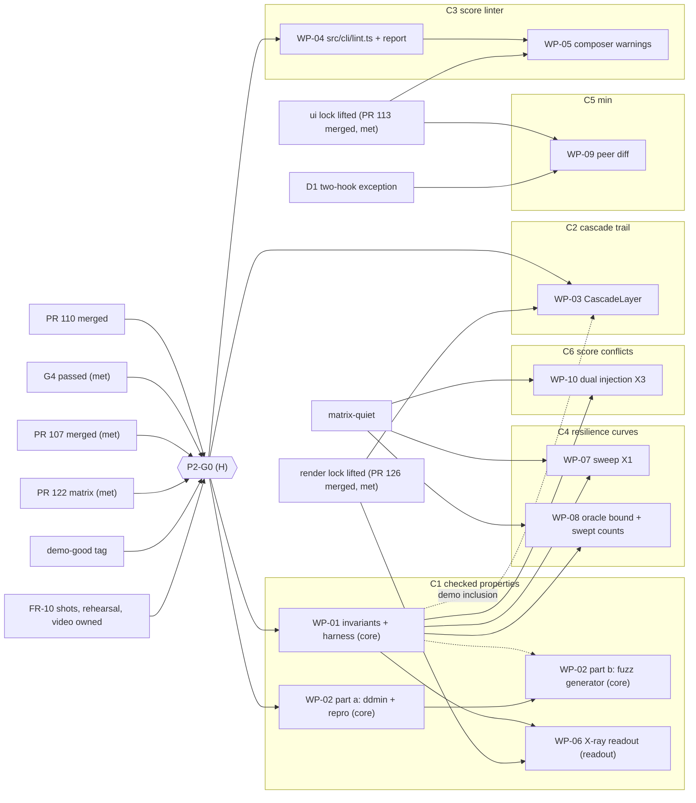
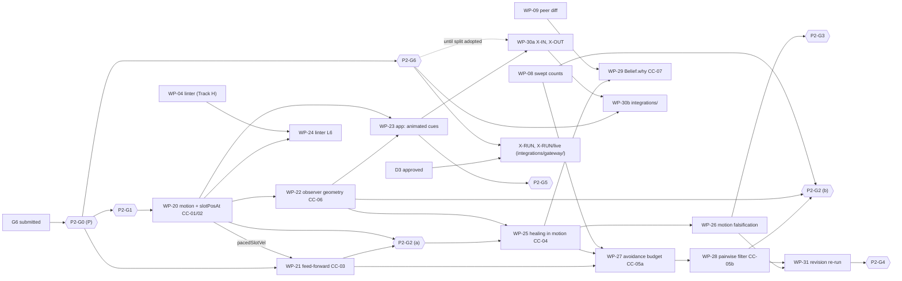

# Phase 2 roadmap

> **STATUS: PROPOSED — NOT IMPLEMENTED.** Nothing here is built, approved or scheduled on GitHub. It is a plan for Arnav to accept, amend or reject. Base work (gates G0–G6 in the [development plan](development-plan.md#gates-and-times-gmt)) always comes first.

Audit base: `origin/main` 26b438a (first audited at 7a50a69). Purpose: when Phase 2 work may happen, in what order, behind which gates, what is cut first, and which decisions Arnav must take. Status: proposal for issue #110. Audited at 26b438a (committed Sun 15 Nov 2026 00:14 GMT, audited ~00:40 GMT); the base state, lock rule and Track H timeline were re-checked at `origin/main` c697f6c (02:58 GMT, 15 Nov 2026). Owner: Arnav (Phase 2 architecture, issue #110).

This file is canonical for: the two tracks, gates `P2-G0`–`P2-G6`, the dependency graph between gates, the Track H timeline, the minimal / recommended / stretch / deferred sets, the emergency cut order, the session plan, risks `P2-R1…` and decisions `D1`–`D7`. Everything else lives elsewhere, and this file links to it:

| Topic | Canonical file |
|---|---|
| Candidates `E01`–`E10`, `N01`–`N21`, verdicts and prior art | [`PHASE2_CANDIDATES.md`](../ideation/PHASE2_CANDIDATES.md) |
| Capabilities `C1`–`C9`, pipeline, `P2-FR`/`P2-NFR`, `P2-ADR`, contract change register `P2-CC-*`, changes since the first audit | [`PHASE2_ARCHITECTURE.md`](../design/PHASE2_ARCHITECTURE.md) |
| `P2-CC-01`, `-02`, `-06`, linter checks `L1`–`L6` | [`ANIMATED_CHOREOGRAPHY_RFC.md`](../design/ANIMATED_CHOREOGRAPHY_RFC.md) |
| `P2-CC-03`, `-04`, `-05`, `-08` | [`ADAPTIVE_RECOVERY_AND_SAFETY_RFC.md`](../design/ADAPTIVE_RECOVERY_AND_SAFETY_RFC.md) |
| `X-IN`, `X-OUT`, `X-PERSIST`, `X-RUN`, `X-RUN/live` | [`OPTIONAL_INTEGRATION_BOUNDARIES.md`](../design/OPTIONAL_INTEGRATION_BOUNDARIES.md) |
| Tests `P2-T*`, invariants `INV-*`, scenarios `M0`–`M6`, `X1`–`X3`, `FZ1`, repro format, performance method | [`PHASE2_EVALUATION.md`](../validation/PHASE2_EVALUATION.md) |
| Work packages `P2-WP-*` (files, acceptance, estimates, per-path file ownership) | [`PHASE2_WORK_PACKAGES.md`](../development/PHASE2_WORK_PACKAGES.md) |
| Demo beats `P2-B*` | [`PHASE2_JUDGING_STORYBOARD.md`](../demo/PHASE2_JUDGING_STORYBOARD.md) |

## Base state this roadmap depends on

Status codes: **(a)** implemented and tested on main · **(b)** implemented, not integrated · **(c)** open PR or active branch · **(d)** documented only · **(e)** not present. Only the rows that open or block a Phase 2 gate are listed. Live state is [`CURRENT_STATE.md`](../CURRENT_STATE.md) and GitHub, and it wins over this table.

| Item | At 26b438a | Re-checked at c697f6c (02:58) | Phase 2 relevance |
|---|---|---|---|
| Encore brain in the app (#107) | (a) | (a) | `P2-G0` (H) condition met; `C2` shows nothing without it |
| Score gossip (#105) | (a); incoming scores checked only for version and non-empty movements | (a) | `C6`, `INV-CONVERGE` |
| Paced targets (#96, `[contract]`): `pacedSlotPos` at `src/agent/steer.ts:114`, constant `PACE_SETTLE_TICKS = 60`, no `Params` change | (a) | (a) | Motion baseline (S0 collisions 60 → 14 at `n0` = 200, PR #96, before #82); linter `L1` restates it. Gates cite R0's counts, not this literal |
| Composer, console, `PreviewLayer` (#112); timeline (#109, no seek) | (b): not mounted | (a): Composer and Inspector mounted by #113 (01:56) | `P2-WP-05` hook; `P2-WP-23` (P) |
| Scripted demo (#104), #108, demo constants (#119, #120), isolation tests (#68) | (a) | (a) | Demo path and regression set that Phase 2 must not disturb |
| CLI Encore arm (#116); perf and screenshot harness (#118, `scripts/perf/`) | (a) | (a) | Track H CLI packages may assume the arm; `P2-G5` reuses the harness |
| App shell #113 | (c) | Merged 01:56; `src/app/main.ts` and `src/app/ui/**` still locked in CURRENT_STATE (01:25) | `P2-WP-05`, `-09` wait for the lock to be lifted |
| Shell red-team #166 | — | (c): edits `main.ts`, `ui/{DemoScript,Legend,dom,keys,popovers,store,surfaces}.ts`, `styles.css`; its title names tethers, so it may touch `TetherLayer` | `P2-WP-03` (tethers), `-05`, `-09`: no edit to its files while open |
| Evidence minimum matrix #122 (G5) | (c) | Merged 00:33 (84d2e2d): S0–S5 records in `results/`; CURRENT_STATE: G5 met | `P2-G0` (H) condition met; see *matrix-quiet* below |
| Freeze run #137 | — | Script merged 02:30; the run is at 08:30 on the freeze commit; `scripts/eval/**` and `results/**` locked | No Track H commit under `results/**`; CLI entry files frozen. Its records become R0 at `P2-G0` (P) ([evaluation §10](../validation/PHASE2_EVALUATION.md#10-provenance-and-reproducibility)) |
| Quality ladder #126 | — | Merged 02:56 (342aa66): adds optional `Layer.setQuality?(level)` and edits `src/app/render/**`; the `src/app/render/**` lock is still listed | `P2-WP-03`, `-06`: the merge wait is satisfied; they wait for the render lock to be lifted, then implement the optional `setQuality` |
| Readout transition #127 | — | (c): `src/app/ui/Readout.ts` locked | `Readout.ts` is never touched |
| Perf #115, follow-ups #121, sensing order #82 | (c) | Merged 00:36, 00:36, 01:40 (#82 adds `src/sim/sensing.ts`; its lock is still listed) | Their file conflicts are gone; the forbidden folders stay forbidden |
| Submission text #125; DEMO_PLAN operator steps #157 | (c) | Merged 01:50, 02:34; `DEMO_PLAN.md` still listed as locked | Storyboard hand-over goes through the lock owner |
| Other merges since 26b438a | — | #124, #161, #163, #164, #165, #154 (README captures), #167 | No Phase 2 gate waits on them. #163 changed `src/sim/grid.ts` after #122, so no Track H check compares against #122's records (P2-R1) |
| Base gate G4 | Tests on main; not declared passed | CURRENT_STATE: met, headless | `P2-G0` (H) condition met |
| `demo-good-<n>` tag | (e) | (e): none on `origin` | `P2-G0` (H) condition not met |
| FR-10 90% / 70% screenshots (base MUST, [requirements](../specification/requirements.md)) | (e) | (e): `assets/` holds only `qa/`; #154's README captures in `docs/assets/readme/` are not the 90% / 70% prefix shots; #141 and #160 open | `P2-G0` (H) condition |
| Presenter rehearsal; backup video | (e) | Rehearsal (e): [`DEMO_PLAN.md`](../demo/DEMO_PLAN.md) "Rehearsal record — none completed". Backup video: recorder merged (#131/#148, 02:51; linked by #167), `scripts/demo/**` still locked; "Backup video record — no recording available" | `P2-G0` (H) condition; visual trigger (rung 0b) |
| Pitch #147 | — | (c) | None; base work |
| Phase 2 docs #110 | (c) | (c) | `P2-G0` (H) condition: Track H thresholds become pre-registered when it merges ([evaluation](../validation/PHASE2_EVALUATION.md)) |

None of these is Phase 2 work, and no Phase 2 doc may present it as such. The CURRENT_STATE at c697f6c is still the 01:25 version: its lock table lists #113 (`src/app/main.ts`, `src/app/ui/**`), #126 (`src/app/render/**`), #82, #125, #131 and #137, although all six have merged (#137's run is still to come). Under the lock rule below these bind until the orchestrator lifts them. The architecture keeps a matching dated note ([changes since first audit](../design/PHASE2_ARCHITECTURE.md#changes-since-first-audit)).

**Lock rule (binding).** The lock table in CURRENT_STATE ("Who is doing what") is binding when `P2-G0` (H) is checked, when a Track H package is claimed and when it merges: no Track H PR edits a locked path. A lock whose PR has merged stays binding until the orchestrator lifts it. The contended-file lists in this roadmap and in [WP §6.2](../development/PHASE2_WORK_PACKAGES.md#62-files-track-h-must-not-edit) are illustrative only.

**matrix-quiet** (Track H term, used instead of "#122 archived"): #122 merged on main (met: 84d2e2d, 00:33) **and** no matrix run active on the laptop (#133 dry run, the #137 freeze run at 08:30, or any S0–S5 re-run). It is checked live. The `P2-G0` (P) archive (records, annotated tag, path on #110) is a separate post-G6 event. `src/cli/main.ts`, `src/cli/brains.ts` and `package.json` stay untouched for the whole of Track H, because the freeze run uses them.

## The two tracks

The governing constraint: once the evidence run starts, any change to `src/agent/**` behaviour, `steer`, `Params` (even a default-off field, because `paramsHash` hashes the whole object) or the `EncoreState` shape (covered by `stateHash`) creates a new revision and forces a full S0–S5 re-run ([evaluation §5](../validation/evaluation-and-tests.md#5-procedure)).

| | Track H (hackathon window) | Track P (post-submission) |
|---|---|---|
| Starts | As soon as `P2-G0` (H) holds (time `T0`; no fixed start) | After `P2-G0` (P); earlier only if Arnav says yes to `D4` |
| Ends | **Phase 2 merges close Sun 07:30** | Open |
| Allowed | New files only, plus at most one hook per WP in a file whose owning PR has merged and that no lock covers (`validateDraft` in `src/app/ui/Composer.ts`: #121 merged; waits for the `src/app/ui/**` lock). `P2-WP-09`'s two hooks need a `D1` exception. Off by default on the demo path | `P2-CC-01`…`07` once approved under `D2`, each as its own `[contract]` PR |
| Forbidden | Any `[contract]` PR; any edit to `src/agent/**`, `src/score/**`, `src/sim/**`, `src/contracts/**`, the contract doc, `Params`, `EncoreState`; any path in the CURRENT_STATE lock table (lock rule above); `src/cli/main.ts`, `brains.ts`, `package.json` | Merging two `[contract]` PRs that touch `steer.ts` or `encoreBrain.ts` at once |
| Evidence | No new revision: every S0–S5 `paramsHash` and `stateHash` unchanged | Each merge declares a new revision and re-runs the matrix (`D5`, `P2-WP-31`) |
| Capabilities | `C1`–`C4`, `C5` (minimal, only with the `D1` exception), `C6` | `C7`, `C8`, `C9`, `C5` (full), integration boundaries |

## Gates

Gates are checkpoints, not a strict sequence: the "Blocks" column is binding, the numbering is not. Test IDs are defined in [`PHASE2_EVALUATION.md`](../validation/PHASE2_EVALUATION.md).

| Gate | Entry criteria | Exit evidence | Owner | Blocks |
|---|---|---|---|---|
| **P2-G0 (H)** Base accepted for Track H | #110 merged (Track H thresholds of evaluation §4 and §6 pre-registered); base gate G4 passed ([evaluation §7](../validation/evaluation-and-tests.md#7-gates); met per CURRENT_STATE); Encore in the app (met, #107); the evidence matrix run with frozen params (met, #122); a `demo-good-<n>` tag exists; FR-10 90% / 70% screenshots committed, or owned on an issue with a time (#141); an owner and slot named for the first presenter rehearsal of the 90 s script and for the backup video recording (recorder merged in #148, no recording yet); the CURRENT_STATE lock table re-read | Orchestrator comment on #110 naming `T0`, the tag, the #122 git SHA and `paramsHash`, and the CURRENT_STATE revision whose lock table was read | Arnav (orchestrator) | Every Track H branch. Visual packages (WP-03, -05, -06, -09) also need one presenter rehearsal recorded in DEMO_PLAN before they merge (rung 0b) |
| **P2-G0 (P)** Base accepted for Track P | G6 submitted; the S0–S5 records archived with git SHA, `paramsHash` and seeds, so a new revision can be compared | Annotated tag on the evidence commit; records path recorded on #110 | Arnav | Every Track P branch |
| **P2-G1** Choreography approved | `P2-G0` (P); RFC for `P2-CC-01`, `-02`, `-06` complete | Arnav approves the three CCs (`D2`); determinism tests `P2-T20`–`P2-T22`, `P2-T25` specified; `L6` bounds fixed in the RFC (`P2-T17`) | Arnav | `P2-WP-20`, `-22`, `-23`, `-24` |
| **P2-G2** Movement safety validated | `P2-CC-03` approved; `P2-T24` also needs WP-20's motion; for part (b) also `P2-CC-05` approved, `P2-WP-08` swept counts available and `M0` runnable (WP-22) | (a) `P2-T23` feed-forward bit-identity on S0–S5 seed 1, `P2-T24` lag. (b) `P2-T32`: S0 at `n0` = 200, both arms: collisions ≤ R0's S0 count for the same arm and seed, and `collisionsSwept` ≤ R0's swept count (R0 records replayed through the WP-08 counter; no literal, because #82 re-ordered `sensed` after the first S0 measurements); `P2-T33`; **and** `P2-T32` (b): the motion collision line of [PHASE2_EVALUATION §5](../validation/PHASE2_EVALUATION.md#5-animated-scenarios-m0m6-track-p) (`M0` inside B's spinning hold; `EXIT` against `EXIT-0`) | Arnav | (a) blocks `P2-G3`. (b) blocks any animated formation in the judged or default demo |
| **P2-G3** Adaptive animated recovery | `P2-G1`; `P2-G2` (a) (healing in motion depends on `P2-CC-03`); `P2-WP-22` and `-25` merged; M-scenario thresholds pre-registered before any run | `P2-T19`, `P2-T25`–`P2-T31`: `M1`/`M2` meet thresholds; G1 suite green and the 40-centre sweep ≥ `N_R0`/200, where `N_R0` is that sweep re-measured on the R0 commit at `P2-G0` (P) and recorded on #110 (`P2-T31`; 183/200 is pre-pacing); both arms fly the same animated score and `steer` | Arnav | Any `C8` claim in README, pitch or Devpost |
| **P2-G4** Resilience evaluation validated | `P2-WP-02`, `-22`, `-26`, `-31` merged | `M0`–`M6` and `FZ1` reproducible from records (`P2-T03`, `P2-T36`); LOSS rows kept; provenance (git, `paramsHash`, seeds, events) complete | Arnav | Any Phase 2 number in public text; `D5` |
| **P2-G5** Experience validated | Beats chosen under `D7`; the canonical demo script run headless with the `INV-*` checkers (`tests/observer/demoScriptInvariants.test.ts`, owned by P2-WP-01) | Storyboard beats rehearsed; `P2-T18`: each per-tick addition ≤ 0.5 ms/tick/world at `n0` = 200 (opt-in `P2_PERF=1`); frame rate measured with the #118 harness against [experience §10](../design/experience-and-demo.md#10-performance) ("both worlds ≤ 3 ms", SHOULD); scripted demo `stateHash` unchanged | Arnav (Haris owns the demo per the [`DEMO_PLAN.md`](../demo/DEMO_PLAN.md) banner; Arnav consults him) | Any Phase 2 visual on the demo path, **including Track H's `C2` tonight** |
| **P2-G6** Optional integrations | `P2-G0` (P); an approved integration spec per integration (#117, #130, #142, or a [boundaries §11](../design/OPTIONAL_INTEGRATION_BOUNDARIES.md#11-williams-intake-template) intake for any other), reviewed by Arnav. William ("Williams" in [TEAM_ROLES](../development/TEAM_ROLES.md)) stays the source of sponsor-specific decisions only; `D3` only for `X-RUN` and `X-RUN/live` | `P2-T35`; `bash scripts/check.sh` passes offline with `integrations/` removed and `X-RUN/live` off | Arnav | `P2-WP-30a` (conservative, until Arnav adopts the gate split; its `X-IN`, `X-OUT` are offline and need no `D3`; it also follows WP-23) and `P2-WP-30b` ([WP §5](../development/PHASE2_WORK_PACKAGES.md#5-parallelisation), open question 5); any `X-RUN` or `X-RUN/live` code also needs `D3` |

**X-RUN and X-RUN/live** (rule stated once here; detail in [boundaries §6](../design/OPTIONAL_INTEGRATION_BOUNDARIES.md#6-x-run-external-integration-runner) and [§6.1](../design/OPTIONAL_INTEGRATION_BOUNDARIES.md#61-x-runlive-provisional-d3-gated)). Both need `D3` and `P2-G6`. `X-RUN` runs outside `src/`, in `integrations/`; a networked service is the one shared gateway `integrations/gateway/`. `X-RUN/live` is the app's request/response channel to that gateway. It is off by default behind a non-secret build flag, so the default build, the judged demo and `check.sh` make zero external requests (NFR-04's check is unchanged). Its app code sits in one confined folder (proposed `src/app/live/`), the only place under `src/` that may use a network API. The only payload that enters Encore is a candidate composition: it must pass every `X-IN` step before an operator `INJECT_SCORE` (library or analytics data may come back for display only). Requests are operator-initiated only, never from ticks, brains, the world, the observer or any decision path. `P2-T35` is extended before any `X-RUN/live` code merges.

## Dependency graph

Capability membership (definitions in [`PHASE2_ARCHITECTURE.md`](../design/PHASE2_ARCHITECTURE.md)): `C1` core = WP-01, 02 (minimal) · `C1` readout = WP-06 (recommended) · `C2` = WP-03 · `C3` = WP-04, 05 (+ `L6` in WP-24) · `C4` = WP-07, 08 · `C5` = WP-09 (min), WP-29 (full) · `C6` = WP-10 · `C7` = WP-20–24 · `C8` = WP-25, 26 · `C9` = WP-27, 28 (`N03` first, measured with WP-08). WP-30 = integrations, WP-31 = revision re-run. Package-level edges are canonical in [WP §5](../development/PHASE2_WORK_PACKAGES.md#5-parallelisation); the graphs below show those edges (WP-02 as its two parts, WP-30 as 30a and 30b) and how they meet the gates. Where a gate stands between two packages, the graph routes the edge through the gate (WP-21 → `P2-G2` (a) → WP-25).

**Track H.** Dashed edges are "may start against a pinned branch; merges only after". The one labelled edge, WP-01 → WP-03 "demo inclusion", is different: WP-03 may merge first, but it enters the judged demo only after WP-01's headless demo-script check (`D7`, `P2-G5`).

**Track P.**

WP-21 lands first with `targetVel` defaulting to zero (`P2-T23`); it passes a non-zero motion velocity only once `P2-CC-02` (WP-20) supplies it. Capability order stays `C7` → `C8` → `C9`.

## Track H timeline (Sun 15 Nov, GMT)

Implementation hours are the [WP §5](../development/PHASE2_WORK_PACKAGES.md#5-parallelisation) estimates (low confidence). Each Track H merge also costs **20–30 min of orchestrator review**: the verified end-to-end run behind the `demo-good-<n>` tag ([WORKFLOW](../development/WORKFLOW.md#answers-to-the-coordination-questions)), the S0 seed 1 `stateHash`, the scripted-demo `stateHash`, and a browser check for visuals. The timeline budgets 30 min. **Latest start** = 07:30 − upper estimate − 30 min review.

| Package | Estimate | Waits for | Latest start |
|---|---|---|---|
| WP-01 | 2–3 h | `T0` | **04:00** |
| WP-02 part a: `ddmin.ts`, `repro.ts` (writer and reader against the `p2-repro/1` spec), their unit tests | ~1 h of the 2–3 h (estimate) | `T0` (no checker needed) | — |
| WP-02 part b: generator `fuzz.ts`, `P2-T03`, `P2-T05` | ~1–2 h | WP-01's branch pinned at a named commit; merges only after WP-01 | 05:00 |
| WP-03 | 1.5–2 h | `T0`; render lock lifted (#126 merged 02:56, so the merge wait is met); no file shared with open #166 | 05:00 |
| WP-04 | 2 h | `T0` | 05:00 |
| WP-05 | 1 h | WP-04 merged; `src/app/ui/**` lock lifted | 06:00 |
| WP-06 | 1 h | WP-01 merged; "P2-T02 clean" ([evaluation §7](../validation/PHASE2_EVALUATION.md#7-tests-p2-t01p2-t36); rung 4); render lock lifted | 06:00 |
| WP-07 (stretch) | 1–1.5 h | WP-01 merged; matrix-quiet | 05:30 |
| WP-08 (stretch) | 2–3 h | WP-01 merged; matrix-quiet | 04:00 |
| WP-09 (stretch) | 1.5 h | `D1` exception; `src/app/ui/**` lock lifted | 05:30 |
| WP-10 (stretch) | 1.5 h, plus a docs PR fixing the churn bound in evaluation §6.1 before eval seeds | WP-01 merged; never while a matrix run is active (no wait on #122's records) | 05:00 |

| Time | Base milestone | Track H | Trigger or rule |
|---|---|---|---|
| Re-check (02:58, c697f6c) | G1–G5 met; #126 merged 02:56; #127, #166 open; integration; freeze at 08:30 | No Phase 2 code before `T0`. #110 in review. Arnav takes `D1`, `D4`, `D6`. The orchestrator may draft Track H issues, unassigned, no branches | Phase 2 never takes a session from a base gate; base reviews first ([review capacity](#parallelisation)) |
| `T0` (P2-G0 (H) holds) | — | H1: WP-01. H2: WP-02 part a. H3: WP-03 if the render lock has been lifted, else WP-04 | `T0` after 04:00 → cut all Track H (rung 0) |
| `T0` + ~1 h | — | H2 moves to WP-02 part b once WP-01's checker and `runCustom` signatures are pushed (pin the commit) | — |
| `T0` + 2–3 h, then 30 min review | — | WP-01 merges; H1 takes WP-06 if its row holds | [Rung 4](#emergency-cut-order) |
| When WP-01 merges | — | **Stretch decision point**: a stretch WP starts only if a session is free, every minimal item is in review, and the clock is before its latest start | Rungs 1–2 |
| 06:00 | — | — | [Rung 0b](#emergency-cut-order) (no rehearsal recorded); rung 1 |
| 06:30 | **G5** target (met) | — | WP-02 not in review → the `P2-B2` repro leaves the `D7` candidates ([rung 6](#emergency-cut-order)) |
| 07:00 | Rehearsals | `C2` beat rehearsed in the scripted demo, if `D7` = yes | — |
| **07:30** | — | **Phase 2 merges close** | Anything not merged, tested and browser-checked stays on its branch |
| 08:30 | Feature freeze; freeze run (#137) | Phase 2 "fixes" are reverts only | — |
| 09:00 | Backup video | — | — |
| 10:15 / 11:00 | **G6** / hard deadline | README may cite merged Phase 2 artefacts (repros, lint report) in the binding wording | — |

**Worked example, `T0` = 03:30.** WP-01 merges 06:00–07:00, so WP-06 is cut (rung 4) unless WP-01 lands at its low estimate. WP-02 merges no earlier than WP-01 plus its own review (06:30–07:30) and misses 07:30 at the upper estimates. WP-03, if the render lock is lifted by `T0`, merges 05:30–06:00; WP-04 then misses its 05:00 latest start. The protected minimum in practice is **WP-01 + WP-03**; WP-02 is branch-only unless merged by 07:30. **Stretch is listed, not planned:** WP-08 needs WP-01 merged by 04:00 and WP-10 by 05:00, which no `T0` still possible at the 02:58 re-check allows; WP-07 only if `T0` ≤ 03:00 and WP-01 lands at its low estimate.

## Sets

| Set | Capabilities (work packages) | Precondition | Proof of value | Est. agent-hours |
|---|---|---|---|---|
| **Minimal** | `C1` core: invariant checkers + fuzzer with ddmin shrinking (WP-01, WP-02); `C2` cascade trail (WP-03, only with `?p2=cascade` and X-ray on) | `P2-G0` (H); WP-03 also the render lock lifted | `P2-T05`: under its own calibration profile ([evaluation §6.2](../validation/PHASE2_EVALUATION.md#62-fuzz-campaign-fz1-track-h)), the fuzzer rediscovers the known G1 late-commit miss unaided and writes a minimal repro (re-confirm the `it.fails` in `tests/g1/g1.beyond.test.ts` on current main first). `P2-T06`: recorded trail changes equal the observer's `slotChanges` delta (drawn arrows ≤ changes) | 5.5–8 implementation + ~1.5 review, across three sessions (WP-02 split) |
| **Recommended** | `C3` score linter: CLI report for the EVAL transitions first (WP-04), then composer warnings (WP-05). Also `C1` readout (WP-06): a `C1` sub-item scheduled with this tier (priority P1, P2-FR-06 SHOULD), not part of the minimal proof | Minimal in review; WP-06 only after "P2-T02 clean" (evaluation §7); each before its latest start | `P2-T07`; `P2-T08`, a calibration report of predicted conflicts under ideal paced flight (no avoidance) against measured collisions, never a forecast; `P2-T09`; `P2-T10` | 4 implementation + ~1.5 review |
| **Stretch** (listed, not planned; see timeline) | `C4` (WP-07, WP-08); `C5` minimal (WP-09); `C6` (WP-10) | WP-01 merged (C4, C6); matrix-quiet (C4); `src/app/ui/**` lock lifted and `D1` grants the two-hook exception (C5); each before its latest start | `P2-T11`–`P2-T14`; all output labelled exploratory, the oracle labelled "oracle upper bound" | 1–3 each + 0.5 review |
| **Deferred (Track P, in order)** | `C7` (feed-forward first) → `C8` → `C9` → `C5` full → integrations in code | `P2-G0` (P) and gates above | Gates `P2-G1`–`P2-G6` | Not estimated here |

Deferred and rejected candidates and the reasons are in [`PHASE2_CANDIDATES.md`](../ideation/PHASE2_CANDIDATES.md). The techniques in `C1` are established practice (history checking as in Jepsen, deterministic simulation testing, swarm testing, ddmin delta debugging); no Phase 2 text may call them novel.

## Emergency cut order

**Global trigger (rung 0):** `P2-G0` (H) not held by **04:00** (WP-01's latest start), G4 not passed by **04:30** (met per CURRENT_STATE), or the evidence matrix not started by **06:30** (met, #122) → cut all Track H work; those sessions return to base gates, rehearsal and submission.

**Visual trigger (rung 0b):** no presenter rehearsal of the 90 s script recorded in DEMO_PLAN by **06:00** → cut every Track H visual (WP-03, -05, -06, -09). Keep headless `C1` and the WP-04 CLI report.

**Review trigger:** a Track H PR waiting more than 30 min for review while a base PR waits → park it (branch kept). It re-enters the queue only when no base PR waits.

Otherwise cut from the top:

| Rung | Cut | Trigger | Keep |
|---|---|---|---|
| 1 | `C4` (WP-07, WP-08) | WP-01 not merged by the package's latest start (WP-07 05:30, WP-08 04:00), no matrix-quiet window, or any minimal item not in review by 06:00 | Numbers already computed go in README text only, labelled exploratory |
| 2 | `C5` minimal, `C6` (WP-09, WP-10) | `src/app/ui/**` lock not lifted, or no `D1` exception, by 05:30 (WP-09); WP-01 not merged by 05:00 (WP-10) | Nothing on the demo path |
| 3 | `C3` composer hook (WP-05) | WP-04 not merged by 06:00, the composer not mounted, or the `src/app/ui/**` lock not lifted | The CLI lint report (WP-04) |
| 4 | `C1` readout (WP-06) | WP-01 not merged, or `P2-T02` not clean, by 06:00 (WP-06's latest start); the render lock not lifted; or `P2-T10` fails. "Clean" is "P2-T02 clean" as [evaluation §7](../validation/PHASE2_EVALUATION.md#7-tests-p2-t01p2-t36) defines it: zero violations of all six `INV-*`, tagged or not, on S0–S5 under `P2_WIDE=1` and on the headless demo script, both arms; a triaged violation is not clean (open question 6) | Headless checkers and tests |
| 5 | `C2` cascade trail (WP-03) | Render lock not lifted by 05:00; rung 0b; not rehearsed in the script by 07:30; `P2-T06` fails; or the scripted demo `stateHash` changes | Branch only |
| 6 (last) | `C1` fuzzer (WP-02) | Not merged by 07:30. Not in review by 06:30 → the `P2-B2` repro leaves the `D7` candidates | Repros may be cited in the README only if the code that produced them is on `main` (traceability, NFR-09). If `P2-T05` calibration fails, no "0 violations" statement is published: say "FZ1 did not rediscover the known miss in N runs", and any demo shows a hand-built repro of a known G1 pair, labelled as such. Post-pacing, 2 of 40 seed-1 centres are late (about 5% per calibration run, estimate); 17 of 200 is pre-pacing |

Every rung: revert first, debug later; the last `demo-good-<n>` tag is the fallback ([WORKFLOW](../development/WORKFLOW.md#answers-to-the-coordination-questions)).

## Parallelisation

**Track H sessions.** At most three Track H sessions at once, and only while no base gate is short of a session.

| Session | Lane | Sequence | Sequential because |
|---|---|---|---|
| H1 | B, then C | WP-01 → WP-06 (if its preconditions hold by 06:00) | WP-06 needs WP-01 merged and `P2-T02` clean |
| H2 | B | WP-02 part a → WP-02 part b | Only the generator runs the WP-01 checker and harness; `ddmin.ts` and `repro.ts` do not |
| H3 | C, then B | WP-03 (once the render lock is lifted), else WP-04 first; WP-05 after WP-04 | WP-03 waits for the render lock; the composer imports the WP-04 linter (`src/cli/lint.ts`) |
| Stretch | — | Listed only (timeline) | Latest starts and preconditions in the timeline |

WP-01, WP-02 part a, WP-03 and WP-04 share no files and can start at the same minute. Fuzz campaigns (`FZ1`, `n0` = 40) and sweeps share the laptop with any evidence run: run them only while matrix-quiet (`P2-R7`).

**Review capacity.** The bottleneck is the orchestrator's review, not agent count, so it is budgeted:

- At most **one Track H PR in review** at a time.
- Base PRs on the CURRENT_STATE critical path, or holding a lock, are always reviewed first. No Track H review starts while one waits (re-checked at c697f6c: #127, #166, and any freeze, video or submission PR).
- Each Track H merge costs 20–30 min (timeline), on top of its implementation hours.
- The review trigger in the cut order parks a Track H PR that waits more than 30 min while a base PR waits.

**Track P.** WP-21, WP-25, WP-27, WP-28 and WP-29 all edit `steer.ts` or `encoreBrain.ts`: strictly one at a time, one `[contract]` PR open at once. WP-22, WP-23, WP-24 and WP-30 can run beside them. WP-28 must not rely on `sensed` order (#64, #82).

**Rules against active work** (re-checked at c697f6c, 02:58; the CURRENT_STATE lock table supersedes this table wherever they differ). The per-path matrix is in [`PHASE2_WORK_PACKAGES.md`](../development/PHASE2_WORK_PACKAGES.md#6-file-ownership); the architecture keeps a matching dated note ([changes since first audit](../design/PHASE2_ARCHITECTURE.md#changes-since-first-audit)).

| Active or recent work | Exposed Phase 2 WPs | Rule |
|---|---|---|
| #113 (merged 01:56): `main.ts`, `worlds.ts`, `actions.ts`, `ui/{commands,Hud}.ts`, shell UI files; `src/app/ui/**` still locked | WP-05, WP-09 | No Track H edit to any of these. WP-05 and WP-09 start only once the `src/app/ui/**` lock is lifted. Hooks are requested on the issue |
| #166 (c): `main.ts`, `ui/{DemoScript,Legend,dom,keys,popovers,store,surfaces}.ts`, `styles.css`; tethers named in its title | WP-03, WP-05, WP-09 | No Track H edit to its files while it is open. WP-03 re-checks #166's file list for `TetherLayer` before it is claimed |
| #126 (merged 02:56, 342aa66): `src/app/render/**` still locked; `Layer.setQuality?` added; #127 (c): `ui/Readout.ts` | WP-03, WP-06 | The merge wait is satisfied. Both wait for the render lock to be lifted, then implement the optional `setQuality` as [WP §2.4](../development/PHASE2_WORK_PACKAGES.md#24-performance-rule) sets it. The WP-06 readout renders as a DOM legend inside a self-registered layer (as `BeliefLayer` does). `Readout.ts` is not touched |
| #115 (merged): `encoreBrain.ts`, `world.ts`, `sim/grid.ts`, `observer/measure.ts` | WP-01, WP-08 | New observer files only; never edit `measure.ts` or `observer/index.ts` |
| #122 (merged), #137 (merged 02:30; run at 08:30; `scripts/eval/**`, `results/**` locked), #116 (a): `src/cli/**` | WP-01, 02, 04, 07, 08, 10 | New entry points are standalone files run with `npx tsx src/cli/<x>.ts`; `src/cli/main.ts`, `brains.ts` and `package.json` untouched for all of Track H. WP-01 owns `src/cli/harness.ts` (`runCustom`). **No Track H PR commits under `results/**` while it is locked**: tools write to an explicit `--out` outside the repo. The `results/phase2/` paths in the evaluation and WP docs apply only once the lock is lifted or the #137 owner agrees on #137 (open question 3) |
| #121 (merged): `Composer.ts`, `Console.ts`, `Timeline.ts` | WP-05 | #121 precondition met; the `src/app/ui/**` lock still applies |
| #125, #157, #167 (merged); `DEMO_PLAN.md` locked under #125. #131/#148 (merged): `scripts/demo/**` locked | Storyboard hand-over | No Phase 2 PR edits DEMO_PLAN or `scripts/demo/**`; beats reach DEMO_PLAN only through its lock owner and Haris (its banner owner) |
| #96 (a): `pacedSlotPos` in `src/agent/steer.ts` | WP-04 (`L1`); WP-20, 21, 27, 28 | App code must not import `src/agent`. WP-04 is pure `src/cli/lint.ts` (imports only `src/contracts` and `src/score`), restating the pacing formula with a parity test pinned to `PACE_SETTLE_TICKS`; the composer imports it. In Track P, `P2-CC-02` moves `pacedSlotPos` into `src/score` |
| #104, #105 (a) | WP-02, WP-10 | Track H repros replay headless only. No change to contract §9 semantics; base tests T16 (`tests/g4/dissemination.test.ts`) and T18 (`tests/g4/relay.test.ts`) stay green |
| #82 (merged): `sim/sensing.ts`, `world.ts` | WP-28 (P) | No dependency on `sensed` order |

## Risks

Same format as the [base risk register](decisions-and-risks.md#risks); base risks #1–#14 still apply. P and I are L/M/H.

| # | Risk | P | I | Owner | Mitigation | Trigger | Fallback |
|---|---|---|---|---|---|---|---|
| P2-R1 | A Track H PR silently changes evidence (touches agent, `Params`, state or world) | L | H | Arnav | Track H file rules and lock rule above; review compares `git diff --name-only` with the forbidden list and the lock table; before merge, S0–S5 seed 1 `stateHash` (and base summary) on the PR head equals the merge parent's (P2-NFR-01; #122's records are not the reference, since later merges touched the brain, world and grid); the freeze run's step 5 ("identical apart from `git`") is the final acceptance ([evaluation §10](../validation/PHASE2_EVALUATION.md#10-provenance-and-reproducibility)) | Diff lists a forbidden or locked path, or a hash differs from the merge parent's | Close the PR; if merged, revert before any record is cited |
| P2-R2 | Phase 2 delays a base gate or a base review | M | H | Arnav | `P2-G0` (H); global trigger; no session moved off base work; review-capacity rules | `P2-G0` (H) not held by 04:00; a Track H PR waits for review beside a base PR | Cut all Track H; park the PR |
| P2-R3 | False invariant violation shown live | M | H | Session H1 | Safety-like checkers (`INV-DUP`, `-MONO`, `-SILENCE`, `-STATIC`) encode §8.4 or a [contract §8.5](../design/contracts-and-algorithms.md#85-known-limits-state-these-dont-hide-them) limit on the brain's delivered or sensed evidence (nine limits at 26b438a, including limit 8: an injection pauses healing for `tStable`). `INV-QUIET` and `INV-CONVERGE` are pre-registered liveness targets, not encodings of limits. Every violation carries a `knownLimit` tag when it matches a documented limit; only untagged ones are called counterexamples ([evaluation §4](../validation/PHASE2_EVALUATION.md#4-checked-properties)). `P2-T02` clean before WP-06; readout only with `?p2=inv` and X-ray on | Untagged violation on S0–S5 or the headless demo script | Rung 4: headless only |
| P2-R4 | Fuzzer finds a real bug at night and someone "fixes" the brain | M | M | Arnav | Findings become repros and a "where Encore loses" README line; brain fixes are Track P | New violation outside the §8.5 limits | Issue for Track P; state the limit honestly |
| P2-R5 | Per-tick additions cost frame rate | M | M | Session H1, H3 | ≤ 0.5 ms/tick/world (`P2-T18`, opt-in); frame rate checked with the #118 harness against [experience §10](../design/experience-and-demo.md#10-performance); persistent buffers; off by default | Measured over budget or visible fps drop | X-ray only, else headless |
| P2-R6 | Merge conflict with a locked path or a just-merged base PR | M | M | Each session | New files only; lock rule; rules against active work above | A rebase conflict in a file owned by others | Drop the hook, keep the library |
| P2-R7 | Fuzz campaigns or sweeps slow an evidence run on the same laptop | M | M | Arnav | Campaigns at `n0` = 40 and sweeps only while matrix-quiet | Matrix wall-clock over its plan | Pause campaigns |
| P2-R8 | Over-claiming | M | H | Arnav | Binding wording: "checked properties on these runs, not proofs", "predicted conflicts under ideal paced flight (no avoidance) — not a collision forecast", "oracle upper bound", "exploratory", "measured, not guaranteed"; never "collision-free", "novel", "guaranteed", "detects dead drones" ([requirements §5](../specification/requirements.md#5-claims-we-must-not-make)) | Any copy review hit | Delete the sentence |
| P2-R9 | Cascade trail draws something that did not happen | L | H | Session H3 | Arrows only from observed `belief.slot` changes; `P2-T06`; static arm draws none; WP-03's trail colours avoid cyan (`HB` with a claim) and amber (in transit) | Count mismatch | Rung 5 |
| P2-R10 | Demo path regresses (hash change, clutter, broken toggle) | L | H | Arnav | Off unless opted in: the scripted demo turns X-ray on, so each visual draws only with its own URL flag (`?p2=cascade`, `?p2=inv`) and X-ray on ([WP §2.1](../development/PHASE2_WORK_PACKAGES.md#21-track-h-hackathon-window)); scripted demo `stateHash` unchanged after each merge; `demo-good-<n>` before each merge | Rehearsal fails or hash differs | Revert to the last tag |
| P2-R11 | Track P pulled forward under time pressure | L | H | Arnav | `D4` = no; zero `[contract]` PRs before G6 | A Phase 2 `[contract]` PR opens before G6 | Park it on its branch |
| P2-R12 | Healing in motion regresses G1 or raises collisions (Track P) | M | H | Arnav | `P2-G3`; `P2-G2` (b) motion collision line; motion absent means bit-identical behaviour (`P2-T20`, `P2-T23`) | `P2-T31` below `N_R0`/200 (re-measured on the R0 commit at `P2-G0` (P)), or `P2-T32` or the motion line fails | Ship `C7` with WP-21's interim motion gate (no healing during motion) |
| P2-R13 | Feed-forward not bit-identical (signed zero, summation order) | L | M | Arnav | `P2-T23` before anything builds on WP-21 | Hash differs | Declare it a new revision and re-run |
| P2-R14 | Integrations pull network access into the core (Track P) | L | H | Arnav | `X-IN`/`X-OUT` are files only; `X-RUN` only after `D3` and `P2-G6`, in a separate process under `integrations/` (gateway `integrations/gateway/`); `X-RUN/live` only after `D3` and `P2-G6`, off by default, in one confined app folder (the X-RUN rule under [gates](#gates)); `P2-T35`, extended before any `X-RUN/live` code | Network import or call under `src/` outside the confined `X-RUN/live` folder, or any external request from the default build | Remove the integrations folder; turn `X-RUN/live` off |
| P2-R15 | Two ID schemes drift (P2- against base IDs) | M | L | Arnav | `D6`; P2- IDs never reused; mapping only on acceptance | A base doc cites a P2- ID as accepted | Fix the citation |

## Decisions for Arnav

Canonical list; other Phase 2 docs link here. Agents do not consult teammates: where a decision involves William or Haris, Arnav consults them.

| # | Decision | Recommendation | Confidence | If accepted | If declined | Needed by |
|---|---|---|---|---|---|---|
| D1 | Track H start rule (`P2-G0` (H), including the lock rule and the 04:00 latest start) and the 07:30 merge close; and whether `P2-WP-09` may use two hooks (`Inspector.ts`, `inspectorTruth.ts`) as a Track H exception | Accept the rule. Grant the WP-09 exception only if the `src/app/ui/**` lock is lifted by 05:30; otherwise WP-09 moves to Track P | High (rule), medium (exception) | Track H runs in a bounded window with a global cut trigger | No Phase 2 code in the hackathon; docs only | Before `T0` (latest 04:00) |
| D2 | Approve or decline each `P2-CC-01`…`08` (post-hackathon) | Decide after G6. Approve CC-03 first (provable by bit-identity), then CC-01/02/06 as one bundle (`P2-G1`), CC-04 after CC-03 and once M-thresholds are pre-registered, CC-05a before CC-05b, CC-07 last; decline CC-08 | Medium | Track P proceeds gate by gate | The affected capability stays a design document | `P2-G1` |
| D3 | Amend NFR-04 ([requirements §3](../specification/requirements.md#3-non-functional-requirements)), the [AGENTS ground rule](../../AGENTS.md#0-ground-rules), the contract §12 "Never" row ([contract §12](../design/contracts-and-algorithms.md#12-deliberately-not-in-the-mvp)) and the decisions log to allow an optional out-of-process runner (`X-RUN`, in `integrations/`, with the shared gateway `integrations/gateway/`) and its live variant `X-RUN/live` (the X-RUN rule under [gates](#gates); [boundaries §6.1](../design/OPTIONAL_INTEGRATION_BOUNDARIES.md#61-x-runlive-provisional-d3-gated)). `X-IN` and `X-OUT` are offline and need no `D3`. `X-OUT/live` ([boundaries OIB-Q5](../design/OPTIONAL_INTEGRATION_BOUNDARIES.md#13-open-questions), proposed by #142) is not covered unless a `D3` revision names it explicitly; it is not accepted. One decision, shared with the network gates of #117, #130 and #142, approved per integration | No change during the hackathon. Afterwards only with William and Haris consulted by Arnav, and with the offline core unchanged: the core folders, `src/cli`, `tests/`, the default build and the judged demo stay offline, and the confined `X-RUN/live` folder is the single exception under `src/` | High (hackathon), low (after) | `X-RUN` and `X-RUN/live` can be built under `P2-G6` | Both remain documentation; file-based `X-IN` is the fallback | Before any `X-RUN` code |
| D4 | Pull any Track P item into the hackathon | **No** | High | A `[contract]` PR at night, a new evidence revision and a full S0–S5 re-run against G5 | Track H only | Now |
| D5 | Accept a new evidence revision when Track P lands | Yes, for every merged CC (even `P2-CC-04`, whose hashes stay equal when nothing moves), as a separately labelled revision (git SHA and `paramsHash`), never mixed with hackathon records | High | Track P results are comparable with the archive | Track P cannot report numbers | First Track P merge |
| D6 | Accept the P2- ID scheme, mapped to FR-39+, NFR-11+, ADR-011+ only on acceptance | Accept | High | Stable cross-references; base IDs never renumbered | Phase 2 docs need re-keying | Merge of #110 |
| D7 | Whether `C2` and the `C1` readout appear in the judged demo | `C2`: yes, as an overlay on the existing regional-kill beat: **0 s added, one spoken sentence of 5 s or less** while the arrows are on screen (the measured arrow window of storyboard `P2-B1`; about 21–30 s only if onset is at commit; WP-03 now draws after arrival, so the arrows come later than the commits). Only if rehearsed by 07:30 after a recorded presenter rehearsal (rung 0b), and only after the canonical demo script has run headless with the `INV-*` checkers (`tests/observer/demoScriptInvariants.test.ts`, P2-WP-01; `INV-QUIET` may fire on a 20-drone kill). On stage it draws only with `?p2=cascade` and X-ray on. `C1` readout: no on stage; cite headless results instead, and the `P2-B2` repro only if WP-02 was in review by 06:30 and merged | Medium | Storyboard beats as in [`PHASE2_JUDGING_STORYBOARD.md`](../demo/PHASE2_JUDGING_STORYBOARD.md) | Phase 2 stays off the demo path | Sun 06:00 |

## Next recommended action once Phase 1 is complete

1. **If the base reaches `P2-G0` (H) by 04:00:** start `P2-WP-01` (lane B), `P2-WP-02` part a (lane B) and `P2-WP-03` (lane C, once the render lock is lifted; `P2-WP-04` instead while it is locked) in three worktrees at the same time. Nothing else starts until WP-01 has merged, and reviews follow the review-capacity rules.
2. **After G6:** pass `P2-G0` (P) by tagging the evidence commit and archiving the S0–S5 records. Arnav takes `D2` for `P2-CC-03`. Then open `P2-WP-21` (velocity feed-forward with `targetVel` defaulting to zero) as the first Track P `[contract]` PR. It is the smallest change, `P2-T23` can prove it changes nothing, and `C7`, `C8` and `C9` all build on it. Review the `P2-G1` bundle in parallel.

## Open questions

1. **Motion collision line (`P2-G2` (b)).** [PHASE2_EVALUATION §5](../validation/PHASE2_EVALUATION.md#5-animated-scenarios-m0m6-track-p) pre-registers it as part (b) of `P2-T32`, with the near-miss bound fixed on dev seeds 101–105 and the exit probe `EXIT` against its twin `EXIT-0`. Still open there (EV-Q4): whether the line gets its own test ID, and whether `EXIT` becomes an M scenario.
2. **Rehearsal at the gate.** As written, `P2-G0` (H) needs only a named owner and slot for the first rehearsal; visuals need a recorded rehearsal before they merge, and rung 0b cuts them at 06:00. Arnav may prefer the stricter rule: no Track H start until one rehearsal is recorded.
3. **Exploratory output while `results/**` is locked.** Either keep `results/phase2/` once the #137 lock lifts (with the #137 owner's agreement), or move to a lock-free top-level folder, which would change PHASE2_EVALUATION §6 and WP §6.1.
4. **WP-02 split.** Closed: WP §5 now shows part a (from `P2-G0` (H)) and part b (from WP-01 and part a), in waves H1 and H2, as the Track H graph does. One note stays: `repro.ts` carries WP-01's thresholds, so part a writes against the `p2-repro/1` spec and part b pins WP-01's threshold type.
5. **Gating P2-WP-30a.** The architecture ([§4.11](../design/PHASE2_ARCHITECTURE.md#411-stage-11-optional-export)) proposes P2-WP-30a (`X-IN`, `X-OUT` in `src/cli`, gated by `P2-G0` (P) only) and P2-WP-30b (`integrations/` and `X-RUN`, gated by `P2-G6` and `D3`). The work-package doc has split the files and steps into 30a and 30b ([P2-WP-30](../development/PHASE2_WORK_PACKAGES.md#p2-wp-30--integration-boundaries-in-code-offline), [WP open question 12](../development/PHASE2_WORK_PACKAGES.md#8-open-questions)). 30a still follows WP-23 (both edit `Composer.ts`). Both parts stay gated at `P2-G6` until Arnav adopts the gate split; then 30a needs only `P2-G0` (P), and the `P2-G6` row and the Track P graph change.
6. **Can "P2-T02 clean" be reached?** Evaluation §7 now defines it, and rung 4 cites that. The risk remains: `INV-QUIET` is designed to fire on documented behaviour (limit 3), and the demo kills 20 drones, so WP-06 may never become clean. If so, rung 4 cuts the readout and `C1` stays headless.
