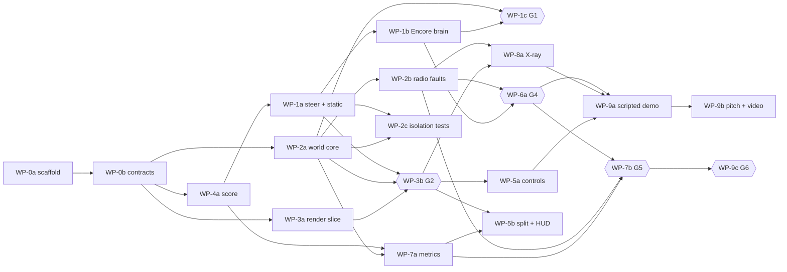

# Development plan

Purpose: what gets built, in which order, by whom, and what can run in parallel. Each row in the work table is one GitHub issue and one PR. Live status is on [GitHub issues](https://github.com/durhacko/Pihh/issues), not here. Process rules are in [`AGENTS.md`](../../AGENTS.md) and [`../development/WORKFLOW.md`](../development/WORKFLOW.md).

## Gates and times (GMT)

Each gate's pass/fail evidence is defined in [`../validation/evaluation-and-tests.md`](../validation/evaluation-and-tests.md).

| Gate | Meaning | Target | If missed |
|---|---|---|---|
| G0 | Design accepted, contracts merged | Sat 20:30 | — |
| G1 | Local-only healing works headless (the thesis) | Sat 23:30 | [Fallback ladder](decisions-and-risks.md#fallback-ladder-if-healing-fails-g1) |
| G2 | 3D view shows real agent state and reacts to a kill | Sun 00:30 | All three on integration |
| G3 | Jam and partition honestly block radio; drones act on local knowledge | Sun 02:30 | Keep jam sphere, drop partition plane |
| G4 | Score injected into one drone spreads by radio; split and reconnection visible | Sun 03:30 | Demo healing only |
| G5 | Reproducible metrics and baseline comparison | Sun 06:30 | 5 seeds, fewer scenarios |
| — | **Feature freeze** | Sun 08:30 | — |
| — | Backup video recorded | Sun 09:00 | — |
| G6 | Submitted on Devpost | Sun 10:15 (hard 11:00) | — |

## Lanes

Directories are the collision boundary: one lane owns each. Owners are **provisional** until the team confirms skills and availability; nothing below is binding on Haris or Williams until they claim the issue on GitHub.

| Lane | Directories | Proposed owner | Shared files owned |
|---|---|---|---|
| A. Brain and contracts | `src/contracts`, `src/score`, `src/agent` | Arnav (integration lead; runs the orchestrator and its local sub-agents) | `src/contracts/**`, contracts doc |
| B. World and evidence | `src/sim`, `src/observer`, `src/cli`, build and CI | Williams | `package.json`, `tsconfig`, `vite.config`, `scripts/check.sh`, CI |
| C. Experience | `src/app/**`, demo, submission | Haris | `src/app/main.ts`, `index.html`, README |

If a lane has nobody active, its READY issues are free to claim: the orchestrator's sub-agents take them, one issue per worktree.

## Work table

"Fixture" means the issue can start before its dependency merges, by building against the named test double from WP-0b.

| ID | Issue | Lane | Allowed files | Depends on | Fixture | Gate | Priority |
|---|---|---|---|---|---|---|---|
| WP-0a | Scaffold: Vite + TS + vitest + lint, `scripts/check.sh`, CI, import-boundary check (#5) | B | repo config, empty `src/*` folders | — | — | G0 | MUST |
| WP-0b | Contract types, `DEFAULT_PARAMS`, fixtures (`dummyBrain`, `fakeSnapshot`) | A | `src/contracts/**`, `tests/fixtures/**` | WP-0a | — | G0 | MUST |
| WP-4a | Score: bitmap font, sphere, helix, farthest-point slots, `currentMovement`, `composeNext`, `launchPos` | A | `src/score/**`, `tests/score/**` | WP-0b | — | G1 | MUST |
| WP-2a | World core: tick loop, physics clamps, sensing grid, radio (range, latency, loss), `KILL`, snapshot, `inspect`, `stateHash`, seeded RNG | B | `src/sim/**`, `tests/sim/**` | WP-0b | `dummyBrain` | G1 | MUST |
| WP-1a | Steering function and static baseline brain | A | `src/agent/steer.ts`, `src/agent/staticBrain.ts`, `tests/agent/steer*` | WP-0b, WP-4a | — | G1 | MUST |
| WP-1b | Encore brain: heartbeats, peer table, `canHeal`, scan, claim, commit, duplicate rule, physical yield, belief | A | `src/agent/encoreBrain.ts`, `src/agent/state.ts`, `tests/agent/encore*` | WP-1a | scripted `AgentInput` sequences | G1 | MUST |
| WP-1c | G1 falsification tests on the real world; tune parameters | A | `tests/g1/**`, `src/contracts/params.ts` (values only) | WP-1b, WP-2a | — | **G1** | MUST |
| WP-3a | Render slice: `WorldView`, instanced drones, camera rig, snapshot buffer, main loop | C | `src/app/**`, `index.html` | WP-0b | `fakeSnapshot` | G2 | MUST |
| WP-3b | Integrate: app steps real Encore and static worlds; kill a drone from the console (#6) | A | `src/app/main.ts`, `src/app/worlds.ts` | WP-3a, WP-2a, WP-1a | — | **G2** | MUST |
| WP-2b | Radio faults and events: jam sphere, partition plane, `SET_LOSS`, `INJECT_SCORE`, radio event log, `idsInSphere`, `randomIds` | B | `src/sim/**`, `tests/sim/**` | WP-2a | — | G3 | MUST |
| WP-2c | Isolation and determinism tests: differential locality, order independence, replay, observer read-only, pure-jam continuity | B | `tests/isolation/**` | WP-2a, WP-1a | — | G3 | MUST |
| WP-6a | Brain: score adoption, anti-entropy send with jitter and suppression; tests on partition and reconnection | A | `src/agent/encoreBrain.ts`, `tests/agent/score*` | WP-1b, WP-2b | — | **G4** | MUST |
| WP-5a | Controls and actions: panel, kill region / random / selected, jam, inject, play / pause / reset / speed / seed; same events to both worlds; UI integration test | C | `src/app/ui/**`, `src/app/actions.ts` | WP-3b | — | G3 | MUST |
| WP-7a | Observer: metrics per the evaluation doc, `MetricsSample` stream, `slotStatus`, reference formation | B | `src/observer/**`, `tests/observer/**` | WP-2a, WP-4a | — | G5 | MUST |
| WP-5b | Split view (Encore above, static below) and HUD | C | `src/app/render/WorldView.ts`, `src/app/ui/Hud.ts` | WP-3b, WP-7a | — | G5 | MUST |
| WP-8a | X-ray: radio layer from `RadioEvent`, jam and partition volumes, belief colours, death marker | C | `src/app/render/layers/{Radio,Zone}Layer.ts`, `colourModes/**` | WP-3b, WP-2b | — | G3, G4 | MUST |
| WP-7b | Scenarios S0–S5, CLI batch runner, run records, results table generator | B | `src/cli/**`, `src/sim/scenarios.ts`, `results/**` | WP-7a, WP-2b, WP-6a | — | **G5** | MUST |
| WP-9a | Scripted 90-second demo and captions | C | `src/app/ui/DemoScript.ts` | WP-5a, WP-8a, WP-6a | — | G6 | MUST |
| WP-8b | Ghost slots (faint target points, vacant ones highlighted) from `Observer.slotStatus`; tethers are SHOULD | C | `src/app/render/layers/GhostSlotLayer.ts` | WP-3b, WP-7a | — | G5 | MUST |
| WP-8c | Drone inspector from `World.inspect` and `Belief` | C | `src/app/ui/Inspector.ts`, `layers/SelectionLayer.ts` | WP-3b | — | — | SHOULD |
| WP-9b | Demo plan, 90-second pitch, rehearsals, backup video (#7) | C | `docs/demo/**`, `assets/**` | WP-9a | — | G6 | MUST |
| WP-9c | README (run steps, frameworks, AI credit, where Encore ties or loses), Devpost submission (#8) | C | `README.md`, `docs/demo/**` | WP-7b | — | **G6** | MUST |

Shared-file rule for lane C: each layer and panel is its own file, registered by one line in `src/app/render/layers/index.ts` or `src/app/ui/index.ts`. Those two index files are the only ones several issues touch; keep the edits to one line each.

## Dependency graph

**Critical path:** WP-0a → WP-0b → WP-4a → WP-1a → WP-1b → WP-1c (G1). Everything else has slack behind it. WP-1b is the riskiest issue in the project and starts the moment WP-1a merges.

## What can run in parallel, and when

| When | Lane A | Lane B | Lane C |
|---|---|---|---|
| Now | Architecture PR (#4) | **WP-0a** (#5) | Read the experience doc; verify the sponsor brief (#1) |
| After WP-0a | **WP-0b** (30 min) | — | — |
| After WP-0b | WP-4a, then WP-1a, then WP-1b | WP-2a | WP-3a |
| After WP-2a | WP-1c (G1), WP-3b (G2) | WP-2b, WP-2c, WP-7a | WP-5a after WP-3b |
| After G1 and G2 | WP-6a | WP-7b | WP-8a, WP-5b, WP-8b, WP-8c |
| From 06:30 | Fixes only | Batch runs, results table | WP-9a, WP-9b, WP-9c |

Three issues are open to three laptops at once from the moment WP-0b merges (WP-4a, WP-2a, WP-3a), with no shared files.

## If we fall behind: cut order

Cut from the top. Never cut agent isolation, real radio lines, or the regional kill with repair.

1. Follow camera, auto-orbit, 3-minute script, observer truth column
2. WP-8c inspector depth (keep id, slot, version, deaf, last decisions)
3. Partition plane (keep the jam sphere)
4. Glow post-processing (keep the sprite halo)
5. Split view (toggle between worlds; both numbers stay in the HUD)
6. WP-8b ghost slots
7. 20 seeds → 5 seeds; S4 dropped
8. `n0` 200 → 100
9. WP-6a dissemination (demo healing only), only if G1 passed late

## Review history

| Round | What was reviewed | Outcome |
|---|---|---|
| 0 | First healing draft, by an adversarial sub-agent | 3 fatal, 6 serious flaws; redesigned (ADR-007) |
