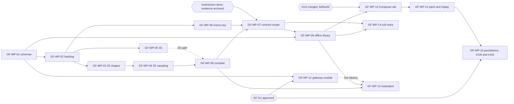

# Gemini generated formations: work packages

> **STATUS: PROPOSED — NOT IMPLEMENTED.** Nothing in this file exists in code. Do not open these issues or start coding until Arnav approves (see [Gating](#gating)).
>
> Source author: William Pimentel (`wpimento`), [source handoff](../handoffs/Encore_Gemini_Flash_Lite_Architecture.md). Integrator: Arnav (issue #117).

Purpose: split William's Gemini generated-formation architecture into issue-ready packages, `GF-WP-01` to `GF-WP-15`, each one small enough for one person and their agent to finish and PR. Status: proposal; audit base `origin/main` 4c41f75 (first written at 9f78902; what changed since is listed once, in the canonical spec). Owner: Arnav (integration, issue #117). Nobody is assigned: every package's assignee is "TBD by Arnav" (cross-integration ruling XI-10). GF-WP-12 is reserved for William's lane, which is not an assignment (he has paused); he keeps the sponsor-specific decisions. GF-WP-15's halves are realised by the MongoDB (#130) and Tiger Data (#142) plans.

**Where things live.** The canonical spec [`../integrations/gemini-generated-formations.md`](../integrations/gemini-generated-formations.md) defines requirements `GF-FR-xx`/`GF-NFR-xx`, contract changes `GF-CC-xx`, conflict records `CR-xx` (CR-01–CR-18 are the compatibility audit's C1–C18 in order; CR-19+ are the spec's own), decisions `GF-D1…`, risks `GF-R01…` and the design sections cited below as "spec §n". The [evaluation doc](../validation/gemini-formation-evaluation.md) defines tests `GF-T01…GF-T41` plus `GF-T24b` and the ladder `CL-1…CL-6`. This file only plans the work and links to those definitions.

**Base rules this plan inherits** (link, not restate): the contract, especially [§6 Composition](../design/contracts-and-algorithms.md#6-composition-from-recipe-to-slots), [§8.5 Known limits](../design/contracts-and-algorithms.md#85-known-limits-state-these-dont-hide-them) and [§12](../design/contracts-and-algorithms.md#12-deliberately-not-in-the-mvp); [requirements](../specification/requirements.md#composition-and-score), especially FR-08 to FR-11 and [NFR-04](../specification/requirements.md#3-non-functional-requirements) (the offline rule); [evaluation and tests](../validation/evaluation-and-tests.md#6-automated-tests); the boundary rules in [`AGENTS.md`](../../AGENTS.md) and [`tests/boundaries.test.ts`](../../tests/boundaries.test.ts); and the workflow in [`../development/WORKFLOW.md`](../development/WORKFLOW.md).

## 1. The two modes, and what each package serves

William's architecture has one pipeline: prompt → Gemini → `SceneSpec2D` or `SceneSpec3D` → deterministic `compileGeneratedScene(scene, params)` → `Formation` → preview → operator acceptance → `INJECT_SCORE` into one drone → gossip → local flight and repair. Gemini proposes geometry only. It never flies drones, assigns slots, reads agent state or overrides repair.

The canonical spec defines two operating modes:

- **Mode OFFLINE-AUTHORING** (spec §4.3). Compliant with NFR-04 **and** the `AGENTS.md` ground rule only if **no network client is checked into the repo**: a person (or a tool outside this repo, such as AI Studio) produces the scene, and only validated `encore.composition` v2 files, one generated cue each, are committed in the one composition library `assets/compositions/*.json` (XI-18), which the app loads with no network. There is no separate scene library. A checked-in authoring script that calls Gemini is LIVE-GATEWAY-class and needs GF-D1.
- **Mode LIVE-GATEWAY.** William's `gemini` module of the optional shared gateway is called from the app through X-RUN/live (provisional, #110; [boundaries §6.1](../design/OPTIONAL_INTEGRATION_BOUNDARIES.md#61-x-runlive-provisional-d3-gated)). It is allowed only after decision **GF-D1**, which is Phase 2 D3 approved for this integration ([Phase 2 roadmap](PHASE2_ROADMAP.md#decisions-for-arnav), provisional: depends on #110). D3 is one decision, shared with MDB-D1 (#130) and TIG-D1 (#142), and approving it for one integration does not approve it for another (XI-9). It amends NFR-04, the `AGENTS.md` ground rule, the contract §12 "Never" row and the decisions log, scoped to the optional gateway only. It is optional and off by default: a non-secret build flag enables it, the default build makes zero external requests and NFR-04's acceptance test is unchanged. The offline library stays the fallback.
- **When the app may call the gateway** (XI-5, correcting CR-25's "never at run time"). The app may call it while the simulation runs, on an operator action, but never inside the tick loop or any decision path. Nothing it returns reaches a drone except through an operator `INJECT_SCORE` (I7).

| Package | Mode | Contract change | Owner lane |
|---|---|---|---|
| GF-WP-01 scene schemas and validators | both | none (types move to `src/contracts` in GF-WP-07) | A |
| GF-WP-02 canonical JSON, `sceneHash`, `slotsDigest` | both | none | A |
| GF-WP-03 2D primitives and 512² mask | both | none | A |
| GF-WP-04 2D candidate sampling | both | none | A |
| GF-WP-05 3D primitives, sampling, visibility | both | none | A |
| GF-WP-06 shared compiler | both | none | A |
| GF-WP-07 generated recipe integration `[contract]` | both | GF-CC-01, GF-CC-02 | A |
| GF-WP-08 memo key and serialisation cost | both | GF-CC-03 | A |
| GF-WP-09 offline scene library and loader | OFFLINE-AUTHORING | none | B (the loader is a lane C file†) |
| GF-WP-10 Composer generated tab, preview worker | both | none | lane C files† |
| GF-WP-11 injection, replay, run provenance | both | none | B (CLI); lane C files† (controller, replay) |
| GF-WP-12 Gemini gateway module (X-RUN/live, provisional, #110) | LIVE-GATEWAY | none in `src/contracts`; needs GF-D1 | **No reserved lane (XI-10, XI-24); interface only.** Assignee TBD by Arnav; William keeps the provider decisions (spec §2) |
| GF-WP-13 evaluation harness | offline part: both; latency part: LIVE-GATEWAY (run from the gateway, GF-WP-12) | none | B |
| GF-WP-14 end-to-end integration tests | both | none | B |
| GF-WP-15 persistence adapters (MongoDB Atlas, Tiger Data) | LIVE-GATEWAY | none; needs GF-D1 | MongoDB half: the #130 packages (MDB-WP-*); Tiger Data half: the #142 packages (TIG-01…TIG-11). No reserved lane (XI-24) |

Lanes are those of [`../development/TEAM_ROLES.md`](../development/TEAM_ROLES.md): A brain, contracts and score; B world, evidence and CLI; C experience. Arnav's agents currently run lanes A and B. † Lane C files (`src/app/**`) are Haris's lane; these packages are worked by Arnav's agents unless Haris claims them. A lane is not an assignment: every assignee is "TBD by Arnav" (XI-10). No package assigns work or review to William or Haris (see [Gating](#gating)).

**Priorities** follow William's final priority table (handoff Part IX): *Essential* is the reliable 2D silhouette, the bounded compiler, preview before injection and genuine dissemination; *High* is coloured 3D, MongoDB save and reload, and Tiger Data analytics; *Optional* is automated visual scoring, arbitrary 3D assets and packetisation. Each package also gets a suggested repo label (P0 to P2) for after submission.

**Sizes** in this file are planning estimates for one person with an agent, not measurements. William's latency and timing figures, quoted where relevant, are his planning estimates and are labelled as such.

## 2. Work packages

Every package below uses the same fields. "Tests" lists `GF-T` IDs only; each test's meaning and the package that delivers it are defined in [evaluation doc §5](../validation/gemini-formation-evaluation.md#5-tests-gf-t01gf-t40) (its WP column).

### GF-WP-01 Scene schemas and validators

- **Identifier:** GF-WP-01. **Title:** `SceneSpec2D` and `SceneSpec3D` types, model-facing JSON Schemas, semantic validation and complexity limits.
- **Purpose:** turn William's scene types (handoff §4.2 and §5.1) into one authoritative validator that every path uses: offline library files, the Composer, the CLI and (later) the gateway's responses. Gemini's structured output constrains syntax only; Google's documentation says to validate values in the application, and `minLength`, `maxLength` and `uniqueItems` are ignored by the model (provider facts checked 2026-11-15, PARTLY VERIFIED for the exact keyword list). Every constraint is therefore enforced here.
- **Dependencies:** none among GF-WPs. Base: none. Approvals: none (the types start inside `src/score/generated/` and move into `src/contracts` only in GF-WP-07). Phase 2: none.
- **Owner lane:** A. **Priority:** Essential. Suggested P1. Size: M (planning estimate).
- **Allowed files:** `src/score/generated/types.ts` (new), `src/score/generated/validation.ts` (new), `src/score/generated/schema/scene2d.schema.json` (new), `src/score/generated/schema/scene3d.schema.json` (new; this folder is a proposed path for Arnav to confirm, since XI-18 rules out `assets/scenes/`; `integrations/gateway/src/gemini/` is the alternative), `tests/score/generated/validation.test.ts` (new), `tests/fixtures/scenes/*.json` (new, hand-written valid and invalid scenes).
- **Proposed interfaces:** the scene types are exactly spec §6.2–§6.3 (William's types plus the spec's marked additions); this package adds only the validator:

```ts
// src/score/generated/validation.ts
export interface SceneIssue { code: string; path: string; message: string }
export interface SceneLimits {   // field for field spec §6.5 V1 and §6.6; the values live only there
  rawBytes: number; canonicalBytes: number; minParts: number;   // minParts 1: CL-1 is a one-part sphere
  parts2D: number; parts3DDeclared: number; parts3DMirrored: number; materials3D: number;
  polygonVertices: number; segmentsPath: number; segmentsStroke: number; segmentsTube: number;
  controlPoints2D: number; controlPoints3D: number; subtractParts2D: number }
export const SCENE_LIMITS: SceneLimits;   // 16 KB canonical cap: GF-D7
export type SceneValidation =
  | { ok: true; scene: SceneSpec; warnings: SceneIssue[] }
  | { ok: false; errors: SceneIssue[] };
export function validateScene(input: unknown, limits?: SceneLimits): SceneValidation;
```

- **Implementation steps:**
  1. Write the spec §6.2–§6.3 types (with `SceneSpec = SceneSpec2D | SceneSpec3D`) and the coordinate convention, rotation units and order of spec §6.1.
  2. Write `validateScene` as a pure, total function over `unknown` that implements the scene layers of spec §6.5 in its order, with their codes: V1a, V2, V3, canonicalisation, V1b, then V4–V10 on the canonical scene only. V11 (trial compile, including `radio-partitioned`) and V12 (linter) run operator-side once the compiler exists (GF-WP-10). It also applies the complexity limits exactly as `SCENE_LIMITS` (spec §6.6). William's 6–20 (2D) and 12–30 (3D) part counts are prompt targets, not bounds.
  3. Compute the canonical byte size with GF-WP-02's `canonicalSceneJson` once it exists; until then, check `JSON.stringify` length as a placeholder and leave a TODO tied to GF-WP-02.
  4. Write the two JSON Schemas as data files using only the subset Gemini accepts (`type`, `properties`, `required`, `additionalProperties`, `enum`, `items`, `minItems`, `maxItems`, `minimum`, `maximum`, `anyOf`, `$defs`, `$ref`; provider facts 2026-11-15, VERIFIED from SDK 3.3.0 typings). Keep them small: Google warns that very large or deeply nested schemas are rejected with 400 (VERIFIED, qualitative).
  5. Add fixtures: at least one valid scene per primitive and per mode, William's two partial elephants (handoff §4.2 and §5.1) as valid partial scenes, and one invalid fixture per error code.
- **Acceptance criteria:** every fixture gets the expected verdict and issue codes; the validator never throws on any input (including `null`, cycles excluded by JSON, huge arrays); a test proves each constraint the model ignores (`uniqueItems`, string lengths) is enforced in TypeScript; files in `src/score/generated/` pass the core ESLint rules (no `Date`, `performance`, `Math.random` or `fetch`) and `tests/boundaries.test.ts` (no npm or out-of-boundary imports). At 4c41f75 `boundaries.test.ts` checks clock and random only for `src/agent`, and neither check catches `crypto` or `globalThis.Date`; GF-WP-06 closes that gap.
- **Tests:** GF-T01–GF-T05.
- **Performance requirements:** validation of a 16 KB scene stays well under 1 ms per call in Node (indicative; reported, not gated).
- **Rollback strategy:** revert the PR. Nothing imports these files yet.
- **Contract approvals required:** none.

### GF-WP-02 Canonical JSON, `sceneHash` and `slotsDigest`

- **Identifier:** GF-WP-02. **Title:** canonical scene form, content hash and compiled-slots digest, plus the seeded stream the compiler uses.
- **Purpose:** William asks Encore to "derive a canonical, content-addressed `sceneHash`" and to "verify the hash rather than trusting one supplied by Gemini" (handoff §6.3). Spec §6.7 fixes how; spec §7.12 derives the compiler's seeded randomness from `sceneHash`. `slotsDigest` (GF-CC-02): inside one simulation process the shared memo makes it a consistency assertion, not a drift detector; its real purpose is saved scenes (library, MongoDB) and future multi-device use.
- **Dependencies:** GF-WP-01 (types). Base: the one shared canonical-JSON extraction (XI-7; owner Arnav, not a GF package). Approvals: none.
- **Owner lane:** A. **Priority:** Essential. Suggested P1. Size: S.
- **Allowed files:** `src/score/generated/hashing.ts` (new), `src/score/generated/prng.ts` (new), `tests/score/generated/hashing.test.ts` (new).
- **Proposed interfaces:**

```ts
export const SCENE_QUANTUM = 1e-4;                             // spec §6.7 step 3
export function normaliseScene(scene: SceneSpec): SceneSpec;   // spec §6.7 steps 1–3
export function canonicalSceneJson(scene: SceneSpec): string;  // spec §6.7 step 4; throws RangeError on NaN or ±Infinity
export function sceneHash(scene: SceneSpec): string;           // spec §6.7: SHA-256 hex of the canonical form
export function slotsDigest(formation: Formation, n0: number, slotSpacingMin: number): string;   // spec §7.1 (1e-6 grids)
export function sha256Hex(text: string): string;               // pure TypeScript, UTF-8 input (spec §6.7 step 5)
export function seededStream(seedHex: string, label: string): () => number;   // sfc32 seeded from sceneHash (spec §7.12)
```

- **Implementation steps:**
  1. Implement `normaliseScene`. **The compiler must compile the normalised scene**, not the raw one; otherwise two scenes with the same hash could compile differently. GF-WP-07 stores the normalised scene in the recipe.
  2. Implement `canonicalSceneJson` as quantisation first (`normaliseScene`, scenes only, never run records), then the repo's one canonical-JSON rule: `canonicalJson` in [`src/cli/run.ts`](../../src/cli/run.ts) (sorted keys, throws on non-finite). The same rule serves MongoDB's `contentHash` (#130) and Tiger's artifact hashes (#142) (XI-7). `src/score` may import only `src/score` and `src/contracts` ([`tests/boundaries.test.ts:9`](../../tests/boundaries.test.ts)), so it cannot import `src/cli`. This package therefore waits for the one shared pure extraction (a single proposal, owner Arnav, not one per integration) and imports it from `src/score/canonical.ts` (proposed, owner Arnav, XI-19). That path is decided; Tiger TIG-D7 (#142) cites it too. The extraction is a byte-for-byte move, and `src/cli/run.ts` then imports it. This package writes no private copy (spec §6.7: never a second copy).
  3. Implement SHA-256 (spec §6.7, GF-FR-06) in pure TypeScript, because `src/score` may not import `node:crypto` or any npm package. SHA-256 is the hash everywhere (XI-7): the gateway's server-side checks use `node:crypto` and must give the same digest. Verify against `node:crypto` in the test file, which may import Node modules.
  4. Implement `slotsDigest` exactly as spec §7.1 (index order, positions and colours on the 1e-6 grid, `n0` and `slotSpacingMin` included).
  5. Implement `seededStream` exactly as spec §7.12 (sfc32, integer-only), one stream per label, with no global state.
- **Acceptance criteria:** key order and `-0` do not change the hash; any change of one quantum in any number changes it; NaN and Infinity are rejected; `sha256Hex` equals `node:crypto` on a corpus of strings including non-ASCII titles; `seededStream` is identical across two calls and independent between labels.
- **Tests:** GF-T20; supplies the canonical byte size GF-T04 checks.
- **Performance requirements:** hashing a 16 KB canonical scene in Node stays near a millisecond or less (indicative). It runs once per package-frozen scene object (GF-WP-08). Each drone holds its own frozen copy (GF-WP-07 step 6), so that is n0 hashes per world per adoption, spread over the adoption window, and none per tick in steady state.
- **Rollback strategy:** revert; nothing outside `src/score/generated/` imports it until GF-WP-07.
- **Contract approvals required:** none here. The hash's role in the recipe and memo key is approved through GF-CC-01, GF-CC-02 and GF-CC-03.

### GF-WP-03 2D primitives and the 512² mask

- **Identifier:** GF-WP-03. **Title:** ellipse, polygon, closed cubic Bézier path, thick stroke; union and subtract; internal 512×512 mask.
- **Purpose:** William's 2D mode treats Gemini as "a vector-graphics scene designer" (handoff §4). This package reconstructs the region exactly and rasterises an internal mask for connectivity, interior and boundary work. The mask is never an image file or a user-facing raster.
- **Dependencies:** GF-WP-01, GF-WP-02 (seeded stream, if any jitter is used). Approvals: none.
- **Owner lane:** A. **Priority:** Essential. Suggested P1. Size: M.
- **Allowed files:** `src/score/generated/shapes2d.ts` (new), `tests/score/generated/shapes2d.test.ts` (new).
- **Proposed interfaces:**

```ts
export type Pt2 = [number, number];
export interface Part2D { id: string; priority: number; operation: 'union' | 'subtract';
  contains(p: Pt2): boolean; outline(step: number): Pt2[]; centreline?: Pt2[] }
export interface Region2D { parts: Part2D[]; contains(p: Pt2): boolean;
  bbox: { min: Pt2; max: Pt2 } }                       // contains = parts applied in array order
export interface Mask2D { size: number; cell: number; origin: Pt2; bits: Uint8Array }
export function buildRegion2D(scene: SceneSpec2D): Region2D;
export function flattenCubic(points: Pt2[], segmentsPerCurve: number): Pt2[];   // fixed count, no adaptive tolerance
export function rasterise(region: Region2D, size?: number): Mask2D;           // default 512
export function components(mask: Mask2D): { count: number; largestShare: number; labels: Int32Array };
```

- **Implementation steps:**
  1. Implement spec §7.2 steps 1–3 exactly: its inside tests (even-odd for polygons and paths) and fixed flattening counts, the mask over its extent with parts applied in array order (William's cut-outs between legs, handoff §4.2), and 4-connected components with speck removal.
  2. Determinism as spec §7.12: arithmetic and `Math.sqrt` as they are, every other `Math.*` result snapped to 1e-9 as [`src/score/shapes.ts`](../../src/score/shapes.ts) does, and no `Math.hypot`. Rasterise only after the union box is normalised (`stats.normalise`, spec §7.2 step 2), so thresholds are relative and a half-size copy compiles alike.
  3. Report the component count and largest share for William's "disconnected blobs" check (handoff §4.7), and the V8 and V10 warnings of spec §6.5.
- **Acceptance criteria:** analytic areas of an ellipse, a square and a stroke match the mask within a stated tolerance; subtraction of a centred disc from a disc gives an annulus with one component; repeated calls give byte-identical masks.
- **Tests:** GF-T06, GF-T07, GF-T08 (GF-T08 shared with GF-WP-06).
- **Performance requirements:** rasterising a CL-4 scene (William's elephant silhouette) at 512² within the compiler's overall budget (GF-WP-06). The mask is 262,144 cells; the containment test runs per cell per part, so the part limit from GF-WP-01 bounds the cost.
- **Rollback strategy:** revert; unused until GF-WP-06.
- **Contract approvals required:** none.

### GF-WP-04 2D candidate sampling

- **Identifier:** GF-WP-04. **Title:** boundary, interior and protected-feature candidates with metadata.
- **Purpose:** William's three candidate sources (handoff §4.4): the outer boundary keeps the outline, the filled interior gives density, and protected features keep the trunk, tusks and legs visible. His starting split of about 30–40% boundary and feature points is labelled "a heuristic, not a general optimum"; it stays a tunable constant.
- **Dependencies:** GF-WP-03, GF-WP-02. Approvals: none.
- **Owner lane:** A. **Priority:** Essential. Suggested P1. Size: M.
- **Allowed files:** `src/score/generated/sample2d.ts` (new), `tests/score/generated/sample2d.test.ts` (new).
- **Proposed interfaces:**

```ts
export type CandidateSource = 'boundary' | 'interior' | 'feature';
export interface Candidate { pos: Vec3; colour: RGB; featureId: string; importance: number;
  source: CandidateSource; normal?: Vec3; visibility?: number }   // William's FormationCandidate + Candidate3D fields
export interface Sample2DOptions { n0: number }   // counts and quota are module constants (spec §7.1, §7.2)
export function sample2d(scene: SceneSpec2D, region: Region2D, mask: Mask2D, opts: Sample2DOptions): {
  candidates: Candidate[]; dense: Vec3[] };   // dense: ~2000 points of the filled region, z = 0
```

- **Implementation steps:**
  1. Implement spec §7.2 steps 4–6 exactly: boundary candidates by marching squares with snapping to the vector edges, the seeded hexagonal interior lattice, feature candidates for protected parts, and the one 35%·n0 budget that boundary points and protected reservations share, capped by feasibility (spec §7.2 step 6). Candidate counts are the spec's: the interior lattice has about max(1,500, 4·n0) points (spec §7.2 step 5), so it never falls below the contract's "about `4·n0`".
  2. Colour every 2D candidate with the scene's `foreground` as spec §7.7 (William: "for a white 2D silhouette … `colour: [1, 1, 1]`"); `z = 0`.
  3. Build `dense` from the region, never from candidates or slots, as spec §7.8 (1,500–2,500 points, matching the dense cap in [`tests/score/expand.test.ts`](../../tests/score/expand.test.ts)).
  4. The contract says "about `4·n0`" candidates ([§6](../design/contracts-and-algorithms.md#6-composition-from-recipe-to-slots)); the text change for generated recipes is CR-06, carried in GF-WP-07's `[contract]` PR.
- **Acceptance criteria:** every candidate lies inside the region; a thin stroke of width 0.05 still yields feature candidates; candidate order is a deterministic function of the scene; dense has 2000 ± 500 points.
- **Tests:** GF-T09, GF-T10 (both shared with GF-WP-06).
- **Performance requirements:** within GF-WP-06's compile budget.
- **Rollback strategy:** revert.
- **Contract approvals required:** none (CR-06 wording goes through GF-WP-07).

### GF-WP-05 3D primitives, surface sampling and visibility

- **Identifier:** GF-WP-05. **Title:** ellipsoid, capsule, cylinder, cone and tapered tube with transforms and mirror-x; area-weighted surface sampling; union-aware interior filtering; normals and visibility.
- **Purpose:** William's 3D mode builds "a genuine volumetric object using mathematical primitives" (handoff §5). He notes that sampling polar angles uniformly clusters points at the poles, so sampling must be approximately area-weighted; that a head overlapping a torso wastes drones unless hidden points are filtered; and that visibility from a reference view keeps the object recognisable.
- **Dependencies:** GF-WP-01, GF-WP-02. Can run in parallel with GF-WP-03 and GF-WP-04. Approvals: none.
- **Owner lane:** A. **Priority:** High (William). Suggested P2. Size: L.
- **Allowed files:** `src/score/generated/shapes3d.ts` (new), `src/score/generated/sample3d.ts` (new), `tests/score/generated/shapes3d.test.ts` (new), `tests/score/generated/sample3d.test.ts` (new).
- **Proposed interfaces:**

```ts
export interface Solid3D { id: string; materialId: string; importance: number;
  insideDepth(p: Vec3): number;                        // signed analytic depth, > 0 inside (spec §7.3 step 3)
  surface(count: number, next: () => number): { pos: Vec3; normal: Vec3 }[];   // spec §7.3 steps 1–2; analytic normals
  area(): number }
export function buildSolids(scene: SceneSpec3D): Solid3D[];   // mirror-x parts expanded here
export interface Sample3DOptions { n0: number; referenceView: SceneSpec3D['referenceView'] }   // counts: spec §7.3 step 2
export function sample3d(scene: SceneSpec3D, solids: Solid3D[], opts: Sample3DOptions): {
  candidates: Candidate[]; dense: Vec3[] };
export function viewDirection(view: SceneSpec3D['referenceView']): Vec3;   // fixed convention, audience on +Z
```

- **Implementation steps:**
  1. Primitives with explicit transforms; convert rotations to a matrix once; snap every `Math.*` result other than arithmetic and `sqrt` to 1e-9 (spec §7.12). A `~m` copy's candidates and dense points are the x-reflection of the original part's, never a fresh sample of the copy.
  2. Tapered tube: centreline from the cubic control points, a rotation-minimising frame computed deterministically, radius interpolated from `startRadius` to `endRadius`.
  3. Area-weighted sampling exactly as spec §7.3 steps 1–2: tessellate each part at the spec's fixed mesh resolution, choose triangles by cumulative area from the seeded stream, and take a uniform barycentric point in each (the √u construction). Then project every sample onto the analytic surface as spec §7.3 step 1 says, so the mesh only drives area weighting. Normals stay analytic. (An affine image of a uniform sphere lattice is not area-uniform: for radii (1, 0.5, 0.3) its density differs about 3.3× between the x and z poles, which GF-T11 would catch.)
  4. Union-aware filtering exactly as spec §7.3 step 3: drop any candidate with `insideDepth > ε = 0.01` in another part, for every part, with no protected exception; record `hiddenFraction` and the `feature-mostly-hidden` warning. Because samples lie on the analytic surface (step 3), ε does not depend on mesh resolution or part size.
  5. Visibility, ranking inputs and the rear-side floor as spec §7.3 steps 4–5 (William: favour the reference view "without entirely sacrificing rear-side geometry").
  6. Colour every candidate from its material (spec §7.7). Dense as spec §7.8, after filtering.
- **Acceptance criteria:** sampled point density on the GF-T11 ellipsoid passes its equal-area band test; points more than ε inside a second, overlapping solid are removed, and two tangent or coincident parts keep their exposed points; a mirror-x copy's candidates and dense points are the exact x-negation of the original's (exact symmetry of the final selection is not required, GF-T15); normals are unit length.
- **Tests:** GF-T11–GF-T15 (GF-T15 shared with GF-WP-06).
- **Performance requirements:** within GF-WP-06's compile budget for CL-1 to CL-4 3D scenes; William's planning estimate for 3D reconstruction is about 0.1–2 s, which is above the repo's cold-expansion budget (see GF-WP-06).
- **Rollback strategy:** revert; the 2D path does not depend on it.
- **Contract approvals required:** none.

### GF-WP-06 Shared compiler

- **Identifier:** GF-WP-06. **Title:** `compileGeneratedScene`: spacing-constrained, feature-aware selection, farthest-point ordering, placement P1, colours, dense, bounds, warnings and totality.
- **Purpose:** William's "deterministic formation compiler" (handoff §6), producing the existing `Formation` type with no new simulation engine. Spec §7.4–§7.11 fix how it meets the contract.
- **Dependencies:** GF-WP-02, GF-WP-04 (2D), GF-WP-05 (3D; the 2D path can merge first behind a `mode` check that returns a typed rejection for `scene3d`). Approvals: none (new files only).
- **Owner lane:** A. **Priority:** Essential. Suggested P1. Size: L.
- **Allowed files:** `src/score/generated/selection.ts`, `src/score/generated/placement.ts`, `src/score/generated/compile.ts`, `src/score/generated/index.ts` (all new); `tests/score/generated/compile.test.ts`, `tests/score/generated/perf.test.ts` (new); `tests/boundaries.test.ts` (apply the clock and random checks to `src/score` too, and catch `crypto`, `globalThis.Date` and `self`); `eslint.config.js` (the same gaps, plus spec §7.12's `no-restricted-properties` rule for `src/score/generated`; a build-config change that needs its owner's sign-off).
- **Proposed interfaces:** `compileGeneratedScene`, `COMPILER_VERSION`, `CompileResult`, `CompileWarning` and `CompileStats` exactly as spec §7.1 (William's `CompileResult` extended with a typed rejection, `slotsDigest` and stats).
- **Implementation steps:**
  1. Normalise and hash the scene (GF-WP-02). Build candidates and `dense` in normalised scene space (GF-WP-04 or GF-WP-05).
  2. **Selection: implements spec §7.4 exactly.** William's design is kept: protected reservations, the boundary quota, William's `Q(p)` in 3D and one common minimum spacing over all points. In detail, as §7.4 fixes them:
     - reservations only for small protected parts, with `kMin = 3` and m_f = min(kMin, ⌊length_f/δ⌋ + 1), served by normalised w_f, and `feature-starved` when a part ends below kMin;
     - the boundary quota split across contours by length (largest remainder), placed at arc-length steps with skip-forward;
     - one canonical spacing search: bisection of δ over [0.35·δ₀, δ₀] for 10 steps, in three phases (full quotas, reservations relaxed to one slot, boundary quota zero), and `infeasible-count` if no phase succeeds;
     - all thresholds relative to the normalised extent (`stats.normalise`, spec §7.2 step 2).
  3. **Ordering (spec §7.5).** Order the `n0` selected points with the existing `farthestPointOrder` from [`src/score/fps.ts`](../../src/score/fps.ts), slot 0 nearest the centroid. This keeps the contract's prefix property (FR-10, AS-09), the observer's priority weights and the interleaved indices local healing relies on (CR-05). It also meets William's "recognisability at every prefix" goal. An importance-weighted order is GF-CC-04, deferred.
  4. **Placement P1 (spec §7.6, GF-D5).** Uniform scale so the closest pair is `slotSpacingMin·1.001`, then translate the bounds centre to (0, 30, 0), exactly as `expandRecipe` step 3. William's caps (width 40 m, height 25 m, minimum altitude 5 m) become validation warnings or rejections, never clamps (CR-04); note that existing formations already exceed 40 m (ENCORE is about 78 m wide at n0 = 200, one local run). P2 (William's bounds-first placement) is GF-CC-05 and not built here. A 2D `below-floor` result first tries permitted simplification 5 (spec §7.6, §7.11): layering into L ∈ {2, 3} copies at z offsets of δ, the smallest L that clears the floor. It departs from William's "Keep Z fixed" (CR-32, GQ-6) and is reported as a warning.
  5. Colours from the selected candidates, clamped to `[0, 1]`, in the colour space of spec §7.7: generated colours pass through like palettes until the hex conversion lands for every hex path together (CR-33, GF-D6). Dense transformed with the same scale and translation; bounds over slots and dense.
  6. Warnings: confined repair, as spec §8.11. The check runs on the components of the slot graph with edges ≤ `rClaim` and reports every component other than the largest as "repair confined", and as "cannot heal internally" when it is too small or has no index gap above `claimGap`. The single-slot island of the [Phase 2 linter's L3](../design/ANIMATED_CHOREOGRAPHY_RFC.md#9-score-linter-checks-l1l6) is a strict subset (provisional: depends on #110; contract §8.5 limit 1, CR-14). Also: size and altitude checks exactly as spec §7.6 (William's caps warn; `below-floor` after layering, and `too-large-world`, reject); a protected feature that received no slot; colours that are dark or reserved (the same rules as `validateDraft`).
  7. **Totality (spec §7.11).** Wrap every stage; `compileGeneratedScene` returns `ok: true` or a typed rejection for any V3-valid scene, never a throw, and it never returns a substitute formation itself. What callers do with a rejection is one rule (GF-WP-07 step 4): `expandRecipe` is total for generated recipes and returns the frozen fallback sphere, detected only by the pure `isFallbackFormation(formation)`. Operator-side paths use the strict variant, which throws a typed `GeneratedSceneRejected`.
  8. Use `n0` everywhere (40 in G1-style tests, 200 in evaluation), never a hard-coded 200.
- **Acceptance criteria:** for every valid fixture at n0 ∈ {40, 200}: exactly `n0` slots, indices `0…n0-1`; closest pair ≥ `slotSpacingMin`; all numbers finite; identical output and `slotsDigest` on a second call and across fresh module instances; dense non-empty and ≤ 2500; every slot within `slotSpacingMin` of a dense point (the existing expand test's rule). No input in the fuzz corpus of valid scenes throws, and `isFallbackFormation` is false for every accepted scene (GF-T41).
- **Tests:** GF-T16–GF-T19, GF-T41 (shared with GF-WP-07); GF-T08–GF-T10 and GF-T15 (shared with GF-WP-03, -04 and -05); GF-T06–GF-T15 rerun as integration of the stages.
- **Performance requirements:** target: cold compile at n0 = 200 under the existing 200 ms cold-expansion budget ([`tests/score/perf.test.ts`](../../tests/score/perf.test.ts)) for CL-1 to CL-4 scenes in Node, measured the way that file does (per-test duration, no clock in the test). William's figures (0.05–0.5 s for 2D, 0.1–2 s for 3D) stay planning estimates. If 3D CL-4+ cannot meet the target, the package reports measured times and the choice (raise the budget for generated recipes only, or precompile at authoring time and accept Option B for those) is recorded as decision GF-D8, never silently assumed. The first main-thread compile happens at injection (GF-WP-10).
- **Rollback strategy:** revert; not reachable from `expandRecipe` until GF-WP-07.
- **Contract approvals required:** none for this package. Its behaviour is what GF-CC-01 adopts.

### GF-WP-07 `[contract]` Generated recipe integration

- **Identifier:** GF-WP-07. **Title:** add William's `generated` recipe kind to `Recipe`, wire it through `expandRecipe`, `composeNext` and the brain's adoption check.
- **Purpose:** William's §6.1 recipe variant, as spec §8.1, §8.2 and §7.11 define it. This is the first package that changes behaviour visible to the simulation.
- **Dependencies:** GF-WP-06 (2D at least), GF-WP-08 must merge with or before this package (without it a 10–30 KB scene costs about 45–165 ms per tick in key building, from one local benchmark). Base: the brain-side "do not adopt on mismatch" check edits `src/agent/encoreBrain.ts` and `EncoreState` ⇒ Track P only, new evidence revision, after #122 archived and #115 settled ([Phase 2 Track P rules](../development/PHASE2_WORK_PACKAGES.md#22-track-p-post-submission), provisional: depends on #110). At 4c41f75 both #122 (evidence matrix) and #115 (perf) are merged; the archive waits for the submission. Phase 2: P2-WP-20 / P2-CC-01 (provisional, #110) edit `src/contracts/score.ts`, `copyMovement` next to `copyRecipe` in `compose.ts`, and add `validateMotion` to the same `handleScoreMessage` check. Merge one at a time, and compose the check as `validateMotion`, then the generated-recipe check (spec §8.1, §8.2). Approvals: **GF-CC-01** and **GF-CC-02** approved by Arnav; GF-FR-01 accepted (FR-09 keeps its three MUST kinds).
- **Owner lane:** A. **Priority:** Essential. Suggested P1. Size: M.
- **Allowed files:** `src/contracts/generatedScene.ts` (new), `src/contracts/score.ts`, `src/contracts/index.ts`, `docs/design/contracts-and-algorithms.md` (§2, §3 note on SCORE size, §6), `src/score/expand.ts`, `src/score/shapes.ts`, `src/score/compose.ts`, `src/score/index.ts`, `src/score/generated/types.ts` (becomes a re-export), `src/agent/encoreBrain.ts` (one call in `handleScoreMessage`), `src/agent/state.ts` (`EncoreState`, only as GF-CC-02 requires), type-narrowing only in `src/app/ui/Composer.ts`, `src/app/ui/Timeline.ts`, `src/app/ui/commands.ts`; `docs/context/evidence-and-assumptions.md` (AS-11, proposed: radio payload size is not modelled, scenes capped, CR-12; AS-12, proposed: per-drone scene compilation is not modelled, spec §8.8); tests under `tests/score/`, `tests/agent/`, `tests/contracts/`.
- **Proposed interfaces:** PROPOSED CONTRACT CHANGE — REQUIRES ARNAV APPROVAL (GF-CC-01, GF-CC-02).

`Recipe` and `GeneratedRecipe` exactly as spec §8.1; this package adds:

```ts
// src/score (public API additions)
export function makeGeneratedRecipe(scene: SceneSpec, n0: number, params: Params):
  { ok: true; recipe: GeneratedRecipe; warnings: CompileWarning[] } | { ok: false; issues: SceneIssue[] } | Extract<CompileResult, { ok: false }>;
export function acceptsRecipe(recipe: Recipe, n0: number, params: Params): boolean;   // brain-side check, pure, total
export function expandRecipeStrict(recipe: Recipe, n0: number, slotSpacingMin: number): Formation;   // operator side; throws GeneratedSceneRejected
export function isFallbackFormation(formation: Formation): boolean;   // pure identity check against the frozen fallback (spec §7.11)
export class GeneratedSceneRejected extends Error { readonly code: string }   // the compiler's typed rejection code
export function copyRecipe(recipe: Recipe): Recipe;   // now exported; spec §8.7 deep-frozen canonical scene, registered for GF-WP-08
```

- **Implementation steps:**
  1. Move the GF-WP-01 types into `src/contracts/generatedScene.ts`; re-export from `src/score/generated/types.ts`.
  2. Add the recipe variant. Generated recipes have **no `palette`**: colours come from scene materials or `foreground`. Every site that reads `recipe.palette` must narrow on `kind` (the list is GF-CC-01's, spec §8.1; at 4c41f75: `compose.ts:30-33` `copyRecipe`, `expand.ts:91`, `Composer.ts:79, 96-98, 273`, `Timeline.ts:61, 74`).
  3. Give every `switch (recipe.kind)` in `shapes.ts` (`selectionCloud`, `denseCloud`, `defaultPalette`) an explicit `generated` case or an early branch in `build()`, plus an `assertNever` default so a future kind fails at compile time. Fix label fallbacks that would silently call a generated formation "Helix" (`Timeline.ts:49`, `commands.ts:358` at 4c41f75): use `scene.title`.
  4. **Totality: one rule in every doc (spec §7.11).** In `expandRecipe`, branch on `kind === 'generated'` to `compileGeneratedScene` on the stored, normalised scene.
     - **Total path.** `expandRecipe` never throws for a generated recipe. On a rejection it returns the frozen, deterministic fallback `sphere` for that `(n0, slotSpacingMin)`. It must be total because `world.step` has no try/catch (`world.ts:156`), and preloaded scores (I4), the observer and `pacedSlotPos` reach `expandRecipe` without the adoption check.
     - **Strict path.** Operator-side callers detect failure only by a throw, so they call `expandRecipeStrict` (or `compileGeneratedScene` directly), which throws a typed `GeneratedSceneRejected`. These are `validateDraft` (`Composer.ts:104`), `composeNext` and `makeScore` (via `slotPositions`, `compose.ts:52, 72`), the library loader (GF-WP-09) and X-IN. The controller's `try` already catches `composeNext` throws. So the operator never validates, composes or schedules the fallback as if it were the scene.
     - **No module-level counter.** Tests use the pure `isFallbackFormation(formation)` identity check.
  5. `copyRecipe` deep-copies a generated recipe and the copy's scene is deep-frozen (spec §8.7, CR-08) and registered as package-frozen for GF-WP-08.
  6. **Adoption check (GF-CC-02, spec §8.2).** In `handleScoreMessage`, after the existing version checks, call `acceptsRecipe` for each movement's recipe. It refuses only for causes every honest drone computes the same way from the score and its own constants: a rejected compile (`isFallbackFormation`), a `sceneHash` label that differs from the hash recomputed from the scene, `compilerVersion ≠ COMPILER_VERSION`, or a `slotsDigest` mismatch where the digest's `n0` and `slotSpacingMin` match the drone's own. A parameter mismatch is out of scope and the digest is not compared. On refusal the score is not adopted, one log note is written, and `(version, sceneHash)` goes into `refused?`. That `EncoreState` field is optional, absent until the first refusal (so `JSON.stringify` omits it), and holds at most 8 entries, oldest evicted. A remembered pair is not rechecked on re-send.
     - **Swarm-level consequences** (spec §8.2). In one process every brain gets the same compile from the shared memo, so a refusal is uniform: all drones refuse or none does. Refusal becomes partial only where compiles differ between drones (multi-device, mixed compiler versions). Then refusers block healing next to them, never relay and keep the old score, which splits the swarm until a score both sides accept arrives. Adopting with a log note instead (detection, not refusal) is open as GQ-1 under GF-D3; the partial-refusal test is GF-T24b.
     - On success (part of GF-CC-02) each generated recipe in the adopted copy (`copyJson`, `encoreBrain.ts:137`, mutable) is replaced by `copyRecipe(recipe)`, so the brain holds a package-frozen scene and GF-WP-08's hash cache applies; the JSON is unchanged for any scene that went through the operator's `copyRecipe`, so `stateHash` is not affected. Existing kinds return `true` with no work and are not replaced, so the brain's behaviour on today's scores is unchanged.
  7. Contract text: §2 types; §6 "Expansion" gains the generated path, the "at least `4·n0`" candidate wording (CR-06) and the placement rule; §3 adds that SCORE size is not modelled and scenes are capped; §6 states the `slotsDigest` scope: inside one simulation process the shared memo makes it a consistency assertion, not a drift detector; its real purpose is saved scenes (library, MongoDB) and future multi-device use (CR-18).
- **Acceptance criteria:** existing recipes produce byte-identical formations, and S0–S5 at seed 1 give the same `stateHash` before and after while `refused` is absent (the brain change is a no-op for non-generated kinds); a generated recipe round-trips through `composeNext`; a mutated `scene` or wrong `slotsDigest` is not adopted and does not crash `world.step`; for every rejected generated recipe the strict path throws `GeneratedSceneRejected` (so `validateDraft` and `composeNext` fail visibly) and the total path returns a formation for which `isFallbackFormation` is true; a preloaded score holding a rejected generated movement leaves `world.step` running; an unknown kind fails typecheck.
- **Tests:** GF-T21, GF-T23, GF-T24; GF-T24b (partial refusal, shared with GF-WP-13); GF-T41 (the recipe paths, shared with GF-WP-06); GF-T16–GF-T20 rerun; the existing T17 and G4 suites unchanged.
- **Performance requirements:** the adoption check adds one scene hash and one frozen canonical copy per adopter per adopted score (16 KB canonical, indicative cost below a millisecond) and no per-tick work.
- **Rollback strategy:** revert the `[contract]` PR. Saved scene files remain on disk; the loader (GF-WP-09) reports them as unsupported instead of failing.
- **Contract approvals required:** GF-CC-01, GF-CC-02 (Arnav, `[contract]` PR rules in [`../development/WORKFLOW.md`](../development/WORKFLOW.md)); CR-06 and CR-12 text.

### GF-WP-08 Memo key and serialisation cost

- **Identifier:** GF-WP-08. **Title:** content-addressed memo key for generated recipes, a hash cache limited to package-frozen scenes, and a performance test with a 30 KB scene.
- **Purpose:** William flags that keying the memo on `JSON.stringify(recipe)` is wasteful for nested scenes (handoff §6.3). The code builds that key on every call, including cache hits ([`src/score/expand.ts`](../../src/score/expand.ts)), and the Encore world calls it about 600–800 times per tick at n0 = 200 (call counts read from code; #115 did not change them; timings from one local benchmark). Spec §8.3 resolves it as GF-CC-03.
- **Dependencies:** GF-WP-02. Merges with or before GF-WP-07. Base: as GF-WP-07 (touches `expand.ts`). Approvals: **GF-CC-03**.
- **Owner lane:** A. **Priority:** Essential. Suggested P1. Size: S.
- **Allowed files:** `src/score/expand.ts`, `src/observer/reference.ts` or `src/observer/index.ts` (the observer fix, step 5), `docs/design/contracts-and-algorithms.md` (§6 memo sentence), `tests/score/memo.test.ts` (new), `tests/score/perf.test.ts`, `tests/observer/` (the whole-world hash count).
- **Proposed interfaces:** PROPOSED CONTRACT CHANGE — REQUIRES ARNAV APPROVAL (GF-CC-03).

```ts
// inside src/score/expand.ts (module state, allowed as "a memo cache of pure expandRecipe results")
const frozenScenes = new WeakSet<object>();          // scenes this package deep-froze (copyRecipe, spec §8.7)
const hashOf = new WeakMap<object, string>();        // scene → H(scene), filled only for members of frozenScenes
function memoKey(recipe: Recipe, n0: number, slotSpacingMin: number): string;
//   generated: `generated:${COMPILER_VERSION}:${H(recipe.scene)}:${n0}:${slotSpacingMin}` (module constant, no palette);
//              H cached only when frozenScenes.has(recipe.scene), otherwise recomputed on every call
//   others:    `${JSON.stringify(recipe)}|${n0}|${slotSpacingMin}`, built on every call exactly as today
```

- **Implementation steps:**
  1. For generated recipes, key on a `sceneHash` **recomputed from the scene content** and on the module's `COMPILER_VERSION`, never on the recipe's own `sceneHash` or `compilerVersion` fields, so one shared memo can never hand one scene's formation to another. A `compilerVersion` other than `COMPILER_VERSION` is rejected (`unsupported-compiler`, spec §6.4). The field is only a checked label: a mismatch makes the recipe invalid; operator-side validation rejects it (GF-WP-10, GF-WP-11) and the brain-side refusal is part of GF-CC-02 (GF-WP-07).
  2. Cache `H` by identity **only for scenes this package deep-froze** (`frozenScenes`, filled by `copyRecipe`). Any other scene is hashed on every call, so mutating an unfrozen recipe can never return a stale formation; it is correct but slow. Brain copies come from `copyJson` (`encoreBrain.ts:137`) and are not frozen, so GF-WP-07 step 6 swaps in `copyRecipe` copies; brain state then keeps that object between ticks (the world passes `bodies[id].state` by reference), and each drone hashes once per adoption. That is n0 hashes per world per adoption, spread over the adoption window, and none in steady state (spec §8.3; sharing one frozen received score between brains instead is GQ-7).
  3. **Existing kinds are untouched**: their key is built on every call, as spec §8.3 says ("Keys for text, sphere and helix are unchanged"). Identity caching for them would make the memo identity-keyed against contract §6's "memoised on JSON(recipe)", and `validateDraft` shares `draft.palette` by reference (`Composer.ts:97`). Any such extension is a separate GF-CC-03 amendment with its own mutation test.
  4. Update the contract §6 comment ("memoised on JSON(recipe), n0 and `slotSpacingMin`") to name the generated key and state that its hash is cached only for package-frozen scenes.
  5. **Observer fix (part of GF-CC-03, no contract change; spec §8.3).** `ReferenceScores.reference()` returns a fresh `structuredClone` on every call (`observer/reference.ts:37`), and its clones are unfrozen, so each sample would hash the scene again. Either `ReferenceScores` keeps one copy per version, with generated recipes made by `copyRecipe`, and returns it by identity, or the observer memoises the `Formation` per `versionKey` and movement index. Both are safe because `register()` already rejects conflicting content for one version.
  6. Measure, and report without fixing, the other per-copy costs of a large score that live in contended files: the `copyJson` on every SCORE send and `stateHash()` stringifying every brain state (about 200 copies of the scene at n0 = 200). These belong to follow-up issues (#115 is merged; open #82 still edits `world.ts`).
- **Acceptance criteria:** a deterministic test, with no clock, spies on the hash and shows at most one hash per package-frozen scene (made by `copyRecipe`) over 800 calls; a whole world with the observer, after one generated injection, makes at most n0 + O(1) hash calls per adoption and none per steady-state tick in brains or the observer; mutating an unfrozen recipe after one call (an existing kind's palette, and a generated scene not made by `copyRecipe`) changes the next `expandRecipe` result; two recipes carrying the same `sceneHash` field but different scenes get their own scenes' formations; the existing memo tests and FR-08/T17 tests pass unchanged.
- **Tests:** GF-T22.
- **Performance requirements:** with a 30 KB package-frozen scene, 800 warm calls cost about what 800 calls cost for a small recipe today (one local measurement put a warm small-recipe hit at about 0.7 µs). Reported through vitest's per-test duration, as `perf.test.ts` does.
- **Rollback strategy:** revert; the old key is still correct, only slow for large recipes, and no generated recipe can exist without GF-WP-07.
- **Contract approvals required:** GF-CC-03.

### GF-WP-09 Offline scene library and loader (Mode OFFLINE-AUTHORING)

- **Identifier:** GF-WP-09. **Title:** validated generated scenes as `encore.composition` v2 files in the one composition library `assets/compositions/*.json` (one generated cue each, XI-18), re-validated by `tests/cli/compositions.test.ts`, with a provenance sidecar and the app loader.
- **Purpose:** William's offline principle ("the score must contain enough information to reconstruct it without Gemini, MongoDB, or any external service", handoff §3) and his "known-good saved scenes, and a working offline fallback" (handoff §10). This is the NFR-04-compliant way to show generated formations: Gemini is used by a person at authoring time, and only validated JSON enters the repo.
- **Dependencies:** GF-WP-01 (schemas, for authoring and validation), GF-WP-06 (digests), GF-WP-07 (the app loader builds `GeneratedRecipe`s). Scene authoring itself can start after GF-WP-01. Phase 2: each library file is an X-IN composition file of kind `encore.composition` v2 (CR-29), as proposed in [boundaries §3.3](../design/OPTIONAL_INTEGRATION_BOUNDARIES.md#33-proposed-v2-holds-and-generated-recipes) (proposed, needs Arnav; provisional: depends on #110). v2 adds only per-cue `holdTicks` and generated recipes (after GF-CC-01) and changes nothing else; its per-file rule is GQ-3. P2-WP-30a owns `assets/compositions/` and `tests/cli/compositions.test.ts` (XI-18, boundaries §7); this package adds generated files and checks to them. Approvals: GF-D9 (committing model-authored scenes; the location is fixed by XI-18) and GF-D11 (provider terms), which GF-D9 waits on.
- **Owner lane:** B (library, CLI); the loader `src/app/scenes/library.ts` is a lane C file, worked by Arnav's agents unless Haris claims it. **Priority:** Essential. Suggested P1. Size: M.
- **Allowed files:** `assets/compositions/*.json` (new files only, one generated cue each; the folder is P2-WP-30a's), `tests/cli/compositions.test.ts` (extended with the generated checks; P2-WP-30a creates it), `src/score/generated/authoring/README.md`, `src/score/generated/authoring/PROMPT_2D.md`, `src/score/generated/authoring/PROMPT_3D.md` (prompt drafts; Arnav may consult William on wording), `src/score/generated/authoring/library-index.json` (the provenance sidecar), `src/cli/scenes.ts` (new; a digest helper, not a validator), `src/app/scenes/library.ts` (new), `tests/app/scenes/library.test.ts` (new). The `src/score/generated/authoring/` folder is a proposed path for Arnav to confirm, with `integrations/gateway/src/gemini/` as the alternative for the prompts (XI-18 rules out `assets/scenes/`).
- **Proposed interfaces:**

```ts
// One library scene = one encore.composition v2 file in assets/compositions/ with one generated cue (CR-29, XI-18).
// v2 is boundaries §3.3's proposal: it adds only per-cue holdTicks and generated recipes and changes nothing else,
// and X-IN rejects unknown keys. So the file carries no library or authoring key; that metadata is in the sidecar.
export interface SceneFile {
  schema: 'encore.composition'; v: 2;
  name: string;                                               // ≤ NAME_MAX (24) as v1: set by hand or cut from the title; full title stays in scene.title
  cues: [{ name: string; recipe: GeneratedRecipe }];          // exactly one cue, name ≤ NAME_MAX; recipe as spec §8.1, scene normalised, ≤ 16 KB canonical
  provenance?: { producer: string; note?: string };           // v1's field, unchanged: each ≤ 200 characters, plain text (a short summary only)
}
// Sidecar, outside the v2 file: src/score/generated/authoring/library-index.json (proposed path, Arnav to confirm).
export interface LibraryEntry {
  file: string;                                               // basename of the file in assets/compositions/
  ladder: 'CL-1' | 'CL-2' | 'CL-3' | 'CL-4' | 'CL-5' | 'CL-6';
  digests: SlotsDigest[];                                     // spec §8.2: { n0, slotSpacingMin, digest }; at least n0 40 and 200
  authoring: { source: 'gemini' | 'hand'; modelId?: string; thinkingLevel?: string; temperature?: number;
    prompt?: string; promptTemplate?: string; author: string; authoredOn: string; edits: string };
}
export function loadLibrary(): { files: { file: SceneFile; entry: LibraryEntry }[]; problems: { id: string; issue: string }[] };   // src/app/scenes/library.ts
// Authoring helper, no package.json change:  npx tsx src/cli/scenes.ts digest assets/compositions/<file>.json
// Putting `library` or `authoring` keys inside the v2 file instead would be a proposed v2 addition for Arnav
// (GQ-3; spec §20 question 6). This plan does not assume it.
```

- **Implementation steps:**
  1. Write the authoring procedure in `src/score/generated/authoring/README.md`: paste the prompt template and the JSON Schema into Google AI Studio (or any other offline-to-the-repo route), save the scene as a v2 file in `assets/compositions/`, run `scenes.ts digest` to add `sceneHash`, the recipe's `slotsDigest` and the sidecar's digests, record provenance in the sidecar's `authoring` honestly (including any hand edits), run `tests/cli/compositions.test.ts`, commit. Raw provider output is never committed (XI-18). Say clearly that no API key and no network client enter the repo; a checked-in script that calls Gemini would be LIVE-GATEWAY-class and need GF-D1. Free-tier prompts may be used by Google to improve products (provider facts 2026-11-15, VERIFIED from the pricing page): never include private data in prompts. Authoring through AI Studio is also subject to the Gemini API Additional Terms recorded in spec §10.6 (UK, Switzerland and EEA: Paid Services only; users 18 or older; PARTLY VERIFIED). Whether and how the team complies is decision GF-D11 for William and Arnav (spec §19), taken before model-authored scenes are committed; the terms are recorded once in spec §10.6.
  2. Prompt drafts follow William's guidance: bold contours, normalised coordinates, audience on positive Z, limited part count, one scene per call; William's settings are proposals to benchmark (2D `minimal` thinking, 3D `low`, temperature about 0.2–0.5).
  3. Seed the library with one scene per ladder rung and mode from William's prompt set (CL-1 heart and sphere up to CL-5; CL-6 kept only as an expected rejection fixture).
  4. Re-validation lives in `tests/cli/compositions.test.ts` (P2-WP-30a), not in a validator of this package's own. For every file in `assets/compositions/` with a generated cue, the test checks the v2 envelope through X-IN's validation, validates the scene with `validateScene`, recomputes `sceneHash`, compiles at each `n0` in the sidecar's `digests` through the strict path (GF-WP-07 step 4) and compares each `digest`; any mismatch fails the check. `src/cli/scenes.ts` only computes the hash and the digests at authoring time; it lives in `src/cli` so it may use `node:fs`.
  5. App loader: `import.meta.glob('/assets/compositions/*.json', { eager: true, import: 'default' })`, keep the files that have one generated cue and a sidecar entry, then check, validate and hash each one; files that fail, or whose stored hash differs, are listed as problems and never offered. Recompiling in the browser and comparing the stored digest is GF-WP-10's job (in the worker), giving the browser half of the determinism check. That check is V8 against V8 today (GF-T19), so it covers V8 realms only.
  6. The same file goes through X-IN unchanged (file picker), once v2 exists. Until then the library is bundled only and is not offered through X-IN. Saved shows in MongoDB are a different container, `saved_shows.composition` (#130); this package defines no other composition kind (GF-WP-11).
- **Acceptance criteria:** the library loads with networking off and the built files request nothing outside `localhost` (NFR-04's test); every committed file validates and its digests match in Node; a deliberately edited file is rejected with a clear message.
- **Tests:** GF-T35; GF-T19 and GF-T20 over every library scene.
- **Performance requirements:** loading and validating the library at start-up adds no compile to start-up; compiles happen on selection.
- **Rollback strategy:** delete the loader import; the JSON files are inert data.
- **Contract approvals required:** none.

### GF-WP-10 Composer generated tab, preview worker and stale requests

- **Identifier:** GF-WP-10. **Title:** a "Generated" source in the merged Composer, preview through a Web Worker, request IDs and stale-response rejection.
- **Purpose:** William's "preview before injection" (Essential) and "make preview and flight separate experiences" (handoff §7.5), placed in the Composer that #112 merged instead of a parallel `AIFormationPanel` (spec §11, CR-16). His `formation.worker.ts` is kept for preview only, because a worker has its own memo and cannot warm the main thread's cache (CR-09).
- **Dependencies:** GF-WP-07, GF-WP-09. Pure validator: P2-WP-30a (provisional, #110) or MDB-WP-02 (#130), whichever lands first and creates `src/app/compose/validate.ts` (XI-13). Base: #113 merged as 6d5ea32 and mounts the Composer and its stage preview on `main` (at c697f6c; spec §3 note), so it no longer blocks this package. Before editing `commands.ts`, `actions.ts` or other shared app files, check the locked paths in [`docs/CURRENT_STATE.md`](../CURRENT_STATE.md). Phase 2: P2-WP-05 (linter warnings in `validateDraft`, provisional: depends on #110) touches the same function; whichever lands second rebases. Approvals: none.
- **Owner lane:** lane C files, worked by Arnav's agents unless Haris claims them. **Priority:** Essential. Suggested P1. Size: M.
- **Allowed files:** `src/app/compose/validate.ts` (the generated branch of the DOM-free `validateDraft` body, XI-13), `src/app/ui/Composer.ts` (`Draft`, the kinds row, `setPreview`), `src/app/ui/GeneratedSource.ts` (new: tab UI), `src/app/workers/formation.worker.ts` (new), `src/app/workers/formationClient.ts` (new), `src/app/ui/store.ts` (preview may carry a precomputed formation), `src/app/render/layers/PreviewLayer.ts` (use it, change the label), `src/app/ui/commands.ts` (`form scene ID`, after #113), `tests/app/composer/generated.test.ts`, `tests/app/workers/formationClient.test.ts` (new); `eslint.config.js` only if the `h(tag, { html })` rule below is enforced by ESLint (a build-config change that needs its owner's sign-off).
- **Proposed interfaces:** `Draft` (the `source` union, `mode`, `status` and `requestId`) exactly as spec §11.1, and `requestId` exactly as spec §10.1 and [boundaries §6.2](../design/OPTIONAL_INTEGRATION_BOUNDARIES.md#62-shared-gateway-skeleton-and-guard) (XI-11, narrowing XI-3; provisional: depends on #110): optional, client-generated, opaque to the gateway and matching `^[A-Za-z0-9._:-]{1,64}$`. A value that does not match is dropped, not echoed, and the request still proceeds; the gateway logs its own server id. This package does not restate the rest. It adds only the worker protocol, which uses the same `requestId` strings from the one client counter:

```ts
type CompileRequest = { requestId: string; scene: SceneSpec; n0: number; params: Params };
type CompileReply = { requestId: string; result: CompileResult };
export function createFormationClient(spawn: () => Worker): {
  compile(req: Omit<CompileRequest, 'requestId'>): Promise<CompileReply | 'stale'>; dispose(): void };
```

- **Implementation steps:**
  1. Change `Draft` to spec §11.1's `source` union. The DOM-free body of `validateDraft` in `src/app/compose/validate.ts` (XI-13) gets a generated branch, so the Composer, X-IN, the gateway and the MongoDB `shows` module (#130) share it. The branch runs `validateScene`, rejects a `sceneHash` label that differs from the recomputed hash, requires status `ready`, builds the recipe with `makeGeneratedRecipe` (the strict path, GF-WP-07 step 4), and keeps the existing name and colour warnings. Its trial compile (V11) also rejects a formation whose placed slots form more than one radio component at `rRadio` (`radio-partitioned`, CR-28; operator acknowledgement instead is GQ-2).
  2. Tab UI: pick a library scene (GF-WP-09) by ladder rung and mode; show title, provenance, warnings (confined repair, size caps, altitude, layering) and the compile status. Scene strings (`title`, provenance) are rendered as text only. `h(tag, { html })` (`dom.ts:18`) is never given a scene or gateway string: `html:` values come only from `icon` in `icons.ts`, enforced by an ESLint `no-restricted-syntax` selector or a `TrustedIcon` brand (GF-T34). The prompt field is present only when the LIVE-GATEWAY flag is on (GF-WP-12); otherwise the tab says scenes come from the offline library.
  3. Worker: compile off the main thread and return the frozen formation and digest. Every request carries a `requestId` from one monotonic client counter (spec §10.1); the client compares the counter and drops any reply older than the latest request (William's "late response can overwrite newer prompt" risk).
  4. Preview: `store.preview` may carry the worker's formation so `PreviewLayer` does not recompile on the main thread; for generated drafts the label reads "target arrangement (preview) — not flown". Live adoption and occupancy come only from the simulation's observer, as today.
  5. Browser determinism: compare the worker's digest for the session's `n0` with the scene file's stored digest; show a visible warning on mismatch.
  6. Injection uses the existing path (`dispatchInject` → controller); the one main-thread compile happens in `composeNext`, bounded by GF-WP-06's budget, and the button shows "composing" during it.
- **Acceptance criteria:** with the gateway flag off the app makes no network request; a stale worker reply never replaces a newer preview; an invalid or rejected scene cannot be injected; the preview is never drawn as drones.
- **Tests:** GF-T29–GF-T31, GF-T34 (app side); keeps GF-T35 passing.
- **Performance requirements:** preview compile does not block the render loop; additions cost at most about 0.5 ms per tick per world on the main thread (the Phase 2 experience gate's figure, provisional: depends on #110); the single injection-time compile stays within GF-WP-06's budget.
- **Rollback strategy:** remove the tab and the generated branch; the existing kinds are untouched.
- **Contract approvals required:** none.

### GF-WP-11 Injection, replay and run provenance

- **Identifier:** GF-WP-11. **Title:** defence-in-depth checks at injection, an optional per-injection lead, replay of saved event logs, and `sceneHash` provenance in run reports.
- **Purpose:** William's MVP sequence (handoff §7.3): generate and compile while the show continues, preview, inject into one drone, measure adoption at the movement start, and report late adoption. Spec §8.9 keeps `scoreLead` at 60 ticks: #105's tests measured adoption within 15 ticks at n0 = 200 in a connected swarm at loss 0.2. William's 8–15 s lead stays available as a presentation choice.
- **Dependencies:** GF-WP-07, GF-WP-10. Base: #113 (`actions.ts`, `commands.ts`) merged as 6d5ea32 (spec §3 note); check the locked paths in [`docs/CURRENT_STATE.md`](../CURRENT_STATE.md) before editing those files. #116 (CLI Encore arm, `report.ts`) is merged. Approvals: none.
- **Owner lane:** B (CLI provenance); controller and replay are lane C files, worked by Arnav's agents unless Haris claims them. **Priority:** Essential. Suggested P1. Size: M.
- **Allowed files:** `src/app/actions.ts` (inject branch), `src/app/ui/commands.ts` (the replay save and load commands; see step 3 for the names), `src/app/ui/Timeline.ts` (cue label from `scene.title`), `src/cli/generated.ts` (new), `src/cli/report.ts` (one provenance column), tests in `tests/app/actions/` and `tests/cli/`.
- **Proposed interfaces:**

```ts
// ControlIntent 'inject' gains an optional lead, used only by composeScore:
{ type: 'inject'; recipe: Recipe; lead?: number }          // composeScore(..., { ...params, scoreLead: lead ?? params.scoreLead })
export interface ReplayLogFile { format: 1; n0: number; paramsHash: string; seed: number; events: EnvEvent[] }   // an event log, not a composition
export function generatedProvenance(record: RunRecord):
  { tick: number; droneId: number; sceneHash: string; compilerVersion: number; slotsDigest: string; title: string }[];
```

- **Implementation steps:**
  1. In the controller's inject branch, for a generated recipe, re-run `validateScene` and verify the hash before `composeScore`, which compiles through the strict path (GF-WP-07 step 4); today non-text recipes pass through unchecked.
  2. Add the optional `lead`. Only `composeNext` reads `scoreLead`, so `{ ...params, scoreLead }` changes no `Params` default and no contract. Explain in the UI that a longer lead lengthens the window in which a drone on a stale base may fly back (contract §8.5 limit 9).
  3. Replay: a save command writes the event log (each `INJECT_SCORE` already contains the full score and scene) with seed and `paramsHash` as a `ReplayLogFile`; a load command resets and schedules it. No Gemini call is involved (William: "replay doesn't depend on Gemini returning the same content").
     - **Not a composition.** A replay log is a deterministic replay of one run. It is not a third composition kind: composition files are `encore.composition` v1/v2 (X-IN, GF-WP-09), and saved shows in MongoDB are `saved_shows.composition` (schemaVersion 1 for text, sphere and helix, 2 for generated; `docs/integrations/mongodb-atlas-show-library.md`, #130). A saved show is explicitly not a replay (William's MongoDB spec).
     - **Command names.** `show save` and `show load` exist as "later" commands (`commands.ts:164-165`). MDB-D9 (#130) keeps them for the file-based X-IN export and import (MDB-WP-09) and gives the cloud show library no console command in the MVP. Arnav allocates the names; this package proposes `replay save` and `replay load`, so `show *` stays the X-IN file path.
  4. Provenance: derive `sceneHash` and friends from `INJECT_SCORE` events already in `RunRecord.events`; the report prints them. `RunRecord` is a contract type and is **not** changed.
  5. Adoption reporting uses the existing observer metrics (`adoptP50`, `adoptMax`, `unadopted` in the evaluation doc); "adoption is not occupancy" (William).
- **Acceptance criteria:** a saved replay log with a generated injection replays to the same `stateHash`; a tampered scene in a loaded file is refused before scheduling; the report lists provenance for each generated injection.
- **Tests:** GF-T36; keeps GF-T21 passing through the event log.
- **Performance requirements:** saving and loading are user actions, not per tick.
- **Rollback strategy:** revert; the `lead` field is optional and unused by existing callers.
- **Contract approvals required:** none.

### GF-WP-12 Gemini module of the optional gateway (X-RUN/live) — interface only

- **Identifier:** GF-WP-12. **Title:** William's `POST /api/generate-formation`, the `gemini` module of the one optional shared gateway at `integrations/gateway/`, out of process.
- **Purpose:** William's sponsor path (handoff §8): keep the key server-side, build the mode-specific prompt, call Gemini with a JSON Schema, and return a schema-checked scene. It attaches at X-RUN/live (provisional, #110; [boundaries §6.1](../design/OPTIONAL_INTEGRATION_BOUNDARIES.md#61-x-runlive-provisional-d3-gated)): its only payload into Encore is a candidate composition that must pass X-IN validation before an operator injection. William owns provider selection, prompts and every provider detail; this entry fixes only the interface Encore depends on (spec §10, CR-10, CR-17, CR-21).
- **Dependencies:** **GF-D1 approved**, that is D3 approved for this integration (LIVE-GATEWAY; XI-9). GF-WP-01 (JSON Schemas at their proposed path `src/score/generated/schema/`, XI-18) and GF-WP-06 (the server-side trial compile). GF-WP-10 for the app-side client. Phase 2: X-RUN/live (provisional, #110) and `P2-G6`; `P2-T35` must be extended for the confined app folder before any client code merges. Base: submission done. Shared skeleton: the one gateway server, `guard.ts`, `errors.ts`, `config.ts` and `GET /api/health` (XI-12), unless this package builds it (see Allowed files). Approvals: GF-D1 (team decision, consulted by Arnav with William and Haris); GF-D11 (provider terms, spec §19) before any live demo; owner sign-off on any change to the root `package.json`, CI or build config (`package.json` and build config are William's files, and he has paused development).
- **Owner lane:** **no reserved lane (XI-24); assignee TBD by Arnav (XI-10); interface only.** William keeps the sponsor and provider decisions (provider selection, prompts, hosting, keys; spec §2), not an implementation lane. **Priority:** High for the sponsor track; Optional for Encore's core claim. Size: not estimated here (William's).
- **Allowed files:** the `gemini` module folder `integrations/gateway/src/gemini/` and its tests in `integrations/gateway/test/gemini/` (XI-20), plus a ladder script in that module folder that runs GF-WP-13's live part and writes dated JSON rows under `results/gemini/`. The gateway is one package with independently optional modules `gemini`, `shows` (MongoDB, #130) and `tiger` (Tiger Data, #142) (XI-1). Its routes are `/api/generate-formation`, `/api/shows*`, `/api/health` and the `tiger` module's read-only routes `/api/runs`, `/api/runs/:runId/metrics`, `/api/comparisons` and `/api/experiments/comparison` (spec §10.4; Tiger §6.7, TD-12, #142). This package implements only `/api/generate-formation`. No module creates its own server. **Shared skeleton (XI-12, XI-20).** `integrations/gateway/src/server.ts`, `guard.ts`, `errors.ts`, `config.ts` and `health.ts` (`GET /api/health`), with the one `package.json`, lockfile, `tsconfig.json`, `README.md` and `.env.example` (no key), defined once in [boundaries §6.2](../design/OPTIONAL_INTEGRATION_BOUNDARIES.md#62-shared-gateway-skeleton-and-guard) (provisional: depends on #110). Whichever module package is approved first builds it, once: GF-WP-12, MDB-WP-03 (#130) or TIG-03 (#142) (XI-12; MQ-8 in `docs/integrations/mongodb-atlas-show-library.md`, #130, answers it the same way). These skeleton files are in this package's allowed files only if it is approved first. Otherwise it depends on the skeleton, adds only its module and its own config entries, and never redefines the guard or the errors. Each module is enabled only by its own server-side configuration, and the absence or failure of one never disables another, the app, the simulator, the CLI or `report.ts`. App side: `src/app/live/geminiClient.ts` (new, proposed name) in the one confined X-RUN/live folder, a lane C file, worked by Arnav's agents unless Haris claims it. Nothing in `src/contracts`, `src/score`, `src/agent`, `src/sim` or `src/observer`; no change to the root `package.json`, so `npm ci` and `scripts/check.sh` stay offline-clean. The root tsconfig does not cover `integrations/`; root `eslint.config.js` must add `integrations/**` to its ignores (a build-config change needing owner sign-off).
- **Proposed interfaces:** the request and success bodies of spec §10.1 (William's envelope, plus `requestId`), under the one gateway envelope for every route (XI-3), which spec §10.1 follows:
  - Success bodies carry no `success` flag; the HTTP status says it.
  - Every error is `{ "error": { "code", "message", "details"?: [{ "path", "reason" }], "requestId"? } }`, with `code` from the shared list (`VALIDATION_FAILED`, `NOT_FOUND`, `PAYLOAD_TOO_LARGE`, `UNSUPPORTED_MEDIA_TYPE`, `RATE_LIMITED`, `UNAUTHORIZED`, `FORBIDDEN`, `CONFLICT`, `SCHEMA_VERSION_UNSUPPORTED`, `DATABASE_UNAVAILABLE`, `PROVIDER_UNAVAILABLE`, `PROVIDER_ERROR`, `TIMEOUT`, `INTERNAL`).
  - Gemini's own reasons go in `details[].reason`. Which reason maps to which code and HTTP status is the table of [spec §10.1](../integrations/gemini-generated-formations.md#101-endpoint-contract-from-william-with-additions-marked); this package does not restate it.
  - `requestId` follows spec §10.1 and [boundaries §6.2](../design/OPTIONAL_INTEGRATION_BOUNDARIES.md#62-shared-gateway-skeleton-and-guard) (XI-11, narrowing XI-3; provisional: depends on #110). It is optional, client-generated, opaque to the gateway and matches `^[A-Za-z0-9._:-]{1,64}$`. A matching value is echoed. A value that does not match is dropped, not echoed, and the request still proceeds; the gateway logs its own server id. The app fills it from one monotonic client counter (GF-WP-10).
  - The gateway may import, by relative path, only pure modules: `src/contracts/**`, `src/score/**` and the pure composition validator `src/app/compose/validate.ts` (XI-13; P2-WP-30a, provisional, #110, or MDB-WP-02, #130). It never imports `src/app`, `src/agent`, `src/sim`, `src/observer` or `src/cli` (XI-2, which supersedes CR-24's "cannot import `src/`"). Its server-side validation is therefore complete: `validateScene`, `sceneHash` and a trial compile at the app's smallest and largest supported `n0` before it answers. That is the one feasibility rule the `shows` module also applies on save (XI-17, proposed; the final values are set when GF-CC-01 is approved). The app still re-validates and re-hashes every `scene` and never trusts the returned `sceneHash` (CR-26).
- **Implementation steps (interface obligations only):**
  1. Use the one shared guard (XI-12, [boundaries §6.2](../design/OPTIONAL_INTEGRATION_BOUNDARIES.md#62-shared-gateway-skeleton-and-guard), provisional: depends on #110). It binds `127.0.0.1` only and refuses to start on any other address unless a server-side authorisation is configured and enabled (a flag alone is never enough). It refuses any non-loopback peer. It sends no CORS headers unless OIB-Q2 (dev proxy or CORS, open in [boundaries §13](../design/OPTIONAL_INTEGRATION_BOUNDARIES.md#13-open-questions)) is decided for CORS. The module itself caps prompt length and response size (the scene cap from GF-WP-01). Request bodies accept no unknown field (`additionalProperties: false`).
  2. **Localhost is not a boundary** (spec §10.3; the guard rules are boundaries §6.2's). A `Content-Type` other than exactly `application/json` gets 415 before any upstream call. Only the `Host` values `127.0.0.1:PORT` and `localhost:PORT` are accepted, plus the dev proxy if OIB-Q2 picks one. Every non-GET route needs an exact `Origin` match, and a missing or `null` Origin gets 403 `FORBIDDEN`. A per-launch random token is optional and never a `VITE_*` variable. The guard is shared, so the same rules apply to the `shows` (#130) and `tiger` (#142) modules.
  3. Key from `GEMINI_API_KEY` on the server only, never a `VITE_*` variable and never in the bundle (CR-17).
  4. **Module isolation and dependencies** (spec §10.3). The `gemini` module imports and reads nothing from the `shows` or `tiger` modules or from X-OUT data, and prompts are never built from run, telemetry or library data. Dependencies use exact versions and a committed lockfile, install with `npm ci --ignore-scripts`, respect a minimum release age (proposed ≥ 14 days, GQ-9), run `npm audit signatures`, and use `node:http` rather than a web framework. Each module reads only its own environment variables, and a disabled module's secrets are never loaded.
  5. Model id, SDK and Node version, structured-output fields (`responseJsonSchema`, `thinkingConfig.thinkingLevel`), retry policy as spec §10.3 (429 and 503 only), pricing and data-use terms: as verified in spec §10.6 (2026-11-15), with its VERIFIED/UNVERIFIED labels. Keep the model id in gateway config and never hard-code free-tier limits. Parse a response only when `finishReason` is `STOP`: `MAX_TOKENS` gives the reason `RESPONSE_TOO_LARGE`, and `SAFETY`, `RECITATION` or a `promptFeedback.blockReason` gives `PROVIDER_BLOCKED` (SCREAMING_SNAKE, XI-16; spec §10.1's kebab-case names are renamed). Whether thinking tokens count against `maxOutputTokens` stays UNVERIFIED.
  6. **Provider terms** (spec §10.6). The Gemini API Additional Terms say API clients offered to users in the UK, Switzerland and the EEA must use Paid Services only, and that users must be 18 or older (PARTLY VERIFIED, spec §10.6). Whether a live demo may run under them is decision GF-D11 for William and Arnav (spec §19), made before any live demo (GQ-5).
  7. App client: in the confined `src/app/live/` folder, behind a non-secret build flag whose default is off and a compile-time constant, so the default bundle does not contain it. Its tests use an injected fake transport and open no socket. Calls are operator-initiated: possibly while the simulation runs, never inside the tick loop or a decision path (XI-5). Every response goes through X-IN, `validateScene` and `sceneHash` in the app; failures fall back to the library with a visible message.
- **Acceptance criteria:** the core repo passes `scripts/check.sh` and the networking-off demo test with `integrations/` deleted and X-RUN/live off; the default build makes zero external requests; no key or `VITE_*` secret appears in the built files; a gateway outage, timeout or 429 leaves the app working from the library; a `text/plain` POST, a foreign `Host`, a foreign, missing or `null` `Origin` and a non-loopback peer are refused before any upstream call; the gateway does not start on a non-loopback address without the server-side authorisation.
- **Tests:** GF-T32, GF-T33, GF-T34 (gateway side); GF-T35's gateway-unreachable case. The live gates also cite the provider terms of spec §10.6 and decision GF-D11.
- **Performance requirements:** William's planning estimates for the model round trip are about 3–12 s (2D) and 6–25 s (3D); the app shows progress and never blocks the simulation loop.
- **Rollback strategy:** delete the module and the client flag; nothing in the core depends on it, and the other gateway modules keep working.
- **Contract approvals required:** none in `src/contracts`. Requires GF-D1 (requirements, ground rule and contract §12 text).

### GF-WP-13 Evaluation harness

- **Identifier:** GF-WP-13. **Title:** ladder runs, compile and quality metrics, determinism and performance protocol.
- **Purpose:** William's "test model output quality, geometry validity, runtime behaviour, and user experience separately" (handoff §12), with his six per-prompt records and his CL-1 to CL-6 prompt ladder. Recognisability cannot be established by geometric checks alone; the protocol records human judgements and labels them as such.
- **Dependencies:** GF-WP-06, GF-WP-09 (offline part); GF-WP-12 and GF-D1 (live latency and first-attempt success). Base: none (#116 merged the CLI Encore arm). Approvals: none for the offline part; GF-D1 for the live part.
- **Owner lane:** B. **Priority:** High. Suggested P2. Size: M.
- **Allowed files:** `src/cli/sceneEval.ts` (new, offline only: no network client in the core repo, spec §4.3), `tests/score/generated/ladder.test.ts` (new), `results/gemini/README.md` (new), result files under `results/gemini/`.
- **Proposed interfaces:** one JSON row per (scene, n0) offline, and one per prompt live. Its fields are the metric names of [evaluation doc §3.2](../validation/gemini-formation-evaluation.md#32-new-metrics) and William's six quality fields as [evaluation doc §7.2](../validation/gemini-formation-evaluation.md#72-williams-six-per-prompt-quality-fields) records them (for example `parseOk`, `schemaOk`, `semanticOk`, `limitsOk`, `compileOk`, `warnings`, `islandSlots`, `confinedSlots`, `radioComponents`, `extent`, `modelLatencyMs`, `e2ePreviewMs`, `regenerated`, `regenReason`, `recognitionRate`). This package does not restate or rename them. Wall-clock fields stay out of records that must replay (evaluation doc §9).

```ts
// npx tsx src/cli/sceneEval.ts --library assets/compositions --n0 40,200 --out results/gemini/   (generated cues only)
```

- **Implementation steps:**
  1. Offline: run every library scene through validation and compile at n0 40 and 200; write one JSON row per (scene, n0) with no wall-clock values in records that must replay.
  2. Human judgement: run the recognisability protocol of [evaluation doc §6](../validation/gemini-formation-evaluation.md#6-recognisability-protocol-class-c) as written: at least 3 respondents not on the team, blind, an ideal and a flown condition, fixed views, one open question and a frozen synonym list. Record `recognitionRate` as `k/n` per scene, view and condition, linked by `sceneHash`; never inferred.
  3. Live (after GF-D1): the gateway's ladder script (GF-WP-12's allowed files) records, for each ladder prompt, `modelLatencyMs` per attempt and `e2ePreviewMs` (failures included), and `regenerated` and `regenReason`, as dated JSON rows under `results/gemini/`. `sceneEval.ts` only reads those rows into the report. Label them as measurements of that day's service, not stable figures. The live part is subject to the provider terms in spec §10.6 and waits on decision GF-D11 (GQ-5).
  4. Report counts, not claims, with the wording rules of evaluation doc §6 step 7 and §11: "n of m scenes compiled", and "k of n people not on the team named it unprompted from the reference view", each proportion with a Wilson 95% interval.
- **Acceptance criteria:** rerunning the offline part from the same commit gives identical rows; every live number carries its date and conditions.
- **Tests:** GF-T24b (shared with GF-WP-07), GF-T25–GF-T28, GF-T37–GF-T40; GF-T16–GF-T20 over the whole library.
- **Performance requirements:** offline run of the whole library in under a minute in Node (indicative).
- **Rollback strategy:** delete the script and results folder.
- **Contract approvals required:** none.

### GF-WP-14 End-to-end integration tests

- **Identifier:** GF-WP-14. **Title:** headless worlds flying a generated formation: dissemination, arrival, settling and collisions, compared with a built-in recipe.
- **Purpose:** William's Essential "genuine score dissemination and transition", and his warnings that a scheduled hold "does not prove settling" and that "spaced targets don't guarantee safe paths" (handoff §7.4, §10).
- **Dependencies:** GF-WP-07, GF-WP-08, GF-WP-09. Base: G4 suites on `main` (#105) as the harness pattern; `runOne` has the Encore arm (#116, merged). Phase 2: when P2-WP-20 lands (animated choreography, P2-CC-01, provisional: depends on #110), add one case showing a generated movement animates unchanged. Approvals: none.
- **Owner lane:** B. **Priority:** Essential. Suggested P1. Size: M.
- **Allowed files:** `tests/generated/e2e.test.ts`, `tests/generated/harness.ts` (new).
- **Proposed interfaces:** test-only helpers, for example `flyGenerated(sceneFile, { n0, seed, loss, injectTick, lead }): RunSummary`.
- **Implementation steps:**
  1. Build a preloaded score with a built-in movement, inject a generated recipe from the library into one drone (FR-19 path), run both arms.
  2. Measure adoption by the movement's start tick, on-slot share at `holdStart`, time to settle, and collision counts; compare with the same run injecting `sphere`.
  3. Run at n0 40 and 200, loss 0 and 0.2, seeds as the evaluation doc's procedure.
  4. Add a kill during the generated hold as an exploratory check of local healing on generated shapes, labelled exploratory (GF-CC-04 would need this as a gate).
- **Acceptance criteria:** pass lines are pre-registered in the evaluation doc before the first run; results are reported as "measured on these runs, not guaranteed".
- **Tests:** GF-T25, GF-T28, GF-T35, GF-T36 (each shared with GF-WP-13, -09 or -11 per the evaluation doc); its runs also feed GF-T26 and GF-T27, which GF-WP-13 reports.
- **Performance requirements:** the suite runs within CI time limits; heavy sweeps sit behind an environment flag as `tests/g1/g1.beyond.test.ts` does.
- **Rollback strategy:** delete the test folder.
- **Contract approvals required:** none.

### GF-WP-15 Persistence adapters (MongoDB Atlas, Tiger Data) — MongoDB half in #130; Tiger Data half in #142

- **Identifier:** GF-WP-15. **Title:** formation library in MongoDB Atlas; real-run telemetry in Tiger Data.
- **Purpose:** William's Part VII: MongoDB stores "the actual validated SceneSpec, not just the prompt"; Tiger Data stores "what actually happened in the simulation". Neither is required for drones to operate.
  - **MongoDB half.** Realised by William's MongoDB spec, integrated in #130 (`docs/integrations/mongodb-atlas-show-library.md`, `docs/planning/mongodb-integration-work-packages.md`, MDB-WP-01…09). It attaches through X-PERSIST (provisional, #110), reached from the app through X-RUN/live (provisional, #110), and holds saved compositions only.
  - **Tiger Data half.** Realised by the Tiger Data plan in #142 (`docs/integrations/tiger-data-analytics.md`, `docs/planning/tiger-data-integration-work-packages.md`, TIG-01…TIG-11), with no reserved implementation lane (XI-24). It holds experiment evidence only, persisted through X-PERSIST (provisional, #110). Its MVP input is the committed CLI `RunRecord` files (`results/*.json`), read by its CLI importer. It reads no X-OUT export. X-OUT records may become an input later, only after P2-WP-30a exists (XI-22, Tiger TCR-32).
  - **Data ownership** (XI-6). MongoDB holds no telemetry, and no experiment catalogue lives in `saved_shows` (Tiger TD-11). Identities link one way: Gemini `sceneHash` per generated recipe, MongoDB `contentHash` per saved composition, Tiger `compositionId` in its import manifest. X-PERSIST covers both stores and never live control ([boundaries §5](../design/OPTIONAL_INTEGRATION_BOUNDARIES.md#5-x-persist-optional-persistence), provisional: depends on #110).
- **Dependencies:** **GF-D1** for the Gemini side; the stores' own network gates are MDB-D1 and TIG-D1, the same D3 approved per integration (XI-9). GF-WP-07 (GF-CC-01: generated movements exist only after it), GF-WP-09 (scene file format), GF-WP-11 (provenance); Phase 2 P2-WP-30a (X-IN import in code, for the MongoDB half's file export and import; provisional: depends on #110). Tiger's MVP needs no X-OUT writer (XI-22). Approvals: GF-D1.
- **Owner lane:** MongoDB: as the #130 work packages; Tiger Data: as the #142 work packages (TIG-01…TIG-11). Neither half has a reserved lane (XI-24). Assignee TBD by Arnav (XI-10). William keeps the sponsor-specific decisions (eligibility, provider choices), not an implementation lane. **Priority:** High (William). Size: not estimated here.
- **Allowed files:** modules of the shared `integrations/gateway/` (the `shows` module per #130, the `tiger` module per #142), never a separate service. No core file.
- **Proposed interfaces:** none restated here. The show library's model is `encore.saved_shows` in `docs/integrations/mongodb-atlas-show-library.md` (#130). It supersedes the field list in William's Gemini handoff §11 (`formationId`, `sceneSpec`, `droneCount`, `generationMs` and others). A generated movement is stored in `saved_shows.composition` with `schemaVersion: 2`, carrying `sceneHash`, `compilerVersion` and `slotsDigest` inside its `GeneratedRecipe`. Size caps (XI-8): schemaVersion 1 bodies ≤ 64 KiB; the schemaVersion 2 budget is movements × the 16 KB scene cap (GF-NFR-04) + overhead, set when GF-CC-01 is approved. Tiger's MVP inputs are the committed CLI `RunRecord` files (`results/*.json`), read by its CLI importer, never live simulation state. X-OUT records come only later (XI-22).
- **Implementation steps:** in the #130 and #142 work packages. Encore's obligations: a saved scene replays with no Gemini call; William's illustrative dashboard values (8.6 s, 94%, 89%, 2 collisions) are not evidence and must not be shown as results; "adoption is not occupancy".
- **Acceptance criteria:** the core passes all checks with `integrations/` removed; a scene round-tripped through the library has the same `sceneHash` and `slotsDigest`.
- **Tests:** none delivered here (no evaluation test names GF-WP-15). Its acceptance reruns GF-T35 and GF-T36 (delivered by GF-WP-09, -11 and -14) on a round-tripped scene, plus the Phase 2 boundary test P2-T35 (provisional: depends on #110). The stores' own tests are in #130 and #142.
- **Performance requirements:** no work inside the simulation loop.
- **Rollback strategy:** delete the module.
- **Contract approvals required:** none in `src/contracts`; GF-D1.

## 3. Recommended implementation order



Order for William's Essential 2D path: GF-WP-01 → 02 → 03 → 04 → 06 (2D) → 08 → 07 → 09 → 10 → 11 → 14, with GF-WP-13's offline part after 09. Coloured 3D (High) adds GF-WP-05 into 06 without blocking the 2D chain. The live path (12, then 13's latency part, then 15) starts only after GF-D1.

**Can run in parallel:** GF-WP-03 with GF-WP-05; GF-WP-04 with GF-WP-05; GF-WP-08 with GF-WP-03 to 06; authoring scene JSON for GF-WP-09 as soon as GF-WP-01 merges; GF-WP-13 offline with GF-WP-10; GF-WP-12 with everything after GF-WP-01 once GF-D1 is approved.

**Blocked on unfinished base or Phase 2 work** (state at 4c41f75; check again before opening issues):

| Package | Blocked by | Status of the blocker |
|---|---|---|
| GF-WP-02 | the one shared canonical-JSON extraction (XI-7, owner Arnav) to `src/score/canonical.ts` (XI-19) | path decided (XI-19); the extraction itself is not built |
| GF-WP-07, GF-WP-08 | #122 archived and #115 settled (the brain check and `expandRecipe` change start a new evidence revision) | #122 and #115 merged; the archive (P2-G0) waits for the submission |
| GF-WP-10, GF-WP-11 | no longer blocked by #113: it merged as 6d5ea32 and mounts the Composer (at c697f6c; spec §3 note) | done; check the locked paths in `docs/CURRENT_STATE.md` before editing `main.ts`, `worlds.ts`, `actions.ts`, `commands.ts` or `Hud.ts` |
| GF-WP-09, GF-WP-12, GF-WP-15 | the X-IN, X-OUT, X-PERSIST and X-RUN/live definitions (provisional, #110), `encore.composition` v2 (CR-29, GQ-3) and P2-WP-30 | #110 open; v2 proposed in boundaries §3.3 (needs Arnav); its per-file rule is GQ-3 |
| GF-WP-10 | P2-WP-05 edits `validateDraft` too; P2-WP-30a or MDB-WP-02 creates `src/app/compose/validate.ts` (XI-13) | #110 open (provisional); #130 open |
| GF-WP-15 | William's MongoDB spec integration (MongoDB half); the Tiger Data plan (Tiger Data half) | #130 and #142 open |
| GF-WP-12, GF-WP-13 (live), GF-WP-15 | GF-D1 (D3 for this integration); MDB-D1 and TIG-D1 for the stores | not decided |

GF-WP-01 to GF-WP-06 add new files under `src/score/generated/` that nothing imports until GF-WP-07, so they do not change simulation behaviour, `paramsHash` or `stateHash`. They are still blocked by the gating rule below.

## Open questions

Each is for the canonical spec to settle; the packages follow whatever it decides.

1. **Candidate counts at larger `n0` (closed).** Closed by spec §7.2 step 5 and §7.3 step 2: the 2D interior lattice has about max(1,500, 4·n0) points, and 3D sampling takes about clamp(20·n0, 2,000, 5,000) candidates, which stays at or above 4·n0 up to n0 = 1,250 (CR-06). GF-WP-04 and GF-WP-05 follow them.
2. **ε against mesh depth (closed).** Closed by spec §7.3 step 1: every sample is projected onto the analytic surface, so the mesh only drives area weighting and ε does not depend on mesh resolution or part size. GF-WP-05 step 3 projects, and step 4 needs no ε-versus-mesh test.
3. **Protected-part depth exception.** Spec §7.3 never reinstates hidden points. If the ladder shows William's tusk-in-head case losing exposed points, a protection rule would enter the spec as a named heuristic with its own constant and warning, and GF-T12 would change.
4. **Self-intersecting paths (closed).** Closed by spec §7.2 step 1: even-odd is the defined fill, also for a path that crosses itself. V6 requires only polygons to be simple, and a self-intersecting path leaves its doubly covered regions empty.
5. **Brain-side safety net (closed).** Closed by the one totality rule of spec §7.11: `expandRecipe` is total for generated recipes and returns a frozen fallback sphere, and operator-side paths use the strict `expandRecipeStrict` (GF-WP-07 step 4). No separate `expandRecipeOrFallback` is needed.
6. **Library scenes in `Draft` (closed).** Closed by spec §11.1, which adds `libraryScene: string | null` to the generated `Draft`: set for a library draft (with an empty `prompt`), `null` for a prompt draft. GF-WP-09 and GF-WP-10 use it.

## Gating

- **No package starts before the base hackathon submission** (Devpost by 10:15 Sun 15 Nov 2026, hard deadline 11:00; NFR-08) **unless Arnav explicitly approves**. In Phase 2 terms every package here is post-submission (Track P class), not Track H ([`PHASE2_ROADMAP.md`](PHASE2_ROADMAP.md) and [`../development/PHASE2_WORK_PACKAGES.md`](../development/PHASE2_WORK_PACKAGES.md), provisional: depends on #110).
- **LIVE-GATEWAY packages (GF-WP-12, the live part of GF-WP-13, GF-WP-15) are blocked on GF-D1.** Until then, the only allowed route to Gemini is a person authoring scenes outside the repo (OFFLINE-AUTHORING). Any live demo also waits on GF-D11 (provider terms, spec §10.6 and §19).
- **`[contract]` packages (GF-WP-07, GF-WP-08) need their GF-CC approvals** and are merged by Arnav. GF-CC-04 (importance-weighted order), GF-CC-05 (bounds-first placement) and GF-CC-06 (`Slot.colour` colour space), together with the GF-D6 hex-path change (CR-33), are not scheduled by any package (spec §8.4). GF-WP-06 only passes colours through.
- Reviews are done by Arnav's own agents; William and Haris are consulted by Arnav, not pinged by agents.

## Issue-body template

Paste into the repo's task template ([`.github/ISSUE_TEMPLATE/task.yml`](../../.github/ISSUE_TEMPLATE/task.yml)) when, and only when, Arnav approves opening the package.

```markdown
**Objective**
GF-WP-NN <title>. <Purpose in one or two sentences.> Source: William's handoff (docs/handoffs/Encore_Gemini_Flash_Lite_Architecture.md); plan: docs/planning/gemini-integration-work-packages.md#gf-wp-nn-...

**Acceptance criteria**
- [ ] <copied from the package>
- [ ] Tests GF-Txx… pass (definitions: docs/validation/gemini-formation-evaluation.md)
- [ ] Core boundary rules hold (tests/boundaries.test.ts, core ESLint rules)
- [ ] Checks pass; PR opened with `Closes #` and handoff block

**Scope and expected files**
In scope: <allowed files, exact paths>
Out of scope: everything else; any contract change not listed below

**References**
Canonical spec: docs/integrations/gemini-generated-formations.md (GF-CC-xx, CR-xx, GF-D1)
Contract: docs/design/contracts-and-algorithms.md §<n>

**Depends on / blocks**
Depends on: GF-WP-xx (#…), base #…, approvals <GF-CC-xx / GF-D1>, Phase 2 <P2-…> (provisional: depends on #110)
Blocks: GF-WP-xx

**Test requirements**
<tests, performance requirement, rollback strategy>

Mode: OFFLINE-AUTHORING | LIVE-GATEWAY · Lane: A | B | C | none (GF-WP-12, GF-WP-15; XI-24) · Assignee: TBD by Arnav · Priority: <William's level>, P<n>
Target branch: feat/<issue#>-gf-wp-nn-<slug>  ([contract] PRs: title starts with [contract])
```

## Instruction

**Do not open these issues and do not start coding any package until Arnav approves.** This file is a plan for after the base submission. Approval is recorded as a row in [`decisions-and-risks.md`](decisions-and-risks.md); LIVE-GATEWAY packages additionally need GF-D1, and `[contract]` packages their GF-CC approvals.
