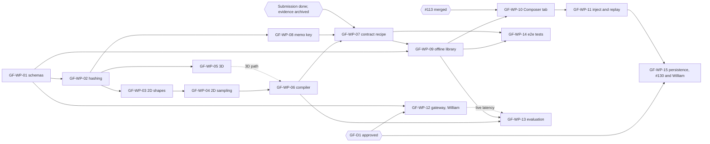

# Gemini generated formations: work packages

> **STATUS: PROPOSED — NOT IMPLEMENTED.** Nothing in this file exists in code. Do not open these issues or start coding until Arnav approves (see [Gating](#gating)).
>
> Source author: William Pimentel (`wpimento`), [source handoff](../handoffs/Encore_Gemini_Flash_Lite_Architecture.md). Integrator: Arnav (issue #117).

Purpose: split William's Gemini generated-formation architecture into issue-ready packages, `GF-WP-01` to `GF-WP-15`, each one small enough for one person and their agent to finish and PR. Status: proposal; audit base `origin/main` 4c41f75 (first written at 9f78902; what changed since is listed once, in the canonical spec). Owner: Arnav (integration, issue #117); GF-WP-12 and the Tiger Data half of GF-WP-15 are reserved for William and unassigned (he has paused; no package is assigned to him).

**Where things live.** The canonical spec [`../integrations/gemini-generated-formations.md`](../integrations/gemini-generated-formations.md) defines requirements `GF-FR-xx`/`GF-NFR-xx`, contract changes `GF-CC-xx`, conflict records `CR-xx` (CR-01–CR-18 are the compatibility audit's C1–C18 in order; CR-19+ are the spec's own), decisions `GF-D1…`, risks `GF-R01…` and the design sections cited below as "spec §n". The [evaluation doc](../validation/gemini-formation-evaluation.md) defines tests `GF-T01…GF-T40` and the ladder `CL-1…CL-6`. This file only plans the work and links to those definitions.

**Base rules this plan inherits** (link, not restate): the contract, especially [§6 Composition](../design/contracts-and-algorithms.md#6-composition-from-recipe-to-slots), [§8.5 Known limits](../design/contracts-and-algorithms.md#85-known-limits-state-these-dont-hide-them) and [§12](../design/contracts-and-algorithms.md#12-deliberately-not-in-the-mvp); [requirements](../specification/requirements.md#composition-and-score), especially FR-08 to FR-11 and [NFR-04](../specification/requirements.md#3-non-functional-requirements) (the offline rule); [evaluation and tests](../validation/evaluation-and-tests.md#6-automated-tests); the boundary rules in [`AGENTS.md`](../../AGENTS.md) and [`tests/boundaries.test.ts`](../../tests/boundaries.test.ts); and the workflow in [`../development/WORKFLOW.md`](../development/WORKFLOW.md).

## 1. The two modes, and what each package serves

William's architecture has one pipeline: prompt → Gemini → `SceneSpec2D` or `SceneSpec3D` → deterministic `compileGeneratedScene(scene, params)` → `Formation` → preview → operator acceptance → `INJECT_SCORE` into one drone → gossip → local flight and repair. Gemini proposes geometry only. It never flies drones, assigns slots, reads agent state or overrides repair.

The canonical spec defines two operating modes:

- **Mode OFFLINE-AUTHORING** (spec §4.3). Compliant with NFR-04 **and** the `AGENTS.md` ground rule only if **no network client is checked into the repo**: a person (or a tool outside this repo, such as AI Studio) produces the scene, and only validated scene JSON files are committed (`assets/scenes/`), which the app loads with no network. A checked-in authoring script that calls Gemini is LIVE-GATEWAY-class and needs GF-D1.
- **Mode LIVE-GATEWAY.** William's Gemini module of the optional shared gateway is called from the app. It is allowed only after decision **GF-D1** (the same decision as D3 in the [Phase 2 roadmap](PHASE2_ROADMAP.md), provisional: depends on #110) amends NFR-04, the `AGENTS.md` ground rule, the contract §12 "Never" row and the decisions log. It is optional and off by default, and the offline library stays the fallback.

| Package | Mode | Contract change | Owner lane |
|---|---|---|---|
| GF-WP-01 scene schemas and validators | both | none (types move to `src/contracts` in GF-WP-07) | A |
| GF-WP-02 canonical JSON, `sceneHash`, `slotsDigest` | both | none | A |
| GF-WP-03 2D primitives and 512² mask | both | none | A |
| GF-WP-04 2D candidate sampling | both | none | A |
| GF-WP-05 3D primitives, sampling, visibility | both | none | A |
| GF-WP-06 shared compiler | both | none | A |
| GF-WP-07 generated recipe integration `[contract]` | both | GF-CC-01, GF-CC-02 | A |
| GF-WP-08 memo key and serialisation cost | both | GF-CC-03 | A |
| GF-WP-09 offline scene library and loader | OFFLINE-AUTHORING | none | B (the loader is a lane C file†) |
| GF-WP-10 Composer generated tab, preview worker | both | none | lane C files† |
| GF-WP-11 injection, replay, run provenance | both | none | B (CLI); lane C files† (controller, replay) |
| GF-WP-12 Gemini gateway module (X-RUN/live) | LIVE-GATEWAY | none in `src/contracts`; needs GF-D1 | **reserved for William, unassigned; interface only** |
| GF-WP-13 evaluation harness | offline part: both; latency part: LIVE-GATEWAY (run from the gateway, GF-WP-12) | none | B |
| GF-WP-14 end-to-end integration tests | both | none | B |
| GF-WP-15 persistence adapters (MongoDB Atlas, Tiger Data) | LIVE-GATEWAY | none; needs GF-D1 | MongoDB half: #130; Tiger Data half **reserved for William** |

Lanes are those of [`../development/TEAM_ROLES.md`](../development/TEAM_ROLES.md): A brain, contracts and score; B world, evidence and CLI; C experience. Arnav's agents currently run lanes A and B. † Lane C files (`src/app/**`) are Haris's lane; these packages are worked by Arnav's agents unless Haris claims them. No package assigns work or review to William or Haris (see [Gating](#gating)).

**Priorities** follow William's final priority table (handoff Part IX): *Essential* is the reliable 2D silhouette, the bounded compiler, preview before injection and genuine dissemination; *High* is coloured 3D, MongoDB save and reload, and Tiger Data analytics; *Optional* is automated visual scoring, arbitrary 3D assets and packetisation. Each package also gets a suggested repo label (P0 to P2) for after submission.

**Sizes** in this file are planning estimates for one person with an agent, not measurements. William's latency and timing figures, quoted where relevant, are his planning estimates and are labelled as such.

## 2. Work packages

Every package below uses the same fields. "Tests" lists `GF-T` IDs only; each test's meaning and the package that delivers it are defined in [evaluation doc §5](../validation/gemini-formation-evaluation.md#5-tests-gf-t01gf-t40) (its WP column).

### GF-WP-01 Scene schemas and validators

- **Identifier:** GF-WP-01. **Title:** `SceneSpec2D` and `SceneSpec3D` types, model-facing JSON Schemas, semantic validation and complexity limits.
- **Purpose:** turn William's scene types (handoff §4.2 and §5.1) into one authoritative validator that every path uses: offline library files, the Composer, the CLI and (later) the gateway's responses. Gemini's structured output constrains syntax only; Google's documentation says to validate values in the application, and `minLength`, `maxLength` and `uniqueItems` are ignored by the model (provider facts checked 2026-11-15, PARTLY VERIFIED for the exact keyword list). Every constraint is therefore enforced here.
- **Dependencies:** none among GF-WPs. Base: none. Approvals: none (the types start inside `src/score/generated/` and move into `src/contracts` only in GF-WP-07). Phase 2: none.
- **Owner lane:** A. **Priority:** Essential. Suggested P1. Size: M (planning estimate).
- **Allowed files:** `src/score/generated/types.ts` (new), `src/score/generated/validation.ts` (new), `assets/scenes/schema/scene2d.schema.json` (new), `assets/scenes/schema/scene3d.schema.json` (new), `tests/score/generated/validation.test.ts` (new), `tests/fixtures/scenes/*.json` (new, hand-written valid and invalid scenes).
- **Proposed interfaces:** the scene types are exactly spec §6.2–§6.3 (William's types plus the spec's marked additions); this package adds only the validator:

```ts
// src/score/generated/validation.ts
export interface SceneIssue { code: string; path: string; message: string }
export interface SceneLimits {   // field for field spec §6.5 V1 and §6.6; the values live only there
  rawBytes: number; canonicalBytes: number; minParts: number;   // minParts 1: CL-1 is a one-part sphere
  parts2D: number; parts3DDeclared: number; parts3DMirrored: number; materials3D: number;
  polygonVertices: number; segmentsPath: number; segmentsStroke: number; segmentsTube: number;
  controlPoints2D: number; controlPoints3D: number; subtractParts2D: number }
export const SCENE_LIMITS: SceneLimits;   // 16 KB canonical cap: GF-D7
export type SceneValidation =
  | { ok: true; scene: SceneSpec; warnings: SceneIssue[] }
  | { ok: false; errors: SceneIssue[] };
export function validateScene(input: unknown, limits?: SceneLimits): SceneValidation;
```

- **Implementation steps:**
  1. Write the spec §6.2–§6.3 types (with `SceneSpec = SceneSpec2D | SceneSpec3D`) and the coordinate convention, rotation units and order of spec §6.1.
  2. Write `validateScene` as a pure, total function over `unknown` that implements layers V1–V10 of spec §6.5 in order, with their codes, and the complexity limits exactly as `SCENE_LIMITS` (spec §6.6). William's 6–20 (2D) and 12–30 (3D) part counts are prompt targets, not bounds.
  3. Compute the canonical byte size with GF-WP-02's `canonicalSceneJson` once it exists; until then, check `JSON.stringify` length as a placeholder and leave a TODO tied to GF-WP-02.
  4. Write the two JSON Schemas as data files using only the subset Gemini accepts (`type`, `properties`, `required`, `additionalProperties`, `enum`, `items`, `minItems`, `maxItems`, `minimum`, `maximum`, `anyOf`, `$defs`, `$ref`; provider facts 2026-11-15, VERIFIED from SDK 3.3.0 typings). Keep them small: Google warns that very large or deeply nested schemas are rejected with 400 (VERIFIED, qualitative).
  5. Add fixtures: at least one valid scene per primitive and per mode, William's two partial elephants (handoff §4.2 and §5.1) as valid partial scenes, and one invalid fixture per error code.
- **Acceptance criteria:** every fixture gets the expected verdict and issue codes; the validator never throws on any input (including `null`, cycles excluded by JSON, huge arrays); a test proves each constraint the model ignores (`uniqueItems`, string lengths) is enforced in TypeScript; files in `src/score/generated/` pass the core ESLint rules and `tests/boundaries.test.ts` (no npm imports, no `Date`, `performance`, `Math.random` or `fetch`).
- **Tests:** GF-T01–GF-T05.
- **Performance requirements:** validation of a 16 KB scene stays well under 1 ms per call in Node (indicative; reported, not gated).
- **Rollback strategy:** revert the PR. Nothing imports these files yet.
- **Contract approvals required:** none.

### GF-WP-02 Canonical JSON, `sceneHash` and `slotsDigest`

- **Identifier:** GF-WP-02. **Title:** canonical scene form, content hash and compiled-slots digest, plus the seeded stream the compiler uses.
- **Purpose:** William asks Encore to "derive a canonical, content-addressed `sceneHash`" and to "verify the hash rather than trusting one supplied by Gemini" (handoff §6.3). Spec §6.7 fixes how; spec §7.12 derives the compiler's seeded randomness from `sceneHash`. `slotsDigest` (GF-CC-02): inside one simulation process the shared memo makes it a consistency assertion, not a drift detector; its real purpose is saved scenes (library, MongoDB) and future multi-device use.
- **Dependencies:** GF-WP-01 (types). Base: none. Approvals: none.
- **Owner lane:** A. **Priority:** Essential. Suggested P1. Size: S.
- **Allowed files:** `src/score/generated/hashing.ts` (new), `src/score/generated/prng.ts` (new), `tests/score/generated/hashing.test.ts` (new).
- **Proposed interfaces:**

```ts
export const SCENE_QUANTUM = 1e-4;                             // spec §6.7 step 3
export function normaliseScene(scene: SceneSpec): SceneSpec;   // spec §6.7 steps 1–3
export function canonicalSceneJson(scene: SceneSpec): string;  // spec §6.7 step 4; throws RangeError on NaN or ±Infinity
export function sceneHash(scene: SceneSpec): string;           // spec §6.7: SHA-256 hex of the canonical form
export function slotsDigest(formation: Formation, n0: number, slotSpacingMin: number): string;   // spec §7.1 (1e-6 grids)
export function sha256Hex(text: string): string;               // pure TypeScript, UTF-8 input (spec §6.7 step 5)
export function seededStream(seedHex: string, label: string): () => number;   // sfc32 seeded from sceneHash (spec §7.12)
```

- **Implementation steps:**
  1. Implement `normaliseScene`. **The compiler must compile the normalised scene**, not the raw one; otherwise two scenes with the same hash could compile differently. GF-WP-07 stores the normalised scene in the recipe.
  2. Implement `canonicalSceneJson` with the same sorted-key rule as [`src/cli/run.ts`](../../src/cli/run.ts) `canonicalJson` (which `src/score` may not import), plus quantisation and non-finite rejection.
  3. Implement SHA-256 (spec §6.7, GF-FR-06) in pure TypeScript, because `src/score` may not import `node:crypto` or any npm package. Verify against `node:crypto` in the test file, which may import Node modules.
  4. Implement `slotsDigest` exactly as spec §7.1 (index order, positions and colours on the 1e-6 grid, `n0` and `slotSpacingMin` included).
  5. Implement `seededStream` exactly as spec §7.12 (sfc32, integer-only), one stream per label, with no global state.
- **Acceptance criteria:** key order and `-0` do not change the hash; any change of one quantum in any number changes it; NaN and Infinity are rejected; `sha256Hex` equals `node:crypto` on a corpus of strings including non-ASCII titles; `seededStream` is identical across two calls and independent between labels.
- **Tests:** GF-T20; supplies the canonical byte size GF-T04 checks.
- **Performance requirements:** hashing a 16 KB canonical scene in Node stays near a millisecond or less (indicative). It runs once per package-frozen scene object (GF-WP-08), never per tick.
- **Rollback strategy:** revert; nothing outside `src/score/generated/` imports it until GF-WP-07.
- **Contract approvals required:** none here. The hash's role in the recipe and memo key is approved through GF-CC-01, GF-CC-02 and GF-CC-03.

### GF-WP-03 2D primitives and the 512² mask

- **Identifier:** GF-WP-03. **Title:** ellipse, polygon, closed cubic Bézier path, thick stroke; union and subtract; internal 512×512 mask.
- **Purpose:** William's 2D mode treats Gemini as "a vector-graphics scene designer" (handoff §4). This package reconstructs the region exactly and rasterises an internal mask for connectivity, interior and boundary work. The mask is never an image file or a user-facing raster.
- **Dependencies:** GF-WP-01, GF-WP-02 (seeded stream, if any jitter is used). Approvals: none.
- **Owner lane:** A. **Priority:** Essential. Suggested P1. Size: M.
- **Allowed files:** `src/score/generated/shapes2d.ts` (new), `tests/score/generated/shapes2d.test.ts` (new).
- **Proposed interfaces:**

```ts
export type Pt2 = [number, number];
export interface Part2D { id: string; priority: number; operation: 'union' | 'subtract';
  contains(p: Pt2): boolean; outline(step: number): Pt2[]; centreline?: Pt2[] }
export interface Region2D { parts: Part2D[]; contains(p: Pt2): boolean;
  bbox: { min: Pt2; max: Pt2 } }                       // contains = parts applied in array order
export interface Mask2D { size: number; cell: number; origin: Pt2; bits: Uint8Array }
export function buildRegion2D(scene: SceneSpec2D): Region2D;
export function flattenCubic(points: Pt2[], segmentsPerCurve: number): Pt2[];   // fixed count, no adaptive tolerance
export function rasterise(region: Region2D, size?: number): Mask2D;           // default 512
export function components(mask: Mask2D): { count: number; largestShare: number; labels: Int32Array };
```

- **Implementation steps:**
  1. Implement spec §7.2 steps 1–3 exactly: its inside tests (even-odd for polygons and paths) and fixed flattening counts, the mask over its extent with parts applied in array order (William's cut-outs between legs, handoff §4.2), and 4-connected components with speck removal.
  2. Determinism as spec §7.12: plain arithmetic, transcendental results snapped to 1e-9 as [`src/score/shapes.ts`](../../src/score/shapes.ts) does.
  3. Report the component count and largest share for William's "disconnected blobs" check (handoff §4.7), and the V8 and V10 warnings of spec §6.5.
- **Acceptance criteria:** analytic areas of an ellipse, a square and a stroke match the mask within a stated tolerance; subtraction of a centred disc from a disc gives an annulus with one component; repeated calls give byte-identical masks.
- **Tests:** GF-T06, GF-T07; `components` feeds GF-T08 (GF-WP-04).
- **Performance requirements:** rasterising a CL-4 scene (William's elephant silhouette) at 512² within the compiler's overall budget (GF-WP-06). The mask is 262,144 cells; the containment test runs per cell per part, so the part limit from GF-WP-01 bounds the cost.
- **Rollback strategy:** revert; unused until GF-WP-06.
- **Contract approvals required:** none.

### GF-WP-04 2D candidate sampling

- **Identifier:** GF-WP-04. **Title:** boundary, interior and protected-feature candidates with metadata.
- **Purpose:** William's three candidate sources (handoff §4.4): the outer boundary keeps the outline, the filled interior gives density, and protected features keep the trunk, tusks and legs visible. His starting split of about 30–40% boundary and feature points is labelled "a heuristic, not a general optimum"; it stays a tunable constant.
- **Dependencies:** GF-WP-03, GF-WP-02. Approvals: none.
- **Owner lane:** A. **Priority:** Essential. Suggested P1. Size: M.
- **Allowed files:** `src/score/generated/sample2d.ts` (new), `tests/score/generated/sample2d.test.ts` (new).
- **Proposed interfaces:**

```ts
export type CandidateSource = 'boundary' | 'interior' | 'feature';
export interface Candidate { pos: Vec3; colour: RGB; featureId: string; importance: number;
  source: CandidateSource; normal?: Vec3; visibility?: number }   // William's FormationCandidate + Candidate3D fields
export interface Sample2DOptions { n0: number }   // counts and quota are module constants (spec §7.1, §7.2)
export function sample2d(scene: SceneSpec2D, region: Region2D, mask: Mask2D, opts: Sample2DOptions): {
  candidates: Candidate[]; dense: Vec3[] };   // dense: ~2000 points of the filled region, z = 0
```

- **Implementation steps:**
  1. Implement spec §7.2 steps 4–6 exactly: boundary candidates by marching squares with snapping to the vector edges, the seeded hexagonal interior lattice, feature candidates for protected parts, and the feasibility-capped quota. Candidate counts are the spec's; how they scale with `n0` is an [open question](#open-questions).
  2. Colour every 2D candidate with the scene's `foreground` as spec §7.7 (William: "for a white 2D silhouette … `colour: [1, 1, 1]`"); `z = 0`.
  3. Build `dense` from the region, never from candidates or slots, as spec §7.8 (1,500–2,500 points, matching the dense cap in [`tests/score/expand.test.ts`](../../tests/score/expand.test.ts)).
  4. The contract says "about `4·n0`" candidates ([§6](../design/contracts-and-algorithms.md#6-composition-from-recipe-to-slots)); the text change for generated recipes is CR-06, carried in GF-WP-07's `[contract]` PR.
- **Acceptance criteria:** every candidate lies inside the region; a thin stroke of width 0.05 still yields feature candidates; candidate order is a deterministic function of the scene; dense has 2000 ± 500 points.
- **Tests:** GF-T08–GF-T10.
- **Performance requirements:** within GF-WP-06's compile budget.
- **Rollback strategy:** revert.
- **Contract approvals required:** none (CR-06 wording goes through GF-WP-07).

### GF-WP-05 3D primitives, surface sampling and visibility

- **Identifier:** GF-WP-05. **Title:** ellipsoid, capsule, cylinder, cone and tapered tube with transforms and mirror-x; area-weighted surface sampling; union-aware interior filtering; normals and visibility.
- **Purpose:** William's 3D mode builds "a genuine volumetric object using mathematical primitives" (handoff §5). He notes that sampling polar angles uniformly clusters points at the poles, so sampling must be approximately area-weighted; that a head overlapping a torso wastes drones unless hidden points are filtered; and that visibility from a reference view keeps the object recognisable.
- **Dependencies:** GF-WP-01, GF-WP-02. Can run in parallel with GF-WP-03 and GF-WP-04. Approvals: none.
- **Owner lane:** A. **Priority:** High (William). Suggested P2. Size: L.
- **Allowed files:** `src/score/generated/shapes3d.ts` (new), `src/score/generated/sample3d.ts` (new), `tests/score/generated/shapes3d.test.ts` (new), `tests/score/generated/sample3d.test.ts` (new).
- **Proposed interfaces:**

```ts
export interface Solid3D { id: string; materialId: string; importance: number;
  insideDepth(p: Vec3): number;                        // signed analytic depth, > 0 inside (spec §7.3 step 3)
  surface(count: number, next: () => number): { pos: Vec3; normal: Vec3 }[];   // spec §7.3 steps 1–2; analytic normals
  area(): number }
export function buildSolids(scene: SceneSpec3D): Solid3D[];   // mirror-x parts expanded here
export interface Sample3DOptions { n0: number; referenceView: SceneSpec3D['referenceView'] }   // counts: spec §7.3 step 2
export function sample3d(scene: SceneSpec3D, solids: Solid3D[], opts: Sample3DOptions): {
  candidates: Candidate[]; dense: Vec3[] };
export function viewDirection(view: SceneSpec3D['referenceView']): Vec3;   // fixed convention, audience on +Z
```

- **Implementation steps:**
  1. Primitives with explicit transforms; convert rotations to a matrix once; snap trigonometric results to 1e-9.
  2. Tapered tube: centreline from the cubic control points, a rotation-minimising frame computed deterministically, radius interpolated from `startRadius` to `endRadius`.
  3. Area-weighted sampling exactly as spec §7.3 steps 1–2: tessellate each part at the spec's fixed mesh resolution, choose triangles by cumulative area from the seeded stream, and take a uniform barycentric point in each (the √u construction). Normals stay analytic. (An affine image of a uniform sphere lattice is not area-uniform: for radii (1, 0.5, 0.3) its density differs about 3.3× between the x and z poles, which GF-T11 would catch.)
  4. Union-aware filtering exactly as spec §7.3 step 3: drop any candidate with `insideDepth > ε = 0.01` in another part, for every part, with no protected exception; record `hiddenFraction` and the `feature-mostly-hidden` warning. ε must exceed the mesh's largest depth below its own analytic surface at the largest allowed size (V5), so coincident or tangent contacts do not drop exposed points; a test checks this ([open question](#open-questions)).
  5. Visibility, ranking inputs and the rear-side floor as spec §7.3 steps 4–5 (William: favour the reference view "without entirely sacrificing rear-side geometry").
  6. Colour every candidate from its material (spec §7.7). Dense as spec §7.8, after filtering.
- **Acceptance criteria:** sampled point density on the GF-T11 ellipsoid passes its equal-area band test; points more than ε inside a second, overlapping solid are removed, and two tangent or coincident parts keep their exposed points; mirror-x parts are exact mirror images; normals are unit length.
- **Tests:** GF-T11–GF-T15.
- **Performance requirements:** within GF-WP-06's compile budget for CL-1 to CL-4 3D scenes; William's planning estimate for 3D reconstruction is about 0.1–2 s, which is above the repo's cold-expansion budget (see GF-WP-06).
- **Rollback strategy:** revert; the 2D path does not depend on it.
- **Contract approvals required:** none.

### GF-WP-06 Shared compiler

- **Identifier:** GF-WP-06. **Title:** `compileGeneratedScene`: spacing-constrained, feature-aware selection, farthest-point ordering, placement P1, colours, dense, bounds, warnings and totality.
- **Purpose:** William's "deterministic formation compiler" (handoff §6), producing the existing `Formation` type with no new simulation engine. Spec §7.4–§7.11 fix how it meets the contract.
- **Dependencies:** GF-WP-02, GF-WP-04 (2D), GF-WP-05 (3D; the 2D path can merge first behind a `mode` check that returns a typed rejection for `scene3d`). Approvals: none (new files only).
- **Owner lane:** A. **Priority:** Essential. Suggested P1. Size: L.
- **Allowed files:** `src/score/generated/selection.ts`, `src/score/generated/placement.ts`, `src/score/generated/compile.ts`, `src/score/generated/index.ts` (all new); `tests/score/generated/compile.test.ts`, `tests/score/generated/perf.test.ts` (new).
- **Proposed interfaces:** `compileGeneratedScene`, `COMPILER_VERSION`, `CompileResult`, `CompileWarning` and `CompileStats` exactly as spec §7.1 (William's `CompileResult` extended with a typed rejection, `slotsDigest` and stats).
- **Implementation steps:**
  1. Normalise and hash the scene (GF-WP-02). Build candidates and `dense` in normalised scene space (GF-WP-04 or GF-WP-05).
  2. **Selection: implements spec §7.4 exactly** (William's design kept: protected reservations, the boundary quota, William's `Q(p)` in 3D, one common minimum spacing over all points, and the spec's bounded δ retries, simplifications and `infeasible-count` rejection).
  3. **Ordering (spec §7.5).** Order the `n0` selected points with the existing `farthestPointOrder` from [`src/score/fps.ts`](../../src/score/fps.ts), slot 0 nearest the centroid. This keeps the contract's prefix property (FR-10, AS-09), the observer's priority weights and the interleaved indices local healing relies on (CR-05). It also meets William's "recognisability at every prefix" goal. An importance-weighted order is GF-CC-04, deferred.
  4. **Placement P1 (spec §7.6, GF-D5).** Uniform scale so the closest pair is `slotSpacingMin·1.001`, then translate the bounds centre to (0, 30, 0), exactly as `expandRecipe` step 3. William's caps (width 40 m, height 25 m, minimum altitude 5 m) become validation warnings or rejections, never clamps (CR-04); note that existing formations already exceed 40 m (ENCORE is about 78 m wide at n0 = 200, one local run). P2 (William's bounds-first placement) is GF-CC-05 and not built here.
  5. Colours from the selected candidates, clamped to `[0, 1]`. Dense transformed with the same scale and translation; bounds over slots and dense.
  6. Warnings: an island, meaning a slot with no other slot within `rClaim` (the [Phase 2 linter's L3](../design/ANIMATED_CHOREOGRAPHY_RFC.md#9-score-linter-checks-l1l6), provisional: depends on #110; contract §8.5 limit 1, CR-14); size and altitude checks exactly as spec §7.6 (William's caps warn; `below-floor` and `too-large-world` reject); a protected feature that received no slot; colours that are dark or reserved (the same rules as `validateDraft`).
  7. **Totality (spec §7.11).** Wrap every stage; any schema-valid scene returns `ok: true` or a typed rejection, never a throw and never a substitute formation (what `expandRecipe` does with a rejection is GF-WP-07 step 4).
  8. Use `n0` everywhere (40 in G1-style tests, 200 in evaluation), never a hard-coded 200.
- **Acceptance criteria:** for every valid fixture at n0 ∈ {40, 200}: exactly `n0` slots, indices `0…n0-1`; closest pair ≥ `slotSpacingMin`; all numbers finite; identical output and `slotsDigest` on a second call and across fresh module instances; dense non-empty and ≤ 2500; every slot within `slotSpacingMin` of a dense point (the existing expand test's rule). No input in the fuzz corpus of valid scenes throws.
- **Tests:** GF-T16–GF-T19; GF-T06–GF-T15 as integration of the stages.
- **Performance requirements:** target: cold compile at n0 = 200 under the existing 200 ms cold-expansion budget ([`tests/score/perf.test.ts`](../../tests/score/perf.test.ts)) for CL-1 to CL-4 scenes in Node, measured the way that file does (per-test duration, no clock in the test). William's figures (0.05–0.5 s for 2D, 0.1–2 s for 3D) stay planning estimates. If 3D CL-4+ cannot meet the target, the package reports measured times and the choice (raise the budget for generated recipes only, or precompile at authoring time and accept Option B for those) is recorded as decision GF-D8, never silently assumed. The first main-thread compile happens at injection (GF-WP-10).
- **Rollback strategy:** revert; not reachable from `expandRecipe` until GF-WP-07.
- **Contract approvals required:** none for this package. Its behaviour is what GF-CC-01 adopts.

### GF-WP-07 `[contract]` Generated recipe integration

- **Identifier:** GF-WP-07. **Title:** add William's `generated` recipe kind to `Recipe`, wire it through `expandRecipe`, `composeNext` and the brain's adoption check.
- **Purpose:** William's §6.1 recipe variant, as spec §8.1, §8.2 and §7.11 define it. This is the first package that changes behaviour visible to the simulation.
- **Dependencies:** GF-WP-06 (2D at least), GF-WP-08 must merge with or before this package (without it a 10–30 KB scene costs about 45–165 ms per tick in key building, from one local benchmark). Base: the brain-side "do not adopt on mismatch" check edits `src/agent/encoreBrain.ts` and `EncoreState` ⇒ Track P only, new evidence revision, after #122 archived and #115 settled ([Phase 2 Track P rules](../development/PHASE2_WORK_PACKAGES.md#22-track-p-post-submission), provisional: depends on #110). At 4c41f75 both #122 (evidence matrix) and #115 (perf) are merged; the archive waits for the submission. Approvals: **GF-CC-01** and **GF-CC-02** approved by Arnav; GF-FR-01 accepted (FR-09 keeps its three MUST kinds).
- **Owner lane:** A. **Priority:** Essential. Suggested P1. Size: M.
- **Allowed files:** `src/contracts/generatedScene.ts` (new), `src/contracts/score.ts`, `src/contracts/index.ts`, `docs/design/contracts-and-algorithms.md` (§2, §3 note on SCORE size, §6), `src/score/expand.ts`, `src/score/shapes.ts`, `src/score/compose.ts`, `src/score/index.ts`, `src/score/generated/types.ts` (becomes a re-export), `src/agent/encoreBrain.ts` (one call in `handleScoreMessage`), `src/agent/state.ts` (`EncoreState`, only as GF-CC-02 requires), type-narrowing only in `src/app/ui/Composer.ts`, `src/app/ui/Timeline.ts`, `src/app/ui/commands.ts`; `docs/context/evidence-and-assumptions.md` (AS-11, proposed: radio payload size is not modelled, scenes capped; CR-12); tests under `tests/score/`, `tests/agent/`, `tests/contracts/`.
- **Proposed interfaces:** PROPOSED CONTRACT CHANGE — REQUIRES ARNAV APPROVAL (GF-CC-01, GF-CC-02).

`Recipe` and `GeneratedRecipe` exactly as spec §8.1; this package adds:

```ts
// src/score (public API additions)
export function makeGeneratedRecipe(scene: SceneSpec, n0: number, params: Params):
  { ok: true; recipe: GeneratedRecipe; warnings: CompileWarning[] } | { ok: false; issues: SceneIssue[] } | Extract<CompileResult, { ok: false }>;
export function acceptsRecipe(recipe: Recipe, n0: number, params: Params): boolean;   // brain-side check, pure, total
export function copyRecipe(recipe: Recipe): Recipe;   // now exported; spec §8.7 deep-frozen canonical scene, registered for GF-WP-08
```

- **Implementation steps:**
  1. Move the GF-WP-01 types into `src/contracts/generatedScene.ts`; re-export from `src/score/generated/types.ts`.
  2. Add the recipe variant. Generated recipes have **no `palette`**: colours come from scene materials or `foreground`. Every site that reads `recipe.palette` must narrow on `kind` (the list is GF-CC-01's, spec §8.1; at 4c41f75: `compose.ts:30-33` `copyRecipe`, `expand.ts:91`, `Composer.ts:79, 96-98, 273`, `Timeline.ts:61, 74`).
  3. Give every `switch (recipe.kind)` in `shapes.ts` (`selectionCloud`, `denseCloud`, `defaultPalette`) an explicit `generated` case or an early branch in `build()`, plus an `assertNever` default so a future kind fails at compile time. Fix label fallbacks that would silently call a generated formation "Helix" (`Timeline.ts:49`, `commands.ts:358` at 4c41f75): use `scene.title`.
  4. In `expandRecipe`, branch on `kind === 'generated'` to `compileGeneratedScene` on the stored, normalised scene; **a rejection throws a typed `GeneratedSceneRejected` error and no substitute formation is ever returned.** Operator-side callers detect failure only by a throw: `validateDraft` (`Composer.ts:104`), `composeNext` and `makeScore` (via `slotPositions`, `compose.ts:52, 72`) and the controller's `try`. A silent `sphere` would validate and compose as a sphere. Brains are protected by step 6, and `makeScore` throws on a rejected preloaded scene. This replaces spec §7.11's "Last resort" (sphere plus counter), which must be changed to match; a brain-only safety net is an [open question](#open-questions).
  5. `copyRecipe` deep-copies a generated recipe and the copy's scene is deep-frozen (spec §8.7, CR-08) and registered as package-frozen for GF-WP-08.
  6. **Adoption check (GF-CC-02, spec §8.2).** In `handleScoreMessage`, after the existing version checks, call `acceptsRecipe` for each movement's recipe. For a generated recipe it recomputes `sceneHash` from the scene and refuses a recipe whose `sceneHash` field differs, then compiles (a memo hit in the simulator) and compares `slotsDigest`. On failure the score is not adopted and a log note is written. On success each generated recipe in the adopted copy (`copyJson`, `encoreBrain.ts:137`, mutable) is replaced by `copyRecipe(recipe)`, so the brain holds a package-frozen scene and GF-WP-08's hash cache applies; the JSON is unchanged for any scene that went through the operator's `copyRecipe`, so `stateHash` is not affected. Existing kinds return `true` with no work and are not replaced, so the brain's behaviour on today's scores is unchanged.
  7. Contract text: §2 types; §6 "Expansion" gains the generated path, the "at least `4·n0`" candidate wording (CR-06) and the placement rule; §3 adds that SCORE size is not modelled and scenes are capped; §6 states the `slotsDigest` scope: inside one simulation process the shared memo makes it a consistency assertion, not a drift detector; its real purpose is saved scenes (library, MongoDB) and future multi-device use (CR-18).
- **Acceptance criteria:** existing recipes produce byte-identical formations, and S0–S5 at seed 1 give the same `stateHash` before and after (the brain change is a no-op for non-generated kinds); a generated recipe round-trips through `composeNext`; a mutated `scene` or wrong `slotsDigest` is not adopted and does not crash `world.step`; a rejected generated recipe makes `expandRecipe`, `validateDraft` and `composeNext` fail visibly, never yield a sphere; an unknown kind fails typecheck.
- **Tests:** GF-T21, GF-T23, GF-T24; GF-T16–GF-T20 rerun; the existing T17 and G4 suites unchanged.
- **Performance requirements:** the adoption check adds one scene hash and one frozen canonical copy per adopter per adopted score (16 KB canonical, indicative cost below a millisecond) and no per-tick work.
- **Rollback strategy:** revert the `[contract]` PR. Saved scene files remain on disk; the loader (GF-WP-09) reports them as unsupported instead of failing.
- **Contract approvals required:** GF-CC-01, GF-CC-02 (Arnav, `[contract]` PR rules in [`../development/WORKFLOW.md`](../development/WORKFLOW.md)); CR-06 and CR-12 text.

### GF-WP-08 Memo key and serialisation cost

- **Identifier:** GF-WP-08. **Title:** content-addressed memo key for generated recipes, a hash cache limited to package-frozen scenes, and a performance test with a 30 KB scene.
- **Purpose:** William flags that keying the memo on `JSON.stringify(recipe)` is wasteful for nested scenes (handoff §6.3). The code builds that key on every call, including cache hits ([`src/score/expand.ts`](../../src/score/expand.ts)), and the Encore world calls it about 600–800 times per tick at n0 = 200 (call counts read from code; #115 did not change them; timings from one local benchmark). Spec §8.3 resolves it as GF-CC-03.
- **Dependencies:** GF-WP-02. Merges with or before GF-WP-07. Base: as GF-WP-07 (touches `expand.ts`). Approvals: **GF-CC-03**.
- **Owner lane:** A. **Priority:** Essential. Suggested P1. Size: S.
- **Allowed files:** `src/score/expand.ts`, `docs/design/contracts-and-algorithms.md` (§6 memo sentence), `tests/score/memo.test.ts` (new), `tests/score/perf.test.ts`.
- **Proposed interfaces:** PROPOSED CONTRACT CHANGE — REQUIRES ARNAV APPROVAL (GF-CC-03).

```ts
// inside src/score/expand.ts (module state, allowed as "a memo cache of pure expandRecipe results")
const frozenScenes = new WeakSet<object>();          // scenes this package deep-froze (copyRecipe, spec §8.7)
const hashOf = new WeakMap<object, string>();        // scene → H(scene), filled only for members of frozenScenes
function memoKey(recipe: Recipe, n0: number, slotSpacingMin: number): string;
//   generated: `generated:${compilerVersion}:${H(recipe.scene)}:${n0}:${slotSpacingMin}` (no palette);
//              H cached only when frozenScenes.has(recipe.scene), otherwise recomputed on every call
//   others:    `${JSON.stringify(recipe)}|${n0}|${slotSpacingMin}`, built on every call exactly as today
```

- **Implementation steps:**
  1. For generated recipes, key on a `sceneHash` **recomputed from the scene content**, never on the recipe's own `sceneHash` field, so one shared memo can never hand one scene's formation to another. The field is only a checked label: a mismatch makes the recipe invalid; operator-side validation rejects it (GF-WP-10, GF-WP-11) and the brain-side refusal is part of GF-CC-02 (GF-WP-07).
  2. Cache `H` by identity **only for scenes this package deep-froze** (`frozenScenes`, filled by `copyRecipe`). Any other scene is hashed on every call, so mutating an unfrozen recipe can never return a stale formation; it is correct but slow. Brain copies come from `copyJson` (`encoreBrain.ts:137`) and are not frozen, so GF-WP-07 step 6 swaps in `copyRecipe` copies; brain state then keeps that object between ticks (the world passes `bodies[id].state` by reference), and each drone hashes once per adoption.
  3. **Existing kinds are untouched**: their key is built on every call, as spec §8.3 says ("Keys for text, sphere and helix are unchanged"). Identity caching for them would make the memo identity-keyed against contract §6's "memoised on JSON(recipe)", and `validateDraft` shares `draft.palette` by reference (`Composer.ts:97`). Any such extension is a separate GF-CC-03 amendment with its own mutation test.
  4. Update the contract §6 comment ("memoised on JSON(recipe), n0 and `slotSpacingMin`") to name the generated key and state that its hash is cached only for package-frozen scenes.
  5. Measure, and report without fixing, the other per-copy costs of a large score that live in contended files: the `copyJson` on every SCORE send, the observer's `structuredClone` of the reference score every tick (its clones are unfrozen, so they hash per `reference()` call), and `stateHash()` stringifying every brain state (about 200 copies of the scene at n0 = 200). These belong to follow-up issues (#115 is merged; open #82 still edits `world.ts`).
- **Acceptance criteria:** a deterministic test, with no clock, spies on the hash and shows at most one hash per package-frozen scene over 800 calls; mutating an unfrozen recipe after one call (an existing kind's palette, and a generated scene not made by `copyRecipe`) changes the next `expandRecipe` result; two recipes carrying the same `sceneHash` field but different scenes get their own scenes' formations; the existing memo tests and FR-08/T17 tests pass unchanged.
- **Tests:** GF-T22.
- **Performance requirements:** with a 30 KB package-frozen scene, 800 warm calls cost about what 800 calls cost for a small recipe today (one local measurement put a warm small-recipe hit at about 0.7 µs). Reported through vitest's per-test duration, as `perf.test.ts` does.
- **Rollback strategy:** revert; the old key is still correct, only slow for large recipes, and no generated recipe can exist without GF-WP-07.
- **Contract approvals required:** GF-CC-03.

### GF-WP-09 Offline scene library and loader (Mode OFFLINE-AUTHORING)

- **Identifier:** GF-WP-09. **Title:** `assets/scenes/` library of validated scenes with provenance, an offline CLI validator, and the app loader.
- **Purpose:** William's offline principle ("the score must contain enough information to reconstruct it without Gemini, MongoDB, or any external service", handoff §3) and his "known-good saved scenes, and a working offline fallback" (handoff §10). This is the NFR-04-compliant way to show generated formations: Gemini is used by a person at authoring time, and only validated JSON enters the repo.
- **Dependencies:** GF-WP-01 (schemas, for authoring and validation), GF-WP-06 (digests), GF-WP-07 (the app loader builds `GeneratedRecipe`s). Scene authoring itself can start after GF-WP-01. Phase 2: the file format should be expressible as an X-IN composition input ([`../design/OPTIONAL_INTEGRATION_BOUNDARIES.md`](../design/OPTIONAL_INTEGRATION_BOUNDARIES.md), provisional: depends on #110). Approvals: GF-D9 (library location; committing model-authored scenes).
- **Owner lane:** B (library, CLI); the loader `src/app/scenes/library.ts` is a lane C file, worked by Arnav's agents unless Haris claims it. **Priority:** Essential. Suggested P1. Size: M.
- **Allowed files:** `assets/scenes/README.md`, `assets/scenes/authoring/PROMPT_2D.md`, `assets/scenes/authoring/PROMPT_3D.md` (prompt drafts; Arnav may consult William on wording), `assets/scenes/library/*.scene.json`, `src/cli/scenes.ts` (new), `src/app/scenes/library.ts` (new), `tests/cli/scenes.test.ts`, `tests/app/scenes/library.test.ts` (new).
- **Proposed interfaces:**

```ts
export interface SceneFile {
  format: 1; id: string; title: string; mode: 'silhouette2d' | 'scene3d'; ladder: 'CL-1' | 'CL-2' | 'CL-3' | 'CL-4' | 'CL-5' | 'CL-6';
  scene: SceneSpec;                          // normalised
  sceneHash: string; compilerVersion: number;
  digests: { n0: number; slotSpacingMin: number; slotsDigest: string }[];   // at least n0 40 and 200
  provenance: { source: 'gemini' | 'hand'; modelId?: string; thinkingLevel?: string; temperature?: number;
    prompt?: string; promptTemplate?: string; author: string; authoredOn: string; edits: string };
}
export function loadLibrary(): { files: SceneFile[]; problems: { id: string; issue: string }[] };   // src/app/scenes/library.ts
// CLI, no package.json change:  npx tsx src/cli/scenes.ts validate|digest assets/scenes/library
```

- **Implementation steps:**
  1. Write the authoring procedure in `assets/scenes/README.md`: paste the prompt template and the JSON Schema into Google AI Studio (or any other offline-to-the-repo route), save the JSON, run `scenes.ts validate`, run `scenes.ts digest` to add `sceneHash` and the digests, record provenance honestly (including any hand edits), commit. Say clearly that no API key and no network client enter the repo; a checked-in script that calls Gemini would be LIVE-GATEWAY-class and need GF-D1. Free-tier prompts may be used by Google to improve products (provider facts 2026-11-15, VERIFIED from the pricing page): never include private data in prompts.
  2. Prompt drafts follow William's guidance: bold contours, normalised coordinates, audience on positive Z, limited part count, one scene per call; William's settings are proposals to benchmark (2D `minimal` thinking, 3D `low`, temperature about 0.2–0.5).
  3. Seed the library with one scene per ladder rung and mode from William's prompt set (CL-1 heart and sphere up to CL-5; CL-6 kept only as an expected rejection fixture).
  4. `scenes.ts`: validate every file with `validateScene`, recompute `sceneHash`, compile at each stored `n0` and compare digests; exit non-zero on any mismatch. Lives in `src/cli` so it may use `node:fs`.
  5. App loader: `import.meta.glob('/assets/scenes/library/*.scene.json', { eager: true, import: 'default' })`, then validate and hash each file; files that fail, or whose stored hash differs, are listed as problems and never offered. Recompiling in the browser and comparing the stored digest is GF-WP-10's job (in the worker), giving the browser half of the determinism check.
- **Acceptance criteria:** the library loads with networking off and the built files request nothing outside `localhost` (NFR-04's test); every committed file validates and its digests match in Node; a deliberately edited file is rejected with a clear message.
- **Tests:** GF-T35; GF-T19 and GF-T20 over every library scene.
- **Performance requirements:** loading and validating the library at start-up adds no compile to start-up; compiles happen on selection.
- **Rollback strategy:** delete the loader import; the JSON files are inert data.
- **Contract approvals required:** none.

### GF-WP-10 Composer generated tab, preview worker and stale requests

- **Identifier:** GF-WP-10. **Title:** a "Generated" source in the merged Composer, preview through a Web Worker, request IDs and stale-response rejection.
- **Purpose:** William's "preview before injection" (Essential) and "make preview and flight separate experiences" (handoff §7.5), placed in the Composer that #112 merged instead of a parallel `AIFormationPanel` (spec §11, CR-16). His `formation.worker.ts` is kept for preview only, because a worker has its own memo and cannot warm the main thread's cache (CR-09).
- **Dependencies:** GF-WP-07, GF-WP-09. Base: **#113** (the shell does not mount `connectComposer` on `main`; until #113 merges the Composer is not visible); #113 also owns `commands.ts` and `actions.ts` changes. Phase 2: P2-WP-05 (linter warnings in `validateDraft`, provisional: depends on #110) touches the same function; whichever lands second rebases. Approvals: none.
- **Owner lane:** lane C files, worked by Arnav's agents unless Haris claims them. **Priority:** Essential. Suggested P1. Size: M.
- **Allowed files:** `src/app/ui/Composer.ts` (`Draft`, `validateDraft`, the kinds row, `setPreview`), `src/app/ui/GeneratedSource.ts` (new: tab UI), `src/app/workers/formation.worker.ts` (new), `src/app/workers/formationClient.ts` (new), `src/app/ui/store.ts` (preview may carry a precomputed formation), `src/app/render/layers/PreviewLayer.ts` (use it, change the label), `src/app/ui/commands.ts` (`form scene ID`, after #113), `tests/app/composer/generated.test.ts`, `tests/app/workers/formationClient.test.ts` (new).
- **Proposed interfaces:** `Draft` (the `source` union, `mode`, `status` and `requestId`) exactly as spec §11.1, and `requestId` as spec §10.1; this package does not restate them. It adds only the worker protocol, which uses the same `requestId` strings from the one client counter:

```ts
type CompileRequest = { requestId: string; scene: SceneSpec; n0: number; params: Params };
type CompileReply = { requestId: string; result: CompileResult };
export function createFormationClient(spawn: () => Worker): {
  compile(req: Omit<CompileRequest, 'requestId'>): Promise<CompileReply | 'stale'>; dispose(): void };
```

- **Implementation steps:**
  1. Change `Draft` to spec §11.1's `source` union; `validateDraft` gets a generated branch that runs `validateScene`, rejects a `sceneHash` label that differs from the recomputed hash, requires status `ready`, builds the recipe with `makeGeneratedRecipe`, and keeps the existing name and colour warnings.
  2. Tab UI: pick a library scene (GF-WP-09) by ladder rung and mode; show title, provenance, warnings (islands, size caps, altitude) and the compile status. The prompt field is present only when the LIVE-GATEWAY flag is on (GF-WP-12); otherwise the tab says scenes come from the offline library.
  3. Worker: compile off the main thread and return the frozen formation and digest. Every request carries a `requestId` from one monotonic client counter (spec §10.1); the client compares the counter and drops any reply older than the latest request (William's "late response can overwrite newer prompt" risk).
  4. Preview: `store.preview` may carry the worker's formation so `PreviewLayer` does not recompile on the main thread; for generated drafts the label reads "target arrangement (preview) — not flown". Live adoption and occupancy come only from the simulation's observer, as today.
  5. Browser determinism: compare the worker's digest for the session's `n0` with the scene file's stored digest; show a visible warning on mismatch.
  6. Injection uses the existing path (`dispatchInject` → controller); the one main-thread compile happens in `composeNext`, bounded by GF-WP-06's budget, and the button shows "composing" during it.
- **Acceptance criteria:** with the gateway flag off the app makes no network request; a stale worker reply never replaces a newer preview; an invalid or rejected scene cannot be injected; the preview is never drawn as drones.
- **Tests:** GF-T29–GF-T31, GF-T34 (app side); keeps GF-T35 passing.
- **Performance requirements:** preview compile does not block the render loop; additions cost at most about 0.5 ms per tick per world on the main thread (the Phase 2 experience gate's figure, provisional: depends on #110); the single injection-time compile stays within GF-WP-06's budget.
- **Rollback strategy:** remove the tab and the generated branch; the existing kinds are untouched.
- **Contract approvals required:** none.

### GF-WP-11 Injection, replay and run provenance

- **Identifier:** GF-WP-11. **Title:** defence-in-depth checks at injection, an optional per-injection lead, replay of saved compositions, and `sceneHash` provenance in run reports.
- **Purpose:** William's MVP sequence (handoff §7.3): generate and compile while the show continues, preview, inject into one drone, measure adoption at the movement start, and report late adoption. Spec §8.9 keeps `scoreLead` at 60 ticks: #105's tests measured adoption within 15 ticks at n0 = 200 in a connected swarm at loss 0.2. William's 8–15 s lead stays available as a presentation choice.
- **Dependencies:** GF-WP-07, GF-WP-10. Base: #113 (`actions.ts`, `commands.ts`); #116 (CLI Encore arm, `report.ts`) is merged. Approvals: none.
- **Owner lane:** B (CLI provenance); controller and replay are lane C files, worked by Arnav's agents unless Haris claims them. **Priority:** Essential. Suggested P1. Size: M.
- **Allowed files:** `src/app/actions.ts` (inject branch), `src/app/ui/commands.ts` (`show save`, `show load`, which exist as "later" commands), `src/app/ui/Timeline.ts` (cue label from `scene.title`), `src/cli/generated.ts` (new), `src/cli/report.ts` (one provenance column), tests in `tests/app/actions/` and `tests/cli/`.
- **Proposed interfaces:**

```ts
// ControlIntent 'inject' gains an optional lead, used only by composeScore:
{ type: 'inject'; recipe: Recipe; lead?: number }          // composeScore(..., { ...params, scoreLead: lead ?? params.scoreLead })
export interface CompositionFile { format: 1; n0: number; paramsHash: string; seed: number; events: EnvEvent[] }
export function generatedProvenance(record: RunRecord):
  { tick: number; droneId: number; sceneHash: string; compilerVersion: number; slotsDigest: string; title: string }[];
```

- **Implementation steps:**
  1. In the controller's inject branch, for a generated recipe, re-run `validateScene` and verify the hash before `composeScore`; today non-text recipes pass through unchecked.
  2. Add the optional `lead`. Only `composeNext` reads `scoreLead`, so `{ ...params, scoreLead }` changes no `Params` default and no contract. Explain in the UI that a longer lead lengthens the window in which a drone on a stale base may fly back (contract §8.5 limit 9).
  3. Replay: `show save` writes the event log (each `INJECT_SCORE` already contains the full score and scene) with seed and `paramsHash`; `show load` resets and schedules it. No Gemini call is involved (William: "replay doesn't depend on Gemini returning the same content").
  4. Provenance: derive `sceneHash` and friends from `INJECT_SCORE` events already in `RunRecord.events`; the report prints them. `RunRecord` is a contract type and is **not** changed.
  5. Adoption reporting uses the existing observer metrics (`adoptP50`, `adoptMax`, `unadopted` in the evaluation doc); "adoption is not occupancy" (William).
- **Acceptance criteria:** a saved composition with a generated injection replays to the same `stateHash`; a tampered scene in a loaded file is refused before scheduling; the report lists provenance for each generated injection.
- **Tests:** GF-T36; keeps GF-T21 passing through the event log.
- **Performance requirements:** saving and loading are user actions, not per tick.
- **Rollback strategy:** revert; the `lead` field is optional and unused by existing callers.
- **Contract approvals required:** none.

### GF-WP-12 Gemini module of the optional gateway (X-RUN/live) — reserved for William; interface only

- **Identifier:** GF-WP-12. **Title:** William's `POST /api/generate-formation`, the `gemini` module of the one optional shared gateway at `integrations/gateway/`, out of process.
- **Purpose:** William's sponsor path (handoff §8): keep the key server-side, build the mode-specific prompt, call Gemini with a JSON Schema, and return a schema-checked scene. It attaches at X-RUN/live (provisional, #110; [boundaries §6](../design/OPTIONAL_INTEGRATION_BOUNDARIES.md#6-x-run-external-integration-runner)): its only payload into Encore is a candidate that must pass X-IN validation before any injection. William owns provider selection, prompts and every provider detail; this entry fixes only the interface Encore depends on (spec §10, CR-10, CR-17, CR-21).
- **Dependencies:** **GF-D1 approved** (LIVE-GATEWAY). GF-WP-01 (JSON Schemas in `assets/scenes/schema/`). GF-WP-10 for the app-side client. Base: submission done. Approvals: GF-D1 (team decision, consulted by Arnav with William and Haris); owner sign-off on any change to root tooling (`package.json` and build config are William's files, and he has paused development).
- **Owner lane:** **reserved for William (`wpimento`), unassigned; interface only.** **Priority:** High for the sponsor track; Optional for Encore's core claim. Size: not estimated here (William's).
- **Allowed files:** the `gemini` module of `integrations/gateway/` (shared with the `shows` MongoDB module, #130, and later William's telemetry; one `package.json`, lockfile, `tsconfig.json`, `README.md` and `.env.example` with no key; routes `/api/generate-formation`, `/api/shows*`, `/api/health`), plus a ladder script in that package that runs GF-WP-13's live part and writes dated JSON rows under `results/gemini/`. App side: `src/app/scenes/gatewayClient.ts` (new), a lane C file, worked by Arnav's agents unless Haris claims it. Nothing in `src/contracts`, `src/score`, `src/agent`, `src/sim` or `src/observer`; no change to the root `package.json`, so `npm ci` and `scripts/check.sh` stay offline-clean. The root tsconfig does not cover `integrations/`; root `eslint.config.js` must add `integrations/**` to its ignores (a build-config change needing owner sign-off).
- **Proposed interfaces:** request, success and error envelopes and error codes exactly as spec §10.1 (William's envelope, plus `requestId` and typed errors); the app re-validates and re-hashes every `scene` and never trusts the returned `sceneHash` (CR-26).
- **Implementation steps (interface obligations only):**
  1. Bind to `127.0.0.1`; restrict CORS to the app's origin; cap prompt length and response size (the scene cap from GF-WP-01).
  2. Key from `GEMINI_API_KEY` on the server only, never a `VITE_*` variable and never in the bundle (CR-17).
  3. Model id, SDK and Node version, structured-output fields (`responseJsonSchema`, `thinkingConfig.thinkingLevel`), retry policy as spec §10.3 (429 and 503 only), pricing and data-use terms: as verified in spec §10.6 (2026-11-15), with its VERIFIED/UNVERIFIED labels. Keep the model id in gateway config and never hard-code free-tier limits.
  4. App client: off by default, enabled only by an explicit local flag; every response goes through `validateScene` and `sceneHash` in the app; failures fall back to the library with a visible message.
- **Acceptance criteria:** the core repo passes `scripts/check.sh` and the networking-off demo test with `integrations/` deleted; no key or `VITE_*` secret appears in the built files; a gateway outage, timeout or 429 leaves the app working from the library.
- **Tests:** GF-T32, GF-T33, GF-T34 (gateway side); GF-T35's gateway-unreachable case.
- **Performance requirements:** William's planning estimates for the model round trip are about 3–12 s (2D) and 6–25 s (3D); the app shows progress and never blocks the simulation loop.
- **Rollback strategy:** delete the folder and the client flag; nothing in the core depends on it.
- **Contract approvals required:** none in `src/contracts`. Requires GF-D1 (requirements, ground rule and contract §12 text).

### GF-WP-13 Evaluation harness

- **Identifier:** GF-WP-13. **Title:** ladder runs, compile and quality metrics, determinism and performance protocol.
- **Purpose:** William's "test model output quality, geometry validity, runtime behaviour, and user experience separately" (handoff §12), with his six per-prompt records and his CL-1 to CL-6 prompt ladder. Recognisability cannot be established by geometric checks alone; the protocol records human judgements and labels them as such.
- **Dependencies:** GF-WP-06, GF-WP-09 (offline part); GF-WP-12 and GF-D1 (live latency and first-attempt success). Base: none (#116 merged the CLI Encore arm). Approvals: none for the offline part; GF-D1 for the live part.
- **Owner lane:** B. **Priority:** High. Suggested P2. Size: M.
- **Allowed files:** `src/cli/sceneEval.ts` (new, offline only: no network client in the core repo, spec §4.3), `tests/score/generated/ladder.test.ts` (new), `results/gemini/README.md` (new), result files under `results/gemini/`.
- **Proposed interfaces:**

```ts
export interface LadderRow { sceneId: string; ladder: string; mode: string; schemaValid: boolean;
  geometryValid: boolean; compiled: boolean; exactN0: boolean; minSpacing: number | null;
  warnings: string[]; humanRecognised: 'yes' | 'no' | 'not-judged'; firstAttemptMs: number | null;
  regenerated: boolean; reason: string | null }
// npx tsx src/cli/sceneEval.ts --library assets/scenes/library --n0 40,200 --out results/gemini/
```

- **Implementation steps:**
  1. Offline: run every library scene through validation and compile at n0 40 and 200; write one JSON row per (scene, n0) with no wall-clock values in records that must replay.
  2. Human judgement: a short protocol (who judged, which camera, from a screenshot of the preview) recorded as `humanRecognised`; never inferred.
  3. Live (after GF-D1): the gateway's ladder script (GF-WP-12's allowed files) records, for each ladder prompt, first-attempt wall-clock time including failures, whether retry happened and why, as dated JSON rows under `results/gemini/`. `sceneEval.ts` only reads those rows into the report. Label them as measurements of that day's service, not stable figures.
  4. Report counts, not claims: "n of m scenes compiled", "n of m judged recognisable by one person".
- **Acceptance criteria:** rerunning the offline part from the same commit gives identical rows; every live number carries its date and conditions.
- **Tests:** GF-T25–GF-T28, GF-T37–GF-T40; GF-T16–GF-T20 over the whole library.
- **Performance requirements:** offline run of the whole library in under a minute in Node (indicative).
- **Rollback strategy:** delete the script and results folder.
- **Contract approvals required:** none.

### GF-WP-14 End-to-end integration tests

- **Identifier:** GF-WP-14. **Title:** headless worlds flying a generated formation: dissemination, arrival, settling and collisions, compared with a built-in recipe.
- **Purpose:** William's Essential "genuine score dissemination and transition", and his warnings that a scheduled hold "does not prove settling" and that "spaced targets don't guarantee safe paths" (handoff §7.4, §10).
- **Dependencies:** GF-WP-07, GF-WP-08, GF-WP-09. Base: G4 suites on `main` (#105) as the harness pattern; `runOne` has the Encore arm (#116, merged). Phase 2: when P2-WP-20 lands (animated choreography, P2-CC-01, provisional: depends on #110), add one case showing a generated movement animates unchanged. Approvals: none.
- **Owner lane:** B. **Priority:** Essential. Suggested P1. Size: M.
- **Allowed files:** `tests/generated/e2e.test.ts`, `tests/generated/harness.ts` (new).
- **Proposed interfaces:** test-only helpers, for example `flyGenerated(sceneFile, { n0, seed, loss, injectTick, lead }): RunSummary`.
- **Implementation steps:**
  1. Build a preloaded score with a built-in movement, inject a generated recipe from the library into one drone (FR-19 path), run both arms.
  2. Measure adoption by the movement's start tick, on-slot share at `holdStart`, time to settle, and collision counts; compare with the same run injecting `sphere`.
  3. Run at n0 40 and 200, loss 0 and 0.2, seeds as the evaluation doc's procedure.
  4. Add a kill during the generated hold as an exploratory check of local healing on generated shapes, labelled exploratory (GF-CC-04 would need this as a gate).
- **Acceptance criteria:** pass lines are pre-registered in the evaluation doc before the first run; results are reported as "measured on these runs, not guaranteed".
- **Tests:** GF-T25, GF-T28, GF-T35, GF-T36 (each shared with GF-WP-13, -09 or -11 per the evaluation doc); its runs also feed GF-T26 and GF-T27, which GF-WP-13 reports.
- **Performance requirements:** the suite runs within CI time limits; heavy sweeps sit behind an environment flag as `tests/g1/g1.beyond.test.ts` does.
- **Rollback strategy:** delete the test folder.
- **Contract approvals required:** none.

### GF-WP-15 Persistence adapters (MongoDB Atlas, Tiger Data) — MongoDB half in #130; Tiger Data reserved for William

- **Identifier:** GF-WP-15. **Title:** formation library in MongoDB Atlas; real-run telemetry in Tiger Data.
- **Purpose:** William's Part VII: MongoDB stores "the actual validated SceneSpec, not just the prompt"; Tiger Data stores "what actually happened in the simulation". Neither is required for drones to operate. The MongoDB half is realised by William's MongoDB spec, integrated in #130 (`docs/integrations/mongodb-atlas-show-library.md`, `docs/planning/mongodb-integration-work-packages.md`, MDB-WP-01…09); the Tiger Data half stays reserved for William. Both attach through X-PERSIST and X-OUT ([`../design/OPTIONAL_INTEGRATION_BOUNDARIES.md`](../design/OPTIONAL_INTEGRATION_BOUNDARIES.md), provisional: depends on #110).
- **Dependencies:** **GF-D1**; GF-WP-09 (scene file format), GF-WP-11 (provenance); Phase 2 P2-WP-30 (X-OUT export writer and X-IN import in code, provisional: depends on #110). Approvals: GF-D1.
- **Owner lane:** MongoDB: as the #130 work packages; Tiger Data: **reserved for William (`wpimento`), unassigned; interface only.** **Priority:** High (William). Size: not estimated here.
- **Allowed files:** modules of the shared `integrations/gateway/` (the `shows` MongoDB module per #130; a later telemetry module), never a separate service. No core file.
- **Proposed interfaces:** only William's field lists, plus `slotsDigest`: the library document and telemetry metrics are listed in spec §13.1 and §13.2. Inputs come from X-OUT exports of `RunRecord`s, never from live simulation state.
- **Implementation steps:** William's. Encore's obligations: a saved scene replays with no Gemini call; William's illustrative dashboard values (8.6 s, 94%, 89%, 2 collisions) are not evidence and must not be shown as results; "adoption is not occupancy".
- **Acceptance criteria:** the core passes all checks with `integrations/` removed; a scene round-tripped through the library has the same `sceneHash` and `slotsDigest`.
- **Tests:** GF-T35, GF-T36; the Phase 2 export purity test P2-T35 (provisional: depends on #110).
- **Performance requirements:** no work inside the simulation loop.
- **Rollback strategy:** delete the module.
- **Contract approvals required:** none in `src/contracts`; GF-D1.

## 3. Recommended implementation order



Order for William's Essential 2D path: GF-WP-01 → 02 → 03 → 04 → 06 (2D) → 08 → 07 → 09 → 10 → 11 → 14, with GF-WP-13's offline part after 09. Coloured 3D (High) adds GF-WP-05 into 06 without blocking the 2D chain. The live path (12, then 13's latency part, then 15) starts only after GF-D1.

**Can run in parallel:** GF-WP-03 with GF-WP-05; GF-WP-04 with GF-WP-05; GF-WP-08 with GF-WP-03 to 06; authoring scene JSON for GF-WP-09 as soon as GF-WP-01 merges; GF-WP-13 offline with GF-WP-10; GF-WP-12 (William) with everything after GF-WP-01 once GF-D1 is approved.

**Blocked on unfinished base or Phase 2 work** (state at 4c41f75; check again before opening issues):

| Package | Blocked by | Status of the blocker |
|---|---|---|
| GF-WP-07, GF-WP-08 | #122 archived and #115 settled (the brain check and `expandRecipe` change start a new evidence revision) | #122 and #115 merged; the archive (P2-G0) waits for the submission |
| GF-WP-10, GF-WP-11 | #113 mounts the Composer, Console and Timeline; owns `main.ts`, `worlds.ts`, `actions.ts`, `commands.ts`, `Hud.ts` | Composer merged in #112 but not mounted; #113 open |
| GF-WP-09, GF-WP-12, GF-WP-15 | the X-IN, X-OUT, X-PERSIST and X-RUN/live definitions and P2-WP-30 | #110 open (provisional) |
| GF-WP-10 | P2-WP-05 edits `validateDraft` too | #110 open (provisional) |
| GF-WP-15 (MongoDB half) | William's MongoDB spec integration | #130 open |
| GF-WP-12, GF-WP-13 (live), GF-WP-15 | GF-D1 | not decided |

GF-WP-01 to GF-WP-06 add new files under `src/score/generated/` that nothing imports until GF-WP-07, so they do not change simulation behaviour, `paramsHash` or `stateHash`. They are still blocked by the gating rule below.

## Open questions

Each is for the canonical spec to settle; the packages follow whatever it decides.

1. **Candidate counts at larger `n0`.** Spec §7.2–§7.3 fix about 1,500 interior (2D) and about 4,000 (3D) candidates, which run short of the contract's "about `4·n0`" as `n0` grows. Options: scale them (for example `max(4·n0, 1500)` and `clamp(20·n0, 2000, 5000)`), or state the largest supported `n0`. Affects GF-WP-04 and GF-WP-05.
2. **ε against mesh depth.** A flat triangle of the example 32×16 ellipsoid mesh lies up to about 0.0096·r inside the analytic surface (edge sagitta about 0.0048·r); a 24-sided tube about 0.0086·r. That is below ε = 0.01 only because sizes are ≤ 1 (V5). Fix the mesh resolution in spec §7.3 step 1, or project samples onto the analytic surface. Affects GF-WP-05 and GF-T12.
3. **Protected-part depth exception.** Spec §7.3 never reinstates hidden points. If the ladder shows William's tusk-in-head case losing exposed points, a protection rule would enter the spec as a named heuristic with its own constant and warning, and GF-T12 would change.
4. **Self-intersecting paths.** Even-odd (spec §7.2) and non-zero fills differ only for self-intersecting paths, which V6 does not forbid (only polygons must be simple). Require simple paths in V6, or keep even-odd as the defined meaning.
5. **Brain-side safety net.** GF-WP-07 makes `expandRecipe` throw on a rejected generated recipe. If a net is still wanted for brains, it would be a separate pure `expandRecipeOrFallback` that only brains call, listed in GF-CC-02's affected modules.
6. **Library scenes in `Draft`.** Spec §11.1's generated `Draft` has `prompt` but no field naming a library scene, which OFFLINE-AUTHORING needs (GF-WP-09, GF-WP-10).

## Gating

- **No package starts before the base hackathon submission** (Devpost by 10:15 Sun 15 Nov 2026, hard deadline 11:00; NFR-08) **unless Arnav explicitly approves**. In Phase 2 terms every package here is post-submission (Track P class), not Track H ([`PHASE2_ROADMAP.md`](PHASE2_ROADMAP.md) and [`../development/PHASE2_WORK_PACKAGES.md`](../development/PHASE2_WORK_PACKAGES.md), provisional: depends on #110).
- **LIVE-GATEWAY packages (GF-WP-12, the live part of GF-WP-13, GF-WP-15) are blocked on GF-D1.** Until then, the only allowed route to Gemini is a person authoring scenes outside the repo (OFFLINE-AUTHORING).
- **`[contract]` packages (GF-WP-07, GF-WP-08) need their GF-CC approvals** and are merged by Arnav. GF-CC-04 (importance-weighted order) and GF-CC-05 (bounds-first placement) are not scheduled by any package.
- Reviews are done by Arnav's own agents; William and Haris are consulted by Arnav, not pinged by agents.

## Issue-body template

Paste into the repo's task template ([`.github/ISSUE_TEMPLATE/task.yml`](../../.github/ISSUE_TEMPLATE/task.yml)) when, and only when, Arnav approves opening the package.

```markdown
**Objective**
GF-WP-NN <title>. <Purpose in one or two sentences.> Source: William's handoff (docs/handoffs/Encore_Gemini_Flash_Lite_Architecture.md); plan: docs/planning/gemini-integration-work-packages.md#gf-wp-nn-...

**Acceptance criteria**
- [ ] <copied from the package>
- [ ] Tests GF-Txx… pass (definitions: docs/validation/gemini-formation-evaluation.md)
- [ ] Core boundary rules hold (tests/boundaries.test.ts, core ESLint rules)
- [ ] Checks pass; PR opened with `Closes #` and handoff block

**Scope and expected files**
In scope: <allowed files, exact paths>
Out of scope: everything else; any contract change not listed below

**References**
Canonical spec: docs/integrations/gemini-generated-formations.md (GF-CC-xx, CR-xx, GF-D1)
Contract: docs/design/contracts-and-algorithms.md §<n>

**Depends on / blocks**
Depends on: GF-WP-xx (#…), base #…, approvals <GF-CC-xx / GF-D1>, Phase 2 <P2-…> (provisional: depends on #110)
Blocks: GF-WP-xx

**Test requirements**
<tests, performance requirement, rollback strategy>

Mode: OFFLINE-AUTHORING | LIVE-GATEWAY · Lane: A | B | C | reserved for William · Priority: <William's level>, P<n>
Target branch: feat/<issue#>-gf-wp-nn-<slug>  ([contract] PRs: title starts with [contract])
```

## Instruction

**Do not open these issues and do not start coding any package until Arnav approves.** This file is a plan for after the base submission. Approval is recorded as a row in [`decisions-and-risks.md`](decisions-and-risks.md); LIVE-GATEWAY packages additionally need GF-D1, and `[contract]` packages their GF-CC approvals.
