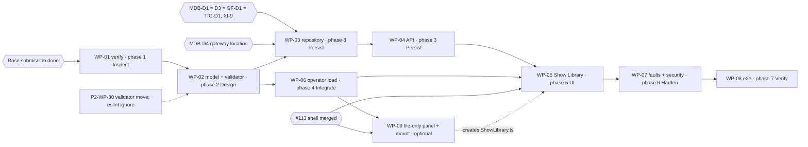

# MongoDB Atlas show library: work packages

> **STATUS: PROPOSED — NOT IMPLEMENTED.** Nothing in this file exists in code. Do not open these issues or start coding until Arnav approves and decision MDB-D1 is made (see [Gating](#gating)).

Purpose: split William's Encore Show Library spec into packages `MDB-WP-01` to `MDB-WP-08`, plus the optional `MDB-WP-09`, each small enough for one person and their agent to finish in one PR. Status: proposal, issue #130, audit base `origin/main` 4c41f75. Source author: William Pimentel (`wpimento`), [source handoff](../handoffs/Encore_MongoDB_Atlas_Implementation_Spec.md) (cited below as "William §n"). Integrator: Arnav.

**Where things live.** These are defined in the canonical spec, [`../integrations/mongodb-atlas-show-library.md`](../integrations/mongodb-atlas-show-library.md): requirements `MDB-FR`/`MDB-NFR`, contract change proposals `MDB-CC`, conflict records `MCR-01…`, decisions `MDB-D1…D7`, risks `MDB-R` and error codes. Tests `MDB-T*` are in [`../validation/mongodb-show-library-evaluation.md`](../validation/mongodb-show-library-evaluation.md). This file is canonical for `MDB-WP` titles and allowed files, and plans the work only. **Where this file and the canonical spec differ (a bound, an error code, a field name), the spec wins.** The orchestrator's cross-integration rulings XI-1…XI-10 (shared gateway, imports, error envelope, hashing, size caps, one network decision) are applied throughout and cited by number.

**Base rules, linked rather than restated:**
- the [contract](../design/contracts-and-algorithms.md): §2 types, §6 composition, §9 dissemination, §12 "not in the MVP";
- [requirements](../specification/requirements.md) **NFR-04**, the offline rule. `AGENTS.md:15` and `CURRENT_STATE.md` mislabel it NFR-10;
- [evaluation and tests](../validation/evaluation-and-tests.md);
- the boundary rules in [`AGENTS.md`](../../AGENTS.md) and [`tests/boundaries.test.ts`](../../tests/boundaries.test.ts);
- [`WORKFLOW.md`](../development/WORKFLOW.md).

Related drafts that are not yet on this branch:
- Gemini (provisional: depends on #117): the [spec](../integrations/gemini-generated-formations.md), its [work packages](gemini-integration-work-packages.md) and its [evaluation](../validation/gemini-formation-evaluation.md);
- Phase 2 (provisional: depends on #110): the [integration boundaries](../design/OPTIONAL_INTEGRATION_BOUNDARIES.md) (X-IN, X-OUT, and **X-RUN/live and X-PERSIST (provisional, #110)** as amended by XI-4), the [roadmap](PHASE2_ROADMAP.md) and the [work packages](../development/PHASE2_WORK_PACKAGES.md);
- Tiger Data (stacked after this, #142): `docs/integrations/tiger-data-analytics.md`, not yet linkable.

**Executed evidence: none.** Every test, check and demonstration below is a *planned check*. No MongoDB, gateway or Show Library code exists on `main` or on any pushed branch at 4c41f75, and no Atlas connection has been made.

## 1. Repo facts the packages rest on (verified at 4c41f75)

| Fact | Where | Consequence |
|---|---|---|
| **No backend.** The app is a static Vite build: no `server/`, and the only env var is `VITE_SIM_MODE` | `package.json`, `vite.config.ts` | William's "reuse existing backend" is impossible. One shared optional gateway, `integrations/gateway/` with modules `gemini`, `shows`, `tiger` (XI-1, MDB-D4, MCR-02) |
| **No Gemini or TigerData code exists**, despite "reported as completed" | orchestrator `git grep`, all `origin/*` | Save starts with manual Composer drafts (MDB-D7). Gemini drafts arrive with GF-WP-10 (MCR-01, MCR-13) |
| An injection is `{ type: 'inject'; recipe; at? }`. It needs a selected live drone (`origin` = that id), allows one `INJECT_SCORE` per tick, and text must match `/^[A-Z0-9 ]{1,20}$/i` | [`actions.ts`](../../src/app/actions.ts) 13, 155–160 | Loading a show means operator injections into one drone |
| `composeNext` returns version `{ issuedTick: tick, origin }` with two movements: the current one, and the new recipe at `tick + scoreLead` with a measured transition | [`compose.ts`](../../src/score/compose.ts) | One recipe per call. Stored `startTick`, `transitionTicks` or `version` would be stale (MD-2) |
| The controller composes from `authoredScore`. `schedule()` replaces it with each scheduled `INJECT_SCORE`'s score before that tick arrives | `actions.ts` 75, 96–98 | **Answers MD-3's open question.** Future `at` injections chain: step k+1 is built on step k's score (canonical §8.3) |
| A transition is ≥ `ceil(3 s / DT)` = 60 ticks; the default `scoreLead` is 60 | `score/timing.ts`, `contracts/params.ts` | With default params, `currentMovement(step k score, t_{k+1})` is always step k's movement. The planner still asserts it |
| Font: A–Z, 0–9 and space. `validateText` allows 1–20 characters (`TEXT_MAX`). `NAME_MAX` is 24 | [`font.ts`](../../src/score/font.ts), [`commands.ts`](../../src/app/ui/commands.ts) 115–116, 288–296 | Rules are derived from these, never copied. But `commands.ts` imports `../actions`, which imports `idsInSphere` and `randomIds` from `src/sim` (`actions.ts` 2), so neither the gateway nor `showComposition.ts` may import it (XI-2). `validateText` and `TEXT_MAX` therefore **move**, not copy, into the pure `validate.ts` (MDB-WP-02) |
| `validateDraft` sits in `Composer.ts`, which imports three.js and the DOM. It does not check that palette values are finite or in [0, 1] | [`Composer.ts`](../../src/app/ui/Composer.ts) 85 | A headless validator needs P2-WP-30's move to `src/app/compose/validate.ts`. The gateway may import that pure module (XI-2) |
| The panel loader ([`ui/index.ts`](../../src/app/ui/index.ts)) auto-mounts modules that export `createPanel({ host })`. The Composer is merged but unmounted until #113. **Changed since 4c41f75:** on `main` after #113 (844f0f2), `main.ts` no longer calls `createPanels`; panels are mounted explicitly (`src/app/main.ts` 357) | `Composer.ts` 7–8; `main.ts` 65 at 4c41f75 | The Show Library exports `createPanel` and talks only through `encore:control` / `encore:control-status` (canonical §12), but needs **one mount line** in `main.ts` (shell-owner sign-off; whichever of WP-09 or WP-05 creates the file adds it). Save Show needs one Composer hook after #113 (MCR-14) |
| The scripted demo sends timed injects with an explicit `at`, `LEAD_TICKS` (3 s) early | [`DemoScript.ts`](../../src/app/ui/DemoScript.ts) | Precedent for the MDB-WP-06 cue runner |
| Root `tsconfig` covers `src`, `tests` and `vite.config.ts`; vitest covers `tests/**`; `eslint .` ignores only `dist`, `node_modules` and `research` | root configs | `integrations/gateway/` is linted, but not typechecked or tested. P2-WP-30 adds the ignore, with owner sign-off (XI-1) |
| `canonicalJson` (sorted keys, throws on non-finite) lives in `src/cli/run.ts`, which also imports `node:crypto` | [`run.ts`](../../src/cli/run.ts) 27–36 | `contentHash` = sha256 of `canonicalJson(composition)` (XI-7). App and gateway reuse it only once it is extracted to a pure module: XI-7's one shared proposal (owner: Arnav) |
| `show save` and `show load` exist as `later` console commands | `commands.ts` 164–165 | Wanted by both GF-WP-11 and MDB-WP-09 (§5) |

## 2. Work packages

**Tests** cite `MDB-T` ranges; the evaluation doc assigns the individual IDs:

| Range | Covers |
|---|---|
| T01–T10 | Validation and serialisation |
| T11–T18 | API and repository, with mocked data access |
| T19–T24 | Idempotency, write protection, rate limits, size limits, error sanitisation, credential non-disclosure (grep of the built bundle) |
| T25–T29 | UI states |
| T30–T33 | Operator-pathway load, fresh versions, determinism with a fixture, isolation |
| T34–T36 | Offline: networking-off build and demo |
| T37–T40 | Live Atlas (separate test database) and the 10-step end-to-end acceptance |
| T41 | Offline export and import (MDB-FR-11, MDB-WP-09) |

**Lanes** follow [`TEAM_ROLES.md`](../development/TEAM_ROLES.md): A is brain, contracts and score; B is world, evidence, CLI and plumbing; C is experience. **Assignee for every package: TBD by Arnav.** No package is assigned to William or Haris (MDB-D5).

**Standard regressions**, required in every package that has code:
1. `bash scripts/check.sh` passes.
2. The isolation tests (`tests/boundaries.test.ts` T01 and `tests/isolation/*`) pass, unchanged.
3. The **networking-off build test** passes: `npm run build && npm run preview` with networking off requests nothing outside `localhost` (the NFR-04 acceptance).
4. `check.sh` passes with `integrations/` deleted (P2-T35, provisional: #110).
5. `stateHash` for S0–S5 seed 1 is unchanged.

### MDB-WP-01 Existing architecture verification

- **Purpose.** William's phase 1 ("Inspect") and §12's "report discrepancies". Re-verify §1 against `main` at start time, because #113, #121, #117 and #110 will have moved it. The output is a verification note, not code.
- **Dependencies.**
  - MDB-WPs: none.
  - Gemini and Phase 2 (read only): P2-WP-30, GF-WP-01/02, 09, 10 and 12.
  - MDB-D1: not needed.
- **Priority.** Essential: it gates every other package. Suggested P1.
- **Lane.** B, with lane A reviewing the score rows. Assignee: TBD by Arnav.
- **Allowed files.** None. The note goes in an issue comment.
- **Proposed interfaces.** None. The note must answer seven questions:
  1. Is there still no backend or `integrations/` folder?
  2. Is `authoredScore` still updated at schedule time?
  3. Has `validateDraft` moved?
  4. How does the #113 shell expose `Drafts`?
  5. Has GF-CC-01 landed?
  6. What is the current state of `eslint.config.js` and `vite.config.ts`?
  7. Is there any Gemini or TigerData branch that the audit missed?
- **Required approvals.** None.
- **Acceptance criteria.** Each §1 row is marked "still true" or "changed", with a file and line. Every change names the MDB-WPs it affects. Any new contradiction with William's spec goes to Arnav as a proposed MCR row and is never silently absorbed.
- **Tests (unit, integration, security).** None.
- **Regression checks.** None.
- **Rollback approach.** Not applicable.
- **Implementation risk.** Low. The real risk is skipping this package and building on a stale fact, such as a second gateway folder.
- **Expected demonstration evidence.** The note, with the SHA it was made at.

### MDB-WP-02 Storage model and validation

- **Purpose.** William §4 and §8.2 as one pure validator and one canonical form (MD-2, MD-4, MD-5). The stored object is a **reusable composition**, not a runtime `Score`. The field is renamed from `score` to `composition` (MCR-04). This package makes all three validation points possible with **one module** (XI-2):
  - (a) in the app, before save;
  - (b) in the service, on write;
  - (c) in the app and the service, on read.
- **Dependencies.**
  - MDB-WP-01.
  - **P2-WP-30** (its offline half, proposed `30a`, provisional: #110), which moves `validateDraft` into `src/app/compose/validate.ts` and adds the palette check. If it has not landed, this package does just that move (no behaviour change, re-exported from `Composer.ts`) and P2-WP-30 rebases. Either way, `validateText` and `TEXT_MAX` move with it (§1), and `validate.ts` imports only `src/contracts`, `src/score` and `src/score/font`.
  - XI-7's extraction of `canonicalJson` to a pure module (owner: Arnav). This package never writes its own copy.
  - GF-WP-01/02 and GF-CC-01, only to accept `generated` recipes (schemaVersion 2, XI-8). Until then they are rejected.
  - MDB-D1: not needed.
- **Priority.** Essential. Suggested P1.
- **Lane.** A, with lane C reviewing the re-export. Assignee: TBD by Arnav.
- **Allowed files.**
  - `src/app/compose/validate.ts` and the `Composer.ts` re-export line: only if P2-WP-30 is absent.
  - The `validateText`/`TEXT_MAX` move into `validate.ts`, if P2-WP-30 has not made it, and one re-export line in `commands.ts` (`export { validateText, TEXT_MAX } from '../compose/validate'`), so console and Composer behaviour and imports are unchanged. Sign-off: the `commands.ts` owner.
  - `src/app/compose/showComposition.ts` (new). It extends P2-WP-30's pure validator module and imports only `src/contracts`, `src/score`, `./validate` and the extracted canonical-JSON helper, so XI-2 lets the gateway import it. If Arnav rules it outside XI-2, its content moves into `validate.ts`.
  - `tests/persistence/composition.test.ts` and `tests/persistence/imports.test.ts` (the transitive import scan).
  - `tests/persistence/fixtures/*.json`: the shared corpus, which the gateway tests (MDB-WP-03) also read.
  - **No `integrations/` file.** The gateway's re-export and its corpus test belong to MDB-WP-03, which creates the gateway after MDB-D1.
- **Proposed interfaces.**

```ts
// src/app/compose/showComposition.ts — no DOM, no three.js, no node:*; importable by the gateway (XI-2)
export interface CompositionMovement { recipe: Recipe; holdTicks: number }   // no startTick, transitionTicks, version
export interface Composition { v: 1; movements: CompositionMovement[] }
export const COMPOSITION_LIMITS: { maxMovements: number; maxHoldTicks: number; maxTitleChars: number;
  maxPromptChars: number; maxBodyBytes: number };   // 16, 6000, 80, 2000, 65536: canonical §7.1, §9 (R1, R8, R9)
export interface CompositionIssue { path: string; rule: string; reason: string }  // = an XI-3 details[] entry
export type CompositionCheck =
  | { ok: true; composition: Composition; warnings: CompositionIssue[] }
  | { ok: false; errors: CompositionIssue[] };
/** Total over unknown, never throws. Shape-directed: descends only into known fields, never a generic walk.
 *  Fresh plain objects; rejects unknown keys, keys starting with '$' or containing '.', and
 *  __proto__/constructor/prototype. Text is upper-cased in the output so the hash is stable. */
export function validateComposition(input: unknown, params: Params): CompositionCheck;
export function canonicalCompositionJson(c: Composition): string;      // = canonicalJson(c) (XI-7), never a second definition
export function compositionPreview(c: Composition): { movementCount: number; kinds: Recipe['kind'][] };
```

  **Rules** R1–R16 are canonical §9. They come only from the current contract:
  - `kind` is one of {text, sphere, helix}, with `generated` added only after GF-CC-01;
  - text passes `validateText`, imported from `./validate` after the move above, never from `commands.ts`;
  - `palette` is absent or two RGB triples, each value finite and in [0, 1];
  - `holdTicks` is a safe integer in [0, max];
  - there are 1 to `maxMovements` movements;
  - each recipe passes a trial `expandRecipe`, as `validateDraft` does.

  **Bounded depth, strict decoding.** "Unknown keys at any depth" (R2) is enforced by shape, not by recursion over input. A valid composition nests at most 6 containers (composition → `movements` → movement → `recipe` → `palette` → RGB), 7 for the request body. Any nesting outside the known shape is rejected as `UNKNOWN_KEY` or `INVALID_FIELD` before `canonicalJson` (which recurses without a bound, `run.ts` 28–36) sees it, so a 64 KiB `[[[[…` body is a 400, never a `RangeError`. Bytes are decoded with `new TextDecoder('utf-8', { fatal: true })`; invalid UTF-8 is 400 `VALIDATION_FAILED` (reason `INVALID_JSON`), never silently replaced with U+FFFD. Whether `JSON.parse` itself is safe on such input is UNVERIFIED, so the body reader (WP-04) and the file importer (WP-09) also reject nesting deeper than 8 with a linear pre-parse scan.

  **Service side (XI-2).** The gateway imports this same module by relative path, so service-side validation is **complete, trial expansion (R14) included**, on write and on read. There is no structural copy and no parity test. This supersedes Gemini CR-24's "cannot import `src/`" for this feature. It holds only because the module's transitive imports exclude `src/sim`, `src/app/actions` and `src/app/ui` (the `validateText` move above); the import scan enforces it.
- **Required approvals.** XI-2 recorded as a decision. No contract change (MDB-CC-01 is deferred).
- **Acceptance criteria.**
  - Every fixture gets its expected verdict and codes.
  - The validator never throws on any JSON value.
  - Canonical form → parse → validate is the identity.
  - Fixtures carrying `version`, `startTick`, `transitionTicks`, `droneId` or `$set` are rejected.
  - The #112 Composer tests and the console tests are unchanged.
  - A root vitest test (the environment is already `node`, `vite.config.ts`) imports `showComposition.ts` alone and gives every fixture's verdict. A transitive import scan of it finds no `three`, DOM global, `node:*`, `src/sim`, `src/app/actions` or `src/app/ui` (extends MDB-T09). The gateway's own run of the corpus is MDB-WP-03's.
- **Unit tests.** MDB-T01–T10.
- **Integration tests.** None: this package is offline and gateway-free.
- **Security tests.** Prototype keys, `$` and `.` keys, oversized strings and arrays, and a 64 KiB deeply nested array (rejected, no throw) (T01–T10).
- **Regression checks.** The standard regressions. The module loads under the Node test environment, with no three.js or `document`.
- **Rollback approach.** Revert. Nothing imports the module yet.
- **Implementation risk.** Medium:
  - the module must stay pure, or the gateway import breaks (an import scan covers it);
  - P2-WP-30, P2-WP-05 and GF-WP-10 also edit `validateDraft`, and the `validateText` move touches `commands.ts`, which is shared with the console;
  - the v2 size budget for generated recipes, decided with GF-CC-01 (XI-8).
- **Expected demonstration evidence.** The test output with the fixture verdicts.

### MDB-WP-03 MongoDB repository and connection management

- **Purpose.** William's phase 3 ("Persist") and the §5 backend requirements: the official driver, one reused client, indexes, and data access behind an interface that tests can mock (William §10). It creates the one shared optional gateway of XI-1 at `integrations/gateway/`, with `shows` as an independently optional module beside `gemini` and `tiger`: each is enabled only by its own server-side configuration, and the absence or failure of one never disables another, the app, the simulator, the CLI or `report.ts`. No module creates its own server.
- **Dependencies.**
  - **MDB-D1** (= D3 = GF-D1 = TIG-D1, one decision, XI-9), under **X-RUN/live and X-PERSIST (provisional, #110)**.
  - MDB-D4.
  - MDB-WP-02.
  - GF-WP-12 and the Tiger module share the folder: the first to land creates `package.json`.
  - P2-WP-30 (proposed `30b`, gated by P2-G6 and D3; provisional: #110) adds the eslint ignore (owner sign-off, XI-1).
- **Priority.** Essential (MVP). Suggested P1.
- **Lane.** B. Assignee: TBD by Arnav.
- **Allowed files.** Everything is under `integrations/gateway/`:
  - `package.json` (run with `tsx`), `package-lock.json`, `tsconfig.json` (resolves XI-2's relative `src/` imports), `README.md`, `.env.example` (variable names only);
  - `src/config.ts` and `src/db/mongo.ts`;
  - `src/shows/types.ts`, `repository.ts`, `mongoRepository.ts`, `memoryRepository.ts` and `indexes.ts`;
  - `src/shows/validate.ts`, a thin re-export of `showComposition.ts` by relative path (moved here from WP-02, so the gateway exists only after MDB-D1);
  - `test/repository.test.ts`, `test/imports.test.ts` (the XI-2 allow-list scan) and `test/validate.test.ts` (the WP-02 corpus through the gateway's import, with the app's verdicts);
  - `test/mongoRepository.live.test.ts`, skipped unless `MONGODB_TEST_URI` is set.
- **Proposed interfaces.**

```ts
// integrations/gateway/src/shows/types.ts — imports Composition from src/app/compose/showComposition.ts (XI-2)
export interface SavedShowDoc {
  _id: ObjectId; schemaVersion: 1; title: string; prompt?: string;   // prompt only with explicit opt-in (MDB-D2)
  composition: Composition; contentHash: string;                      // sha256(canonicalJson(composition)), server-computed (XI-7)
  source: 'gemini' | 'manual'; generator?: { model: string; integrationVersion: string; sceneHashes?: string[] };
  preview: { movementCount: number; kinds: string[] }; operationId: string; createdAt: Date; updatedAt: Date;
}
// ShowSummary, SavedShow: canonical §10.1
export type NewSavedShow = Omit<SavedShowDoc, '_id' | 'schemaVersion' | 'createdAt' | 'updatedAt'>;
export type InsertOutcome = { kind: 'created'; id: string } | { kind: 'duplicate'; id: string; contentHash: string };
export interface ShowsRepository {                                    // mocked in unit tests
  insert(show: NewSavedShow, now: Date): Promise<InsertOutcome>;
  list(page: { limit: number; after?: { createdAt: Date; id: string } }):
    Promise<{ items: ShowSummary[]; next: { createdAt: Date; id: string } | null }>;
  get(id: string): Promise<SavedShowDoc | null>;                       // id already checked as 24 hex
  ping(): Promise<'up' | 'down'>;
}
export function getDb(c: { uri: string; dbName: string; serverSelectionTimeoutMS: number }): Promise<Db>;  // one lazy client
export function ensureIndexes(db: Db): Promise<void>;   // { createdAt: -1, _id: -1 }; unique { operationId: 1 }
```

  **Driver facts** are canonical §10.9 (VERIFIED and UNVERIFIED rows, 2026-11-15). Two remain to check here: the duplicate-key code 11000 (detect it through the driver error, with a test) and driver support for Node 22.12+ (check before pinning). The optional `$jsonSchema` validator (MD-6) mirrors the structural rules as defence in depth.
- **Required approvals.** MDB-D1, MDB-D4, and the eslint ignore (through P2-WP-30 or build-config owner sign-off). **Root `package.json`, CI and `eslint.config.js` changes need owner sign-off** (XI-1); this package makes none to the first two. The root manifest is William's, and he has paused.
- **Acceptance criteria.**
  - The gateway imports from `src/` only XI-2's allow-list (never `src/app` outside the pure validator, `src/agent`, `src/sim`, `src/observer` or `src/cli`).
  - The gateway, importing the module under Node, gives the app's verdict on the whole WP-02 corpus.
  - The memory and Mongo repositories pass one contract suite.
  - A repeated `operationId` gives `duplicate` and no second document.
  - Keyset paging is newest first, with `_id` as the tie-break.
  - Concurrent first calls create one client.
  - An unreachable URI fails within the timeout as a typed `DatabaseUnavailable`, never as a raw driver error.
  - No telemetry, frame, `RunRecord` or experiment-catalogue field exists in the types (MD-13, XI-6).
- **Unit tests.** MDB-T11–T18.
- **Integration tests.** MDB-T37–T38: a live read-after-write against a **separate test database**, run by hand.
- **Security tests.** The URI is never logged or echoed (T19–T24). The least-privilege Atlas user (`readWrite` on `encore.saved_shows` only) is checked by hand and recorded in the README.
- **Regression checks.** The standard regressions. The root `npm ci` installs no MongoDB package.
- **Rollback approach.** Delete `src/shows` and `src/db`, or the whole folder. Nothing in `src/` depends on them.
- **Implementation risk.** Medium:
  - a duplicate gateway folder, if #117's draft (`integrations/gemini-gateway/`) is not yet aligned to XI-1;
  - pinning the driver and Node versions;
  - Atlas network access from the venue.
- **Expected demonstration evidence.** A live read-after-write log from the test database. None exists until it is run.

### MDB-WP-04 Saved Shows API

- **Purpose.** William's four routes and status table (§5), plus MD-7 idempotency and MD-8's 409, 413 and 415, in the gateway's one error envelope (XI-3). William's **400** is kept for all invalid input, rather than 422, because `details[].reason` already separates malformed JSON from a rule violation and there is one client. **Not here:** Host, Origin and CORS checks (403) and rate limiting (429) are MDB-WP-07's `guard.ts`. This package hard-codes the `127.0.0.1` bind, sends no CORS headers, and is not run against real Atlas until WP-07 merges.
- **Dependencies.**
  - MDB-WP-03.
  - MDB-D1.
  - MDB-D2, which decides whether `prompt` is accepted.
  - GF-WP-12 and the Tiger module share `server.ts` and `errors.ts`; routes are registered per module (XI-1).
- **Priority.** Essential (MVP). Suggested P1.
- **Lane.** B. Assignee: TBD by Arnav.
- **Allowed files.** Under `integrations/gateway/`:
  - `src/server.ts`, using `node:http` with no framework (William: do not add Express "before inspecting current infrastructure"; there is none);
  - `src/http/body.ts` (byte cap, fatal UTF-8 decode, pre-parse depth scan) and `errors.ts` (the XI-3 envelope, shared by all modules, with `sanitise` and `redact`, since T23 is tested here);
  - `src/shows/routes.ts` and `hash.ts` (sha256 via `node:crypto` over the shared `canonicalJson`, XI-7);
  - `src/health.ts`;
  - `test/routes.test.ts` and `test/idempotency.test.ts`.
- **Proposed interfaces.**

```ts
// POST /api/shows   Content-Type: application/json; Idempotency-Key: <uuid v4> (body operationId as fallback)
//   body SaveShowRequest → 201 { show: SavedShow; idempotentReplay: false } + Location   (types: canonical §10.1–10.2)
//   200 + idempotentReplay: true on same key and same contentHash · 409 CONFLICT on same key, other content
// GET /api/shows?limit=20&cursor=<opaque> → 200 { items: ShowSummary[]; nextCursor: string | null }  (limit ≤ 50)
// GET /api/shows/:id → 200 { show: SavedShow }
// GET /api/health    → 200, per-module status (canonical §10.4); shows.db 'up' | 'down' | 'disabled'; no secrets
type ErrorBody = { error: { code: GatewayErrorCode; message: string;          // XI-3: every gateway route;
  details?: { path: string; reason: string }[]; requestId?: string } };      // no `success` flag on any body
type GatewayErrorCode = 'VALIDATION_FAILED' | 'NOT_FOUND' | 'PAYLOAD_TOO_LARGE' | 'UNSUPPORTED_MEDIA_TYPE'
  | 'RATE_LIMITED' | 'UNAUTHORIZED' | 'FORBIDDEN' | 'CONFLICT' | 'SCHEMA_VERSION_UNSUPPORTED'
  | 'DATABASE_UNAVAILABLE' | 'PROVIDER_UNAVAILABLE' | 'PROVIDER_ERROR' | 'TIMEOUT' | 'INTERNAL';   // XI-3 shared list
export function createShowsHandler(repo: ShowsRepository, clock: () => Date, limits: ShowLimits):
  (req: IncomingMessage, res: ServerResponse) => Promise<boolean>;   // false = not a shows route
export function sanitise(error: unknown): { status: number; body: ErrorBody };   // src/http/errors.ts; never driver text
export function redact(text: string): string;                                    // strips mongodb(+srv):// URIs from logs
```

  Shows-specific causes (malformed JSON, id, cursor or idempotency key; idempotency conflict; stored show invalid; module disabled; the validator's reasons) go in `details[].reason`, never in `code`. The canonical spec §10.1 fixes the reason strings. `requestId` is client-generated (≤ 64 characters) and echoed.

  **Why the `Idempotency-Key` header.** It keeps the body equal to the content being hashed, and it is a common HTTP API convention. The standing of the IETF draft is UNVERIFIED and nothing here relies on it. If a header and a body key disagree, the request gets a 400.

  **Write path:**
  1. Check the content type (415).
  2. Read the body with a byte cap of 64 KiB (schemaVersion 1, XI-8) before parsing (413).
  3. Decode as strict UTF-8, scan the nesting depth, then parse (400 `INVALID_JSON`; WP-02's "bounded depth, strict decoding").
  4. Run the shared validator, trial expansion included (400 `VALIDATION_FAILED`, XI-2).
  5. Build the document field by field and never spread client input.
  6. Hash, then `insert`.
  7. On `duplicate`, compare hashes: 200 for a replay, 409 for a conflict.

  **Read path:**
  - The id must be 24 hex characters before any query (400).
  - Every query sets `maxTimeMS`.
  - The stored composition is re-validated with the same module. A corrupt document returns 500 `INTERNAL` (reason: stored show invalid) and is logged without content; a newer `schemaVersion` returns `SCHEMA_VERSION_UNSUPPORTED`.
  - List returns only William's metadata projection.
- **Required approvals.** MDB-D1 and MDB-D2. MDB-D3 only for anything beyond `127.0.0.1`, which is out of MVP.
- **Acceptance criteria.**
  - Every status in William's table, plus 409, 413 and 415, has a test. 403 and 429 are WP-07's.
  - Every non-2xx body is the XI-3 envelope with a shared-list code; no driver text, stack trace or URI appears in any response.
  - List returns no `composition` and no `prompt`.
  - `limit` is bounded.
  - Health works with the database down or `disabled`.
- **Unit tests.** MDB-T11–T18.
- **Integration tests.** MDB-T37–T38, over HTTP against the test database.
- **Security tests.** MDB-T19, T22 and T23: duplicate retry, conflict, sanitised errors, and `$`-key injection; with T13's 413, plus a 64 KiB nested array and invalid UTF-8 bytes (both 400, never 500).
- **Regression checks.** The standard regressions, plus the gateway's own `npm test`.
- **Rollback approach.** Unregister the shows routes. Health then reports `disabled` and the app hides the library.
- **Implementation risk.** Medium. Hand-rolled body handling (chunking, caps) needs its own tests, and `server.ts` and `errors.ts` are shared with GF-WP-12 and the Tiger module. If the package is still too large for one PR, the keyset cursor is the piece to split off (§6, item 4).
- **Expected demonstration evidence.** A status-code test report. Optionally a `curl` transcript against `127.0.0.1`.

### MDB-WP-05 Frontend Show Library

- **Purpose.** William §7: a **Save Show** action and a Saved Shows panel (the Show Library), attached to the existing Composer rather than a parallel flow (MD-12; the Gemini spec's CR-16 did the same).
- **Dependencies.**
  - MDB-WP-02, MDB-WP-06 (Load), and MDB-WP-04 for the live client. The panel is built against a fake client first.
  - **Base #113**, which mounts the Composer (for the Save Show hook, MCR-14).
  - GF-WP-10, for saving a generated draft. Until then only `source: 'manual'` exists (MDB-D7).
  - MDB-D1 and MDB-D2.
- **Priority.** Essential (MVP). Suggested P1.
- **Lane.** C. Assignee: TBD by Arnav.
- **Allowed files.**
  - `src/app/services/savedShows.ts` (new).
  - `src/app/ui/ShowLibrary.ts`: the network section (Save, list, retrieve). The file-only panel and its `main.ts` mount line normally come from MDB-WP-09; if WP-05 lands first, it creates both, as WP-09 describes (§1).
  - The one Save Show hook in `Composer.ts`, after #113 (Composer-lane sign-off, MCR-14).
  - `tests/persistence/savedShowsClient.test.ts`.
  - `tests/persistence/showLibrary.test.ts`, using `tests/app/ui/fakeDom.ts`.
  - **Not** `main.ts` (beyond that one mount line), the #113 shell, `styles.css` or `vite.config.ts`.
- **Proposed interfaces.**

```ts
// src/app/services/savedShows.ts — the only src/ file that calls fetch, and only same-origin /api/* (MCR-17)
export type ShowsAvailability = 'off' | 'unavailable' | 'disabled' | 'down' | 'up';  // off = flag unset: no request
export type ApiResult<T> = { ok: true; value: T }
  | { ok: false; code: GatewayErrorCode | 'NETWORK'; message: string; retryable: boolean };  // retryable: client-derived
export interface ClientOptions { fetch?: typeof fetch; timeoutMs?: number }
export function probeShows(o?: ClientOptions): Promise<ShowsAvailability>;
export function newOperationId(): string;                                         // crypto.randomUUID()
export function saveShow(input: Omit<SaveShowRequest, 'operationId'>, operationId: string, o?: ClientOptions):
  Promise<ApiResult<{ show: SavedShow; idempotentReplay: boolean }>>;
export function listShows(cursor?: string, limit?: number, o?: ClientOptions):
  Promise<ApiResult<{ items: ShowSummary[]; nextCursor: string | null }>>;
export function getShow(id: string, o?: ClientOptions): Promise<ApiResult<{ show: SavedShow }>>;
// src/app/ui/ShowLibrary.ts — talks to the simulation only via encore:control / encore:control-status
export function createPanel(o: { host: HTMLElement }): void;
```

  **The ten UI states** and their messages are canonical §12. Stored strings are set with `textContent` only. Save is enabled only for a draft that passes `validateDraft`, or for a validated generated draft (GF-WP-10). The Save form follows canonical §12: the current draft by default, optionally more validated drafts, each with `holdTicks`.
- **Required approvals.** MDB-D1, MDB-D2, the Composer lane (the Save hook) and MDB-D5.
- **Acceptance criteria.**
  - All ten states are reachable with a fake client.
  - A failed or timed-out save keeps the draft, and its retry sends the same key.
  - With the library flag off (the default), the app makes **zero** requests (XI-9). With it on and no gateway, it sends exactly one `/api/health` probe and changes nothing else.
  - Every response is re-validated before Load is offered.
  - No HTML is built from stored strings.
- **Unit tests.** MDB-T25–T29. The client's parsing and timeouts are covered by T11–T18.
- **Integration tests.** Panel → client → gateway on the memory repository (T37–T40 group).
- **Security tests.** A title containing `` renders as text. No credentials and no `VITE_*` secrets in the client (T19–T24).
- **Regression checks.** The standard regressions, plus T34–T36 with the gateway absent.
- **Rollback approach.** Remove the Save hook and the network section of `ShowLibrary.ts`; the file-only panel (WP-09) stays.
- **Implementation risk.** Medium:
  - it depends on where #113 lets the Composer hook live;
  - it must not steal focus from the Composer's never-rebuilt text fields;
  - it adds the first `fetch` in `src/app`. Lint bans `fetch` only in core, but this is still new, and it is why MDB-D1 is required. The app may call the gateway while the simulation runs, but never inside the tick loop or a decision path (XI-5).
- **Expected demonstration evidence.** Once executed: a recording of save → refresh → list on the test database, with no URI or Atlas console visible.

### MDB-WP-06 Operator pathway integration

- **Purpose.** William §3 step 6 and the §6 loading flow, which is his phase 4 ("Integrate"). A stored composition goes through the **existing injection pathway** (canonical §8.2, §13), and the controller assigns each runtime `ScoreVersion` (MD-3, MD-14). It never sets drone targets and never bypasses radio: nothing from the gateway reaches a drone except via an operator `INJECT_SCORE` (I7, XI-5).
- **Dependencies.**
  - MDB-WP-02.
  - Base #113 owns `actions.ts` and `commands.ts`. This package changes neither.
  - **MDB-D1 is not required**: loading works from a fixture or a file.
  - MDB-D6 (just-in-time runner over pre-scheduling).
- **Priority.** Essential (MVP). Suggested P1.
- **Lane.** C, with lane A reviewing the timing. Assignee: TBD by Arnav.
- **Allowed files.**
  - `src/app/compose/showLoad.ts` (new, pure).
  - `tests/persistence/showLoad.test.ts`.
  - `tests/persistence/showDeterminism.test.ts`.
  - `tests/persistence/fixtures/*.json`.
- **Proposed interfaces.**

```ts
// src/app/compose/showLoad.ts — no DOM; ControlPort adapts the encore:control / encore:control-status events
export interface ShowLoadPlan { droneId: number; steps: { recipe: Recipe; holdTicks: number }[] }
export function planShowLoad(c: Composition, droneId: number): ShowLoadPlan;
/** t_{i+1} = t_i + max(L, T_i + h_i), L = params.scoreLead (canonical §8.2 step 6). */
export function nextStepTick(tickI: number, transitionTicksI: number, holdTicksI: number, scoreLead: number): number;
export interface ControlPort { dispatch(intent: ControlIntent): ControlResult; status(): ControlStatus }
export interface CueRunner {
  readonly state: 'running' | 'paused' | 'done' | 'stopped' | 'failed'; readonly problem: string | null;
  readonly scheduled: { step: number; tick: number; version: { issuedTick: number; origin: number } }[];
  poll(): void;   // on every control status: dispatches the next step R ticks early with an explicit `at`
  resume(): void; stop(): void;
}
export function loadComposition(plan: ShowLoadPlan, port: ControlPort, dispatchLead?: number): CueRunner;  // R = 20
```

  **How the cue runner works** (canonical §8.2 is authoritative; this is the plan):
  - **Step 1** goes at the operator's chosen tick, or with no `at` so it lands on the next tick.
  - **Step i+1** is sent once `status.tick ≥ t_{i+1} − R`, as one `inject` with `at = t_{i+1}`. **The runner never sends `select`**: unlike the DemoScript, it would take over the operator's selection and inspector mid-show. If late, it goes without `at` and the load is marked off-schedule. `T_i` is read from the returned event, `result.event.score.movements[1].transitionTicks`, after the event is checked (canonical §8.2 step 5).
  - Each step is its own `composeNext`, with a **fresh** version `{ t_i, droneId }`. Because composition chains through `authoredScore`, step i+1 starts with step i's movement; the `max` keeps movement i from vanishing.
  - **Selection check before every dispatch:** `status.selectedId === plan.droneId && status.selectedAlive`. Otherwise the runner pauses with a fixed message ("Select drone D in the Encore pane, then Resume"). On current `main`, an inject also fails with `STATIC_SELECTION_REFUSAL` when the selection was made in the static pane (`actions.ts` 45, 106 at 844f0f2; `ControlStatus` does not report the pane). The runner treats that result as the same pause, not as a failed intent. **Resume** continues into the live Encore drone selected at that moment, and the panel names it. It never retargets silently. An uplink into a drone that dies after dispatch is flagged as possibly undelivered.
  - **Reset, seed change, a foreign `INJECT_SCORE` or a failed intent** stop it.

  **Late or missed adoption** follows LWW (contract §9). A drone that misses step k adopts step k+1, which carries step k's movement first. A drone cut off past `t_{k+1} + scoreLead` joins movement k+1 directly. Adoption is reported only from observer `MetricsSample.versions`.

  **Why not schedule every step at once** is canonical §8.3 (no un-schedule, a fixed drone, interleaving; MDB-D6). The single-call alternative, `composeShow` in `src/score`, is **MDB-CC-01: deferred. PROPOSED CONTRACT CHANGE — REQUIRES ARNAV APPROVAL.** No package depends on it.

  **X-IN.** A loaded show is a candidate composition that passes X-IN validation before any operator injection (XI-4). X-IN "never schedules injections by itself", so this runner asks for an explicit confirmation ("Schedule N injections into drone D?"). It also offers **Load as drafts**, which only adds Composer drafts (X-IN step 7). See §6, item 1.
- **Required approvals.** None for code. Arnav decides MDB-D6 and accepts the "one confirmed Load = N operator injections" reading, or chooses drafts-only for MVP.
- **Acceptance criteria.**
  - On headless worlds with a three-movement fixture, each step is exactly one `INJECT_SCORE` into the chosen drone, at the planned tick, with a strictly newer version.
  - The measured holds equal `holdTicks`.
  - Every step goes through `controller.handle`.
  - The runner dispatches no `select`. A lost, unselected or static-pane-selected drone pauses it visibly (the static-pane case belongs in MDB-T30's setup); reset or a foreign injection stops it.
  - A headless replay of the event log gives the same `stateHash`.
  - The fixture injected directly and the same fixture injected through `loadComposition` give the same `stateHash` (MD-14).
- **Unit tests.** MDB-T30–T31.
- **Integration tests.** MDB-T32: determinism from a fixture, without Atlas.
- **Security tests.** An unknown recipe kind never reaches `dispatch`. Unvalidated, it would crash `expandRecipe` in both worlds.
- **Regression checks.** The standard regressions, MDB-T33 (isolation unchanged), and `tests/app/demo.test.ts`.
- **Rollback approach.** Revert. Only WP-05 and WP-09 import the module.
- **Implementation risk.** Medium-high:
  - an off-by-`scoreLead` timing bug;
  - a manual inject during a show, which is legal under LWW but surprising, so the panel says so;
  - #113 changing `ControlResult` or the status event.
- **Expected demonstration evidence.** A headless log of each step's tick, version and measured hold.

### MDB-WP-07 Fault handling and security

- **Purpose.** William's phase 6 ("Harden"): the §8.3 security list and the §9 failure scenarios A–F, plus "gateway not running" and "refresh" (MD-10, MD-11). It also documents the operator's local runbook.
- **Dependencies.**
  - MDB-WP-04, 05 and 06.
  - MDB-D1.
  - MDB-D3, only for a public deployment, which is out of MVP. That case needs server-side authorisation, such as a server-held operator credential behind a server-issued HttpOnly session, plus stricter rate limits (MD-9).
- **Priority.** Essential before any demo with real Atlas. Suggested P1.
- **Lane.** B for the service and C for the UI states. Assignee: TBD by Arnav.
- **Allowed files.**
  - Under `integrations/gateway/`: `src/http/guard.ts` (new, owned entirely here: Host, Origin and CORS checks and the rate limiter), the guard settings in `src/config.ts` (created by WP-03), `README.md` (the runbook: Atlas user, network access, `.env` handling), `test/faults.test.ts`, `test/security.test.ts`, and `test/bundle-secrets.test.ts`, which scans the root `dist/` after a build. Not `errors.ts`, which WP-04 owns.
  - `tests/persistence/faults.test.ts`.
- **Proposed interfaces.**

```ts
export interface GuardConfig { bind: '127.0.0.1'; allowedOrigins: string[]; allowedHosts: string[];
  rate: { writes: { perMinute: number; burst: number }; reads: { perMinute: number } } }   // values: canonical §10.7
export function guard(req: IncomingMessage, res: ServerResponse, c: GuardConfig, now: () => number): boolean;  // false = answered 403/429
```

  **Fault matrix.** Each row is a planned test:

  | Scenario (William) | Expected |
  |---|---|
  | A. Atlas down during save | 503. The draft is kept, Retry uses the same key, and the simulation is untouched |
  | B. Corrupt document | Rejected on read by both sides. Never injected |
  | C. Save times out after the insert | Retry gives 200 `idempotentReplay`, with exactly one document stored |
  | D. Unauthorised write | A foreign Origin gets 403 before any insert |
  | E. No internet | Local controls, drafts and steps already scheduled all continue |
  | F. Outdated schema | An unsupported `schemaVersion` gives `SCHEMA_VERSION_UNSUPPORTED`, never reinterpreted |
  | Gateway not running, or library flag off | "Feature unavailable" after one probe, no retry storm; zero requests when the flag is off |
  | Refresh | UI state is cleared and the library persists (William §7). The cue runner is gone, but the steps already scheduled remain |

- **Required approvals.** MDB-D1. MDB-D3 only if the gateway is ever deployed beyond the laptop.
- **Acceptance criteria.**
  - Every row passes.
  - A `grep` of `dist/` finds no `mongodb://`, `mongodb+srv://`, `MONGODB_` or Atlas host.
  - No `.env` file is committed; `.gitignore` already covers `.env*` and keeps `.env.example`.
  - Logs hold only request id, route, status and latency.
  - The gateway **refuses to start** on any address other than `127.0.0.1` unless MDB-D3's server-side authorisation is configured and enabled. A flag alone is never enough, and the refusal message names no secret (the rule belongs in canonical §10.7; MDB-T20).
- **Unit tests.** MDB-T20, T21 and T24.
- **Integration tests.** Scenarios A, C and E against the test database (T37–T40 group).
- **Security tests.** MDB-T20, T21 and T24, then T19, T22 and T23 re-run with the guard on.
- **Regression checks.** The standard regressions, plus T34–T36 with the gateway stopped.
- **Rollback approach.** Revert, then stop using real Atlas: without the guard, WP-04 is test-only (see its purpose).
- **Implementation risk.** Medium. An Origin check is not authentication, which is why the MVP is localhost-only and the README says so.
- **Expected demonstration evidence.** The test report. Optionally a drill: cut Atlas access in the middle of a show, and the loaded show keeps flying.

### MDB-WP-08 Validation and end-to-end acceptance

- **Purpose.** William's phase 7 ("Verify") and his 10-step test (§10): generate, save, verify in Atlas, refresh, open, retrieve, load, execute, then an outage. William: "Do not claim live Atlas verification without an actual read-after-write test".
- **Dependencies.**
  - MDB-WP-02 to MDB-WP-07.
  - MDB-D1.
  - GF-WP-10 and GF-WP-12 for step 2. **Without them, step 2 uses a manual draft and is recorded as such** (MDB-D7), never as Gemini output.
- **Priority.** Essential for any claim. Suggested P1.
- **Lane.** B. Assignee: TBD by Arnav.
- **Allowed files.**
  - `integrations/gateway/test/e2e.live.test.ts` (opt-in).
  - `tests/persistence/acceptance.test.ts`: steps 7–10 on the memory repository with a fixture.
  - An evidence note in the PR.
- **Proposed interfaces.** None.
- **Required approvals.** MDB-D1. Arnav decides whether any result is cited in submission material, after MLH eligibility is checked (issue #1).
- **Acceptance criteria.**
  - All 10 steps are run against a separate test database. Each step records time, SHA, document `_id` (never the URI) and outcome.
  - The full `check.sh` output is recorded, including any pre-existing failures.
  - The networking-off demo is recorded separately.
  - Known limitations are listed. At least: a saved show is not a deterministic replay (seed, events, params and SHA are not stored, MD-14), and an Atlas-only show is unavailable offline unless exported.
- **Unit tests.** None new.
- **Integration tests.** MDB-T37–T40.
- **Security tests.** Re-run T19–T24 on the final build.
- **Regression checks.** The standard regressions and T34–T36.
- **Rollback approach.** Not applicable.
- **Implementation risk.** Low in code, high in time: Atlas set-up, the venue network, and Gemini availability. If it does not run, report "not executed" rather than a partial claim.
- **Expected demonstration evidence.** The step log, a recording with no secrets visible, and the `check.sh` output. **This would be the feature's first executed evidence.**

### MDB-WP-09 (optional) Local export and import (offline path)

- **Purpose.** MDB-FR-11. William §7 and §8.4: an Atlas-only show "cannot be loaded while offline unless previously cached or exported locally". This is outside William's MVP (MCR-09). It is the NFR-04-compatible way to keep a show for the judged demo (MD-11), and it aligns with GF-WP-09's offline library and with X-IN files.
- **Dependencies.**
  - MDB-WP-02 and MDB-WP-06.
  - P2-WP-30 (X-IN, provisional: #110).
  - GF-WP-09 for format alignment (provisional: #117).
  - GF-WP-11, if it takes the `show save`/`show load` names first.
  - Base #113 (merged), for the mount line.
  - **No MDB-D1**: there is no network.
- **Priority.** Optional, with high value for demo safety: it is the only operator-reachable save and load without MDB-D1 (MDB-R25). Suggested P2.
- **Lane.** C. Assignee: TBD by Arnav.
- **Allowed files.**
  - `src/app/compose/showFile.ts` (new).
  - `src/app/ui/ShowLibrary.ts` (new): the panel in **file-only mode**: Export, Import and Load (WP-06's runner, with its confirmation), no `fetch`, library flag ignored. WP-05 later adds the network section to this file.
  - One mount line in `src/app/main.ts` (shell-owner sign-off), since `main` no longer runs the `createPanels` loader (§1).
  - `tests/persistence/showFile.test.ts`.
  - Console wiring in `commands.ts` waits for its owner.
- **Proposed interfaces.**

```ts
export interface ShowFileV1 { schema: 'encore.show'; v: 1; title: string; composition: Composition; contentHash: string;
  source: 'gemini' | 'manual'; generator?: { model: string; integrationVersion: string } }   // contentHash as XI-7
export function exportShow(show: { title: string; composition: Composition; source: ShowFileV1['source'] }): Blob;   // a download
export function importShow(bytes: Uint8Array, params: Params):   // strict UTF-8 decode and depth scan, as WP-02
  { ok: true; title: string; composition: Composition } | { ok: false; errors: CompositionIssue[] };
```

  The schema name is a proposal. The better target is X-IN's `encore.composition`, which needs either per-cue `holdTicks` (an X-IN v2) or dropping holds on export (§6, item 2).
- **Required approvals.** Arnav chooses the file format, with #110's owner.
- **Acceptance criteria.**
  - Export then import gives the same canonical composition and `contentHash`.
  - Import applies X-IN's 64 KiB gate, rejects prototype keys, and uses the same validator.
  - It works with networking off and no gateway, from the mounted panel, and the panel sends zero requests.
- **Unit tests.** MDB-T41, over the T01–T10 corpus.
- **Integration tests.** MDB-T41 (networking off, no gateway) and T35's file path.
- **Security tests.** Oversized, `__proto__`, deeply nested and invalid-UTF-8 files (T41).
- **Regression checks.** The standard regressions.
- **Rollback approach.** Remove the mount line and the panel, or only its file section if WP-05 has landed.
- **Implementation risk.** Low, apart from the format overlap with X-IN and GF-WP-11.
- **Expected demonstration evidence.** Export → networking off → import → load → the show flies.

## 3. Sequence



**Mapping to William's phases** (§11):
1. Inspect is WP-01.
2. Design is WP-02, together with the canonical spec.
3. Persist is WP-03 and WP-04.
4. Integrate is WP-06.
5. UI is WP-05.
6. Harden is WP-07.
7. Verify is WP-08.

His "stop/reassess if a major refactor … is required" applies to every package. None of them edits `src/agent`, `src/sim`, `src/observer`, `src/cli` or `src/contracts`.

**What can run in parallel:**
- WP-03 and WP-04 (lane B, behind MDB-D1) alongside WP-06 (lane C, offline);
- WP-05 against a fake client, alongside WP-04;
- WP-09, any time after WP-06 (if WP-05 is built in parallel, whichever lands first creates `ShowLibrary.ts` and the mount line);
- GF-WP-12 and the Tiger module, if approved, in the same folder, coordinating on `server.ts` and `errors.ts`.

**If MDB-D1 is late:** WP-01 → 02 → 06 → 09 still delivers save-to-file and load-into-the-swarm with no network code, operator-reachable through WP-09's mounted file-only panel. None of these four creates anything under `integrations/`.

## 4. File-ownership matrix

| File | Created or edited by | Also touched by | Sign-off |
|---|---|---|---|
| `src/app/compose/validate.ts` (incl. moved `validateText`, `TEXT_MAX`) | P2-WP-30 (WP-02 if absent) | GF-WP-10 | — |
| `src/app/ui/commands.ts` | one re-export line for `validateText`, `TEXT_MAX` (WP-02, if P2-WP-30 has not moved them) | — | `commands.ts` owner |
| `src/app/ui/Composer.ts` | re-export line (WP-02, if P2-WP-30 absent); one Save Show hook (WP-05, after #113) | #121, GF-WP-10, P2-WP-05 | Composer lane |
| `src/app/compose/showComposition.ts` | WP-02 | read by WP-05, 06, 09; imported by the gateway (XI-2) | Arnav (XI-2 coverage) |
| extracted pure `canonicalJson` helper | XI-7's one shared proposal | WP-02, Gemini, Tiger | Arnav |
| `src/app/compose/showLoad.ts` | WP-06 | — | lane A review |
| `src/app/compose/showFile.ts` | WP-09 | — | — |
| `src/app/services/savedShows.ts` | WP-05 | WP-07 | MDB-D1 |
| `src/app/ui/ShowLibrary.ts` | WP-09 file-only (or WP-05, whichever lands first) | WP-05 network section; WP-06 Load; WP-07 states | — |
| `src/app/main.ts` | one Show Library mount line, by the creator of `ShowLibrary.ts` | — | shell owner |
| `tests/persistence/**` | WP-02, 05–09 (separate files) | gateway tests read `fixtures/` | — |
| `integrations/gateway/{package.json,tsconfig.json,src/server.ts}` | first of WP-03 / GF-WP-12 / Tiger | the others | MDB-D1, MDB-D4 |
| `integrations/gateway/src/{shows,db}/**`, `src/config.ts` | WP-03 (incl. the `shows/validate.ts` re-export), 04 | WP-07 (guard settings in `config.ts`) | MDB-D1 |
| `integrations/gateway/src/http/{body,errors}.ts` (XI-3 envelope, `sanitise`), `src/health.ts` | WP-04 | GF-WP-12, Tiger | — |
| `integrations/gateway/src/http/guard.ts` (Host, Origin, CORS, rate limit) | WP-07 | GF-WP-12, Tiger | — |
| `integrations/gateway/test/**` | WP-03 to 08 (separate files) | — | — |
| `eslint.config.js` (ignore `integrations/**`) | P2-WP-30 | — | build-config owner |
| `vite.config.ts` (`/api` dev proxy) | no package | — | build-config owner, later |
| `src/agent`, `src/sim`, `src/observer`, `src/cli`, `src/contracts`, root `package.json`, CI, `actions.ts`; `main.ts` and `commands.ts` beyond the lines above | **none** | — | — |

**Same-origin `/api` is not decided here** (MD-1). There are two options: a Vite dev proxy, or the gateway also serving the built `dist/` on `127.0.0.1`. Either way, the NFR-04 demo keeps using `npm run preview`, and the default build makes zero external requests (XI-9).

## 5. Reconciliation with existing work

- **MongoDB issues: none exist.** These packages are new.
- **GF-WP-15** reserves MongoDB and Tiger Data persistence, as interface only. Its MongoDB half → MDB-WP-02 to 08, from William's own MongoDB spec (XI-6, MCR-08); GF-WP-15 points here in #117's revision. Its Tiger Data half belongs to the Tiger plan (#142). Nobody is assigned (XI-10).
- **Data ownership (XI-6).** `encore.saved_shows` is the canonical show-library model. The field list in William's earlier Gemini handoff §11 (`formationId`, `sceneSpec`, `droneCount`, `generationMs` and others) is superseded by his MongoDB spec, and the Gemini docs point to this model (MCR-12). MongoDB holds no telemetry, and no experiment catalogue lives in `saved_shows` (Tiger TD-11). Identity links run one way: Gemini `sceneHash` per generated recipe, MongoDB `contentHash` per saved composition, Tiger `compositionId` in its import manifest (MD-13).
- **GF-WP-12** is aligned by XI-1 to the shared `integrations/gateway/` in #117's revision (MCR-07). Until that lands, WP-03 must not create a second folder.
- **Gemini CR-25** ("the app never queries MongoDB at run time") is corrected by XI-5 in #117: the app may call the gateway while the simulation runs, never inside the tick loop or a decision path (MCR-10).
- **GF-WP-11** uses `show save` and `show load` for event-log replay files, which are a *deterministic replay*. A saved show explicitly is not one (William §8.4). Both features stay, under distinct names; Arnav allocates the console names.
- **Issue #1 (sponsor brief).** MLH's "Best Use of MongoDB Atlas" rules were unpublished at audit time ([`BRIEF.md`](../competition/BRIEF.md) §5, §7). Capture them before any submission text claims the track. William: eligibility is "not guaranteed by merely using Atlas". No one is assigned or pinged here; Arnav decides how #1 is updated.
- **#112, #121 and #113.** The Composer is merged (#112), its follow-ups are in #121, and mounting comes with #113. WP-05 and WP-06 wait for #113 and never edit its files.

## 6. Open inconsistencies for Arnav

These are reported, not resolved. The canonical spec records the resolutions as MCR rows. **Resolved since the first draft:** hold spacing (`t_{i+1} = t_i + max(L, T_i + h_i)`, canonical §8.2); live reads (X-RUN/live and X-PERSIST (provisional, #110), XI-4; CR-25 per XI-5); the size budget (v1 64 KiB; v2 = movements × GF-NFR-04 cap + overhead, set when GF-CC-01 is approved, XI-8).

1. **Who schedules.** X-IN "never schedules injections by itself", but WP-06 schedules N injections after one confirmed Load (MDB-D6). The alternative is Load-as-drafts only.
2. **Four meanings of "composition".**
   - X-IN `encore.composition` v1 has `cues: [{ name, recipe }]`, no holds, and rejects the key `movements`.
   - MD-2 has `movements: [{ recipe, holdTicks }]` and no names.
   - GF-WP-11's `CompositionFile` is an event log.
   - `ControlStatus.composition` is a boolean.
3. **XI-2 coverage.** XI-2 names P2-WP-30's validator; `showComposition.ts` must count as part of it, or merge into it (WP-02). The same ruling must cover the `validateText`/`TEXT_MAX` move into it.
4. **Keyset cursor in the MVP.** MD-6 specifies keyset pagination. If WP-04 is too large for one PR, the MVP could ship `limit ≤ 50`, newest first, `nextCursor: null`, with the cursor as a follow-up package. That departs from MD-6, so Arnav decides.

## Gating

- **No package starts before the base submission** (Devpost by 10:15 Sun 15 Nov 2026, hard deadline 11:00) unless Arnav explicitly approves. These are Track P packages ([`PHASE2_ROADMAP.md`](PHASE2_ROADMAP.md), provisional: depends on #110).
- **The networked packages are blocked on MDB-D1**: WP-03, WP-04, WP-05's client, WP-07 and WP-08. MDB-D1 = Phase 2 D3 = GF-D1 = TIG-D1, **one decision** (XI-9): it amends NFR-04, the AGENTS ground rule, the contract §12 row and the decisions log, scoped to the optional gateway only, under X-RUN/live and X-PERSIST (provisional, #110). The core and the default build stay offline: library UI off unless a non-secret flag enables it, zero external requests by default, and the NFR-04 acceptance test unchanged. WP-01, 02, 06 and 09 have no network code but are still gated by the submission rule and Arnav's approval.
- **No package changes a contract.** MDB-CC-01 (`composeShow`) is deferred: **PROPOSED CONTRACT CHANGE — REQUIRES ARNAV APPROVAL.**
- **Reviews are done by Arnav's own agents.** Agents never ping William or Haris, and no package is assigned to them (XI-10). William keeps the sponsor-specific decisions.

## Issue-body template

Paste into [`.github/ISSUE_TEMPLATE/task.yml`](../../.github/ISSUE_TEMPLATE/task.yml) when, and only when, Arnav approves opening the package.

```markdown
**Objective**
MDB-WP-NN <title>. <Purpose.> Source: docs/handoffs/Encore_MongoDB_Atlas_Implementation_Spec.md §n; plan: docs/planning/mongodb-integration-work-packages.md#mdb-wp-nn-...

**Acceptance criteria**
- [ ] <copied from the package>
- [ ] Tests MDB-Txx–Tyy pass (docs/validation/mongodb-show-library-evaluation.md)
- [ ] Standard regressions: check.sh; isolation; networking-off build; check.sh with integrations/ deleted; stateHash S0–S5 seed 1
- [ ] Networked packages: no secret in dist/, logs or error bodies
- [ ] PR with `Closes #` and handoff block; executed tests listed, planned-only checks marked

**Scope and expected files**
In scope: <allowed files, exact paths>
Out of scope: src/agent, src/sim, src/observer, src/cli, src/contracts, root package.json, CI, main.ts and other #113-owned files (except the single lines a package's allowed files name, with owner sign-off); any contract change

**References**
Canonical spec: docs/integrations/mongodb-atlas-show-library.md (MCR-xx, MDB-D1…D7); rulings XI-1…XI-10
Contract: docs/design/contracts-and-algorithms.md §<n>

**Depends on / blocks**
Depends on: MDB-WP-xx (#…), base #113, P2-WP-30 (provisional: #110), GF-WP-xx (provisional: #117), <MDB-D1 / D2 / D4>
Blocks: MDB-WP-xx

**Test requirements**
<unit, integration, security; rollback; risk>

Networked: yes/no · Lane: A | B | C · Assignee: TBD by Arnav · Priority: <Essential/Optional>, P<n>
Target branch: feat/<issue#>-mdb-wp-nn-<slug>
```

## Instruction

**Do not open these issues and do not start coding any package until Arnav approves, and, for networked packages, until MDB-D1 is decided.** Approval is recorded as a row in [`decisions-and-risks.md`](decisions-and-risks.md).

## Appendix A. William's §12 coding-agent brief (source material — not authorisation)

This is reproduced verbatim from the [source handoff](../handoffs/Encore_MongoDB_Atlas_Implementation_Spec.md) §12. **It authorises nothing.** A future agent follows the packages above, applying the deltas listed after the brief.

> **Task:** Implement MongoDB Atlas Saved Show Library for Encore.
>
> **Objective:** Enable saving, browsing, retrieving, and reusing Gemini-generated drone compositions via MongoDB Atlas, as a small real feature suitable for demonstration at DurHack. Gemini and TigerData are reported to be implemented in the current branch; inspect their actual code before changing anything.
>
> **First inspect:** `package.json`, application entry points, server/deployment setup, Gemini integration and validated output, TigerData integration, `src/contracts/score.ts`, existing score validation, operator score-injection pathway, tests, build scripts, and environment conventions. Report discrepancies from this specification.
>
> **Architecture:** Gemini prompt → generated composition → score validation → MongoDB Atlas save → Saved Shows UI → MongoDB retrieval → validation → existing operator pathway → decentralized simulation. Keep TigerData responsible for telemetry. No MongoDB in agent/simulation ticks.
>
> **Data:** Use `encore.saved_shows`. Save schema version, title, prompt, validated score/composition, source, actual model ID when available, and timestamps. Reuse existing `Score`, `Movement`, and `Recipe` contracts. Preserve the semantics of `ScoreVersion`; assign runtime version via the existing operator mechanism. Do not store frames, telemetry, or entire run histories in this collection.
>
> **API:** Reuse existing backend. Add `POST /api/shows`, `GET /api/shows`, and `GET /api/shows/:id`. Use the official MongoDB Node driver, pooled connection, runtime validation, bounded payloads, pagination, ObjectId checks, sanitized errors, authorization, and idempotent creation. Never expose Atlas credentials to browser code.
>
> **UI:** Save Show after Gemini generation, Saved Shows panel, list metadata, retrieve and load selected show, loading/empty/error/success states. Failed save must not discard generated content. Do not mock the production DB workflow.
>
> **Constraints:** Preserve `src/agent/`, `src/sim/`, existing observer and CLI behavior, score contracts where possible, and TigerData responsibilities. Do not bypass simulated radio or directly assign drone targets. Cloud failures must not block local simulation.
>
> **Failure tests:** Atlas unavailable, invalid generated score, corrupt saved document, malformed ID, duplicate retry, oversized request, unauthorized write, network timeout, full internet outage, outdated schema.
>
> **Acceptance:** Generate → save to real Atlas → verify stored document → refresh → retrieve → load through operator → execute show. Run the full current test/typecheck/lint/build suite. Report modified files, setup, executed tests, known limitations, and any unresolved risks. Do not claim live Atlas verification without an actual connection and read-after-write test.
>
> **Priority:** Smallest secure, demonstrable implementation. If major refactoring becomes necessary, stop and report the blocker rather than expanding scope.

**Deltas a future agent must apply:**
1. **Gemini and TigerData are not implemented** at 4c41f75. Start from manual Composer drafts; Gemini drafts come with GF-WP-10.
2. **There is no backend to reuse.** Use the one shared optional `integrations/gateway/` (XI-1, MDB-D4), module `shows`, with its own `package.json`, `node:http` and the `mongodb` driver. The root `package.json` stays untouched.
3. **Store `composition`** `{ v: 1, movements: [{ recipe, holdTicks }] }`, not `score`, and with no `version`, `startTick` or `transitionTicks` (MD-2).
4. **Load as operator injections** into one chosen drone, each with a fresh version assigned by the controller (WP-06). Do not use the `startTick 0` / `{0,0}` example version: origin 0 is a drone id, and the preloaded score uses `OPERATOR` = −1.
5. **Add idempotency and fixed errors:** `operationId` with an `Idempotency-Key` header, `contentHash` (sha256 of `canonicalJson`, XI-7), 409/413/415/429 and the gateway's one error envelope (MD-7, MD-8, XI-3).
6. **"Authorization" in the MVP means a localhost bind plus an Origin check.** A public deployment needs MDB-D3 (MD-9).
7. **One validator module, run three times.** The gateway imports the app's pure module, so its checks are complete, trial expansion included (MD-4, XI-2).
8. **Nothing networked before MDB-D1** (= D3 = GF-D1 = TIG-D1, XI-9), and nothing at all before the submission and Arnav's approval.
9. **"Do not mock the production DB workflow"** holds for the acceptance run (WP-08). Unit tests mock `ShowsRepository`, as William's §10 asks.
