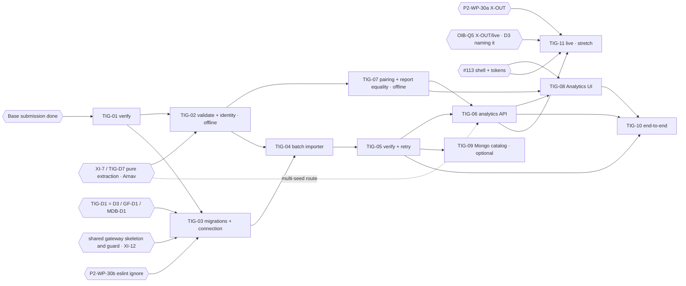

# Tiger Data experiment analytics: work packages

> **STATUS: PROPOSED — NOT IMPLEMENTED.** Nothing in this file exists in code. Do not open these issues or start coding until Arnav approves and decision TIG-D1 (= Phase 2 D3) is made (see [Gating](#10-gating)).

Purpose: split William's Tiger Data plan into issue-ready packages `TIG-01` to `TIG-11`, each small enough for one person and their agent to finish in one PR. Status: proposal, issue #142, audit base `origin/main` 23d6748. Source author: William Pimentel (`wpimento`), [source handoff](../handoffs/Encore_Tiger_Data_Technical_Plan.md) (cited below as "William §n"). Integrator: Arnav.

**Where things live (one fact, one place).** This file plans work only.

| What | Canonical file |
|---|---|
| Requirements `TIG-FR`/`TIG-NFR`, contract changes `TIG-CC`, conflict records `TCR`, decisions `TIG-D`, risks `TIG-R` | [overview](../integrations/tiger-data-analytics.md) |
| Validation rules and caps, identity, manifest and ledger, DDL, migrations, import transaction, state machine, verification, roles, queries Q1–Q16 | [ingestion RFC](../design/TIGER_TELEMETRY_AND_INGESTION_RFC.md) |
| Analytics queries (Q17 on), route shapes, provenance, report reconstruction, dashboard placement | [analytics and dashboard RFC](../design/TIGER_ANALYTICS_AND_DASHBOARD_RFC.md) |
| Tests `TIG-T01…T44`, report equality E1–E3 (with E2-cell and E2-sel), the 12-step acceptance (TIG-T44) | [evaluation](../validation/tiger-data-evaluation.md) |

**Where this file and those documents differ, they win**, and the difference should be reported as a TCR. Interfaces below are named to match them.

**Base rules, linked rather than restated:**
- the [contract](../design/contracts-and-algorithms.md#5-world-events-snapshot-metrics) §5 and §12;
- [requirements](../specification/requirements.md#3-non-functional-requirements) **NFR-04**;
- [evaluation and tests](../validation/evaluation-and-tests.md) §2 (summary keys), §3 (S5) and §4 (fairness);
- [`AGENTS.md`](../../AGENTS.md#0-ground-rules), [`WORKFLOW.md`](../development/WORKFLOW.md), [`TEAM_ROLES.md`](../development/TEAM_ROLES.md).

**Related drafts not yet on this branch** (provisional: they depend on #110, #117 and #130, stacked before #142):
- Phase 2 (#110): [boundaries](../design/OPTIONAL_INTEGRATION_BOUNDARIES.md) (X-OUT, X-PERSIST, X-RUN/live, D3), [evaluation](../validation/PHASE2_EVALUATION.md) (P2-T35), [roadmap](PHASE2_ROADMAP.md) (P2-G6) and [work packages](../development/PHASE2_WORK_PACKAGES.md) (P2-WP-30);
- Gemini (#117): [spec](../integrations/gemini-generated-formations.md) (`sceneHash`) and [work packages](gemini-integration-work-packages.md) (GF-WP-12, GF-WP-15);
- MongoDB (#130): [spec](../integrations/mongodb-atlas-show-library.md) (`contentHash`, shared gateway) and [work packages](mongodb-integration-work-packages.md) (MDB-WP-03).

**Executed evidence: none.** Every test, check and demonstration below is a *planned check*. No Tiger, gateway or telemetry code exists on `main` or any pushed branch at 23d6748, and no Tiger Data service has been contacted. The audit ran only `buildReport` and `canonicalJson` over the committed `results/*.json`. Those runs are repo facts (§1), not Tiger evidence.

## 0. Cross-references used here

The overview assigns the numbers; this plan follows the order of the decision sheet, as its siblings do. **If the overview renumbers, fix it here only.**

| ID | Topic |
|---|---|
| TIG-D1 | Network decision, the same as Phase 2 D3, GF-D1 and MDB-D1 (linked, not decided again) |
| TIG-D2 | MongoDB catalogue option. Recommended: none in the MVP |
| TIG-D3 | Dashboard placement |
| TIG-D4 | `run_id` scheme. Recommended in the RFC: UUIDv5 of `artifactHash` |
| TIG-D5 | Manifest and ledger location. Recommended: `integrations/gateway/src/tiger/state/` (the module folder of XI-20), gitignored inside the gateway |
| TIG-D6 | Who implements. Lanes only; never William or Haris |
| TIG-D7 | Pure-module extraction: `canonicalJson` and `report.ts`'s statistics, so the gateway may import them under XI-2. `canonicalJson` goes to `src/score/canonical.ts` (XI-19). Until then the multi-seed route is not enabled (TIG-06) |
| TIG-D8 | Service tier, TLS posture and credential handling |
| TIG-D9 | Hypertable settings |
| TIG-D10 | Comparison set: one clean (`git`, `paramsHash`) per request; no mixing and no `includeDirty` |
| TIG-D11 | Dirty and unknown revisions: importable, flagged, conflict-exempt, never compared |
| TIG-D12 | Tiger Data track at DurHack, and the smallest slice if approved (William for sponsor eligibility, plus Arnav). Recommended: forgo |
| TIG-D13 | Live write authentication for TIG-11 (options in [§13](#13-open-questions)); defined in the overview's decision table (§20) |
| TCR-01…09 | `src/server/`+`sql/` placement · catalogue vs Show Library · `experiment_key` not unique · MongoDB upsert in the import path · `Pihh.zip` facts vs `main` · minimum-matrix command vs committed `results/` · `--report` comparison · HTTP upload vs CLI importer · separate page vs shell |
| TCR-10…41 | As numbered by the overview (§18). Cited here: TCR-10 recovery windows · TCR-11 sample schedule · TCR-12 metric-range tolerance · TCR-13 file bytes not canonical · TCR-14 dirty git · TCR-15 DT source · TCR-16 `canonicalJson` placement · TCR-17 `report.ts` private helpers · TCR-18 UI tokens unwired · TCR-19 `pairKey` vs `fairPair` · TCR-20 `compositionId` · TCR-22 ledger location · TCR-23 CHECK immutability · TCR-26 app export · TCR-27 purity lint · TCR-28 `inHold` derivation · TCR-30 `verified` from Tiger rows · TCR-35 S5 · TCR-36 `run_verifications` table · TCR-37 `archived` state and owner-only restore · TCR-38 manifest identity vs first-observation fields · TCR-39 one `hashVersion` per database · TCR-40 version gates and `search_path` · TCR-41 live boundary |
| TIG-CC-01 | `inHold` and composition fields in a `RunRecord` v2 or `MetricsSample`. Deferred: **PROPOSED CONTRACT CHANGE — REQUIRES ARNAV APPROVAL** |
| XI-1…XI-21 | Cross-integration rulings shared with #110/#117/#130. Used here: XI-1 one shared gateway with modules `gemini`, `shows`, `tiger`; XI-2 the gateway imports only pure `src/` modules, never `src/cli` (`report.ts` included); XI-3 one error envelope and code list; XI-4 X-RUN/live and X-PERSIST (provisional, #110); XI-5 calls may happen while the simulation runs, never in the tick loop; XI-6 MongoDB holds no telemetry; XI-7 one `canonicalJson`, sha256 server-side; XI-8 size caps; XI-9 one network decision; XI-10 nobody assigned; XI-11 `requestId`; XI-12 one gateway skeleton and guard; XI-13 the pure composition validator's location; XI-14 app-side network code only in `src/app/live/`; XI-16 `details[].reason` values in SCREAMING_SNAKE; XI-19 `canonicalJson` extracted to `src/score/canonical.ts`; XI-20 the gateway layout (`src/<module>/`, `test/<module>/`, and a second entry point only for the Tiger live writer) |

## 1. Repo facts the packages rest on (verified at 23d6748)

The RFC (§2) and the evaluation (§1.1) hold the full fact tables. These are the ones that shape the packages.

| Fact | Where | Consequence |
|---|---|---|
| No backend, no `integrations/`, no driver, no Tiger code anywhere | repo scan | Networked code goes in the shared gateway `integrations/gateway/`, module `tiger` (XI-1, TCR-01) |
| `RunRecord` v1 has no run id, composition id or `inHold`; counters are cumulative; `npwc`/`sfMean`/`sfMax` are nullable | [`metrics.ts`](../../src/contracts/metrics.ts) 6–31 | External manifest; no contract change for the MVP |
| `DT = 0.05` is a constant, not a `Params` field | [`params.ts`](../../src/contracts/params.ts) 3 | DT is tied to `git`, not `paramsHash` (TCR-15) |
| `tRec`: start of the first qualifying 12-sample streak after the first KILL, special case 0 (two causes), key absent without a KILL | [`summary.ts`](../../src/observer/summary.ts) 41, 60, 65, 75, 135 | Summary values come only from `RunRecord.summary`: recovered, censored or not applicable |
| `report.ts` exports `stats`, `fairPair`, `pairStatus`, `Group`, `SeedRow`, `npwcRows` and `buildReport` (Markdown); `groupRecords`, `pairedDeltas`, `censored` and `NO_VERDICT` are private | [`report.ts`](../../src/cli/report.ts) 10–263 | Reconstruct `RunRecord[]` and call `buildReport`; never reimplement statistics |
| `canonicalJson` lives in `run.ts`, whose imports pull `node:crypto`, `sim` and both brains; `report.ts` imports it | [`run.ts`](../../src/cli/run.ts) 5–12, 27–36 | Pure and browser use needs the shared extraction to `src/score/canonical.ts` (XI-7, XI-19, TCR-16) |
| `runReport` reads every top-level `*.json` in `results/`, unvalidated | [`main.ts`](../../src/cli/main.ts) 99–109 | Nothing Tiger-related may live in `results/` |
| `results/`: 50 records (S0–S3, S5 × seeds 1–5 × 2 arms, n0 200), git `571c8e4…`; 360 samples each (ticks 5…1800); 18,000 / 80 / 50 rows; 104,196–113,222 bytes; `buildReport` equals `RESULTS.md` lines 1–226 | [`results/`](../../results/README.md) | The fixtures for every test and for TIG-T44. Never restated as Tiger results |
| `boundaries.test.ts` and the ESLint `fetch` bans cover only the five core folders; root `tsconfig` and vitest exclude `integrations/` | [`boundaries.test.ts`](../../tests/boundaries.test.ts) 8–16, `eslint.config.js` 9–13 | `src/telemetry` purity needs a new entry (TCR-27); gateway tests are outside `check.sh` |
| Single Vite entry; `src/app/ui/index.ts` auto-mounts any `src/app/ui/*.ts` exporting `createPanel`; `ui/styles.css` tokens are unwired until #113 | `vite.config.ts`, `ui/index.ts` 5–12 | Dashboard placement is TIG-D3 (TCR-09, TCR-18) |
| The app exports no `RunRecord`, summary, events, `git` or `paramsHash` | `src/app/main.ts` 130–164 | App export and live ingestion are new app work (TCR-26) |

## 2. Conventions for every package

**Tests** cite `TIG-T` ranges. The evaluation doc assigns each ID its meaning.

| Range | Covers |
|---|---|
| T01–T12 | Import correctness |
| T13–T16 | Cross-database behaviour and the ledger |
| T17–T26 | Experimental correctness, including report equality |
| T27–T30 | Isolation and determinism |
| T31–T36 | Security |
| T37–T40 | UI provenance and censoring |
| T41–T44 | Live Tiger integration; T44 is the 12-step acceptance |

**Priority.** William's plan has no numbered priority list. This scale is derived from his §4.1 "Mandatory", §4.2 "Optional", §16 phases and §18 "Stretch goal":

| Priority | Covers |
|---|---|
| W1 | Post-run batch ingestion |
| W2 | Paired analytics equal to the local report |
| W3 | Dashboard and provenance |
| W4 | MongoDB run catalogue |
| W5 | Live telemetry |

A suggested repo label (P0–P2) for after submission follows each.

**Lanes** ([`TEAM_ROLES.md`](../development/TEAM_ROLES.md)):
- A: contracts and score; reviews identity rules;
- B: evidence, CLI and plumbing; owns the telemetry and the gateway;
- C: experience; owns the dashboard.

**Assignee for every package: TBD by Arnav** (TIG-D6, XI-10). No package is assigned to William or Haris. Decisions on his proposal (TIG-D2) are Arnav's to take with him; agents contact no teammate.

**Placement** (TD-2, TCR-01):
- `src/telemetry/` is pure and offline. It imports `src/contracts` and the extracted canonical module `src/score/canonical.ts` (XI-19) only. sha256 is injected, so there is no `node:crypto`, and no clock or network is read.
- `integrations/gateway/src/tiger/` is the networked `tiger` module of the one shared gateway (XI-1), which has one package. Its tests are in `integrations/gateway/test/tiger/` (XI-20). It holds `pg`, migrations, the importer CLI and the read-only routes. It imports only pure modules by relative path: `src/contracts`, `src/telemetry` and, once extracted, `src/score/canonical.ts` (XI-2, XI-19). It never imports `src/cli`, so `report.ts` stays out of reach until TIG-D7. The layout is fixed by XI-20 (§9).
- The module uses the shared skeleton's server, `guard.ts`, `errors.ts`, `config.ts` and `GET /api/health` (XI-12, [boundaries §6.2](../design/OPTIONAL_INTEGRATION_BOUNDARIES.md#62-shared-gateway-skeleton-and-guard), provisional, #110). It adds its routes, its config section and its health entry, and never redefines the guard or the errors.
- App-side network code lives only in `src/app/live/` behind the module's own build-time, non-secret flag (XI-14; flag name not yet chosen). `src/analytics/**` has no network API.
- William's `src/server/`, `sql/` and `scripts/import-results.ts` are not created.

**Standard regressions R1–R6**, required for every package with code:
1. `bash scripts/check.sh` passes.
2. `tests/boundaries.test.ts` and `tests/isolation/*` pass.
3. The networking-off build test (NFR-04 acceptance) passes. The analytics UI is off unless a non-secret flag enables it (XI-9).
4. `check.sh` passes with `integrations/` deleted (P2-T35, provisional, #110).
5. `stateHash` for S0–S5 seed 1 is unchanged, with any import or export on or off.
6. `buildReport(results/)` still equals `RESULTS.md` lines 1–226, and `git diff -- results/` is empty.

**Standard security S1–S5**, required for every networked package:
1. Credentials are server-side only: never `VITE_*`, never in bundles, logs, error bodies or screenshots. `.env.example` holds names only. There are three, one per process (TIG-03): reader `TIGER_READ_DATABASE_URL` (API process), importer `TIGER_DATABASE_URL` read from `src/tiger/.env.importer` (importer CLI), and admin `TIGER_ADMIN_DATABASE_URL` (migrations and the live-test harness; the ingestion RFC §13 also uses it for the owner tools, §13 q4). Each process refuses to start if a credential it must not hold is set. TIG-11 adds a fourth, `TIGER_LIVE_WRITE_URL`, for its own process only.
2. Queries are parameterised only.
3. Roles are least-privilege: the schema owner runs migrations only; `encore_importer` writes, with no UPDATE/DELETE/TRUNCATE and no CREATE; `encore_reader` is read-only (RFC §13).
4. The module relies on the shared guard (XI-12, [boundaries §6.2](../design/OPTIONAL_INTEGRATION_BOUNDARIES.md#62-shared-gateway-skeleton-and-guard), provisional, #110) and adds no rule of its own. That guard binds `127.0.0.1` only, refuses non-loopback peers, allows only `Host` `127.0.0.1:<port>` and `localhost:<port>` (plus the dev proxy if one is used), requires an exact `Origin` on every non-GET request (missing or `null` gives 403 `FORBIDDEN`), answers 415 `UNSUPPORTED_MEDIA_TYPE` to a non-JSON body, and sends no CORS headers unless OIB-Q2 is decided for CORS. Every Tiger route is a `GET`, so the `Host` allow-list is its DNS-rebinding defence. Errors use the XI-3 envelope from the shared `errors.ts` (`sanitise`, `redact`); Tiger causes are `details[].reason` values under the shared codes, and a valid `requestId` is echoed per XI-11.
5. Every artifact and request is untrusted, bounded by the RFC caps (file ≤ 1 MiB before parsing, events ≤ 1,000, event ≤ 64 KiB). Per XI-8, the file cap comes from the measured `results/` sizes (104,196–113,222 bytes): about 9× the largest, as ingestion RFC §3.1 records.

Every package that adds a gateway dependency also follows the shared dependency policy (XI-12): each direct dependency pinned exactly, a committed `integrations/gateway/package-lock.json`, installs only via `npm ci --ignore-scripts`, a 14-day minimum release age, `npm audit signatures`, `node:http` with no web framework unless approved, and the `npm audit` output in the PR.

## 3. Work packages

### TIG-01 Repository and backend verification

- **Purpose.** William's evidence boundary (§2, "checked against `Pihh.zip`"; TCR-05). Re-verify §1 at implementation time and record which backend now exists. The output is a verification note.
- **Dependencies.** No TIG package. Read only: MDB-WP-03 and GF-WP-12 (gateway skeleton created?), P2-WP-30b (ESLint ignore). No TIG-D1.
- **Priority.** W1 (it gates everything). P1.
- **Suggested owner.** Lane B. Assignee: TBD by Arnav.
- **Allowed files.** None. The note goes in an issue comment.
- **Existing interfaces reused / proposed.** None. The note answers, with a file and line for each:
  1. Does the gateway follow the XI-20 layout, and do `guard.ts`, `errors.ts`, `config.ts` and `/api/health` exist (XI-12)?
  2. Has XI-7 or TIG-D7 landed?
  3. Are `report.ts`'s exports unchanged?
  4. Is `RunRecord` unchanged?
  5. Are `summary.ts` 41/60/65/75/135 unchanged?
  6. Has #137 rewritten git in `results/` or moved files to `superseded-*`?
  7. Has #153 touched `main.ts`?
  8. Has #113 merged, and where do views mount?
  9. What is the state of `eslint.config.js` and `vite.config.ts`?
  10. Is there any Tiger branch the audit missed?
- **Acceptance criteria.** Each §1 row is marked still true or changed, with the affected TIG packages. New contradictions go to Arnav as proposed TCRs, never silently absorbed.
- **Tests, performance, security, regression, rollback.** Not applicable.
- **Integration blockers.** None. **Contract approvals.** None.

### TIG-02 Artifact validation and canonical identity

- **Purpose.** William §5 identities, §8 checklist and serialiser ("should not recalculate metrics or mutate the source record"); TD-3, TD-4, TD-9. Pure functions from bytes to a validated record, its identity, digests, manifest and rows, with the exact inverse. Offline.
- **Dependencies.**
  - TIG-01.
  - **The XI-7 canonical-JSON extraction** to `src/score/canonical.ts` (XI-19, TIG-D7; owner Arnav; not a TIG package). Until it lands, root tests may import `canonicalJson` from `src/cli/run.ts`, and TIG-04 cannot merge.
  - **No TIG-D1.**
- **Priority.** W1. P1.
- **Suggested owner.** Lane B; lane A reviews identity. Assignee: TBD by Arnav.
- **Allowed files.**
  - `src/telemetry/{validate,identity,normalise,digest,manifest,ledger,index}.ts`, all new;
  - `tests/telemetry/{validate,identity,normalise,digest,ledger}.test.ts`;
  - the `telemetry` entry in `tests/boundaries.test.ts` and an ESLint block banning `fetch`, `WebSocket` and `XMLHttpRequest` in `src/telemetry` (TCR-27). These are shared-file edits: lane A review and build-config sign-off.
  - Fixtures are read from `results/`, never copied or written.
- **Existing interfaces reused.** `RunRecord`, `MetricsSample`, `EnvEvent`, `DT`; `canonicalJson`; `SCENARIO_TICKS` (imported **in tests only**, to guard the importer's `expectedTicks`).
- **Proposed interfaces** (names as in RFC §3–§6; the RFC fixes rules and fields):

```ts
// src/telemetry — pure; no node:*, fetch or clock
export type Sha256 = (data: string | Uint8Array) => string;               // injected; 64 lower-case hex
export interface ValidationContext { sourceKind: 'cli-scenario' | 'app-export'; expectedTicks: number }
export type Validation = { ok: true; record: RunRecord; warnings: Issue[] } | { ok: false; errors: Issue[] };
export function validateRunRecord(bytes: Uint8Array, ctx: ValidationContext): Validation;   // caps + validatorVersion: RFC §3
export interface RunIdentity { hashVersion: 1; fileSha256: string; artifactHash: string; experimentKey: string;
  pairKey: string | null; compositionId: string | null; gitClean: boolean;
  seriesDigest: string; eventsDigest: string; summaryDigest: string }
export function computeIdentity(record: RunRecord, bytes: Uint8Array, compositionId: string | null, sha256: Sha256): RunIdentity;
export interface ImportManifestV1 { manifestVersion: 1; hashVersion: 1; validatorVersion: string; artifactPath: string;
  fileSha256: string; artifactHash: string; experimentKey: string; pairKey: string | null; runId: string;
  gitClean: boolean; compositionId: string | null; sourceKind: ValidationContext['sourceKind'];
  dtSeconds: number; createdAt: string /* passed in by the caller */ ; /* + RFC §5 derived fields */ }
  // identity fields are compared on re-import; first-observation fields (artifactPath, fileSha256,
  // fileBytes, fileForm, createdAt) are never compared (RFC §5)
export function buildManifest(id: RunIdentity, init: { artifactPath: string; runId: string; sourceKind: ValidationContext['sourceKind'];
  validatorVersion: string; createdAt: string }): ImportManifestV1;
export interface RunRows { run: RunRow; metrics: MetricRow[]; events: EventRow[]; summary: SummaryRow }   // mirror RFC §6 DDL
export function syntheticSampleTimeMs(tick: number): number;              // RFC §8; synthetic, never wall clock
export function recordToRows(record: RunRecord, id: RunIdentity, runId: string): RunRows;
export function rowsToRecord(rows: RunRows): RunRecord;                    // exact inverse; absent stays absent, null stays null
```

  Identity hashes use the one `canonicalJson` and sha256 (XI-7). One database holds one `hashVersion`; a bump is a full rebuild from the local artifacts (TCR-39). `runId` = UUIDv5(`ENCORE_TIGER_NS_V1`, `artifactHash`) under TIG-D4. The gateway computes it, because UUIDv5 needs SHA-1: with `node:crypto` (`createHash('sha1')` plus the RFC 4122 version and variant bits), no `uuid` dependency, tested against RFC 4122 vectors.
- **Acceptance criteria.**
  - All 50 fixtures validate.
  - RFC §3 rejections, each with every error listed:
    - an unsupported `v`, or a bad seed, n0 or arm;
    - ticks not exactly 5, 10, …, `expectedTicks` (TCR-11);
    - `alive` outside [0, n0];
    - a non-finite number;
    - a decreasing counter;
    - a malformed event;
    - a cap exceeded, with the file size checked before parsing;
    - a `JAM_*` or `PARTITION_*` `id` outside `^[A-Za-z0-9_.:-]{1,64}$`, or any string with U+0000 or an unpaired surrogate (RFC §3.3).
  - Ranges allow the RFC tolerance and values are stored unclamped (TCR-12).
  - `canonicalJson(rowsToRecord(recordToRows(r))) === canonicalJson(r)` for every fixture (E1, offline).
  - `artifactHash(S0_n200_encore_s1.json)` starts `43338607c7be88f2`.
  - `fileSha256 ≠ artifactHash` for CLI-written files (TCR-13).
  - Paired arms share `pairKey`. Changing seed, n0, git, params hash, any event field or composition changes it.
  - Dirty or unknown git gives `gitClean = false` (TCR-14).
  - Inputs are never mutated (deep-frozen fixtures).
- **Tests.** TIG-T01–T12 (validation, identity and normalisation parts); TIG-T27–T30 (purity).
- **Performance.** About three canonical serialisations of ~110 KB per artifact. Measure; do not assume.
- **Security.** S5. No prototype-polluting keys. Errors never echo payloads.
- **Regression.** R1, R2, R5, R6.
- **Rollback.** Delete `src/telemetry/` and `tests/telemetry/`, and revert the two shared-file entries.
- **Integration blockers.** The XI-7 extraction landing. XI-19 fixes its location: `src/score/canonical.ts`, because `src/score` may import only `src/score` and `src/contracts`, and Gemini's `sceneHash` is computed there. `src/cli/run.ts` imports it instead of defining its own; that is a `src/cli` edit by its owner (#26). It is a byte-for-byte move, with a test that `stateHash` and the existing artifact hashes are unchanged.
- **Contract approvals.** None. `src/score/canonical.ts` is outside `src/contracts/`, so the extraction is not a `[contract]` PR; it needs lane A review for `src/score`.

### TIG-03 SQL migrations and Tiger connection

- **Purpose.** William §6 schema, §13 TLS, connection and role rows, Appendix A cautions and §16 phase 1 "provision… create migrations". It turns the RFC's "PROPOSED — NOT A MIGRATION" blocks into migration files and adds the runner and the `pg` connection.
- **Dependencies.**
  - TIG-01;
  - **TIG-D1**, plus X-RUN/live and X-PERSIST (provisional, #110). Stored experiment evidence is X-PERSIST (XI-4);
  - TIG-D4 and TIG-D8;
  - the shared gateway skeleton (XI-12): one server, `guard.ts`, `errors.ts`, `config.ts` and `GET /api/health`, built once by whichever of MDB-WP-03, GF-WP-12 and TIG-03 is approved first. XI-20 fixes its files: `integrations/gateway/{package.json,package-lock.json,tsconfig.json,README.md,.env.example}` with `src/server.ts`, `src/guard.ts`, `src/errors.ts`, `src/config.ts` and `src/health.ts` (MDB-WP-03's `src/http/` subfolder does not match XI-20). If TIG-03 is first, it builds exactly that, to the rules of [boundaries §6.2](../design/OPTIONAL_INTEGRATION_BOUNDARIES.md#62-shared-gateway-skeleton-and-guard) (provisional, #110);
  - P2-WP-30b or build-config sign-off for the ESLint ignore of `integrations/**`.
- **Priority.** W1. P1.
- **Suggested owner.** Lane B. Assignee: TBD by Arnav.
- **Allowed files.**
  - `integrations/gateway/src/tiger/migrations/{000_migrations_table,001_runs,002_metrics,003_events,004_summaries,005_conflicts_verifications,006_roles}.sql`, exactly as RFC §7 lists them, with unqualified table names (TCR-40);
  - `integrations/gateway/src/tiger/{config,db,migrate,schemaName}.ts`: `config.ts` is the `tiger` section that the shared `config.ts` loads (each module reads only its own secrets, XI-12), and `schemaName.ts` is the one helper that checks a schema name;
  - the `tiger` entry in the shared `src/health.ts` (`modules.tiger`) and one registration line in the shared `src/server.ts`;
  - `integrations/gateway/test/tiger/{migrations,config}.test.ts`;
  - `integrations/gateway/test/tiger/live/*.live.test.ts`, skipped unless the evaluation §3 test settings are set (`TIGER_TEST_WRITE_URL`, `TIGER_TEST_READ_URL`, and the admin URL for migrations);
  - if the CI owner signs off (open): the `CI-GW` workflow under `.github/workflows/` that evaluation §1 rule 2 plans;
  - `integrations/gateway/src/tiger/README.md`;
  - `integrations/gateway/src/tiger/.env.importer.example` (names only; the real `.env.importer` is already ignored by the root `.env.*` rule);
  - the module's own lines in the shared `.env.example`, `package.json` and `package-lock.json` (`pg` and every other direct dependency pinned exactly; no `pg-copy-streams` until COPY is needed).
- **Existing interfaces reused.** `DT` from `src/contracts`. A test asserts `DT * 1000 === 50`, the literal in the tick→time CHECK (TCR-15).
- **Proposed interfaces.**

```ts
interface TigerConnSettings { url: string; sslMode: 'require' | 'verify-full'; statementTimeoutMs: number }   // budgets: RFC §13
  // url: refused if it carries sslmode, sslrootcert, sslcert, sslkey or ssl (RFC §13); `ssl` is built only from sslMode:
  // 'verify-full' → { rejectUnauthorized: true, servername: host }; 'require' → { rejectUnauthorized: false },
  // accepted only with TIGER_TLS_UNVERIFIED=1; the effective mode is logged once at start-up
export function loadTigerReaderConfig(env: NodeJS.ProcessEnv): (TigerConnSettings & { apiPoolMax: 3 }) | null;
  // HTTP server: reads TIGER_READ_DATABASE_URL only; null ⇒ module disabled, others unaffected (XI-1);
  // throws (fatal, server refuses to start) if TIGER_DATABASE_URL, TIGER_ADMIN_DATABASE_URL or TIGER_LIVE_WRITE_URL is present
export function loadTigerImporterConfig(env: NodeJS.ProcessEnv): TigerConnSettings & { importerConnections: 2 };
  // importer CLI: reads TIGER_DATABASE_URL from src/tiger/.env.importer; refuses if TIGER_ADMIN_DATABASE_URL is set
export function loadTigerAdminConfig(env: NodeJS.ProcessEnv): TigerConnSettings;
  // read only by `tiger:migrate`, the live-test harness and, per ingestion RFC §13, the owner tools (§13 q4):
  // TIGER_ADMIN_DATABASE_URL (tsdbadmin or `encore_owner`)
export function connect(s: TigerConnSettings, role: 'owner' | 'importer' | 'reader'): Promise<Pool>;
  // sets extra_float_digits = 1, a safe-integer int8 parser, application_name (RFC §6.6);
  // every transaction runs set_config('search_path', $1, true) with a name checked by schemaName.ts
export function checkSchemaName(name: string): string;
  // the one helper: accepts only ^(encore|tig_test_[0-9a-f]{12})$, quotes with %I for CREATE/DROP SCHEMA (evaluation §3)
export function migrate(ownerPool: Pool, dir: string, schema: string): Promise<{ applied: string[] }>;
  // runs as the schema owner, never as encore_importer; creates the schema before 000; per-file transaction + sha256;
  // refuses edited files; refuses below PostgreSQL 16 or TimescaleDB 2.20 (RFC §7, TCR-40)
```

  The `tiger` module never spawns a child process (there is no report subprocess), so it needs no environment scrubbing.

- **Acceptance criteria.**
  - The DDL equals the RFC's blocks, including its deltas from William:
    - `experiment_key` unique over clean runs (TCR-03, TCR-14);
    - tolerance CHECKs;
    - an immutable tick→time CHECK through the `synthetic_time(tick)` function (TCR-23);
    - the `run_verifications` table in 005 (TCR-36) and the `metrics_v` view with `sim_seconds` and `synthetic_time` columns in 002;
    - a primary key containing `sample_time`;
    - no generated partition column;
    - an explicit partition column;
    - **no retention policy** (William App. A).
  - Re-running `migrate` is a no-op. An edited applied file stops the runner. The same file bytes, with the same checksums, migrate both `encore` and a `tig_test_<12 hex>` schema, resolved through `search_path`; each file has one variant, and the runner refuses versions below its gates (TCR-40).
  - Roles are created by the owner's guarded run-once script (RFC §13), never by a migration; 006 holds grants only. The `down` script revokes 006 and drops 005 → 000.
  - Hostile schema names are rejected by `checkSchemaName` (T33).
  - Role tests: the reader cannot INSERT, and the importer cannot UPDATE, DELETE or DROP. The importer holds SELECT on `schema_migrations` and INSERT on `run_verifications`. The importer connection's `current_user` is not the schema owner and has no CREATE on schema `encore` (T32). The role-level `CONNECTION LIMIT`, `statement_timeout` and `idle_in_transaction_session_timeout` of RFC §13 are set; `REVOKE TEMPORARY` stays UNVERIFIED until tried.
  - A URL with a TLS parameter is refused, and `require` without `TIGER_TLS_UNVERIFIED=1` is refused (T35). Whether node-postgres can make SCRAM channel binding mandatory against a Tiger service is UNVERIFIED and checked here (TIG-D8).
  - The HTTP server started with `TIGER_DATABASE_URL`, `TIGER_ADMIN_DATABASE_URL` or `TIGER_LIVE_WRITE_URL` set refuses to start (T31); so does the importer CLI with the admin URL set.
  - With no config, `/api/health` reports `modules.tiger: { enabled: false, db: 'disabled' }` (analytics RFC §3.1).
- **Provider checklist.** Run by hand after TIG-D1, following RFC §13 and §17; this plan does not restate the provider facts. Record the tier, region, TimescaleDB and PostgreSQL versions, the TLS mode and the date in the README. The RFC marks the version and the free-tier columnstore as UNVERIFIED.
- **Tests.** TIG-T31–T36 (credentials never logged, sanitised config errors, grants); TIG-T41–T44, live-migration step (separate test service, by hand).
- **Performance.** Connection budget per RFC §13: shared compute allows 25 connections, and free services have no pooler.
- **Security.** S1–S3 and the dependency policy. Passwords never appear in migrations; roles are created by the service owner. Three credentials, one per process: admin (migrations and the live-test harness only), importer, reader. The test container is pinned by digest (`timescale/timescaledb@sha256:…`), recorded in the T41 evidence.
- **Regression.** R1–R4, R6. The root `npm ci` installs no `pg`.
- **Rollback.** Local `down` scripts; otherwise drop schema `encore`. Tiger is a copy (TD-1).
- **Integration blockers.**
  - TIG-D1;
  - the gateway skeleton (its layout is fixed by XI-20, §9);
  - `CI-GW`: without the CI owner's sign-off, the gateway tests run only by hand;
  - provisioning.
- **Contract approvals.** None.

### TIG-04 Transactional batch importer

- **Purpose.** William §4.1 (mandatory batch ingestion) and §8 "Transaction and idempotency", including "avoid `ON CONFLICT DO NOTHING` as the sole correctness policy". The flow is RFC §9–§10: validate, identity, manifest, then the transaction with in-transaction checks. It is a CLI using the importer role, with **no HTTP upload** (TCR-08). Persisting validated run records is X-PERSIST (XI-4, provisional, #110).
- **Dependencies.**
  - TIG-02 (after XI-7);
  - TIG-03;
  - **TIG-D1**;
  - TIG-D4 and TIG-D5.
- **Priority.** W1. P1.
- **Suggested owner.** Lane B. Assignee: TBD by Arnav.
- **Allowed files.**
  - `integrations/gateway/src/tiger/{repository,pgRepository,fakeRepository,importer,manifestFile,ledgerFile}.ts`;
  - `integrations/gateway/src/tiger/cli/import.ts`;
  - `integrations/gateway/test/tiger/{importer,repository.contract}.test.ts`;
  - `integrations/gateway/src/tiger/state/.gitignore`, a nested ignore with no root change;
  - the module's script line in the gateway `package.json`.
- **Existing interfaces reused.** TIG-02; the directory scan mirrors `runReport` (top-level `*.json`, sorted).
- **Proposed interfaces** (the repository seam named in RFC §1):

```ts
export type ImportOutcome =
  | { kind: 'imported'; runId: string } | { kind: 'identical'; runId: string }          // Q1 found the same artifactHash
  | { kind: 'conflict'; experimentKey: string; existingArtifactHash: string }           // clean git only; never overwritten
  | { kind: 'failed'; code: string };                                                   // rolled back; sanitised
export interface TigerRepository {                       // fakeRepository enforces the same keys and all-or-nothing
  findIdentity(artifactHash: string, experimentKey: string): Promise<IdentityHit>;     // Q1
  importRun(rows: RunRows, m: ImportManifestV1): Promise<ImportOutcome>;               // one txn: Q2–Q12, COMMIT only if checks pass
  readBack(runId: string): Promise<RunRows | null>;                                    // Q10–Q12, Q14, ordered
  recordVerification(runId: string, digests: { seriesDigest: string; eventsDigest: string; summaryDigest: string },
    outcome: 'verified' | 'mismatch', verifierVersion: string): Promise<void>;         // Q13; INSERT only, append-only
  recordConflict(m: ImportManifestV1, existing: IdentityHit): Promise<void>;           // Q15
}
export interface ImportReport { discovered: number; verified: number; identical: number; rejected: number;
  conflicts: number; incomplete: number }
export function importDirectory(dir: string, deps: { repo: TigerRepository; ledger: ImportLedger; sha256: Sha256;
  now: () => string; compositionOf: (r: RunRecord) => string | null }): Promise<ImportReport>;
```

  `fakeRepository` implements `recordVerification` too, and keeps its `run_verifications` rows append-only: a row is never updated or removed.

  Command: `npm --prefix integrations/gateway run tiger:import -- --dir <path> [--dry-run]`. `--dry-run` validates and writes manifests with no connection. The default `compositionOf` returns `scenario:<id>` for `cli-scenario` (TCR-20).
- **Acceptance criteria.**
  - Importing the 50 fixtures gives 50 runs and 18,000 / 80 / 50 rows.
  - Re-import is `identical`, with zero new rows. So is a re-serialised (`FX-RESER`) or moved copy: identity fields match, and the new file observation goes on its ledger line only (RFC §5, TCR-38).
  - A clean same-`experimentKey`, different-hash import is `conflict`, and nothing changes.
  - A dirty duplicate is conflict-exempt.
  - A run whose row is `archived` is reported `ARCHIVED`, never restored and never `VERIFY_MISMATCH` (RFC §10, case 2(a′); TCR-37).
  - `dt_seconds` is the DT at the record's `git` (RFC §8): a clean record whose commit is missing is `rejected` with `DT_UNVERIFIABLE`; an `unknown`-git record gets `DT_ASSUMED`. How the importer reads `params.ts` at that commit without spawning a child process is open (§13).
  - A failure injected after the metric inserts leaves zero rows.
  - `npwc = null` becomes SQL NULL; zero `alive` fabricates nothing.
  - Inserts are batched per run, never per tick.
  - Artifacts are never opened for writing. Manifests and the ledger go only to the TIG-D5 location, never to `results/` (TCR-22).
- **Tests.** TIG-T01–T12 (transaction, idempotency, conflict, NULLs, missing tick, counters, version), run against `fakeRepository`, with the shared contract suite also run against Postgres; TIG-T31–T36 (parameterised-only source scan, no URL in output); TIG-T41–T44, live-import steps.
- **Performance.** One run's 360 samples go in Q4: one `unnest` statement with 18 parameters (ingestion RFC §9). COPY is deferred until a workload needs it, and then only over a direct connection (RFC §9, §13). Runs are sequential by default. Storage figures come from TIG-10's measurements.
- **Security.** S1–S3, S5. Importer role only. RFC §13 path rule: only files found by scanning `--dir` are opened; each stays inside its root, `lstat` refuses symlinks, and UNC and drive-letter paths are refused. No path read from the database is ever opened. `artifact_path` is a POSIX repo-relative label.
- **Regression.** R1–R6.
- **Rollback.** Delete the importer files. Imported rows stay or go with the schema.
- **Integration blockers.** TIG-D1; XI-7; #137's git rewrite, which makes a rewritten record a **new** experiment.
- **Contract approvals.** None.

### TIG-05 Import verification and retry

- **Purpose.** William §8 "Counts alone do not prove integrity…", §13 partial-import and reconciliation rows, and §14 "do not report cloud persistence as successful". It adds the post-commit re-read on a fresh connection, the append-only `run_verifications` row (Q13, TCR-36), the append-only ledger, reconciliation, bounded retry and status output (RFC §10–§12).
- **Dependencies.** TIG-04; TIG-D5; **TIG-D1** for the re-read. The ledger fold is offline, in TIG-02.
- **Priority.** W1. P1.
- **Suggested owner.** Lane B. Assignee: TBD by Arnav.
- **Allowed files.**
  - `integrations/gateway/src/tiger/{verify,reconcile}.ts`;
  - `integrations/gateway/src/tiger/cli/{verify,status}.ts`;
  - `integrations/gateway/test/tiger/{verify,retry,reconcile}.test.ts`;
  - `src/telemetry/ledger.ts` and `tests/telemetry/ledger.test.ts`, if not complete in TIG-02.
- **Existing interfaces reused.** `digest`, `rowsToRecord`, `TigerRepository.readBack`. The state machine (`discovered → validated → imported → verified`, plus `rejected`, `conflict`, `incomplete` and `archived`, TCR-37) is canonical in RFC §10.
- **Proposed interfaces.**

```ts
// src/telemetry/ledger.ts — pure; line shape per RFC §5
export type ImportState = 'discovered' | 'validated' | 'imported' | 'verified' | 'rejected' | 'conflict' | 'incomplete' | 'archived';
export interface LedgerLine { ledgerVersion: 1; at: string; attemptId: string; artifactHash: string; experimentKey: string | null;
  runId: string | null; from: ImportState | null; to: ImportState; code: string | null; detail: string | null }
export function isAllowedTransition(from: ImportState | null, to: ImportState): boolean;
export function currentStates(lines: readonly LedgerLine[]): Map<string, LedgerLine>;   // last line per artifactHash; torn line skipped
// gateway
export interface ImportLedger { append(l: LedgerLine): Promise<void>; readAll(): Promise<LedgerLine[]> }   // O_APPEND + fsync + lock
export function verifyRun(repo: TigerRepository, m: ImportManifestV1, sha256: Sha256):
  Promise<{ ok: true } | { ok: false; mismatches: string[] }>;
  // RFC §11.1: a new connection to the primary with the importer credential, reads inside BEGIN READ ONLY,
  // never TIGER_READ_DATABASE_URL; then repo.recordVerification (Q13) inserts one run_verifications row ('verified' | 'mismatch')
export function reconcile(repo: TigerRepository, ledger: ImportLedger, manifests: readonly ImportManifestV1[],
  evidenceRoots: readonly string[]): Promise<{ verified: number; requeued: number; stillIncomplete: number }>;
  // evidence found by artifactHash, scanning --dir or --evidence-root; artifact_path is only a hint (RFC §11.2)
```

- **Acceptance criteria.**
  - `verified` is set only when the counts, first and last tick, `seriesDigest`, `eventsDigest`, the summary and the metadata are all equal (RFC §11.1).
  - The 1.0000000000000004 values round-trip bit for bit.
  - JSONB key order is irrelevant to the digests.
  - Every re-read appends one `run_verifications` row; none is ever updated.
  - A run row not yet visible on the verification connection means "retry verification" (case G), never `VERIFY_MISMATCH`.
  - A crash between COMMIT and the re-read leaves `imported`, and the next run verifies without re-inserting.
  - A lost ledger is rebuilt from Tiger.
  - Retries are bounded, with backoff.
  - `tiger:status` never says "persisted" for anything short of `verified`.
  - A row deleted by hand surfaces as `incomplete`, which is distinct from "zero measurements" (William §14).
  - A changed file at a run's recorded path is reported as "superseded", for information only. Only a database-side digest mismatch demotes a run.
  - The API's `verified` flag derives from Tiger rows, never from the ledger (TCR-30, TCR-36). It is `true` when the latest `run_verifications` row is `verified`, its digests equal the `experiment_runs` digests and `telemetry_state = 'present'` (RFC §11.1). Routes that return series or events also recompute the digests on every read (analytics RFC §2.1), so a flag set at import is never the only check.
  - Archive, restore and delete (Q16, Q16b, Q16c) are run by the owner by hand (RFC §13, TCR-37). No TIG package automates them in the MVP. The ingestion RFC §13 runs them with the admin credential; which package builds the tools is open (§13 q4).
- **Tests.** TIG-T01–T12 (digests); TIG-T13–T16 (append-only, crash and retry, rebuild, no false "complete"); TIG-T41–T44, live re-read step.
- **Performance.** One ordered `SELECT` of 360 rows per run.
- **Security.** S1–S3. Ledger lines hold no credentials and no payloads.
- **Regression.** R1–R6.
- **Rollback.** Delete the files. The ledger is a journal and can be rebuilt.
- **Integration blockers.** TIG-D5. **Contract approvals.** None.

### TIG-06 Analytics query API

- **Purpose.** William §9 routes and queries, and §13 "read-only credentials for analytics". TD-12: four read-only routes in the shared gateway, each with a provenance block. Shapes and Q17+ queries are canonical in the analytics RFC. The routes return read-only analytics data to the app over X-RUN/live (XI-4, provisional, #110). The app may call them while the simulation runs, never from the tick loop or a decision path (XI-5).
- **Dependencies.**
  - TIG-05;
  - TIG-07, for the two comparison routes (the list and metrics routes can ship first);
  - **TIG-D1** and X-RUN/live (provisional, #110);
  - XI-3, XI-11 and the shared skeleton (XI-12);
  - **TIG-D7**, for the multi-seed route only (blockers below).
- **Priority.** W2. P1.
- **Suggested owner.** Lane B. Assignee: TBD by Arnav.
- **Allowed files.**
  - `integrations/gateway/src/tiger/{routes,services}/**`;
  - `integrations/gateway/test/tiger/routes.test.ts`;
  - one registration line in `integrations/gateway/src/server.ts`, coordinated with its creator.
- **Existing interfaces reused.**
  - `rowsToRecord`;
  - TIG-07's `pairReasons`, `alignByTick` and `selectForReport`;
  - `experiment_runs.dt_seconds`, for `simSeconds = tick × dt_seconds` per run (Q18), never a second SQL literal (William §9.1);
  - after TIG-D7 only: `buildReport`, `npwcRows`, `stats` and `Group`, from the extracted pure module.
- **Interfaces.** Exactly the analytics RFC's, not restated here (one fact, one place): `Provenance` (§3.2), `RunMeta` (§3.3), `GET /api/runs` with `cursor` → `RunListResponse` (§3.4), `GET /api/runs/:runId/metrics` with `afterTick`/`toTick`/`limit` → `RunMetricsResponse` (§3.5), `GET /api/comparisons` → `ComparisonResponse` (§3.6, §5.2), `GET /api/experiments/comparison` with `matrix=minimum|full` (dirty `git` refused with 422 `VALIDATION_FAILED`, `details[].reason` `DIRTY_REVISION`; no `includeDirty`, TIG-D10) → `ExperimentComparisonResponse` (§3.6, §6.2), and health `modules.tiger: { enabled, db }` (§3.1). Q21's `recovery_state` equals `RecoveryState['state']`, so the service needs no mapping (analytics RFC Q21).

- **Acceptance criteria.**
  - Every query filters by `run_id` or explicit metadata (William App. A).
  - Errors use the XI-3 envelope. Tiger causes are `details[].reason` values under the shared codes: for example 422 `VALIDATION_FAILED` with the §4.2 reasons or `DIRTY_REVISION`, 503 `DATABASE_UNAVAILABLE` with `POOL_TIMEOUT` or `MODULE_DISABLED`, 429 `RATE_LIMITED`. Excluded runs in a body keep `excluded[].reason`. A `requestId` matching `^[A-Za-z0-9._:-]{1,64}$` is echoed; any other value is dropped and the request proceeds (XI-11).
  - Every response, errors included, is `Cache-Control: no-store` with no `ETag`, and the gateway keeps no result cache (analytics RFC §3.7).
  - The pair route checks fairness first (`pairReasons`, analytics RFC §4) and refuses an unfair pair with 422 `VALIDATION_FAILED`, unless `allowMismatch`, which returns `fair: false` with every delta null. An archived pair returns 200 with `rows: []` and `deltaReason: 'archived'`.
  - `verification` follows the ingestion RFC's `run_verifications` row and, on routes that return series or events (metrics, pairs, multi-seed), the per-read digest recomputation (analytics RFC §2.1). The list route does not recompute and reports `verified-at-import`. Archived runs are `verified-without-series`, a run with no verification row is `not-checked`, and a `mismatch` run is never paired or counted (reason `UNVERIFIED`). `verified: true` only for `verified`, and for `verified-at-import` on the list route.
  - For S5 (`NO_VERDICT`), the pair route sets `reference.fromTick` at the first sample where the arms' `versions` key sets differ; from there `deltaNpwc` is null and the affected summary deltas carry `differentReference: true` (analytics RFC §5.2).
  - Alignment is a full outer join with explicit missing ticks, never an inner join (William §9.2).
  - NULL stays null.
  - Counter deltas use `LAG` over `tick` within one run, labelled per interval, beside the totals (TD-9).
  - The experiment route classifies its cell with `selectForReport` (analytics RFC §6.2) before `buildReport`. It excludes only `DEV_SEED`, `NOT_PREREGISTERED`, `COMPOSITION_UNKNOWN`, `CONTESTED`, `COMPOSITION`, `UNVERIFIED`, `HASH_VERSION` and `HORIZON` runs, and lists each with its reason (Q24 selects `hash_version` and `expected_samples` for the last two). `MISMATCH` and `UNPAIRED` seeds go to `buildReport`, so the per-arm figures match the CLI's. Archived runs are reported and listed in `selection.archived`. Missing expected seeds are listed in `selection.missing`, and `selection.complete` is false until none is missing. Equal `pairKey` is required by the pair route only. The Markdown is returned verbatim (TCR-17). S5 keeps `verdict: null`.
  - Until TIG-D7, the experiment route answers 503 `PROVIDER_UNAVAILABLE` with `details[].reason` `REPORT_NOT_ENABLED`, and the dashboard points to `results/RESULTS.md`.
  - Recovery state comes from `summary` only.
  - Route responses type-check against the analytics RFC §3–§6 types by name.
- **Tests.** TIG-T17–T26, the container and route parts: T17, the integration halves of T18, T19 and T21, T24 and T25 (fairness, alignment, censoring, S5, and evaluation §1.2's E2-cell per cell through the route, E2-sel with `FX-COMP` and `FX-DEV`, an archived run that stays in the report and is listed in `selection.archived`, and E2 and E3 over a gateway-internal all-runs function that is not a route; all after TIG-D7); TIG-T31–T36 (read role, injection probes on every parameter including seed 4294967295, sanitisation, rate limit, the `Host` allow-list per S4); TIG-T41–T44, live-route steps.
- **Performance.** Index reads of one run. The experiment route reconstructs at most 2 × the expected seeds and re-reads and re-verifies on every request. `statement_timeout` is 5 s and pool acquisition times out after 2 s. Global per-route budgets follow analytics RFC §3.1 (20/s for list and metrics, 5/s for pairs, one multi-seed computation with a queue of 2). No continuous aggregates (William §17).
- **Security.** S1–S5. Reader role only. No write route.
- **Regression.** R1–R6.
- **Rollback.** Remove the registration line and the route files.
- **Integration blockers.** XI-2 forbids the gateway importing `src/cli`, but TD-8 needs `buildReport`. **TIG-D7** decides the extraction of `canonicalJson` and `report.ts`'s statistics into a pure module the gateway may import under XI-2. There is no subprocess path: the `tiger` module never spawns a child. Until TIG-D7, the list, metrics and pair routes can ship, and the multi-seed route answers 503 `PROVIDER_UNAVAILABLE`, reason `REPORT_NOT_ENABLED`.
- **Contract approvals.** None. TIG-D7 is Arnav's decision with the `src/cli` owner.

### TIG-07 Paired comparison correctness

- **Purpose.** William §6.1 "a matching label… alone does not prove a valid pair", §9.2–§9.3 "reuse the existing `src/cli/report.ts` comparison semantics" and §15 "most important end-to-end test". This package adds pure pairing and alignment, plus the offline proof that Tiger-shaped rows reproduce the CLI report (TD-4, TD-8).
- **Dependencies.** TIG-02. **No TIG-D1**: it is offline and runs in parallel with TIG-03 to TIG-05.
- **Priority.** W2. P1.
- **Suggested owner.** Lane B; lane A reviews fairness. Assignee: TBD by Arnav.
- **Allowed files.** `src/telemetry/pairing.ts` (with the `RunMeta` and reason types of analytics RFC §3.3 and §4.2, so both the gateway and the UI can import them under XI-2); `tests/telemetry/{pairing,align,reportEquality}.test.ts`.
- **Existing interfaces reused.** From `report.ts`, **in tests only** (`src/telemetry` never imports `src/cli`): `fairPair`, `pairStatus`, `buildReport`, `npwcRows`, `stats(values, true)`. Also `recordToRows`/`rowsToRecord`, and the S5 rules as `NO_VERDICT` encodes them.
- **Proposed interfaces.**

```ts
export type Reason = 'SAME_RUN' | 'ARM_ROLES' | 'SCENARIO' | 'SEED' | 'N0' | 'GIT' | 'PARAMS' | 'EVENTS'
  | 'COMPOSITION_UNKNOWN' | 'COMPOSITION' | 'HASH_VERSION' | 'DT' | 'HORIZON' | 'GIT_DIRTY'
  | 'CONTESTED' | 'UNVERIFIED' | 'ARCHIVED';                                   // analytics RFC §4.2
export function pairReasons(a: RunMeta, b: RunMeta): Reason[];                 // [] ⇒ fair; one function for gateway and UI
export const EXPECTED_SEEDS: { minimum: readonly number[]; full: readonly number[] };   // 1–5 and 1–20; never a request parameter
export interface AlignedRow { tick: number; encore: MetricRow | null; static: MetricRow | null }
export function alignByTick(e: readonly MetricRow[], s: readonly MetricRow[]):
  { rows: AlignedRow[]; missing: { encore: number[]; static: number[] } };   // full outer, by tick
export type ExcludeReason = 'DEV_SEED' | 'NOT_PREREGISTERED' | 'COMPOSITION_UNKNOWN' | 'CONTESTED' | 'COMPOSITION' | 'UNVERIFIED'
  | 'HASH_VERSION' | 'HORIZON';                                              // analytics RFC §6.2
export function selectForReport(runs: readonly { record: RunRecord; meta: RunMeta }[], expectedSeeds: readonly number[]):
  { records: RunRecord[];                                                    // MISMATCH and UNPAIRED seeds stay in
    excluded: { runId: string; seed: number; arm: 'encore' | 'static'; reason: ExcludeReason }[];
    archived: string[]; missing: { seed: number; arm: 'encore' | 'static'; state: 'absent' | 'excluded' }[];
    complete: boolean };                                                     // analytics RFC §6.2; no includeDirty (TIG-D10)
export function recoveryBand(killTick: number, tRec: number | null | undefined, dt: number):
  | { state: 'recovered'; tRecZero: false; streakStartTick: number; bandEndTickExclusive: number }
      // streakStartTick = killTick + round(tRec / dt); band = first qualifying 12-sample streak (2.75 s):
      // [streakStartTick, streakStartTick + 60) ticks: 12 samples, 2.75 s from first to last
  | { state: 'recovered'; tRecZero: true }                     // tRec = 0: two causes, no band (TCR-10)
  | { state: 'censored' } | { state: 'not-applicable' };      // from summary only (TD-7); never re-derived
```

- **Acceptance criteria.**
  - **Report equality**, exactly as defined in evaluation §1.2. Offline here: E1 (record equality), E2 (`buildReport(D) === buildReport(F)` as strings) and E3 (the committed `RESULTS.md` starts with that string, and the rest begins `\n---\n`), with `D` built by `rowsToRecord(recordToRows(…))`. It never uses whole-file equality (TCR-07). Input order is shuffled. E2-cell, E2-sel and E3 through the gateway belong to TIG-06 and TIG-10.
  - `pairKey` equality implies `fairPair` for every fixture pair. Property tests show that varying seed, n0, git, params hash, an event field or composition breaks `pairKey` (William §15). A pair that `fairPair` accepts but `pairKey` rejects is excluded with reason `COMPOSITION` and listed (TCR-19).
  - `pairReasons` gives the same reasons as the gateway's Q22 check for every fixture pair and for altered copies (T20).
  - `selectForReport` keeps `MISMATCH` and `UNPAIRED` seeds, excludes only the eight reasons above, and lists every exclusion and missing seed. Seeds 101–105 are `DEV_SEED`.
  - Censored counts are preserved. No average silently drops censored runs.
  - S5 has a delta but no verdict. The pair route's reference flag (`differentReference`, TIG-06) is tested there.
  - A dropped tick appears in `missing`.
  - `recoveryBand` is consistent with every Encore S1/S2 fixture with `tRec > 0`: every fixture sample in the band has `npwc ≥ 0.95`. This is a consistency assertion, not a re-derivation. `tRec = 0` returns `tRecZero: true` and no band, because the record cannot tell its two causes apart; no committed record has `tRec = 0`.
- **Tests.** The offline parts of TIG-T17–T26 only, inside `check.sh`, with no database: E1–E3 in `tests/telemetry` (the unit halves of T18 and T19), and the pure pairing and alignment tests (T20, T21(a), T22, T23, T26). The container and route parts (T17, the integration halves of T18, T19 and T21, T24, T25) belong to TIG-06 and TIG-10, although the evaluation's WP column still names TIG-07 for T17–T19; it should be re-labelled.
- **Performance.** Offline. Measure, do not assume.
- **Security.** Not applicable beyond S5 input.
- **Regression.** R1, R2, R5, R6.
- **Rollback.** Delete `pairing.ts` and its tests.
- **Integration blockers.** None beyond TIG-02.
- **Contract approvals.** None. A structured `analyse()` export from `report.ts` would be a later `src/cli` change by its owner.

### TIG-08 Experiment Analytics UI

- **Purpose.** William §10 and his §3 dashboard questions: run selector, recovery timeline, coordination costs, experiment summary and provenance, with "never imply a local fallback is a live database query" (TD-13, TD-15). It has a **minimal** scope (the MVI) and a **full** scope.
- **Dependencies.**
  - **TIG-D3** (TCR-09);
  - #113, for the tokens and the shell (TCR-18);
  - TIG-07;
  - for Tiger mode: TIG-06 plus **TIG-D1**, the module's own build flag (XI-9, XI-14) and the `src/app/live/` folder skeleton, whose owner is open (OIB-Q3);
  - for local-artifact mode: XI-7 (TIG-D7), because a browser `buildReport` breaks on `node:crypto` today. **That mode needs no TIG-D1**, because records come from a file picker.
- **Priority.** W3. P2; the minimal scope is P1 if the MVI is approved.
- **Suggested owner.** Lane C; lane B builds the client. Assignee: TBD by Arnav.
- **Allowed files** (TIG-D3 selects one option; the analytics RFC records it):
  - always: `src/analytics/**` with **no network API** (new: `client.ts` holding the `AnalyticsClient` type and `createLocalClient`, `viewModel.ts`, `charts/*.ts` in SVG, `views/*.ts`) and `tests/analytics/*.test.ts` (pure view models; vitest runs in Node with no DOM library, and none is added);
  - Tiger mode: `src/app/live/analytics/httpClient.ts` inside the confined X-RUN/live folder ([boundaries §6.1](../design/OPTIONAL_INTEGRATION_BOUNDARIES.md#61-x-runlive-provisional-d3-gated), provisional, #110), behind the build flag, with its test using an injected fake transport;
  - an ESLint block banning `fetch`, `WebSocket`, `XMLHttpRequest` and `EventSource` in `src/analytics/**`, and `tests/boundaries.test.ts` entries: `src/app/live/analytics/**` imports only contract and telemetry types, `src/analytics/` types and the transport, and never the X-IN validator (`src/app/compose/validate.ts`, XI-13), the composition client or any `INJECT_SCORE` builder; none of those import it (shared-file edits: build-config sign-off);
  - **(a) Separate page:** `analytics.html` and the `vite.config.ts` `build.rollupOptions.input` entry, with build-config sign-off;
  - **(b) Shell view:** one mount line in a #113-owned file, made by its owner;
  - **never:** `src/app/ui/Analytics*.ts` exporting `createPanel` (auto-mounted into the 3D app), `main.ts`, `worlds.ts`, a chart library or a UI framework.
- **Existing interfaces reused.** `ui/styles.css` tokens; `.tag.proto/.later/.main/.obs` for badges; `dom.ts` `h()` and `esc()`; `fmt()` only where analytics RFC §7.3 allows it (`npwc`, `pwc` and `coverage` print 3 decimals, with the raw value in a title); `Provenance`; `pairReasons`; `recoveryBand`.
- **Proposed interfaces.**

```ts
// src/analytics/client.ts — types from the analytics RFC by name; no network API
export interface AnalyticsClient {
  health(): Promise<{ tiger: { enabled: boolean; db: 'up' | 'down' | 'disabled' } }>;          // RFC §3.1
  listRuns(q: RunFilter, cursor?: string): Promise<RunListResponse>;                           // RFC §3.4
  metrics(runId: string, page?: { afterTick?: number; toTick?: number; limit?: number }): Promise<RunMetricsResponse>;   // §3.5
  comparison(encoreRunId: string, staticRunId: string, opts?: { allowMismatch?: boolean; afterTick?: number }):
    Promise<ComparisonResponse>;                                                                // §3.6, §5.2
  experiment(q: { scenario: string; n0: number; git: string; paramsHash: string; compositionId?: string;
    matrix?: 'minimum' | 'full' /* default 'minimum' */ }):
    Promise<ExperimentComparisonResponse>;                                                      // §3.6, §6.2
}
export function createLocalClient(records: readonly RunRecord[], sha256: (s: string) => Promise<string>): AnalyticsClient;
  // 'local-artifact', verified: false, importedAt: null; sha256 via WebCrypto (XI-7)
// src/app/live/analytics/httpClient.ts — the only network code; behind the flag
export function createHttpClient(transport: typeof fetch, timeoutMs: number): AnalyticsClient;  // same-origin /api; 'tiger'
  // reads only, on operator actions, possibly while the simulation runs; never from the tick loop (XI-5);
  // sends a requestId per XI-11; reads the XI-3 envelope by code and details[].reason, never by message text
```

- **Acceptance criteria.**
  - **Minimal scope:**
    - a run selector (scenario, seed, arm, git, params hash, composition);
    - a recovery timeline with Encore and static `npwc` always beside `alive` and `coverage`, KILL markers, the 0.95 line and the "first qualifying 12-sample streak" band from `summary.tRec`, drawn only for `tRec > 0`. `tRec = 0` gets the overview's two-cause label (§6.5), never "Recovered after 0 s";
    - y-axes fixed at [0, 1] for `npwc` and `coverage` and [0, n0] for `alive`, one scale for both arms, and a persistent "Single seed: not a result" caption on timeline and pair views;
    - a status reading Recovered / Not recovered (censored) / Not applicable;
    - the report Markdown rendered by a tested, dependency-free table converter, with a "Copy raw Markdown" button; fields that need `report.ts`'s private functions show "In the report text below" (analytics RFC §6.2, §7.3);
    - a provenance badge on every chart, and the "Dirty or unknown revision" badge wherever it applies. Data kept while the gateway reports down is badged "cached at hh:mm · not current", with `verified` shown false.
    - Unfair pairs are blocked by default, and the override shows a prominent warning. Fixtures are labelled "illustrative". Tiger down shows the unavailable state with an "Open local files" action; local-artifact mode starts only when the operator picks files, and every badge then changes (analytics RFC §3.7, §7.4). There is no automatic fallback.
    - Every state in analytics RFC §7.4 is renderable from the client types, including "Multi-seed not enabled" (503 `PROVIDER_UNAVAILABLE`, reason `REPORT_NOT_ENABLED`, before TIG-D7) and "Archived telemetry". The `AnalyticsClient` types equal the RFC §3–§6 types.
    - Fixture mode exists only under `import.meta.env.DEV`; a bundle grep shows it is absent from the production build, and no acceptance screenshot uses it.
  - **Full scope** adds coordination costs, with totals and per-interval deltas on separate, labelled axes, and the paired summary.
  - The x-axis is `tick` or `tick × DT` s, never synthetic time shown as a clock. `importedAt` is labelled as real time.
  - S5's pass line is labelled per clause, as in analytics RFC §6.6, and no clause gets a pass or fail (TCR-35).
- **Tests.** TIG-T37–T40 (badges, three states, null as `—`, override warning, local-file labelling); TIG-T27–T30 (default build makes zero external requests; flag off means no client is constructed; T27/T30's scans cover `src/analytics/**` and `src/app/live/analytics/**` and the boundaries rules above, and P2-T35's network allow-list names only `src/app/live/`); T28(b) for Tiger mode (a scripted app run with the client on, stalled, failing and off gives the same `stateHashes()` and `series()`).
- **Performance.** 360 points per series as SVG paths. Nothing runs in the 3D render loop.
- **Security.** Text via `textContent`/`esc()`. No credentials in the client. Same-origin only.
- **Regression.** R1–R6. The 3D app's mounted panels are unchanged.
- **Rollback.** Delete `src/analytics/`, `src/app/live/analytics/`, `tests/analytics/` and the entry or mount line.
- **Integration blockers.** #113; TIG-D3; the X-RUN/live folder existing (#110); same-origin `/api` via a Vite dev proxy, or the gateway serving only the separate `analytics.html` bundle. **The gateway never serves the 3D app's `dist/`** (constraint on TIG-D3): the judged demo path never depends on X-RUN ([boundaries §6](../design/OPTIONAL_INTEGRATION_BOUNDARIES.md#6-x-run-external-integration-runner)). Demo gate: the judged build loads and runs with the gateway process absent.
- **Contract approvals.** None. Hold-window shading would need TIG-CC-01 (**PROPOSED CONTRACT CHANGE — REQUIRES ARNAV APPROVAL**, deferred) or the offline derivation alternative (TCR-28). The MVP shows only the authoritative interval.

### TIG-09 Optional MongoDB run catalog reconciliation

- **Purpose.** William §5's ownership row ("Import status and artifact checksum → Import manifest / MongoDB catalog") and §4.1 "MongoDB catalog upsert", held to his own rule: "write/verify Tiger first, then upsert MongoDB… reconciled by an idempotent importer".
  - **Recommended: not in the MVP** (TD-11; TCR-02, TCR-04; TIG-D2).
  - If chosen, it is a **separate** collection (e.g. `encore.experiment_catalog`), never `saved_shows`.
  - It is written only after `verified` and reconciled from the ledger. Tiger ingestion never depends on it.
  - MongoDB holds no telemetry (XI-6): the document carries identity and verification metadata only.
- **Dependencies.**
  - TIG-05;
  - **TIG-D2**, taken by Arnav with William;
  - **TIG-D1** (= MDB-D1);
  - MDB-WP-03 (the single gateway `MongoClient`, reused);
  - MDB-D2 (visibility).
- **Priority.** W4. P2, stretch.
- **Suggested owner.** Lane B. Assignee: TBD by Arnav.
- **Allowed files.** `integrations/gateway/src/tiger/catalog/{types,reconcile,mongoCatalog,fakeCatalog}.ts`; `integrations/gateway/test/tiger/catalog.test.ts`; variable names in `.env.example`. No `shows`-module file is edited; its db helper is only imported.
- **Existing interfaces reused.** `currentStates`; MDB-WP-03 `getDb`; `compositionId` values that cite `contentHash` (#130) or `sceneHash` (#117).
- **Proposed interfaces.**

```ts
export interface ExperimentCatalogDoc { _id: string /* experimentKey */; schemaVersion: 1; runId: string; artifactHash: string;
  scenario: string; arm: 'encore' | 'static'; seed: number; n0: number; git: string; gitClean: boolean;
  compositionId: string | null; tigerVerifiedAt: string }   // no series, summary values or telemetry (MD-13)
export interface CatalogStore { upsertVerified(d: ExperimentCatalogDoc): Promise<'inserted' | 'unchanged' | 'conflict'> }
export function reconcileCatalog(ledger: readonly LedgerLine[], repo: TigerRepository, store: CatalogStore):
  Promise<{ inserted: number; unchanged: number; conflicts: number; skippedUnverified: number }>;
```

- **Acceptance criteria.**
  - Only verified runs are written.
  - A re-run changes nothing.
  - A different `artifactHash` under an existing `_id` is a conflict, never overwritten.
  - MongoDB down leaves Tiger and the ledger untouched and reports "catalog incomplete" (William §14).
  - `saved_shows` is never touched.
- **Tests.** TIG-T13–T16 (MongoDB fails after the Tiger commit, and a retry reconciles: William §15); TIG-T31–T36 (a separate least-privilege Atlas user on this collection only; no `$` or `.` keys).
- **Performance.** One upsert per verified run, in a batch after import, never inside the transaction.
- **Security.** S1, S4, S5; MongoDB MD-10.
- **Regression.** R1–R6. The Show Library tests are unchanged.
- **Rollback.** Drop the collection and delete `catalog/`.
- **Integration blockers.** TIG-D2; MDB-WP-03; Atlas network access.
- **Contract approvals.** None.

### TIG-10 End-to-end validation

- **Purpose.** William §15 "Most important end-to-end test", the §16 exit criteria for phases 1–3, and §18 demonstration steps 4–6 and 8. It runs TIG-T44, the evaluation doc's 12-step acceptance, on a separate test service with the 50 committed records. It produces the **first executed evidence**.
- **Dependencies.**
  - TIG-04 to TIG-07;
  - TIG-08 (minimal scope);
  - **TIG-D1**, and **TIG-D7** for the multi-seed steps;
  - a provisioned test service;
  - `results/` stable after #137, or pinned to a commit.
- **Priority.** W1 and W2. P1.
- **Suggested owner.** Lane B; lane C runs the UI steps. Assignee: TBD by Arnav.
- **Allowed files.** `integrations/gateway/test/tiger/e2e.live.test.ts`, skipped without the test URL; `integrations/gateway/src/tiger/E2E.md` (the step-log template; the filled log goes in the PR). Nothing in `results/`.
- **Existing / proposed interfaces.** None new.
- **Acceptance criteria.** Every one of the 12 steps is recorded as passed, failed or not executed, with the commit, tier, versions and date. Among them:
  - 50 runs `verified`; re-import gives 50 `identical`;
  - E1 holds for every reconstructed record; E2-cell holds for each of the five cells through the route; E2 and E3 hold over the gateway-internal all-runs function (evaluation §1.2);
  - S2 seed 1 compares `fair: true` over 360 aligned ticks;
  - the dashboard shows `tiger`, then the unavailable state after the gateway stops, and `local-artifact` only after the operator opens local files (no automatic fallback);
  - simulator, CLI and `report.ts` are unaffected;
  - `check.sh` is green with `integrations/` deleted.
  - A partial run is reported as "not executed" from the first unpassed step.
- **Tests.** TIG-T41–T44; it re-runs TIG-T17–T26 through Tiger; T28(b) if TIG-08's Tiger mode is shown.
- **Performance.** Record import time, route latency and storage used as dated **measurements**. William's §11 counts (18,000 / 80 / 50) are expectations to confirm.
- **Security.** Grep `dist/` and the logs for the host, user and password. No secret in recordings. The test data is kept separate.
- **Regression.** R1–R6.
- **Rollback.** Not applicable (read-only on fixtures).
- **Integration blockers.** Provisioning; venue network; trial-expiry data loss, which is why local artifacts stay authoritative (TD-1).
- **Contract approvals.** None.

### TIG-11 Optional live ingestion (stretch)

- **Purpose.** William §4.2, §14 live mode, §16 phase 4 and §18 "Live telemetry: Stretch goal" (TD-14). A bounded, provisional stream: drop and count, never in the tick loop, never claimed complete. It becomes authoritative only through a verified batch import of the final `RunRecord`.
- **Boundary status: not covered by any Phase 2 boundary.** X-OUT is an offline file writer, and X-RUN/live allows only operator-initiated requests with "no world state per tick" ([boundaries §6.1](../design/OPTIONAL_INTEGRATION_BOUNDARIES.md#61-x-runlive-provisional-d3-gated), provisional, #110). A continuous, automatic stream of samples needs a **new, separately approved boundary**, proposed here as an "X-OUT/live" amendment to #110, which D3 (= TIG-D1) must name explicitly (TCR-41). The #110 boundaries doc records it as an open question, OIB-Q5 (proposed by #142), not as an accepted boundary ([boundaries §13](../design/OPTIONAL_INTEGRATION_BOUNDARIES.md#13-open-questions), provisional, #110). Until it is accepted, TIG-11 cannot be approved.
- **Dependencies.**
  - TIG-04 to TIG-06;
  - **TIG-D1** naming X-OUT/live, and the X-RUN/live folder (#110);
  - P2-WP-30a (X-OUT and its `ExportLineV1` envelope);
  - #113;
  - **an app `RunRecord` export** (TCR-26): without it, live runs stay `live-provisional` forever;
  - **TIG-D13**, the write-authentication decision: William's §13 requirement applies because this is the only write route. Options are in [§13](#13-open-questions).
- **Priority.** W5. P2, post-submission.
- **Suggested owner.** Lane C (exporter) and lane B (live process, staging table). Assignee: TBD by Arnav.
- **Allowed files.**
  - `src/app/live/telemetry/liveExport.ts`, only inside the confined `src/app/live/` folder and behind a build flag of its own (XI-14), plus its boundaries entry (imports only contract and telemetry types and the transport);
  - `integrations/gateway/src/tiger-live/{server,route}.ts`: a **separate gateway process** with its own credential `TIGER_LIVE_WRITE_URL` and a role with `INSERT` on the staging table only. `server.ts` is the second entry point of the same package that XI-20 allows only if OIB-Q5 is accepted. It is built on the shared skeleton and uses its `guard.ts`, `errors.ts` and `config.ts` unchanged (XI-12, XI-20). It never runs in, or shares an environment with, the read-only API process, which refuses to start if `TIGER_LIVE_WRITE_URL` is set; the live process likewise refuses to start if the reader, importer or admin credential is set (this keeps TD-10's writer/reader split and T36's "only `GET`" for the API);
  - `integrations/gateway/src/tiger/migrations/007_live.sql`, a separate staging table and its role grant, never `simulation_metrics`;
  - `integrations/gateway/test/tiger/live.test.ts` and `tests/app/live/liveExport.test.ts` (injected fake transport; no socket).
  - The single app hook is a #113-owned edit, made by its owner.
- **Existing interfaces reused.** `worlds.series()`, which at 23d6748 returns the **live internal arrays**, not copies (`worlds.ts` 120), and swaps them on reset (line 107); `ExportLineV1` (provisional, #110); `validateRunRecord`.
- **Proposed interfaces.**

```ts
// src/app/live/telemetry/liveExport.ts — behind the flag
export interface LiveExporter {
  offer(series: Readonly<Record<'encore' | 'static', readonly MetricsSample[]>>): void;
    // once per rendered frame, after all stepBoth() calls of that frame; synchronously slices the samples
    // added since its last offset; never awaits; drops and counts when the bounded queue is full;
    // a changed array identity (reset/build) ends the stream and starts a new streamId
  stats(): { streamId: string; sent: number; dropped: number; failed: number; lastSeq: number }; stop(): void }
export function createLiveExporter(o: { capacity: number; batchSize: number; flushMs: number },
  send: (streamId: string, batch: ExportLineV1[]) => void): LiveExporter;   // fire-and-forget
```

  **Live identity.** X-OUT's `runId` cannot separate live sessions: it is computed from inputs that include the canonical event list, which in the interactive app is not known when the stream starts, and a reset restarts `seq` at 0 under the same inputs. The staging layer therefore keys on (`streamId`, `arm`, `seq`). `streamId` is a per-session id made by the exporter (outside the core and outside `ExportLineV1`), new on every build or reset. Dedupe uses that key, never `runId` alone; `runId` is stored only as a label. When the final app `RunRecord` is imported and verified, the importer records (`streamId` → `experimentKey`, `run_id`), which is the link the "live and batch differ at k ticks" view needs (analytics RFC §7.6).
- **Acceptance criteria.**
  - `stateHash`, series and summary are identical with export on and off.
  - With the network stalled (a `send` that never settles), the frame loop's tick count and `stateHash` are unchanged over a fixed run; drops are counted and shown.
  - Re-sent batches are idempotent on (`streamId`, `arm`, `seq`); two sessions with the same seed and different operator actions never merge.
  - Live charts are badged `live-provisional`, with the drop count.
  - After the verified batch import, any live–batch difference is shown and labelled (William §13).
- **Tests.** TIG-T27–T30 (on/off determinism, including T28(b) with the exporter on, stalled, failing and off; the boundaries entry); TIG-T31–T36 (caps, rate limits, credential refusals); TIG-T37–T40 (provisional badge, loss count); new TIG-T45+ for write authentication, against the mechanism TIG-D13 chooses (evaluation T36).
- **Performance.** `offer` runs per rendered frame, outside the stepping path; its cost is measured per frame with the #118 harness. Sends are batched, never per tick.
- **Security.** S1–S5, plus the write authentication chosen by TIG-D13, with no browser-held secret (as MongoDB MD-9), a per-session byte budget and a row cap. The write route is a non-GET, so the shared guard's exact-`Origin` rule applies to it.
- **Regression.** R1–R6, plus the frame budget measured with the #118 harness.
- **Rollback.** Turn the flag off, delete the files and drop the staging table.
- **Integration blockers.** #113; app export; the X-OUT/live boundary amendment (OIB-Q5, #110) and D3 naming it; TIG-D13; the second entry point `src/tiger-live/server.ts`, which XI-20 allows only if OIB-Q5 is accepted (§13 q6).
- **Contract approvals.** None for the stream. Live hold state needs TIG-CC-01: **PROPOSED CONTRACT CHANGE — REQUIRES ARNAV APPROVAL**, deferred.

## 4. Dependency graph



## 5. Parallelisation

- **Offline track (no TIG-D1):** TIG-01 → 02 → 07, plus TIG-08 in local-artifact mode. This yields the report-equality proof and a local dashboard with no network code.
- **Networked track (behind TIG-D1):** TIG-03 → 04 → 05 → 06 in lane B. TIG-03 can start while TIG-02 finishes.
- TIG-08's view models and charts can be built against a fake client alongside TIG-06.
- TIG-09 and TIG-11 come only after their own decisions.
- **Shared files:** TIG-03, MDB-WP-03 and GF-WP-12 touch the gateway's `package.json`, `server.ts`, `config.ts` and health module; they merge one at a time, and only the first builds the skeleton (XI-12).
- **If TIG-D1 is late,** the offline track still delivers. It never claims a Tiger query.

## 6. File-ownership matrix

| File or folder | Created or edited by | Also touched by | Sign-off |
|---|---|---|---|
| `src/telemetry/{validate,identity,normalise,digest,manifest,index}.ts` | TIG-02 | — | lane A review |
| `src/telemetry/ledger.ts` | TIG-02 | TIG-05 | — |
| `src/telemetry/pairing.ts` | TIG-07 | — | lane A review |
| `tests/telemetry/**` | TIG-02, 05, 07 (separate files) | — | — |
| `tests/boundaries.test.ts` (`telemetry` entry), `eslint.config.js` (telemetry block) | TIG-02 | — | lane A; build-config owner |
| `src/score/canonical.ts` (XI-19) and the `report.ts` statistics module; the `run.ts`/`report.ts` import lines | **no TIG package** (XI-7, XI-19, TIG-D7) | — | Arnav; `src/cli` owner; lane A for `src/score`; `[contract]` only if the statistics module goes under `src/contracts` |
| The shared gateway skeleton (XI-12): `integrations/gateway/{package.json,package-lock.json,tsconfig.json,README.md,.env.example}`, `src/{server,guard,errors,config,health}.ts` (XI-20) | first approved of MDB-WP-03 / GF-WP-12 / TIG-03 | TIG-03, 04, 06, 09, 11 (own lines only; never the guard or the errors) | TIG-D1 |
| `integrations/gateway/src/tiger/migrations/000–006` (005 = `conflicts_verifications`) | TIG-03 | — | — |
| `integrations/gateway/src/tiger/migrations/007_live.sql` | TIG-11 | — | TIG-D1 scope |
| `integrations/gateway/src/tiger/{config,db,migrate,schemaName}.ts` | TIG-03 | — | — |
| `.github/workflows/` (`CI-GW` only) | TIG-03, if signed off | — | CI owner (open) |
| `integrations/gateway/src/tiger/{repository,pgRepository,fakeRepository,importer,manifestFile,ledgerFile}.ts`, `cli/import.ts` | TIG-04 | TIG-05, 06 | — |
| `integrations/gateway/src/tiger/{verify,reconcile}.ts`, `cli/{verify,status}.ts` | TIG-05 | — | — |
| `integrations/gateway/src/tiger/{routes,services}/**` (read-only API process) | TIG-06 | — | — |
| `integrations/gateway/src/tiger-live/**` (separate live-write entry point, XI-20) | TIG-11 | — | TIG-D1 naming X-OUT/live (OIB-Q5 accepted); TIG-D13 |
| `integrations/gateway/src/tiger/catalog/**` | TIG-09 | — | TIG-D2 |
| `integrations/gateway/test/tiger/**`, `integrations/gateway/src/tiger/{README.md,E2E.md}` | TIG-03 to 11 (separate files) | — | — |
| `integrations/gateway/src/tiger/state/` (nested `.gitignore`) | TIG-04 | TIG-05, 09 | TIG-D5 |
| `src/analytics/**` (no network API), `tests/analytics/**` | TIG-08 | — | lane C |
| `src/app/live/analytics/**`, `src/app/live/telemetry/**` (inside the confined `src/app/live/` folder, XI-14) | TIG-08 (Tiger mode), TIG-11 | — | folder skeleton owner (open, OIB-Q3); build-config owner |
| `eslint.config.js` (`src/analytics` network ban), `tests/boundaries.test.ts` (`src/app/live/{analytics,telemetry}` entries) | TIG-08, TIG-11 | — | lane A; build-config owner |
| `analytics.html`, `vite.config.ts` input | TIG-08 option (a) | — | build-config owner, via Arnav |
| #113 shell mount line | TIG-08 (b), TIG-11 | — | #113 owner |
| `eslint.config.js` (ignore `integrations/**`) | P2-WP-30b | — | build-config owner |
| `results/**`, `src/agent`, `src/sim`, `src/observer`, `src/contracts`, `src/cli` (except via XI-7 and TIG-D7), root `package.json`, CI other than `CI-GW`, `main.ts`, `worlds.ts`, `src/app/ui/*` | **none** | — | — |

## 7. Mapping to William's phases and his time estimates

These are **William's estimates, quoted from §16**: "all estimates are rough and exclude potentially significant service setup, deployment and debugging time". They are planning figures, not measurements. This plan adds work his phases omit, such as gateway coordination, the ledger, XI-7 and the offline equality harness. It does not re-estimate his phases; §8 gives one planning estimate, for MVI-0 only.

| William's phase (his estimate) | Packages | His exit criterion |
|---|---|---|
| 1. Reliable ingestion (roughly 2–4 h) | TIG-01 to 05 | "one `RunRecord` survives upload and round-trip verification unchanged in meaning" |
| 2. Paired analytics (roughly 2–4 h) | TIG-06, 07; TIG-10 equality steps | "Tiger-backed analytics match the authoritative local evaluation report" |
| 3. Dashboard and MongoDB catalog (roughly 3–5 h) | TIG-08; TIG-09 (optional); TIG-10 UI steps | "users can select a real persisted experiment and inspect the evidence and its provenance" |
| 4. Optional live telemetry (roughly 4–8+ h) | TIG-11 | "cloud disconnection does not alter simulation results or conceal telemetry loss" |

**Deviations from his phase content:**
- Phase 1 imports all 50 committed records through a CLI, rather than one record (TCR-06, TCR-08).
- Phase 3's MongoDB metadata is optional and separate from `saved_shows` (TCR-02, TCR-04).
- Phase 4's authenticated HTTP ingestion is the only write route (TCR-08).
- His §8 regeneration command is never run into `results/`, because the overwrite guard refuses it (TCR-06).
- His §15 comparison target is defined as E1, E2 (with E2-cell and E2-sel through the route) and E3 (TCR-07).

## 8. Recommended minimum viable integration and stretch

**Nothing Tiger-backed is shown or claimed at DurHack unless TIG-D12 says otherwise** (overview §15). TIG-D12 recommends forgoing the track.

**MVI-0, judge-inspectable copy** (the smallest slice TIG-D12 could approve; it still needs a TIG-D1 exception and Arnav's approval):
- TIG-02 and TIG-07 offline, so validation, identity and E2 over local records exist first.
- Migrations 001–005 pasted by hand into the Tiger console SQL editor (as the service owner, with `search_path` set to `encore`), into a disposable trial service created at least 30 minutes before the first `verify-full` connection (TIG-D8).
- One importer script outside the core, using TIG-02's pure functions: validate, then Q1 (skip if identical) and Q2–Q6 per run in one transaction, then the Q10–Q12 re-read, a digest comparison and the Q13 row. No ledger files, reconcile, API, gateway skeleton or dashboard.
- **Done when** 50 runs are imported, the digests are equal for all 50, and these console queries are saved with their outputs: Q7 (per-run counts), Q17 (run list), Q21 (recovery state for S1/S2), and Q23 (S2 seed 1 alignment). The outputs go into the dated judge-evidence file the overview describes (§15), outside `results/`, with no credential in it.
- **Estimate (planning figure, not a measurement):** about 4–6 h after TIG-02, of which about 1 h is provisioning and console work; about 7–11 h including TIG-02. It is not a commitment, and it never replaces `RESULTS.md` (TD-1).

**Minimum viable integration** (the post-submission target): TIG-01 to TIG-07, plus TIG-10, plus TIG-08's **minimal scope**.
- It answers William's four dashboard questions (§3) from verified Tiger data.
- It proves agreement with the local report.
- It keeps every offline guarantee (TD-15).
- It needs no contract change, no MongoDB, no app export and no write route.
- It depends on XI-7 and TIG-D7, the shared gateway skeleton, P2-WP-30b, #113, TIG-D1, TIG-D3 and T44, so it is not sized for the hackathon window.

**Stretch, in order:**
1. TIG-08 full scope;
2. TIG-09 (only if TIG-D2 chooses a catalogue);
3. TIG-11 (needs an app export, the X-OUT/live boundary amendment (OIB-Q5) and TIG-D13).

**Deferred:** TIG-CC-01; continuous aggregates; position hypertables (William §11, §17); `analyse()` in `report.ts`; any retention policy on synthetic time.

## 9. Reconciliation with existing work

- **GF-WP-15** (#117) reserves the Tiger Data half "for William; interface only". Under XI-10 and TIG-D6, nobody is assigned and William keeps sponsor-specific decisions. TIG-01 to 11 realise that half from his own plan, so GF-WP-15 should point here. This is reported, not edited.
- **Gateway layout. Resolved by XI-20.** One package: the skeleton in `integrations/gateway/src/`, one folder per module (`src/tiger/` here, `src/shows/` in MDB-WP-03, #130), tests in `integrations/gateway/test/<module>/`. The only second entry point is TIG-11's `src/tiger-live/server.ts`, and only if OIB-Q5 is accepted. TD-2's earlier `integrations/gateway/tiger/` is replaced.
- **XI-2 in the Phase 2 text.** Boundaries §6 (Coupling) now lists XI-2's pure modules, `src/telemetry/**` among them, and MongoDB spec §7.3 uses the one shared canonical-JSON extraction. `report.ts` is `src/cli`, so TIG-06's multi-seed route waits for TIG-D7; there is no exception for it.
- **#137** rewrites `git` in identical records and moves superseded ones. Tiger treats a rewrite as a new experiment, and the state folder is never in `results/`.
- **#153** edits `src/cli/main.ts`; no TIG package does.
- **#113** owns the shell and token wiring that TIG-08 and TIG-11 mount into.

## 10. Gating

- **No package starts before the base submission** unless Arnav explicitly approves. These are Track P packages ([roadmap](PHASE2_ROADMAP.md), provisional, #110).
- **The networked packages wait for TIG-D1** (= D3 = GF-D1 = MDB-D1; linked, not decided a fourth time; XI-9): TIG-03, 04, 05, 06, TIG-08's Tiger mode, 09, 10 and 11. D3 amends NFR-04, the `AGENTS.md` ground rule, the contract §12 row and the decision log together, scoped to the optional gateway only ([boundaries §9](../design/OPTIONAL_INTEGRATION_BOUNDARIES.md#9-the-no-network-rule-and-decision-d3), provisional, #110). The core and the default build stay offline, and the default build makes zero external requests. Phase 2 recommends no D3 amendment during the hackathon window.
- **DurHack:** nothing Tiger-backed is shown or claimed unless TIG-D12 approves the MVI-0 slice (§8).
- TIG-01, 02, 07 and TIG-08's local mode have no network code but still need Arnav's approval.
- **TIG-11 also waits for a new boundary.** No Phase 2 boundary covers an automatic stream (TIG-11); D3 must name the proposed X-OUT/live amendment explicitly, and #110 lists it as the open question OIB-Q5.
- **TIG-06's multi-seed route waits for TIG-D7.** **`CI-GW`** waits for the CI owner's sign-off, which is open.
- **Demo gate:** the judged build loads and runs with the gateway process absent (TIG-08 blockers).
- **No package changes a contract.** TIG-CC-01 is deferred: **PROPOSED CONTRACT CHANGE — REQUIRES ARNAV APPROVAL.** XI-19 places `canonicalJson` in `src/score/canonical.ts`, so it is no contract change; TIG-D7's `report.ts` statistics module is one only if placed under `src/contracts`.
- **Reviews are done by Arnav's own agents.** No teammate is pinged, and no package goes to William or Haris.

## 11. Issue-body template

Paste into [`.github/ISSUE_TEMPLATE/task.yml`](../../.github/ISSUE_TEMPLATE/task.yml) when, and only when, Arnav approves opening the package.

```markdown
**Objective**
TIG-NN <title>. <Purpose.> Source: docs/handoffs/Encore_Tiger_Data_Technical_Plan.md §n; plan: docs/planning/tiger-data-integration-work-packages.md#tig-nn-...

**Acceptance criteria**
- [ ] <copied from the package>
- [ ] Tests TIG-Txx–Tyy pass (docs/validation/tiger-data-evaluation.md)
- [ ] Standard regressions R1–R6 (check.sh; isolation; networking-off build; check.sh without integrations/; stateHash S0–S5 seed 1; buildReport == RESULTS.md generated part, results/ untouched)
- [ ] Networked packages: S1–S5; no secret in dist/, logs, error bodies or screenshots
- [ ] PR with `Closes #` and handoff block; executed tests listed, planned-only checks marked

**Scope and expected files**
In scope: <allowed files, exact paths>
Out of scope: src/agent, src/sim, src/observer, src/contracts, src/cli (except via XI-7 / TIG-D7), results/, root package.json, CI (except CI-GW in TIG-03, if signed off), main.ts, worlds.ts, #113-owned files; the gateway guard and errors (XI-12); any contract change

**References**
Overview: docs/integrations/tiger-data-analytics.md (TCR-xx, TIG-D1…D13)
RFCs: docs/design/TIGER_TELEMETRY_AND_INGESTION_RFC.md §n; docs/design/TIGER_ANALYTICS_AND_DASHBOARD_RFC.md §n

**Depends on / blocks**
Depends on: TIG-xx (#…), XI-7, P2-WP-30a/b (provisional, #110), the shared gateway skeleton (XI-12; MDB-WP-03 / GF-WP-12, provisional, #130 / #117), #113, <TIG-D1…D13>
Blocks: TIG-xx

**Test requirements**
<unit, integration, security; performance; rollback; blockers>

Networked: yes/no · Lane: A | B | C · Assignee: TBD by Arnav · Priority: W<n>, P<n>
Target branch: feat/<issue#>-tig-nn-<slug>
```

## 12. Instruction

**Do not open these issues and do not start coding any package until Arnav approves, and, for networked packages, until TIG-D1 (= D3) is decided.** Approval is recorded as a row in [`decisions-and-risks.md`](decisions-and-risks.md#decision-log-newest-first).

## 13. Open questions

For Arnav; none is decided here.

1. **Live write authentication (TIG-11; TIG-D13).** (a) The live process issues a short-lived, per-session, HttpOnly SameSite=Strict cookie plus a CSRF token, and the route requires both, a matching `Host`, a per-session byte budget and a row cap. Caveat: the cookie must be same-origin with the app page, which works through the Vite dev proxy but must not mean the gateway serving the 3D app's `dist/` (TIG-08). (b) No HTTP write route: the app writes an X-OUT file and a local Node process tails it and writes with a staging-only role. Caveat: a browser app cannot append to a local file without a picker-granted handle. The TIG-T45+ tests are written against the choice.
2. **X-OUT/live amendment (#110, OIB-Q5).** Whether Phase 2 accepts an automatic, bounded sample stream as a new boundary at all, and which D3 revision names it.
3. **MVI-0 importer placement.** Where the single script lives (`integrations/gateway/src/tiger/cli/` without the gateway skeleton, or a standalone folder), and whether it may import `canonicalJson` from `src/cli/run.ts` before XI-7 lands (XI-2).
4. **Owner-run archive, restore and delete.** Ingestion RFC §13 runs Q16, Q16b and Q16c by hand through `tiger archive | restore | delete <runId>`, with the admin credential `TIGER_ADMIN_DATABASE_URL` supplied only for that command and never stored in the API's or the importer's environment. The overview's credential list still names admin for migrations and the live-test harness only. Open: confirm this use (or the `SECURITY DEFINER` function of ingestion RFC §17), and which package builds the tools.
5. **DT check without a child process.** Ingestion RFC §8 reads `params.ts` at the record's `git` with `git show`, but the `tiger` module never spawns a child. Options: the operator passes the file, or a pure reader of the local git objects.
6. **A second gateway process for TIG-11. Resolved by XI-20.** XI-1's "no module creates its own server" means no module builds its own HTTP stack. XI-20 allows one second entry point, `integrations/gateway/src/tiger-live/server.ts`, built on the same skeleton, only if OIB-Q5 is accepted.
7. **`CI-GW` owner.** Who approves the workflow (evaluation §1 rule 2), and does it stay in TIG-03's allowed files?
