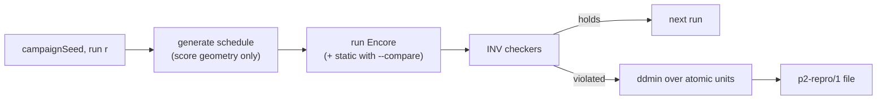

# Phase 2 evaluation

> **STATUS: PROPOSED — NOT IMPLEMENTED.** None of the metrics, checked properties, scenarios, campaigns or tests below exist in code. Track H thresholds (§4, §6) become pre-registered when this file merges. Every M-scenario threshold (§5) is a **proposal**, frozen only at gate P2-G1 and before any M run on an evaluation seed. Nothing here changes the base evaluation, S0–S5 or their pass lines.

Purpose: how Phase 2 work is measured, checked, falsified and reported. Status: proposal for issue #110, written Sun 15 Nov 2026 ~00:15 GMT. Owner: Arnav (Phase 2 architecture, issue #110). Audit base: `origin/main` 26b438a (first audited at 7a50a69); re-checked at `origin/main` c697f6c (02:58 GMT, 15 Nov 2026; what changed is in §1). Changes since the first audit are listed once in [PHASE2_ARCHITECTURE §1](../design/PHASE2_ARCHITECTURE.md#1-scope-sources-and-status-labels).

This file is canonical for: the Phase 2 metric families and summary keys (§3); the checked properties `INV-DUP`, `INV-MONO`, `INV-SILENCE`, `INV-QUIET`, `INV-CONVERGE` and `INV-STATIC` (§4); scenarios `M0`–`M6` and their proposed thresholds (§5); sweeps `X1`–`X3`, fuzz campaign `FZ1`, its budget and the repro format `p2-repro/1` (§6); tests `P2-T01`–`P2-T36` (§7); and Phase 2 fairness, falsification, provenance, statistics and performance criteria, including opt-in timing (`P2_PERF=1`, §12) (§8–§12). Other docs link here rather than restate these. Everything else is linked:

| Topic | Canonical place |
|---|---|
| Base metrics, keys, S0–S5, win rule, procedure, T01–T19, G0–G6 | [evaluation and tests](evaluation-and-tests.md) |
| Healing, known limits 1–9, dissemination, motion | [contract §8](../design/contracts-and-algorithms.md#8-healing-local-claims-adr-007), [§8.5](../design/contracts-and-algorithms.md#85-known-limits-state-these-dont-hide-them), [§9](../design/contracts-and-algorithms.md#9-score-dissemination-and-partitions-adr-005-adr-008), [§10](../design/contracts-and-algorithms.md#10-motion) |
| Candidates E01–E10, N01–N21, prior art | [PHASE2_CANDIDATES](../ideation/PHASE2_CANDIDATES.md) |
| Capabilities C1–C9, P2-FR/P2-NFR, contract-change register | [PHASE2_ARCHITECTURE](../design/PHASE2_ARCHITECTURE.md) |
| `Movement.motion`, `slotPosAt`/`slotVelAt`, observer under motion, linter L1–L6 | [ANIMATED_CHOREOGRAPHY_RFC](../design/ANIMATED_CHOREOGRAPHY_RFC.md) |
| Healing in motion, `rOccEff`, feasibility guard, avoidance, proposed limits 10–15 | [ADAPTIVE_RECOVERY_AND_SAFETY_RFC](../design/ADAPTIVE_RECOVERY_AND_SAFETY_RFC.md) |
| X-IN, X-OUT, X-PERSIST, X-RUN, X-RUN/live | [OPTIONAL_INTEGRATION_BOUNDARIES](../design/OPTIONAL_INTEGRATION_BOUNDARIES.md) ([§6.1](../design/OPTIONAL_INTEGRATION_BOUNDARIES.md#61-x-runlive-provisional-d3-gated) for X-RUN/live) |
| Gates P2-G0–P2-G6, decisions D1–D7, risks | [PHASE2_ROADMAP](../planning/PHASE2_ROADMAP.md) |
| Work packages P2-WP-… | [PHASE2_WORK_PACKAGES](../development/PHASE2_WORK_PACKAGES.md) |
| Demo beats P2-B… | [PHASE2_JUDGING_STORYBOARD](../demo/PHASE2_JUDGING_STORYBOARD.md) |
| Wording | [requirements §5](../specification/requirements.md#5-claims-we-must-not-make) |

Status labels: **(a)** implemented and tested on main · **(b)** implemented, not integrated · **(c)** open PR or active work · **(d)** documented only · **(e)** not present.

---

## 1. Scope and starting point

**The base evaluation is untouched** ([evaluation §2–§5](evaluation-and-tests.md#2-metrics)). This file adds keys, scenarios and checks and never redefines a base key. A base key reported on a Phase 2 run keeps its base formula; on an M run the observer reads slot positions and `dense` at the sample tick (P2-CC-06), which reduces exactly to the base definition when motion is absent (P2-T20, P2-T25).

**The evidence is fragile.** Any change to brain behaviour, `steer`, `Params` or `EncoreState` after the base evidence run (#122, for #26) starts is a new revision with a full S0–S5 re-run ([PHASE2_ARCHITECTURE](../design/PHASE2_ARCHITECTURE.md); [evaluation §5](evaluation-and-tests.md#5-procedure)). Track H evaluation work is therefore read-only (observers, CLI tools, layers). Every M scenario is Track P.

| Item (at 26b438a) | Status |
|---|---|
| Observer metrics, 23 summary keys plus `tRec`; `P*(M)`, `capacityLoss`, `coordLoss` (`src/observer`) | (a) |
| S0–S5 builders, `RunRecord`, `paramsHash`, overwrite guard, report with paired Δ, W/T/L, censored `tRec` (`src/cli`) | (a) |
| G1 40-centre sweep with the known late-commit miss as `it.fails` (`tests/g1/g1.beyond.test.ts:80`) | (a) |
| Encore arm registered in the CLI (`src/cli/brains.ts`, #116); paced targets (`pacedSlotPos`, `src/agent/steer.ts:114`, #96); score gossip (#105); Encore isolation and replay tests (`tests/isolation/`, #68) | (a) |
| Perf and screenshot harness (`scripts/perf/run.mjs`, `simBench.ts`; [QA](../demo/QA.md), #118) | (a) |
| Base evidence matrix (#122, for #26): no records in `results/` | (c) |
| Swept collision counts (contract §10 SHOULD) | (d) |
| Checkers, fuzzer, shrinking, repros, `--set`, sweeps, oracle time bound, bootstrap, per-addition timing test, `slotPosAt`, motion, time-dependent observer | (e) |

**Re-checked at `origin/main` c697f6c (02:58 GMT, 15 Nov 2026).** The statuses above stay as at 26b438a. Merged since: #124, #122, #115, #121, #82 (adds `src/sim/sensing.ts`), #125, #113 (app shell; Composer and Inspector mounted), #137 (freeze-run script, `scripts/eval/`), #157, #161, #163, #164, #165, #154, #131/#148 (backup video recorder), #126 (quality ladder: optional `Layer.setQuality?`, `src/app/render/**`) and #167. Still open: #127, #166 (may touch `TetherLayer`), #160 and #147. What that changes here:
- #122 has merged: S0–S5 records are in `results/`, and CURRENT_STATE records G5 met. `R0` is still the freeze run (#137), which has not run yet (§10).
- The waits on #113 (P2-T13) and #126 (§12) are satisfied by those merges. The CURRENT_STATE lock table at c697f6c still lists #113's `src/app/ui/**` and #126's `src/app/render/**` locks. Under the [roadmap's lock rule](../planning/PHASE2_ROADMAP.md#base-state-this-roadmap-depends-on) they bind until the orchestrator lifts them.
- #137 locks `results/**` and `scripts/eval/**` (§6).
- The G1 `it.fails` is still at `tests/g1/g1.beyond.test.ts:80` and reads 38 of 40.

None of the merged items is Phase 2 work. `buildEvalScore` at `n0` = 200 gives movement B `transitionTicks` = 304 and `holdStart` = 1204 (computed for this file; `src/cli/scenarios.ts` and `src/score` are unchanged since #96). No M scenario depends on movement A's start.

---

## 2. Notation and the truth model

- `L(t)` live drones in snapshot `t`, `M(t) = |L(t)|`, `DT` = 0.05 s. `R(t)` is the reference score of [evaluation §2](evaluation-and-tests.md#2-metrics); `p_i(t) = slotPosAt(R(t), t, i, n0, params)` (P2-CC-02), equal to the static slot when motion is absent; `D(t)` is `dense` transformed to `t` (P2-CC-06). `score_d` is the registered score matching drone `d`'s `belief.version`.
- **Slot-change stream:** the base `slotChanges` rule (baseline `drone.id`). A change to a lower index is a **commit**, to a higher index a **pop**. In one tick a drone commits once or pops one or more times, never both: a pop calls `targetChanged`, so that tick's scan fails `canHeal` ([§8.3](../design/contracts-and-algorithms.md#83-per-tick-logic)).

**Truth radio contact** reproduces step 5 of `src/sim/world.ts`: "a broadcast between `i` and `j` at tick `t` would be delivered, apart from random loss". It holds if and only if:
1. both are in `L(t)` (kills apply before sends);
2. `|x_i − x_j| ≤ rRadio`, with `x` the position in snapshot `t − 1` (radio uses start-of-tick positions; `launchPos` for `t` = 1);
3. neither `x` lies inside a jam active at `t` (`|x − centre|² ≤ radius²`);
4. for every partition active at `t`, both are in the same group. Groups are fixed at `PARTITION_ON` tick `t_on` from snapshot `t_on − 1`: side 0 if `(x − point)·normal < 0`, else 1. The checker rebuilds every partition's groups from the recorded event; `partitionSide` (oldest partition only) is a cross-check. Without recorded events it uses `partitionSide` and treats pairs as **not** in contact while two or more partitions are active, which can only suppress a report;
5. the current loss (`params.loss`, then the latest `SET_LOSS`) is below 1.

**Truth radio components:** union-find over contact on a grid of cell `rRadio`, on sample ticks (`t mod 5 = 0`), so component times have 0.25 s resolution. P2-T15 checks the model against `RadioEvent` counts.

---

## 3. Metrics

All metrics are observer-side (I6): snapshots, recorded events and registered scores only. **Wall-clock time never enters a `RunRecord`, Phase 2 result file or repro** ([evaluation §2](evaluation-and-tests.md#2-metrics)). Track H keys go into Phase 2 result files (§10), never into base matrix records. Track P keys may enter `RunRecord.summary` of a declared new revision; `summary` is a key-value record defined by the evaluation docs, so no contract type changes.

### 3.1 Image under motion

| Key | Definition | Unit |
|---|---|---|
| `npwc`, `coverage`, `sfMean`, `sfMax` on M runs | Base formulas with `p_i(t)` and `D(t)`; occupied = a live drone within `rOcc` of `p_i(t)` | as base |
| `trackP50`, `trackP95`, `trackMax` | Per sample, over live drones in hold with no slot change for `tStable`: `e_d = |pos_d − slotPosAt(score_d, t, belief.slot_d)|`; type-7 percentiles and max | m |
| `trackP95End`, `trackMaxEnd` | Means over hold samples in `end` (1700–1799) | m |
| `trackBrainP99` | The same drones, in the **brain's frame**: the distance from `pos_d(t − 1)` to `slotPosAt(score_d, t, belief.slot_d)`, with `pos_d(t − 1)` from snapshot `t − 1` (what `input.sensed` holds at tick `t`); p99 over the hold. It leaves out the snapshot offset below. Source for `LAG_MARGIN` ([adaptive RFC §1.4](../design/ADAPTIVE_RECOVERY_AND_SAFETY_RFC.md#14-the-effective-occupancy-radius-rocceff)), dev seeds only | m |
| `npwcLag` | `npwc` with radius `rOcc + λ`, `λ` = 0.10 m (0.7 < `slotSpacingMin/2`, so still one slot per drone; close to the feed-forward lag *estimate* of [adaptive RFC §1.4](../design/ADAPTIVE_RECOVERY_AND_SAFETY_RFC.md#14-the-effective-occupancy-radius-rocceff)). Diagnostic only | 0–1 |
| `lagLoss`, `assignLoss` | `pwcLag − pwc` and `P*(M) − pwcLag`, so `coordLoss = assignLoss + lagLoss`; means over `end` | 0–1 |

Tracking uses the drone's own score, so a stale drone is measured against what it flies; healing flights are excluded and counted in `tRec`. Occupancy is judged at the snapshot tick, so a perfect tracker sits about `|ṗ|·DT` ahead (0.094 m at the `EVAL-M` rim, [choreography RFC §7.3](../design/ANIMATED_CHOREOGRAPHY_RFC.md#73-the-one-tick-offset-lag-aware-note)), stated next to occupancy and `sf*` results under motion. `track*` keys are in this snapshot frame and include that offset; `trackBrainP99` does not.

### 3.2 Recovery

| Key | Definition | Unit |
|---|---|---|
| `tRec` on M runs | Base definition (first `KILL` to the start of 12 consecutive hold samples with `npwc ≥ 0.95`) with time-dependent `npwc` | s |
| `tRecHorizon` | Largest observable `tRec`: `(lastSampleTick − 55 − firstKill)·DT`; 19.75 s for a kill at 1350 in 1800 ticks | s |
| `tRecFromLast` | As `tRec`, from the last `KILL` (M6) | s |
| `tFirst95` | First `KILL` to the first sample tick with `npwc ≥ 0.95` (no run of 12 needed); `null` if never | s |
| `tOracle` | Oracle bound below, labelled "oracle upper bound" (instant global knowledge) | s |

**`tOracle`** is a lower bound on when *any* controller with instant global knowledge and no detection delay could first reach `npwc ≥ 0.95`, so an upper bound on performance: a ceiling, never a competitor arm ([evaluation §4](evaluation-and-tests.md#4-baseline-fairness)). At the first `KILL` tick `k`: (1) `target = 0.95·P*(M(k))`; if `pwc(k) ≥ target`, it is 0. (2) For each unoccupied slot `s`, `τ(s)` = min over live `d` of the smallest `u·DT` (whole ticks) with `reach_d(u) ≥ max(0, |p_s(k+u) − x_d(k)| − rOcc)`, where `reach_d(u) = Σ_{n=1..u} min(vMax, |v_d(k)| + n·aMax·DT)·DT` is the farthest the world's semi-implicit Euler (velocity first, clamped to `vMax`, then position by the new velocity; `world.ts` step 6) can carry a drone in `u` ticks. The continuous `|v|τ + ½aMax·τ²` understates that by `½aMax·DT²·u` (0.1 m after 1 s) and is not used. (3) Add `w_s` in order of `τ` until `pwc` reaches `target`; `tOracle` is the `τ` reached. **Defined only on runs with exactly one `KILL`** (`null` otherwise): a later kill lowers `P*(M(t))`, and with it the level `tFirst95` must reach, below the fixed target. Every relaxation (a drone may serve several slots, need not vacate its own, ignores neighbours and turning) only shortens time, so on every single-kill run `tOracle ≤ tFirst95`, and `tOracle ≤ tRec` whenever `tRec` is defined (P2-T12). A min-bottleneck assignment to the whole prefix is not used: it bounds a different event and can exceed `tRec`.

### 3.3 Safety: swept collisions

World counts are end-of-tick lower bounds ([contract §10](../design/contracts-and-algorithms.md#10-motion)). For a pair alive in snapshots `t − 1` and `t`, `r(s) = r0 + s·Δ`, `Δ = r1 − r0`, `s ∈ [0, 1]`, is exactly the world's per-tick displacement (semi-implicit Euler moves each body by `vel·DT` in a line; the `y = 0` clamp at launch is the only exception). `dmin = |r(s*)|`, `s* = clamp(−r0·Δ/|Δ|², 0, 1)`.
- **`collisionsSwept`:** ticks with `|r0| ≥ dCollide` and `dmin < dCollide` (contact begins inside the tick). **`nearMissesSwept`:** the same with `dNear`.
- Candidates from a grid at `t − 1` with range `dNear + 2·vMax·DT` = 1.6 m.
- Every end-of-tick entry has `dmin ≤ |r1| < d`, so swept ≥ end-of-tick counts on every run (P2-T12).

### 3.4 Coordination churn

| Key | Definition | Unit |
|---|---|---|
| `oscillations` | Changes of live `d` at `t2` into a slot `a` it last left at `t1 ≥ t2 − W`, `W` = 200 ticks: A→B→A and longer returns. Each is a legal pop under §8.4; this measures churn | count |
| `oscillationDrones` | Distinct drones with an oscillation | count |
| `falseClaims` | Commits by `d` into `v` at `t` while another live drone had `belief.slot = v` in snapshot `t − 1`: a claim on a slot that still had a live holder by truth. In S0, S3 and M0 every commit is one | count |
| `dupOwnSec` | `Σ dupSlots(t)·DT` over **every tick** (holds and transitions); not comparable with base `dupSlotSec` (hold samples only) | slot·s |
| `dupOwnSecContact`, `dupOwnSecSep` | Split: a duplicated index is "contact" on `t` if any pair of its claimants is in truth contact, else "separated" (limit 5) | slot·s |
| `dupOwnSecSameVersion` | `dupOwnSec` over claimant pairs on equal versions (base `dupSlots` ignores versions) | slot·s |
| `dupEpisodeMax` | Longest run of ticks one pair shares an index | s |

### 3.5 Dissemination and communication

| Key | Definition | Unit |
|---|---|---|
| `tConvComp` | `S(t)`: live drones whose truth component holds a live drone on a newer version (`newerVersion`). `t_a`: last `INJECT_SCORE`, `PARTITION_OFF` or `JAM_OFF`. `(t* − t_a)·DT`, `t*` the first sample tick `≥ t_a` from which `S` stays empty; 0 if empty at `t_a`; `null` if not empty at the end | s |
| `staleContactSec` | `Σ |S(t)|·5·DT` over sample ticks | drone·s |
| `tLoserSwitch` (X3) | `PARTITION_OFF` to the last losing-side drone adopting the winner | s |
| `hbPerDroneSec`, `scorePerDroneSec` | Base `msgsPerDroneSec` split by type, same denominator | 1/s |
| `scoreSendsPerAdoption` | `SCORE` broadcasts after the first injection ÷ adoptions of injected versions | count |
| `claimHbFraction` | Share of `HB` with `claimSlot ≠ null` | 0–1 |

### 3.6 Robustness curves

Per sweep point (X1, X2): base keys, `tRec`, `dupOwnSec` and `falseClaims` per arm, and the median paired Δ `npwcEnd`. The **breakdown point** is the smallest value at which a criterion stated before the sweep fails; defaults: median paired Δ no longer above +0.02, more than half the seeds censor `tRec`, or `dupSlotsEnd > 0` on more than one seed. Exploratory (§11). M3 and M4 give the same reading under motion.

### 3.7 Throughput (never in records)

`msPerTickStep` (wall-clock of `world.step()` plus `observer.sample()`), `msPerTickAdd(X)` (one per-tick addition by the §12 method, ms per tick per world) and `fps` (the app's once-per-second readout). Printed by opt-in tests or recorded in PRs only.

---

## 4. Checked properties

Jepsen-style history checkers ([PHASE2_CANDIDATES](../ideation/PHASE2_CANDIDATES.md) N05): pure, incremental, fed one snapshot per tick with `TickEvidence`'s rules (repeat is a no-op, gap or backward tick throws). Results are worded **"checked properties on these runs, not proofs"**.

**Safety-like** properties (`INV-DUP`, `-MONO`, `-SILENCE`, `-STATIC`) each encode the [§8.4](../design/contracts-and-algorithms.md#84-why-this-settles) argument or a [§8.5](../design/contracts-and-algorithms.md#85-known-limits-state-these-dont-hide-them) limit on the brain's **delivered or sensed evidence**, so a documented limit is never reported as a safety violation. They are expected never to fire; a violation blocks the claim it touches. **Bounded-liveness** properties (`INV-QUIET`, `-CONVERGE`) are pre-registered **targets**, not encodings of limits: their time bounds can be exceeded by documented behaviour (limit 3, limit 8, heavy loss, flapping connectivity). Each violation carries a `knownLimit` tag when its shape matches a documented limit; reports list tagged and untagged violations separately, and only untagged ones are called counterexamples. Bounds are never moved afterwards.

Pre-registered by this file (exported as `INVARIANT_DEFAULTS`, P2-WP-01): `Ddup` = 60 ticks (diagnostic only, below), `Q` = 400 ticks, `C` = 600 ticks, `W` = 200 ticks.

| ID | Holds when | Encodes | Arms |
|---|---|---|---|
| `INV-DUP` | No later holder keeps a shared index `latencyMax + 1` ticks after a **delivered** heartbeat from the earlier holder | limit 5, duplicate rule | both |
| `INV-MONO` | Commits drop by `≥ claimGap + 1`; pops return only to a slot on the drone's observed history stack | §8.4 | both |
| `INV-SILENCE` | Before the first kill or any version split, every slot change is backed by the brain's own vacancy evidence | limits 6, 7 | Encore |
| `INV-QUIET` | No commit more than `Q` ticks after its anchor | liveness target (limit 3 instances tagged) | Encore |
| `INV-CONVERGE` | No drone stays stale for `C` ticks in a stable component with a newer version | §9 claim (flapping tagged) | Encore |
| `INV-STATIC` | Static never changes slot or version | §11 | static |

**`INV-DUP`** (on delivered evidence, so exact at any loss). For live `i ≠ j` with equal `belief.slot = v` in snapshot `t` (compared across versions, as the duplicate rule is) and `(heldSince_i, i) < (heldSince_j, j)` lexicographically, take an `HB` `RadioEvent` at `t` from `i` with `j` in `delivered`. The heartbeat carries `i`'s slot and `heldSince` at the end of its step, which is snapshot `t`'s belief (`encoreBrain.ts` builds it after scan and pops), so `j` receives it by `t + latencyMax` and must pop ([§8.3](../design/contracts-and-algorithms.md#83-per-tick-logic)). Violated if `j` is live in snapshot `t + latencyMax + 1` with the same `(slot, heldSince)` as at `t`; once per episode. A limit-5 duplicate whose every heartbeat is lost is never flagged. `RadioEvent`s are in every snapshot, so this rule also runs live (P2-WP-06). **Diagnostic, not a property:** `dupContactRuns`, the episodes in which a pair shares an index for more than `Ddup` ticks while in truth contact (§2); at loss ℓ a legal one needs about 12 consecutive losses (ℓ¹²: 1.7·10⁻⁵ at 0.4, 2.4·10⁻⁴ at 0.5, 0.28 at 0.9; arithmetic). Separated duplicates are measured by `dupOwnSecSep`.

**`INV-MONO`.** Per drone an observed stack `H` (empty; current slot starts at `id`). Commit `a → b`: violated unless `a − b ≥ claimGap + 1`; push `a`. Pop `b → u`: violated unless `u` is in `H`; remove the topmost `u` and everything above it. The brain's `history` is always a subsequence of `H` (the `historyMax` cap only removes from the brain's copy; a pop lands on the brain's top entry), so legal histories, including multi-pop ticks, are never flagged. It is stronger than "returns to some slot held before": it rejects A→B, B→A, A→C, C→B.

**`INV-SILENCE`.** Window: tick 1 to the earlier of the first `KILL` and the first tick on which two or more versions coexist among live drones, for any reason (limits 7 and 8). Inside it, every Encore slot change is a violation unless **excused** on the brain's own observable evidence: sampled scans, start-of-tick positions, its own score and delivered heartbeats only ([§8.1](../design/contracts-and-algorithms.md#81-three-levels-of-knowledge-about-another-drone), [§8.3](../design/contracts-and-algorithms.md#83-per-tick-logic)). (a) Limit 6 / proposed limit 10: a commit by `d` into `v` at `c` such that (i) on every scan tick `s` of `d` (`s mod hbPeriod = d mod hbPeriod`) in `[c − tVacant − claimWindow, c]`, no live drone other than `d` in snapshot `s − 1` lies within `rOcc` (`rOccEff(score_d, s, v)` under motion, [adaptive RFC §1.4](../design/ADAPTIVE_RECOVERY_AND_SAFETY_RFC.md#14-the-effective-occupancy-radius-rocceff)) of `slotPosAt(score_d, s, v)` (`rClaim ≤ rSense − rOcc`, so all such drones are sensed); and (ii) no `HB` `RadioEvent` sent at `t ∈ (c − tSuspect − latencyMin, c − latencyMax]` by a sender with `belief.slot = v` in snapshot `t` lists `d` in `delivered` (such a heartbeat certainly arrived in `(c − tSuspect, c]`). Both follow from `vacant` holding at the claim start and at commit (`encoreBrain.ts:199-202`, `:240-252`), so a legal commit is never flagged at any loss. (b) A pop by a drone that made an excused commit. Excused changes are reported as `silenceExcused`; the S0/S3/M0 lines and P2-T28 ("0 slot changes") still count them.

**`INV-QUIET`** is a pre-registered liveness target. It does **not** encode limit 3: `Q` = 400 ticks (20 s, G1 test 2's "no commits in the last 10 s of 30 s") sits below limit 3's chain time, so it is designed to fire on documented behaviour, which is what P2-T05 must rediscover. A commit by `d` at `c` violates if `c − anchor > Q`, with `anchor` = max(last recorded `EnvEvent` tick of any type `≤ c`, `currentMovement(score_d, c).holdStart`, the last tick `≤ c` on which `d`'s `belief.version` changed): a new hold, a new event or `d`'s own adoption restarts the clock (limit 8 pauses healing from each drone's adoption, not from the injection). Tag: `knownLimit: '§8.5 limit 3'` when `d` already committed once in `(anchor, c)` (the drone-hops-twice shape), or when the causal chain of vacancies that `d`'s commit fills, walked back from `c` to the anchor in at most 8 links, contains a drone that committed into a slot and out of it again since the anchor, its two commits `tStable + tVacant + claimWindow` to that plus `2·hbPeriod + latencyMax` ticks apart (180–192 at the defaults), and every vacancy-to-fill link of that chain (each filler's commit after the commit that vacated its slot, and the chain's first commit after the anchor) is at most `max(tSuspect, tVacant + ⌈√(2·rOcc/aMax)/DT⌉) + claimWindow + 2·hbPeriod + latencyMax` ticks (92 at the defaults); else `null`. (Amended after pre-registration by #287, pending Arnav's ratification: the original sentence tagged only the first case, which misses G1's own late commit, the first commit of the drone that fills the double-hopper's slot.) Known instances at 26b438a: G1 seed 1, 2 of 40 centres late, the latest 20.20 s (404 ticks) after the kill (measured at 571c8e4 with paced targets; `tests/g1/g1.beyond.test.ts:80`, comment corrected on later main by #135). Before pacing: 5 of 40, 20.20–20.95 s, and 17 of 200 over seeds 1–5 ([§8.6](../design/contracts-and-algorithms.md#86-the-first-falsification-test-gate-g1)). Without recorded events the anchor is derived from snapshot changes and the result is marked `derived`.

**`INV-CONVERGE`.** With `S(t)` from §3.5 and `staleSince[d]` the first sample tick of `d`'s current run in `S`, violated at `t` if some `d ∈ S(t)` has `t − staleSince[d] ≥ C`. The run restarts at every sample tick on which `d`'s truth component differs in membership from the previous sample (split, merge, kill, a drone crossing a jam edge or radio range), so only a stable component counts. `C` = 30 s is 1.5 × T18's two-hop bound at 20% loss and 3 × S5's median `tVersion` line: loose, so a violation means a stall. **Expected exception:** flapping contact inside a stable membership (edges that last less than the per-hop relay time, latency plus `scoreResendMin`), where progress is monotone but completion unbounded ([adaptive RFC §4](../design/ADAPTIVE_RECOVERY_AND_SAFETY_RFC.md#4-e08-concurrent-score-conflicts)); a violation in which any truth-contact edge inside `d`'s component changed state within the last `scoreResendMin + latencyMax` ticks is tagged `knownLimit: 'flapping'`. Encore only.

**`INV-STATIC`.** In the static arm, every live drone has `belief.slot = id` and the preloaded version on every tick.

---

## 5. Animated scenarios M0–M6 (Track P)

**Set-up.** `n0` = 200, 1800 ticks, default `Params` plus approved P2 parameters, 20 kills (`killCount`). Preloaded `EVAL-M` = base EVAL ([evaluation §3](evaluation-and-tests.md#3-scenarios)) with movement B (sphere) given `motion: spin ω = 0.2 rad/s` about the vertical axis through `(0, 30, 0)` (P2-CC-01 fields). M6 uses `EVAL-W`: B with transverse-wave preset `W1`, fixed at P2-G1 within L6 bounds ([choreography RFC](../design/ANIMATED_CHOREOGRAPHY_RFC.md)) and with `rOccEff` below the cap on B's slots; otherwise no slot is watched and M6 measures no healing by design ([adaptive RFC §1.4](../design/ADAPTIVE_RECOVERY_AND_SAFETY_RFC.md#14-the-effective-occupancy-radius-rocceff): A = 2 m, ω = 1.4 rad/s is such a wave). Which wave `W1` is stays open until P2-G1: a planar text wave along its normal that exercises speed deferrals, or a milder sphere wave (for example A = 1 m, ω = 1 rad/s) with M6's purpose limited to watched-set churn and distance deferrals ([adaptive RFC AR-Q4](../design/ADAPTIVE_RECOVERY_AND_SAFETY_RFC.md#8-open-questions-for-review); EV-Q2). Both arms fly the same score. A new pure `buildMScenario(id, seed, params)` with its own ids and stream salt (`agentSeed(seed, 0x5c1000 + index)`) leaves S0–S5 builders and streams byte-identical (P2-T19).

**Event resolution** is from **score geometry, never live state**: kill sets are the ids whose `p_i(t_kill)` are nearest slot `c` (ties to lower id). Under rigid spin, nearest sets are rotation-invariant; under waves the tick matters. M0's zero-slot-change property keeps ids and slots aligned before the kill; the base caveat on regions still applies ([evaluation §8](evaluation-and-tests.md#8-bias-risks-and-reporting-wording)).

**Why kills at 1350.**
- B's `holdStart` is 1204 at `n0` = 200 (§1), so `canHeal` condition 1 holds from 1244. The runner asserts B's `holdStart ≤ 1300` at every admissible `n0`, so 1350 ≥ 1300 + `holdGrace` lands in the healing-eligible hold at any accepted `n0`.
- By 1350 the spin has run 146 ticks (about 1.5 rad). The P2-CC-01 ramp must reach full ω by 1300 at `n0` = 200 (≤ 96 ticks); otherwise P2-G1 moves the kill tick, never the `end` window.
- 350 ticks remain before `end` (S2 has 400 before `endA`). No formation change follows, so the regional claim rides on `sfMaxEnd`, not `sfMaxEndA`. The price is a 19.75 s `tRec` horizon (S2: about 22 s).

| ID | Events (tick) |
|---|---|
| M0 null spin | none |
| M1 random kill | `KILL` 1350: 20 ids by `randomIds` |
| M2 regional kill | `KILL` 1350: 20 ids nearest `c`, `c` uniform (`pickOne`) |
| M3 + loss | M2 plus `SET_LOSS` 1250 to 0.2 |
| M4 + partition | `PARTITION_ON` 1250 `P`; `KILL` 1350 as M2 with `c` drawn from slots whose `p_c(1250)` is within 5 m of `P`; `PARTITION_OFF` 1600 |
| M5 + score update | M2 plus `INJECT_SCORE` 1410 into the lowest id not killed, score `composeNext(EVAL-M, 1410, sphere, d, n0, params, B.motion)`: P2-CC-01's optional trailing `motion` gives the new movement B's spin, and `copyMovement` keeps the carried B's ([choreography RFC §10.1](../design/ANIMATED_CHOREOGRAPHY_RFC.md#101-p2-cc-01-movementmotion-and-movementcolourmotion)). The new motion is anchored to its own `holdStart` ([§3.3 there](../design/ANIMATED_CHOREOGRAPHY_RFC.md#33-phase-anchoring-and-timing-semantics)), so the new movement opens with a paced **un-rotation** transition from B, turned by about 2.2–2.5 rad at `startTick` 1470, back to the unrotated sphere (rim chord about 17 m; `transitionTicksBetween` at the moved positions ≈ 143–149 ticks for a 40–96-tick ramp, *estimate*), then restarts the spin ramp at its hold (≈ 1615). The exact value is written here at P2-G1 |
| M6 wave, two kills | `EVAL-W`. `KILL` 1350: 10 ids nearest `c1` at `p(1350)`; `KILL` 1410: 10 ids nearest `c2` at `p(1410)` among the not yet killed |

In M4 the groups are fixed at `PARTITION_ON` and co-rotate, so the cut is fixed in the body frame; a centre near `P` at 1250 stays at the cut (the S4 design under motion). `PARTITION_OFF` leaves 5 s before `end`.

**Thresholds** (**PROPOSED**, frozen at P2-G1; "out of 20 eval seeds", scaled to the seeds run). Δ = Encore − static `npwcEnd` (time-dependent); W/T/L by the base ±0.02 rule.

| ID | Proposed pass | Honest expectation |
|---|---|---|
| M0 | Encore `slotChanges = 0` and both arms `npwcEnd ≥ 0.98` in ≥ 19; `INV-SILENCE` in 20 (P2-T26) | Tie on the image; both arms pay the same lag (well under `rOcc` with feed-forward, about 0.44 m without: *estimates*). Encore loses on messages |
| M1 | Δ ≥ −0.02, `lateSlotChanges = 0`, `dupSlotsEnd = 0`, `slotChanges ≤ 60` in ≥ 18 (P2-T27) | As S1: a small win resting on our own labels. Unwatched slots (lag bound over the cap) cost repair, not safety |
| M2 | Win in ≥ 15; `sfMaxEnd` below static in ≥ 15; median `tRec ≤ T_M2`, at most 5 censored. `T_M2 = min(19.5 s, 1.25 × median S2 tRec of the archived base matrix at n0 = 200)`, set at P2-G1 from base records only (P2-T27) | Ahead on regional holes, as S2, but slower (relative settle, guard, unwatched slots) and more censored (shorter horizon). A miss is published, not re-timed |
| M3 | Δ ≥ −0.02 in ≥ 18; win in ≥ 12; `dupSlotsEnd = 0` in ≥ 18; ≤ 8 censored | Lost bids raise `dupOwnSecContact` and `oscillations` (limit 5); false silence is negligible (0.2¹² ≈ 4·10⁻⁹; arithmetic) |
| M4 | Δ ≥ −0.02 in ≥ 18; win in ≥ 10; `dupSlots = 0` at every sample from 1700 in ≥ 18 | As S4, plus proposed limit 10 at the rotating cut: `dupOwnSecSep > 0`, pops after 1600, losses on some seeds |
| M5 | Encore only, no W/T/L (static cannot adopt, as S5): one version at the end in 20; `dupSlotsEnd = 0` in ≥ 19; `adoptMax ≤ 10 s` in ≥ 18 (P2-T30) | Limit 8 pauses healing for `tStable`, then the un-rotation transition blocks it (limit 4) until about 1655 (new hold plus `holdGrace`), so `tRec` is usually censored; the 17 m crossings put transition collisions in the run, reported. If the new transition overlaps `end`, `npwcEnd` is `null` and reported so |
| M6 | Δ ≥ −0.02, `lateSlotChanges = 0`, `dupSlotsEnd = 0`, `slotChanges ≤ 60` in ≥ 18. **No win line** | On the non-planar sphere, L6's `A·k ≤ 0.13` bounds the relative slot speed within reach by `A·ω·k·(rClaim + rOcc)` ≈ 0.86·ω m/s (1.2 m/s at ω = 1.4), below `ALPHA·vMax` = 4 m/s, so the speed check **never defers** ([adaptive RFC §1.7](../design/ADAPTIVE_RECOVERY_AND_SAFETY_RFC.md#17-claim-feasibility-guard)); only its distance check can, near the reach edge. Expect M2-like behaviour with two kills and the wave's smaller `rOccEff` margin. It does not exercise speed deferral (open question EV-Q2) |
| All | `INV-DUP`, `-MONO`, `-STATIC` in 20/20. Reported, no threshold: `INV-QUIET`, `INV-CONVERGE`, swept counts (apart from the M0 motion collision line below), `trackP95End`, `lagLoss`, `falseClaims` | Swept ≥ end-of-tick; Encore ≥ static on collisions, as in the base |

**Jam probe `J`** (P2-T28, P2-T29), a **partial** jam: jams cut radio, not sensing, and the S3 jam (radius 12) covers the whole `EVAL-M` sphere, which makes the test trivial ([adaptive RFC §1.11](../design/ADAPTIVE_RECOVERY_AND_SAFETY_RFC.md#111-jams-the-jam-plus-lag-false-vacancy-the-main-new-risk)). `J` = `EVAL-M`, no kills, `JAM_ON` 1300 at `[R_B, 30, 0]` with radius 4 m, `JAM_OFF` 1600, where `R_B` is the largest B-slot distance from `(0, 30, 0)`: the spin carries drones through a world-fixed jam on the equator. P2-T28 passes with 0 Encore slot changes. P2-T29 adds a test-only wrapper (both arms) that, for a drone inside the jam, drops feed-forward and steers at a point 1.0 m behind its slot along `−slotVelAt`. Removing feed-forward alone is not adversarial: at ω = 0.2 the rim lag without it peaks near 0.47 m in the brain's frame (reviewer's integration of `steer` plus the world's semi-implicit Euler, *estimate*; 0.44 m from `u²/aMax`), inside `rOccEff` ≈ 0.6 m + `LAG_MARGIN`, so signal S never fires. 1.0 m exceeds the largest admissible `rOccEff` (the 0.75 m cap). **Sanity check, pre-registered:** at least one holder inside the jam is farther than its `rOccEff` from its slot, in the brain's frame, on `tVacant` consecutive ticks; otherwise P2-T29 is reported **void**, not passed. **Proposed churn bound**, re-checked on dev seeds 101–105 before P2-G1: (i) `INV-MONO` and `INV-STATIC` hold; (ii) `dupSlots = 0` at every sample from 1700; (iii) pops after `JAM_OFF` ≤ commits in `[JAM_ON, JAM_OFF]`; (iv) `slotChanges ≤ 4·J_max`, `J_max` the most live drones inside the jam on one tick (one false claim plus one cascade per jammed holder, each a commit and a pop); (v) `lateSlotChanges = 0`. `falseClaims` is reported.

**Motion collision line** (**PROPOSED**, gate P2-G2 (b), [roadmap](../planning/PHASE2_ROADMAP.md#gates)). Pre-registered here before any M run. It is checked as part (b) of P2-T32, so it adds no test ID (EV-Q4). It needs `M0` runnable (P2-WP-22) and swept counts (P2-WP-08). Dev seeds 101–105 run first, then eval seeds, both arms.
1. **Inside the spinning hold.** On `M0`, from B's `holdStart` to the last tick: `collisions` = 0 and `collisionsSwept` = 0. If an S0 run (`EVAL`, motion absent) on the same seed and arm has a non-zero count in the same window, the line is ≤ that count instead. `nearMissesSwept` in the same window ≤ a bound fixed on dev seeds 101–105 and written here by docs PR before eval seeds run.
2. **Exit probe `EXIT`.** `EVAL-M` with a third movement C after B: movement A's text recipe with no motion, so drones leave a moving hold (the `L6-exit` step of [choreography RFC §9.6](../design/ANIMATED_CHOREOGRAPHY_RFC.md#96-l5-and-l6-speeds-and-accelerations)). Its twin `EXIT-0` is the same score with B's motion removed, so it flies the same transition from a static hold. No kills and no other events. C's start tick and the run length are fixed at P2-G1 and written here. The run may be longer than 1800 ticks, because `EXIT` is a probe, not an M scenario (C's transition is about 300 ticks at `n0` = 200, as B's 304: *estimate*). Pass: on every seed and in both arms, `collisions` and `collisionsSwept` in C's transition `[startTick, holdStart)` on `EXIT` ≤ the same counts on `EXIT-0`. The `L6-exit` velocity step is reported.

---

## 6. Exploratory sweeps and the fuzz campaign

All of §6 is labelled **"exploratory, not pre-registered; no parameter was chosen from these runs"** and never written into the base matrix folder. While #137 locks `results/**`, Track H tools write to an explicit `--out` outside the repo, and no Track H PR commits under `results/**`. The `results/phase2/` paths in this file apply only once that lock is lifted or the #137 owner agrees on #137 ([roadmap](../planning/PHASE2_ROADMAP.md#parallelisation), open question 3 there). No generator here or in §5 may emit two different scores with the same version: equal versions with different content never converge.

### 6.1 Sweeps (Track H, only while matrix-quiet; X3 after P2-WP-01)

Sweeps run only while **matrix-quiet**, the roadmap's term: #122 merged (met) and no matrix run active on the laptop ([roadmap base state](../planning/PHASE2_ROADMAP.md#base-state-this-roadmap-depends-on)). X1 and X2 also need P2-WP-07 (`--set`). X3 (P2-WP-10) needs only P2-WP-01, has no base-matrix column, and also never runs while a matrix run is active. The `P2-G0` (P) archive of `R0` is a separate, later event (§10).

| ID | Definition | Seeds, arms |
|---|---|---|
| X1 | S2 with `--set loss=v`, `v ∈ {0, 0.1, 0.2, 0.4}`, one `paramsHash` per point (P2-T11). The base S2 records at 0.05 on the same seeds (#122's in `results/`, or `R0`'s once archived) are a separate, labelled column (their `git` differs) | eval 1–5, both |
| X2 | S2-like kill fraction `f ∈ {5, 10, 20, 30%}`, centre drawn as S2 draws it (`randomIds(agentSeed(seed, 0x5c0000 + 2), ids, 1)`), so `f = 10%` reproduces S2. Labels `X2-k05`…`X2-k30` keep the report from pairing fractions | eval 1–5, both |
| X3 | `PARTITION_ON` 300 `P`; `INJECT_SCORE` 400 into the lowest id with A-slot `x < −10`, `composeNext(EVAL, 400, text BRAVO, …)`; `INJECT_SCORE` 420 into the lowest id with `x > +10`, `composeNext(EVAL, 420, text DELTA, …)`; `PARTITION_OFF` 700 | bound on dev 101–105, then eval 1–5; Encore (static for the capability row) |

X1 and X2 report §3.6 curves. X3 reports `tVersion`, `tLoserSwitch`, `splitSec`, `slotChanges`, `dupOwnSec`, `oscillations` and collisions. Collisions are reported for Encore against static on the same seeds. X3 is S5-shaped, so every X3 claim states that collision cost, as every S5 claim does: the S5 minimum matrix measured 103 collisions for Encore against 14 for static (#123, recorded on `main` after the audit base). Both X3 groups fly away to different scores, so each sees the other's slots as empty and silent: limit 7 on **both** sides, so churn is expected. Both scores share a base, so limit 9 is not exercised. **X3 churn bound** (P2-T14): structural (pops after `PARTITION_OFF` ≤ commits during the partition) plus a numeric `slotChanges` cap fixed on dev seeds and written here by docs PR before eval seeds run.

### 6.2 Fuzz campaign FZ1 (Track H)

Deterministic simulation testing with swarm testing and delta debugging: established practice (FoundationDB; QuickCheck; Groce et al. 2012; Zeller and Hildebrandt 2002), **not new**.

**Configuration.** `n0` = 40, 1200 ticks, `makeParams(40, { loss: 0.2 })` (G1's). Score: the G1 shape, `makeScore([text ENCORE], 40, params, LONG_HOLD)` as `killSetUp` builds it, so the known miss is in the search space. `runSeed = agentSeed(campaignSeed, r)`; the generator has its own salted stream. Checks: every applicable `INV-*` plus a **comparative check** (not an invariant) with `--compare`: Encore's mean `npwc` over hold samples in the last 100 ticks below static's by more than 0.02, with no partition overlapping an injection.

**Generator (swarm testing).** Each kind in {random kill, clumped kill, jam, partition, loss change, injection} is included with probability ½ (redraw if none), with 1–3 events each. Ticks are uniform in `[tReady, ticks − tTail]`, `tReady = healReadyTick(holdStart, 0, params)`, `tTail` = `Q` + 100 = 500, so late commits are observable.
- Random kills: size 1–5 by `randomIds` over ids not yet killed by the schedule. Clumped kills: size 2–6 by `nearestSlotIds` around a uniform centre in the slots of the movement current by schedule. At most 10 ids per run.
- Jams: centre a uniform slot position; radius from {3, 6, 12} m; duration 40–300 ticks, `JAM_OFF` clipped to `ticks − tTail`. Partitions: plane through `(0, 30, 0)`, normal from {x, y, z, (x+z)/√2}, durations as jams; overlaps allowed. Every generated pair has its own id (`fz-j<k>`, `fz-p<k>`), because an `ON` with an active id replaces it and an `OFF` removes by id ([contract §5](../design/contracts-and-algorithms.md#5-world-events-snapshot-metrics)), so a shared id would make one `OFF` end another window and break ddmin's pairs.
- Loss: `SET_LOSS` from {0, 0.05, 0.2, 0.4}.
- Injection: a uniform id alive by schedule, recipe from {sphere, helix, text `DUR`}, `composeNext` on the newest score the schedule has issued; no two injections share a `(tick, id)`, so versions are unique.
- **No decision reads live state**; otherwise the same events would be unfair to static ([evaluation §4](evaluation-and-tests.md#4-baseline-fairness)).

**Shrinking.** `ddmin` (complement-first, n-way split) over **atomic units** in the order `(tick, kind, id)`: each id in a `KILL` (an empty kill is dropped), each `JAM_ON`/`JAM_OFF` pair, each `PARTITION_ON`/`PARTITION_OFF` pair, each `SET_LOSS`, each `INJECT_SCORE`. `test(subset)` re-runs with the same seed, params and score and passes if and only if the **same** INV fires (the first tick may move). Budget 300 re-runs; when exhausted, `oneMinimal: false`. Removing events shifts later radio draws, so a repro is an exact run of its own, not a slice of the original.

**Repro `p2-repro/1`**, serialised with `canonicalJson` plus a newline, so equal inputs give byte-identical files (P2-T03); no wall-clock field. Fields: `v`, `git`, `campaign`, `campaignSeed`, `run`, `arm`, `seed`, `n0`, `ticks`, `params` (full), `paramsHash`, `score`, `events` (shrunk), `thresholds` (the `INVARIANT_DEFAULTS` used), `violation: { inv, firstTick, ids, slot?, detail }`, `shrink: { fromUnits, toUnits, tests, oneMinimal }`, `stateHash`. `--replay <file>` must report the same INV at the same first tick.

**Budget.** `R` ≤ 400 runs of the swarm generator (*estimate*), and ≤ 400 runs of the calibration profile below, stopping at the first find; the calibration budget is re-derived from P2-WP-02's re-confirmation run before P2-T05 runs and written here. The per-run cost at `n0` = 40 is unmeasured; the first run prints its wall time to the console, never to a file. Offline only.

**Calibration (P2-T05).** FZ1 must rediscover the G1 late-commit miss (`INV-QUIET`, tagged limit 3) unaided. The swarm generator is a poor probe: the latest known late commit is only 4 ticks past `Q`, and any later recorded event between the kill and the commit moves the anchor and hides it. P2-T05 therefore uses its own fixed **calibration profile**: one clumped kill of size 5 at G1's kill tick (`killSetUp` timing), centre uniform over slots, no other events. (a) *Positive control:* the late (seed, centre) pairs found by P2-WP-02's re-confirmation on current main fire `INV-QUIET` through the checker. (b) *Unaided:* the profile finds an `INV-QUIET` violation within its budget. *Estimate:* at 26b438a, 2 of 40 seed-1 centres are late (§4 INV-QUIET), so roughly 5% per run and about a 0.6% chance of no find in 100 runs; the five-seed rate after pacing is unmeasured (17 of 200 is pre-pacing). The `it.fails` (`tests/g1/g1.beyond.test.ts:80`) still runs in the default suite; if it has turned red, or (a) fails because one heartbeat phase moves the commit inside `Q` (the test's ADR-002 note), the target is re-chosen here first. **If calibration fails, no "0 violations" statement from FZ1 is published**; what is shown instead is "FZ1 did not rediscover the known miss in N runs" and, in any demo, a hand-built repro of a known G1 pair labelled as such.

---

## 7. Tests P2-T01–P2-T36

Headless vitest unless stated. Gate = latest gate by which the test is green; **H-merge** = before the Track H PR merges (close 07:30 Sun). Opt-in flags: `P2_WIDE=1`, `P2_PERF=1` (§12), `P2_FUZZ=1`. P2-T15–P2-T19 are assigned here (canonical; every sibling doc cites them).

| ID | Test | Area | Pass condition | Gate | WP |
|---|---|---|---|---|---|
| P2-T01 | Checkers on synthetic histories | observer | Each `INV-*` holds on one history and fires on another at the expected tick, ids and slot; cases include a separated duplicate, a duplicate whose every heartbeat is lost (not flagged), a limit-6 excuse with a lost heartbeat, a limit-7 split, a limit-3 `knownLimit` tag and multi-partition suppression | H-merge; P2-G4 | 01 |
| P2-T02 | Clean on S0–S5 | observer | Default suite: one short S2 run (about 300 ticks, `n0` 40). Opt-in (`P2_WIDE=1`, [WP §2.3](../development/PHASE2_WORK_PACKAGES.md#23-standard-regression-set) item 7): S0–S5, `n0` 40, dev seed 101, both arms, then `n0` 200, seeds 101–105: no `INV-DUP`, `-MONO`, `-SILENCE`, `-STATIC` violation; `INV-QUIET`/`-CONVERGE` violations listed with their `knownLimit` tags and triaged against §8.5 before merge. `stateHash` and base summary equal with and without the checker (the S0–S5 on/off matrix is opt-in). Before D7, also the scripted demo headless (`tests/observer/demoScriptInvariants.test.ts`, opt-in), both arms, violations listed for the storyboard. Passing this is weaker than "P2-T02 clean" (below) | H-merge; P2-G4 | 01 |
| P2-T03 | Fuzzer determinism | cli | Same `campaignSeed`, `R`, `n0`, `ticks`, `git`: deep-equal schedules, byte-identical repros; another seed differs; every schedule has unique versions and a unique id per jam and partition pair | H-merge; P2-G4 | 02 |
| P2-T04 | ddmin shrink | cli | Every repro replays to the same INV and first tick; removing any one unit stops that INV, or `oneMinimal: false`; unit tests on known minimal sets | H-merge; P2-G4 | 02 |
| P2-T05 | Calibration | cli | `P2_FUZZ`: (a) the known late G1 pairs fire `INV-QUIET` tagged limit 3; (b) the calibration profile (§6.2) finds an `INV-QUIET` violation within its budget, unaided; the shrunk repro holds one `KILL`; runs-to-discovery in the PR | H-merge; P2-G4 | 02 |
| P2-T06 | Cascade layer | app-render | Real worlds, Encore, `n0` 40, regional kill: recorded `changes` = observer `slotChanges` delta; drawn arrows ≤ `changes`, each drawn only after its drone is within `rOcc` of its new target; no trail segment while that drone's tether is drawn; none without a belief change; none in static | H-merge; P2-G5 | 03 |
| P2-T07 | Linter L1 | cli | Closed form = refined sampled minimum within 1e-6 m (plain 1000-step sampling is held to its relSpeed/2000 error bound); L2–L5 unit cases incl. two islands; the restated pacing equals `pacedSlotPos` at sampled EVAL ticks (pinned to `PACE_SETTLE_TICKS`); `src/cli/lint.ts` imports only `src/contracts` and `src/score` | H-merge | 04 |
| P2-T08 | Linter calibration | cli | Committed report: L1's predicted conflicts under ideal paced flight (no avoidance) per EVAL transition against measured S0 static collisions per window; calibration only, never a collision forecast ([choreography RFC §9.2](../design/ANIMATED_CHOREOGRAPHY_RFC.md#92-l1-predicted-conflicts-under-ideal-paced-flight-no-avoidance)). **Not a pass line** | H-merge | 04 |
| P2-T09 | Lint never blocks | app-ui | With findings, or a throwing linter, a valid draft still validates and injection dispatches exactly one `INJECT_SCORE` | H-merge; P2-G5 | 05 |
| P2-T10 | Readout cost, neutrality | app-ui | `P2_PERF`: ≤ 0.5 ms/tick/world at `n0` 200 (§12); scripted-demo `stateHash` equal with readout on and off | H-merge; P2-G5 | 06 |
| P2-T11 | Override provenance | cli | Each `--set` point: `paramsHash = sha256(canonicalJson(makeParams(n0, overrides)))`, distinct; bad key or type errors; tables headed "exploratory"; X2 at 10% equals S2 events | H-merge | 07 |
| P2-T12 | Oracle, swept counts | observer | S1, S2, S4 (one `KILL` each), seeds 1–5, both arms: `tOracle ≤ tFirst95` on every run and `≤ tRec` whenever `tRec` is defined; swept ≥ end-of-tick for collisions and near-misses. Units: `reach_d(u)` equals the distance of one drone driven from rest at full `aMax` through `createWorld` (within 1e-9 m, `u` ≤ 200) and bounds it from a moving start; pass-through pair counts 1 swept, 0 end-of-tick; T12 head-on counts 1 and 1 | H-merge; P2-G2 (b), P2-G4 | 08 |
| P2-T13 | Peer diff | app-ui | Reads only guarded `inspect().state` and observer truth; tripwire believed-alive = `belief.peersKnown`; isolation tests green | H-merge (#113 merged, re-checked at c697f6c; the `src/app/ui/**` lock must be lifted first); P2-G5 | 09 |
| P2-T14 | Dual injection | cli | X3, eval 1–5: every live drone ends on the later `issuedTick`; `INV-CONVERGE` holds; churn within the §6.1 bound | H-merge; P2-G4 | 10 |
| P2-T15 | Contact model | observer | S3, S4, `n0` 40, seed 101: per broadcast, `delivered + lost` = in-contact live receivers (§2) and `jammed + partitioned` = in-range receivers not in contact | H-merge | 01 |
| P2-T16 | Animated app views | app-ui | Ghosts equal the observer formation at the reading tick (interpolated ones labelled); composer spin yields a valid `Movement.motion`; `form sphere --spin ω` round-trips | P2-G5 | 23 |
| P2-T17 | Linter L6 | cli | Flags exactly the motions whose sampled max slot speed or acceleration exceeds the P2-G1 bounds (brute-force `slotVelAt` check); never blocks | P2-G1 | 24 |
| P2-T18 | Per-tick cost | observer | `P2_PERF`: each per-tick addition (checkers, swept counter, cascade `ingest`, time-dependent geometry, the hoisted co-moving vacancy scan, and the safety stages with their defensive sort of `sensed`) ≤ 0.5 ms/tick/world at `n0` 200 (§12); printed in the PR. For P2-WP-25 the timed unit is the brain's scan (adaptive RFC §1.15). For P2-WP-27/28 the sort is also timed on its own, on the presorted `sensed` that #82 delivers (expected O(k): *estimate*) | H-merge per package; Track P: before each package merges; P2-G5 | 01, 03, 08, 22, 25, 27, 28 |
| P2-T19 | M builder | cli | `buildMScenario` pure, sorted, explicit ids; kill ticks assert `≥ holdStart + holdGrace`; M2 kill set = nearest set at `p(1350)`; S0–S5 `buildScenario` output byte-identical to the parent | P2-G3 | 22 |
| P2-T20 | `slotPosAt` base case | score | Motion absent: equal (`===`) to `expandRecipe` positions; `colourMotion` absent: `slotColourAt` equal (`===`) to `Slot.colour`, plus one unit case per `colourMotion` kind (breathe, chase); closed form agrees with integrated `slotVelAt` within 1e-6 m over a hold; `pacedSlotPos`, moved byte for byte, passes `tests/agent/pacedSlotPos.test.ts` through the `steer.ts` re-export | P2-G1 | 20 |
| P2-T21 | Late adoption | score | Adopting at `t` gives the identical target to an early adopter at `t` (spin and wave) | P2-G1 | 20 |
| P2-T22 | Spacing under motion | score | Rigid: every pair ≥ `slotSpacingMin` on every hold tick; waves: ≥ the RFC's bound | P2-G1 | 20 |
| P2-T23 | Feed-forward bit-identity | core-agent | S0–S5 seed 1 (`n0` 40; `P2_WIDE` 200), `targetVel = pacedSlotVel` (motion part only, so zero for static scores): `stateHash` equal to the parent | P2-G2 (a) | 21 |
| P2-T24 | Tracking lag | core-agent | M0 at ω ∈ {0.2, 0.4}: `trackP95End` < 0.3 m (`rOcc/2`, snapshot frame, §3.1) with feed-forward; without, reported. Also reports `trackBrainP99` (brain frame), the figure `LAG_MARGIN` is calibrated from on dev seeds | P2-G2 (a) | 21 |
| P2-T25 | Observer in time | observer | A drone still in the co-moving frame is occupied during spin; motion absent: all observer tests unchanged | P2-G3 | 22 |
| P2-T26 | M0 | core-agent | §5 M0 row | P2-G3 | 26 |
| P2-T27 | M1, M2 | core-agent | §5 M1 and M2 rows | P2-G3 | 26 |
| P2-T28 | Silence under motion | core-agent | Probe `J`: Encore `slotChanges = 0`; `INV-SILENCE` holds | P2-G3 | 26 |
| P2-T29 | Jam-plus-lag probe | core-agent | Probe `J` with wrapper: §5 bound (i)–(v); **void** if the §5 sanity check fails | P2-G3 | 26 |
| P2-T30 | Update in recovery | core-agent | §5 M5 row | P2-G3 | 26 |
| P2-T31 | No regression | core-agent | G1 suite green; 40-centre sweep ≥ `N_R0`/200 with the other four conditions 200/200, where `N_R0` is that sweep (`P2_WIDE`) re-measured at the R0 commit at P2-G0 (P) and recorded on #110 (183/200 is pre-pacing; seed 1 went from 35 to 38 of 40 with #96); S0–S5 `stateHash` unchanged with motion absent | P2-G3 | 25 |
| P2-T32 | Avoidance budget | core-agent | S0, `n0` 200, both arms: collisions ≤ the R0 S0 count of the same arm and seed, and `collisionsSwept` ≤ R0's swept count (R0 records replayed through the P2-WP-08 counter); fidelity cost reported. No literal: trajectories changed after the first S0 measurements (#82 re-orders `sensed`). (b) The §5 motion collision line: `M0` inside the spinning hold, and probe `EXIT` against `EXIT-0` | P2-G2 (b) | 27 (line: 22, 08) |
| P2-T33 | Filter determinism | core-agent | Permuted `sensed` gives bit-identical acceleration; T03 green; S0 meets P2-T32. Cases ([adaptive RFC §2.7](../design/ADAPTIVE_RECOVERY_AND_SAFETY_RFC.md#27-deadlocks-determinism-and-fairness)): launch-grid reciprocity (`j ∈ M_i ⇔ i ∈ M_j` for every grid pair when neither side overflows), with the count of `MAX_ACTIVE` overflows reported; `c` at `d = Ds ± 1e-9`, closing and separating, non-increasing as `d` falls; the §2.6 ball-step case (norm of `u` ≤ `aMax`, `r̂·u ≤ c` within 1e-9), with the residual `max(0, r̂·u − c)` reported; a stalled symmetric pair (`relVel = 0` at `d < dAvoid`) whose tie-breaker sidesteps the two drones in opposite directions | P2-G2 (b) | 28 |
| P2-T34 | `Belief.why` | core-agent | From brain state only; isolation tests green; no `canHeal` logic in `src/app` (source scan). Equivalence: `healBlocks(s, now, holdStart).length === 0` ⇔ `evaluateCanHeal(s, now, holdStart)`, checked inside the scan at the `evaluateCanHeal` call on every scan tick of a G1 run, never by comparing `belief().why` with `belief().canHeal` (they legitimately differ for up to `hbPeriod` ticks, including a commit tick: [architecture §12.2](../design/PHASE2_ARCHITECTURE.md#122-p2-cc-07-beliefwhy)) | P2-G5 | 29 |
| P2-T35 | Integration boundary | ops | Exports are pure functions of records and snapshots; `stateHash` unchanged; `bash scripts/check.sh` passes offline (NFR-04) with `integrations/` (including the shared gateway `integrations/gateway/`) removed and `X-RUN/live` off; no network API under `src/` (source scan). Before any `X-RUN/live` code merges, the scan is extended: network APIs under `src/` only in the one confined client folder (proposed `src/app/live/`), and the default build makes zero external requests ([boundaries §6.1](../design/OPTIONAL_INTEGRATION_BOUNDARIES.md#61-x-runlive-provisional-d3-gated)) | P2-G6 | 30 |
| P2-T36 | Revision reproducible | ops | One record per S0–S5 and M0–M6 re-run at the revision's `git` and `paramsHash`: equal `stateHash` and `summary`; superseded tables kept | P2-G4 | 31 |

**"P2-T02 clean"** is the precondition of P2-WP-06 and of roadmap cut rung 4 ([emergency cut order](../planning/PHASE2_ROADMAP.md#emergency-cut-order)). It is stricter than P2-T02 passing. It means zero violations of all six `INV-*`, tagged or not, on S0–S5 under `P2_WIDE=1` (`n0` 200, seeds 101–105, both arms) **and** on the headless canonical demo script (`tests/observer/demoScriptInvariants.test.ts`, both arms). A triaged violation still counts as not clean. The wide run must not overlap a matrix run. P2-T02 passing (the P2-WP-01 merge line) allows tagged `INV-QUIET`/`-CONVERGE` violations that are listed and triaged.

**Before P2-WP-25.** P2-T26 and P2-T28 can run before P2-WP-25 merges. They then test P2-WP-21's interim motion gate (`evaluateCanHeal` false while `motion` is present, so no healing during motion), not healing in motion. Both are re-run after P2-WP-25.

---

## 8. Baseline fairness for animated shows

Base rules hold ([evaluation §4](evaluation-and-tests.md#4-baseline-fairness)). Additionally, **identical in both arms**: the animated score and every motion field, `slotPosAt`/`slotVelAt`, `steer` with feed-forward and any P2-CC-05 safety layer, seeds, `n0`, `Params`, world, observer, and deep-equal `events` resolved from score geometry. The static arm flies `slotPosAt` with `targetVel` and is **never stripped of animation**, so lag, shear and collision costs fall on both arms. Only `WorldConfig.brain` differs: healing and dissemination.

**Separating the losses.** `P*(M)` depends only on `M`, so capacity loss is unaffected by motion. Coordination loss splits into `assignLoss`, which a better arrangement would win back, and `lagLoss` (§3.1), which both arms share through the same steering. A Δ in `assignLoss` is what healing changes.

**Inherent differences, stated and not "fixed":** static never heals; it ignores injection (M5 and X3 have no W/T/L; `unadopted` shows the gap); it is not slowed by jams or partitions.

**The comparison supports:** under one animation, steering and fault schedule, how much coordination loss Encore's local healing and dissemination win back, on these seeds. **It does not support:** claims about real drones; other motions, speeds or shapes; comparison with a central planner (the oracle is a bound, not an arm); or safety claims (collisions are measured, not guaranteed). If `lagLoss` dominates, it says little about healing, and that is reported.

---

## 9. Falsification strategy

Each claim names its refuting result in advance. A refutation is published in the README's "Where Encore ties or loses" (or the Phase 2 report) with its record or repro. Properties and bounds are **never** loosened afterwards; a changed definition is a new pre-registration for runs not yet made.

| Claim (our wording) | Refuted by | We then publish |
|---|---|---|
| C1: "`INV-DUP`, `-MONO`, `-SILENCE`, `-STATIC` held on these runs: checked properties, not proofs" | Any unexcused violation on S0–S5 or M eval runs | Violation, first tick, repro; property listed as violated |
| C1: "FZ1 searched R schedules; these are the minimal unexplained counterexamples" (known-limit instances listed separately) | P2-T05 fails | "FZ1 did not rediscover the known miss in N runs"; no zero-violation statement |
| C2: "Arrows show only observed slot changes" | P2-T06 mismatch or an arrow in static | Layer off the demo path; bug note |
| C3: "k predicted conflicts under ideal paced flight (no avoidance), not a collision forecast" | P2-T07 fails (closed form differs from the sampled minimum) | Bug note; L1 off until fixed. P2-T08 stays a calibration table, never a forecast |
| C4: "Encore tRec X s; oracle upper bound (instant global knowledge) Y s" | `tOracle > tFirst95` on any single-kill run, or `> tRec` where defined | Nothing until the bound or metric is fixed |
| C4: "Swept counting adds k to the end-of-tick lower bound" | swept < end-of-tick | Nothing until fixed |
| C6: "The later score won everywhere; churn within the bound" | P2-T14 fails on eval seeds | Run and churn; bound unchanged |
| C7: "The animated hold keeps the image in both arms" | M0 `npwcEnd < 0.98` on more than one seed, or P2-T24 lag ≥ 0.3 m with feed-forward | Measured lag; L6's ω bound lowered |
| C8: "Encore repairs regional holes during rigid motion" | M2 wins in fewer than 15; any slot change in M0 or P2-T28; P2-T31 below `N_R0`/200 | `LOSS` rows; `C7` ships with P2-WP-21's interim motion gate, which keeps healing off while `motion` is present (the safe fallback). Without the gate today's settle test does not switch healing off on slow slots |
| C8: "Jam-plus-lag churn is bounded" | P2-T29 beyond the frozen bound | Measured churn; proposed limit 10 strengthened |
| C9: "The budget reduces transition collisions" | P2-T32: swept S0 not below R0's S0 swept count for the same arm and seed, or a gain only at tick ends | A negative result, as the spike's TTC result was published |
| P2-CC-03: "No effect when off" | P2-T23 `stateHash` differs | Not merged |
| Integrations: "The core is unchanged offline; the default build makes zero external requests" | P2-T35 fails | Not merged |
| P2-NFR-02: "Each addition ≤ 0.5 ms/tick/world" | P2-T10 or P2-T18 over budget | Addition made X-ray-only or headless, or cut |

---

## 10. Provenance and reproducibility

- **`git`:** `git rev-parse HEAD` plus `-dirty` when `src` or the package files differ (as `src/cli/main.ts`). **`paramsHash`:** sha256 of `canonicalJson` of the **whole** `Params`; a default-off field changes it.
- **Revision id.** `R0` = the base's final evidence: the freeze-run records (#137, on the freeze commit) with their `git` and `paramsHash`, archived at P2-G0 (P). Every behaviour-changing Track P merge declares `R1`, `R2`, … (D5), even when its hashes are unchanged with motion absent (P2-CC-04 uses code constants only), and re-runs S0–S5 and M0–M6 (P2-WP-31); the label lives in Phase 2 result files and `results/phase2/README.md`, and `RunRecord` is unchanged. A Track H merge declares none. Its check before merge: S0–S5 seed 1 `stateHash` (and base summary) on the PR head equals the merge parent's (P2-NFR-01); the #122 records are not the reference, since later merges (#115) touched the brain and world. Track H code is in the freeze commit, and the freeze run's step 5 ("identical apart from `git`") is P2-NFR-01's final acceptance: it proves Track H changed no record. Track H exploratory files are never fed to `buildReport` with base records.
- **Seeds.** Dev 101–105: tuning and calibration (`LAG_MARGIN`, X3 and P2-T29 bounds), never reported. Eval 1–20: pre-registered M runs after P2-G1. Eval 1–5: X1–X3, so base S2 records line up. Fuzz: `campaignSeed` (uint32), `runSeed = agentSeed(campaignSeed, r)`.
- **Phase 2 result files** (`p2-result/1`, `results/phase2/<kind>/` once the #137 `results/**` lock allows it, §6; until then an explicit `--out` outside the repo): `RunRecord` fields plus `label`, `kind` (`p2-exploratory` or `p2-eval`), `revision`, `p2` (§3 keys) and `invariants` (checker report). The base report never reads them.
- **Replay.** Same (scenario, seed, arm, `n0`, params, `git`) gives equal `stateHash` and summary, as in the base. A repro replays from its own file, which carries the score and full params that `RunRecord` lacks.
- Every Phase 2 number traces to a record, repro or committed report with its `git` and `paramsHash` (P2-NFR-08, extending NFR-09).

---

## 11. Statistics

- **Paired by seed:** Δ = Encore − static; W/T/L by the base ±0.02 rule on `npwcEnd` ([evaluation §3](evaluation-and-tests.md#3-scenarios)). Per scenario and key: median and IQR per arm (type 7, as `report.ts`), median paired Δ, W/T/L, censored count, worst seed; `LOSS` rows kept.
- **Confirmatory claims are the pre-registered pass lines only**, as counts ("in ≥ k of 20") scaled to the seeds run and stated. No p-values and no intervals on M results; other keys are descriptive.
- **Exploratory sweeps only:** percentile bootstrap 95% interval of the median paired Δ over seeds, 10 000 resamples from a seeded stream recorded in the sweep header (Efron 1979). With 5 seeds it is coarse; printed with `n`, never used for a claim.
- **Fuzz:** violation counts per property over `R` runs. Zero violations supports at most "fewer than about 3/R of runs violate, at 95%, **under FZ1's generator only**" (rule of three; Hanley and Lippman-Hand 1983), and only if P2-T05 passed.
- **Censoring:** `tRec` beyond the horizon is `null` and ranks as +∞, as in the base; `tRecHorizon` is printed.

---

## 12. Performance criteria

**Budgets.** Only two apply: the repo's frame budget "both worlds ≤ 3 ms, render ≤ 6 ms" (SHOULD, [experience §10](../design/experience-and-demo.md#10-performance); quoted, not a new number), and P2-NFR-02: each per-tick Phase 2 addition ≤ 0.5 ms per tick per world at `n0` = 200, measured opt-in.

**Method (P2-T10, P2-T18).**
1. Record one snapshot stream: S2, `n0` = 200, 1800 ticks (launch, hold, kill, recovery), Encore arm.
2. Time only the addition (`ingest`, and a layer's per-frame update against a stub scene) over the stream, which removes world variance.
3. One discarded warm-up pass, then 5 passes. Pass: the median of per-pass mean ms/tick ≤ 0.5. Also print the worst 100-tick window (launch and kill spikes).
4. The test lives under `tests/`, skipped unless `P2_PERF=1`, and times as `scripts/perf/simBench.ts` (#118) does (`node:perf_hooks`, warm-up first); no new timing framework. Lint bans `performance` only in `src/{contracts,score,agent,sim,observer}`, but existing tests avoid clocks by convention (`tests/score/perf.test.ts`), so timing stays opt-in.
5. Printed and pasted into the PR; never stored in a record.

**Frame rate and step cost:** the #118 harness (`node scripts/perf/run.mjs`, [QA](../demo/QA.md)) with the layer on, then off, in single and split X-ray, against NFR-01 and the [architecture targets](../design/system-architecture.md#6-scale-and-performance-budget); pass: no fps drop beyond run-to-run noise. A software-rendered run is never a GPU number. Both reports go in the PR. #126's quality ladder has merged (re-checked at c697f6c), so each Phase 2 layer also hides itself at every quality level above 0 ([WP §2.4](../development/PHASE2_WORK_PACKAGES.md#24-performance-rule)).

**Baseline, stated honestly: one run, not a benchmark.** The committed [`assets/qa/perf.md`](../../assets/qa/perf.md) (#118; one machine, revision 21747c5) records a Node `stepBoth` mean of about 7.7 ms at `n0` = 200 with the Encore arm (4.4 ms with static in both). Headroom is thin, which is why the 0.5 ms rule exists; any Phase 2 speed claim needs its own repeated measurement by this method. #115 (merged after the audit base) reports `stepBoth` at `n0` 200 about 40% faster with identical behaviour, but `perf.md` was not re-run (re-checked at c697f6c), so the step cost on current main is to be measured.

---

## Open questions

- **EV-Q1. `Q` against the known instance.** The latest measured late commit (20.20 s) is 4 ticks past `Q`, so P2-T05's positive control can flip on another host or after any timer change. `Q` is not moved; open is whether calibration should instead target a synthetic chain history (P2-T01) when no real instance remains. Decide before P2-T05 runs.
- **EV-Q2. Exercising speed deferral.** Under L6 on the non-planar sphere the speed check never defers (§5 M6). Only a planar formation waving along its normal at short wavelength makes it bind ([adaptive RFC §1.7](../design/ADAPTIVE_RECOVERY_AND_SAFETY_RFC.md#17-claim-feasibility-guard)). Whether to add a planar-wave scenario (movement A's text, with its own kill ticks) or leave proposed limit 12 unmeasured is decided at P2-G1, together with the recovery RFC's [AR-Q4](../design/ADAPTIVE_RECOVERY_AND_SAFETY_RFC.md#8-open-questions-for-review) on which wave M6 flies.
- **EV-Q4. A test ID for the motion collision line.** The §5 line is folded into P2-T32 (b), so the test range stays P2-T01–P2-T36. Open: whether it gets its own ID, and whether `EXIT` should become an M scenario. Decide before any M run.
- **EV-Q3. Stability for `INV-CONVERGE`.** Restarting on membership change is a coarse stand-in for path persistence; flapping inside a stable membership is only tagged. Whether to model per-hop persistence (latency plus `scoreResendMin` per hop along a path) is open until P2-T14 and FZ1 show how often the tag fires.

---

## References

Prior art for the established techniques used here; none is claimed as new. Heartbeat, gossip and LWW prior art: [PHASE2_CANDIDATES §8](../ideation/PHASE2_CANDIDATES.md#8-literature-and-prior-art).
- Kingsbury, K. Jepsen (history checkers), 2013–.
- Zhou, J. et al. FoundationDB. SIGMOD 2021 (deterministic simulation testing).
- Claessen, K., Hughes, J. QuickCheck. ICFP 2000.
- Groce, A., Zhang, C., Eide, E., Chen, Y., Regehr, J. Swarm testing. ISSTA 2012.
- Zeller, A., Hildebrandt, R. Simplifying and isolating failure-inducing input. IEEE TSE 28(2), 2002.
- Efron, B. Bootstrap methods: another look at the jackknife. Annals of Statistics 7(1), 1979.
- Hanley, J. A., Lippman-Hand, A. If nothing goes wrong, is everything all right? JAMA 249(13), 1983.
