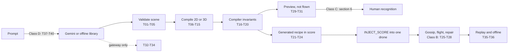

# Gemini formation evaluation

> **STATUS: PROPOSED — NOT IMPLEMENTED.** Nothing in this file has been built, run or measured. It specifies how generated formations would be checked if the proposal is accepted.
>
> Source design: William Pimentel (`wpimento`), [Encore × Gemini 3.1 Flash-Lite handoff](../handoffs/Encore_Gemini_Flash_Lite_Architecture.md) (Part VIII, "Testing and Acceptance Criteria", plus the limits in Parts I–VI). Integrated by Arnav, issue #117.

Purpose: the validation specification for Gemini-generated 2D silhouettes and 3D coloured formations. It covers tests `GF-T01`…`GF-T41` plus `GF-T24b`, the complexity ladder `CL-1`…`CL-6`, the human recognisability protocol, the model quality and latency protocol, the performance criteria, provenance, and the gates. Status: proposed; every threshold here is a candidate to freeze before the first evaluation run. Owner: Arnav (integration, issue #117). William keeps the sponsor-specific decisions (provider, gateway and persistence details). Nobody is assigned: work goes by owner lane, assignee TBD by Arnav.

Audit base: `origin/main` 4c41f75 (first audited at 9f78902). Statuses below are refreshed to 4c41f75; the canonical spec records what changed since the first audit.

Sibling documents, written together with this one:

- **Canonical specification:** [`../integrations/gemini-generated-formations.md`](../integrations/gemini-generated-formations.md). It defines the scene types and limits, `sceneHash`, `slotsDigest`, `GF-FR-*`/`GF-NFR-*`, `GF-CC-*`, conflict records `CR-01`…`CR-36` (CR-01–CR-18 are the compatibility audit's C1–C18 in order; CR-36 comes from the cross-integration rulings), decisions `GF-D*`, risks `GF-R01`… and review questions `GQ-1`…`GQ-9`, cited here by number.
- **Work packages:** [`../planning/gemini-integration-work-packages.md`](../planning/gemini-integration-work-packages.md), packages `GF-WP-01`…`GF-WP-15`.
- This file is the only place tests `GF-T01`…`GF-T41`, `GF-T24b` and ladder levels are defined. The other two cite these exact IDs.

---

## 1. Scope and how to read this

William's handoff says to test "model output quality, geometry validity, runtime behaviour, and user experience **separately**" (§12). This file keeps four classes of evidence apart, because each one is decided differently and supports a different kind of claim.

| Class | What it establishes | How it is decided | Can it block a gate? | How we may word it |
|---|---|---|---|---|
| **A. Programmatic correctness** | Schemas, geometry, compiler invariants, score integration, UI and gateway rules | Deterministic vitest tests, pass or fail, offline | Yes | "Test GF-Txx passes on commit X" |
| **B. Runtime behaviour in the simulation** | Adoption, arrival, settling, collisions and healing when a generated formation is flown | Headless runs from `RunRecord`s and snapshots, with fixed seeds and paired against baselines | Yes, where a pass line is pre-registered; otherwise reported only | "In simulation, n0 = 200, N seeds: …" ([wording rules](evaluation-and-tests.md#8-bias-risks-and-reporting-wording)) |
| **C. Subjective recognisability** | Whether people recognise the intended subject | The human protocol in §6, with blind answers recorded verbatim | Only as a demo-selection rule (§10), never as a correctness claim | "k of n people not on the team named it unprompted from the reference view" |
| **D. Model generation quality and latency** | How often Gemini's first answer is usable, how often it is regenerated, how long it takes | The measurement protocol in §7, run outside `npm run check` | No. It is a measurement, **never an SLA** | "On date D, with model M and settings S, the median was X s over n requests" |

Class B presupposes Class A. Neither can stand in for C: without a visual-evaluation model, geometric checks **cannot** establish recognisability (William §12; GF-R15). Class D is about the provider and the prompt, not Encore.

The letters A–D are evidence classes. Status labels use lower case, as in the Phase 2 documents: (a) implemented and tested on main, (b) implemented but not integrated, (c) open PR or active, (d) documented only, (e) not present. **Everything this file specifies is (e).**

### 1.1 What this file depends on

| Dependency | Status | Effect here |
|---|---|---|
| Observer metrics, `RunRecord`, `adoptP50`/`adoptMax`/`unadopted` | (a) | Reused unchanged (§3.1) |
| Score gossip (#105), paced targets (#96) | (a) | Runtime tests (GF-T25–T28) run on the real dissemination and pacing |
| Composer, Console, PreviewLayer (#112) | (b): merged but not mounted by `main.ts`; mounting is in #113 (c) | UI tests GF-T29–T31 can run headless now; in-app checks wait for #113 |
| CLI Encore arm (#116); perf and screenshot harness (#118, `scripts/perf/`) | (a) | Class B runs may use the CLI runner with both arms; GF-T19's browser check and §8's traces extend the #118 harness |
| Score linter L1–L6 | (d), [Phase 2 RFC §9](../design/ANIMATED_CHOREOGRAPHY_RFC.md#9-score-linter-checks-l1l6) (provisional: depends on #110) | Used as a pre-flight report on generated formations |
| Generated recipe `GF-CC-01`, `slotsDigest` check `GF-CC-02`, memo key `GF-CC-03` | (d), canonical spec | GF-T21–T24 need them. **PROPOSED CONTRACT CHANGE — REQUIRES ARNAV APPROVAL** |
| Optional shared gateway `integrations/gateway/` (`gemini` module; Mode LIVE-GATEWAY) | (d), gated on `GF-D1` (Phase 2 decision [D3](../planning/PHASE2_ROADMAP.md#decisions-for-arnav) approved for this integration) and X-RUN/live (provisional, #110; [boundaries §6.1](../design/OPTIONAL_INTEGRATION_BOUNDARIES.md#61-x-runlive-provisional-d3-gated); CR-21) | GF-T32–T34 apply only to the gateway package |

---

## 2. Where each test applies

Gemini proposes geometry only; Encore validates, compiles, disseminates, moves and repairs. The app may call the gateway while the simulation runs, but never inside the tick loop or any decision path. Nothing it returns reaches a drone except through an operator `INJECT_SCORE` (I7).

---

## 3. Metrics

### 3.1 Reused observer metrics

Every runtime metric (`coverage`, `npwc`, `sfMean`/`sfMax`, `dupSlots`, `versions`, `collisions`/`nearMisses`, `slotChanges`, `adoptP50`/`adoptMax`/`unadopted`, `tRec`, `tVersion`) is an existing observer metric, defined in [evaluation-and-tests §2](evaluation-and-tests.md#2-metrics) and not redefined here. There are two conditions on using them for generated formations:

- **`dense` comes from the intended shape.** For `sfMean`/`sfMax`, `dense` must be about 2000 points sampled from the intended surface or silhouette, never the n0 chosen slots. William states this rule himself (§6), and the observer relies on it. GF-T18 checks it.
- **`npwc` is weighted by our own slot order.** With generated formations, that order is `farthestPointOrder` over the selected points (canonical spec, decision GD-6). Always report `npwc` next to `coverage`, `sfMean` and `sfMax`.

### 3.2 New metrics

These are computed by the evaluation harness (`GF-WP-13`) from the scene, the compiled `Formation`, snapshots or the authoring log. **None of them is added to `RunRecord.summary`.** Adding a summary key would change the canonical key list in [evaluation-and-tests §2](evaluation-and-tests.md#2-metrics), which needs Arnav's approval. Wall-clock values never enter a record at all (§9).

| Metric | Definition | Unit | Deterministic? |
|---|---|---|---|
| `sceneBytes` | UTF-8 length of the canonical JSON of the validated scene: numbers quantised first (canonical spec §6.7, scenes only), then the one shared `canonicalJson` (sorted keys, throws on non-finite; XI-7) | bytes | yes |
| `candTotal`, `candBoundary`, `candInterior`, `candFeature` | Candidate counts by source before selection (2D: boundary, interior, protected feature; 3D: surface by part) | count | yes |
| `candAfterFilter` | 3D candidates left after union-aware interior filtering | count | yes |
| `featureAlloc[partId]` | Selected slots whose source part is `partId` | count | yes |
| `protectedSurvival` | Share of parts with priority or importance ≥ 4 (William's scale tops out at 5) that receive at least `kMin = 3` slots | 0–1 | yes |
| `warnings` | List of compiler warning codes (canonical spec); reported as a count and the list of codes | count, codes | yes |
| `extent` | `bounds.max − bounds.min` per axis after placement | m | yes |
| `minAltitude` | `bounds.min.y` (slots and `dense`) | m | yes |
| `islandSlots` | Slots with no other slot within `rClaim` (per-slot linter L3). A strict subset of `confinedSlots` | count | yes |
| `confinedSlots` | Slots outside the largest component of the slot graph with edges ≤ `rClaim` (component form of L3, canonical spec §8.11). Reported with each component's size and lowest index, and a flag "cannot heal internally" for a component with fewer than `claimGap` + 2 slots or no index gap above `claimGap` | count, list | yes |
| `radioComponents` | Connected components of the slot graph with edges ≤ `rRadio` (linter L2). Operator-side V11 rejects a generated formation with more than 1 (`radio-partitioned`, CR-28) | count | yes |
| `prefixSf90`, `prefixSf70` | `sfMax` of the first 90% / 70% of slots against `dense`, divided by `slotSpacingMin`. This is the geometric part of FR-10 and of William's "recognisability at every prefix" | ratio | yes |
| `dmax`, `transitionTicks` | Largest same-index displacement into the generated movement, and the authored transition ([contract §6](../design/contracts-and-algorithms.md#6-composition-from-recipe-to-slots)) | m, ticks | yes |
| `arriveLag` | `(arriveTick − holdStart)·DT`, where `arriveTick` is the first tick ≥ the movement's `startTick` at which `onSlotFraction` (src/cli/run.ts: live drones within `rOcc` of their believed slot) is ≥ 0.95. Negative means early | s | yes |
| `settleLag` | `(settleTick − holdStart)·DT`, where `settleTick` is the first tick from which, for `tSettle` ticks in a row, ≥ 95% of live drones are within `rOcc` of their believed slot and slower than 0.5 m/s (the thresholds of contract §8.2 condition 3) | s | yes |
| `compileMs` | Wall-clock time of one `compileGeneratedScene` call, cold (fresh module state) or warm. Measured by the harness or by the vitest per-test duration, never inside `src/score` | ms | **no** |
| `modelLatencyMs` | Wall-clock from sending the request to receiving the complete response, per attempt, measured by the gateway or authoring tool | ms | **no** |
| `e2ePreviewMs` | Wall-clock from prompt submission to the first preview frame, across all attempts | ms | **no** |
| `firstAttemptValid` | 1 if the first model response passes parsing, schema, semantic checks, limits and a trial compile (exactly n0 slots, spacing); otherwise 0 | 0/1 | per response |
| `regenerated`, `regenReason` | Whether a further request was needed, and the first failing layer (parse · schema · semantic · complexity · feasibility · human preview) | 0/1, code | per prompt |
| `recognitionRate` | Correct blind identifications ÷ answers, per scene, view and condition (§6) | ratio, with counts | per protocol run |

Report proportions as `k/n` together with a Wilson 95% interval. The samples are small, so a bare percentage would overstate precision.

---

## 4. Fixtures, ladder and scenarios

### 4.1 Scene fixtures

There are two kinds of fixture, both committed as JSON (proposed location: `tests/fixtures/scenes/`; the offline library itself goes in `assets/scenes/`, `GF-WP-09`):

- **Hand-written fixtures**, valid and invalid, for the Class A tests. They need no model and contain no network output. They include:
  - William's partial 2D elephant (§4.2), completed by hand;
  - his partial 3D elephant (§5.1), completed with ears, tusks, legs, eyes and tail. It faces +x, so the fixture is rotated −90° about y to face +z (subject convention, CR-31); the unrotated original stays as a fixture too;
  - analytic shapes (a disc, an annulus, two overlapping spheres, a straight tube, a mirrored pair), including a tall 2D subject (a plain rocket) and two blobs more than `rRadio` apart after placement;
  - one invalid mutant per rejection rule.

  Valid fixtures use the canonical spec's ranges: centres and curve points within ±1.5, evaluated geometry within ±1.6 (CR-30).
- **Ladder outputs**: scenes Gemini produced during the §7 runs, saved with their provenance (§9). Accepted ones become library scenes. Their content was generated, so it is never edited by hand. A fix is a new scene with a new `sceneHash`.

### 4.2 Complexity ladder CL-1…CL-6

This is William's prompt test set (§12), kept as he defined it. The expected outcomes are what we pre-register. They are **not** results.

| Level | 2D silhouette | 3D coloured | Expected outcome, 2D | Expected outcome, 3D | Measured at this level |
|---|---|---|---|---|---|
| **CL-1** very simple | Heart | Sphere | Accept | Accept | The six quality fields (§7.2); compile metrics; recognition. Calibration level: failure here points to the prompt or schema, not to the model's limits |
| **CL-2** simple | Rocket | Rocket | Accept or simplify (layered: a tall 2D subject is `below-floor` at n0 = 200 without layering, canonical spec §7.6, CR-32) | Accept | As CL-1, plus `protectedSurvival` (fins, nose) and, in 2D, `minAltitude` and the layer count |
| **CL-3** medium | Butterfly | Stylised car | Accept, possibly with warnings | Accept, possibly with warnings | As CL-2, plus `islandSlots`, `confinedSlots` and `radioComponents` (2D butterfly wings may separate) and 3D `candAfterFilter` |
| **CL-4** complex | Elephant silhouette | Elephant head | Accept | Accept or simplify | Full Class B runtime set (GF-T25–T28) on one accepted scene per mode; thin features (trunk, tusks); `prefixSf70` |
| **CL-5** very complex | Lion with detailed mane | Full-body elephant | Simplify (detail beyond the 200-light budget) | Simplify | Whether the system simplifies honestly rather than accepting an unreadable scene; `warnings`; recognition drop compared with CL-4 |
| **CL-6** unreasonable | Highly detailed photograph | Photorealistic dragon with textures | Reject | Reject | That the outcome is **reject**, or **simplify** with an explicit detail-budget warning. An unqualified **accept** fails the level |

Outcome definitions:

- **Accept**: the scene passes every Class A check and compiles to n0 slots without a detail-budget warning.
- **Simplify**: either the model, following the system prompt's part budget, returned a scene within limits (possibly after the one permitted regeneration), or the compiler accepted it with a warning naming a permitted simplification (canonical spec §7.11). The compiler never drops detail silently.
- **Reject**: a typed rejection at any layer; nothing is injected.

William's handoff gives each level a subject, not a prompt. The proposed prompt text follows his examples ("Generate a silhouette of an elephant.", "Generate a 3D elephant with grey skin, large ears and white tusks."), one per level and mode. It is frozen in the fixture file before the first run.

### 4.3 Runtime scenarios (exploratory, derived; S0–S5 unchanged)

The pre-registered scenarios S0–S5 and their pass lines in [evaluation-and-tests §3](evaluation-and-tests.md#3-scenarios) are **not changed**. Generated formations get derived scenarios with their own IDs. Each one replaces exactly one recipe and changes nothing else (`GF-S0′` also moves A's start, identically for the generated run and its baselines):

| ID | Derived from | Change | Baselines on the same seeds and `Params` |
|---|---|---|---|
| `GF-S0` | S0 | Movement A := the generated recipe (B stays sphere at tick 900) | S0 (A = text `ENCORE`); S0 with A := sphere; S0 with A := helix |
| `GF-S2` | S2 | As GF-S0. The kill at tick 400 falls in A's hold. `buildEvalScore` already derives A's start from `tA`, and the runner's paced-launch and B ≤ 1300 assertions apply unchanged | S2 and the same A := sphere / helix variants |
| `GF-S5` | S5 | The injected recipe `BRAVO` := the generated recipe | S5 |
| `GF-INJ` | S0 | Adds `INJECT_SCORE` at tick 400 into drone `d` (chosen as in S5) with the generated recipe; no partition | The same with text `BRAVO` |
| `GF-S0′` (optional) | GF-S0 | A starts at tick 0, so its paced span is the authored `tA − 60` ticks and its speed stays ≤ 0.5·vMax. S0 only: S2's kill at tick 400 needs A's hold by tick 380. Built by the harness (GF-WP-13), not by `buildEvalScore` | S0 and the sphere/helix variants, also started at tick 0 |

Fairness follows [evaluation-and-tests §4](evaluation-and-tests.md#4-baseline-fairness):

- Within each scenario, both arms get the same seed, n0, score, events and `Params`. Only the brain differs.
- Across the generated-versus-baseline comparison, everything is equal except the one recipe.
- Three differences are inherent and must be stated, not fixed:
  - Kill sets are resolved from formation-A slot geometry, so for a different shape GF-S2 kills a different neighbourhood.
  - `sfMean`/`sfMax` are in metres. Under placement policy P1 (canonical spec, GD-7), every formation has the same closest-pair spacing, so metres are comparable as local density but not as "shape quality". Report them divided by `slotSpacingMin` as well.
  - **Paced launch speed.** A's hold is pinned: `holdA = min(tA − 40, 340)` (`aStartTick`, `A_HOLD_READY_BY` = 380 and `holdGrace` = 40, `src/cli/scenarios.ts`), and the paced launch flies from tick 0 to `holdA − 60`. Its span is `min(tA − 100, 280)` ticks, not the authored `tA − 60`, so movement A's maximum paced speed is above 0.5·vMax = 4 m/s for every shape and depends on `dmax`. ENCORE at n0 = 200 gives 4.61 m/s (L5, [RFC §9.6](../design/ANIMATED_CHOREOGRAPHY_RFC.md#96-l5-and-l6-speeds-and-accelerations), provisional: depends on #110). By the same formula (derived, not measured), a compact shape with `dmax` ≈ 30 m needs about 5.5 m/s, and one with `dmax` > 64 m needs `dmax`/14 s, which reaches vMax at about 112 m, where `buildEvalScore` throws. Report L5's maximum paced speed and the count of slots over 0.5·vMax for movement A in every arm and every baseline. A generated run whose maximum exceeds every baseline's on the same n0 is marked **speed-confounded** in GF-T26 and GF-T27: its lags and collisions cannot be attributed to the shape alone. `GF-S0′` removes this difference.

If the scene fails an assertion (for example, B's hold cannot begin by tick 1300 because `dmax` is large), the run is reported as **not runnable at this n0**. It is never tuned.

These scenarios are **exploratory**. Their outcome may be claimed as a win, tie or loss only if a pass line was frozen before the first run, in the same way as [evaluation-and-tests §5](evaluation-and-tests.md#5-procedure).

---

## 5. Tests GF-T01–GF-T40

The column **WP** names the work package that delivers the test (canonical list in the [work packages](../planning/gemini-integration-work-packages.md)). Thresholds marked † are proposed and must be frozen before the first evaluation run. GF-T41 (totality, §5.4) and GF-T24b (partial refusal, §5.5) were added after other documents linked this section, so the section title keeps its original range and anchor.

### 5.1 Schema and validation (Class A)

| ID | Test | Pass condition | WP |
|---|---|---|---|
| **GF-T01** | Schema accept/reject (GF-R01) | Every valid 2D and 3D fixture passes both the JSON Schema sent to the model (`responseJsonSchema`) and the app validator. Every invalid fixture is rejected by the app validator with a typed error naming the path. The two schemas are generated from one source, or a test asserts they agree on every fixture. `additionalProperties: false` is in force: an unknown key is rejected. The valid fixtures use the CR-30 ranges and include William's 3D example both rotated to face +z and as the +x-facing original (CR-31); both pass | 01 |
| **GF-T02** | Semantic geometry rejects | The validator rejects each of the following with a typed error, and compiles nothing: `NaN`, `±Infinity` or a non-number coordinate; a value outside the canonical spec's V5 ranges (centres and curve points within ±1.5, CR-30; sizes in [0.005, 1]; colours; priority; rotation ±360°); evaluated part geometry beyond ±1.6 (V6); radius or width ≤ 0; a negative `cone.topRadius`; an undeclared `materialId`; an unsupported `symmetry`; an unknown geometry `type`. A centre at 1.5 and a pointed cone (`topRadius` = 0, `baseRadius` ≥ 0.005) are accepted | 01 |
| **GF-T03** | Malformed curves and tubes | The validator rejects: a path, stroke or tapered tube whose point count is not 3k+1 within the spec's k range; a negative radius or a zero-length tube; a zero stroke width; repeated consecutive control points that make a segment degenerate. A path not closed to within 1e-3 is accepted with the warning `path-auto-closed` (canonical spec §6.2). Validation runs on the canonical scene (V4–V12 after canonicalisation, spec §6.5): a fixture that is valid raw but invalid once quantised (for example a polygon whose vertices merge or become self-touching on the 1e-4 grid) is rejected | 01 |
| **GF-T04** | Complexity and byte limits (GF-R02) | The following are rejected with a typed `complexity` or `too-large` error: a scene over the canonical spec's part and control-point limits (§6.6; William plans ~6–20 parts for 2D and ~12–30 for 3D); raw input > 64 KiB or `sceneBytes` > 16 KB (V1, GD-3). An overlong prompt is a gateway request fault, tested in GF-T33 (7). A scene exactly at each cap is accepted. Containers have their own caps (XI-8): a generated cue in `encore.composition` v2 is capped at 16 KB (CR-29; per-file rule GQ-3), and a saved show with generated movements (`saved_shows` `schemaVersion` 2, #130) gets the budget movements × 16 KB + overhead, set when GF-CC-01 is approved. Their tests are added with those formats | 01 |
| **GF-T05** | Constraints Gemini ignores, re-checked in the app | Gemini ignores several length, uniqueness and property-count keywords, and `pattern` is unsupported (canonical spec §6.8, PARTLY VERIFIED 2026-11-15). So the app must reject each of these: duplicate part `id`s, duplicate material `id`s, an empty or overlong `title`/`id`, an empty `parts` array, and a `foreground` that is neither `#RRGGBB` nor `[r, g, b]` (CR-23). `minimum`/`maximum`/`minItems`/`maxItems` are also re-checked in the app, even though they are supported | 01 |

### 5.2 2D geometry (Class A)

| ID | Test | Pass condition | WP |
|---|---|---|---|
| **GF-T06** | Bézier evaluation | `B(0) = P0` and `B(1) = P3` exactly. On 20 fixed random segments (seeded), the Bernstein form and de Casteljau agree within 1e-12. Arc-length sampling is monotone in `t`, and its spacing varies by no more than 10%† along a segment | 03 |
| **GF-T07** | Union/subtract mask | On the 512² mask: a disc of radius 0.5 covers π/16 of the `[-1, 1]²` area within 1%†; a disc minus a concentric disc of radius 0.25 gives the annulus area within 1%†. Parts apply in array order, and reversing a union-only list gives an identical mask | 03 |
| **GF-T08** | Connected regions | The component count is correct on fixtures with 1, 2 and 3 separated blobs. A silhouette with several components gives the warning `disconnected` (V8). Components are counted on the mask, and separately on the placed slots with edges ≤ `rClaim`, and both counts are reported with `islandSlots` and `confinedSlots` (component form of L3, canonical spec §8.11). The two-blob fixture whose blobs are more than `rRadio` apart after placement has `radioComponents` = 2 and is rejected by V11 with `radio-partitioned` (CR-28). **Boundary uniformity:** on the disc, the annulus and a two-component fixture, each contour's boundary slots match its length share by largest remainder (±1), and no arc gap between consecutive boundary slots on one contour exceeds 2× that contour's mean gap† (canonical spec §7.4 step 3) | 03, 06 |
| **GF-T09** | Thin-feature protection (GF-R03) | On the completed elephant fixture, the `kMin` rule of canonical spec §7.4 step 2 holds. A protected part (priority ≥ 4) is reserved only if uniform fill would give it fewer than `kMin = 3`† slots (n0·share < kMin), and then gets m = min(kMin, ⌊length/δ⌋ + 1) slots along its feature line. So at n0 = 200 every protected part (trunk, tusks, legs) ends with ≥ m slots, or with fewer than kMin and a `feature-starved` warning naming it; at n0 = 40 each has ≥ 1 unless a warning names it. Large protected parts (body, head) get no reservation. The compiler never violates spacing, and a protected speck is never dropped (V8) | 04, 06 |
| **GF-T10** | Negative space preserved | On a fixture with a subtracted gap (between legs) whose width after placement is ≥ 2·`slotSpacingMin`, no slot and no `dense` point lies inside the gap, and the gap stays visible: the distance across it, from the slots on one side to the slots on the other, is ≥ 2·`slotSpacingMin`. A gap that falls below that width gives a `gap-lost` warning naming it (William: "Validate cutout sizes; preserve important negative spaces") | 04, 06 |

### 5.3 3D geometry (Class A)

| ID | Test | Pass condition | WP |
|---|---|---|---|
| **GF-T11** | Area-weighted sampling uniformity | On a sphere and on an ellipsoid with radii (1, 0.5, 0.3), the surface sampler's counts in 12 equal-area bands pass a χ² test against uniform at p > 0.01, on a fixed seed derived from the scene. A negative control is included: naive polar-angle sampling **fails** the same test, which proves the test can detect the polar clustering William warns about | 05 |
| **GF-T12** | Union-aware interior filtering | For two overlapping spheres, no candidate lies more than ε = 0.01 (of the normalised extent) inside the other part (canonical spec §7.2, §7.3). A tusk half-embedded in the head keeps its exposed candidates. `hiddenFraction` is reported per part, and a protected part that loses > 80% gives `feature-mostly-hidden` naming it | 05 |
| **GF-T13** | Tapered tube frames | Along every fixture tube, the frames are orthonormal within 1e-9 and have no flip: adjacent normals have a dot product > 0. The radius goes linearly from `startRadius` to `endRadius` in the curve parameter. A straight tube samples the analytic surface of a capsule (equal radii) or of a frustum with hemispherical end caps (unequal radii), area within 1%† | 05 |
| **GF-T14** | Visibility ranking | From the declared `referenceView`, candidates whose normal faces the camera rank above back-facing ones with equal importance and distance terms in `Q(p) = αI + βV + γD`. William's rule "favour it without entirely sacrificing rear-side geometry" is checked as follows: on the full-body elephant fixture, at least the spec's rear-side floor (15%†) of selected slots lie on back-facing surfaces | 05 |
| **GF-T15** | `mirror-x` | (1) A part with `symmetry: "mirror-x"` produces the exact x-negation of its geometry. (2) The copy's candidates and `dense` points are the exact x-negation of the original's. That requires generating them by reflecting the original's, not by re-sampling the copy ([spec §7.3](../integrations/gemini-generated-formations.md#73-3d-stages) step 2). (3) Exact symmetry of the compiled set is **not** required. Seeded sampling, greedy Q(p) and farthest-point fill with lowest-index ties are not reflection-equivariant, δ can block a mirror point near x = 0, and an odd n0 with no candidate on the plane cannot be symmetric. Instead, on a scene that is symmetric by construction, the Hausdorff distance between the slot set S and mirror(S) is ≤ δ_world† (δ after P1 scaling), and each part and its `~m` copy get slot counts that differ by at most 1†. Mirroring changes neither `sceneHash` determinism nor `slotsDigest` stability. (4) Facing (CR-31): a +x-facing fixture (William's original orientation, plus one mirrored ear) also validates and compiles, because the subject convention cannot be checked automatically. Its mirror copy lands at the rear instead of on the other side. The test records this as expected; (3) uses the +z-facing fixture | 05, 06 |

### 5.4 Compiler invariants (Class A)

These extend base test T17 ([evaluation-and-tests §6](evaluation-and-tests.md#6-automated-tests)) to the generated kind. They run on every hand-written fixture and every library scene, at n0 ∈ {40, 200}. n0 is never hard-coded to 200.

| ID | Test | Pass condition | WP |
|---|---|---|---|
| **GF-T16** | Exactly n0 slots, FPS order | `slots.length === n0`, indices are `0…n0−1` in order, and no two positions are equal. The order equals `farthestPointOrder` over the selected point set, with slot 0 nearest its centroid (canonical spec, GD-6; contract §6). So the prefix property FR-10 relies on holds by construction | 06 |
| **GF-T17** | Spacing, finiteness, colour (GF-R14) | Every pair is ≥ `slotSpacingMin`, and the closest pair is `slotSpacingMin·1.001` under P1 (GD-7). Every coordinate and colour channel is finite, and every channel is in [0, 1]. In 3D, each slot's colour equals its source material's `rgb`, in 2D the `foreground`, under the single hex rule (CR-33): passed through unchanged until GF-D6 approves linearising every hex path together, then linearised from sRGB (GF-CC-06). A generated recipe has no `palette`. One case per colour space (canonical spec §7.7): the reserved-colour and pure-blue warnings read the sRGB-encoded value, so light periwinkle `[0.5, 0.55, 0.9]` gives no "pure blue" warning; the luminance warning reads the linear value, so a colour below 0.02 linear luminance gives `dark-light-may-vanish`. **Observation:** William's example foreground `#FFFFFF` triggers the Composer's near-white warning (reserved for selection and deaf markers); the test expects it | 06 |
| **GF-T18** | Bounds, altitude, caps as validation (GF-R04) | `bounds` covers the slots and `dense`. `bounds.min.y ≥ 2` (contract §6 design rule; L4), else `below-floor`; any extent > 120 m gives `too-large-world`. `dense` has 1500–2500 points from the intended shape, and every slot is within `slotSpacingMin` of a `dense` point (as `tests/score/expand.test.ts` does today). William's caps (width 40 m, height 25 m, minimum altitude 5 m) are **validation limits**: exceeding one gives a warning and never a clamp or rescale that breaks spacing (CR-04). The test feeds a scene known to exceed 40 m at n0 = 200 and expects the warning, with spacing unchanged. **Tall 2D subject** (CR-32): the plain-rocket fixture (H²/A above about 4.5, canonical spec §7.6) at n0 = 200 compiles with layering (simplification 5: the smallest L ∈ {2, 3} that clears the floor, recorded in `stats.simplifications` and a warning) and `bounds.min.y ≥ 2`, or is rejected `below-floor` if L = 3 does not clear it. It is never clamped or rescaled | 06 |
| **GF-T19** | Determinism | The same scene and `Params` give a deep-equal `Formation` across 3 calls in fresh module state, and across different key orders of the input JSON. Node compares every fixture's `slotsDigest` against golden digests in vitest, and a browser check compares the same goldens through the #118 harness (a), extended for this. **That browser check is V8 against V8** (`scripts/perf/cdp.mjs` finds only Chrome, Chromium or Edge), so it cannot detect engine drift in `sin`/`cos`/`pow`/`atan2`. Until a non-V8 engine (Firefox or WebKit) runs the same goldens (new tooling: owner sign-off), the claim is "deterministic across V8 realms". Snapping to 1e-9 is not a guarantee: a 1-ulp difference that straddles a half-grid point still flips a value, a threshold (a mask inside-test, δ acceptance) can turn that into a different selection, and the 1e-6 digest grid has the same edge (residual risk, §12). **Scale invariance** (normalisation, canonical spec §7.2): a fixture whose numbers all lie on a 2e-4 grid and its copy scaled by 0.5 (still on the 1e-4 quantisation grid) give the same `slotsDigest`. Static rules: `src/score` contains no `Math.random`, `Date`, `performance` or `fetch`, and no npm import. Today only ESLint enforces the clock and random rules in `src/score` (`tests/boundaries.test.ts` applies them to `src/agent` only), and neither check catches `crypto` or `globalThis.Date`. GF-WP-06 extends the boundary test to `score` and both checks to `crypto`, `globalThis` and `self`; the ESLint part is a build-config change needing owner sign-off (CR-11) | 06 |
| **GF-T20** | `sceneHash` and `slotsDigest` stability (GF-R08) | `sceneHash` is unchanged by key reordering, whitespace and number noise below the quantisation grid. It changes when any field changes by one grid step or more. Canonicalisation rejects `NaN`/`Infinity`. A golden `slotsDigest` per fixture is committed, and the test **fails if a golden changes while `compilerVersion` stays the same**. That makes compiler drift visible, not silent (CR-18) | 02 |
| **GF-T41** | Compiler totality (GF-FR-05) | A seeded generator of V3-valid scenes (degenerate sizes, all-subtract, tangent parts, extreme mirror cases) is compiled at n0 ∈ {1, 2, 40, 200}. Every `compileGeneratedScene` call returns `ok: true` or a typed rejection and never throws; no rejection has code `internal`. Through the recipe paths (canonical spec §7.11): `isFallbackFormation` is false for every accepted scene; for every rejected scene the strict path (`expandRecipeStrict`, `composeNext`, `makeScore`) throws a typed `GeneratedSceneRejected`, and the total path (`expandRecipe`) returns the fallback. No module-level counter is used. The generator seed and its corpus are committed | 06, 07 |

### 5.5 Score integration (Class A; needs GF-CC-01…03)

**PROPOSED CONTRACT CHANGE — REQUIRES ARNAV APPROVAL.** These tests assume `GF-CC-01`…`03` (§1.1) are approved; until then they cannot be written against `src/contracts`.

| ID | Test | Pass condition | WP |
|---|---|---|---|
| **GF-T21** | Serialisation and deep-copy safety | `copyJson(score)` round-trips a generated recipe deep-equal, and with the same `sceneHash`. `composeNext`/`makeScore` deep-copy the scene: mutating the caller's scene after composing changes neither the composed score nor the cached `Formation` (CR-08). `copyRecipe` returns a deep-frozen scene and registers it in `frozenScenes` (canonical spec §8.7) | 07 |
| **GF-T22** | Memo key cost and safety (GF-R09) | The key uses a `sceneHash` **recomputed from the scene content**, never the recipe's own `sceneHash` field, and excludes `palette`, so a wrong claimed hash cannot poison the cache. The hash is cached by object identity **only for scenes the score package deep-froze** (the `frozenScenes` WeakSet that `copyRecipe` fills); any other scene object is hashed on every call. (1) Clock-free, whole world: a test-only counter of `H(scene)` calls, on a scene made by `copyRecipe` (not a `Proxy`, which would be a different, unregistered object). After a generated injection into a world with the observer sampling, the count is ≤ n0 + O(1) per world per adoption (each brain swaps in its own `copyRecipe` copy and hashes it once) and 0 per steady-state tick, in brains and the observer together. A scene not made by `copyRecipe` is hashed on every call, and if it is changed after one call, the next `expandRecipe` result changes. (2) Harness-timed, not asserted in vitest: a 30 KB `copyRecipe`-made scene (2× the cap, built directly) takes ≤ 1 ms† for 800 warm calls, against about 165 ms with today's key (CR-03, one local bench). (3) Existing kinds keep their key and output: S0–S5 at seed 1, both arms, give an equal `stateHash` before and after GF-CC-01 and GF-CC-03. With GF-CC-02 they stay equal only while `refused` is absent (no refusal happens in S0–S5), and GF-CC-02 is a new evidence revision regardless (GF-R13) | 08 |
| **GF-T23** | An unknown kind fails loudly; a rejected scene does not | Every `switch (recipe.kind)` in `src/score` ends in an assert-never. `expandRecipe({kind: 'bogus'})` throws an error naming the kind, not the `TypeError` from `distinct(undefined)` that happens today. `composeNext` and `validateDraft` turn it into a refusal, and nothing is scheduled. A **generated** recipe whose scene is rejected is different (canonical spec §7.11): `expandRecipe` returns the frozen fallback sphere (`isFallbackFormation` true) and never throws, while `composeNext`, `makeScore` and `validateDraft` refuse it. **Preloaded case:** a scenario whose preloaded score (I4) holds a rejected generated movement, built directly by the test, runs to its last tick in both arms with `world.step` never throwing. Every `recipe.palette` site GF-CC-01 lists narrows on `kind`, and no label falls through to "Helix" for a generated recipe (it shows `scene.title`) | 07 |
| **GF-T24** | Hash or digest mismatch ⇒ refused | Operator side: a recipe whose `sceneHash` field differs from the hash recomputed from its scene is invalid, and validation refuses it before injection. Brain side (part of `GF-CC-02`): a generated recipe is not adopted only for causes every drone computes the same way (canonical spec §8.2): its compile is rejected, its `sceneHash` label is wrong, its `compilerVersion` ≠ `COMPILER_VERSION`, or its `slotsDigest` differs while the digest's `n0` and `slotSpacingMin` match the brain's own. The reason is logged once, `(version, sceneHash)` goes into the optional `refused?` (absent until the first refusal, at most 8 entries), and the next valid score is still adopted. Inside one simulation process the shared memo makes the digest check a consistency assertion, not a drift detector; its real purpose is saved scenes (library, MongoDB) and future multi-device use. The brain-side check edits `src/agent/encoreBrain.ts` and `EncoreState`, so it is **Track P only, a new evidence revision, after #122 is archived and #115 settled** | 07 |
| **GF-T24b** | Partial refusal (Class B; GF-R22) | Inside one process a refusal is uniform, so the test makes it partial on purpose: a test double makes a fixed set of drones (seeded, about 20%) compute a different `slotsDigest` for one injected generated score, in `GF-INJ` at n0 = 200, seeds 1–5. Reported per seed: unadopted drones, drone-ticks with `canHeal` false, SCORE sends and slot changes, until a score every drone accepts is injected. No pass line: it measures the swarm split of canonical spec §8.2 and informs GQ-1 under GF-D3. Track P only, like GF-T24 | 07, 13 |

### 5.6 Runtime in the simulation (Class B)

These run on the derived scenarios of §4.3, with the real Encore and static brains, and on one accepted CL-4 scene per mode plus the CL-1 scenes. Seeds: 1–5 first; the 20-seed matrix only if time allows ([procedure](evaluation-and-tests.md#5-procedure)).

| ID | Test | Pass condition | WP |
|---|---|---|---|
| **GF-T25** | Radio dissemination (GF-R06, GF-R07) | `GF-INJ`, n0 = 200: the Encore arm has `unadopted = 0` and `adoptMax ≤ scoreLead·DT` (3 s) on every seed run†. Report `adoptP50`, `adoptMax` and `unadopted` with the text `BRAVO` run beside them. **Expected:** adoption ticks are identical to the `BRAVO` run on the same seed, because the radio does not model payload size (CR-12; proposed assumption AS-11). Equality confirms that the model has this property. It is **not** evidence that a 16 KB score would disseminate this fast on real radios. `GF-S5` applies S5's pre-registered pass lines unchanged. **L2 self-partition** (CR-28, GF-R21): the two-blob fixture (blobs more than `rRadio` = 15 m apart) is rejected by V11, so the harness builds its score directly, bypassing V11. As movement A of `GF-S0`, with a text `BRAVO` injection during its hold (tick 400, drone chosen as in `GF-INJ`), the run reports `unadopted` for each radio component. Expected: drones outside the injected drone's component never adopt. This is the evidence for the `radio-partitioned` rejection and for GQ-2, not a pass line | 13, 14 |
| **GF-T26** | Actual arrival and settling (GF-R10) | For the generated movement, report `arriveLag` and `settleLag` against the scheduled `holdStart`, per seed, with `dmax`, `transitionTicks` and movement A's L5 maximum paced speed (§4.3): in `GF-S0` for both arms; in `GF-INJ` and `GF-S5` for the Encore arm only. The static brain never reads its inbox (`staticBrain.ts`), so it never flies an injected movement and is reported as "not applicable: never adopts", as for S5. `onSlotFraction` (`src/cli/run.ts`) uses the score it is given: the preloaded score in `GF-S0`, and the injected score taken from `RunRecord.events` in `GF-INJ` and `GF-S5`. Pass†: `onSlotFraction ≥ 0.95` at `holdStart`, as `tests/cli/s0Collisions.test.ts` already asserts for text and sphere, and `settleLag ≤ holdGrace·DT` (2 s). The scheduled hold tick proves nothing on its own (William: "The hold-phase start tick likewise does not prove settling"). A speed-confounded run (§4.3) is reported, not judged against the pass line | 13 |
| **GF-T27** | Collision and near-miss regression (GF-R05) | `GF-S0` against S0 (text A) and its sphere/helix variants, same seeds, both arms: report `collisions` and `nearMisses` per run and per transition, with L1 predicted conflicts and movement A's L5 maximum paced speed beside them. A speed-confounded run (§4.3) is reported against the bound but not read as a shape regression. Pass†, static arm, seed 1, n0 = 200: collisions ≤ 15, the existing `MAX_COLLISIONS` bound of the S0 regression test. Otherwise the result is reported with no threshold, as in the evaluation doc. A failure is reported with its scene. **Never tune the scene or `Params` to pass** | 13 |
| **GF-T28** | Healing on a generated shape | The G1 clumped kill ([contract §8.6](../design/contracts-and-algorithms.md#86-the-first-falsification-test-gate-g1) test 2) on the generated scene compiled at n0 = 40, 20% loss, seed 1 and then seeds 1–5, with the kill centre from `randomIds(seed, slots, 1)`: all five conditions pass. The null run (test 1) has zero slot changes. `islandSlots` and `confinedSlots` (with any "cannot heal internally" components) are reported before the run. A kill that lands in a confined component is expected to fail condition 5 (holes cannot leave the component, and an island's hole is never repaired: [§8.5 limit 1](../design/contracts-and-algorithms.md#85-known-limits-state-these-dont-hide-them), CR-14) and is reported, not dropped. Centre dependence is known (183/200 on the text sweep); an optional 40-centre sweep is reported, not gated | 13, 14 |

### 5.7 User interface (Class A, headless; in-app after #113)

| ID | Test | Pass condition | WP |
|---|---|---|---|
| **GF-T29** | Preview equals the compiled formation | The preview's instance positions and colours equal, exactly, the slots of the formation that `composeNext` would put in the injected score. The worker-compiled preview (separate realm, CR-09) and the main-thread compile at injection give the same `slotsDigest`. A failed compile shows no preview rings | 10 |
| **GF-T30** | The preview is never shown as flown | The preview label reads "target arrangement (preview) — not flown" (GD-11), or the existing "local only, nothing is sent" wording extended to say so. No preview state feeds the HUD, the readout, adoption counts or occupancy. Those come only from observer samples (`adoption(samples, sent)` reads `versions`). A test scans the UI copy for "flown", "formed" and "live" next to preview state | 10 |
| **GF-T31** | Stale responses rejected | Every generate or compile request carries a `requestId`: a client-generated string of at most 64 characters, built from one monotonic client counter (XI-3; canonical spec §10.1). The gateway echoes it unchanged and treats it as opaque; the client compares responses by the counter. With a fake gateway or worker answering out of order, only the newest request's result reaches the draft. Changing mode, prompt or draft invalidates in-flight requests, and a late result is discarded and logged (William, risk table: "Request IDs and stale-result rejection") | 10 |

### 5.8 Gateway (Class A; Mode LIVE-GATEWAY only, gated on GF-D1)

These run in the optional shared gateway's own package (`integrations/gateway/`, `gemini` module, own `package.json`; `GF-WP-12`; X-RUN/live (provisional, #110)). Root `eslint.config.js` ignores `integrations/**` (build-config change, owner sign-off) and the root tsconfig does not cover it, so they never run under the core `npm run check`. They use a fake upstream, never the real API. Every error body uses the one gateway envelope (XI-3): `{ "error": { "code", "message", "details"?: [{ "path", "reason" }], "requestId"? } }`, with a code from the shared SCREAMING_SNAKE list and the Gemini reason (for example `provider-blocked`, `response-too-large`) in `details[].reason`. Success bodies have no `success` flag; the HTTP status carries it. The code chosen for each reason is canonical spec §10.1's.

| ID | Test | Pass condition | WP |
|---|---|---|---|
| **GF-T32** | Key never in the client bundle | After `npm run build`, a scan of `dist/**` finds none of `GEMINI_API_KEY`, `GOOGLE_API_KEY`, `generativelanguage`, `@google/genai` or `x-goog-api-key`, nor the test key's literal value (a known dummy injected into the build environment). The only `VITE_` variables allowed are `VITE_SIM_MODE` and the documented non-secret boolean module flags (XI-14: one per module, for example `VITE_SHOW_LIBRARY`; the Gemini client's flag is the one GF-WP-12 step 7 names). Any other `VITE_` variable fails the build, and no `VITE_` variable may hold a key or token. No `.env*` file is tracked. A scan for `fetch(` alone is **not** a valid check, because bundler helpers may contain it: use the NFR-04 network-log check (GF-T35) | 12 |
| **GF-T33** | Failure handling | Against a fake upstream: (1) a timeout gives an envelope with code `TIMEOUT` within the deadline; (2) 429 and 503 are retried with exponential backoff and jitter up to the attempt cap; (3) 400, 402 and 403 are not retried; (4) an empty `text`, truncated JSON, schema-invalid JSON or an oversize response gives a typed error and **no partial scene**; (5) the response is parsed only when `finishReason` is `STOP`: a `MAX_TOKENS` finish gives reason `response-too-large`, and a `SAFETY` or `RECITATION` finish or a `promptFeedback.blockReason` gives `provider-blocked`, each with no partial scene; (6) localhost rules (canonical spec §10.3, GF-R23): a `text/plain` POST gets 415 before any upstream call, a foreign `Host` and a foreign `Origin` are rejected, and the fake upstream records no call for any of them; (7) request limits (canonical spec §10.1): a prompt over the length limit (1–500 characters after trimming, a proposed default) gets 400 `VALIDATION_FAILED` with reason `prompt-too-long`, and a prompt exactly at the limit is accepted; the fake upstream records no call for the rejected one. Every body matches the XI-3 envelope and echoes `requestId`. In every case the app shows the error and offers the offline library (retry rules: canonical spec §10.3) | 12 |
| **GF-T34** | No generated code executed | Static check: no `eval`, `new Function`, `innerHTML`/`outerHTML` assignment from scene strings, dynamic `import()` of non-literal specifiers, or SVG/HTML parsing of model output anywhere in the app or the gateway. The app's main markup sink is the `html` attribute of the `h()` helper, which sets `innerHTML` (`src/app/ui/dom.ts:18`), and the Composer kinds row that GF-WP-10 extends already uses it (`Composer.ts:383`). So no `html:` value may be anything but a member of `icon` from `src/app/ui/icons.ts`, enforced by an ESLint `no-restricted-syntax` selector (build-config change: owner sign-off) or a branded `TrustedIcon` type that only `icons.ts` can produce. Fuzz: scenes whose titles or IDs are `<script>…`, ``, `__proto__`, `constructor` or `{{…}}` are rejected or rendered inert through `textContent` in the Generated tab, the Timeline cue and console output, and `Object.prototype` is unchanged after parse and validate. **Gateway imports** (XI-2, module isolation, canonical spec §10.3): a static import check over `integrations/gateway/` allows relative imports from `src/` only into `src/contracts/**`, `src/score/**`, `src/telemetry/**` (proposed, #142) and the pure composition validator `src/app/compose/validate.ts` (XI-13). That file is the only allowed import from `src/app`. Nothing in the gateway imports `src/agent`, `src/sim` or `src/observer`. The `gemini` module imports nothing from `src/cli` except a pure canonical-JSON helper, if one is extracted (XI-7). The Tiger proposal to let the `tiger` module import `report.ts` (TCR-17, TIG-D7, #142) is not part of XI-2 yet; if approved, the check allows it for `tiger` only. The `gemini` module imports nothing from the `shows` or `tiger` modules; nothing under `src/` imports from `integrations/`. **Extra fields:** a `POST /api/generate-formation` body with any field beyond `prompt`, `mode` and `requestId` is rejected with `VALIDATION_FAILED` before any upstream call. William: "never run AI-generated code or raw SVG markup" | 10, 12 |

### 5.9 Offline fallback and replay (Class A + B)

| ID | Test | Pass condition | WP |
|---|---|---|---|
| **GF-T35** | Networking off (GF-R11, GF-R12) | With networking disabled, `npm run build && npm run preview` serves the app; every library scene loads, previews, injects and flies; the built files request nothing outside `localhost` (the NFR-04 test, [requirements §3](../specification/requirements.md#3-non-functional-requirements)). The default build has the X-RUN/live flag off and makes zero external requests. Network APIs appear under `src/` only in the confined `src/app/live/` folder (the P2-T35 extension that [boundaries §6.1](../design/OPTIONAL_INTEGRATION_BOUNDARIES.md#61-x-runlive-provisional-d3-gated) requires; X-RUN/live (provisional, #110)). In LIVE-GATEWAY configuration with the gateway unreachable, the app falls back to the library within the request timeout. `bash scripts/check.sh` passes with `integrations/` removed (mirrors [P2-T35](../validation/PHASE2_EVALUATION.md#7-tests-p2-t01p2-t36), provisional: depends on #110) | 09, 14 |
| **GF-T36** | Replay | A run whose event log includes a generated `INJECT_SCORE` (or a generated preloaded movement) replays headless with an equal `stateHash` every 100 ticks and an equal `summary` (as base T04/T13). The app's log replayed in the CLI gives the same `stateHash`. Replay needs no Gemini call: the scene travels in the score (Option A, GD-3) | 11, 14 |

### 5.10 Quality protocol (Class D; measurement, not pass/fail)

| ID | Test | What is recorded | WP |
|---|---|---|---|
| **GF-T37** | Ladder runs | CL-1…CL-6 × {2D, 3D} × `R = 5`† repetitions with frozen settings (§7.1). For each prompt: the six quality fields (§7.2), the outcome (accept, simplify, reject) against the CL table's expectation, the compile metrics (§3.2) and the provenance (§9). "Passing" means the run happened and every record is complete | 13 |
| **GF-T38** | First-attempt success | `firstAttemptValid` per level and mode as `k/n` with a Wilson interval, and also "first attempt valid **and** recognised" once §6 has run. Optimise this, not tokens per second (William §7.2) | 13 |
| **GF-T39** | Regeneration rate | Share of prompts needing a regeneration (at most one optional retry, William §2), with `regenReason` counts by layer | 13 |
| **GF-T40** | Latency distribution | `modelLatencyMs` per attempt and `e2ePreviewMs` per prompt: n, median, p90 and max, by mode and thinking level, with retries included, plus token counts from `usageMetadata` (including `thoughtsTokenCount`). Shown beside William's planning ranges (preview ~4–15 s for 2D and ~7–30 s for 3D). **Never an SLA, never a demo promise** | 13 |

---

## 6. Recognisability protocol (Class C)

William's preview layer is "inherently hard to automate"; his answer is "deterministic checks plus human visual confirmation" (§8). This protocol makes that confirmation repeatable and stops it from being leading.

1. **Stimuli.** For each scene there are two conditions:
   - (i) **ideal**: the compiled preview, as point lights on the night background;
   - (ii) **flown**: a hold-sample snapshot from a GF-S0 run (Encore arm, seed 1).

   The two are always labelled separately, and only (ii) says anything about the swarm. Calibration items are mixed in: text `ENCORE`, sphere and helix. They show whether people can read point-light formations at all.
2. **Views.**
   - 2D: the audience view (camera toward +Z, target (0, 30, 0)) is primary. Two alternate views at ±30° yaw record the expected degradation; William labels 2D as "audience-facing 2D artwork".
   - 3D: the scene's declared `referenceView` first, then front, side, and rear or top.

   Views are fixed camera poses stored with the protocol, never chosen per scene after looking.
3. **Respondents.** At least 3 people **not on the team** where possible. If team members have to be used, record that and report the results separately. Respondents get anonymous codes, and no personal data is kept.
4. **Blindness and ordering.** Respondents see no prompt, title, part name or colour legend. Stimulus order is a fixed seeded shuffle per respondent. The reference view always comes before the alternate views of the same scene, and a scene's ideal and flown conditions never appear back to back.
5. **Question.** One open question, read the same way each time: "What does this show?" There are no options, hints, follow-ups or "is it an animal?". Answers are recorded verbatim.
6. **Scoring.** A synonym list per subject is frozen before the first session. For example, for the elephant: "elephant" and "mammoth" are accepted, "animal" is not. Two people score answers independently, and disagreements are resolved by the stricter reading. Report `recognitionRate` as `k/n` per scene, view and condition.
7. **What it supports.** "k of n people not on the team named it unprompted from the reference view." It does not support "the system generates recognisable objects". Ladder results are per subject and per day.

William's acceptance targets ("clear from audience camera" for 2D, "clear from reference and alternate cameras" for 3D) map to: 2D, ideal and flown, reference view; 3D, ideal and flown, reference view plus at least two alternates.

---

## 7. Model quality and latency protocol (Class D)

This protocol needs network access. In **Mode OFFLINE-AUTHORING** it runs outside the app, outside `npm run check` and outside this repo: a person, or a tool outside the repo such as AI Studio, produces the scenes, and only validated scene JSON files are committed (`assets/scenes/`). That is compliant with NFR-04 and the `AGENTS.md` ground rule only while **no network client is checked in**; a checked-in authoring script that calls Gemini is LIVE-GATEWAY-class and needs GF-D1. In **Mode LIVE-GATEWAY** it runs through the gateway. Either way, its results are measurements of a provider on a date. Both modes are subject to the Gemini API Additional Terms recorded in [spec §10.6](../integrations/gemini-generated-formations.md#106-provider-facts-verified-2026-11-15): API clients offered to users in the UK, Switzerland and the EEA must use Paid Services only, and users must be 18 or older (PARTLY VERIFIED). Offline authoring through AI Studio is covered too. Whether and how the team meets them is a GF-D-level decision for William and Arnav (GQ-5), taken before any live demo.

### 7.1 Frozen settings

Recorded with every request; a later run must match them to be compared. Provider facts and their verification status: [spec §10.6](../integrations/gemini-generated-formations.md#106-provider-facts-verified-2026-11-15).

- **Model ID:** `gemini-3.1-flash-lite` (Stable), never the shut-down `-preview` ID.
- **Structured output:** `responseMimeType: "application/json"` with `responseJsonSchema`, never combined with `responseSchema`.
- **Thinking:** `thinkingConfig.thinkingLevel`. William starts at `minimal` for 2D and `low` for 3D. A second arm at `low`/`medium` is optional.
- **Temperature:** 0.3, from William's example (his range 0.2–0.5; Google's guidance UNVERIFIED).
- **Recorded with each run:** the hashes of the system prompt and the schema, and the SDK version.
- **Free-tier RPM/RPD** are UNVERIFIED: do not plan run size around remembered numbers. Free-tier prompts are used to improve Google's products: use only the ladder prompts, never private text.

**Planning estimate, not a measurement.** One full ladder pass is 12 prompts × 5 repetitions = 60 requests, or 120 with a second thinking arm. At William's upper output estimate (~2,500 tokens) and the paid list price in the spec, that is under US$1 per pass. On the free tier it costs nothing but counts against quota.

### 7.2 William's six per-prompt quality fields

These are recorded for every prompt, as in his handoff §12:

| # | Field | Recorded as |
|---|---|---|
| 1 | Did Gemini return parseable, schema-valid JSON? | `parseOk`, `schemaOk` (booleans) for each attempt |
| 2 | Did the geometry pass bounds and the other feasibility checks? | `semanticOk`, `limitsOk`, `warnings` codes |
| 3 | Were 200 valid, separated targets produced? | `compileOk` at n0 = 200 (and at 40), `islandSlots`, `confinedSlots`, `radioComponents`, `extent` |
| 4 | Did a human recognise the intended subject in the compiled point preview? | `recognitionRate` from §6 (filled in later, linked by `sceneHash`) |
| 5 | First-attempt generation wall-clock time, including any failures | `modelLatencyMs` of attempt 1, and `e2ePreviewMs` |
| 6 | Whether and why regeneration was required | `regenerated`, `regenReason` |

### 7.3 Analysis

- Report per level and mode, never pooled across levels.
- Show where expected (CL table) and observed outcomes differ. An unexpected **accept** at CL-6 is a finding against the limits, not a success.
- A rerun on another date, model or setting is a new table; the old one stays, labelled.

---

## 8. Performance criteria

| Criterion | Target | Basis | How it is measured |
|---|---|---|---|
| Cold compile, Node, n0 = 200 | **≤ 200 ms** per scene for CL-1–CL-4, 2D and 3D | The existing budget for a cold `expandRecipe` (`tests/score/perf.test.ts`, issue #13). The compiler runs inside the same call, so it takes the same budget (CR-06) | Like the existing perf test: vitest per-test duration (`--reporter=verbose`), because tests must not read a clock. The harness records `compileMs` for the report |
| Warm per-tick cost | Negligible: in steady state, a run with a generated scene costs ≤ 0.5 ms per tick per world more than the same run with sphere† (GF-NFR-03). The adoption window is reported separately: each drone hashes its own copy once, so n0 hashes per world per adoption (canonical spec §8.3) | Matches the Phase 2 bar for additions (P2-G5 in the [Phase 2 roadmap](../planning/PHASE2_ROADMAP.md#gates), provisional: depends on #110). GF-T22 removes the size-dependent key cost | Harness timing of `stepBoth` with the observer sampling, with and without the scene, never `expandRecipe` alone. Reported as one machine and one run unless repeated |
| Interactive preview | No main-thread stall > 50 ms (one 20 Hz tick) while a preview compiles; the preview appears ≤ 500 ms† after a scene is accepted | GD-11: compile in a worker for preview | Browser performance trace; reported, not asserted in vitest |
| Compile at injection | One bounded main-thread compile (≤ 200 ms) | The worker's cache does not warm the main realm (CR-09) | As cold compile |

**Possible exception.** William's candidate counts (2D 800–2,000, 3D 2,000–5,000) could exceed 200 ms for 3D CL-4+ scenes. If measurement shows that, the choice (raise the budget for generated recipes only, or precompile at authoring time and accept Option B for those scenes) is a GF-D-level decision (GF-D8), recorded as a decision, never silently assumed. William's latency numbers stay planning estimates.

---

## 9. Provenance

Every generated scene, run and protocol result must be traceable. Wall-clock time **never enters a `RunRecord`**, because it would break replay equality ([evaluation-and-tests §2](evaluation-and-tests.md#2-metrics)). So provenance is split in two:

- **Inside the run (deterministic; no contract change).** The `RunRecord` already carries `git`, `paramsHash`, `scenario`, `seed`, `n0`, `events` and `stateHash`, and `events` holds each `INJECT_SCORE` with its full score. So `sceneHash`, `compilerVersion` and `slotsDigest` are recovered from the record itself (or from the preloaded score the scenario builder produced). The GF report lists `sceneHash` next to each record.
- **Beside the scene (authoring provenance; wall-clock allowed).** Stored with each library scene, which is an `encore.composition` v2 file (CR-29, GQ-3); GF-WP-09 defines where the provenance sits (whether v2 gets a provenance field is spec open question 6). Saved shows go through X-PERSIST (provisional, #110; [boundaries §5](../design/OPTIONAL_INTEGRATION_BOUNDARIES.md#5-x-persist-optional-persistence)) into the `encore.saved_shows` model of `docs/integrations/mongodb-atlas-show-library.md` (#130), with `saved_shows.composition` at `schemaVersion` 2 for generated movements. That model is canonical: the field list in William's earlier Gemini handoff (§11) is superseded by it (XI-6), and only what it defines is stored there. Identity links: `sceneHash` per generated recipe, `contentHash` per saved composition (#130), and Tiger's `compositionId` in its import manifest (#142). The evaluation needs: the verbatim prompt, mode and CL level; the §7.1 settings with system-prompt and schema hashes; request IDs, attempt count, UTC timestamps and `modelLatencyMs` per attempt; `usageMetadata` token counts; `compileMs` (cold, warm), `compilerVersion`, `sceneHash`, `slotsDigest` and `git`; warning codes, the operator decision and regeneration reason; links to the recognition sessions.

Telemetry of real runs, if built, goes out through X-OUT ([boundaries §4](../design/OPTIONAL_INTEGRATION_BOUNDARIES.md#4-x-out-telemetry-export), provisional: depends on #110) and is derived from records, never fed back. William's illustrative dashboard values (8.6 s, 94%, 89%, 2 collisions) are **not measurements** and must not appear as results. As William puts it, "Adoption is not occupancy".

---

## 10. Gates

A gate opens only when every listed test passes on the same commit, or, for Class C and D, has been run and recorded. Thresholds marked † must be frozen before the first run.

| Gate | Requires | Also requires |
|---|---|---|
| **Generated injection enabled in the app** (Mode OFFLINE-AUTHORING, library scenes only) | GF-T01–T24 and GF-T41; GF-T25–T28 on the library scenes to be offered; GF-T29–T31; GF-T35; GF-T36; GF-T24b run and reported wherever GF-T24's brain-side check is built | `GF-CC-01`/`02`/`03` approved (**PROPOSED CONTRACT CHANGE — REQUIRES ARNAV APPROVAL**); the base S0–S5 seed-1 `stateHash` unchanged by GF-CC-01 and GF-CC-03, and with GF-CC-02 unchanged while `refused` is absent (GF-T22 part 3); GF-T24's brain-side check only as Track P with a new evidence revision (§5.5); feature off by default |
| **Mode LIVE-GATEWAY** | Everything above, plus GF-T32, GF-T33, GF-T34 and GF-T35 in the gateway configuration | `GF-D1` approved, that is D3 approved for this integration: NFR-04, the AGENTS.md ground rule, the contract §12 "Never" row and the decisions log amended (CR-01, CR-19), scoped to the optional gateway; X-RUN/live (provisional, #110; CR-21); the provider-terms decision of [spec §10.6](../integrations/gemini-generated-formations.md#106-provider-facts-verified-2026-11-15) (UK/EEA Paid Services only, 18+; PARTLY VERIFIED; GQ-5) taken by William and Arnav; GF-T37–T40 run at least once and recorded; William's sign-off on provider and gateway details |
| **Any demo use** (judged demo, video or Devpost) | The injection gate above; GF-T35 rehearsed with networking physically off; GF-T36 on the exact demo seed; GF-T27 numbers for the demo scene reported | The demo scene's recognition recorded (§6), with ≥ 2 of 3 respondents not on the team correct from the reference view in the flown condition†; the demo scene has `radioComponents` = 1 (CR-28); the scripted demo's `stateHash` unchanged with the feature off. If live generation is shown at all, the LIVE-GATEWAY gate must also have passed and the offline fallback must have been rehearsed. Every number spoken traces to a `RunRecord` (NFR-09) or to a dated Class D table |

Class D tests (GF-T37–T40) never block on their values. A slow or failing model is a finding, and the offline library is the demo path regardless.

---

## 11. Reporting wording and bias risks

The base rules apply unchanged ([evaluation-and-tests §8](evaluation-and-tests.md#8-bias-risks-and-reporting-wording), [claims we must not make](../specification/requirements.md#5-claims-we-must-not-make)). Additional rules for generated formations:

- **Preview vs flown.** "The compiled target arrangement" is not "the swarm formed it". Only Class B results say the latter.
- **Our own labels, twice over.** `npwc` uses our slot order, and the feature-aware selection also comes from us. Report `coverage`, `sfMean` and `sfMax` against the intended `dense` next to it.
- **Payload size.** Radio size is not modelled (CR-12, proposed AS-11). Never say a scene "disseminates as fast as text on real radios".
- **Per-drone compile cost.** Per-drone scene compilation is not modelled: a single-process memo makes it free in simulated time (proposed AS-12, canonical spec §8.8). Never say "each drone compiles in real time" or that late adopters pay no compile delay.
- **Selection effects.** Library scenes are the ones that passed. Report the ladder's rejects next to any showcase scene.
- **Small n.** Recognition and first-attempt rates come from a handful of samples. Always give `k/n` and an interval.
- **Provider drift.** Class D results hold for one model, settings and date. They are not properties of Encore.
- **Never** say "generates any object", "guaranteed", "collision-free" or "real-time AI choreography". Say "AI-assisted procedural formations from a bounded set of primitives, checked by a deterministic compiler and flown by the unchanged swarm".

---

## 12. Notes for the canonical spec

Earlier notes are resolved (GF-T05, GF-T17, GF-T22, GF-T24). Still open, except where marked resolved:

- **No size-scaled S0 baseline.** The collision bound (≤ 15) was set for text and sphere transitions; a large generated `dmax` may exceed it for geometric reasons, and the pinned hold also raises A's paced speed (§4.3). So it is marked † and failures are reported, not tuned. Whether `GF-S0′` becomes the primary GF-T27 comparison is undecided.
- **Mirror candidates (resolved).** [Spec §7.3](../integrations/gemini-generated-formations.md#73-3d-stages) step 2 now gives each `~m` copy the exact x-negation of its original's candidates, as GF-T15 (2) needs. Exact slot symmetry would further need a symmetric selection (select on x ≥ 0 and reflect, with a rule for points on the plane); not proposed now.
- **Evidence for review questions.** GF-T24b measures the swarm split behind GQ-1 (refusal vs detection, GF-D3). The L2 case in GF-T25 measures the cost of a self-partitioned formation behind GQ-2 (reject vs operator acknowledgement).
- **Cross-engine determinism.** GF-NFR-01 already reads "V8 realms; other engines by golden digests", and [spec §7.12](../integrations/gemini-generated-formations.md#712-determinism-gd-9) states the residual risk (GF-T19). One question is still open, and §7.12 points here for it: should the compiler's `sin`/`cos`/`pow`/`atan2` become pure-arithmetic routines in `src/score`? Those would use only +, −, ×, ÷ and `sqrt`, which are correctly rounded, so results would be bitwise equal on every engine.
